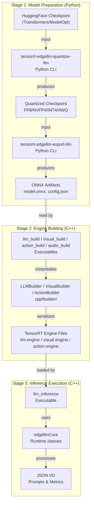
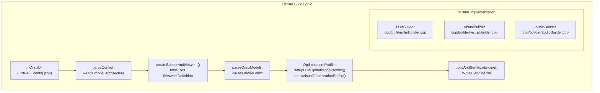

<!-- source: DeepWiki mcp.deepwiki.com · repo NVIDIA/TensorRT-Edge-LLM · page 3 Model Deployment Workflow · fetched 2026-10-26 -->

# Model Deployment Workflow

Relevant source files

The following files were used as context for generating this wiki page:

- [cpp/builder/llmBuilder.cpp](cpp/builder/llmBuilder.cpp)
- [cpp/builder/llmBuilder.h](cpp/builder/llmBuilder.h)
- [cpp/builder/visualBuilder.cpp](cpp/builder/visualBuilder.cpp)

This document provides a comprehensive overview of the end-to-end process for deploying Large Language Models (LLMs), Vision-Language Models (VLMs), and Action models on NVIDIA edge platforms using TensorRT-Edge-LLM. The workflow spans from downloading HuggingFace model checkpoints to executing inference on target devices.

For detailed information on specific components:
- Python-based model preparation: see [Python Export Pipeline](#3.1)
- TensorRT engine creation: see [Engine Building](#3.2)
- Runtime execution details: see [Running Inference](#3.3)

---

## Overview

The deployment workflow is divided into four main stages executed sequentially:

1.  **Model Quantization**: Reduce model precision (FP16/FP8/NVFP4/INT4) to optimize for edge hardware constraints.
2.  **ONNX Export**: Convert quantized models from HuggingFace format to ONNX intermediate representation.
3.  **Engine Building**: Compile ONNX models into optimized TensorRT engines with optimization profiles.
4.  **Inference Execution**: Load engines and run inference with JSON-based I/O.

The first two stages use Python tools and typically run on an x86 development host with a GPU. Engine building and inference execute on target edge devices (Jetson/DRIVE).

**Sources**: [cpp/builder/llmBuilder.cpp:121-179](), [cpp/builder/visualBuilder.cpp:44-77]()

---

## Deployment Pipeline Architecture

**Diagram 1**: Complete deployment pipeline showing the progression from HuggingFace checkpoints to running inference.

**Sources**: [cpp/builder/llmBuilder.cpp:165-183](), [cpp/builder/visualBuilder.cpp:71-77]()

---

## Stage 1: Model Preparation (Python)

The Python export pipeline transforms HuggingFace models into ONNX format suitable for TensorRT compilation.

### Quantization

The `tensorrt-edgellm-quantize-llm` command reduces model precision to optimize memory footprint and performance. Supported precision types include:

| Precision | Description |
|-----------|-------------|
| **FP16** | Half precision baseline |
| **FP8** | 8-bit floating point for balanced performance |
| **NVFP4** | NVIDIA 4-bit float for maximum compression |
| **INT4** | 4-bit integer (GPTQ/AWQ) |

**Sources**: [cpp/builder/llmBuilder.h:48](), [cpp/builder/llmBuilder.cpp:193-205]()

### ONNX Export

The `tensorrt-edgellm-export-llm` command converts the quantized model to ONNX. This process produces `model.onnx` and a `config.json` that includes architecture parameters like `hidden_size`, `num_attention_heads`, and `num_key_value_heads`. For LoRA-enabled models, it generates `lora_model.onnx`.

**Sources**: [cpp/builder/llmBuilder.cpp:167-176](), [cpp/builder/llmBuilder.h:47]()

---

## Stage 2: Engine Building (C++)

TensorRT engine building compiles ONNX models into optimized execution graphs. This is handled by specialized builder classes in the `trt_edgellm::builder` namespace.

**Diagram 2**: Engine building process orchestrated by `LLMBuilder` and `VisualBuilder`.

**Sources**: [cpp/builder/llmBuilder.cpp:121-163](), [cpp/builder/visualBuilder.cpp:44-99]()

### Optimization Profiles

TensorRT engines support dynamic shapes through optimization profiles. The builder creates profiles for different execution phases:

-   **LLM Profiles**: Configured via `setupLLMOptimizationProfiles`, these handle the context (prefill) and generation (decode) phases, supporting parameters like `maxBatchSize` and `maxInputLen`. [cpp/builder/llmBuilder.cpp:126-130]()
-   **Visual Profiles**: Configured via `setupVisualOptimizationProfile`, these handle image inputs for VLMs, supporting varying image dimensions (e.g., `mImageSizeH`, `mImageSizeW`). [cpp/builder/visualBuilder.cpp:96-99]()

### Builder Configuration

The builder classes use configuration structures (`LLMBuilderConfig`, `VisualBuilderConfig`) to define build-time limits. For example, `LLMBuilderConfig` tracks `maxKVCacheCapacity` and `maxKVPoolPages` for paged KV-cache management.

**Sources**: [cpp/builder/llmBuilder.h:41-54](), [cpp/builder/llmBuilder.cpp:141-156]()

---

## Stage 3: Inference Execution (C++)

The `llm_inference` executable loads the generated `.engine` files and executes inference.

### Execution Modes

-   **Standard LLM**: Loads `model.engine` (or `lora_model.engine`). [cpp/builder/llmBuilder.cpp:167-176]()
-   **Speculative Decoding**: Loads specialized engines for strategies like `eagle3`, `mtp`, `dflash`, `dspark`, or `gemma4_mtp`. The builder identifies these via `spec_decode_type` in `config.json`. [cpp/builder/llmBuilder.cpp:46-70]()
-   **Multimodal (VLM/Audio)**: Loads `visual.engine` or `audio.engine` alongside the LLM engine. For models like Phi-4MM or Nemotron-Omni, the builder ensures required weights like `phi4mm_gn_proj.safetensors` or `nemotron_omni_embedder.safetensors` are present. [cpp/builder/visualBuilder.cpp:124-132]()

---

## Artifact Flow and File Organization

The workflow produces a structured engine directory containing everything needed for runtime:

-   **Engines**: `model.engine`, `visual.engine`, or `audio.engine`. [cpp/builder/llmBuilder.cpp:211](), [cpp/builder/visualBuilder.cpp:135]()
-   **Configs**: `config.json` containing model metadata and `edgellm_version`. [cpp/builder/llmBuilder.cpp:136-140](), [cpp/builder/visualBuilder.cpp:159-160]()
-   **Specialized Weights**: modality-specific artifacts such as `phi4mm_gn_proj.safetensors`. [cpp/builder/visualBuilder.cpp:124-127]()

**Sources**: [cpp/builder/llmBuilder.cpp:207-213](), [cpp/builder/visualBuilder.cpp:134-148]()

---

