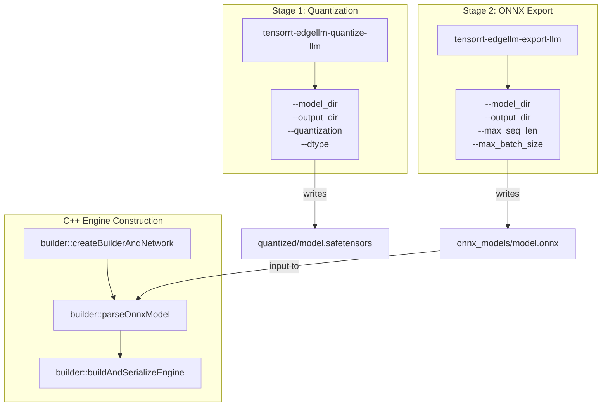
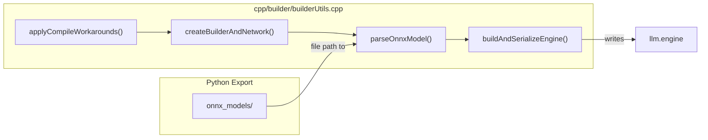

<!-- source: DeepWiki mcp.deepwiki.com · repo NVIDIA/TensorRT-Edge-LLM · page 3.1 Python Export Pipeline · fetched 2026-10-26 -->

# Python Export Pipeline

<details>
<summary>Relevant source files</summary>

The following files were used as context for generating this wiki page:

- [cpp/builder/builderUtils.cpp](cpp/builder/builderUtils.cpp)
- [cpp/builder/builderUtils.h](cpp/builder/builderUtils.h)

</details>


## Purpose and Scope

The Python Export Pipeline is the model preparation phase of TensorRT Edge-LLM, responsible for converting HuggingFace models into optimized ONNX format suitable for edge deployment. This document provides an overview of the two-stage pipeline: quantization and ONNX export, including both the standard script-based flow and the experimental `llm_loader` path.

For detailed information on specific stages:
- Quantization options and configuration: see [Model Quantization](#3.1.1)
- ONNX export process and model-specific handling: see [ONNX Export](#3.1.2)
- Engine building from exported ONNX files: see [Engine Building](#3.2)
- Advanced checkpoint loading and model registry: see [AutoModel and Model Registry](#4.5.1)

This pipeline runs on **x86_64 Linux hosts with GPU** during the development/preparation phase. The generated ONNX artifacts are then transferred to edge devices for engine building and inference.

**Sources**: [.github/ISSUE_TEMPLATE/2_bug_report_export.md:31-33](), [cpp/builder/builderUtils.h:97-102]()

---

## Pipeline Overview

The Python Export Pipeline transforms pretrained HuggingFace models into TensorRT-compatible ONNX format through a two-stage process. This separation allows for flexible quantization strategies while maintaining clean model conversion logic.

```mermaid
graph LR
    HF["HuggingFace Model<br/>(e.g., Qwen/Qwen3-0.6B)"]
    QUANT["tensorrt-edgellm-quantize-llm"]
    QUANTIZED["Quantized Checkpoint<br/>(safetensors)"]
    EXPORT["tensorrt-edgellm-export-llm"]
    ONNX["ONNX Models<br/>(model.onnx)"]
    BUILDER["builder::buildAndSerializeEngine"]
    
    HF -->|"download"| QUANT
    QUANT -->|"FP8/NVFP4/INT4"| QUANTIZED
    QUANTIZED -->|"model_dir"| EXPORT
    EXPORT -->|"graph surgery"| ONNX
    ONNX -->|"parsed by"| BUILDER
```



**Pipeline Stages:**

| Stage | Command | Input | Output | Purpose |
|-------|---------|-------|--------|---------|
| **Quantization** | `tensorrt-edgellm-quantize-llm` | HuggingFace model directory | Quantized checkpoint directory | Apply precision reduction (FP8, NVFP4, INT4) using NVIDIA ModelOpt |
| **ONNX Export** | `tensorrt-edgellm-export-llm` | Quantized checkpoint directory | ONNX model files | Convert PyTorch model to ONNX with TensorRT-compatible graph structure |

**Sources**: [.github/ISSUE_TEMPLATE/2_bug_report_export.md:19-24](), [cpp/builder/builderUtils.h:97-111]()

---

## Command-Line Interface

The pipeline is accessed through Python entry points installed as console scripts. These scripts facilitate the transition from Natural Language/HuggingFace space into the structured ONNX files required by the C++ `builder` utilities. The underlying C++ utilities also support JSON-based configuration management [cpp/builder/builderUtils.h:113-125]().



**Typical Usage Example:**

```bash
# Stage 1: Quantize a HuggingFace model to FP8
tensorrt-edgellm-quantize-llm \
    --model_dir Qwen/Qwen3-0.6B \
    --output_dir ./quantized/qwen3-0.6b \
    --quantization fp8

# Stage 2: Export quantized model to ONNX
tensorrt-edgellm-export-llm \
    --model_dir ./quantized/qwen3-0.6b \
    --output_dir ./onnx_models/qwen3-0.6b
```

**Sources**: [.github/ISSUE_TEMPLATE/2_bug_report_export.md:19-24](), [cpp/builder/builderUtils.cpp:97-111](), [cpp/builder/builderUtils.h:88-95]()

---

## Quantization Stage Summary

The quantization stage applies precision reduction to model weights and activations. This stage leverages NVIDIA ModelOpt for calibration and quantization. The C++ builder supports these precisions by parsing metadata and applying specific workarounds for advanced formats like NVFP4 [cpp/builder/builderUtils.cpp:63-74]().

**Supported Quantization Schemes:**

| Scheme | Description | Typical Use Case |
|--------|-------------|------------------|
| **FP8** | 8-bit floating point | Balanced accuracy/performance for most models |
| **NVFP4** | NVIDIA 4-bit floating point | Aggressive compression for Blackwell-based platforms |
| **INT4** | 4-bit integer quantization | High compression for memory-constrained devices |
| **INT4_GPTQ** | GPTQ-style 4-bit quantization | Support for existing pre-quantized checkpoints |

The quantization process produces a modified model checkpoint containing quantized weights and an updated `config.json` containing metadata like `model_type` and `embd_layer` [cpp/builder/builderUtils.h:34-38]().

**Sources**: [.github/ISSUE_TEMPLATE/2_bug_report_export.md:22-22](), [cpp/builder/builderUtils.cpp:70-74](), [cpp/builder/builderUtils.h:113-117]()

---

## ONNX Export Stage Summary

The ONNX export stage converts PyTorch models to ONNX format with TensorRT-specific optimizations. It handles complex graph structures and prepares the model for the C++ builder utilities.

**Key Export Features:**
- **AttentionPlugin Integration**: Replaces standard attention blocks with optimized TensorRT plugins.
- **Dynamic Shapes**: Configures inputs for variable sequence lengths and batch sizes, which are validated via `checkOptimizationProfileDims` [cpp/builder/builderUtils.cpp:112-131]().
- **Multimodal Support**: For VLMs, this stage exports both the visual encoder and the language model, identifying components via keys like `vision_config` and `image_embd_layer` [cpp/builder/builderUtils.h:35-38]().

The C++ builder utilities parse these ONNX files and apply necessary compile-time workarounds for stability and performance [cpp/builder/builderUtils.cpp:52-86]().

**Sources**: [cpp/builder/builderUtils.cpp:101-102](), [cpp/builder/builderUtils.cpp:141-152](), [cpp/builder/builderUtils.h:34-38]()

---

## Artifact Structure

The pipeline produces well-defined directory structures at each stage. The `builder` namespace utilities in the C++ SDK specifically look for these files during the engine build process.

**Stage 2 Output: ONNX Model Directory**

```
onnx_models/qwen3-0.6b/
├── model.onnx                 # Primary ONNX graph (parsed by parseOnnxModel)
├── config.json                # Model metadata (loaded via loadJsonConfig)
├── tokenizer.json             # Tokenizer config
└── [additional files]
```

**C++ SDK Interaction with Artifacts:**
- `builder::loadJsonConfig()`: Reads `config.json` to extract model parameters [cpp/builder/builderUtils.h:113-117]().
- `builder::parseOnnxModel()`: Loads `model.onnx` into the TensorRT network definition [cpp/builder/builderUtils.h:97-102]().
- `builder::saveConfigWithBuilderInfo()`: Saves the final configuration alongside the engine [cpp/builder/builderUtils.h:119-125]().
- `builder::applyCompileWorkarounds()`: Sets environment variables like `__LUNOWUD` based on the target precision and batch size before building [cpp/builder/builderUtils.cpp:52-86]().

**Sources**: [cpp/builder/builderUtils.cpp:101-102](), [cpp/builder/builderUtils.h:113-117](), [cpp/builder/builderUtils.h:119-125](), [cpp/builder/builderUtils.cpp:81-85]()

---

## System Requirements

The Python Export Pipeline has specific requirements distinct from the edge deployment targets.

| Requirement | Specification | Rationale |
|-------------|--------------|-----------|
| **CPU Architecture** | x86_64 | Required for ModelOpt and CUDA-based export tools |
| **Operating System** | Linux (Ubuntu 22.04+) | Native PyTorch and TensorRT support |
| **GPU** | NVIDIA (H100, A100, RTX 4090, etc.) | Required for quantization calibration |
| **Software** | Python 3.8+, PyTorch, Transformers, ModelOpt | Core export stack |

**Sources**: [.github/ISSUE_TEMPLATE/2_bug_report_export.md:28-43]()

---

## Integration with Engine Building

The ONNX files produced by the export pipeline serve as input to the engine building process. The C++ `builder` utilities coordinate the transition from ONNX to a serialized TensorRT engine.



**Workflow Integration:**
1. **Export**: Run Python scripts on an x86 host to generate the ONNX directory.
2. **Transfer**: Move the directory to the target edge platform.
3. **Build**: Use `buildAndSerializeEngine()` to generate the optimized engine file [cpp/builder/builderUtils.h:110-111]().

**Sources**: [cpp/builder/builderUtils.h:82-86](), [cpp/builder/builderUtils.h:88-95](), [cpp/builder/builderUtils.h:110-111]()

---

