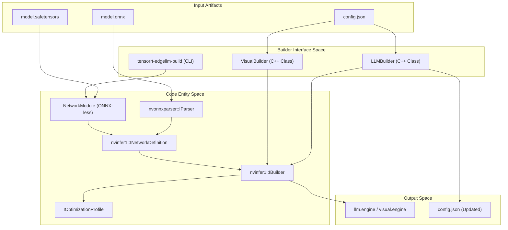
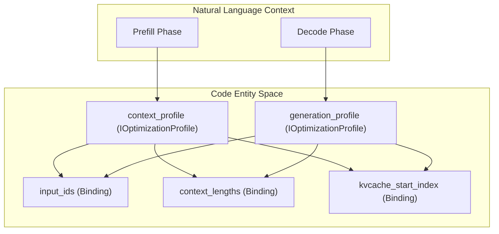

<!-- source: DeepWiki mcp.deepwiki.com · repo NVIDIA/TensorRT-Edge-LLM · page 3.2 Engine Building · fetched 2026-10-26 -->

# Engine Building

Relevant source files

The following files were used as context for generating this wiki page:

- [cpp/builder/llmBuilder.cpp](cpp/builder/llmBuilder.cpp)
- [cpp/builder/llmBuilder.h](cpp/builder/llmBuilder.h)
- [cpp/builder/visualBuilder.cpp](cpp/builder/visualBuilder.cpp)
- [cpp/builder/visualBuilder.h](cpp/builder/visualBuilder.h)

## Purpose and Scope

This document covers the TensorRT engine building process in TensorRT-Edge-LLM, which converts ONNX model files or direct checkpoints into optimized TensorRT engine files for inference on edge devices. Engine building is the bridge between model export (see [Python Export Pipeline](#3.1)) and inference execution (see [Running Inference](#3.3)).

The SDK supports two primary building paths:
1.  **Standard ONNX Path**: Uses specialized builder classes like `LLMBuilder` and `VisualBuilder` to parse ONNX models and compile them via the TensorRT C++ API.
2.  **Experimental ONNX-less Path**: Introduced in version 0.10.0, this path builds engines directly from checkpoints using a C++-based model definition API (`NetworkModule`), bypassing the ONNX export step for faster iterations.

For detailed documentation, see [LLM Engine Builder](#3.2.1), [Visual, Audio, and Action Engine Builders](#3.2.2), and [Experimental ONNX-less Builder](#3.2.3).

**Sources:** [cpp/builder/llmBuilder.cpp:121-183](), [cpp/builder/llmBuilder.h:38-54]()

## Overview

Engine building transforms model definitions into TensorRT engines through the following steps:

1.  **Model Definition**: Load and parse ONNX model files using TensorRT's ONNX parser, or define the network graph directly using the `NetworkModule` API.
2.  **Optimization Profile Setup**: Define dynamic input shapes for different execution phases, such as context (prefill) and generation (decode).
3.  **Engine Compilation**: Build serialized TensorRT engines with specified optimizations, including precision (FP16, FP8, INT4) and kernel fusions.
4.  **Artifact Generation**: Copy configuration files, tokenizer files, and auxiliary data (like LoRA weights or speculative decoding artifacts) to the engine directory.

The process produces self-contained engine directories that include the compiled TensorRT engine, model configuration, and all necessary runtime metadata.

**Sources:** [cpp/builder/llmBuilder.cpp:158-243](), [cpp/builder/builderUtils.cpp:98-105]()

## Builder Architecture

**Diagram: Builder Class Architecture and Code Entities**

The builder system uses specialized classes that share a common structure:

| Builder Class | Purpose | ONNX Input | Engine Output |
| :--- | :--- | :--- | :--- |
| `LLMBuilder` | Text-based language models | `model.onnx` or `lora_model.onnx` | `llm.engine`, `draft.engine`, or `base.engine` |
| `VisualBuilder` | Vision encoders for VLMs | `model.onnx` | `visual.engine` |
| `AudioBuilder` | Audio encoders (e.g. Qwen3-ASR) | `model.onnx` | `audio.engine` |
| `ActionBuilder` | Trajectory/Action models | `model.onnx` | `action.engine` |

Key TensorRT interfaces used include:
*   `nvinfer1::IBuilder`: Creates network definitions and builds engines [cpp/builder/builderUtils.h:84-89]().
*   `nvinfer1::INetworkDefinition`: Represents the neural network graph [cpp/builder/builderUtils.h:84-84]().
*   `nvonnxparser::IParser`: Parses ONNX files into TensorRT networks [cpp/builder/builderUtils.h:91-96]().
*   `nvinfer1::IBuilderConfig`: Specifies build-time configuration and optimization settings [cpp/builder/builderUtils.h:89-89]().
*   `nvinfer1::IOptimizationProfile`: Defines dynamic input shape ranges [cpp/builder/builderUtils.cpp:85-96]().

**Sources:** [cpp/builder/llmBuilder.h:147-171](), [cpp/builder/builderUtils.h:84-105](), [cpp/builder/visualBuilder.h:103-123]()

## Build Configuration

Builder classes accept configuration structures that control engine building.

### LLMBuilderConfig
The `LLMBuilderConfig` structure [cpp/builder/llmBuilder.h:41-80]() controls parameters such as `maxBatchSize`, `maxInputLen`, and `maxKVCacheCapacity`. It also manages speculative decoding parameters like `maxVerifyTreeSize` and `maxDraftTreeSize`.

### VisualBuilderConfig
The `VisualBuilderConfig` structure [cpp/builder/visualBuilder.h:39-98]() handles VLM-specific parameters, including `maxImageTokens` and the choice of using TRT native ViT attention via `useTrtNativeVitAttn`.

### Speculative Decoding Roles
The builder supports different engine roles for speculative decoding strategies like EAGLE3, MTP, DFlash, and DSpark. These are identified via `spec_decode_type` and `engine_role` in the model configuration [cpp/builder/llmBuilder.cpp:46-75]().

**Sources:** [cpp/builder/llmBuilder.h:41-103](), [cpp/builder/visualBuilder.h:39-59](), [cpp/builder/llmBuilder.cpp:46-75]()

## Optimization Profiles

TensorRT engines require optimization profiles to handle dynamic input shapes. The builder creates distinct profiles for LLM inference:

**Diagram: Optimization Profile Mapping to Runtime Phases**

*   **Context Profile**: Optimized for variable-length input sequences (up to `maxInputLen`) during initial prompt processing.
*   **Generation Profile**: Optimized for single-token inputs during autoregressive decoding.

**Sources:** [cpp/builder/llmBuilder.cpp:237-240](), [cpp/builder/builderUtils.cpp:151-182]()

### Paged KV Cache Configuration
A critical part of the build process is configuring the physical Paged KV Cache pool. The builder calculates the required number of pages based on `maxBatchSize` and `maxKVCacheCapacity` using `rt::computeMinimumKvPoolPages` [cpp/builder/llmBuilder.h:66-70](). This pool size is then serialized into the engine binding shapes.

**Sources:** [cpp/builder/llmBuilder.h:59-79](), [cpp/builder/llmBuilder.cpp:141-156]()

## Build Workflow

The build process executes these steps in order:

1.  **Plugin Loading**: Load `libedgellm_plugin.so` to register custom kernels like `AttentionPlugin` and `MambaPlugin` [cpp/builder/llmBuilder.cpp:133-133]().
2.  **Configuration Parsing**: Read `config.json` to extract model architecture parameters [cpp/builder/llmBuilder.cpp:136-139]().
3.  **Builder Creation**: Instantiate TensorRT builder and network objects [cpp/builder/llmBuilder.cpp:159-163]().
4.  **Model Loading**: 
    *   **ONNX Path**: Parse ONNX model file into the network definition [cpp/builder/llmBuilder.cpp:178-183]().
    *   **ONNX-less Path**: Use the `NetworkModule` registry to build the graph directly [experimental/builder/build_llm.cpp]().
5.  **Profile Setup**: Configure optimization profiles for dynamic input shapes [cpp/builder/llmBuilder.cpp:237-240]().
6.  **Engine Building**: Compile the network into a serialized engine [cpp/builder/builderUtils.cpp:98-105]().
7.  **Artifact Generation**: Write engine file and save updated configuration with builder info [cpp/builder/builderUtils.cpp:113-119]().

**Sources:** [cpp/builder/llmBuilder.cpp:121-243](), [cpp/builder/builderUtils.cpp:84-122]()

## Utility Functions

The builder implementation includes several utility functions for common operations:

| Function | Purpose | Location |
| :--- | :--- | :--- |
| `createDims()` | Convert vector to `nvinfer1::Dims` | [cpp/builder/builderUtils.cpp:35-49]() |
| `checkOptimizationProfileDims()` | Validate profile dimension constraints | [cpp/builder/builderUtils.cpp:56-75]() |
| `setOptimizationProfile()` | Set min/opt/max dimensions on profile | [cpp/builder/builderUtils.cpp:85-96]() |
| `printNetworkInfo()` | Debug output of network inputs/outputs | [cpp/builder/builderUtils.cpp:102-143]() |
| `buildAndSerializeEngine()` | High-level wrapper for TRT engine build | [cpp/builder/builderUtils.cpp:98-105]() |

**Sources:** [cpp/builder/builderUtils.cpp:31-232]()

---

