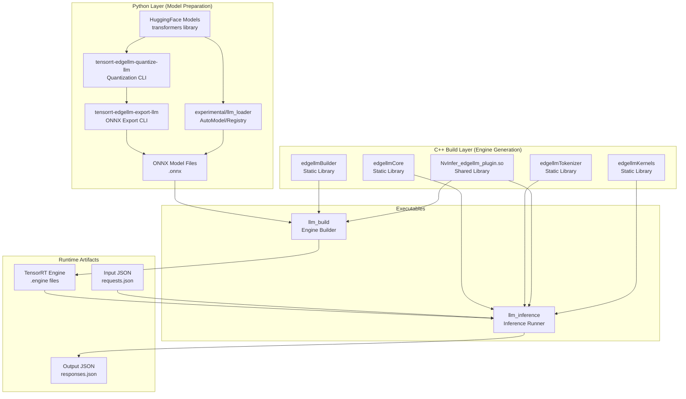
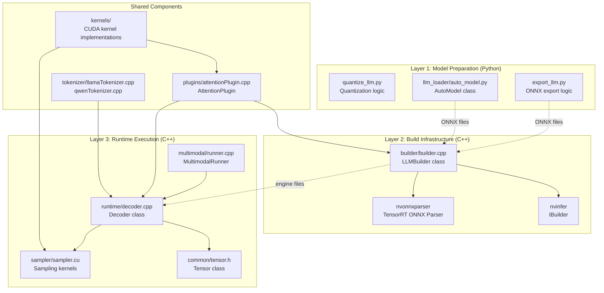
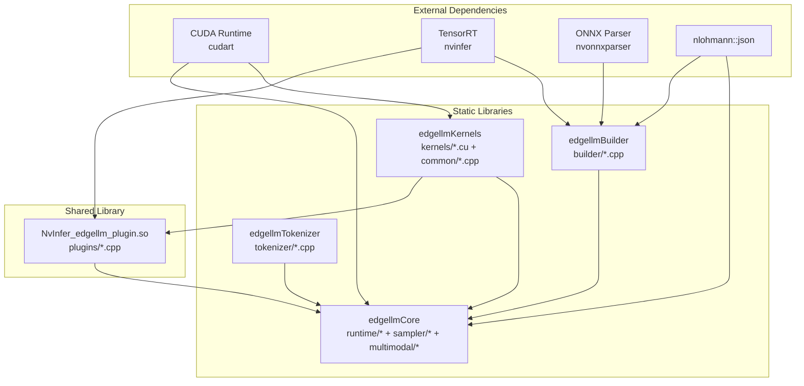
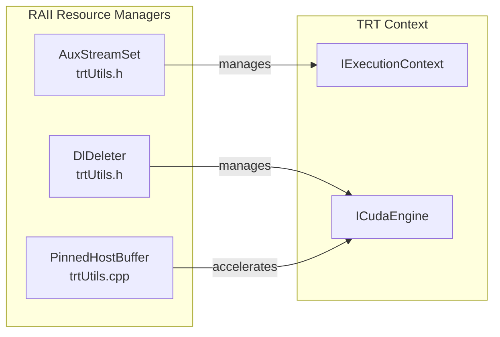
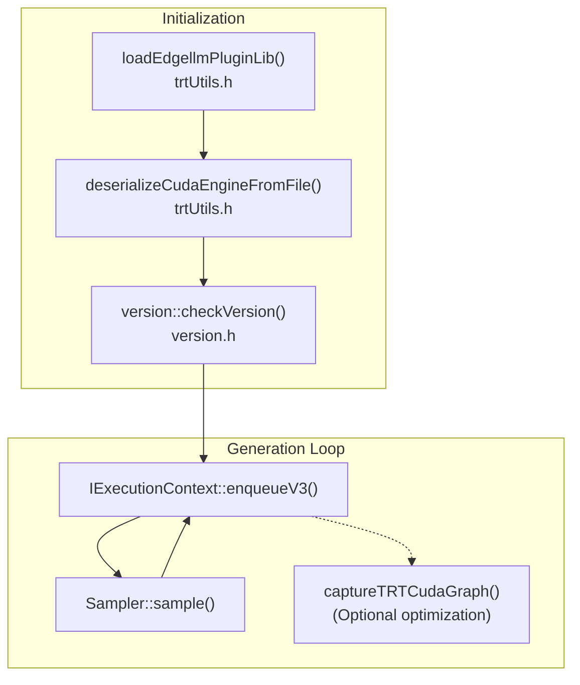

<!-- source: DeepWiki mcp.deepwiki.com · repo NVIDIA/TensorRT-Edge-LLM · page 4 Architecture · fetched 2026-10-26 -->

# Architecture

Relevant source files

The following files were used as context for generating this wiki page:

- [.github/CODEOWNERS](.github/CODEOWNERS)
- [cpp/CMakeLists.txt](cpp/CMakeLists.txt)

## Purpose and Scope

This document provides a comprehensive overview of the TensorRT-Edge-LLM system architecture, describing the major components and their interactions. The architecture spans from Python-based model preparation through C++ runtime execution on edge devices, optimized for NVIDIA platforms such as Jetson and DRIVE.

For detailed information on specific components:
- Python-to-C++ deployment flow: see [System Overview](#4.1)
- C++ library internals (edgellmCore, edgellmKernels, etc.): see [C++ Core Libraries](#4.2)
- Runtime execution, memory management, and KV cache: see [Runtime Components](#4.3)
- Custom TensorRT layers (Attention, Mamba, MoE): see [TensorRT Plugins](#4.4)
- Experimental loader and server: see [Experimental LLM Loader](#4.5)

---

## Architectural Overview

The TensorRT-Edge-LLM system follows a two-stage deployment architecture: **offline model preparation** and **online inference execution**.

### Deployment Pipeline

**Sources:** [cpp/common/trtUtils.h:60-92](), [cpp/common/version.h:28-34](), [cpp/CMakeLists.txt:62-120]()

The pipeline separates **model preparation** (flexible Python environment) from **inference execution** (optimized C++ runtime). This design enables model conversion on development hosts while inference runs on resource-constrained edge devices.

---

## Component Layers

The system is organized into distinct layers, each with specific responsibilities.

### Layer Architecture

**Sources:** [cpp/common/trtUtils.h:96-97](), [cpp/common/trtUtils.h:181-182](), [cpp/CMakeLists.txt:101-106]()

---

## C++ Library Dependencies

The C++ codebase is organized into four static libraries and one shared library to manage dependencies and visibility.

### Library Dependency Graph

**Sources:** [cpp/common/trtUtils.h:20-30](), [cpp/common/trtUtils.cpp:18-34](), [cpp/CMakeLists.txt:62-120]()

### Library Composition

| Library | Purpose | Key Symbols |
|---------|---------|-------------|
| `edgellmKernels` | Low-level CUDA kernels (FMHA, MoE, Mamba) and base utilities. | `captureTRTCudaGraph` [cpp/common/trtUtils.h:96](), `cudaUtils.h` |
| `edgellmTokenizer` | Text tokenization for supported model families (Llama, Qwen). | `llamaTokenizer.cpp`, `qwenTokenizer.cpp` |
| `edgellmBuilder` | Engine building logic using `nvonnxparser`. | `deserializeCudaEngineFromFile` [cpp/common/trtUtils.h:181]() |
| `edgellmCore` | High-level runtime orchestration, including samplers and multimodal runners. | `AuxStreamSet` [cpp/common/trtUtils.h:102](), `version::checkVersion` [cpp/common/version.h:34]() |
| `NvInfer_edgellm_plugin` | Shared library for custom TensorRT layers required by the engine. | `initEdgellmPlugins` [cpp/common/trtUtils.h:85](), `DlDeleter` [cpp/common/trtUtils.h:39]() |

**Sources:** [cpp/CMakeLists.txt:62-120]()

---

## Key Design Patterns

### Runtime Resource Management

The system utilizes specialized RAII classes to manage complex TensorRT and CUDA resources, ensuring safe lifecycle management on edge devices.

**Sources:** [cpp/common/trtUtils.h:39-50](), [cpp/common/trtUtils.h:102-157](), [cpp/common/trtUtils.cpp:56-153]()

- **`DlDeleter`**: Handles proper cleanup of dynamically loaded plugin libraries using `dlclose` with `RTLD_NODELETE` to avoid teardown crashes [cpp/common/trtUtils.h:74-76]().
- **`AuxStreamSet`**: Manages non-blocking auxiliary streams for `IExecutionContext::setAuxStreams()`, ensuring they outlive the context [cpp/common/trtUtils.h:99-102]().
- **`PinnedHostBuffer`**: Facilitates efficient engine deserialization by managing pinned memory and CUDA events for asynchronous transfers [cpp/common/trtUtils.cpp:59-81]().

### Optimized Engine Loading

The `FileStreamReaderV2` implementation enables deserializing TensorRT engine plans from disk without mapping the entire plan into process memory, which is critical for memory-constrained edge devices [cpp/common/trtUtils.h:181-182](). It uses a chunked transfer mechanism via `PinnedHostBuffer` to stream data to the device [cpp/common/trtUtils.cpp:160-162]().

---

## Execution Flow

### Inference Pipeline

The execution flow starts from engine deserialization and moves through tokenization to the autoregressive generation loop.

**Sources:** [cpp/common/trtUtils.h:60-97](), [cpp/common/version.h:34]()

For details on how these components interact in specific scenarios, see the child pages:
- [System Overview](#4.1)
- [C++ Core Libraries](#4.2)
- [Runtime Components](#4.3)
- [TensorRT Plugins](#4.4)
- [Experimental LLM Loader](#4.5)

---

