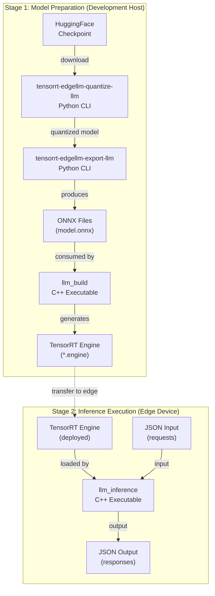
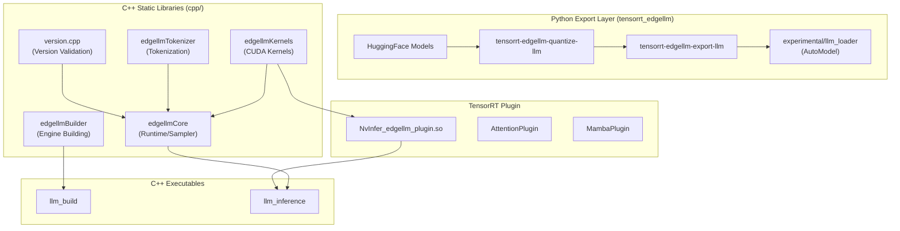
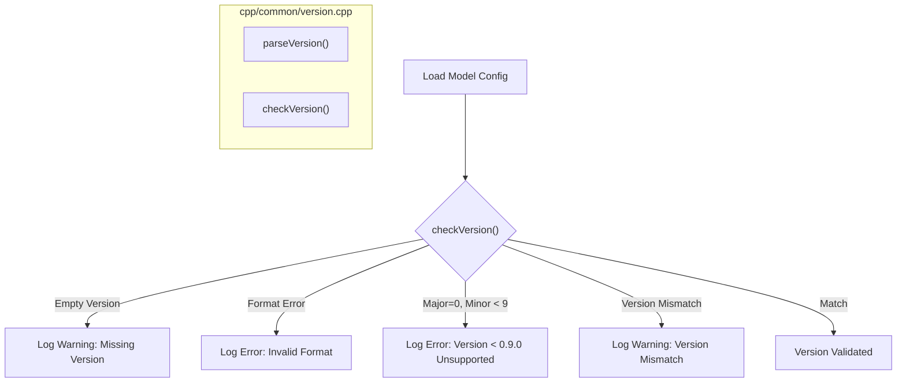
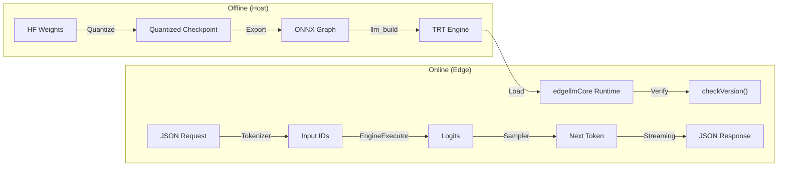

<!-- source: DeepWiki mcp.deepwiki.com · repo NVIDIA/TensorRT-Edge-LLM · page 4.1 System Overview · fetched 2026-10-26 -->

# System Overview

Relevant source files

The following files were used as context for generating this wiki page:

- [.github/CODEOWNERS](.github/CODEOWNERS)
- [cpp/common/version.cpp](cpp/common/version.cpp)
- [cpp/common/version.h](cpp/common/version.h)

## Purpose and Scope

This page describes the high-level architecture of TensorRT-Edge-LLM, explaining how the Python export pipeline, C++ libraries, and inference runtime work together to enable LLM and VLM deployment on NVIDIA edge platforms. It covers the end-to-end flow from HuggingFace model checkpoints to production inference on Jetson, DRIVE, and DGX Spark devices.

TensorRT-Edge-LLM is optimized for resource-constrained environments, providing a C++ inference runtime that supports state-of-the-art features like **Gemma 4** multimodal processing (text, image, audio), **NVFP4** precision for Nemotron-3, and **DFlash** speculative decoding. The project maintains versioning to ensure compatibility between exported models and the runtime environment [cpp/common/version.h:28-34]().

For detailed information about specific components:
- C++ library internals: see [C++ Core Libraries](#4.2)
- Runtime execution and memory management: see [Runtime Components](#4.3)
- Custom TensorRT layers: see [TensorRT Plugins](#4.4)
- Python export commands and options: see [Python Export Pipeline](#3.1)
- Engine building configuration: see [Engine Building](#3.2)

---

## Two-Stage Deployment Architecture

TensorRT-Edge-LLM follows a two-stage deployment model that separates model conversion from inference execution. This design enables offline optimization on development hosts while keeping the runtime lightweight for edge devices.

### Deployment Pipeline Diagram

**Stage 1: Model Preparation** runs on x86_64 or ARM64 development machines. Python tools perform quantization (FP8, NVFP4, INT4) and ONNX export. The `llm_build` C++ tool then compiles these into optimized TensorRT engines.

**Stage 2: Inference Execution** runs on edge platforms (Jetson Thor, Jetson Orin, NVIDIA DRIVE). The `llm_inference` executable processes requests and responses in JSON format.

---

## Complete System Architecture

The system is modularized into specialized C++ libraries and a shared plugin library for TensorRT. The codebase is organized into distinct ownership areas for C++, Python, and build configurations [.github/CODEOWNERS:1-18]().

### Code Entity Association Diagram

**Sources:** [.github/CODEOWNERS:1-18](), [cpp/common/version.cpp:18-20]()

---

## C++ Core Libraries

The C++ backend is organized into static libraries to optimize binary size and maintainability.

### Library Responsibilities

| Library | Key Responsibilities | Source Path |
|---------|----------------------|-------------|
| `edgellmKernels` | CUDA kernels for FMHA, XQA, MoE, and SSD. Includes CuTe DSL generated kernels. | `cpp/kernels/` |
| `edgellmTokenizer` | Text tokenization for Llama, Qwen, and specialized multimodal models. | `cpp/tokenizer/` |
| `edgellmBuilder` | Interface for `nvonnxparser` and TensorRT engine generation. | `cpp/builder/` |
| `edgellmCore` | Orchestrates runtime, `Sampler`, multimodal processing (vision/audio), and `EngineExecutor`. | `cpp/core/` |
| `NvInfer_edgellm_plugin` | Shared library for custom TensorRT layers (Attention, Mamba, GatedDeltaNet). | `cpp/plugins/` |
| `edgellmVersion` | Validates compatibility between model versions and runtime [cpp/common/version.cpp:73-108](). | `cpp/common/version.cpp` |

**Sources:** [cpp/common/version.h:28-34](), [cpp/common/version.cpp:73-108]()

---

## Versioning and Compatibility

To ensure system stability, the runtime performs strict version checking when loading models. The current runtime version is tracked via `kRUNTIME_VERSION` [cpp/common/version.h:28-28]().

### Version Validation Flow

The system specifically rejects models exported with versions earlier than `0.9.0` to ensure compatibility with modern features like paged KV-cache and multimodal runners [cpp/common/version.cpp:92-99]().

**Sources:** [cpp/common/version.h:28-34](), [cpp/common/version.cpp:34-70](), [cpp/common/version.cpp:73-119]()

---

## Data Flow: From Checkpoint to Token

**Sources:** [cpp/common/version.cpp:73-108](), [cpp/common/version.h:28-28]()

---

