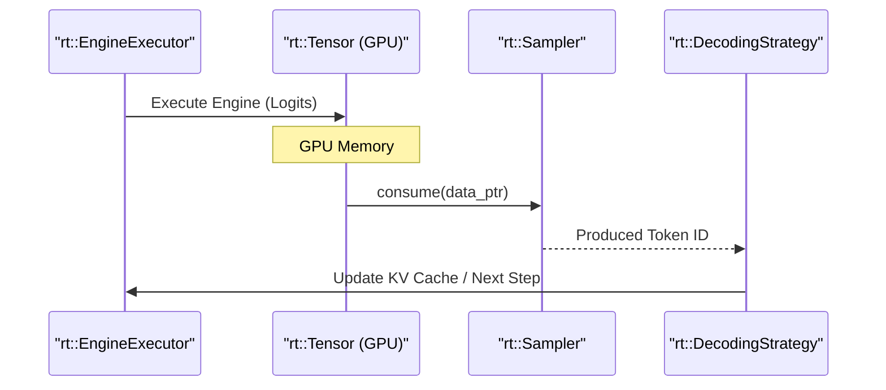

<!-- source: DeepWiki mcp.deepwiki.com · repo NVIDIA/TensorRT-Edge-LLM · page 4.3 Runtime Components · fetched 2026-10-26 -->

# Runtime Components

<details>
<summary>Relevant source files</summary>

The following files were used as context for generating this wiki page:

- [cpp/common/hashUtils.h](cpp/common/hashUtils.h)
- [cpp/common/pagedKvTypes.h](cpp/common/pagedKvTypes.h)
- [cpp/common/tensor.cpp](cpp/common/tensor.cpp)
- [cpp/common/tensor.h](cpp/common/tensor.h)

</details>


## Purpose and Scope

This page documents the runtime architecture and components responsible for executing LLM inference on edge devices. The runtime system manages memory, coordinates TensorRT engine execution, performs token sampling, and handles the inference pipeline from input to output. 

The core of the runtime is built around the `edgellmCore` library, which provides the foundational `Tensor` class for memory management, the `ContextCacheManager` for KV-cache reuse, and the `EngineExecutor` for orchestrating model execution.

**Sources:** [cpp/common/tensor.h:35-45](), [cpp/common/tensor.cpp:27-30](), [cpp/common/pagedKvTypes.h:23-27]()

---

## Runtime Architecture Overview

The runtime system implements a consumer-producer design pattern centered around the `Tensor` class. The architecture consists of several cooperating components that bridge the gap between high-level inference requests and low-level CUDA execution.

### Natural Language to Code Entity Mapping
The following diagram maps high-level system concepts to their specific C++ class implementations and file locations.

```mermaid
graph TB
    subgraph "Application Layer"
        EXE["llm_inference Executable"]
    end
    
    subgraph "Core Runtime Entities (edgellmCore)"
        TENSOR["rt::Tensor<br/>cpp/common/tensor.h"]
        COORDS["rt::Coords<br/>cpp/common/tensor.h"]
        DEVICE["rt::DeviceType<br/>cpp/common/tensor.h"]
    end
    
    subgraph "Memory & Cache Management"
        CCM["rt::ContextCacheManager<br/>cpp/runtime/"]
        PKV["rt::kTOKENS_PER_PAGE<br/>cpp/common/pagedKvTypes.h"]
        HASH["hash_utils::hashCombine<br/>cpp/common/hashUtils.h"]
    end
    
    subgraph "Execution & Logic"
        EXECUTOR["rt::EngineExecutor<br/>cpp/runtime/"]
        DECODER["rt::DecodingStrategy<br/>cpp/runtime/"]
        SAMPLER["rt::Sampler<br/>cpp/sampler/"]
    end
    
    subgraph "External Integration"
        TRT["nvinfer1::ICudaEngine"]
        CUDA["CUDA Runtime API"]
    end
    
    EXE --> EXECUTOR
    EXECUTOR --> DECODER
    DECODER --> SAMPLER
    DECODER --> TENSOR
    EXECUTOR --> CCM
    CCM --> HASH
    TENSOR --> COORDS
    TENSOR --> DEVICE
    TENSOR --> TRT : "Binding addresses"
    TENSOR --> CUDA : "cudaMalloc/cudaFree"
```

**Sources:** [cpp/common/tensor.h:41-48](), [cpp/common/tensor.h:85-86](), [cpp/common/tensor.h:221-222](), [cpp/common/pagedKvTypes.h:27-30](), [cpp/common/hashUtils.h:40-45]()

---

## Memory Management and Paged KV Cache

The runtime employs a sophisticated memory management system to handle both general-purpose tensors and specialized KV caches for Transformer and Mamba models.

### Tensor Lifecycle and Memory Allocation
The `Tensor` class is the primary memory abstraction. It supports both owned memory (allocated via `cudaMalloc` or `cudaMallocHost`) and non-owned memory (reusing existing pointers). It automatically computes strides for linear memory layout [cpp/common/tensor.cpp:74-86]().

### Paged KV Cache and Context Reuse
For efficient memory utilization, the runtime uses a paged KV cache system.
- **Page Size**: Fixed at `kTOKENS_PER_PAGE = 128` [cpp/common/pagedKvTypes.h:27]().
- **Capacity Management**: Functions like `computeMaxPagesPerSeq` and `computeMinimumKvPoolPages` calculate the required pool size based on batch size and sequence length [cpp/common/pagedKvTypes.h:46-61]().
- **Context Reuse**: The `ContextCacheManager` uses `hash_utils::hashCombine` to generate unique keys for prompt prefixes, allowing the runtime to reuse KV blocks across multi-turn conversations [cpp/common/hashUtils.h:40-65]().

**Sources:** [cpp/common/tensor.h:221-235](), [cpp/common/tensor.cpp:144-175](), [cpp/common/pagedKvTypes.h:27-61](), [cpp/common/hashUtils.h:30-45]()

---

## Execution Flow and Data Handling

The runtime orchestrates the flow of data from input tensors through the TensorRT engine via the `EngineExecutor`.

### Data Flow: From Engine to Token
This diagram illustrates how the `Tensor` class acts as the data carrier between the TensorRT execution context and the sampling logic.



**Tensor Utilities:**
The runtime provides robust debugging tools in `tensorUtils.cpp`, including specialized formatting for `half`, `__nv_bfloat16`, and `fp8` [cpp/common/tensorUtils.cpp:82-135](), and a PyTorch-style tensor printer `buildStringRecursive` [cpp/common/tensorUtils.cpp:149-210]().

**Sources:** [cpp/common/tensorUtils.cpp:38-61](), [cpp/common/tensorUtils.cpp:149-160]()

---

## Key Components Summary

| Component | Code Entity | Role |
| :--- | :--- | :--- |
| **Memory Buffer** | `rt::Tensor` | Encapsulates `void* data` with shape and device info [cpp/common/tensor.h:221](). |
| **Shape Descriptor** | `rt::Coords` | Handles dimension math and TRT `Dims` conversion [cpp/common/tensor.h:85](). |
| **Cache Manager** | `rt::ContextCacheManager` | Manages paged KV-cache reuse and eviction. |
| **Hashing Utility** | `hash_utils::Hash` | Provides composite hashing for paged cache keys [cpp/common/hashUtils.h:57-65](). |
| **Execution Engine** | `rt::EngineExecutor` | Manages TRT execution contexts and CUDA graph capture. |
| **Type System** | `rt::utils::getTypeSize` | Maps `nvinfer1::DataType` to byte sizes [cpp/common/tensor.cpp:35](). |

For detailed information on specific components, see:
- [Tensor Memory Management](#4.3.1) — Deep dive into the Tensor class and consumer-producer design pattern.
- [Decoder and Sampler](#4.3.2) — Explain decoder component, sampler logic for token generation, and pluggable decoding strategies.
- [Paged KV-Cache Reuse](#4.3.3) — Document the ContextCacheManager system for paged KV-cache reuse across multi-turn LLM requests.

**Sources:** [cpp/common/tensor.h:41-48](), [cpp/common/tensor.h:221-225](), [cpp/common/tensor.cpp:35-40](), [cpp/common/pagedKvTypes.h:27-30](), [cpp/common/hashUtils.h:75-76]()

---

