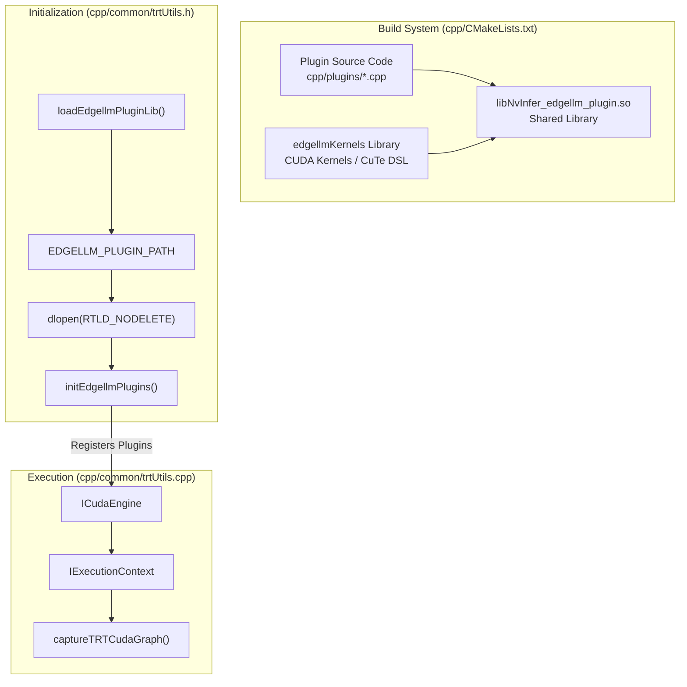
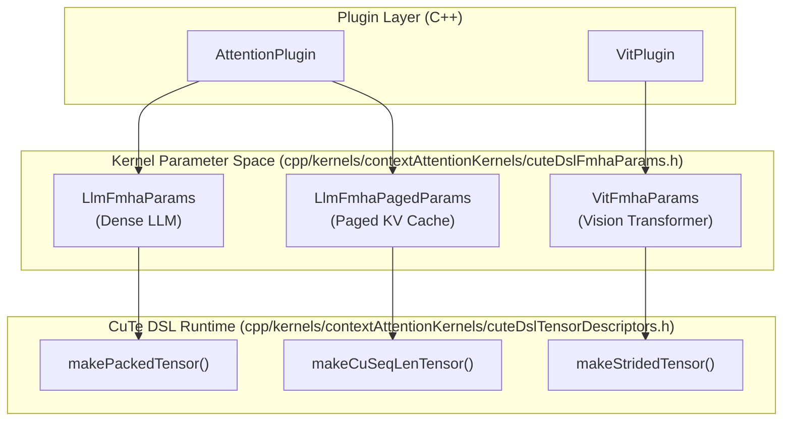
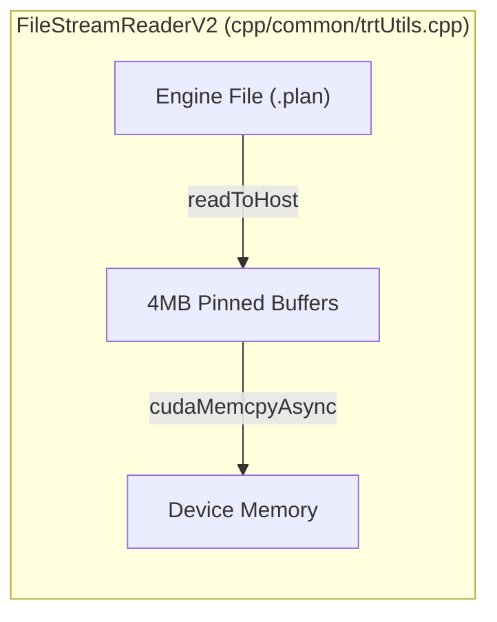

<!-- source: DeepWiki mcp.deepwiki.com · repo NVIDIA/TensorRT-Edge-LLM · page 4.4 TensorRT Plugins · fetched 2026-10-26 -->

# TensorRT Plugins

Relevant source files

The following files were used as context for generating this wiki page:

- [cpp/kernels/audioAttentionKernels/gemma4AudioAttention.cu](cpp/kernels/audioAttentionKernels/gemma4AudioAttention.cu)
- [cpp/kernels/audioAttentionKernels/gemma4AudioAttention.h](cpp/kernels/audioAttentionKernels/gemma4AudioAttention.h)
- [cpp/kernels/contextAttentionKernels/cuteDslFmhaParams.h](cpp/kernels/contextAttentionKernels/cuteDslFmhaParams.h)
- [cpp/kernels/contextAttentionKernels/cuteDslTensorDescriptors.h](cpp/kernels/contextAttentionKernels/cuteDslTensorDescriptors.h)

## Purpose and Scope

This page documents the custom TensorRT plugin system in TensorRT-Edge-LLM. TensorRT plugins extend the framework's layer catalog by implementing custom operations not natively supported by TensorRT. The codebase provides the `NvInfer_edgellm_plugin` shared library containing specialized layers optimized for LLM and VLM inference on edge devices.

The plugin system supports a wide range of architectures including traditional Transformer attention, Mamba-based recurrent states, Gated Delta Nets (GDN), and Mixture of Experts (MoE) with specialized precision like NVFP4. It also includes new plugins for multimodal processing (Gemma4 audio) and optimized KV cache updates (DFlash).

For detailed information about the `AttentionPlugin` implementation, see [AttentionPlugin](#4.4.1). For the CUDA kernels used by plugins, see [edgellmKernels Library](#4.2.2).

**Sources:** [cpp/common/trtUtils.h:56-92](), [cpp/common/trtUtils.cpp:18-35]()

---

## TensorRT Plugin System Overview

TensorRT plugins enable custom layer implementations that integrate seamlessly with TensorRT's execution engine. In TensorRT-Edge-LLM, plugins are compiled into a shared library that is loaded dynamically at runtime.

**Diagram: TensorRT Plugin Lifecycle** - Custom plugins are compiled into a shared library, loaded via `dlopen`, and their creators are registered with the TensorRT `IPluginRegistry`.

**Sources:** [cpp/common/trtUtils.h:39-92](), [cpp/common/trtUtils.cpp:94-98]()

---

## Plugin Loading and Management

The runtime utilizes `loadEdgellmPluginLib` to discover and initialize plugins. A critical detail is the use of `RTLD_NODELETE` to prevent crashes during engine destruction.

### Dynamic Loading Logic
1.  **Environment Variable**: The system checks `EDGELLM_PLUGIN_PATH`. If not set, it defaults to `build/libNvInfer_edgellm_plugin.so` [cpp/common/trtUtils.h:62-72]().
2.  **Library Handle**: `dlopen` is called with `RTLD_LAZY | RTLD_NODELETE`. The `RTLD_NODELETE` flag ensures the library stays mapped for the process lifetime, as TensorRT engines may use plugin code even after the handle is technically closed [cpp/common/trtUtils.h:74-76]().
3.  **Plugin Initialization**: The symbol `initEdgellmPlugins` is resolved via `dlsym`. This function synchronizes the plugin's logging with the main `gLogger` and registers plugin creators with the global TensorRT registry [cpp/common/trtUtils.h:84-90]().

### Utility Functions
The `trtUtils` component provides additional support for managing plugin execution within the TensorRT context:
*   **CUDA Graph Capture**: `captureTRTCudaGraph` captures the execution of a context (including plugins) into a `cudaGraph_t` for reduced launch overhead [cpp/common/trtUtils.cpp:485]().
*   **Auxiliary Streams**: `setNonBlockingAuxStreams` manages non-blocking streams required by some plugins for internal parallelization [cpp/common/trtUtils.cpp:485]().

**Sources:** [cpp/common/trtUtils.h:39-182](), [cpp/common/trtUtils.cpp:485]()

---

## Supported Plugins

### 1. AttentionPlugin
The primary plugin for Transformer models. It supports:
*   **Static shape attention** for edge-optimized execution.
*   **RoPE (Rotary Position Embeddings)** and **Longrope**.
*   **Speculative Decoding**: Support for tree attention used in EAGLE3.
*   **Precision**: FP16 and FP8 KV cache support.

For details, see [AttentionPlugin](#4.4.1).

### 2. Mamba and Recurrent Plugins
Used for SSM (State Space Model) architectures like Mamba and linear-attention layers like Gated Delta Net (GDN). These plugins manage complex recurrent states across inference steps.
*   **MambaPlugin**: Implements selective scan and convolution states.
*   **GatedDeltaNet**: Specialized linear attention mechanism for recurrent models.

### 3. Mixture of Experts (MoE) Plugins
Supports high-performance routing and expert execution for models like DeepSeek or Qwen-MoE.
*   **INT4/NVFP4 MoE**: Specialized kernels for low-precision expert weights (NVFP4 for Blackwell/GB100 targets).
*   **Grouped MoE**: Optimizations for routing multiple tokens to expert subsets efficiently.

### 4. Multimodal and Specialized Plugins
*   **VIT Attention Plugin**: A specialized version of the attention plugin optimized for Vision Transformers (ViT). It utilizes `VitFmhaParams` [cpp/kernels/contextAttentionKernels/cuteDslFmhaParams.h:94-110]() for MHA variants and `FmhaV2VitParams` [cpp/kernels/contextAttentionKernels/cuteDslFmhaParams.h:141-158]() for GQA variants.
*   **Gemma4AudioAttentionPlugin**: A dedicated plugin for the Gemma4 unified audio architecture. It implements a fused forward pass `gemma4AudioAttentionForward` [cpp/kernels/audioAttentionKernels/gemma4AudioAttention.h:69-71]() specialized for audio-encoder chunked local attention (C=12, L=12, M=24) [cpp/kernels/audioAttentionKernels/gemma4AudioAttention.cu:143-143]().
*   **DFlash Target KV Cache Update**: A specialized plugin for DFlash speculative decoding that updates the target model's KV cache based on verified tokens from the draft model.

---

## Kernel Interface and CuTe DSL Integration

Modern plugins in TensorRT-Edge-LLM leverage the **CuTe DSL** for kernel generation. The plugin layer interacts with these kernels using structured parameter bundles defined in `cuteDslFmhaParams.h`.

**Diagram: Plugin to Kernel Parameter Mapping** - This shows how high-level plugins populate specific `Params` structs which are then converted into CuTe-compatible descriptors using `makePackedTensor` [cpp/kernels/contextAttentionKernels/cuteDslTensorDescriptors.h:112-124]() and `makeStridedTensor` [cpp/kernels/contextAttentionKernels/cuteDslTensorDescriptors.h:83-107]().

**Sources:** [cpp/kernels/contextAttentionKernels/cuteDslFmhaParams.h:37-158](), [cpp/kernels/contextAttentionKernels/cuteDslTensorDescriptors.h:83-137]()

---

## Data Type Support

Plugins interact with TensorRT using a variety of data types, mapped to human-readable strings for logging and debugging.

| TensorRT DataType | String Representation |
|-------------------|-----------------------|
| `kFLOAT`          | "FLOAT32"             |
| `kHALF`           | "FLOAT16"             |
| `kBF16`           | "BFLOAT16"            |
| `kFP8`            | "FLOAT8_E4M3"         |
| `kINT4`           | "INT4"                |
| `kE8M0`           | "FLOAT8_E8M0"         |

**Sources:** [cpp/common/trtUtils.h:186-210]()

---

## Engine Deserialization with Plugins

To handle large LLM engines efficiently on memory-constrained edge devices, `deserializeCudaEngineFromFile` uses a custom `FileStreamReaderV2`. This reader avoids mapping the entire engine plan into process memory by using a chunked transfer strategy with pinned host buffers [cpp/common/trtUtils.cpp:41-42]().

**Diagram: Optimized Engine Loading** - The `FileStreamReaderV2` uses a double-buffering scheme (`kEngineDeviceTransferBufferCount = 2`) to overlap disk I/O and device transfers during engine deserialization.

**Sources:** [cpp/common/trtUtils.cpp:41-154](), [cpp/common/trtUtils.cpp:208-212]()

---

