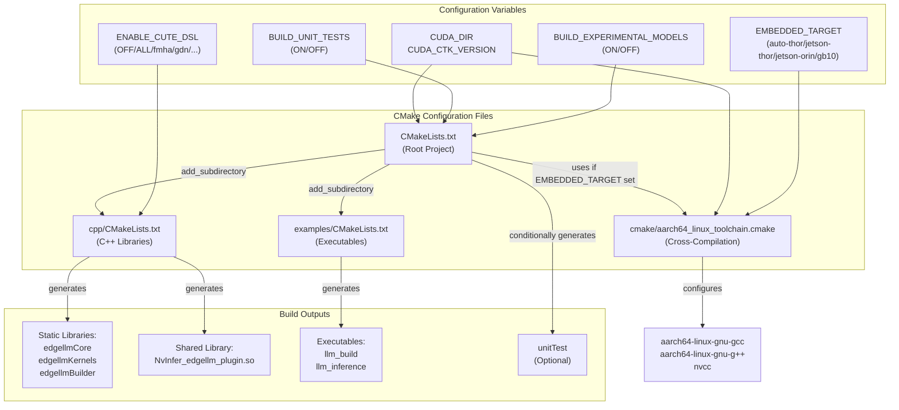
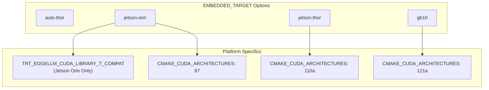

<!-- source: DeepWiki mcp.deepwiki.com · repo NVIDIA/TensorRT-Edge-LLM · page 5 Build System · fetched 2026-10-26 -->

# Build System

<details>
<summary>Relevant source files</summary>

The following files were used as context for generating this wiki page:

- [CMakeLists.txt](CMakeLists.txt)
- [cmake/FindTensorRT.cmake](cmake/FindTensorRT.cmake)
- [cpp/CMakeLists.txt](cpp/CMakeLists.txt)

</details>


This document describes the CMake-based build system that compiles TensorRT-Edge-LLM from source. The build system handles project configuration, dependency management, cross-compilation for ARM64 targets, and generation of static libraries, shared plugins, and executables.

For information about setting up the development environment and running builds, see [Installation](#2.2). For details on building and running unit tests, see [Testing](#6.5). For information about cross-compilation target platform options, see [Target Platform Configuration](#5.2.1).

## Build System Architecture

The build system uses a hierarchical CMake structure with three primary CMake files coordinating compilation of the entire project.



**Sources**: [CMakeLists.txt:16-199](), [cpp/CMakeLists.txt:1-141]()

## Root Project Configuration

The root [CMakeLists.txt:16-21]() defines the project `tensorrt_edgellm_sdk` with version `0.10.0` and enables C, C++, and CUDA languages. The project requires CMake 3.20 or higher.

### C++ and CUDA Standards

The build system enforces C++17 and CUDA 17 standards:

| Setting | Value | Source |
|---------|-------|--------|
| `CMAKE_CXX_STANDARD` | 17 | [CMakeLists.txt:24]() |
| `CMAKE_CXX_STANDARD_REQUIRED` | True | [CMakeLists.txt:25]() |
| `CMAKE_CUDA_STANDARD` | 17 | [CMakeLists.txt:26]() |

### Helper Macros

Two utility macros facilitate build configuration:

**`set_ifndef`** [CMakeLists.txt:50-55](): Sets a variable to a default value if not already defined, then prints the configured value. Used throughout the build system for optional configuration variables.

**`add_cross_build_link_options`** [CMakeLists.txt:57-73](): When `AARCH64_BUILD` is defined (indicating cross-compilation), adds linker flags to search CUDA libraries in the cross-compilation target directory. Applied to shared plugins and executables to ensure correct linking against stubs.

**Sources**: [CMakeLists.txt:16-73]()

## Configuration Variables

The build system accepts multiple configuration variables passed via `-D` flags to CMake. For details, see [CMake Configuration](#5.1).

### CUDA Configuration

CUDA configuration variables with defaults [CMakeLists.txt:82-83]():
- `CUDA_CTK_VERSION`: Default `12.8`
- `CUDA_DIR`: Default `/usr/local/cuda-${CUDA_CTK_VERSION}`

The build system finds CUDA components:
- `cuda_runtime_api.h` [CMakeLists.txt:98-101]()
- `libcudart.so` [CMakeLists.txt:103-106]()
- `libcuda.so` (driver) [CMakeLists.txt:108-112]()
- `curand_kernel.h` [CMakeLists.txt:120-124]()

### Native CUDA Architectures

For native builds (no `AARCH64_BUILD`), the default CUDA architectures are `80;86;89` [CMakeLists.txt:86](). If `CUDA_CTK_VERSION >= 12.8`, architectures `100a` and `120` are added [CMakeLists.txt:87-89]().

| Architecture | GPU Family |
|--------------|------------|
| 80 | Ampere (A100) |
| 86 | Ampere (RTX 30xx) |
| 89 | Ada Lovelace (RTX 40xx, L40) |
| 100a | Blackwell (B100) |
| 120 | Blackwell (GB200) |

**Sources**: [CMakeLists.txt:75-90]()

## Cross-Compilation Toolchain

When building for ARM64 embedded targets, the build system configures cross-compilation. This toolchain is activated by setting the `EMBEDDED_TARGET` variable. For details, see [Cross-Compilation for ARM64](#5.2).

### Target Platform Mapping

The `EMBEDDED_TARGET` variable maps to specific CUDA architectures and toolkit directories.



#### Target Details

| `EMBEDDED_TARGET` | Platform | Behavior | Source |
|-------------------|----------|-----------|--------|
| `jetson-orin` | Jetson Orin | Sets `TRT_EDGELLM_CUDA_LIBRARY_T_COMPAT` | [CMakeLists.txt:94-96]() |
| `auto-thor` | Automotive Thor | Cross-compilation for Thor platform | [CMakeLists.txt:73]() (implied by toolchain) |

**Sources**: [CMakeLists.txt:94-96]()

## Build Targets

The [cpp/CMakeLists.txt]() defines the build process for core libraries and the TensorRT plugin. For details, see [Build Targets](#5.4).

### Static Libraries

- **`edgellmKernels`** [cpp/CMakeLists.txt:62-73](): Contains CUDA kernels, common utilities, and MoE Marlin kernels. Uses `CUDA_SEPARABLE_COMPILATION` for MoE Marlin kernel templates.
- **`edgellmCore`** [cpp/CMakeLists.txt:76-98](): The main runtime library including samplers, multimodal, action models, tokenizer, and profiler.
- **`edgellmBuilder`** [cpp/CMakeLists.txt:101-106](): Handles TensorRT engine building and ONNX parsing.

### Shared Library

- **`NvInfer_edgellm_plugin`** [cpp/CMakeLists.txt:109-123](): A shared library implementing custom TensorRT plugins. It links against `edgellmKernels` and `commonLibraryExt` [cpp/CMakeLists.txt:116-118](). It uses `-Wl,--exclude-libs,ALL` to hide symbols from static archives.

### CuTe DSL Integration

The build system supports CuTe DSL-based kernel generation via the `ENABLE_CUTE_DSL` option [CMakeLists.txt:183-195](). Supported groups include `fmha`, `gdn`, `f16_moe`, `nvfp4_moe`, and `nvfp4_fused_moe`. If enabled, it links prebuilt static artifacts generated by `kernelSrcs/build_cutedsl.py` via the `cute_dsl_setup` macro [cpp/CMakeLists.txt:140-141]().

**Sources**: [cpp/CMakeLists.txt:62-141](), [CMakeLists.txt:183-195]()

## Compiler Flags

The build system configures multiple compiler flag categories for C++ and CUDA compilation.

### Root-Level Flags

Configured in [CMakeLists.txt:28-34]():

| Compiler | Flags | Purpose |
|----------|-------|---------|
| `CMAKE_CXX_FLAGS` | `-Wall -Werror -Wno-error=unused-parameter` | Standard warnings and error handling |
| `CMAKE_CUDA_FLAGS` | `-Xcompiler=-Werror,-Wno-error=unused-parameter` | Pass warning-as-error to host compiler |
| `CMAKE_SHARED_LINKER_FLAGS` | `-Wl,--no-undefined` | Fail if shared library has undefined symbols |

### CUDA Kernel Compilation Flags

Configured in [cpp/CMakeLists.txt:12-23]():

**Base CUDA flags** [cpp/CMakeLists.txt:17]():
```
CMAKE_CUDA_FLAGS: --expt-relaxed-constexpr -t 0 -fPIC
```

**PTX assembler flags** [cpp/CMakeLists.txt:18]():
```
CUDA_PTXAS_FLAGS: -warn-lmem-usage -warn-double-usage -warn-spills
```

**Release configuration** [cpp/CMakeLists.txt:19-21]():
```
CMAKE_CUDA_FLAGS_RELEASE: -lineinfo -res-usage --use_fast_math -Xptxas='${CUDA_PTXAS_FLAGS}'
```

**Sources**: [CMakeLists.txt:28-34](), [cpp/CMakeLists.txt:12-23]()

## Dependencies Management

The build system manages external dependencies including CUDA, TensorRT, and third-party libraries. For details, see [Dependencies Management](#5.3).

- **TensorRT**: Found via `find_package(TensorRT REQUIRED COMPONENTS OnnxParser)` [CMakeLists.txt:158](). The `cmake/FindTensorRT.cmake` script facilitates finding `nvinfer` or `tensorrt_rtx` [cmake/FindTensorRT.cmake:31-35]().
- **NVTX**: Profiling support is optional via `ENABLE_NVTX_PROFILING` [CMakeLists.txt:132](). It uses bundled headers in `3rdParty/NVTX` [CMakeLists.txt:138]().
- **Common Interface**: The `commonLibraryExt` interface library encapsulates TensorRT, OnnxParser, and CUDA runtime dependencies [CMakeLists.txt:173-176]().

**Sources**: [CMakeLists.txt:132-176](), [cmake/FindTensorRT.cmake:1-98]()

## Unit Test Build Target

Unit tests are conditionally built when `BUILD_UNIT_TESTS=ON` is set [CMakeLists.txt:42](). The build system also supports `ENABLE_CUTEDSL_MODULE_TEST_HOOK` for deterministic failure injection during testing [CMakeLists.txt:43-48]().

**Sources**: [CMakeLists.txt:42-48]()

---

