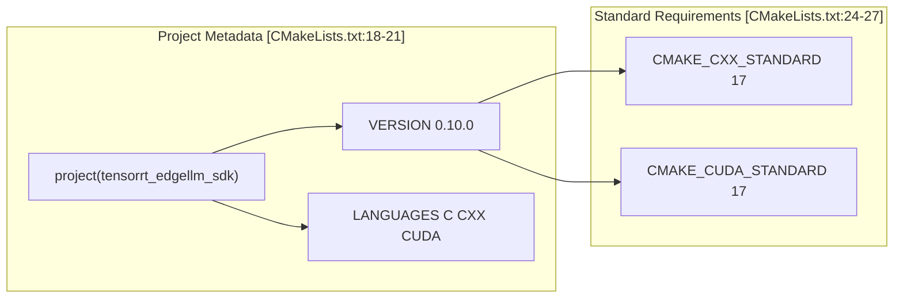
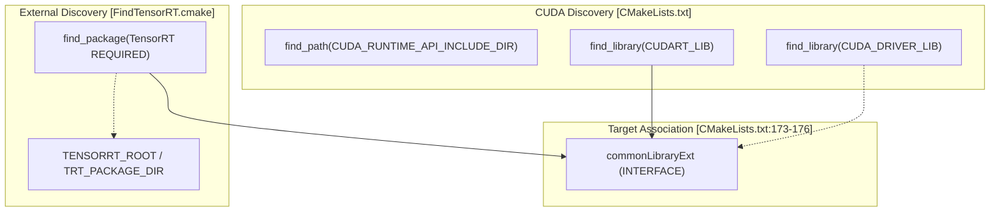

<!-- source: DeepWiki mcp.deepwiki.com · repo NVIDIA/TensorRT-Edge-LLM · page 5.1 CMake Configuration · fetched 2026-10-26 -->

# CMake Configuration

Relevant source files

The following files were used as context for generating this wiki page:

- [CMakeLists.txt](CMakeLists.txt)
- [cmake/CodeCoverage.cmake](cmake/CodeCoverage.cmake)
- [cmake/FindTensorRT.cmake](cmake/FindTensorRT.cmake)
- [cpp/CMakeLists.txt](cpp/CMakeLists.txt)

## Purpose and Scope

This page documents the root CMake configuration defined in [CMakeLists.txt:1-199](). It covers project settings, compiler configuration, required and optional build variables, CUDA and TensorRT setup, and build options. This is the entry point for the entire build system.

For cross-compilation specifics, see [5.2 Cross-Compilation for ARM64](). For detailed dependency management and third-party libraries, see [5.3 Dependencies Management](). For information on individual build targets (libraries and executables), see [5.4 Build Targets]().

**Sources:** [CMakeLists.txt:1-199]()

---

## Project Declaration and Versioning

The project is declared as `tensorrt_edgellm_sdk` with semantic versioning and support for C, C++, and CUDA languages:

 Title: Project Declaration Flow

The project declaration is at [CMakeLists.txt:18-21]() and requires CMake version 3.20 or higher [CMakeLists.txt:16](). Both C++ and CUDA standards are set to 17 [CMakeLists.txt:24-27]().

**Sources:** [CMakeLists.txt:16-27]()

---

## Compiler Configuration

### Compiler Flags

The build system configures several compiler and linker flags to ensure code quality and compatibility:

| Flag Category | Variable | Flags | Purpose |
|---------------|----------|-------|---------|
| C++ Compiler | `CMAKE_CXX_FLAGS` | `-Wno-deprecated-declarations` `-Wall` `-Werror` `-Wno-error=unused-parameter` | Suppress deprecation warnings, enable all warnings, treat warnings as errors (except unused parameters) [CMakeLists.txt:28-30]() |
| CUDA Compiler | `CMAKE_CUDA_FLAGS` | `-Wno-deprecated-declarations` `-Xcompiler=-Werror,-Wno-error=unused-parameter` | Suppress deprecation warnings, pass error flags to host compiler [CMakeLists.txt:31-33]() |
| Shared Linker | `CMAKE_SHARED_LINKER_FLAGS` | `-Wl,--no-undefined` | Ensure all symbols are resolved at link time [CMakeLists.txt:34]() |

Internal C++ symbols are hidden by default using the `edgellm_set_hidden_visibility` function [cpp/CMakeLists.txt:28-31](), ensuring only `EDGELLM_PLUGIN_EXPORT` entry points are visible to prevent collisions [cpp/CMakeLists.txt:25-27]().

**Sources:** [CMakeLists.txt:28-34](), [cpp/CMakeLists.txt:25-31]()

---

## Configuration Variables and Macros

### Custom Macros

The build system defines utility macros for variable management and cross-compilation:

#### `set_ifndef` Macro
Defined at [CMakeLists.txt:50-55](), this macro sets a variable only if it's not already defined, and logs the final value. Used for providing default values with override capability.

#### `add_cross_build_link_options` Macro
Defined at [CMakeLists.txt:57-73](), this macro adds CUDA library link paths when `AARCH64_BUILD` is defined. It adds:
- `-L${CUDA_DIR}/lib`
- `-L${CUDA_DIR}/lib/stubs`

**Sources:** [CMakeLists.txt:50-73]()

---

## CUDA Configuration

### CUDA Variables and Architectures

The CUDA configuration uses `set_ifndef` to establish defaults. It also performs a check to ensure `CUDA_CTK_VERSION` is used instead of the ambiguous `CUDA_VERSION` [CMakeLists.txt:76-81]().

| Variable | Default | Lines | Description |
|----------|---------|-------|-------------|
| `CUDA_CTK_VERSION` | 12.8 | [CMakeLists.txt:82]() | CUDA toolkit version |
| `CUDA_DIR` | `/usr/local/cuda-${CUDA_CTK_VERSION}` | [CMakeLists.txt:83]() | CUDA installation directory |
| `CMAKE_CUDA_ARCHITECTURES` | 80; 86; 89 | [CMakeLists.txt:86]() | Default target GPU architectures |

For native builds, if `CUDA_CTK_VERSION` is 12.8 or higher, support for Blackwell architectures (`100a`, `120`) is automatically appended [CMakeLists.txt:87-89]().

### Embedded Target Specifics
For Jetson Orin targets (`EMBEDDED_TARGET` set to `jetson-orin`), a compatibility macro `TRT_EDGELLM_CUDA_LIBRARY_T_COMPAT` is defined to handle missing `cudaLibrary_t` in older headers [CMakeLists.txt:94-96]().

**Sources:** [CMakeLists.txt:76-96]()

---

## Dependency Discovery

### CUDA and TensorRT Discovery
The build system uses `find_path` and `find_library` to locate dependencies. TensorRT is required via `find_package` [CMakeLists.txt:158](), which relies on the custom `FindTensorRT.cmake` module.

 Title: Dependency Discovery and Linking

- **TensorRT Discovery**: `FindTensorRT.cmake` honors `TRT_PACKAGE_DIR` or `TENSORRT_ROOT` as primary root hints [cmake/FindTensorRT.cmake:18-21](). It defines the `TensorRT::TensorRT` and `TensorRT::OnnxParser` imported targets [cmake/FindTensorRT.cmake:81-97]().
- **CUDA Headers**: Located at [CMakeLists.txt:98-101]() and [CMakeLists.txt:120-124]().
- **CUDA Libraries**: `cudart` [CMakeLists.txt:103-106]() and `cuda` driver [CMakeLists.txt:108-112]().
- **System Includes**: TRT and CUDA headers are treated as `SYSTEM` includes to suppress third-party warnings [CMakeLists.txt:163]().

### NVTX Profiling
Profiling support is optional via `ENABLE_NVTX_PROFILING` [CMakeLists.txt:132](). When enabled, the system uses bundled NVTX3 headers from `3rdParty/NVTX` and defines the `ENABLE_NVTX_PROFILING` preprocessor macro [CMakeLists.txt:138-143]().

**Sources:** [CMakeLists.txt:98-163](), [cmake/FindTensorRT.cmake:1-98]()

---

## Common Library Interface

The `commonLibraryExt` interface library packages frequently-used dependencies to simplify downstream linking:

- **Linked Libraries**: `TensorRT::TensorRT`, `TensorRT::OnnxParser`, and `${CUDART_LIB}` [CMakeLists.txt:174-176]().
- **Cross-Compilation Workaround**: For ARM64, it ignores unresolved symbols in shared libraries to handle platform-specific TensorRT dependencies (like NVDLA) that are only present on-device [CMakeLists.txt:180-181]().

**Sources:** [CMakeLists.txt:173-181]()

---

## Code Coverage

Code coverage instrumentation using `gcov` is supported via the `ENABLE_COVERAGE` option [CMakeLists.txt:37-38]().

- **Scope**: Coverage is limited to C++ (`.cpp`) files. CUDA (`.cu`) files are intentionally excluded because `nvcc` generates ephemeral stub files in `/tmp/` that break `gcov` path resolution [cmake/CodeCoverage.cmake:22-26]().
- **Flags**: Appends `--coverage` and `-fprofile-abs-path` to `CMAKE_CXX_FLAGS` and linker flags [cmake/CodeCoverage.cmake:47-49]().

**Sources:** [CMakeLists.txt:37-38](), [cmake/CodeCoverage.cmake:1-56]()

---

## Build Options and Targets

### Feature Toggles
| Option | Default | Description |
|--------|---------|-------------|
| `ENABLE_COVERAGE` | OFF | Enable gcov instrumentation [CMakeLists.txt:37]() |
| `ENABLE_NVTX_PROFILING` | OFF | Enable NVTX profiling support [CMakeLists.txt:132]() |
| `BUILD_UNIT_TESTS` | OFF | Build GoogleTest-based unit tests [CMakeLists.txt:42]() |
| `ENABLE_CUTEDSL_MODULE_TEST_HOOK` | OFF | Enable deterministic CuTe DSL failure injection (requires `BUILD_UNIT_TESTS`) [CMakeLists.txt:43-48]() |
| `ENABLE_CUTE_DSL` | OFF | Enable CuTe DSL kernel generation (Choices: `fmha`, `gdn`, `f16_moe`, `nvfp4_moe`, `nvfp4_fused_moe`, `ALL`) [cpp/CMakeLists.txt:127-138]() |
| `BUILD_EXPERIMENTAL_MODELS` | OFF | Enable experimental model targets (Cosmos3, Nemotron-3.5-ASR) [cpp/CMakeLists.txt:141]() |

### Core Subdirectories and Libraries
The `cpp` subdirectory [cpp/CMakeLists.txt:1-141]() defines the primary library targets:

- **edgellmKernels**: Static library containing CUDA kernels, FMHA/XQA generated sources, and common utilities [cpp/CMakeLists.txt:62-72]().
- **edgellmCore**: Static library containing the runtime, samplers, multimodal, action, and tokenizer components [cpp/CMakeLists.txt:76-98]().
- **edgellmBuilder**: Static library for TensorRT engine building and ONNX parsing [cpp/CMakeLists.txt:101-106]().
- **NvInfer_edgellm_plugin**: Shared library containing custom TensorRT plugins [cpp/CMakeLists.txt:109-122]().

**Sources:** [CMakeLists.txt:37-48](), [cpp/CMakeLists.txt:62-141]()

---

