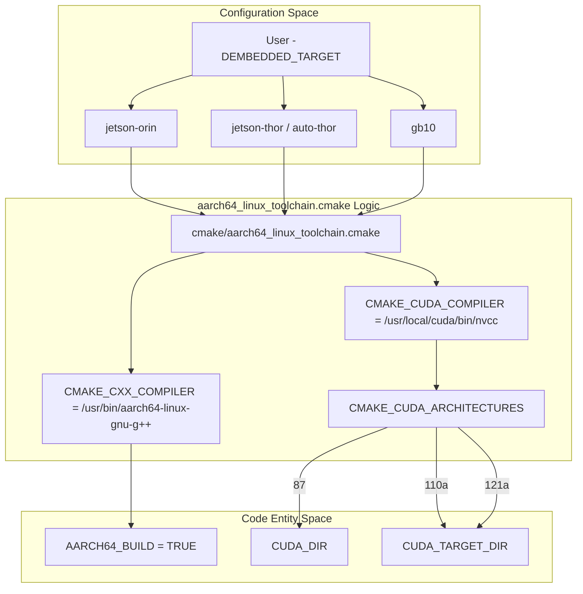
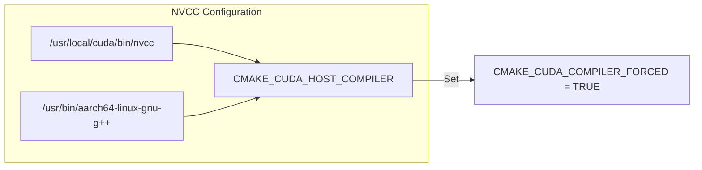

<!-- source: DeepWiki mcp.deepwiki.com · repo NVIDIA/TensorRT-Edge-LLM · page 5.2 Cross-Compilation for ARM64 · fetched 2026-10-26 -->

# Cross-Compilation for ARM64

Relevant source files

The following files were used as context for generating this wiki page:

- [cmake/aarch64_linux_toolchain.cmake](cmake/aarch64_linux_toolchain.cmake)

## Purpose and Scope

This document explains the cross-compilation infrastructure for building TensorRT-Edge-LLM on x86_64 development hosts while targeting ARM64 edge platforms. The system uses a CMake toolchain file to configure GCC/G++ cross-compilers and CUDA for ARM64 architecture. This enables developers to build binaries for Jetson and DRIVE platforms without requiring direct access to the target hardware.

For specific target platform configurations (`auto-thor`, `jetson-thor`, `jetson-orin`, `gb10`), see [Target Platform Configuration](#5.2.1). For general CMake configuration and build variables, see [CMake Configuration](#5.1).

---

## Toolchain File Overview

Cross-compilation is enabled through the toolchain file [cmake/aarch64_linux_toolchain.cmake:1-101](), which CMake loads before processing the project. This file overrides default compiler detection and configures all build tools for ARM64 target architecture.

### Toolchain Logic Flow
The following diagram illustrates how the toolchain file bridges the configuration from natural language platform targets to specific code entities and compiler settings.

**Toolchain Activation**: The toolchain file is loaded early in CMake's initialization phase. It establishes the cross-compilation environment by setting system properties and compiler paths [cmake/aarch64_linux_toolchain.cmake:17-34]().

**Sources**: [cmake/aarch64_linux_toolchain.cmake:1-101]()

---

## Cross-Compiler Configuration

The toolchain specifies GNU cross-compilers targeting the `aarch64-linux-gnu` triplet. These compilers are typically provided by the `gcc-aarch64-linux-gnu` package on Ubuntu development hosts.

### Compiler Paths

| Variable | Value | Purpose |
|----------|-------|---------|
| `CMAKE_C_COMPILER` | `/usr/bin/aarch64-linux-gnu-gcc` | C compiler for ARM64 |
| `CMAKE_CXX_COMPILER` | `/usr/bin/aarch64-linux-gnu-g++` | C++ compiler for ARM64 |
| `CMAKE_C_COMPILER_TARGET` | `aarch64-linux-gnu` | Target triplet for C |
| `CMAKE_CXX_COMPILER_TARGET` | `aarch64-linux-gnu` | Target triplet for C++ |

**Sources**: [cmake/aarch64_linux_toolchain.cmake:21-25]()

### System Configuration

The toolchain sets fundamental CMake system properties:
- `CMAKE_SYSTEM_NAME`: Set to `Linux` [cmake/aarch64_linux_toolchain.cmake:17]().
- `CMAKE_SYSTEM_PROCESSOR`: Set to `aarch64` [cmake/aarch64_linux_toolchain.cmake:18]().

These settings inform CMake that the target is an ARM 64-bit Linux environment.

**Sources**: [cmake/aarch64_linux_toolchain.cmake:17-18]()

---

## CUDA Cross-Compilation Setup

Cross-compiling CUDA code requires configuring `nvcc` to use the ARM64 host compiler and target the correct GPU compute capability.

### CUDA Compiler Configuration
The toolchain forces the CUDA compiler to use the specified ARM64 C++ compiler as its host compiler [cmake/aarch64_linux_toolchain.cmake:28-31]().

**Sources**: [cmake/aarch64_linux_toolchain.cmake:27-34]()

### CUDA Architecture and Toolkit Paths

The toolchain selects `CMAKE_CUDA_ARCHITECTURES` and `CUDA_DIR` based on the `EMBEDDED_TARGET` variable [cmake/aarch64_linux_toolchain.cmake:51-93]().

| EMBEDDED_TARGET | CUDA_CTK_VERSION (Default) | CMAKE_CUDA_ARCHITECTURES | CUDA_DIR Path |
|-----------------|----------------------------|--------------------------|---------------|
| `auto-thor`     | 13.3                       | 110a (or 101a)           | `/usr/local/cuda/targets/aarch64-linux` |
| `jetson-thor`   | 13.0                       | 110a                     | `/usr/local/cuda/targets/sbsa-linux` |
| `jetson-orin`   | 12.6                       | 87                       | `/usr/local/cuda/targets/aarch64-linux` |
| `gb10`          | 13.0                       | 121a                     | `/usr/local/cuda/targets/sbsa-linux` |

**Sources**: [cmake/aarch64_linux_toolchain.cmake:51-93]()

---

## Build System Integration

### AARCH64_BUILD Flag
The toolchain file sets `AARCH64_BUILD` to `TRUE` [cmake/aarch64_linux_toolchain.cmake:101](). This variable is used in the main build system to apply conditional logic for ARM64-specific linking or configuration.

### Find Root Path Configuration
To prevent the build system from accidentally using host (x86_64) libraries, the toolchain restricts the search modes:

- `CMAKE_FIND_ROOT_PATH_MODE_PROGRAM`: Set to `NEVER` (use host programs like `nvcc`) [cmake/aarch64_linux_toolchain.cmake:96]().
- `CMAKE_FIND_ROOT_PATH_MODE_LIBRARY`: Set to `ONLY` (only find target-arch libraries) [cmake/aarch64_linux_toolchain.cmake:97]().
- `CMAKE_FIND_ROOT_PATH_MODE_INCLUDE`: Set to `ONLY` (only find target-arch headers) [cmake/aarch64_linux_toolchain.cmake:98]().

**Sources**: [cmake/aarch64_linux_toolchain.cmake:96-101]()

---

## Summary

The cross-compilation for ARM64 is a high-level process managed by `aarch64_linux_toolchain.cmake`. It handles:
1.  **Compiler Selection**: Redirecting CMake to use `aarch64-linux-gnu-gcc/g++`.
2.  **CUDA Redirection**: Ensuring `nvcc` uses the cross-compiler for host code.
3.  **Target Optimization**: Setting the correct `CMAKE_CUDA_ARCHITECTURES` for Orin, Thor, or GB10 platforms.
4.  **Path Management**: Locating the correct CUDA toolkit targets (e.g., `sbsa-linux` vs `aarch64-linux`).

For details on the specific hardware targets and their associated architectures, see [Target Platform Configuration](#5.2.1).

**Sources**: [cmake/aarch64_linux_toolchain.cmake:1-101]()

---

