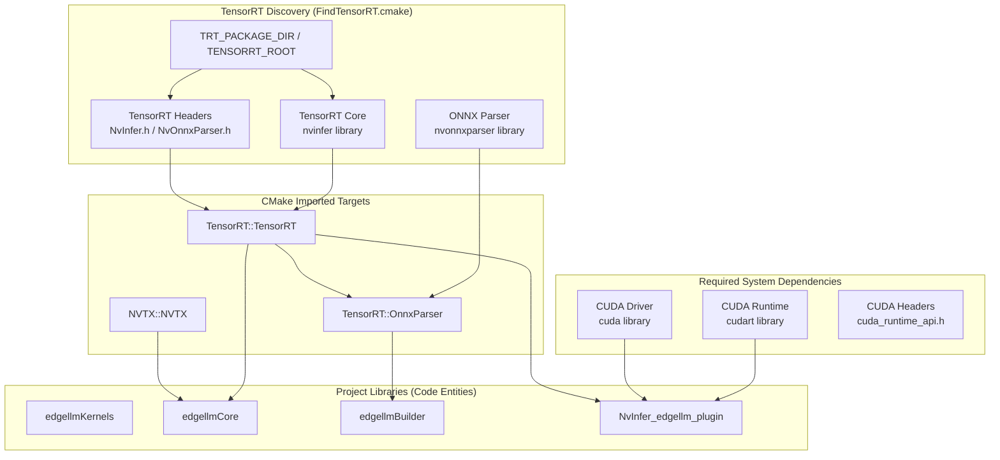
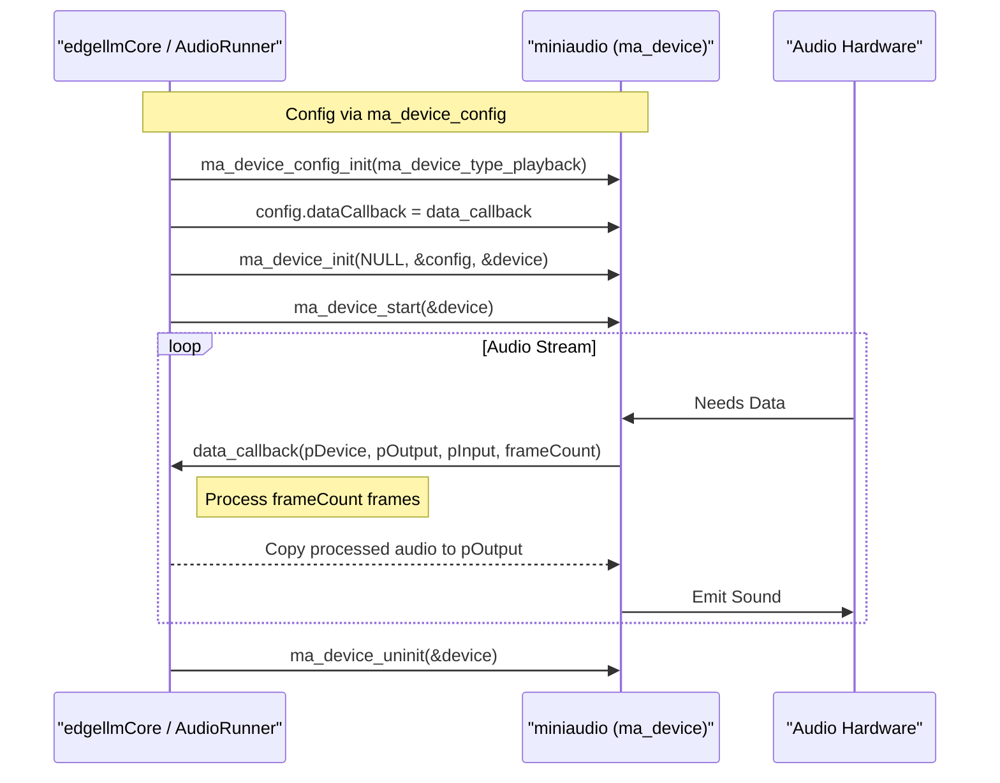

<!-- source: DeepWiki mcp.deepwiki.com · repo NVIDIA/TensorRT-Edge-LLM · page 5.3 Dependencies Management · fetched 2026-10-26 -->

# Dependencies Management

Relevant source files

The following files were used as context for generating this wiki page:

- [.gitmodules](.gitmodules)
- [3rdParty/miniaudio/miniaudio.h](3rdParty/miniaudio/miniaudio.h)
- [3rdParty/stb/stb_image.h](3rdParty/stb/stb_image.h)
- [3rdParty/stb/stb_image_resize2.h](3rdParty/stb/stb_image_resize2.h)

This page documents the external dependencies required by the TensorRT-Edge-LLM SDK, including how they are discovered, configured, and linked during the build process. This covers required runtime dependencies (CUDA, TensorRT) and third-party libraries including NVTX, miniaudio, and JSON utilities.

For information about CMake configuration variables and build options, see [CMake Configuration](#5.1). For cross-compilation toolchain setup, see [Cross-Compilation for ARM64](#5.2).

## Overview

The TensorRT-Edge-LLM SDK depends on several categories of external libraries:

| Category | Dependencies | Management Method | Required |
|----------|--------------|-------------------|----------|
| **CUDA Runtime** | `cudart`, `cuda` driver | CMake `find_library` | Yes |
| **TensorRT** | `nvinfer`, `nvonnxparser` | `FindTensorRT.cmake` module | Yes |
| **Git Submodules** | `googletest`, `nlohmann::json`, `NVTX` | Git submodules in `3rdParty/` | Conditional |
| **Header-only Libraries** | `stb_image.h`, `stb_image_resize2.h` | Vendored in `3rdParty/stb/` | Yes |
| **Audio Libraries** | `miniaudio.h` | Vendored in `3rdParty/miniaudio/` | Yes |

The build system uses a combination of standard CMake discovery and a custom `FindTensorRT.cmake` module to locate dependencies.

**Sources**: [.gitmodules:1-9](), [3rdParty/miniaudio/miniaudio.h:1-10]()

## Dependency Hierarchy

The following diagram maps the relationship between external system dependencies and the internal C++ core libraries.

**Diagram: Dependency Mapping to Code Entities**

**Analysis**: This diagram illustrates how the build system abstracts installation paths into modern CMake imported targets. `TensorRT::OnnxParser` depends on `TensorRT::TensorRT`, ensuring that linking the parser automatically pulls in the core inference library. NVTX is integrated for profiling within the `edgellmCore` library.

**Sources**: [.gitmodules:7-9](), [3rdParty/miniaudio/miniaudio.h:77-83]()

## TensorRT Discovery and Linking

The SDK utilizes a specialized find module, `cmake/FindTensorRT.cmake`, to locate TensorRT and its ONNX parser component. This module prioritizes user-provided paths to support multiple TensorRT versions on the same system.

### Search Logic

The module searches for TensorRT using the following priority for root hints:
1. `TRT_PACKAGE_DIR` (Primary root hint)
2. `TENSORRT_ROOT`
3. Standard system paths: `/usr`, `/opt/tensorrt`

### Imported Targets

Upon successful discovery, the module creates two `UNKNOWN IMPORTED` libraries:

*   **`TensorRT::TensorRT`**: Maps to `nvinfer`.
*   **`TensorRT::OnnxParser`**: Maps to `nvonnxparser` and sets `TensorRT::TensorRT` as an interface link library.

This encapsulation ensures that downstream targets like `edgellmBuilder` only need to link against `TensorRT::OnnxParser` to receive all necessary include directories and transitive dependencies.

## CUDA and Performance Profiling

### CUDA Requirements
The SDK requires the CUDA Toolkit and the CUDA Driver. The build system specifically targets NVIDIA architectures. For native builds, it targets Ampere (80, 86) and Ada Lovelace (89). For CUDA 12.8+, it adds support for Blackwell (100, 120).

### NVTX (NVIDIA Tools Extension)
NVTX is used throughout the codebase to provide instrumentation for NVIDIA Nsight Systems. It is managed as a git submodule and provides the `nvtx3` C++ headers used for range markers and resource naming in the runtime.

**Sources**: [.gitmodules:7-9]()

## Third-Party Dependencies

### Git Submodules

The SDK includes several third-party libraries as git submodules in the `3rdParty/` directory:

#### googletest
*   **Location**: `3rdParty/googletest`
*   **Purpose**: Unit testing framework.
*   **Source**: [https://github.com/google/googletest.git](https://github.com/google/googletest.git) [.gitmodules:1-3]()

#### nlohmann::json
*   **Location**: `3rdParty/nlohmannJson`
*   **Purpose**: Modern JSON support for configuration parsing and I/O.
*   **Source**: [https://github.com/nlohmann/json.git](https://github.com/nlohmann/json.git) [.gitmodules:4-6]()

#### NVTX
*   **Location**: `3rdParty/NVTX`
*   **Purpose**: Instrumentation for performance profiling.
*   **Source**: [https://github.com/NVIDIA/NVTX.git](https://github.com/NVIDIA/NVTX.git) [.gitmodules:7-9]()

### Vendored Header-Only Libraries

#### Image Processing (stb)
The `3rdParty/stb/` directory contains image processing utilities:
*   **stb_image.h**: Public domain image loader for JPEG, PNG, TGA, BMP, PSD, GIF, HDR, and PIC [3rdParty/stb/stb_image.h:20-52](). It is integrated by defining `STB_IMAGE_IMPLEMENTATION` in a single C/C++ file [3rdParty/stb/stb_image.h:24-32]().
*   **stb_image_resize2.h**: High-performance image resizing for VLM input, supporting SSE2, AVX, and NEON SIMD [3rdParty/stb/stb_image_resize2.h:20-26]().

#### Audio Processing (miniaudio)
The `3rdParty/miniaudio/` directory provides audio playback and capture capabilities.
*   **miniaudio.h**: A single-file library for audio device abstraction [3rdParty/miniaudio/miniaudio.h:1-10]().
*   **Implementation**: The SDK uses the low-level API (`ma_device`) to interface with physical audio hardware for Omni models [3rdParty/miniaudio/miniaudio.h:47-60]().

**Sources**: [3rdParty/stb/stb_image.h:20-52](), [3rdParty/stb/stb_image_resize2.h:20-26](), [3rdParty/miniaudio/miniaudio.h:1-10]()

## Audio Dependency Implementation

The `miniaudio` library is used to handle asynchronous audio data delivery via callbacks. It follows a "transparent structure" design where the application allocates memory for objects [3rdParty/miniaudio/miniaudio.h:32-38]().

**Diagram: Audio Callback Data Flow**

**Analysis**: The implementation follows the config/init pattern [3rdParty/miniaudio/miniaudio.h:40-45](). The `ma_device_config` is initialized with `ma_device_config_init` to set logical defaults, then passed to `ma_device_init` [3rdParty/miniaudio/miniaudio.h:77-88](). The `data_callback` is the primary integration point where the SDK provides generated audio samples to the hardware [3rdParty/miniaudio/miniaudio.h:68-73]().

**Sources**: [3rdParty/miniaudio/miniaudio.h:32-45](), [3rdParty/miniaudio/miniaudio.h:68-96]()

## Build-Time vs. Runtime Dependencies

| Dependency | Phase | Role in Codebase |
|------------|-------|------------------|
| **NVCC** | Build | Compiles CUDA kernels in `edgellmKernels` |
| **nvonnxparser** | Build/Runtime | Used by `edgellmBuilder` to parse ONNX files |
| **nvinfer** | Runtime | Core engine execution in `edgellmCore` |
| **NVTX** | Runtime | Profiling and markers in `edgellmCore` |
| **miniaudio** | Runtime | Audio I/O for multimodal/Omni models |
| **googletest** | Build/Test | Unit testing in `tests/` and `unittests/` |

**Sources**: [.gitmodules:1-9](), [3rdParty/miniaudio/miniaudio.h:12-26]()

---

