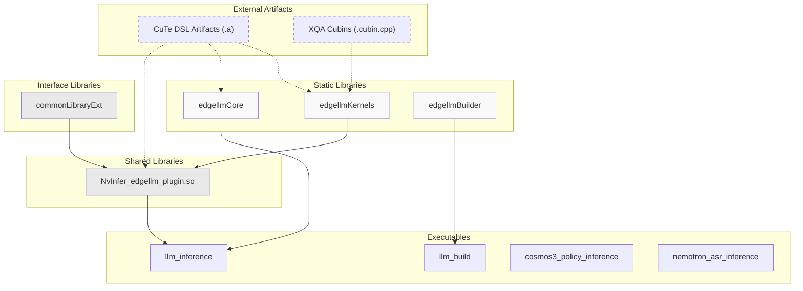
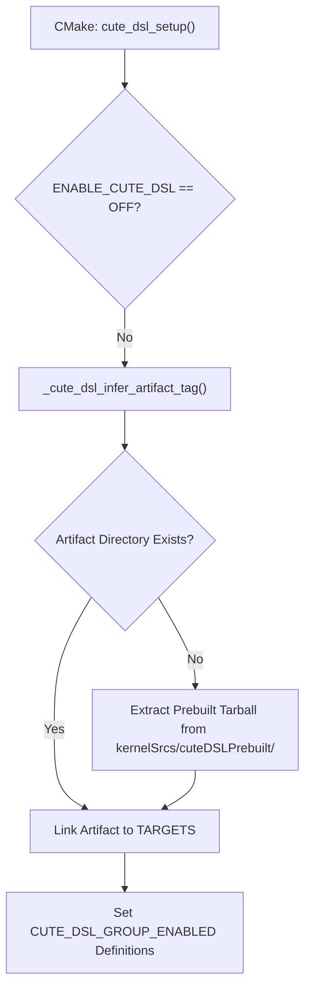
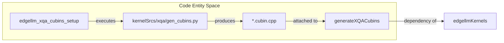

<!-- source: DeepWiki mcp.deepwiki.com · repo NVIDIA/TensorRT-Edge-LLM · page 5.4 Build Targets · fetched 2026-10-26 -->

# Build Targets

Relevant source files

The following files were used as context for generating this wiki page:

- [CMakeLists.txt](CMakeLists.txt)
- [cmake/CuteDsl.cmake](cmake/CuteDsl.cmake)
- [cmake/XQACubins.cmake](cmake/XQACubins.cmake)

## Purpose and Scope

This page documents all CMake build targets defined in the TensorRT-Edge-LLM SDK build system. Build targets are the compilation outputs produced by the CMake build process, including static libraries, shared libraries, executables, and test binaries. Each target is defined with specific source files, include directories, link dependencies, and build properties.

This section also details the specialized CuTe DSL artifact generation workflow, the XQA cubin generation pipeline, and support for experimental models like Cosmos3 and Nemotron-3.5-ASR.

---

## Build Target Overview

The build system produces primary targets organized into core static libraries for internal linking, shared libraries for TensorRT plugin loading, interface libraries for dependency aggregation, and executables for model building and inference.

**Sources**: [cpp/CMakeLists.txt:93-132](), [cpp/CMakeLists.txt:141](), [cmake/XQACubins.cmake:137-140](), [CMakeLists.txt:221-236]()

---

## Core Static Libraries

### edgellmKernels

**Build Definition**: [cpp/CMakeLists.txt:93-94]()

**Purpose**: Provides CUDA kernel implementations and common utilities. It serves as the foundation for both the runtime core and the TensorRT plugins.

**Implementation Details**:
- **Separable Compilation**: Enabled via `CUDA_SEPARABLE_COMPILATION ON` [cpp/CMakeLists.txt:99]() to support complex template-based kernels like MoE Marlin.
- **Relocatable Device Code (RDC)**: Specifically enabled for MoE Marlin and NVF4 decoding kernels [cpp/CMakeLists.txt:87-91]().
- **Conditional Compilation**: FMHA kernels are conditionally excluded based on the `CMAKE_CUDA_ARCHITECTURES` to reduce binary size [cpp/CMakeLists.txt:58-62]().
- **XQA Integration**: Automatically includes generated XQA cubin sources and sets up dependencies on the `generateXQACubins` target [cmake/XQACubins.cmake:137-140]().

### edgellmCore

**Build Definition**: [cpp/CMakeLists.txt:103-115]()

**Purpose**: The primary runtime library. It aggregates kernels, samplers, multimodal processing, action models, and the tokenizer.

**Key Components Linked**:
- `sampler/*.cpp, .cu`: Token sampling logic [cpp/CMakeLists.txt:79-80]().
- `multimodal/*.cpp`: Vision-language model support [cpp/CMakeLists.txt:81]().
- `action/*.cpp`: Robotics/Trajectory model support [cpp/CMakeLists.txt:82]().
- `tokenizer/*.cpp`: Llama and Qwen tokenization [cpp/CMakeLists.txt:101]().

### edgellmBuilder

**Build Definition**: [cpp/CMakeLists.txt:125]()

**Purpose**: Encapsulates the TensorRT engine building logic and ONNX parser integration [cpp/CMakeLists.txt:128]().

**Sources**: [cpp/CMakeLists.txt:73-128](), [cmake/XQACubins.cmake:127-140]()

---

## Shared Libraries

### NvInfer_edgellm_plugin.so

**Build Definition**: [cpp/CMakeLists.txt:132]()

**Purpose**: A shared library containing custom TensorRT plugins (e.g., `AttentionPlugin`, `MambaPlugin`). This is dynamically loaded by the TensorRT runtime during inference.

**Link Dependencies**:
- `edgellmKernels`: Provides the underlying CUDA implementations [cpp/CMakeLists.txt:141]().
- `commonLibraryExt`: Provides TensorRT and CUDA runtime symbols [cpp/CMakeLists.txt:141]().

**Sources**: [cpp/CMakeLists.txt:131-141]()

---

## CuTe DSL Artifact Generation

The build system integrates a specialized workflow for high-performance kernels generated via the CuTe Domain Specific Language (DSL).

### Configuration and Setup
The `ENABLE_CUTE_DSL` CMake flag controls which kernel groups are integrated [cmake/CuteDsl.cmake:54-59]():
- `OFF`: Disable CuTe DSL kernels.
- `ALL`: Enable all available groups (FMHA, GDN, SSD, GEMM, MoE).
- `fmha`: FP16 Context/ViT FMHA baseline (default).
- `fmha;gdn`: Semicolon-separated list for selective inclusion.

### Artifact Resolution Flow
Artifacts are static libraries (`libcutedsl_<arch>.a`) and headers located in `cpp/kernels/cuteDSLArtifact/{arch}/{artifact_tag}/` [cmake/CuteDsl.cmake:20-21](). If missing, the build system can auto-extract prebuilt tarballs from `kernelSrcs/cuteDSLPrebuilt/` [cmake/CuteDsl.cmake:23-24]().

**Key Functions**:
- `_cute_dsl_infer_artifact_tag`: Automatically selects the GPU architecture tag (e.g., `sm_110` for `jetson-thor`) if not explicitly set via `CUTE_DSL_ARTIFACT_TAG` [cmake/CuteDsl.cmake:104-127]().
- `cute_dsl_setup`: Configures compile definitions (e.g., `CUTE_DSL_FMHA_ENABLED`) and links the artifact to `edgellmKernels`, `edgellmCore`, and `NvInfer_edgellm_plugin` [cmake/CuteDsl.cmake:183-215](), [cpp/CMakeLists.txt:141]().

**Sources**: [cmake/CuteDsl.cmake:18-215](), [cpp/CMakeLists.txt:141]()

---

## XQA Cubin Generation

The XQA (eXtreme Query Attention) kernels utilize a pre-compiled cubin approach to optimize build times and support multiple GPU architectures.

### Workflow
The `edgellm_xqa_cubins_setup` function orchestrates the generation process [cmake/XQACubins.cmake:62-125]():
1. **SM Detection**: Identifies required SM versions from `CMAKE_CUDA_ARCHITECTURES` (e.g., 80, 87, 101, 121) [cmake/XQACubins.cmake:22-60]().
2. **Cubin Generation**: Invokes `kernelSrcs/xqa/gen_cubins.py` using the Python interpreter to compile `.cu` files into `.cubin.cpp` artifacts [cmake/XQACubins.cmake:102-112]().
3. **Target Integration**: The `generateXQACubins` custom target is created to ensure cubins are generated before any dependent libraries are compiled [cmake/XQACubins.cmake:113]().

**Sources**: [cmake/XQACubins.cmake:22-140]()

---

## Experimental Models Support

The build system provides an optional flag `BUILD_EXPERIMENTAL_MODELS` to include support for specialized architectures such as Cosmos3 and Nemotron-3.5-ASR.

### Cosmos3-Edge
When enabled, the system builds the `cosmos3_policy_inference` and `cosmos3_policy_build` executables [CMakeLists.txt:222-226](). These targets support multimodal reasoning and action-generation policies.

### Nemotron-3.5-ASR
Enabling experimental models also builds the `nemotron_asr_inference` target [CMakeLists.txt:232-236](). This implements an RNN-T transcription runtime for audio-to-text processing.

**Sources**: [CMakeLists.txt:217-236]()

---

## Code Coverage Instrumentation

When `ENABLE_COVERAGE` is set to `ON`, the build system instruments C++ source files for coverage analysis using `gcov`.

### Implementation
- **Compiler Flags**: Appends `--coverage -fprofile-abs-path` to `CMAKE_CXX_FLAGS` [cmake/CodeCoverage.cmake:47]().
- **Linker Flags**: Appends `--coverage` to executable and shared linker flags [cmake/CodeCoverage.cmake:48-49]().
- **CUDA Exclusion**: CUDA `.cu` files are intentionally **not** instrumented. Instrumentation of `nvcc` generated temporary files leads to unresolvable source references in `gcov` [cmake/CodeCoverage.cmake:22-26](), [cmake/CodeCoverage.cmake:51-53]().

**Sources**: [cmake/CodeCoverage.cmake:16-56](), [CMakeLists.txt:37-38]()

---

## Target Build Flags and Optimization

| Target Category | Key Flags | Purpose |
| :--- | :--- | :--- |
| **Global C++** | `-Wall -Werror -fPIC` | Standard safety and position-independent code [CMakeLists.txt:28-30](). |
| **Global CUDA** | `-Xcompiler=-Werror` | Enforce strict compilation for kernels [CMakeLists.txt:31-33](). |
| **MoE Kernels** | `-rdc=true` | Enable Relocatable Device Code for cross-compilation unit referencing [cpp/CMakeLists.txt:90-91](). |
| **FMHA Kernels** | `EXCLUDE_SM_XX` | Preprocessor defines to skip unused GPU architectures [cpp/CMakeLists.txt:58-62](). |
| **AARCH64 Link** | `-Wl,--unresolved-symbols=ignore-in-shared-libs` | Handle embedded board dependencies during cross-compilation [CMakeLists.txt:180-181](). |

**Sources**: [CMakeLists.txt:28-34](), [CMakeLists.txt:180-181](), [cpp/CMakeLists.txt:58-62](), [cpp/CMakeLists.txt:90-91]()

---

