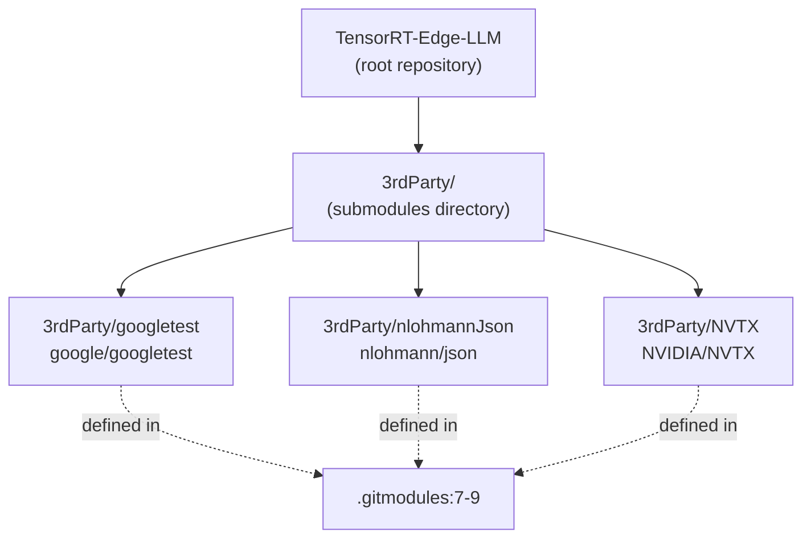
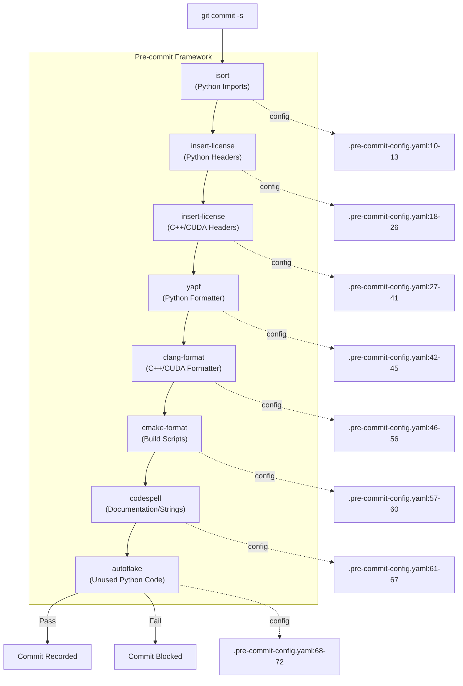
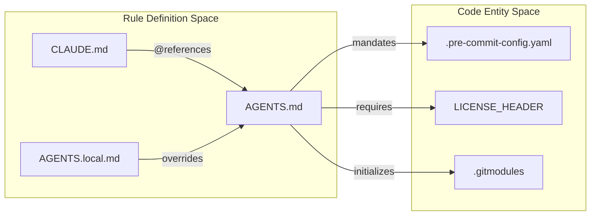

<!-- source: DeepWiki mcp.deepwiki.com · repo NVIDIA/TensorRT-Edge-LLM · page 6.1 Setting Up Development Environment · fetched 2026-10-26 -->

# Setting Up Development Environment

<details>
<summary>Relevant source files</summary>

The following files were used as context for generating this wiki page:

- [.gitmodules](.gitmodules)
- [.pre-commit-config.yaml](.pre-commit-config.yaml)
- [AGENTS.md](AGENTS.md)
- [CLAUDE.md](CLAUDE.md)

</details>


This page provides technical guidance for configuring a local development environment for TensorRT-Edge-LLM. It details repository initialization, Git submodule management, and the configuration of automated quality enforcement tools.

## Overview

The TensorRT-Edge-LLM development environment is designed to ensure consistency across C++ and Python components. Key elements include:
- **Git Submodules**: Management of third-party C++ libraries like `googletest` and `NVTX`.
- **Pre-commit Hooks**: Automated validation of code style, licensing, and correctness.
- **Developer Guidelines**: Adherence to `AGENTS.md` and `CLAUDE.md` for contribution rules and DCO sign-offs.
- **Build Artifact Isolation**: A `.gitignore` configuration that prevents local build files and cache data from entering the version control system.

## Repository Structure and Submodules

The project utilizes Git submodules to maintain external dependencies without bloating the primary source tree. These are defined in the `.gitmodules` file and reside within the `3rdParty/` directory.

### Submodule Architecture


**Sources**: [.gitmodules:1-9]()

### Submodule Dependencies

| Submodule Path | Repository URL | Purpose |
|----------------|----------------|---------|
| `3rdParty/googletest` | `https://github.com/google/googletest.git` | C++ unit testing framework [.gitmodules:1-3]() |
| `3rdParty/nlohmannJson` | `https://github.com/nlohmann/json.git` | JSON parsing and serialization for C++ [.gitmodules:4-6]() |
| `3rdParty/NVTX` | `https://github.com/NVIDIA/NVTX.git` | NVIDIA Tools Extension for performance profiling [.gitmodules:7-9]() |

## Cloning and Initialization

### Initial Clone
To ensure all dependencies are available for the build system, use the `--recursive` flag:
```bash
git clone --recursive https://github.com/NVIDIA/TensorRT-Edge-LLM.git
```

### Manual Initialization
If the repository was cloned without submodules, they must be initialized and updated as required by the developer rules:
```bash
git submodule update --init --recursive
```
**Sources**: [AGENTS.md:18](), [.gitmodules:1-9]()

## Pre-commit Hook Configuration

The repository uses the `pre-commit` framework to enforce coding standards before code is committed. The configuration is defined in `.pre-commit-config.yaml`. Developers are required to run these hooks, and if files are modified by the hooks, they must re-stage and commit again [AGENTS.md:14-15]().

### Hook Execution Pipeline
The following diagram illustrates how the `pre-commit` framework processes files during a `git commit` operation, mapping specific hooks to their respective code entities.



**Sources**: [.pre-commit-config.yaml:1-72](), [AGENTS.md:12-15]()

### Hook Details and Exclusions

| Hook ID | File Types | Key Arguments / Logic |
|:---|:---|:---|
| `insert-license` | `.py`, `.cpp`, `.cu`, `.h` | Injects `LICENSE_HEADER` content into the top 20 lines [.pre-commit-config.yaml:18-41]() |
| `yapf` | `.py` | Python code formatting [.pre-commit-config.yaml:45]() |
| `clang-format` | `c++`, `c`, `cuda` | C++/CUDA formatting [.pre-commit-config.yaml:49-50]() |
| `codespell` | All (except `.json`) | Ignores technical terms like `rouge`, `inout`, `strat` [.pre-commit-config.yaml:61-67]() |
| `autoflake` | `.py` | Removes unused imports and variables in-place [.pre-commit-config.yaml:71-72]() |

### Exclusion Rules
The project defines strict exclusion patterns to prevent hooks from modifying third-party code or generated artifacts:
- **Global Exclusions**: All files in `3rdParty/`, `kernelSrcs/`, and `cpp/common/json/jsmn.h` are ignored [.pre-commit-config.yaml:2-7]().
- **Generated Artifacts**: Files ending in `cubin.cpp` or `_cubin.h` are excluded from license and formatting checks [.pre-commit-config.yaml:30-34, 52-56]().

**Sources**: [.pre-commit-config.yaml:1-72]()

## Developer Rules and Workflow

Developers must follow specific guidelines for code changes and environment setup as outlined in `AGENTS.md`.

### Critical Requirements
- **DCO Sign-off**: All commits must use `git commit -s` for Developer Certificate of Origin sign-off [AGENTS.md:12]().
- **Copyright Headers**: NVIDIA copyright headers are mandatory for all new files; the `insert-license` hook manages this automatically for supported extensions [AGENTS.md:11]().
- **Path Configuration**:
    - `TRT_PACKAGE_DIR`: Must be set for all C++ builds [AGENTS.md:16]().
    - `LLM_SDK_DIR`: Must be set for all Python tests [AGENTS.md:16]().
    - `LD_LIBRARY_PATH`: Must include `$TRT_PACKAGE_DIR/lib` before running binaries [AGENTS.md:17]().

### Developer Guidance Flow
The following diagram maps the relationship between the shared rules (`AGENTS.md`) and local overrides (`AGENTS.local.md`) used by development tools.



**Sources**: [AGENTS.md:1-26](), [CLAUDE.md:1-18]()

## Setup Verification

1. **Install Pre-commit**:
   ```bash
   pip install pre-commit
   pre-commit install
   ```
2. **Run on All Files**:
   To ensure the local environment matches the repository standards immediately:
   ```bash
   pre-commit run --all-files
   ```
3. **Verify Submodules**:
   Check that `3rdParty/googletest` and other submodules contain files:
   ```bash
   ls 3rdParty/googletest/README.md
   ```

**Sources**: [.pre-commit-config.yaml:1-72](), [AGENTS.md:43]()

---

