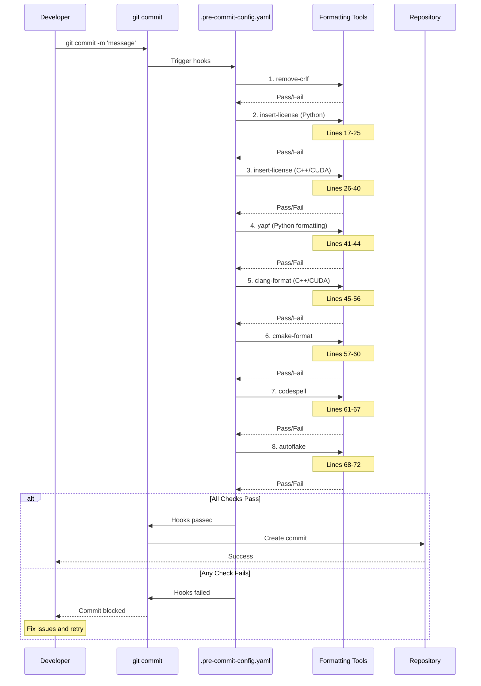

<!-- source: DeepWiki mcp.deepwiki.com · repo NVIDIA/TensorRT-Edge-LLM · page 6.2 Coding Standards · fetched 2026-10-26 -->

# Coding Standards

<details>
<summary>Relevant source files</summary>

The following files were used as context for generating this wiki page:

- [.clang-format](.clang-format)
- [CODING_GUIDELINES.md](CODING_GUIDELINES.md)

</details>


## Purpose and Scope

This document defines the coding standards that all contributors to TensorRT-Edge-LLM must follow. These standards ensure code consistency, readability, and maintainability across the C++ runtime libraries and Python export tools. The standards are enforced through automated tooling configured via [.clang-format:1-107]() and [.pre-commit-config.yaml:1-72]().

For detailed language-specific guidelines, see:
- **C++ Style Guide**: [C++ Style Guide](#6.2.1) - Comprehensive C++ coding rules based on the Google C++ Style Guide.
- **Python Style Guide**: [Python Style Guide](#6.2.2) - Python-specific conventions including formatting with `black` and `yapf`.
- **Pre-commit Hooks**: [Pre-commit Hooks](#6.4.1) - Automated enforcement details.
- **Development Environment Setup**: [Setting Up Development Environment](#6.1) - Installing formatting tools.

**Sources:** [CODING_GUIDELINES.md:2-7](), [.clang-format:1-107](), [.pre-commit-config.yaml:1-72]()

---

## Standards Architecture

The coding standards system consists of three layers: documentation, configuration files, and automated enforcement. The following diagram illustrates how these components relate:

**Standards Enforcement Pipeline**
```mermaid
graph TB
    subgraph "Standards Documentation"
        [GUIDE]["CODING_GUIDELINES.md Source of Truth"]
        [CPP_DOC]["C++ Standards Lines 4-339"]
        [PY_DOC]["Python Standards Lines 340-482"]
        [COPY_DOC]["Copyright Header Lines 483-503"]
    end
    
    subgraph "Configuration Files"
        [CLANG_FMT][".clang-format C++ Formatting Rules"]
        [PRECOMMIT][".pre-commit-config.yaml Hook Configuration"]
        [LICENSE]["LICENSE_HEADER Copyright Template"]
    end
    
    subgraph "Enforcement Tools"
        [CLANG_TOOL]["clang-format v20.1.8"]
        [YAPF_TOOL]["yapf v0.43.0"]
        [ISORT_TOOL]["isort v6.0.1"]
        [LICENSE_TOOL]["insert-license v1.5.5"]
        [SPELL_TOOL]["codespell v2.4.1"]
        [AUTOFLAKE_TOOL]["autoflake v2.3.1"]
        [CMAKE_FMT]["cmake-format v0.6.13"]
    end
    
    subgraph "Developer Workflow"
        [DEV_CODE]["Write Code"]
        [GIT_COMMIT]["git commit"]
        [HOOKS_RUN]["Pre-commit Hooks Execute"]
        [FORMAT_CHECK]["Formatting Check"]
        [CODE_PASS]["Commit Success"]
    end
    
    [GUIDE] --> [CPP_DOC]
    [GUIDE] --> [PY_DOC]
    [GUIDE] --> [COPY_DOC]
    
    [CPP_DOC] -.-> [CLANG_FMT]
    [PY_DOC] -.-> [PRECOMMIT]
    [COPY_DOC] -.-> [LICENSE]
    
    [CLANG_FMT] --> [CLANG_TOOL]
    [PRECOMMIT] --> [CLANG_TOOL]
    [PRECOMMIT] --> [YAPF_TOOL]
    [PRECOMMIT] --> [ISORT_TOOL]
    [PRECOMMIT] --> [LICENSE_TOOL]
    [PRECOMMIT] --> [SPELL_TOOL]
    [PRECOMMIT] --> [AUTOFLAKE_TOOL]
    [PRECOMMIT] --> [CMAKE_FMT]
    
    [LICENSE] --> [LICENSE_TOOL]
    
    [DEV_CODE] --> [GIT_COMMIT]
    [GIT_COMMIT] --> [HOOKS_RUN]
    [HOOKS_RUN] --> [CLANG_TOOL]
    [HOOKS_RUN] --> [YAPF_TOOL]
    [HOOKS_RUN] --> [ISORT_TOOL]
    [HOOKS_RUN] --> [LICENSE_TOOL]
    [HOOKS_RUN] --> [SPELL_TOOL]
    [HOOKS_RUN] --> [AUTOFLAKE_TOOL]
    [HOOKS_RUN] --> [CMAKE_FMT]
    [CLANG_TOOL] --> [FORMAT_CHECK]
    [YAPF_TOOL] --> [FORMAT_CHECK]
    [ISORT_TOOL] --> [FORMAT_CHECK]
    [LICENSE_TOOL] --> [FORMAT_CHECK]
    [SPELL_TOOL] --> [FORMAT_CHECK]
    [AUTOFLAKE_TOOL] --> [FORMAT_CHECK]
    [CMAKE_FMT] --> [FORMAT_CHECK]
    [FORMAT_CHECK] -->|pass| [CODE_PASS]
    [FORMAT_CHECK] -->|fail| [DEV_CODE]
```

**Sources:** [CODING_GUIDELINES.md:1-502](), [.pre-commit-config.yaml:8-72]()

---

## C++ Coding Standards Overview

The TensorRT-Edge-LLM C++ standards are derived from the [Google C++ Style Guide](https://google.github.io/styleguide/cppguide.html) with project-specific modifications. All C++ code must conform to these standards before being committed.

### Key Standards Summary

| Category | Standard | Configuration |
|----------|----------|---------------|
| **Indentation Style** | Allman style with 4 spaces | [.clang-format:25-44]() `BreakBeforeBraces: Custom` |
| **Line Length** | 120 characters maximum | [.clang-format:48]() `ColumnLimit: 120` |
| **Pointer Alignment** | Left-aligned (`int* ptr`) | [.clang-format:84]() `PointerAlignment: Left` |
| **Const Qualifier** | East const (`int const x`) | [.clang-format:105]() `QualifierAlignment: Right` |
| **Namespace Comments** | Required closing comments | [CODING_GUIDELINES.md:11-17]() |
| **Smart Pointers** | Prefer `unique_ptr`, `shared_ptr` | [CODING_GUIDELINES.md:103-105]() |
| **Standard** | C++17 | [.clang-format:98]() `Standard: c++17` |

### Naming Conventions

The following diagram maps naming rules to specific code entities found in the project:

**C++ Naming Convention Mapping**
```mermaid
graph LR
    subgraph "Naming Rules (CODING_GUIDELINES.md)"
        [FILES]["File Names camelCase first lower Lines 44-46"]
        [TYPES]["Type Names CamelCase first upper Lines 48-49"]
        [LOCALS]["Local Variables camelCase first lower Lines 51-52"]
        [GLOBALS]["Global Variables gPrefix or sPrefix Lines 54-61"]
        [MEMBERS]["Member Variables mPrefix Lines 63-65"]
        [CONSTANTS]["Constants kUPPER_SNAKE Lines 67-75"]
        [MACROS]["Macros UPPER_SNAKE Lines 77-79"]
    end
    
    subgraph "Code Entity Examples"
        [FILE_EX]["edgellmCore.cpp builder.cpp"]
        [TYPE_EX]["LLMBuilder Tensor AttentionPlugin"]
        [LOCAL_EX]["localFooBar nbInputs"]
        [GLOBAL_EX]["gDontUseGlobalFoos sMutableStaticGlobal"]
        [MEMBER_EX]["mNbLayers mNbFooValues"]
        [CONST_EX]["kDIGIT_NUM kNbInputsWBias"]
        [MACRO_EX]["FOO_VERSION API_ENTRY_TRY"]
    end
    
    [FILES] --> [FILE_EX]
    [TYPES] --> [TYPE_EX]
    [LOCALS] --> [LOCAL_EX]
    [GLOBALS] --> [GLOBAL_EX]
    [MEMBERS] --> [MEMBER_EX]
    [CONSTANTS] --> [CONST_EX]
    [MACROS] --> [MACRO_EX]
```

**Sources:** [CODING_GUIDELINES.md:43-85](), [.clang-format:1-107]()

For comprehensive C++ guidelines including memory management and exception handling, see [C++ Style Guide](#6.2.1).

---

## Python Coding Standards Overview

Python code must conform to Python 3.8+ standards with project-specific conventions enforced by `yapf`, `isort`, and `autoflake`.

### Key Python Standards

| Category | Standard | Enforcement |
|----------|----------|-------------|
| **Python Version** | Python 3.8+ | [CODING_GUIDELINES.md:342]() |
| **Indentation** | 4 spaces, no tabs | [CODING_GUIDELINES.md:345]() |
| **Formatter** | yapf | [.pre-commit-config.yaml:41-44]() |
| **Import Sorting** | isort | [.pre-commit-config.yaml:9-12]() |
| **Dead Code Removal** | autoflake | [.pre-commit-config.yaml:68-72]() |
| **Docstrings** | Google style | [CODING_GUIDELINES.md:402]() |

### Python Naming Conventions

Python follows standard PEP 8-like naming but with specific project prefixes for globals:

- **Files**: `snake_case.py` [CODING_GUIDELINES.md:369]()
- **Classes**: `PascalCase` [CODING_GUIDELINES.md:372]()
- **Functions/Methods**: `snake_case` [CODING_GUIDELINES.md:375]()
- **Global Variables**: `G_UPPER_SNAKE` [CODING_GUIDELINES.md:384]()
- **Constants**: `UPPER_SNAKE` [CODING_GUIDELINES.md:387]()

For complete Python guidelines including import logic and error handling, see [Python Style Guide](#6.2.2).

**Sources:** [CODING_GUIDELINES.md:340-482]()

---

## Automated Enforcement via Pre-commit Hooks

All standards are automatically enforced when developers commit code. The pre-commit framework configured in [.pre-commit-config.yaml:1-72]() runs multiple quality checks before allowing commits.

### Pre-commit Hook Execution Flow



**Sources:** [.pre-commit-config.yaml:1-72]()

---

## clang-format Configuration

The C++ formatter is configured with specific rules in [.clang-format:1-107]() to ensure consistency across the codebase.

### Critical Formatting Rules

| Rule | Value | Purpose | Line Reference |
|------|-------|---------|----------------|
| `BasedOnStyle` | `None` | Custom configuration | [.clang-format:19]() |
| `ColumnLimit` | `120` | Maximum line length | [.clang-format:48]() |
| `IndentWidth` | `4` | Spaces per indentation level | [.clang-format:67]() |
| `UseTab` | `Never` | Enforce spaces over tabs | [.clang-format:101]() |
| `Standard` | `c++17` | C++ standard version | [.clang-format:98]() |
| `QualifierAlignment` | `Right` | East const (`int const x`) | [.clang-format:105]() |

**Sources:** [.clang-format:1-107]()

---

## Copyright and Licensing Requirements

All source files must include the NVIDIA Apache 2.0 copyright header. This requirement is enforced by the `insert-license` pre-commit hook.

### Required Copyright Header

Every source file must include the license block starting with `Copyright (c) 2025, NVIDIA CORPORATION` [CODING_GUIDELINES.md:484-502]().

| File Type | Comment Style | Hook Configuration |
|-----------|---------------|--------------------|
| Python (`*.py`) | `#` | [.pre-commit-config.yaml:17-25]() |
| C++/CUDA (`*.cpp`, `*.cu`, `*.h`, etc.) | `/* */` | [.pre-commit-config.yaml:26-40]() |

**Sources:** [CODING_GUIDELINES.md:483-502](), [.pre-commit-config.yaml:13-40]()

---

