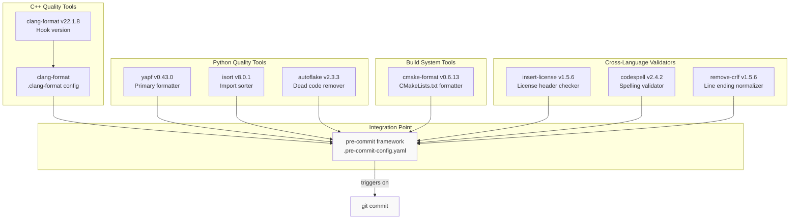
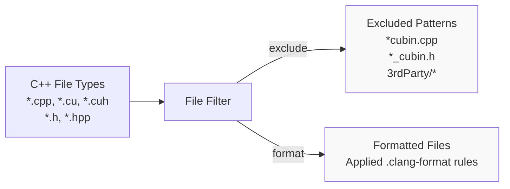

<!-- source: DeepWiki mcp.deepwiki.com · repo NVIDIA/TensorRT-Edge-LLM · page 6.4 Code Quality Tools · fetched 2026-10-26 -->

# Code Quality Tools

Relevant source files

The following files were used as context for generating this wiki page:

- [.clang-format](.clang-format)
- [.pre-commit-config.yaml](.pre-commit-config.yaml)

## Purpose and Scope

This page documents the automated code quality tools used in TensorRT-Edge-LLM to maintain consistent formatting, enforce license compliance, and catch common errors before code review. These tools run automatically via pre-commit hooks during local development and as part of CI/CD pipelines.

For detailed information about configuring and using specific pre-commit hooks, see [Pre-commit Hooks](#6.4.1). For broader contribution guidelines including PR submission and review processes, see [Contributing Workflow](#6.3).

---

## Quality Assurance Tool Ecosystem

The project employs a multi-layered quality assurance strategy combining formatters, linters, and validators that operate on different file types and serve complementary purposes. The orchestration of these tools is managed by the `pre-commit` framework.

### Tool Categories

**Sources**: [.pre-commit-config.yaml:9-72]()

---

## C++ Code Formatting

### clang-format Configuration

The project uses `clang-format` with a custom configuration file [`.clang-format`](.clang-format) based on a modified Allman brace style with east-const enforcement. Key formatting rules include:

| Configuration Parameter | Value | Purpose |
|------------------------|-------|---------|
| `ColumnLimit` | 120 | Maximum line length [.clang-format:48]() |
| `IndentWidth` | 4 | Spaces per indentation level [.clang-format:67]() |
| `PointerAlignment` | Left | Pointer/reference alignment: `int* ptr` [.clang-format:84]() |
| `QualifierAlignment` | Right | East-const: `int const` instead of `const int` [.clang-format:105]() |
| `Standard` | c++17 | C++ language version [.clang-format:98]() |
| `BreakBeforeBraces` | Custom | Brace placement strategy [.clang-format:25]() |

The configuration enforces braces on new lines after control structures, classes, functions, and namespaces [.clang-format:26-44](). It specifically enables `QualifierAlignment: Right` to enforce the "East-Const" style across the codebase [.clang-format:105]().

### Application Scope

clang-format applies to C++ source files with specific exclusions defined in [.pre-commit-config.yaml:46-56]():

Generated cubin files and third-party code are excluded from automatic formatting to preserve original structure [.pre-commit-config.yaml:53-55]().

**Sources**: [.clang-format:1-107](), [.pre-commit-config.yaml:46-56]()

---

## Python Code Formatting

### Primary Formatter: yapf

The project uses `yapf` (v0.43.0) as the primary Python formatter configured in the pre-commit pipeline [.pre-commit-config.yaml:42-45]().

### Import Organization: isort

The `isort` tool (v8.0.1) automatically sorts and organizes Python imports [.pre-commit-config.yaml:10-13](). This ensures consistent import ordering across all Python modules.

### Dead Code Removal: autoflake

The `autoflake` tool (v2.3.3) removes unused imports and variables [.pre-commit-config.yaml:68-72](). It is configured with `--remove-all-unused-imports` and `--remove-unused-variables` to modify files in-place [.pre-commit-config.yaml:72]().

**Sources**: [.pre-commit-config.yaml:10-13,42-45,68-72]()

---

## License Compliance and Validation

### License Header Insertion

The `insert-license` hook (v1.5.6) verifies and inserts license headers in source files.

#### Python License Headers
Applied to `*.py` files with shell comment style [.pre-commit-config.yaml:18-26]():
- License template: `LICENSE_HEADER` file [.pre-commit-config.yaml:22]()
- Comment style: `#` [.pre-commit-config.yaml:24]()
- Checks the top 20 lines for existing licenses [.pre-commit-config.yaml:25]()

#### C++ License Headers
Applied to C++, CUDA, and Header files [.pre-commit-config.yaml:27-41]():
- License template: `LICENSE_HEADER` file [.pre-commit-config.yaml:37]()
- Comment style: `/*| *| */` [.pre-commit-config.yaml:39]()
- Exclusions: `*cubin.cpp`, `*_cubin.h`, and `3rdParty/` [.pre-commit-config.yaml:29-34]()

### Spelling Validation: codespell

The `codespell` tool (v2.4.2) checks for common spelling mistakes [.pre-commit-config.yaml:61-67](). It uses a custom ignore list for domain-specific terms like `rouge`, `inout`, `atleast`, `strat`, `nd`, `subtile`, `thrid`, `ans`, `datas`, `thw`, and `mot` [.pre-commit-config.yaml:66](). JSON files are excluded from spelling checks [.pre-commit-config.yaml:67]().

### Line Ending Normalization

The `remove-crlf` hook ensures Unix-style line endings (LF) across the repository [.pre-commit-config.yaml:17]().

**Sources**: [.pre-commit-config.yaml:14-41,61-67]()

---

## Build System Formatting

### cmake-format

CMake build files are formatted using `cmake-format` (v0.6.13) [.pre-commit-config.yaml:57-60](). This ensures consistent formatting in `CMakeLists.txt` and `.cmake` files.

**Sources**: [.pre-commit-config.yaml:57-60]()

---

## Global Exclusion Patterns

The pre-commit configuration defines repository-wide exclusions to prevent quality tools from modifying external or generated code [.pre-commit-config.yaml:1-7]():

| Pattern | Reason |
|---------|--------|
| `3rdParty/.*` | External dependencies with their own style |
| `cpp/common/json/jsmn.h` | Third-party JSON parser library |
| `kernelSrcs/.*` | Generated or DSL-based kernel sources (e.g., CuTe DSL) |

**Sources**: [.pre-commit-config.yaml:1-7]()

---

## Tool Version Requirements

The following table summarizes the pinned versions for the quality tools as defined in the pre-commit configuration:

| Tool | Version (Revision) | Source |
|------|---------|--------|
| `isort` | 8.0.1 | [.pre-commit-config.yaml:11]() |
| `insert-license` | v1.5.6 | [.pre-commit-config.yaml:15]() |
| `yapf` | v0.43.0 | [.pre-commit-config.yaml:43]() |
| `clang-format` | v22.1.8 | [.pre-commit-config.yaml:47]() |
| `cmake-format` | v0.6.13 | [.pre-commit-config.yaml:58]() |
| `codespell` | v2.4.2 | [.pre-commit-config.yaml:62]() |
| `autoflake` | v2.3.3 | [.pre-commit-config.yaml:69]() |

**Sources**: [.pre-commit-config.yaml:9-72]()

---

