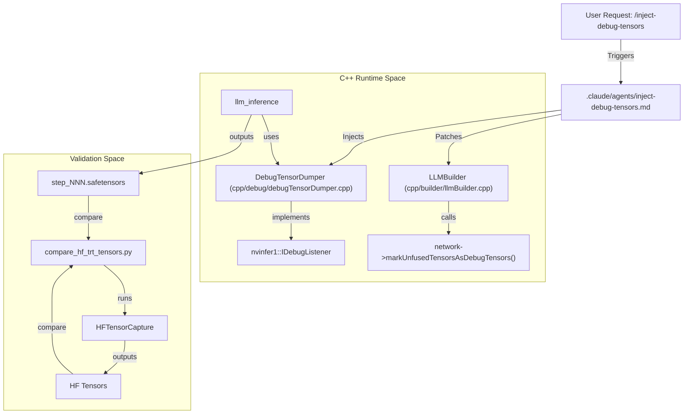
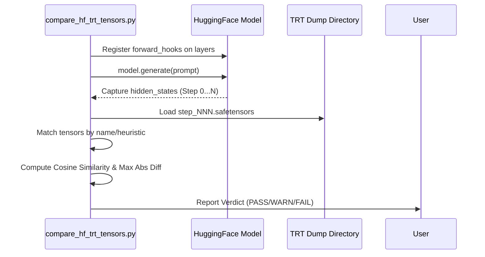

<!-- source: DeepWiki mcp.deepwiki.com · repo NVIDIA/TensorRT-Edge-LLM · page 6.6 Debugging and Accuracy Validation · fetched 2026-10-26 -->

# Debugging and Accuracy Validation

Relevant source files

The following files were used as context for generating this wiki page:

- [.claude/agents/inject-debug-tensors.md](.claude/agents/inject-debug-tensors.md)
- [.claude/agents/inject-debug-tensors/compare_hf_trt_tensors.py](.claude/agents/inject-debug-tensors/compare_hf_trt_tensors.py)
- [.claude/agents/inject-debug-tensors/debugTensorDumper.cpp](.claude/agents/inject-debug-tensors/debugTensorDumper.cpp)
- [.claude/agents/inject-debug-tensors/debugTensorDumper.h](.claude/agents/inject-debug-tensors/debugTensorDumper.h)
- [.claude/agents/inject-debug-tensors/debug_README.md](.claude/agents/inject-debug-tensors/debug_README.md)
- [.claude/agents/inject-debug-tensors/existing_files.patch](.claude/agents/inject-debug-tensors/existing_files.patch)

This page documents the workflow for validating the numerical accuracy of TensorRT engines against HuggingFace reference models. The system utilizes TensorRT's `IDebugListener` API (available in TRT >= 10.12) to capture intermediate activations without modifying the model architecture.

## Overview

The validation workflow follows a three-stage process to isolate numerical divergence:
1.  **Build**: Compile engines with debug metadata using the `--debugTensors` flag.
2.  **Dump**: Execute inference using `llm_inference` with `--dumpTensors` to export every unfused activation to `.safetensors` files.
3.  **Compare**: Use the `compare_hf_trt_tensors.py` script to run the same prompt through a HuggingFace reference model and compute layer-by-layer similarity metrics.

### System Flow: Natural Language to Code Entities

The following diagram illustrates how user-level debugging requests translate into specific C++ and Python components within the codebase.

**Accuracy Validation Architecture**

Sources: [.claude/agents/inject-debug-tensors.md:1-10](), [.claude/agents/inject-debug-tensors/debug_README.md:9-15](), [.claude/agents/inject-debug-tensors/debugTensorDumper.h:44-45](), [.claude/agents/inject-debug-tensors/existing_files.patch:38-41]()

## The `inject-debug-tensors` Agent

The `inject-debug-tensors` agent is a specialized automation tool that temporarily modifies the working tree to enable deep-tensor inspection. It performs a "clean" injection by ensuring the git status is clear before applying patches and reverting all changes after the validation is complete [.claude/agents/inject-debug-tensors.md:31-45]().

### Key Responsibilities
- **Environment Verification**: Checks for TensorRT version >= 10.12 via `NvInferVersion.h` to ensure `IDebugListener` support [.claude/agents/inject-debug-tensors.md:61-68]().
- **Source Injection**: Copies `DebugTensorDumper.cpp/h` into the core library and patches `LLMBuilder` and `VisualBuilder` to support the `debugTensors` configuration [.claude/agents/inject-debug-tensors.md:74-88]().
- **Automated Pipeline**: Handles the full lifecycle: Building C++ tools -> Exporting ONNX -> Building Engine -> Running Inference -> Comparing Tensors [.claude/agents/inject-debug-tensors.md:92-191]().

Sources: [.claude/agents/inject-debug-tensors.md:1-191]()

## C++ Debug Infrastructure

The core of the debugging system is the `DebugTensorDumper` class, which implements the TensorRT `IDebugListener` interface.

### `DebugTensorDumper` Class
Located in `.claude/agents/inject-debug-tensors/debugTensorDumper.h`, this class intercepts every intermediate tensor produced by the TRT engine during execution.

| Function | Description |
| :--- | :--- |
| `processDebugTensor` | Callback invoked by TRT for each unfused tensor. It performs a `cudaMemcpy` from device to a host-side `rt::Tensor` [.claude/agents/inject-debug-tensors/debugTensorDumper.cpp:75-133](). |
| `beginStep` | Resets the internal state and sets a label (e.g., "prefill", "decode") for the next inference pass [.claude/agents/inject-debug-tensors/debugTensorDumper.cpp:42-47](). |
| `flush` | Serializes all captured tensors for the current step into a `.safetensors` file using `rt::safetensors::saveSafetensors` [.claude/agents/inject-debug-tensors/debugTensorDumper.cpp:49-73](). |

### Engine Building Requirements
To enable runtime dumping, engines must be built with the `debugTensors` flag set to `true` in `LLMBuilderConfig` or `VisualBuilderConfig`. This triggers a call to `network->markUnfusedTensorsAsDebugTensors()` during the network definition phase [.claude/agents/inject-debug-tensors/existing_files.patch:38-41]().

### Multimodal Extensions
The debug infrastructure is integrated into multimodal runners to ensure parity across vision and audio components. For example, `Qwen3OmniAudioRunner` uses `mDebugTensorDumper` to label and capture audio encoder chunks during preprocessing [.claude/agents/inject-debug-tensors/existing_files.patch:163-167]().

Sources: [.claude/agents/inject-debug-tensors/debugTensorDumper.h:44-86](), [.claude/agents/inject-debug-tensors/debugTensorDumper.cpp:27-137](), [.claude/agents/inject-debug-tensors/existing_files.patch:68](), [.claude/agents/inject-debug-tensors/existing_files.patch:116](), [.claude/agents/inject-debug-tensors/existing_files.patch:163-167]()

## Accuracy Comparison Logic

The `compare_hf_trt_tensors.py` script acts as the ground-truth reference. It uses HuggingFace `transformers` to capture activations and matches them against TRT outputs.

### Data Flow: HF vs TRT Comparison

Sources: [.claude/agents/inject-debug-tensors/compare_hf_trt_tensors.py:162-171](), [.claude/agents/inject-debug-tensors/compare_hf_trt_tensors.py:26-41]()

### Comparison Metrics
The script evaluates the following metrics for every matched tensor pair:
- **Cosine Similarity**: Primary metric for vector orientation alignment. Targets `> 0.999` for FP16 precision [.claude/agents/inject-debug-tensors/debug_README.md:119]().
- **Max Absolute Difference**: Measures the largest element-wise divergence [.claude/agents/inject-debug-tensors/debug_README.md:120]().
- **Relative L∞ error**: Max difference normalized by the maximum value in the TRT tensor [.claude/agents/inject-debug-tensors/debug_README.md:121]().

### Handling Multimodal Models
For Vision-Language Models (VLMs), the script accounts for architectural differences in prefill:
- **Prefill Mismatch**: In models like Qwen3-VL, HF might embed raw patches while TRT uses compressed visual features. The script identifies these expected shape mismatches [.claude/agents/inject-debug-tensors/debug_README.md:166-170]().
- **Visual Encoder**: The script can separately compare the visual backbone using `--multimodal-trt-dump` [.claude/agents/inject-debug-tensors/compare_hf_trt_tensors.py:65]().

Sources: [.claude/agents/inject-debug-tensors/compare_hf_trt_tensors.py:15-75](), [.claude/agents/inject-debug-tensors/debug_README.md:105-123]()

---

