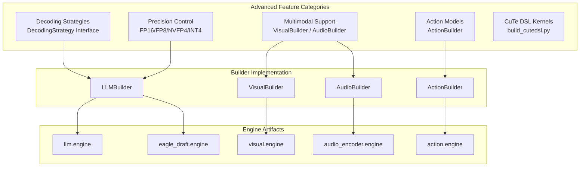
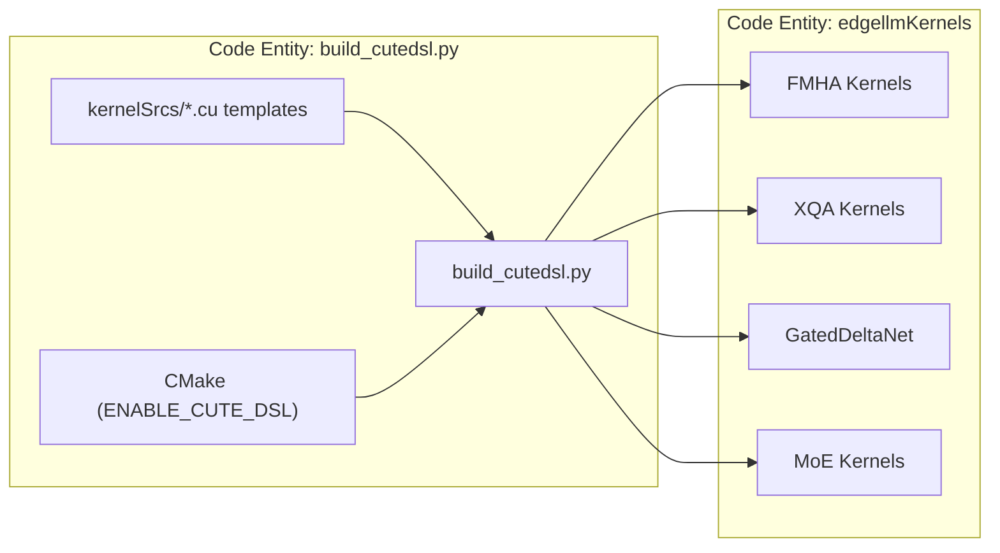

<!-- source: DeepWiki mcp.deepwiki.com · repo NVIDIA/TensorRT-Edge-LLM · page 7 Advanced Features · fetched 2026-10-26 -->

# Advanced Features

Relevant source files

The following files were used as context for generating this wiki page:

- [cpp/common/pagedKvTypes.h](cpp/common/pagedKvTypes.h)
- [cpp/common/ropeUtils.h](cpp/common/ropeUtils.h)

This document covers the advanced capabilities of TensorRT-Edge-LLM that extend beyond basic LLM inference. These features include specialized decoding strategies for improved throughput, multimodal vision and audio processing, action models for robotics, quantization techniques for memory and compute efficiency, and performance optimizations for reducing latency on edge devices.

For basic inference workflow and engine building, see [Model Deployment Workflow](#3). For core architecture components, see [Architecture](#4).

---

## Overview of Advanced Capabilities

TensorRT-Edge-LLM provides several categories of advanced features designed for production edge deployments:

| Feature Category | Key Capabilities | Primary Benefit |
|-----------------|------------------|-----------------|
| **Decoding Strategies** | Vanilla, EAGLE3, MTP, DFlash, DSpark, BlockDiffusion | Improved throughput via parallel token generation |
| **Multimodal Support** | VLM (Vision), ASR/TTS (Audio), Omni models | Process images, audio, and text in unified pipelines |
| **Action Models** | Alpamayo 1 trajectory prediction | Low-latency inference for robotics control |
| **Precision/Quantization** | FP16, FP8, NVFP4, INT4/INT4_GPTQ/AWQ | Reduced memory footprint and compute cost |
| **Performance Optimizations** | CUDA Graph, LoRA, Paged KV Cache Reuse | Lower latency and efficient memory utilization |
| **CuTe DSL Kernels** | Just-in-time kernel generation | Highly optimized hardware-specific kernels |

**Sources**: [cpp/builder/llmBuilder.cpp:37-189](), [cpp/builder/visualBuilder.cpp:41-130](), [cpp/builder/audioBuilder.cpp:91-208]()

---

## Decoding Strategies

TensorRT-Edge-LLM supports multiple decoding approaches that trade off implementation complexity for throughput gains. The system utilizes a pluggable `DecodingStrategy` interface to manage these behaviors. For details, see [Decoding Strategies](#7.1).

*   **Vanilla and MTP**: Standard autoregressive generation and Multi-Token Prediction.
*   **EAGLE3 Speculative Decoding**: Uses tree-structured token candidates with a Draft and Base model pair [cpp/builder/llmBuilder.cpp:123-130]().
*   **DFlash**: Speculative decoding with `DDTree` for Qwen3/Qwen3.5 hybrid models.
*   **DSpark and BlockDiffusion**: Advanced strategies for DSpark drafting and non-autoregressive diffusion-based generation.

---

## Multimodal Support

The SDK extends language models with vision and audio capabilities through specialized builders and runners. For details, see [Multimodal Support](#7.2).

### Vision-Language Models (VLM)
The `VisualBuilder` handles Vision Transformer (VIT) models. It supports dynamic image token counts and specialized features like Phi-4MM GN projection weights [cpp/builder/visualBuilder.cpp:101-115]().

### Audio and Omni Models
The `AudioBuilder` supports audio processing components including Audio Encoders and Code2Wav engines for models like Qwen3-Omni [cpp/builder/audioBuilder.cpp:122-141](). It manages optimization profiles for variable time steps and code lengths.

---

## Precision and Quantization

TensorRT-Edge-LLM supports multiple precision formats to balance accuracy and efficiency on edge hardware. For details, see [Precision and Quantization](#7.3).

| Precision | Bits | Data Type | Usage |
|-----------|------|-----------|-------|
| **FP8** | 8 | E4M3 | Supported for KV cache and weights |
| **NVFP4** | 4 | 4-bit float | Next-gen efficiency |
| **INT4** | 4 | Integer | Weight-only, GPTQ, or AWQ (e.g., Gemma4 26B-A4B) |

The `LLMBuilder` also implements **Vocabulary Reduction**, which shrinks the `lm_head` projection size to improve performance [cpp/builder/llmBuilder.cpp:179-183]().

---

## Performance Optimizations

Advanced runtime and build-time optimizations are available to maximize hardware utilization. For details, see [Performance Optimizations](#7.4).

*   **CUDA Graph**: The `EngineExecutor` allows capturing kernel sequences to eliminate CPU launch overhead.
*   **Paged KV Cache Reuse**: The `ContextCacheManager` enables reusing KV cache blocks across multi-turn requests using a hashing mechanism. Page sizes are fixed at `kTOKENS_PER_PAGE = 128` [cpp/common/pagedKvTypes.h:27-27]().
*   **RoPE Optimizations**: The system handles various Rotary Positional Embedding variants including Gemma4 sliding RoPE, LongRoPE, and Proportional RoPE via `getRotaryDim` [cpp/common/ropeUtils.h:27-63]().
*   **LoRA Support**: `LLMBuilder` supports LoRA-enabled ONNX models, allowing dynamic rank adaptation [cpp/builder/llmBuilder.cpp:65-70]().

---

## Action Models

For robotics and trajectory prediction use cases, the SDK supports **Alpamayo 1** action models. The `ActionBuilder` generates engines specifically for these trajectory-based inference pipelines. For details, see [Action Models](#7.5).

---

## CuTe DSL Kernel Sources

The `kernelSrcs/` directory contains templates for generating highly optimized CUDA kernels using the CuTe DSL. This includes kernels for FMHA, XQA, GatedDeltaNet (GDN), and MoE. For details, see [CuTe DSL Kernel Sources](#7.6).

**Sources**: [cpp/common/ropeUtils.h:27-63](), [cpp/common/pagedKvTypes.h:23-63](), [cpp/builder/llmBuilder.cpp:1-200](), [cpp/builder/visualBuilder.cpp:1-131](), [cpp/builder/audioBuilder.cpp:1-208]()

---

