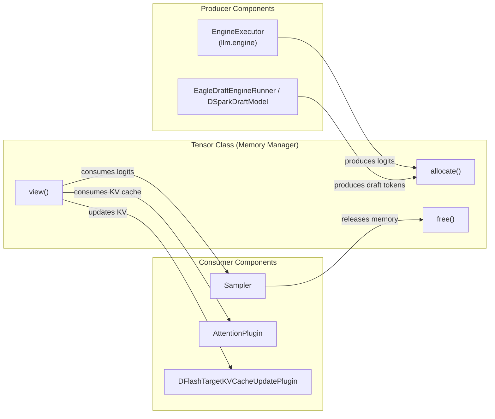
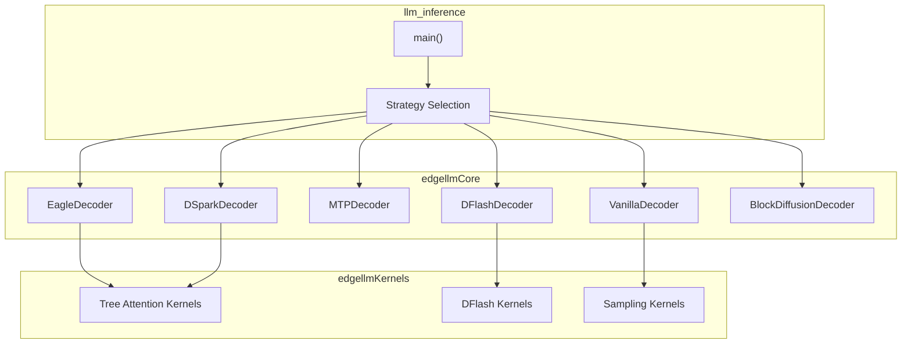

<!-- source: DeepWiki mcp.deepwiki.com · repo NVIDIA/TensorRT-Edge-LLM · page 7.1 Decoding Strategies · fetched 2026-10-26 -->

# Decoding Strategies

<details>
<summary>Relevant source files</summary>

The following files were used as context for generating this wiki page:

- [cpp/common/hashUtils.h](cpp/common/hashUtils.h)
- [cpp/common/pagedKvTypes.h](cpp/common/pagedKvTypes.h)
- [cpp/common/ropeUtils.h](cpp/common/ropeUtils.h)

</details>


## Purpose and Scope

This document provides a high-level overview of the decoding strategies implemented in TensorRT-Edge-LLM for autoregressive text generation. It explains the pluggable decoding architecture, including standard autoregressive (Vanilla), Multi-Token Prediction (MTP), and speculative execution methods (EAGLE3, DFlash, and DSpark), as well as non-autoregressive strategies like BlockDiffusion. These strategies leverage a consumer-producer design pattern with the `Tensor` class for memory management and the `ContextCacheManager` for paged KV-cache reuse.

For detailed implementation of each strategy, see:
- [Vanilla and MTP Decoding](#7.1.1) — Standard autoregressive decoding (`VanillaDecoder`) and Multi-Token Prediction (`MTPDecoder`).
- [EAGLE3 and DFlash Speculative Decoding](#7.1.2) — Tree-based speculative execution (`EagleDecoder`) and DFlash with `DDTree` for hybrid models.
- [DSpark and BlockDiffusion Decoding](#7.1.3) — DSpark speculative decoding with `DDTree` drafting and BlockDiffusion non-autoregressive decoding for `DiffusionGemma`.

For information about the runtime components that support these strategies, see [Runtime Components](#4.3).

---

## Overview

TensorRT-Edge-LLM supports several decoding strategies to optimize inference for different model architectures and performance requirements. As of version 0.10.0, the framework supports the following strategies:

| Strategy | Description | Key Feature | Use Case |
|----------|-------------|-------------|----------|
| **Vanilla Decoding** | Standard autoregressive token generation | Single-token prediction per iteration | Baseline inference, guaranteed correctness |
| **MTP Decoding** | Multi-Token Prediction | Predicts $N$ future tokens in one pass | DeepSeek-style MTP architectures |
| **EAGLE3 Speculative** | Tree-based speculative execution | Draft model + Parallel verification | Accelerated inference via speculative draft |
| **DFlash / DDTree** | Speculative decoding for hybrid models | Dual-path (e.g., Qwen3/3.5) verification | Hybrid Transformer/Mamba or specialized hybrids |
| **DSpark Speculative** | Draft-Verify speculative decoding | `DDTree` drafting logic | High-performance speculative inference (v0.10.0) |
| **BlockDiffusion** | Non-autoregressive decoding | Block-wise diffusion generation | `DiffusionGemma` architectures (v0.10.0) |
| **Gemma4MTP** | Unified multimodal MTP | Optimized for Gemma4 architectures | Audio/Vision unified MTP generation |

**Sources:** [CHANGELOG.md:4-4](), [CHANGELOG.md:12-12](), [cpp/builder/llmBuilder.cpp:123-134]()

---

## Architectural Differences

### Standard vs. Speculative vs. Diffusion Flow

```mermaid
graph TB
    subgraph "Standard Decoding (Vanilla/MTP)"
        V_INPUT["Input IDs"]
        V_CONTEXT["Context Phase<br/>(Prefill)"]
        V_GEN["Generation Phase<br/>(VanillaDecoder / MTPDecoder)"]
        V_SAMPLER["Sampler"]
        V_OUTPUT["Output Token(s)"]
        
        V_INPUT --> V_CONTEXT
        V_CONTEXT --> V_GEN
        V_GEN --> V_SAMPLER
        V_SAMPLER --> V_OUTPUT
        V_OUTPUT -.next iteration.-> V_GEN
    end
    
    subgraph "Speculative Decoding (EAGLE3/DFlash/DSpark)"
        E_INPUT["Input IDs"]
        E_CONTEXT["Context Phase<br/>(Prefill)"]
        E_DRAFT["Draft Logic<br/>(EagleDraftEngineRunner / DSparkDraftModel)"]
        E_TREE["Tree Attention / DDTree<br/>(Parallel Verification)"]
        E_VERIFY["Verification Logic"]
        E_SAMPLER["Sampler"]
        E_OUTPUT["Accepted Tokens"]
        
        E_INPUT --> E_CONTEXT
        E_CONTEXT --> E_DRAFT
        E_DRAFT --> E_TREE
        E_TREE --> E_VERIFY
        E_VERIFY --> E_SAMPLER
        E_SAMPLER --> E_OUTPUT
        E_OUTPUT -.next iteration.-> E_DRAFT
    end

    subgraph "Non-Autoregressive (BlockDiffusion)"
        D_INPUT["Input Latents/IDs"]
        D_BACKBONE["DiffusionGemmaBackbone"]
        D_BLOCK["BlockDiffusionDecoder"]
        D_OUTPUT["Generated Block"]

        D_INPUT --> D_BACKBONE
        D_BACKBONE --> D_BLOCK
        D_BLOCK --> D_OUTPUT
    end
```



**Diagram: High-Level Comparison of Decoding Flows**

**Sources:** [CHANGELOG.md:4-4](), [CHANGELOG.md:12-12](), [cpp/builder/llmBuilder.cpp:123-134]()

---

## Consumer-Producer Architecture

All decoding strategies use a unified consumer-producer design pattern where the `Tensor` class manages runtime memory.

### Memory Management and Hashing

The `Tensor` class provides centralized memory management, zero-copy views, and lifetime management. To manage complex mappings (such as tensor names or shapes to memory locations), the codebase utilizes `hash_utils::HashMap` [cpp/common/hashUtils.h:75-76](), which employs a `hashCombine` algorithm [cpp/common/hashUtils.h:40-45]() to create composite hash values for tuples.



**Diagram: Consumer-Producer Design with Tensor Class**

**Sources:** [CHANGELOG.md:12-12](), [cpp/common/hashUtils.h:40-76](), [cpp/builder/llmBuilder.cpp:123-134]()

---

## Paged KV-Cache Management

A critical component for all decoding strategies is the paged KV-cache system. This system allows for efficient memory allocation and cross-request reuse.

- **Page Size**: Defined as `kTOKENS_PER_PAGE = 128` [cpp/common/pagedKvTypes.h:27]().
- **Pool Management**: The system calculates the minimum required pages for a KV pool based on `maxBatchSize` and `maxKVCacheCapacity` [cpp/common/pagedKvTypes.h:56-61]().
- **Addressing**: Uses `kUNUSED_PAGE_ENTRY = -1` for unallocated entries [cpp/common/pagedKvTypes.h:30]().

**Sources:** [cpp/common/pagedKvTypes.h:26-61]()

---

## Runtime Integration

### Component Interaction

The `llm_inference` executable selects the appropriate runtime based on configuration. All strategies interface with core kernels for performance.



**Diagram: Runtime Components and Decoding Strategy Integration**

**Sources:** [CHANGELOG.md:14-17](), [CHANGELOG.md:53-53](), [cpp/common/trtUtils.h:56-75]()

---

## Configuration and Selection

### Strategy Selection

The decoding strategy is determined at runtime based on the model configuration. The `LLMBuilder` differentiates between base and draft engines during the build phase:

```cpp
// Determine engine file name based on builder config
if (mBuilderConfig.eagleDraft) {
    engineFileName = "eagle_draft.engine";
} else if (mBuilderConfig.eagleBase) {
    engineFileName = "eagle_base.engine";
} else {
    engineFileName = "llm.engine";
}
```
[cpp/builder/llmBuilder.cpp:123-134]()

### RoPE Configuration

Decoding strategies also rely on proper RoPE (Rotary Positional Embedding) configuration, especially for tree-based attention. The system supports various RoPE types, including `proportional` RoPE, which affects the `rotaryDim` consumed by the attention plugin [cpp/common/ropeUtils.h:50-63]().

**Sources:** [cpp/builder/llmBuilder.cpp:123-134](), [cpp/common/ropeUtils.h:50-63]()

---

## Optimization Features

### CUDA Graph Support
All decoding strategies support CUDA Graph optimization to reduce kernel launch overhead. The runtime can capture graphs from the execution context via `captureTRTCudaGraph` [cpp/common/trtUtils.h:90-91]().

### Vocab Reduction
The vocab reduction optimization improves `lm_head` computation time by limiting the vocabulary size during token prediction, managed via `copyVocabMappingFiles()` [cpp/builder/llmBuilder.cpp:179-182]().

**Sources:** [CHANGELOG.md:6-6](), [cpp/common/trtUtils.h:90-91](), [cpp/builder/llmBuilder.cpp:179-182]()

---

## Summary

TensorRT-Edge-LLM provides a pluggable decoding framework that accommodates:

1.  **Standard Autoregressive**: Vanilla and MTP for direct token generation.
2.  **Speculative Execution**: EAGLE3, DFlash, and DSpark for high-throughput verification-based decoding.
3.  **Non-Autoregressive**: BlockDiffusion for modern diffusion-based language models.

These strategies ensure efficient resource utilization across NVIDIA edge platforms by leveraging optimized CUDA kernels, paged KV-cache management, and a unified memory management system.

**Sources:** [CHANGELOG.md:4-4](), [CHANGELOG.md:12-12](), [cpp/common/pagedKvTypes.h:26-61](), [cpp/builder/llmBuilder.cpp:123-134]()

---

