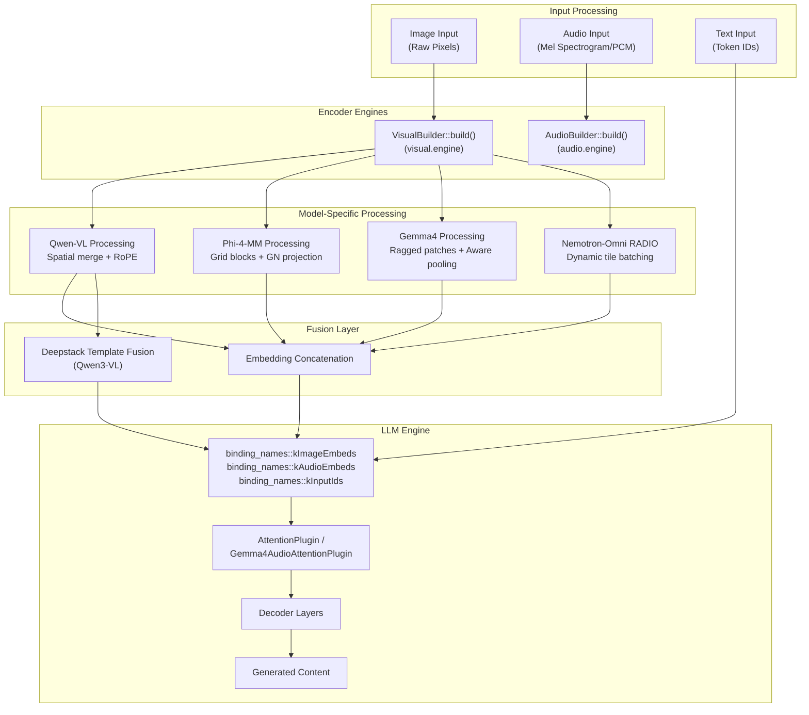
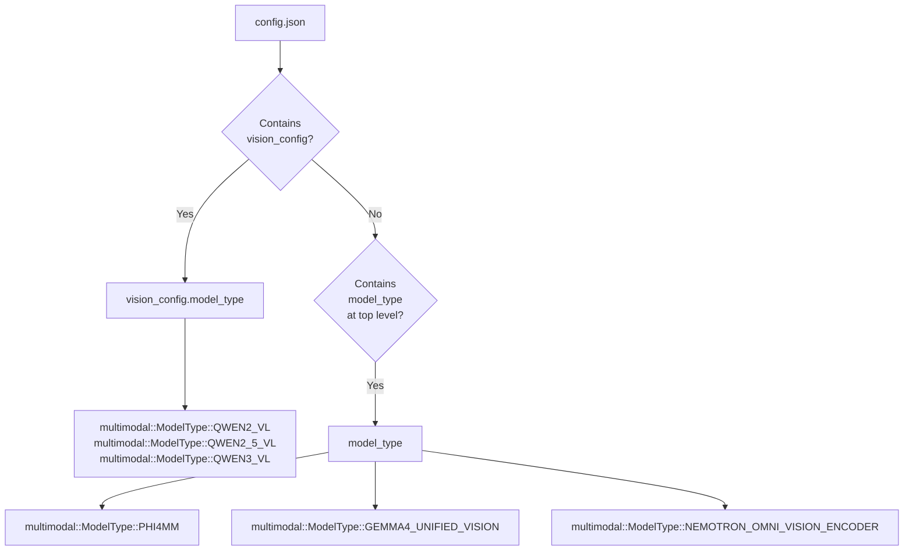

<!-- source: DeepWiki mcp.deepwiki.com · repo NVIDIA/TensorRT-Edge-LLM · page 7.2 Multimodal Support · fetched 2026-10-26 -->

# Multimodal Support

Relevant source files

The following files were used as context for generating this wiki page:

- [cpp/kernels/audioAttentionKernels/gemma4AudioAttention.cu](cpp/kernels/audioAttentionKernels/gemma4AudioAttention.cu)
- [cpp/kernels/audioAttentionKernels/gemma4AudioAttention.h](cpp/kernels/audioAttentionKernels/gemma4AudioAttention.h)

## Purpose and Scope

This document describes the multimodal capabilities of TensorRT-Edge-LLM, which enable Vision-Language Models (VLMs) and Audio-Language Models to process image, audio, and text inputs. The system supports multiple multimodal architectures with different encoders (Vision Transformers, Audio Encoders) and fusion strategies. For details on specific supported models, see [Supported Multimodal Models](#7.2.1). For vision transformer implementation details, see [Vision Transformer Integration](#7.2.2).

**Sources:** [cpp/builder/visualBuilder.cpp:162-212](), [cpp/builder/visualBuilder.h:35-37]()

## Multimodal Architecture Overview

The multimodal inference pipeline separates non-text processing from language model execution through a multi-engine architecture. A dedicated encoder engine (Vision Transformer or Audio Encoder) processes raw signals into embeddings, which are then fused with text tokens for autoregressive generation in the LLM engine.

**Diagram: End-to-End Multimodal Pipeline**

**Sources:** [cpp/builder/visualBuilder.cpp:41-131](), [cpp/builder/visualBuilder.cpp:164-212](), [cpp/builder/audioBuilder.cpp:43-132](), [cpp/kernels/audioAttentionKernels/gemma4AudioAttention.h:44-71]()

## Vision Processing System

The vision processing system is managed by the `VisualBuilder` class, which creates optimized TensorRT engines for different VLM architectures. Each model type requires specific input configurations and optimization profiles.

### VisualBuilder Class

The `VisualBuilder` [cpp/builder/visualBuilder.h:99-170]() constructs vision transformer engines from ONNX models. Key responsibilities:

| Responsibility | Method | Description |
|----------------|--------|-------------|
| Configuration parsing | `parseConfig()` [cpp/builder/visualBuilder.cpp:133-255]() | Reads model type and vision-specific parameters from `config.json` |
| Engine building | `build()` [cpp/builder/visualBuilder.cpp:41-131]() | Creates TensorRT engine with optimization profiles |
| Profile setup | `setupVisualOptimizationProfile()` [cpp/builder/visualBuilder.cpp:257-302]() | Configures dynamic shape ranges for vision inputs |
| Architecture profiles | `setupQwenViTProfile()` / `setupInternPhi4ViTProfile()` / `setupGemma4ViTProfile()` | Sets up architecture-specific optimization profiles |

**Sources:** [cpp/builder/visualBuilder.cpp:33-131](), [cpp/builder/visualBuilder.h:99-170]()

### Model Type Detection

The builder determines the multimodal architecture from the configuration file structure:

**Diagram: Model Type Detection Logic**

**Sources:** [cpp/builder/visualBuilder.cpp:146-162](), [cpp/builder/visualBuilder.h:125-126]()

## Optimization Profiles for Multimodal Models

Multimodal models require dynamic shape optimization profiles to handle variable input token counts (e.g., different image resolutions or audio lengths).

### Qwen-VL Profile Configuration
Qwen-VL models (Qwen2-VL, Qwen2.5-VL, Qwen3-VL) use a spatial merge approach where visual tokens depend on image resolution. The `setupQwenViTProfile()` [cpp/builder/visualBuilder.cpp:304-365]() method configures mandatory inputs like `kVisualInput` and version-specific inputs like `kFastPosEmbIdx` (Qwen3-VL).

### Gemma4 Unified Vision Profile
Gemma4 models utilize a specific vision encoder requiring ragged patches and position-aware pooling. The `setupGemma4ViTProfile()` [cpp/builder/visualBuilder.cpp:425-467]() method configures the optimization profile for these unique inputs, including `ragged_patch_ids` and `pos_ids`.

### Audio Profile Configuration
For audio models like Qwen3-ASR or Gemma4-Audio, the `AudioBuilder` handles optimization profiles via `setupAudioOptimizationProfile()` [cpp/builder/audioBuilder.cpp:177-217](), configuring inputs such as `kAudioInput` and `kAudioInputLen`.

**Sources:** [cpp/builder/visualBuilder.cpp:304-467](), [cpp/builder/audioBuilder.cpp:177-217]()

## Multimodal Fusion Strategies

### Embedding Concatenation
Standard fusion treats image or audio embeddings as additional tokens in the input sequence. This is the baseline approach for most supported VLMs (Qwen-VL, Phi-4-MM, InternVL).

### Deepstack Template-Based Fusion
Qwen3-VL introduces a template-based fusion mechanism using Deepstack features. This allows for structured composition of visual features with text using predefined templates, requiring specific optimization profiles for `deepstack_features_*` inputs [cpp/builder/visualBuilder.cpp:209-253]().

**Sources:** [cpp/builder/visualBuilder.cpp:209-253]()

## Audio Processing and Attention

For specialized audio models like Gemma 4, the runtime includes optimized kernels for the audio-encoder attention body. This includes the `gemma4AudioAttentionForward` function [cpp/kernels/audioAttentionKernels/gemma4AudioAttention.h:69-71](), which implements fused chunked local attention.

Key features of the audio attention kernel:
* **Fused Execution:** One CTA handles a full (batch, head, chunk) calculation, fusing scaling, GEMMs, relative shift, soft-cap, masking, and softmax [cpp/kernels/audioAttentionKernels/gemma4AudioAttention.cu:50-54]().
* **Scaling and Cap:** Implements per-dim learned query scale via `softplus(gamma)` and a `tanh` soft-cap on logits [cpp/kernels/audioAttentionKernels/gemma4AudioAttention.cu:26-39]().
* **Relative Position:** Uses query-dependent relative-position scores with Transformer-XL blocked shift [cpp/kernels/audioAttentionKernels/gemma4AudioAttention.cu:33-37]().

**Sources:** [cpp/kernels/audioAttentionKernels/gemma4AudioAttention.cu:19-59](), [cpp/kernels/audioAttentionKernels/gemma4AudioAttention.h:36-71]()

## File Artifacts for Multimodal Models

| File | Purpose | Models | Source Code |
|------|---------|--------|-------------|
| `visual.engine` | TensorRT engine for vision transformer | All VLMs | [cpp/builder/visualBuilder.cpp:118-122]() |
| `audio.engine` | TensorRT engine for audio encoder | Audio/Omni Models | [cpp/builder/audioBuilder.cpp:119-123]() |
| `phi4mm_gn_proj.safetensors` | Grid Newline projection weights | Phi-4-MM only | [cpp/builder/visualBuilder.cpp:101-115]() |

**Sources:** [cpp/builder/visualBuilder.cpp:101-122](), [cpp/builder/audioBuilder.cpp:119-123]()

---

