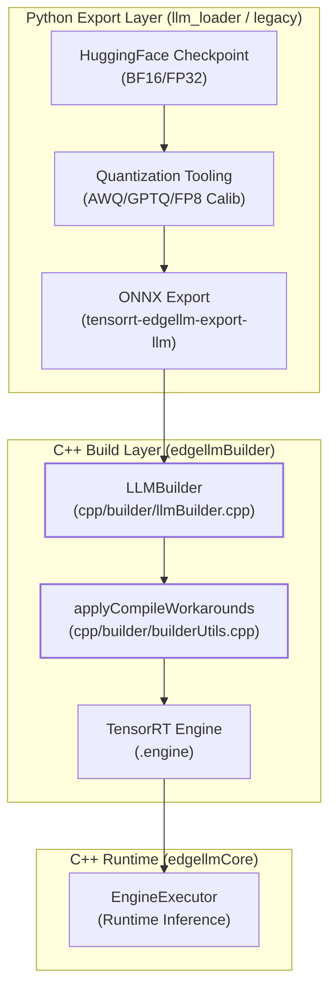
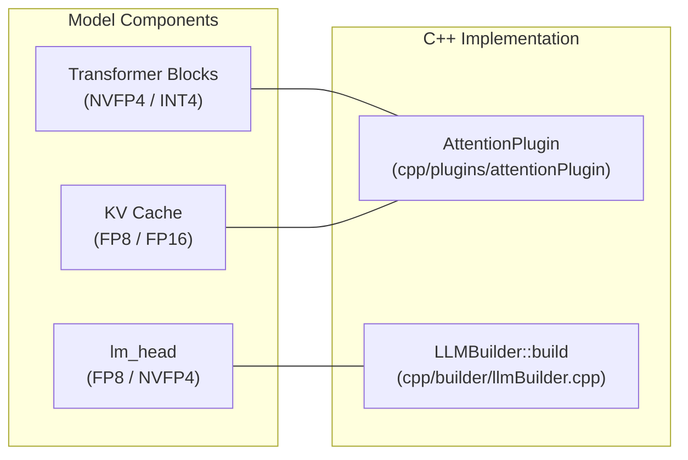

<!-- source: DeepWiki mcp.deepwiki.com · repo NVIDIA/TensorRT-Edge-LLM · page 7.3 Precision and Quantization · fetched 2026-10-26 -->

# Precision and Quantization

Relevant source files

The following files were used as context for generating this wiki page:

- [cpp/builder/builderUtils.cpp](cpp/builder/builderUtils.cpp)
- [cpp/builder/builderUtils.h](cpp/builder/builderUtils.h)

## Purpose and Scope

This page provides a high-level guide to the precision types and quantization strategies supported by TensorRT-Edge-LLM. It covers the quantization pipeline, supported formats (FP16, FP8, NVFP4, INT4), and the integration between Python-based quantization tools and the C++ engine building process.

For detailed technical specifications of each format, see [Quantization Options](#7.3.1). For advanced optimizations like `lm_head` quantization and KV cache precision, see [Component-Specific Quantization](#7.3.2).

---

## Overview

TensorRT-Edge-LLM balances model accuracy, inference speed, and memory footprint on edge devices through a variety of precision formats. The system supports:

- **FP16/BF16**: Standard 16-bit floating-point formats used as baselines.
- **FP8**: 8-bit floating-point (E4M3), providing ~2x memory reduction.
- **NVFP4**: NVIDIA 4-bit floating-point format for aggressive optimization (SM 120+).
- **INT4 (GPTQ/AWQ)**: 4-bit integer quantization for maximum compression, including specialized support for MoE models like Gemma 4 26B-A4B.

Quantization metadata is typically preserved during the ONNX export phase and then consumed by the `LLMBuilder` to generate optimized TensorRT engines.

**Sources:** [cpp/builder/llmBuilder.cpp:141-142](), [cpp/common/trtUtils.h:186-203]()

---

## Quantization Pipeline

The quantization process is a multi-stage workflow starting from HuggingFace checkpoints and ending with a serialized TensorRT engine.

### End-to-End Precision Flow

**Diagram: Precision Lifecycle** - Shows how precision is defined in Python and implemented via the `LLMBuilder` and specialized compile-time workarounds.

**Sources:** [cpp/builder/builderUtils.cpp:52-86](), [cpp/builder/llmBuilder.cpp:37-77]()

---

## Supported Precision Types

The C++ builder and runtime map high-level quantization choices to specific TensorRT `nvinfer1::DataType` values and environment configurations.

| Precision | Bit-Width | Primary Use Case | TRT Data Type |
|-----------|-----------|------------------|---------------|
| **FP16** | 16-bit | Baseline for most edge GPUs | `kHALF` |
| **BF16** | 16-bit | Training parity (Orin/Thor) | `kBF16` |
| **FP8** | 8-bit | SM 89+ (Orin) optimization | `kFP8` |
| **NVFP4** | 4-bit | SM 120+ (Thor) optimization | `kFP4` |
| **INT4** | 4-bit | GPTQ/AWQ Compression | Plugin-based |

### Hardware-Specific Workarounds
During the engine build process, `applyCompileWorkarounds` in `builderUtils.cpp` manages environment variables like `__LUNOWUD` to handle precision-specific compiler behavior, such as disabling dual-GEMM fusion for NVFP4 on specific SM versions.

**Sources:** [cpp/builder/builderUtils.cpp:60-75](), [cpp/common/trtUtils.h:186-203]()

---

## Component-Specific Precision

TensorRT-Edge-LLM allows for heterogeneous precision within a single model. This is critical for maintaining accuracy while reducing the footprint of the largest components.

**Diagram: Component-to-Code Mapping** - Associates specific model components with the C++ entities that handle their precision settings.

### Key Optimization Areas
- **`lm_head` Quantization**: The final projection layer can be quantized independently to reduce memory spikes during vocabulary prediction.
- **KV Cache Precision**: The `AttentionPlugin` supports FP8 KV caching to double the effective context length on memory-constrained devices.
- **Vocab Reduction**: The builder can optimize the vocabulary size based on the model configuration to reduce the `lm_head` weight matrix.

For details on configuring these, see [Component-Specific Quantization](#7.3.2).

**Sources:** [cpp/builder/llmBuilder.cpp:179-182](), [cpp/builder/builderUtils.h:35-38]()

---

## Code Entity Reference

| Code Entity | Location | Role |
|-------------|----------|------|
| `applyCompileWorkarounds` | [cpp/builder/builderUtils.cpp:52]() | Configures TRT compiler flags for FP4/FP8 |
| `LLMBuilder` | [cpp/builder/llmBuilder.cpp:37]() | Orchestrates the build with precision metadata |
| `createBuilderConfig` | [cpp/builder/builderUtils.cpp:95]() | Initializes TRT builder with optimization flags |
| `getDataTypeString` | [cpp/common/trtUtils.h:186]() | Utility for logging precision types |

For implementation details, see child pages:
- [Quantization Options](#7.3.1)
- [Component-Specific Quantization](#7.3.2)

**Sources:** [cpp/builder/builderUtils.cpp:52-111](), [cpp/builder/llmBuilder.cpp:37-189]()

---

