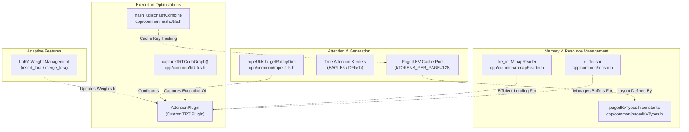

<!-- source: DeepWiki mcp.deepwiki.com · repo NVIDIA/TensorRT-Edge-LLM · page 7.4 Performance Optimizations · fetched 2026-10-26 -->

# Performance Optimizations

Relevant source files

The following files were used as context for generating this wiki page:

- [cpp/common/hashUtils.h](cpp/common/hashUtils.h)
- [cpp/common/pagedKvTypes.h](cpp/common/pagedKvTypes.h)
- [cpp/common/ropeUtils.h](cpp/common/ropeUtils.h)

## Purpose and Scope

This page documents the comprehensive set of performance optimizations implemented in TensorRT-Edge-LLM to maximize inference throughput and minimize latency on resource-constrained NVIDIA edge platforms. The optimizations span multiple layers: kernel execution, memory management, quantization, and model-specific strategies like paged KV cache reuse and RoPE precomputation.

For detailed coverage of specific optimizations:
- CUDA Graph kernel launch optimization: see [CUDA Graph Optimization](#7.4.1)
- Dynamic LoRA adaptation: see [LoRA Support](#7.4.2)
- Speculative decoding with EAGLE3, DFlash, and DSpark: see [Decoding Strategies](#7.1)
- Paged KV-cache reuse and hashing: see [Paged KV-Cache Reuse](#4.3.3)
- Quantization methods (FP8, NVFP4, INT4): see [Precision and Quantization](#7.3)

---

## Performance Optimization Architecture

The following diagram maps high-level optimization concepts to the specific C++ classes and components that implement them within the `trt_edgellm` namespace.

### Logic to Code Entity Map

**Sources**: [cpp/common/tensor.h:221-230](), [cpp/common/trtUtils.h:56-91](), [cpp/common/mmapReader.h:35-36](), [cpp/common/hashUtils.h:75-76](), [cpp/common/pagedKvTypes.h:27-30](), [cpp/common/ropeUtils.h:50-63]()

---

## Kernel Execution Optimizations

### CUDA Graph
CUDA Graph is a critical optimization that captures sequences of CUDA kernel launches into a graph structure, allowing the entire sequence to be replayed with a single API call. This eliminates kernel launch overhead, which is significant on edge devices. The utility function `captureTRTCudaGraph` in `cpp/common/trtUtils.h` is responsible for capturing the execution state from a `nvinfer1::IExecutionContext` into a `cudaGraph_t` [cpp/common/trtUtils.h:88-91]().

### RoPE and Rotary Dimension Optimization
Rotary Position Embeddings (RoPE) are optimized by pre-calculating the rotary dimension and handling variants like Proportional RoPE or Partial RoPE via `getRotaryDim`. By identifying the `rotaryDim` versus the `headDim`, the system avoids unnecessary rotations in the attention kernel for channels outside the rotary dimension [cpp/common/ropeUtils.h:27-63]().

---

## Memory and I/O Optimizations

### Paged KV Cache Layout
To support long-context and multi-turn conversations efficiently, the system uses a paged KV cache layout. The layout is defined by a fixed page size (tokens per page) to enable flexible allocation and reuse.

| Constant / Function | Value / Logic | Purpose |
| :--- | :--- | :--- |
| `kTOKENS_PER_PAGE` | `128` | Standard page size for paged-KV layout [cpp/common/pagedKvTypes.h:27]() |
| `kUNUSED_PAGE_ENTRY` | `-1` | Sentinel for unallocated page-table entries [cpp/common/pagedKvTypes.h:30]() |
| `computeMinimumKvPoolPages` | `maxBatchSize * pagesPerSequence` | Calculates minimum pool size for allocation [cpp/common/pagedKvTypes.h:56-61]() |

**Sources**: [cpp/common/pagedKvTypes.h:27-61]()

### Tensor Class and Consumer-Producer Pattern
The `rt::Tensor` class is the foundational memory abstraction. It supports linear layout tensors where memory can either be owned by the object or reused from another allocation. This design is central to the consumer-producer pattern used throughout the runtime to minimize memory allocation overhead.

**Key Benefits**:
- **Explicit Ownership**: Disables copy constructors to enforce explicit memory ownership transfer [cpp/common/tensor.h:228-230]().
- **Zero-Copy**: Support for constructing non-owned tensors that wrap existing device memory.
- **Dynamic Reshaping**: Supports reshapes without reallocation if the underlying buffer has sufficient capacity [cpp/common/tensor.h:219-220]().

**Sources**: [cpp/common/tensor.h:217-230]()

### High-Performance Hashing
For internal lookups—such as managing cached states in the `ContextCacheManager` or identifying unique configurations—the system employs `hash_utils::HashMap`. This implementation uses a boost-style `hashCombine` algorithm to create composite hash values from tuples of keys.

**Implementation Details**:
- **Composite Keys**: Supports `std::tuple` as a key by successively applying `hashCombine` to each element [cpp/common/hashUtils.h:56-65]().
- **Performance-focused**: Uses a fixed delta constant `0x9e3779b9` to ensure uniform distribution of hash values [cpp/common/hashUtils.h:41-45]().

**Sources**: [cpp/common/hashUtils.h:30-45](), [cpp/common/hashUtils.h:75-76]()

---

## Summary of Performance Features

| Feature | Code Reference | Primary Benefit |
| :--- | :--- | :--- |
| **CUDA Graph** | `captureTRTCudaGraph` | Zero kernel launch overhead |
| **Paged KV Cache** | `kTOKENS_PER_PAGE` | Memory efficiency for long contexts |
| **Tensor Management** | `rt::Tensor` | Minimal allocation/Zero-copy |
| **Mmap Reading** | `file_io::MmapReader` | Efficient zero-copy weight loading |
| **RoPE Scaling** | `getRotaryDim` | Optimized rotary embedding application |
| **Composite Hashing**| `hash_utils::Hash` | Fast lookup for KV-cache reuse keys |

**Sources**: [cpp/common/tensor.h:221-230](), [cpp/common/trtUtils.h:56-91](), [cpp/common/mmapReader.h:35-36](), [cpp/common/hashUtils.h:56-65](), [cpp/common/pagedKvTypes.h:27-30](), [cpp/common/ropeUtils.h:50-63]()

---

