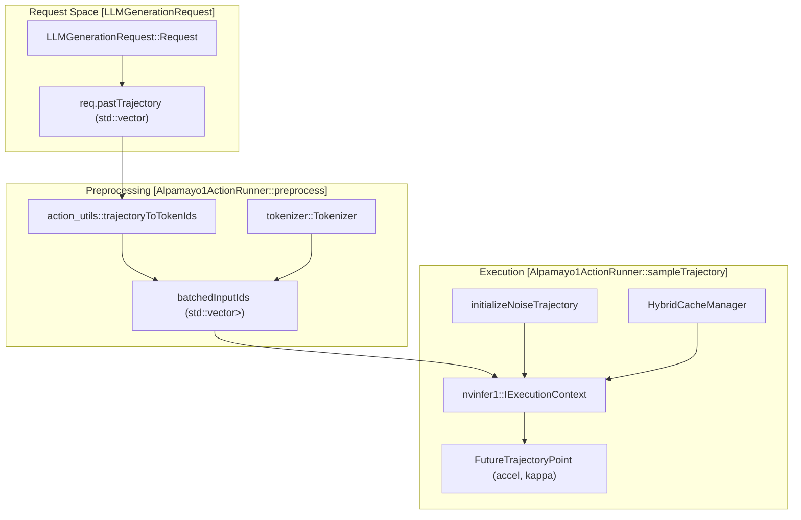
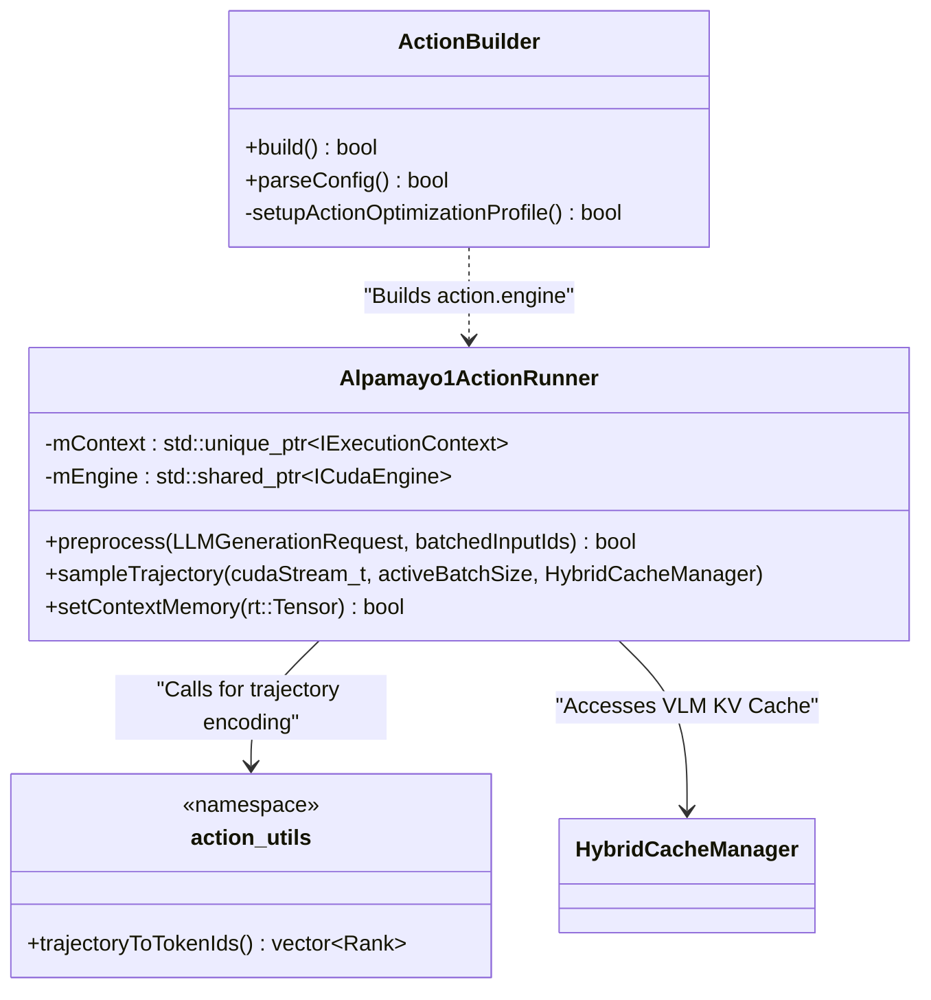

<!-- source: DeepWiki mcp.deepwiki.com · repo NVIDIA/TensorRT-Edge-LLM · page 7.5 Action Models · fetched 2026-10-26 -->

# Action Models

Relevant source files

The following files were used as context for generating this wiki page:

- [cpp/action/actionModelTypes.h](cpp/action/actionModelTypes.h)
- [cpp/action/actionUtils.cpp](cpp/action/actionUtils.cpp)
- [cpp/action/actionUtils.h](cpp/action/actionUtils.h)
- [cpp/action/alpamayo1ActionRunner.cpp](cpp/action/alpamayo1ActionRunner.cpp)
- [cpp/action/alpamayo1ActionRunner.h](cpp/action/alpamayo1ActionRunner.h)
- [cpp/action/alpamayo1RunnerUtils.h](cpp/action/alpamayo1RunnerUtils.h)
- [cpp/builder/actionBuilder.cpp](cpp/builder/actionBuilder.cpp)
- [cpp/builder/actionBuilder.h](cpp/builder/actionBuilder.h)

Action models represent a specialized class of trajectory prediction and robotics-oriented models within the TensorRT-Edge-LLM ecosystem. Specifically, the SDK supports the **Alpamayo 1** architecture, which utilizes a flow-matching head for trajectory prediction based on historical data and multimodal inputs.

## Overview

The action model pipeline is designed for robotics use cases where a model predicts future trajectories (waypoints) based on a past trajectory history. This history is tokenized and embedded into the LLM's prompt space, and a specialized "action expert" head processes the resulting hidden states to generate the final trajectory.

The implementation consists of three primary components:
1.  **`ActionBuilder`**: Handles the compilation of ONNX action models into optimized TensorRT engines [cpp/builder/actionBuilder.h:87-140]().
2.  **`Alpamayo1ActionRunner`**: Manages the runtime execution, including preprocessing of trajectory data and inference orchestration [cpp/action/alpamayo1ActionRunner.h:59-128]().
3.  **`action_utils`**: Provides utility functions for mapping physical coordinates to discrete token IDs [cpp/action/actionUtils.h:28-35]().

### Supported Model Types
The system currently defines supported action models via the `ActionModelType` enum:
| Type | Description |
| :--- | :--- |
| `ALPAMAYO1` | Alpamayo 1 trajectory prediction with a flow-matching head. |

Sources: [cpp/action/actionModelTypes.h:28-32](), [cpp/action/alpamayo1ActionRunner.h:93-96]()

---

## Action Model Pipeline

The data flow for an action model involves converting physical trajectory points into tokens that the LLM can understand, followed by a specialized inference pass to predict future movements.

### Trajectory Tokenization
Physical coordinates (X, Y, Z) are converted into discrete tokens using `trajectoryToTokenIds`. This process involves:
1.  Calculating relative coordinates between consecutive points [cpp/action/actionUtils.cpp:63-68]().
2.  Clamping values within a predefined ego-centric bounding box (±4m for X/Y, ±10m for Z) [cpp/action/actionUtils.cpp:34-49]().
3.  Mapping the normalized coordinates to a specific range of trajectory tokens defined in the model configuration [cpp/action/actionUtils.cpp:40-53]().

### Inference Data Flow
The following diagram illustrates how the `Alpamayo1ActionRunner` bridges the natural language request space with the specialized action inference code.

**Trajectory Processing and Inference Flow**

Sources: [cpp/action/alpamayo1ActionRunner.cpp:49-135](), [cpp/action/actionUtils.cpp:29-73](), [cpp/action/alpamayo1ActionRunner.h:119-120]()

---

## Engine Building: ActionBuilder

The `ActionBuilder` class is responsible for converting the action model's ONNX representation into a TensorRT engine. It configures specific optimization profiles required for the trajectory-specific inputs.

### Key Configuration Parameters
The builder extracts several parameters from the model's `config.json`:
*   `n_diffusion_tokens`: The number of waypoints/tokens used in the diffusion/flow-matching process [cpp/builder/actionBuilder.cpp:138-143]().
*   `num_hidden_layers`, `num_key_value_heads`, `head_dim`: Standard transformer architecture parameters [cpp/builder/actionBuilder.cpp:117-136]().

### Optimization Profiles
`ActionBuilder::setupActionOptimizationProfile` configures the following dynamic shapes using `binding_names`:
*   **`kvcache_start_index`**: Tracks the length of the past KV cache per batch row [cpp/builder/actionBuilder.cpp:155-156]().
*   **`noise_trajectory`**: Input noise for the flow-matching head, shaped as `[batch, num_waypoints, 2]` [cpp/builder/actionBuilder.cpp:159-161]().
*   **`rope_rotary_cos_sin`**: Rotary embeddings for the action head [cpp/builder/actionBuilder.cpp:164-167]().
*   **`k_cache` / `v_cache`**: Paged KV cache tensors, typically shaped as `[batch, num_heads, max_capacity, head_dim]` [cpp/builder/actionBuilder.cpp:174-202]().

Sources: [cpp/builder/actionBuilder.cpp:32-102](), [cpp/builder/actionBuilder.cpp:148-202](), [cpp/builder/actionBuilder.h:37-82]()

---

## Runtime Execution: Alpamayo1ActionRunner

The `Alpamayo1ActionRunner` handles the lifecycle of an action model inference, specifically for the Alpamayo 1 architecture.

### Preprocessing Logic
During `preprocess`, the runner searches for special placeholder tokens in the input text:
1.  Identifies `<|traj_history_start|>`, `<|traj_history_pad|>`, and `<|traj_history_end|>` tokens [cpp/action/alpamayo1ActionRunner.cpp:65-78]().
2.  Replaces the padding tokens (`<|traj_history|>`) with the encoded trajectory tokens generated by `action_utils` [cpp/action/alpamayo1ActionRunner.cpp:102-116]().
3.  Initializes the noise trajectory for the flow-matching process via `initializeNoiseTrajectory` [cpp/action/alpamayo1ActionRunner.cpp:125-133]().

### Memory Management
Action models often share KV cache or device memory with a base LLM.
*   **`getRequiredContextMemorySize()`**: Returns the device memory required by the action engine via the TensorRT execution context [cpp/action/alpamayo1ActionRunner.cpp:192-195]().
*   **`setContextMemory()`**: Allows the runner to use a pre-allocated `rt::Tensor`, facilitating memory sharing between models [cpp/action/alpamayo1ActionRunner.cpp:197-208]().

### Trajectory Sampling
The `sampleTrajectory` method performs the denoising loop:
*   It runs a fixed number of denoising steps (defined by `kNumDenoiseSteps = 10`) [cpp/action/alpamayo1ActionRunner.h:132]().
*   It consumes the VLM's KV cache via `HybridCacheManager` [cpp/action/alpamayo1ActionRunner.h:119-120]().
*   It produces `FutureTrajectoryPoint` pairs representing acceleration and curvature (kappa) [cpp/action/alpamayo1RunnerUtils.h:37-38]().

**Action Model Class Relationships**

Sources: [cpp/action/alpamayo1ActionRunner.cpp:137-190](), [cpp/action/alpamayo1ActionRunner.h:59-128](), [cpp/builder/actionBuilder.cpp:32-40](), [cpp/action/alpamayo1RunnerUtils.h:32-34]()

---

