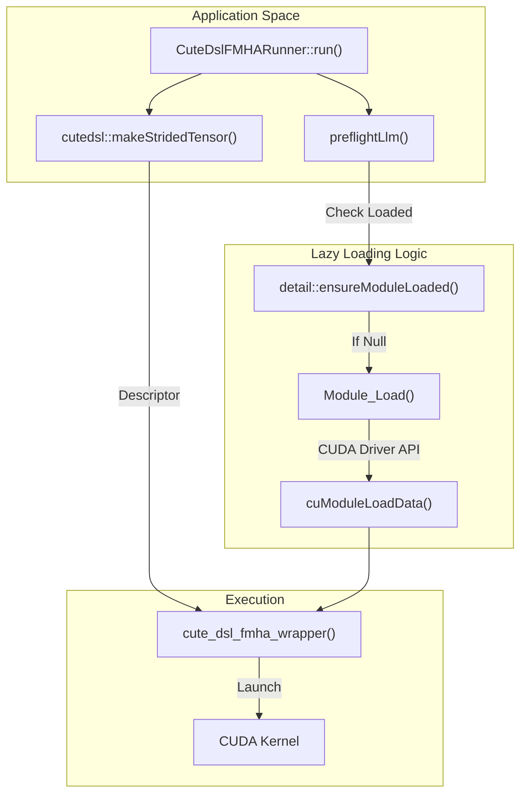
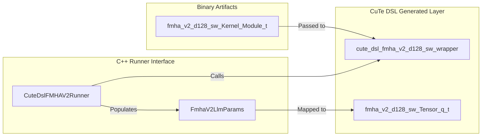

<!-- source: DeepWiki mcp.deepwiki.com · repo NVIDIA/TensorRT-Edge-LLM · page 7.6 CuTe DSL Kernel Sources · fetched 2026-10-26 -->

# CuTe DSL Kernel Sources

Relevant source files

The following files were used as context for generating this wiki page:

- [cmake/CuteDsl.cmake](cmake/CuteDsl.cmake)
- [cpp/kernels/contextAttentionKernels/cuteDslFMHARunner.cpp](cpp/kernels/contextAttentionKernels/cuteDslFMHARunner.cpp)
- [cpp/kernels/contextAttentionKernels/cuteDslFMHAV2Runner.cpp](cpp/kernels/contextAttentionKernels/cuteDslFMHAV2Runner.cpp)
- [cpp/kernels/contextAttentionKernels/cuteDslFmhaParams.h](cpp/kernels/contextAttentionKernels/cuteDslFmhaParams.h)
- [cpp/kernels/contextAttentionKernels/cuteDslTensorDescriptors.h](cpp/kernels/contextAttentionKernels/cuteDslTensorDescriptors.h)
- [cpp/kernels/cuteDslModuleLoader.cpp](cpp/kernels/cuteDslModuleLoader.cpp)

The `kernelSrcs/` directory and associated build infrastructure provide a domain-specific language (DSL) approach to CUDA kernel generation using **NVIDIA CuTe** (part of the CUTLASS library). This system automates the generation, compilation, and integration of high-performance kernels for critical LLM operations including Attention (FMHA/XQA), Gated Delta Net (GDN), Matrix Multiplication (GEMM), Mixture of Experts (MoE), Selective Structured State Space (SSD), and INT4-FP16 quantized kernels.

## Overview and Purpose

The CuTe DSL workflow addresses the complexity of maintaining hand-written CUDA kernels for diverse GPU architectures (e.g., SM80, SM90, SM110/121). In version 0.10.0, the legacy FMHA-v2 cubins were replaced by CuTe DSL-generated FMHA-v2 variants, providing a unified path for Blackwell (SM10x/110) and earlier architectures.

### Key Kernel Groups Supported
*   **FMHA (Fused Multi-Head Attention):** Optimized context-phase attention for LLM and ViT.
*   **XQA (eXtended Query Attention):** Optimized generation-phase (decoding) attention.
*   **GDN (Gated Delta Net):** Kernels for linear attention variants.
*   **GEMM:** Specialized matrix multiplications, including quantized variants.
*   **MoE (Mixture of Experts):** Specialized routing and GEMM kernels for sparse models.
*   **SSD:** Selective Scan/State Space model kernels.
*   **INT4-FP16:** Specialized kernels for INT4 weight-only quantization.

**Sources:** [cmake/CuteDsl.cmake:18-52](), [cpp/kernels/contextAttentionKernels/cuteDslFMHAV2Runner.cpp:1-16]()

---

## Build System Integration

The integration is managed via `cmake/CuteDsl.cmake` and the `ENABLE_CUTE_DSL` CMake variable.

### Configuration Options
| Option | Description |
| :--- | :--- |
| `OFF` | Disables CuTe DSL kernels entirely. |
| `ALL` | Enables all kernel groups defined in the artifact metadata [cmake/CuteDsl.cmake:30](). |
| `fmha` | Enables FP16 Context/ViT FMHA baseline and Blackwell overlays (Default) [cmake/CuteDsl.cmake:31-32](). |
| `<group_name>` | Enables specific groups (e.g., `gdn`, `f16_moe`, `ssd`, `gemm`) [cmake/CuteDsl.cmake:33-36](). |

### Artifact Management
The build system looks for artifacts in `cpp/kernels/cuteDSLArtifact/{arch}/{artifact_tag}/`. If the directory does not exist, CMake auto-extracts a matching prebuilt tarball from `kernelSrcs/cuteDSLPrebuilt/` [cmake/CuteDsl.cmake:20-24](). Users can also generate artifacts locally using `python kernelSrcs/build_cutedsl.py --gpu_arch <sm_NN>` [cmake/CuteDsl.cmake:25-26]().

**Sources:** [cmake/CuteDsl.cmake:54-66](), [cmake/CuteDsl.cmake:20-26]()

---

## Implementation Details

### Kernel Dispatch and Lazy Loading
The C++ runtime uses `trt_edgellm::detail::LazyKernelModule` to manage the lifecycle of DSL kernels. Kernels are loaded into the CUDA Driver API only when first requested.

**Title: CuTe DSL Kernel Loading and Dispatch Flow**

**Sources:** [cpp/kernels/contextAttentionKernels/cuteDslFMHARunner.cpp:44-49](), [cpp/kernels/contextAttentionKernels/cuteDslFMHARunner.cpp:57-98](), [cpp/kernels/cuteDslModuleLoader.cpp:71-92]()

### Tensor Descriptors
The CuTe DSL C exporter generates specific descriptor structs (e.g., `fmha_d64_Tensor_q_tensor_t`). The `trt_edgellm::cutedsl` namespace provides helpers to populate these from C++:
*   `makeStridedTensor`: For non-packed physical layouts [cpp/kernels/contextAttentionKernels/cuteDslTensorDescriptors.h:83-107]().
*   `makePackedTensor`: For standard row-major layouts [cpp/kernels/contextAttentionKernels/cuteDslTensorDescriptors.h:112-124]().
*   `makeCuSeqLenTensor`: Specifically for Rank-1 cumulative sequence length tensors [cpp/kernels/contextAttentionKernels/cuteDslTensorDescriptors.h:128-137]().

### FMHA Runners
The codebase provides two primary runners for FMHA:
1.  **CuteDslFMHARunner:** Handles Blackwell-optimized variants (SM100/101/110) including skip-softmax (BLASST) and FP8 input support [cpp/kernels/contextAttentionKernels/cuteDslFMHARunner.cpp:39-42](), [cpp/kernels/contextAttentionKernels/cuteDslFMHARunner.cpp:68-74]().
2.  **CuteDslFMHAV2Runner:** The general-purpose runner supporting SM80 through SM121, covering Causal, Sliding Window, and Paged KV cache variants [cpp/kernels/contextAttentionKernels/cuteDslFMHAV2Runner.cpp:62-66](), [cpp/kernels/contextAttentionKernels/cuteDslFMHAV2Runner.cpp:88-106]().

**Title: FMHA Runner Architecture**

**Sources:** [cpp/kernels/contextAttentionKernels/cuteDslFmhaParams.h:113-137](), [cpp/kernels/contextAttentionKernels/cuteDslFMHAV2Runner.cpp:32-52](), [cpp/kernels/contextAttentionKernels/cuteDslTensorDescriptors.h:45-58]()

---

## CMake Function: cute_dsl_setup

The `cute_dsl_setup` function in `cmake/CuteDsl.cmake` is the primary interface for C++ targets.

1.  **Tag Inference:** Detects the GPU architecture based on `EMBEDDED_TARGET` (e.g., `sm_121` for `gb10`, `sm_110` for `jetson_thor`, `sm_87` for `jetson_orin`) [cmake/CuteDsl.cmake:113-127]().
2.  **Compile Definitions:** Sets preprocessor flags like `CUTE_DSL_FMHA_ENABLED`, `CUTE_DSL_GDN_ENABLED`, and `CUTE_DSL_FMHA_BLACKWELL_ENABLED` [cmake/CuteDsl.cmake:44-51]().
3.  **Linking:** Links the DSL static library (`libcutedsl_<arch>.a`) to `LINK_TARGETS` [cmake/CuteDsl.cmake:181-184]().

**Sources:** [cmake/CuteDsl.cmake:104-175](), [cmake/CuteDsl.cmake:187-204]()

---

