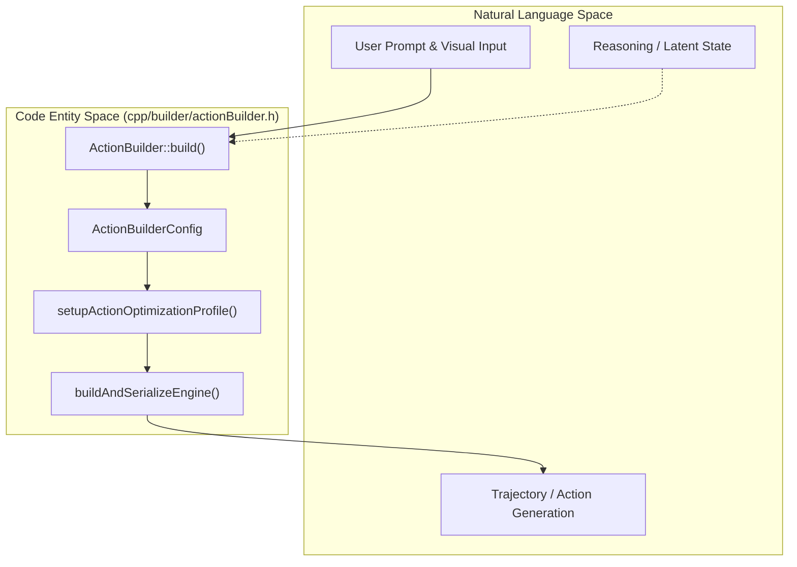
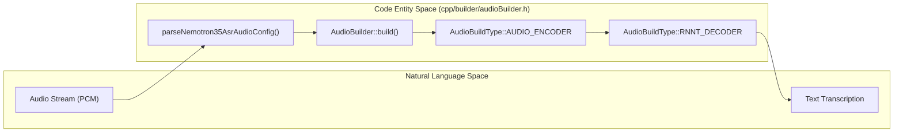

<!-- source: DeepWiki mcp.deepwiki.com · repo NVIDIA/TensorRT-Edge-LLM · page 7.7 Experimental Models · fetched 2026-10-26 -->

# Experimental Models

<details>
<summary>Relevant source files</summary>

The following files were used as context for generating this wiki page:

- [cpp/builder/actionBuilder.cpp](cpp/builder/actionBuilder.cpp)
- [cpp/builder/actionBuilder.h](cpp/builder/actionBuilder.h)
- [cpp/builder/audioBuilder.cpp](cpp/builder/audioBuilder.cpp)
- [cpp/builder/audioBuilder.h](cpp/builder/audioBuilder.h)

</details>


The `experimental_models/` directory contains runtime implementations and command-line interfaces (CLIs) for specialized model architectures that fall outside the standard LLM/VLM autoregressive text generation pipeline. This includes the **Cosmos3-Edge** multimodal reasoning and policy generation runtime for robotics, and the **Nemotron-3.5-ASR** RNN-T transcription runtime.

Accessing these models requires enabling the `BUILD_EXPERIMENTAL_MODELS` CMake flag during the build process.

## Cosmos3-Edge Policy Runtime

Cosmos3-Edge is a multimodal model designed for reasoning and action generation (policy). Unlike standard LLMs, it integrates a flow-matching decoder (action expert) to generate trajectories or waypoints.

### Architecture and Data Flow

The Cosmos3-Edge runtime utilizes the `ActionBuilder` to compile the flow-matching decoder into a TensorRT engine. This engine handles the diffusion-based generation of action tokens.

**Natural Language to Code Entity Space: Action Generation**


*Sources: [cpp/builder/actionBuilder.h:87-107](), [cpp/builder/actionBuilder.cpp:40-102]()*

### Engine Building
The `ActionBuilder` class manages the lifecycle of the action expert engine. It parses the model configuration to determine transformer layers, head dimensions, and the number of diffusion tokens (waypoints) [cpp/builder/actionBuilder.cpp:104-146]().

Key inputs configured during `setupActionOptimizationProfile` include:
* **`kvcache_start_index`**: Tracks the past-KV length per batch [cpp/builder/actionBuilder.cpp:155-156]().
* **`noise_trajectory`**: The initial noise for the diffusion process, shaped `[batch, num_waypoints, 2]` [cpp/builder/actionBuilder.cpp:159-161]().
* **`rope_rotary_cos_sin`**: Rotary embeddings for the diffusion tokens [cpp/builder/actionBuilder.cpp:164-167]().

### CLI Usage
The experimental build provides two primary CLIs for Cosmos3:
1. `cosmos3_policy_build`: Invokes `ActionBuilder` to create the `action.engine` [cpp/builder/actionBuilder.cpp:88-89]().
2. `cosmos3_policy_inference`: Executes the multimodal reasoning pipeline followed by the action generation step.

## Nemotron-3.5-ASR RNN-T Runtime

Nemotron-3.5-ASR implements an Automatic Speech Recognition (ASR) pipeline using an RNN-Transducer (RNN-T) architecture. This involves a FastConformer encoder and a specialized RNN-T decoder.

### RNN-T Components
The ASR pipeline is split into two distinct TensorRT engines:
1. **Audio Encoder**: A FastConformer model that processes Mel-spectrogram features [cpp/builder/audioBuilder.cpp:273-287]().
2. **RNN-T Decoder**: A "step engine" that performs the transducer joiner operations. This engine is unique because it uses fully static I/O shapes for a single decode step, requiring no optimization profile [cpp/builder/audioBuilder.cpp:180-186]().

**Natural Language to Code Entity Space: ASR Pipeline**


*Sources: [cpp/builder/audioBuilder.h:65-72](), [cpp/builder/audioBuilder.cpp:128-153]()*

### Implementation Details
The `AudioBuilder` detects the RNN-T requirement by checking for `encoder_config` in the model's `config.json` [cpp/builder/audioBuilder.cpp:312-327]().

| Feature | Audio Encoder | RNN-T Decoder |
| :--- | :--- | :--- |
| **Build Type** | `AUDIO_ENCODER` | `RNNT_DECODER` |
| **Engine Name** | `audio_encoder.engine` | `rnnt_step.engine` |
| **Input** | `input_features` (Mel-bins) | `encoder_outputs`, `decoder_outputs` |
| **Profile** | Dynamic (Time steps) | Static (Single step) |

*Sources: [cpp/builder/audioBuilder.cpp:130-147](), [cpp/builder/audioBuilder.cpp:273-305]()*

### CLI Usage
The `nemotron_asr_inference` CLI facilitates the transcription process. It manages the audio preprocessing (Mel-bin extraction), executes the FastConformer encoder, and loops through the RNN-T decoder step engine to generate the final text tokens.

## Build Configuration

To enable these experimental features, the project must be configured with the `BUILD_EXPERIMENTAL_MODELS` flag.

```bash
cmake -DBUILD_EXPERIMENTAL_MODELS=ON ..
make cosmos3_policy_build cosmos3_policy_inference nemotron_asr_inference
```

This flag triggers the inclusion of `ActionBuilder` and the RNN-T specific logic within `AudioBuilder`.

*Sources: [cpp/builder/audioBuilder.h:71-72](), [cpp/builder/actionBuilder.h:87-88]()*

---

