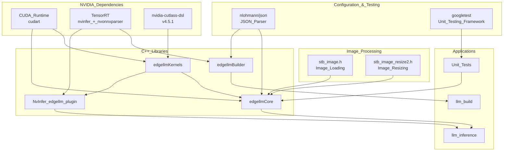
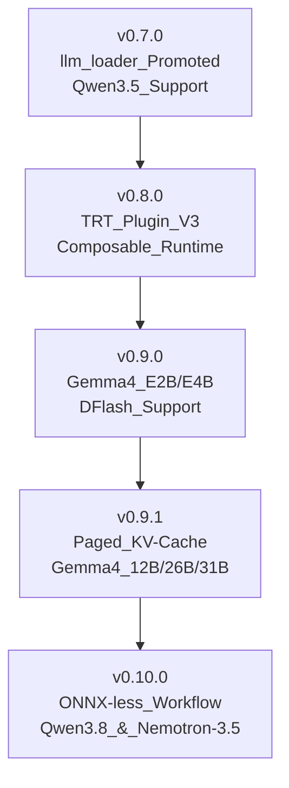

<!-- source: DeepWiki mcp.deepwiki.com · repo NVIDIA/TensorRT-Edge-LLM · page 8 Reference · fetched 2026-10-26 -->

# Reference

Relevant source files

The following files were used as context for generating this wiki page:

- [CHANGELOG.md](CHANGELOG.md)
- [LICENSE](LICENSE)

This page provides reference materials for the TensorRT-Edge-LLM project, including third-party library dependencies, version history, legal information, and community resources. For architectural documentation and implementation details, see [Architecture](#4). For development workflows and contribution guidelines, see [Development Guide](#6).

---

## Third-Party Dependencies

TensorRT-Edge-LLM integrates several external libraries to provide its functionality. For details, see [Third-Party Libraries](#8.1).

### Core Runtime Dependencies

The following diagram shows the primary external libraries used by the C++ runtime and their integration points:

**Sources:** [CHANGELOG.md:47-53](), [CHANGELOG.md:141]()

### CUDA and TensorRT
The foundation of the inference runtime relies on NVIDIA's compute and inference frameworks. The project formally supports CUDA 13.x and has upgraded to TensorRT Plugin V3 for TensorRT 11 readiness [CHANGELOG.md:47](). The `edgellmKernels` library utilizes the `nvidia-cutlass-dsl` (version 4.5.1) for high-performance kernel generation [CHANGELOG.md:53]().

### Image and JSON Libraries
- **stb_image.h / stb_image_resize2.h**: Used for image loading and high-performance resizing in multimodal pipelines. For details, see [stb_image Library](#8.1.1) and [stb_image_resize2 Library](#8.1.2).
- **nlohmann/json**: Modern C++ JSON parser. It is used for all `llm_inference` inputs and outputs to manage configuration and inference requests [CHANGELOG.md:118]().

---

## Version History

The project follows semantic versioning, with major architectural shifts occurring in the 0.3.0, 0.8.0, and 0.10.0 releases. For a full list of changes, see [Version History](#8.2).

### Version Timeline

**Sources:** [CHANGELOG.md:3-82]()

### Recent Milestones
- **v0.10.0**: Added an experimental ONNX-less workflow for direct engine building, support for Qwen3.8-27B and Nemotron-3.5, and paged KV-cache reuse for multi-turn requests [CHANGELOG.md:3-11]().
- **v0.9.1**: Expanded Gemma 4 support across 12B, 26B, and 31B variants with MTP, and introduced paged XQA decode support [CHANGELOG.md:23-26]().
- **v0.8.0**: Re-architected the C++ runtime with composable execution and state-management components, and externalized weights to reduce engine build memory [CHANGELOG.md:45-50]().

---

## Legal and Licensing

TensorRT-Edge-LLM is licensed under the **Apache License, Version 2.0**. This license allows for reproduction, preparation of derivative works, and distribution in source or object form, provided the terms are met [LICENSE:67-72]().

**Copyright:** Copyright (c) 2025, NVIDIA CORPORATION. All rights reserved.

**Sources:** [LICENSE:1-202]()

---

## Security Policy

NVIDIA is dedicated to software security. Potential vulnerabilities should be reported through official channels rather than GitHub issues.

**Reporting Channels:**
- **Web**: [Security Vulnerability Submission Form](https://www.nvidia.com/object/submit-security-vulnerability.html)
- **Email**: psirt@nvidia.com

For details, see [Security Policy](#8.4).

---

## Community Guidelines

Participation in the project is governed by standards for respectful and constructive collaboration. For details, see [Community Guidelines](#8.5).

---

## Ignored Files and Artifacts

The project maintains a `.gitignore` configuration to manage build artifacts and temporary files. For details, see [Ignored Files and Artifacts](#8.6).

**Common Artifacts:**
- `build/`: CMake build directory.
- `*.engine`: Serialized TensorRT engines [CHANGELOG.md:6]().
- `__pycache__/`: Python bytecode.
- `*.cubin`: Legacy CUDA binary kernels (replaced by CuTe DSL in 0.10.0) [CHANGELOG.md:14]().

**Sources:** [CHANGELOG.md:6](), [CHANGELOG.md:14]()

---

