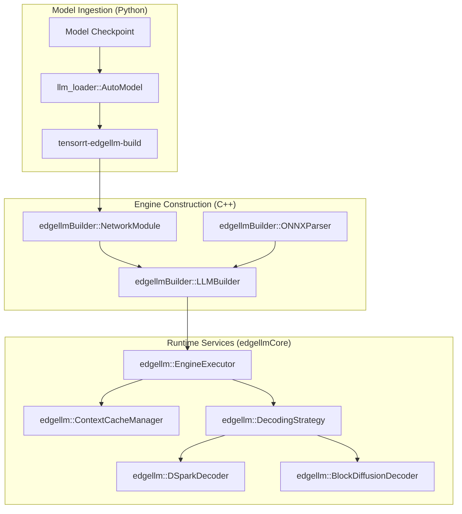

<!-- source: DeepWiki mcp.deepwiki.com · repo NVIDIA/TensorRT-Edge-LLM · page 8.2 Version History · fetched 2026-10-26 -->

# Version History

<details>
<summary>Relevant source files</summary>

The following files were used as context for generating this wiki page:

- [CHANGELOG.md](CHANGELOG.md)

</details>


This page provides a comprehensive chronological record of all TensorRT-Edge-LLM releases, documenting the evolution of features, architectural changes, bug fixes, and deprecations. Each version section details what was added, modified, or removed, enabling users to understand version-specific capabilities and migration requirements.

For information about third-party library versions and dependencies, see [Third-Party Libraries](#8.1). For contribution guidelines and development workflows, see [Development Guide](#6).

---

## Release Timeline

The following diagram shows the progression of major releases and their key themes, including the latest additions for multimodal and high-performance edge inference:

```mermaid
gantt
    title "TensorRT-Edge-LLM Release Timeline"
    dateFormat YYYY-MM
    section Foundation
    "0.0.1: Basic LLM Inference" :milestone, 2024-01, 0d
    "0.0.2: VLM + NVFP4" :milestone, 2024-02, 0d
    "0.0.3: Bug Fixes" :milestone, 2024-03, 0d
    section Advanced Features
    "0.1.0: EAGLE + LoRA" :milestone, 2024-04, 0d
    "0.1.1: More Models" :milestone, 2024-05, 0d
    section Modernization
    "0.2.0: CUDA 13.0 + Longrope" :milestone, 2024-06, 0d
    "0.3.0: Major Refactor (Tensor class)" :milestone, 2024-08, 0d
    "0.4.0: Multi-batch EAGLE3 + Vocab Reduction" :milestone, 2024-10, 0d
    section Optimization & Scale
    "0.5.0: FP8 KV Cache + Jetpack 6.2" :milestone, 2024-11, 0d
    "0.6.0: Audio (ASR/TTS) + Blackwell Optimizations" :milestone, 2024-12, 0d
    "0.7.0: llm_loader + NVFP4 MoE" :milestone, 2025-01, 0d
    "0.8.0: TRT 11 Readiness + Runtime Re-arch" :milestone, 2025-02, 0d
    "0.9.0: Gemma 4 + Unified Multimodal" :milestone, 2025-03, 0d
    "0.9.1: DFlash + Paged KV-Cache" :milestone, 2025-03, 0d
    section Current
    "0.10.0: ONNX-less Workflow + Qwen3.8 + Context Reuse" :crit, milestone, 2025-04, 0d
```

**Sources**: [CHANGELOG.md:1-135]()

---

## Feature Evolution Matrix

This table maps major features to the versions in which they were introduced or significantly modified:

| Feature | 0.7.0 | 0.8.0 | 0.9.0 | 0.9.1 | 0.10.0 |
|---------|-------|-------|-------|-------|-------|
| **Workflow** |
| ONNX-less Workflow | - | - | - | - | ✓ |
| llm_loader | ✓ | ✓ | ✓ | ✓ | ✓ |
| **Precision Support** |
| NVFP4 MoE | ✓ | ✓ | ✓ | ✓ | ✓ |
| INT4 AWQ MoE | - | - | - | - | ✓ |
| **Model Support** |
| Qwen3.8-27B | - | - | - | - | ✓ |
| Nemotron-3.5 Lightning | - | - | - | - | ✓ |
| Cosmos3-Edge | - | - | - | - | ✓ |
| **Decoding Strategies** |
| DFlash Speculative | - | - | ✓ | ✓ | ✓ |
| DSpark / BlockDiffusion | - | - | - | - | ✓ |
| MTP Replay Fixed | - | - | - | - | ✓ |
| **Optimizations** |
| Paged KV-Cache Reuse | - | - | - | ✓ | ✓ |
| CuTe DSL FMHA-v2 | - | - | - | - | ✓ |
| Media-aware KV Reuse | - | - | - | - | ✓ |

**Sources**: [CHANGELOG.md:3-84]()

---

## Version 0.10.0

**Release Focus**: Direct checkpoint-to-engine workflow, paged KV-cache reuse, and Qwen3.8/Nemotron-3.5 support.

### Key Changes
*   **ONNX-less Workflow**: Introduced an experimental workflow to build TensorRT engines directly from checkpoints, bypassing the intermediate ONNX export step. [CHANGELOG.md:6-6]()
*   **Context Cache Management**: Added paged KV-cache reuse for multi-turn requests and media-aware KV reuse for VLMs. [CHANGELOG.md:11-11]()
*   **New Architectures**: Day-0 support for Qwen3.8-27B, Nemotron-3.5 Lightning, and Cosmos3-Edge multimodal reasoning. [CHANGELOG.md:4-7]()
*   **Advanced Decoding**: Added DSpark speculative decoding with DDTree drafting and DiffusionGemma block-diffusion inference. [CHANGELOG.md:8-10]()
*   **Kernel Modernization**: Replaced legacy embedded-cubin FMHA-v2 with CuTe DSL FMHA-v2. [CHANGELOG.md:14-14]()
*   **Quantization**: Added Gemma 4 26B-A4B and Qwen3-Omni 30B-A3B INT4 AWQ MoE support. [CHANGELOG.md:16-17]()

---

## Version 0.9.1

**Release Focus**: Paged memory management, advanced speculative decoding, and CuTe DSL kernels.

### Key Changes
*   **Gemma 4 Full Support**: Added support for Gemma 4 12B, 26B-A4B, and 31B architectures including Multi-Token Prediction (MTP). [CHANGELOG.md:24-24]()
*   **DFlash & DDTree**: Expanded DFlash speculative decoding with DDTree support for Qwen3/3.5 hybrid models. [CHANGELOG.md:25-25]()
*   **Paged Memory**: Introduced paged KV-cache prefill and paged XQA decode support. [CHANGELOG.md:26-26]()
*   **CuTe DSL Kernels**: Integrated INT4-FP16 GEMM/GEMV kernels and FP16 MoE support for up to 256 experts. [CHANGELOG.md:29-29]()

---

## Version 0.9.0

**Release Focus**: Gemma 4 introduction and NVFP4 expansion.

### Major Features
*   **Gemma 4 Unified**: Added support for Gemma 4 E2B/E4B text and 12B unified multimodal inference. [CHANGELOG.md:35-36]()
*   **NVFP4 Expansion**: Added NVFP4 support for Qwen3-Omni-30B-A3B and expanded backend coverage for SM100/101/110. [CHANGELOG.md:38-42]()

---

## Architectural Evolution

The following diagram maps the modern composable runtime and the new ONNX-less builder path introduced in 0.10.0:



**Sources**: [CHANGELOG.md:6-11](), [CHANGELOG.md:29-30]()

---

## Deprecation and Migration

### Deprecation Timeline

| Feature | Introduced | Deprecated | Removed | Reason |
|---------|-----------|------------|---------|--------|
| FMHA-v2 Cubins | 0.0.1 | 0.10.0 | 0.10.0 | Replaced by CuTe DSL FMHA-v2 |
| Legacy Exporter | 0.0.1 | 0.8.0 | - | Replaced by `llm_loader` / ONNX-less |
| Plugin V2 | 0.0.1 | 0.8.0 | 0.8.0 | Migrated to TensorRT Plugin V3 |

### Migration to Paged KV-Cache Reuse (0.10.0+)
The 0.10.0 release enables significant latency reductions for multi-turn conversations.
*   **Change**: Implementation of `ContextCacheManager` to track and reuse paged KV blocks based on hashing. [CHANGELOG.md:11-11]()
*   **Usage**: Enable via the `--enableContextReuse` flag in the runtime.

**Sources**: [CHANGELOG.md:1-21]()

---

