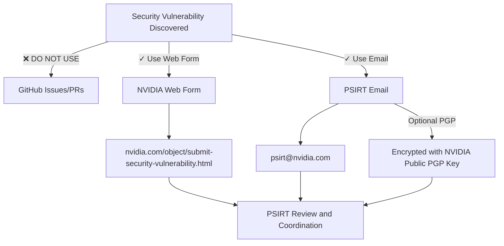
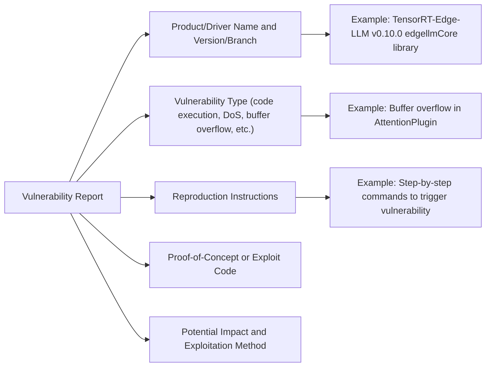
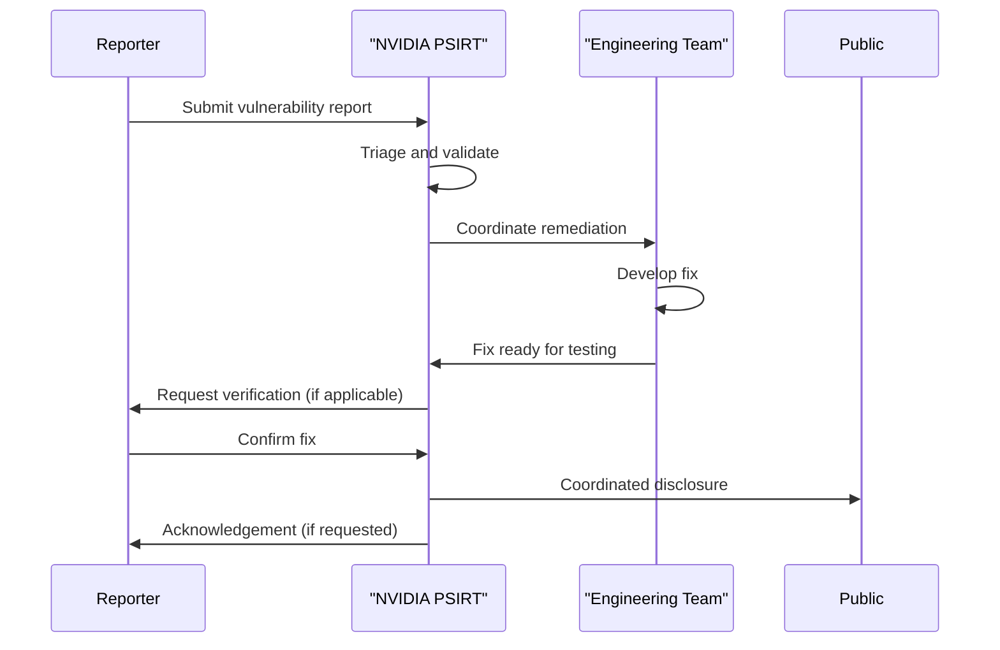
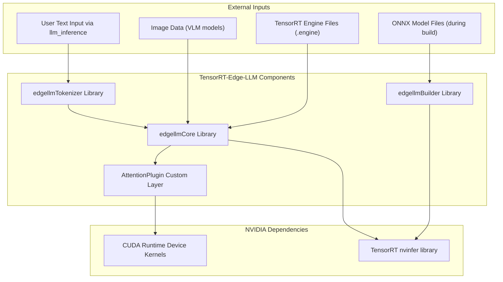
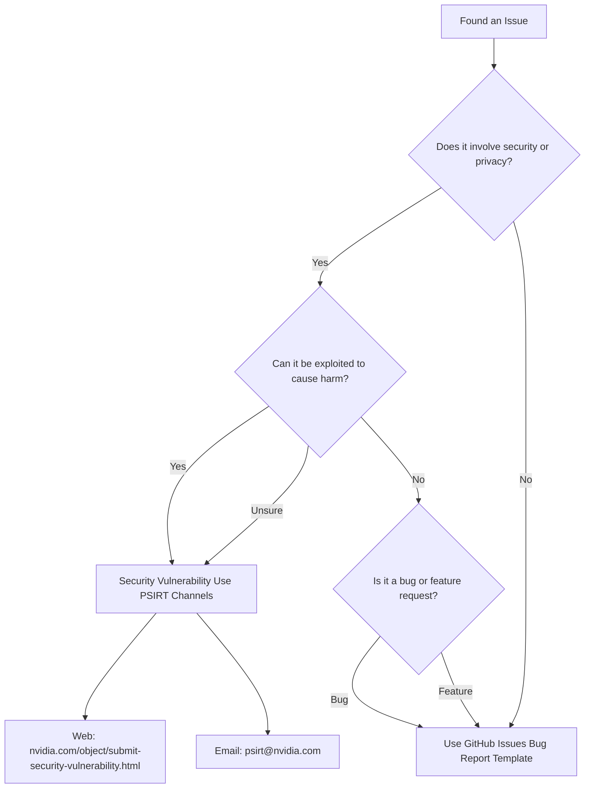

<!-- source: DeepWiki mcp.deepwiki.com · repo NVIDIA/TensorRT-Edge-LLM · page 8.4 Security Policy · fetched 2026-10-26 -->

# Security Policy

Relevant source files

The following files were used as context for generating this wiki page:

- [SECURITY.md](SECURITY.md)

## Purpose and Scope

This document outlines the security policy for the TensorRT-Edge-LLM project, including procedures for reporting security vulnerabilities, contact information for NVIDIA's Product Security Incident Response Team (PSIRT), and guidelines for secure communication. This policy applies to all source code, binaries, and artifacts within the TensorRT-Edge-LLM repository.

For information about community standards and acceptable behavior, see [Community Guidelines](#8.5). For legal and licensing information, see [Legal and Licensing](#8.3).

---

## NVIDIA Security Commitment

NVIDIA is dedicated to the security and trust of all software products and services, including open-source repositories managed through the NVIDIA organization [SECURITY.md:1-3](). The company maintains an active Product Security Incident Response Team (PSIRT) that handles vulnerability reports, coordinates disclosure, and manages security updates for all NVIDIA products.

**Sources:** [SECURITY.md:1-3]()

---

## Vulnerability Reporting

### Reporting Channels

Security vulnerabilities in TensorRT-Edge-LLM or any NVIDIA product **must not be reported through GitHub issues or pull requests** [SECURITY.md:5-6](). Instead, use the official NVIDIA security reporting channels to ensure proper handling of sensitive information.

**Reporting Decision Flow**

**Primary Reporting Methods:**

| Method | Contact Point | Notes |
|--------|---------------|-------|
| Web Form | [Security Vulnerability Submission Form](https://www.nvidia.com/object/submit-security-vulnerability.html) | Preferred for structured reporting [SECURITY.md:10-10]() |
| Email | `psirt@nvidia.com` | Direct communication with PSIRT [SECURITY.md:11-11]() |
| Encrypted Email | PGP-encrypted to `psirt@nvidia.com` | [NVIDIA Public PGP Key](https://www.nvidia.com/en-us/security/pgp-key) [SECURITY.md:12-12]() |

**Sources:** [SECURITY.md:5-12]()

---

### Required Information for Vulnerability Reports

When reporting a potential security vulnerability, include the following information to facilitate efficient triage and remediation [SECURITY.md:13-13]():

**Information Architecture for Reports**

**Vulnerability Report Checklist:**

1.  **Product/Driver Name and Version/Branch**: Specify the exact component affected (e.g., `edgellmCore`, `AttentionPlugin`, `llm_inference` executable) and the version or git commit hash [SECURITY.md:14-14]().
2.  **Type of Vulnerability**: Classify the vulnerability (e.g., code execution, denial of service, buffer overflow, information disclosure, privilege escalation) [SECURITY.md:15-15]().
3.  **Instructions to Reproduce**: Provide step-by-step instructions that allow PSIRT engineers to reproduce the vulnerability consistently [SECURITY.md:16-16]().
4.  **Proof-of-Concept or Exploit Code**: Include working exploit code or a minimal reproducible example demonstrating the vulnerability [SECURITY.md:17-17]().
5.  **Potential Impact**: Describe how an attacker could exploit the vulnerability and the potential consequences (e.g., arbitrary code execution on edge devices, data exfiltration, model inference manipulation) [SECURITY.md:18-18]().

**Sources:** [SECURITY.md:13-18]()

---

## Coordinated Vulnerability Disclosure

### Disclosure Process

NVIDIA follows a coordinated vulnerability disclosure policy to balance security improvements with responsible information sharing.

**Vulnerability Lifecycle**

**Timeline and Acknowledgement:**

-   NVIDIA PSIRT coordinates with reporters on appropriate disclosure timelines.
-   External reporters who contribute to addressing security issues may receive acknowledgement under NVIDIA's coordinated vulnerability disclosure policy [SECURITY.md:20-20]().
-   While NVIDIA does not currently operate a bug bounty program, the company values and recognizes contributions from security researchers [SECURITY.md:20-20]().

**Sources:** [SECURITY.md:20-20]()

---

## Security Resources and Contact Information

### NVIDIA Product Security Portal

For comprehensive security information, policies, and updates, visit NVIDIA's Product Security portal at [https://www.nvidia.com/en-us/security](https://www.nvidia.com/en-us/security) [SECURITY.md:22-24]().

The portal provides:
-   Product security updates and bulletins
-   Coordinated vulnerability disclosure policies
-   Security best practices for NVIDIA products
-   Contact information for the PSIRT team

**Sources:** [SECURITY.md:22-24]()

### PSIRT Policy Documentation

Detailed PSIRT policies, including response timelines, severity classification, and disclosure procedures, are available at: [https://www.nvidia.com/en-us/security/psirt-policies](https://www.nvidia.com/en-us/security/psirt-policies) [SECURITY.md:20-20]().

**Sources:** [SECURITY.md:20-20]()

---

## Security Considerations for TensorRT-Edge-LLM

### Attack Surface Overview

The TensorRT-Edge-LLM runtime presents several potential attack surfaces that should be considered when deploying on edge devices.

**Data Flow and Security Boundaries**

**Key Attack Vectors:**

| Component | Potential Risk | Mitigation |
|-----------|---------------|------------|
| `edgellmTokenizer` | Malicious text input causing buffer overflows or crashes | Input validation and length sanitization |
| TensorRT Engine Files | Maliciously crafted `.engine` files exploiting deserialization | Validate engine sources and use secure boot/checksums |
| ONNX Model Files | Compromised model files during `llm_build` phase | Verify model provenance and file integrity |
| Image Processing | Malicious image data exploiting processing logic | Use validated image loaders (e.g., `stb_image`) and check dimensions |
| CUDA Kernels | Memory safety issues in custom kernels | Code review and testing of `edgellmKernels` |

**Best Practices for Deployment:**

1.  **Validate Input Sources**: Only accept TensorRT engine files from trusted sources.
2.  **Sandbox Runtime Environment**: Run `llm_inference` with minimal privileges required for GPU access.
3.  **Monitor Resource Usage**: Implement resource limits to prevent denial-of-service via memory exhaustion (e.g., managing `ContextCacheManager` limits).
4.  **Regular Updates**: Keep TensorRT and CUDA dependencies up-to-date with security patches.
5.  **Secure Communication**: Use encrypted channels for transmitting sensitive inputs/outputs.

**Sources:** [SECURITY.md:1-24]()

---

## Reporting Issues vs. Security Vulnerabilities

### Decision Tree for Issue Classification

**Examples of Security Issues:**
-   Buffer overflows in tokenization or inference code.
-   Memory corruption in CUDA kernels within `edgellmKernels`.
-   Privilege escalation vulnerabilities.
-   Information disclosure through model outputs or KV-cache leakage.
-   Denial-of-service through malicious inputs.

**Examples of Non-Security Issues:**
-   Performance regressions or optimization requests.
-   Compatibility problems with specific models.
-   Documentation errors or improvements.
-   Feature requests for new models or quantization types.

For non-security bugs and features, use the GitHub issue templates [SECURITY.md:5-5]().

**Sources:** [SECURITY.md:5-5]()

---

## Summary

The TensorRT-Edge-LLM project follows NVIDIA's comprehensive security policy, prioritizing responsible disclosure and coordinated remediation of security vulnerabilities. All security concerns must be reported through official NVIDIA PSIRT channels (`psirt@nvidia.com` or the web submission form), **never through GitHub issues or pull requests** [SECURITY.md:5-6](). Include detailed information about the vulnerability, reproduction steps, and potential impact to facilitate efficient handling. For general product security information and policies, consult the [NVIDIA Product Security portal](https://www.nvidia.com/en-us/security).

**Sources:** [SECURITY.md:1-24]()

---

