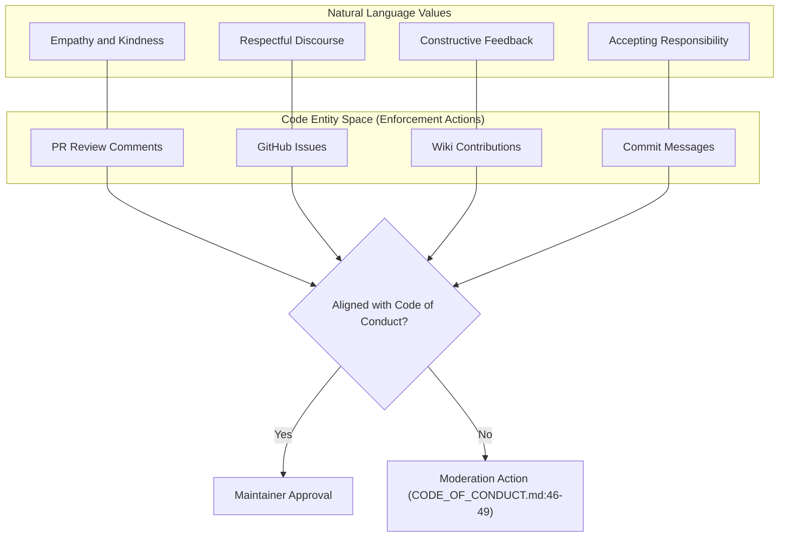
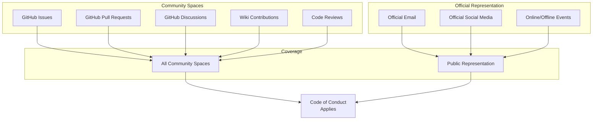
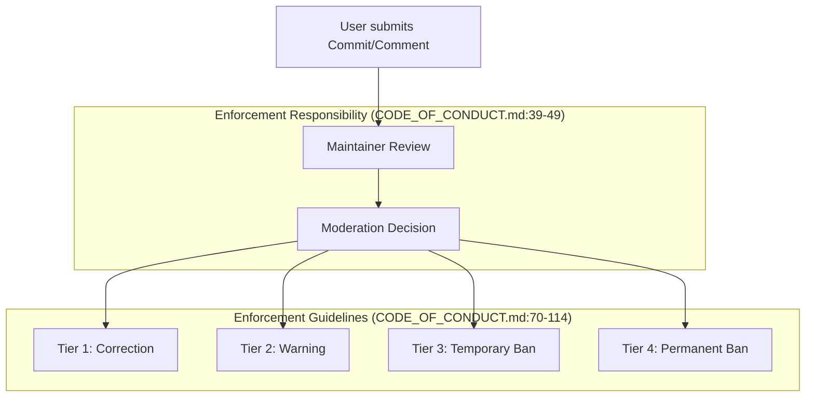

<!-- source: DeepWiki mcp.deepwiki.com · repo NVIDIA/TensorRT-Edge-LLM · page 8.5 Community Guidelines · fetched 2026-10-26 -->

# Community Guidelines

Relevant source files

The following files were used as context for generating this wiki page:

- [CODE_OF_CONDUCT.md](CODE_OF_CONDUCT.md)

## Purpose and Scope

This document describes the community participation standards and code of conduct for the TensorRT-Edge-LLM project. It establishes behavioral expectations for all contributors, maintainers, and participants in project spaces. For technical contribution processes (branching, pull requests, code review), see [Contributing Workflow](#6.3). For code formatting and style requirements, see [Coding Standards](#6.2).

The TensorRT-Edge-LLM project adopts the Contributor Covenant Code of Conduct (version 2.1) to ensure an inclusive, respectful, and harassment-free environment for all participants.

**Sources**: [CODE_OF_CONDUCT.md:1-3]()

---

## Community Pledge

The project community pledges to make participation a harassment-free experience for everyone, regardless of:

| Category | Protected Attributes |
|----------|---------------------|
| **Physical Characteristics** | Age, body size, visible or invisible disability |
| **Identity** | Gender identity and expression, sexual identity and orientation, ethnicity, race, caste, color |
| **Background** | Education, socio-economic status, nationality, personal appearance, religion |
| **Professional** | Level of experience |

The community commits to acting and interacting in ways that contribute to an open, welcoming, diverse, inclusive, and healthy environment.

**Sources**: [CODE_OF_CONDUCT.md:5-13]()

---

## Behavioral Standards

### Expected Behaviors

Contributors are expected to demonstrate the following behaviors in all project interactions:

**Natural Language to Code Entity Space: Behavioral Mapping**

**Expected Behaviors Table**:

| Behavior | Description |
|----------|-------------|
| **Empathy and Kindness** | Demonstrating empathy and kindness toward other people |
| **Respectful Discourse** | Being respectful of differing opinions, viewpoints, and experiences |
| **Constructive Feedback** | Giving and gracefully accepting constructive feedback |
| **Accountability** | Accepting responsibility and apologizing to those affected by mistakes, learning from the experience |
| **Community Focus** | Focusing on what is best not just for individuals, but for the overall community |

**Sources**: [CODE_OF_CONDUCT.md:17-26]()

### Unacceptable Behaviors

The following behaviors are explicitly prohibited:

| Violation Type | Examples |
|----------------|----------|
| **Sexual Misconduct** | Use of sexualized language or imagery, sexual attention or advances of any kind |
| **Harassment** | Trolling, insulting or derogatory comments, personal or political attacks, public or private harassment |
| **Privacy Violations** | Publishing others' private information (physical or email address) without explicit permission |
| **Professional Misconduct** | Other conduct which could reasonably be considered inappropriate in a professional setting |

**Sources**: [CODE_OF_CONDUCT.md:28-37]()

---

## Scope of Application

The Code of Conduct applies in the following contexts:

The Code of Conduct applies:
1. **Within all community spaces**: GitHub repositories, issues, pull requests, discussions, wiki edits, and code review comments [CODE_OF_CONDUCT.md:53-54]().
2. **When officially representing the community**: Using official email addresses, posting via official social media accounts, or acting as an appointed representative at events [CODE_OF_CONDUCT.md:54-57]().

**Sources**: [CODE_OF_CONDUCT.md:51-57]()

---

## Enforcement Process

### Reporting Violations

Instances of abusive, harassing, or otherwise unacceptable behavior should be reported through **GitHub's report functionality** [CODE_OF_CONDUCT.md:61-63]().

All complaints are:
- Reviewed and investigated **promptly and fairly** by administrators [CODE_OF_CONDUCT.md:64-65]().
- Handled with respect for the **privacy and security** of the reporter [CODE_OF_CONDUCT.md:67-68]().

**Sources**: [CODE_OF_CONDUCT.md:59-68]()

### Enforcement Workflow

**Natural Language to Code Entity Space: Enforcement Logic**

**Sources**: [CODE_OF_CONDUCT.md:39-49](), [CODE_OF_CONDUCT.md:70-114]()

---

## Community Impact Guidelines

Community leaders follow a four-tier escalation system when determining consequences for Code of Conduct violations:

### Tier 1: Correction

| Aspect | Details |
|--------|---------|
| **Community Impact** | Use of inappropriate language or other behavior deemed unprofessional or unwelcome in the community [CODE_OF_CONDUCT.md:77-79](). |
| **Consequence** | Private, written warning from community leaders providing clarity around the nature of the violation and explanation of why the behavior was inappropriate [CODE_OF_CONDUCT.md:80-82](). |
| **Possible Action** | A public apology may be requested [CODE_OF_CONDUCT.md:82-82](). |

**Sources**: [CODE_OF_CONDUCT.md:75-82]()

### Tier 2: Warning

| Aspect | Details |
|--------|---------|
| **Community Impact** | A violation through a single incident or series of actions [CODE_OF_CONDUCT.md:86-88](). |
| **Consequence** | Warning with consequences for continued behavior. No interaction with the people involved, including unsolicited interaction with those enforcing the Code of Conduct, for a specified period of time [CODE_OF_CONDUCT.md:89-91](). |
| **Restrictions** | Avoiding interactions in community spaces as well as external channels like social media [CODE_OF_CONDUCT.md:91-93](). |
| **Escalation** | Violating these terms may lead to a temporary or permanent ban [CODE_OF_CONDUCT.md:93-94](). |

**Sources**: [CODE_OF_CONDUCT.md:84-94]()

### Tier 3: Temporary Ban

| Aspect | Details |
|--------|---------|
| **Community Impact** | A serious violation of community standards, including sustained inappropriate behavior [CODE_OF_CONDUCT.md:98-100](). |
| **Consequence** | A temporary ban from any sort of interaction or public communication with the community for a specified period of time [CODE_OF_CONDUCT.md:101-103](). |
| **Restrictions** | No public or private interaction with the people involved, including unsolicited interaction with those enforcing the Code of Conduct [CODE_OF_CONDUCT.md:103-104](). |
| **Escalation** | Violating these terms may lead to a permanent ban [CODE_OF_CONDUCT.md:105-105](). |

**Sources**: [CODE_OF_CONDUCT.md:96-105]()

### Tier 4: Permanent Ban

| Aspect | Details |
|--------|---------|
| **Community Impact** | Demonstrating a pattern of violation of community standards, including sustained inappropriate behavior, harassment of an individual, or aggression toward or disparagement of classes of individuals [CODE_OF_CONDUCT.md:109-112](). |
| **Consequence** | A permanent ban from any sort of public interaction within the community [CODE_OF_CONDUCT.md:113-114](). |

**Sources**: [CODE_OF_CONDUCT.md:107-114]()

---

## Responsibilities of Community Leaders

Community leaders (repository maintainers and administrators) have the following responsibilities:

Community leaders have the authority to:
- **Remove, edit, or reject** comments, commits, code, wiki edits, issues, and other contributions that are not aligned to this Code of Conduct [CODE_OF_CONDUCT.md:46-48]().
- **Communicate reasons** for moderation decisions when appropriate [CODE_OF_CONDUCT.md:48-49]().
- Take **appropriate and fair corrective action** in response to inappropriate, threatening, offensive, or harmful behavior [CODE_OF_CONDUCT.md:41-45]().

**Sources**: [CODE_OF_CONDUCT.md:39-49]()

---

## Attribution and References

The TensorRT-Edge-LLM Code of Conduct is adapted from the **Contributor Covenant, version 2.1** [CODE_OF_CONDUCT.md:118-120]().

### External Resources

| Resource | URL |
|----------|-----|
| **Contributor Covenant Homepage** | https://www.contributor-covenant.org |
| **Version 2.1 Full Text** | https://www.contributor-covenant.org/version/2/1/code_of_conduct.html |
| **FAQ** | https://www.contributor-covenant.org/faq |
| **Translations** | https://www.contributor-covenant.org/translations |
| **Mozilla CoC Enforcement Ladder** | https://github.com/mozilla/diversity |

**Sources**: [CODE_OF_CONDUCT.md:116-133]()

---

