# Page: Home

# Home

<details>
<summary>Relevant source files</summary>

The following files were used as context for generating this wiki page:

- [.github/CODEOWNERS](.github/CODEOWNERS)
- [CHANGELOG.md](CHANGELOG.md)
- [README.md](README.md)

</details>


**Purpose and Scope**: This page introduces TensorRT-Edge-LLM, a high-performance C++ inference runtime for deploying Large Language Models (LLMs) and Vision-Language Models (VLMs) on NVIDIA edge platforms. It provides an architectural overview of the system and guides users to relevant documentation sections based on their needs.

For step-by-step instructions on building and running your first inference, see [Getting Started](#2). For detailed architectural documentation, see [Architecture](#4). For advanced features like speculative decoding and multimodal support, see [Advanced Features](#7).

---

## What is TensorRT-Edge-LLM

TensorRT-Edge-LLM is NVIDIA's production-grade inference framework designed specifically for resource-constrained edge devices such as NVIDIA Jetson Thor, Jetson Orin, and NVIDIA DRIVE platforms [README.md:26-26](). The system provides a complete pipeline from Hugging Face model checkpoints to optimized on-device inference, combining Python-based model preparation tools with a highly optimized C++ runtime [README.md:26-27]().

### Key Features

| Feature Category | Capabilities |
|-----------------|--------------|
| **Target Platforms** | Jetson Thor (SM 101), Jetson Orin (SM 87), NVIDIA DRIVE GB10 (SM 120/121), NVIDIA DGX Spark [README.md:26-26](), [CHANGELOG.md:40-42]() |
| **Model Support** | Qwen 3.x/3.5/3.8, Gemma 4 (E2B-31B), NVIDIA Nemotron-3.5 Lightning, Cosmos3-Edge, DiffusionGemma, Alpamayo-1 [CHANGELOG.md:4-8](), [CHANGELOG.md:60-60]() |
| **Precision Options** | FP16, FP8, NVFP4 (4-bit float), INT4/INT4_GPTQ/INT4_AWQ [CHANGELOG.md:16-17](), [CHANGELOG.md:38-40]() |
| **Decoding Strategies** | Vanilla, EAGLE3, MTP, DFlash with DDTree, DSpark (DDTree drafting), BlockDiffusion [CHANGELOG.md:5-10]() |
| **Runtime Optimizations** | CUDA Graph, Paged KV-cache reuse (multi-turn/media-aware), Vocabulary reduction, Dynamic LoRA, FP8 KV Cache [CHANGELOG.md:11-11](), [CHANGELOG.md:96-97](), [CHANGELOG.md:109-109]() |
| **Multimodal Processing** | Unified image/audio inference, Video input support, Whisper-based audio preprocessing, FP8 ViT [CHANGELOG.md:7-12](), [CHANGELOG.md:62-62]() |

**Sources**: [README.md:26-27](), [CHANGELOG.md:1-25](), [CHANGELOG.md:34-43](), [CHANGELOG.md:60-62]()

---

## System Architecture

TensorRT-Edge-LLM follows a two-stage deployment architecture: offline model preparation and engine building, followed by on-device inference execution. Version 0.10.0 introduced an experimental ONNX-less workflow to build engines directly from checkpoints [CHANGELOG.md:6-6]().

### Deployment Pipeline

```mermaid
graph LR
    subgraph "Stage 1: Model Preparation (Python)"
        HF["HuggingFace<br/>Model Checkpoint"]
        LLM_LOADER["llm_loader<br/>(tensorrt_edgellm)"]
        QUANT["tensorrt-edgellm-quantize<br/>(Python CLI)"]
        EXPORT["tensorrt-edgellm-export<br/>(Python CLI)"]
        ONNX["ONNX Files<br/>(*.onnx)"]
    end
    
    subgraph "Stage 2: Engine Building (C++ / Experimental Python)"
        BUILD_EXE["llm_build<br/>(Executable)"]
        DIRECT_BUILD["Experimental ONNX-less<br/>(tensorrt-edgellm-build)"]
        BUILDER_LIB["edgellmBuilder<br/>(Static Library)"]
        ENGINE["TensorRT Engine<br/>(*.trt)"]
    end
    
    subgraph "Stage 3: Inference Execution (C++)"
        INFER_EXE["llm_inference<br/>(Executable)"]
        CORE_LIB["edgellmCore<br/>(Static Library)"]
        PLUGIN["NvInfer_edgellm_plugin<br/>(Shared Library)"]
        OUTPUT["JSON Output<br/>(Responses)"]
    end
    
    HF --> LLM_LOADER
    LLM_LOADER --> QUANT
    QUANT -->|"quantized weights"| EXPORT
    EXPORT --> ONNX
    ONNX --> BUILD_EXE
    LLM_LOADER -->|"direct path"| DIRECT_BUILD
    DIRECT_BUILD --> ENGINE
    BUILD_EXE --> BUILDER_LIB
    BUILDER_LIB --> ENGINE
    ENGINE --> INFER_EXE
    INFER_EXE --> CORE_LIB
    INFER_EXE --> PLUGIN
    CORE_LIB --> OUTPUT
```

**Stage Descriptions**:

1. **Model Preparation**: Python tools handle model quantization and conversion. The primary path is the checkpoint-based `llm_loader` workflow [CHANGELOG.md:48-48](), which supports architectures using `AutoModel.from_pretrained`. Commands like `tensorrt-edgellm-quantize-llm` and `tensorrt-edgellm-export-llm` orchestrate this flow [CHANGELOG.md:121-121]().

2. **Engine Building**: The `llm_build` executable consumes ONNX files and produces optimized TensorRT engine files (`.trt`). Version 0.10.0 adds `tensorrt-edgellm-build` for direct checkpoint-to-engine conversion without intermediate ONNX files [CHANGELOG.md:6-6]().

3. **Inference Execution**: The `llm_inference` executable loads TensorRT engines and executes inference with JSON-formatted input/output [CHANGELOG.md:118-118](). It links against `edgellmCore` and the `NvInfer_edgellm_plugin` shared library.

**Sources**: [README.md:26-44](), [CHANGELOG.md:3-25](), [CHANGELOG.md:117-121]()

---

### C++ Component Architecture

The C++ codebase is organized into modular static libraries and specialized runtimes for experimental models:

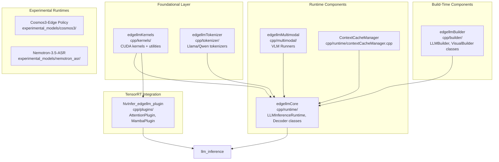

**Component Details**:

- **`edgellmKernels`** (`cpp/kernels/`): Contains CUDA kernel implementations including CuTe DSL FMHA-v2, XQA, MoE, and specialized kernels for Gemma 4 audio attention [CHANGELOG.md:14-14](), [CHANGELOG.md:29-29]().
- **`edgellmTokenizer`** (`cpp/tokenizer/`): Text tokenization support for Llama and Qwen model families.
- **`edgellmBuilder`** (`cpp/builder/`): Library for building TensorRT engines, now moved to the `cpp` folder for tighter integration [CHANGELOG.md:120-120]().
- **`edgellmCore`** (`cpp/runtime/`): The primary runtime library containing `LLMInferenceRuntime`, `Decoder` strategies, and the `ContextCacheManager` for paged KV-cache reuse [CHANGELOG.md:11-11]().
- **`NvInfer_edgellm_plugin`** (`cpp/plugins/`): Shared library containing custom TensorRT plugins like `AttentionPlugin` (upgraded to Plugin V3) and `Gemma4AudioAttentionPlugin` [CHANGELOG.md:47-47]().
- **`Experimental Runtimes`**: Dedicated runtimes for Cosmos3-Edge multimodal reasoning and Nemotron-3.5-ASR RNN-T transcription [CHANGELOG.md:7-9]().

**Sources**: [CHANGELOG.md:3-25](), [CHANGELOG.md:47-56](), [CHANGELOG.md:115-121]()

---

## Runtime Execution Flow

The runtime utilizes a composable execution architecture where `LLMInferenceRuntime` manages the lifecycle of requests via `handleRequest()` [CHANGELOG.md:118-118]().

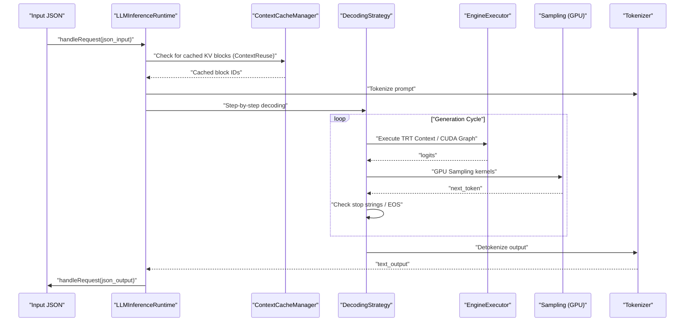

**Key Classes**:

- **`ContextCacheManager`**: Manages paged KV-cache reuse for multi-turn LLM requests and media-aware reuse for VLM requests using collision-resistant hashing [CHANGELOG.md:11-11](), [CHANGELOG.md:99-99]().
- **`EngineExecutor`**: Handles TensorRT execution context, supporting CUDA Graph capture and execution for reduced latency [CHANGELOG.md:49-49]().
- **`DecodingStrategy`**: Pluggable interface for generation modes including `VanillaDecoder`, `EagleDecoder`, `MTPDecoder`, `DFlashDecoder`, `DSparkDecoder`, and `BlockDiffusionDecoder` [CHANGELOG.md:10-10](), [CHANGELOG.md:50-50]().
- **`StreamChannel`**: API for per-slot streaming output [CHANGELOG.md:79-79]().

**Sources**: [CHANGELOG.md:3-25](), [CHANGELOG.md:49-50](), [CHANGELOG.md:79-99]()

---

## Supported Models and Precisions

The compatibility matrix as of version **0.10.0**:

| Model Family | Supported Models | Multimodal | Precisions |
|--------------|------------------|------------|------------|
| **Qwen** | Qwen 3.8-27B, 3.x, 3.5, 3.6 | ✓ | FP16, FP8, NVFP4, INT4 AWQ/GPTQ [CHANGELOG.md:4-17]() |
| **Nemotron** | Nemotron-3.5 Lightning, 3.5-ASR, Omni | ✓ | NVFP4, FP16 [CHANGELOG.md:5-9]() |
| **Gemma** | Gemma 4 (12B, 26B-A4B, 31B), DiffusionGemma | ✓ | FP16, FP8, INT4 AWQ [CHANGELOG.md:8-24]() |
| **Cosmos** | Cosmos3-Edge | ✓ | Multimodal Reasoning [CHANGELOG.md:7-7]() |
| **Phi** | Phi-4-Multimodal | ✓ | FP16, FP8, NVFP4 [CHANGELOG.md:112-112]() |
| **Llama** | Llama 3.x | ✗ | FP16, FP8, NVFP4, INT4 |

**Precision Details**:
- **NVFP4**: NVIDIA 4-bit floating point format for Blackwell (SM100/101) [CHANGELOG.md:38-42]().
- **INT4 AWQ/GPTQ**: Supported for large MoE models like Gemma 4 26B-A4B and Qwen3-Omni 30B-A3B to reduce memory footprint [CHANGELOG.md:16-17]().
- **FP8 ViT**: Optimized vision transformer processing for VLMs [CHANGELOG.md:62-62]().

**Sources**: [CHANGELOG.md:3-25](), [CHANGELOG.md:38-42](), [CHANGELOG.md:62-62]()

---

## Advanced Decoding: Speculative and Non-Autoregressive

The runtime supports multiple pluggable decoding strategies to improve throughput and latency [CHANGELOG.md:50-50]().

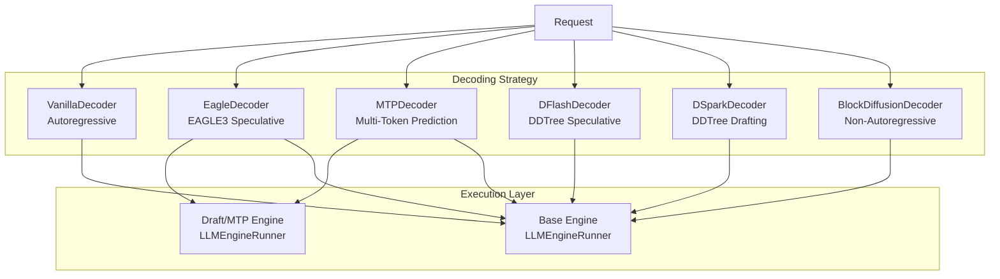

**Implementation Details**:
- **DSpark**: New speculative decoding strategy using DDTree drafting for enhanced performance [CHANGELOG.md:10-10]().
- **BlockDiffusion**: Non-autoregressive decoding supported for models like DiffusionGemma [CHANGELOG.md:8-8]().
- **MTP (Multi-Token Prediction)**: Native support for Nemotron-3.5 Lightning and Gemma 4 paired-checkpoints [CHANGELOG.md:5-15]().
- **DFlash**: Optimized speculative decoding for Qwen3/Qwen3.5 hybrid models using DDTree [CHANGELOG.md:25-25]().

**Sources**: [CHANGELOG.md:3-25](), [CHANGELOG.md:50-50]()

---

## Build System and Cross-Compilation

The project uses a CMake-based build system optimized for NVIDIA edge platforms [CHANGELOG.md:80-80]().

- **Target Platforms**: Supports `jetson-thor`, `jetson-orin`, and `gb10` (NVIDIA DRIVE) [CHANGELOG.md:40-42]().
- **CuTe DSL**: High-performance FMHA-v2, XQA, and MoE kernels are generated via CuTe DSL, replacing legacy cubin artifacts [CHANGELOG.md:14-14](), [CHANGELOG.md:29-29]().
- **Experimental Flags**: `BUILD_EXPERIMENTAL_MODELS` enables building Cosmos3 and Nemotron-ASR runtimes [CHANGELOG.md:7-9]().

**Sources**: [CHANGELOG.md:3-14](), [CHANGELOG.md:40-42](), [CHANGELOG.md:80-80]()

---

## Version Information

Current version: **0.10.0** [CHANGELOG.md:3-3]()

**Major Recent Updates**:
- **Qwen 3.8-27B** Day-0 support [CHANGELOG.md:4-4]().
- **ONNX-less workflow** for direct engine building from checkpoints [CHANGELOG.md:6-6]().
- **Paged KV-cache reuse** for multi-turn and media-aware requests [CHANGELOG.md:11-11]().
- **Cosmos3-Edge** and **DiffusionGemma** support [CHANGELOG.md:7-8]().
- **OpenAI-compatible server** expansion with video input, tool-calling, and ASR/TTS endpoints [CHANGELOG.md:12-19]().

**Sources**: [CHANGELOG.md:1-25]()

---

# Page: Getting Started

# Getting Started

<details>
<summary>Relevant source files</summary>

The following files were used as context for generating this wiki page:

- [CMakeLists.txt](CMakeLists.txt)
- [README.md](README.md)

</details>


This page provides an introduction to setting up and running TensorRT-Edge-LLM for the first time. It covers the basic workflow from model preparation through inference execution, with links to detailed documentation for each step.

For comprehensive installation instructions, see [Installation](#2.2). For detailed system requirements and platform compatibility, see [System Requirements](#2.1). For a complete hands-on tutorial with example commands, see [Quick Start Tutorial](#2.3).

---

## Overview

TensorRT-Edge-LLM is a high-performance C++ inference framework designed for text, vision, audio, speech, and action models on NVIDIA edge platforms like Jetson, DRIVE, and DGX Spark [README.md:3-6](). The framework bridges the gap between HuggingFace checkpoints and optimized TensorRT engines by providing two primary deployment paths:

1.  **ONNX-based Pipeline**: Convert HuggingFace models to ONNX format with optional quantization (FP8, NVFP4, INT4) using the `tensorrt_edgellm` Python package, then build the engine [README.md:22-26]().
2.  **Experimental Direct Builder**: Build TensorRT engines directly from checkpoints without an intermediate ONNX export step [README.md:18-19, 26]().

The SDK supports state-of-the-art architectures including the full **Gemma 4** family (multimodal text/image/audio with MTP), **Qwen3**, **NVIDIA Nemotron-3.5 Lightning**, and **Cosmos3-Edge** [README.md:18-20]().

**Sources**: [README.md:3-6](), [README.md:18-20](), [README.md:22-26]()

---

## Deployment Workflow

The following diagram illustrates the transition from the Python-based model preparation space to the C++ runtime execution space, mapping high-level tasks to specific code entities.

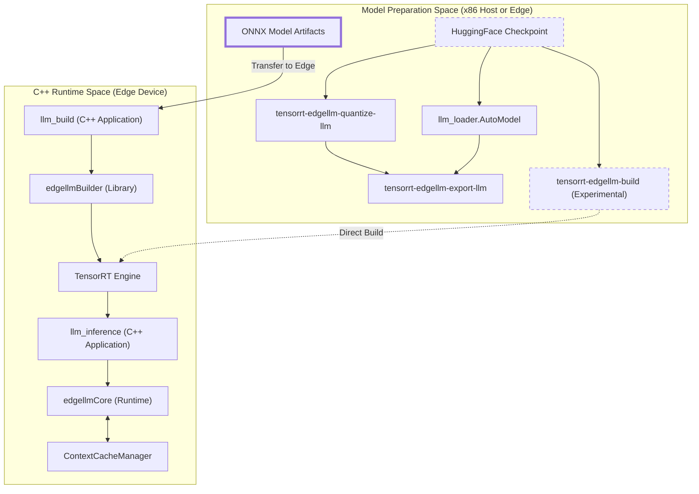

**Diagram: End-to-End Deployment Pipeline**

The Python scripts handle weight transformation and graph export. The resulting ONNX files are consumed by the `llm_build` utility, which utilizes the `edgellmBuilder` library [CMakeLists.txt:158]() to generate optimized engines. Release 0.10.0 introduced `ContextCacheManager` for paged KV-cache reuse across multi-turn requests [README.md:18-19](). Inference is handled by `llm_inference` via the `edgellmCore` runtime [CMakeLists.txt:158]().

**Sources**: [README.md:18-19](), [README.md:22-26](), [README.md:37-45](), [CMakeLists.txt:158-163]()

---

## Prerequisites

Before starting, ensure your environment meets these high-level requirements. For a detailed checklist, see [System Requirements](#2.1).

| Component | Requirement | Notes |
|-----------|-------------|-------|
| **Host (Export)** | x86_64 Linux with NVIDIA GPU | Required for quantization and ONNX export |
| **Target (Inference)** | NVIDIA Jetson (Orin/Thor), DRIVE (Thor), or GB10 | Supported via `EMBEDDED_TARGET` [CMakeLists.txt:85-90, 113-118]() |
| **CUDA** | Version 12.8+ | Default: `/usr/local/cuda-12.8` [CMakeLists.txt:82-83]() |
| **TensorRT** | Version 10.x+ | Required with `OnnxParser` [CMakeLists.txt:158]() |
| **C++ Standard** | C++17 | Required for SDK compilation [CMakeLists.txt:24-27]() |

**Sources**: [CMakeLists.txt:24-27](), [CMakeLists.txt:82-83](), [CMakeLists.txt:85-90](), [CMakeLists.txt:113-118](), [CMakeLists.txt:158]()

---

## Installation Overview

The project uses a CMake-based build system supporting both native and cross-compilation. For detailed setup, see [Installation](#2.2).

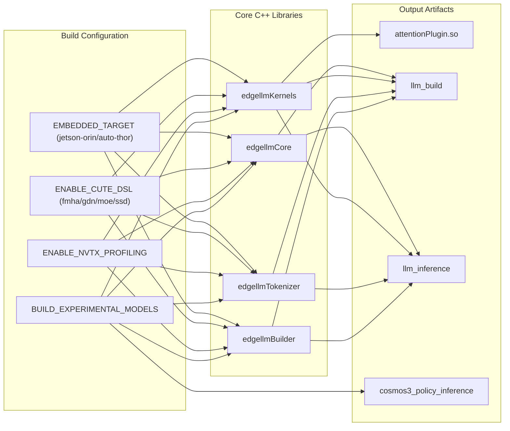

**Diagram: Build System Components and Artifacts**

The build process links core libraries into the final executables. A key feature is the `ENABLE_CUTE_DSL` option, which enables high-performance CuTe-based kernels for FMHA, MoE, SSD, and Gated Delta Networks [CMakeLists.txt:183-205](). Release 0.10.0 also added `BUILD_EXPERIMENTAL_MODELS` for Cosmos3 and Nemotron-ASR runtimes [CMakeLists.txt:213-220]().

**Sources**: [CMakeLists.txt:131-133](), [CMakeLists.txt:158-163](), [CMakeLists.txt:183-205](), [CMakeLists.txt:213-220]()

---

## Quick Start Summary

To run your first model, follow these high-level steps. For a hands-on guide, see [Quick Start Tutorial](#2.3).

### 1. Export the Model (Host)
Install the Python package and export a model to ONNX using the checkpoint exporter [README.md:43]():
```bash
tensorrt-edgellm-export-llm --model_dir Qwen/Qwen3-0.6B --output_dir ./onnx_models/qwen3-0.6b
```

### 2. Build the Engine (Edge)
Use the `llm_build` utility to create a TensorRT engine. This process utilizes the `edgellmBuilder` library internally to optimize the model for the target hardware [CMakeLists.txt:158-163]():
```bash
./llm_build --onnxDir ./onnx_models/qwen3-0.6b --engineDir ./engines/qwen3-0.6b --maxBatchSize 1
```

### 3. Run Inference (Edge)
Execute inference using the `llm_inference` tool, which leverages the `edgellmCore` runtime for token generation [CMakeLists.txt:158-163]():
```bash
./llm_inference --engineDir ./engines/qwen3-0.6b --inputFile input.json --outputFile output.json
```

**Sources**: [README.md:32](), [README.md:43](), [CMakeLists.txt:158-163]()

---

## Next Steps

*   **System Requirements**: Verify your hardware and software compatibility. [System Requirements](#2.1)
*   **Installation**: Detailed guide for building the SDK from source. [Installation](#2.2)
*   **Quick Start Tutorial**: Step-by-step walkthrough with sample data. [Quick Start Tutorial](#2.3)
*   **Model Deployment**: Learn about the full Python-to-C++ pipeline and quantization options. [Model Deployment Workflow](#3)

---

# Page: System Requirements

# System Requirements

<details>
<summary>Relevant source files</summary>

The following files were used as context for generating this wiki page:

- [README.md](README.md)
- [cmake/aarch64_linux_toolchain.cmake](cmake/aarch64_linux_toolchain.cmake)

</details>


This document details the hardware, software, and platform requirements for developing and deploying LLM inference with TensorRT-Edge-LLM. The system has distinct requirements for two environments: the **development host** (where models are quantized and exported) and the **edge device** (where inference runs).

---

## Overview of Deployment Architecture

The TensorRT-Edge-LLM workflow involves two distinct execution environments with different requirements. The Python-based export pipeline prepares models on high-performance workstations, while the C++ runtime is optimized for resource-constrained edge platforms.

### Environment Interaction Diagram

```mermaid
graph TB
    subgraph DevHost["Development Host (x86_64)"]
        [PythonEnv] --> [ExportTools]
        [CUDA_Host] --> [ExportTools]
        [ExportTools] --> [ONNX]
        [ExportTools] --> [DirectBuilder]
    end
    
    subgraph EdgeDevice["Edge Device (aarch64)"]
        [CppRuntime]
        [CUDA_Edge] --> [CppRuntime]
        [TRT_Edge] --> [CppRuntime]
        [Engines] --> [CppRuntime]
    end
    
    subgraph Artifacts["Intermediate Artifacts"]
        [ONNX]
        [Engines]
    end
    
    [ONNX] --> [CppRuntime]
    [DirectBuilder] -- "Experimental Direct Path" --> [Engines]
    [CppRuntime] -- "edgellmBuilder" --> [Engines]

    classDef code font-family:monospace;
    class ExportTools,DirectBuilder,CppRuntime code;
```

**Sources**: [README.md:24-27](), [README.md:43-44]()

---

## Development Host Requirements

The development host is used for model quantization and ONNX export. Version 0.10.0 introduces an experimental direct engine builder that can bypass ONNX export but still requires a host for initial processing.

### Operating System & Architecture
*   **OS Type**: Linux x86_64.
*   **Tested Distributions**: Ubuntu 22.04, CentOS 7.
*   **Architecture**: x86_64 (ARM64 hosts are not supported for the export pipeline).

### Hardware Requirements
| Component | Minimum | Recommended | Purpose |
|-----------|---------|-------------|---------|
| CPU | x86_64 multi-core | High core count | Model quantization and engine building are CPU-intensive |
| GPU | NVIDIA GPU with 16GB+ VRAM | H100, A100, RTX 4090 | Required for quantization, export, and engine building |
| System RAM | 32GB | 64GB+ | Large model quantization (e.g., Llama-3 70B, Qwen3.8-27B) |
| Storage | 100GB free | 500GB+ SSD | Model weights and intermediate artifacts |

### Software Dependencies
| Dependency | Version Range | Purpose |
|------------|---------------|---------|
| Python | 3.8+ | Export pipeline and `llm_loader` runtime |
| CUDA Toolkit | 11.8+ or 12.x | GPU acceleration for PyTorch |
| PyTorch | 2.0+ | Model loading and manipulation |
| Transformers | 4.30+ | HuggingFace model support |
| ModelOpt | Compatible with TensorRT | Quantization (FP8, NVFP4, INT4) |
| ONNX | 1.14+ | Model serialization (Legacy path) |

**Sources**: [README.md:24-27](), [README.md:48-51]()

---

## Edge Device Requirements

The edge device is the deployment target for TensorRT inference engines. This is where the C++ components, such as `edgellmCore` and `edgellmBuilder`, are executed.

### Supported Platforms and Toolchain Mapping

The `cmake/aarch64_linux_toolchain.cmake` file defines the specific CUDA architectures and toolkit versions for supported edge platforms.

```mermaid
graph LR
    subgraph TargetSelection["EMBEDDED_TARGET Selection"]
        [AutoThor]
        [JetsonThor]
        [JetsonOrin]
        [GB10]
    end
    
    subgraph ArchConfig["Toolchain Architecture"]
        [SM110]
        [SM87]
        [SM121]
        [SM101]
    end
    
    [AutoThor] -- "CUDA < 13.0" --> [SM101]
    [AutoThor] -- "CUDA >= 13.0" --> [SM110]
    [JetsonThor] --> [SM110]
    [JetsonOrin] --> [SM87]
    [GB10] --> [SM121]

    classDef code font-family:monospace;
    class AutoThor,JetsonThor,JetsonOrin,GB10 code;
```

| Platform | `EMBEDDED_TARGET` | CUDA Arch | Default `CUDA_CTK_VERSION` |
|----------|-------------------|-----------|----------------------------|
| Jetson Thor | `jetson-thor` | 110a | 13.0 [cmake/aarch64_linux_toolchain.cmake:66-67]() |
| Jetson Orin | `jetson-orin` | 87 | 12.6 [cmake/aarch64_linux_toolchain.cmake:71-73]() |
| DRIVE GB10 | `gb10` | 121a | 13.0 [cmake/aarch64_linux_toolchain.cmake:83-85]() |
| Auto Thor | `auto-thor` | 110a/101a | 13.3 [cmake/aarch64_linux_toolchain.cmake:51-57]() |

### Operating System & Hardware
*   **Architecture**: aarch64 (ARM64) [cmake/aarch64_linux_toolchain.cmake:18-18]().
*   **OS**: Linux (JetPack for Jetson, DRIVE OS for Automotive) [cmake/aarch64_linux_toolchain.cmake:17-17]().
*   **Memory**: 8GB minimum; 32GB+ recommended for large models like Qwen3.8-27B or Cosmos3-Edge.
*   **Storage**: 10GB+ free for engines and model weights.

**Sources**: [cmake/aarch64_linux_toolchain.cmake:51-93](), [README.md:18-20]()

---

## Build Environment Requirements

Building the C++ runtime requires a specific toolchain configuration, especially when cross-compiling from an x86 host.

### Cross-Compilation Toolchain
When building on x86_64 for an aarch64 target, the following tools are required:
*   **Cross-compiler**: `aarch64-linux-gnu-gcc` and `aarch64-linux-gnu-g++` [cmake/aarch64_linux_toolchain.cmake:21-22]().
*   **CUDA Compiler**: `nvcc` must be available at `/usr/local/cuda/bin/nvcc` [cmake/aarch64_linux_toolchain.cmake:27-27]().
*   **CMake**: Version 3.18 or higher.

### Toolchain Paths
The build system expects specific directory structures for the CUDA toolkit based on the target:
*   **Jetson/Standard aarch64**: `/usr/local/cuda/targets/aarch64-linux` [cmake/aarch64_linux_toolchain.cmake:59-60]().
*   **SBSA (Server Base System Architecture)**: `/usr/local/cuda/targets/sbsa-linux` [cmake/aarch64_linux_toolchain.cmake:69-70]().
*   **Thor-specific target**: `/usr/local/cuda/thor/targets/aarch64-linux` [cmake/aarch64_linux_toolchain.cmake:61-63]().

### Required CMake Variables
| Variable | Purpose |
|----------|---------|
| `CMAKE_TOOLCHAIN_FILE` | Path to `cmake/aarch64_linux_toolchain.cmake`. |
| `EMBEDDED_TARGET` | Identifies the hardware (e.g., `jetson-orin`). |
| `CUDA_CTK_VERSION` | Specifies the CUDA Toolkit version to avoid ambiguity [cmake/aarch64_linux_toolchain.cmake:47-49](). |
| `AARCH64_BUILD` | Set to `TRUE` by the toolchain file to indicate ARM64 build [cmake/aarch64_linux_toolchain.cmake:101-101](). |

**Sources**: [cmake/aarch64_linux_toolchain.cmake:16-35](), [cmake/aarch64_linux_toolchain.cmake:96-101]()

---

## Software Compatibility Matrix

| Feature | Supported Platforms | Requirement |
|---------|---------------------|-------------|
| **FP8 / NVFP4 Quantization** | Blackwell (Thor/GB10) | CUDA 13.0+, SM 110/121 |
| **DFlash Speculative Decoding** | Jetson Thor, Qwen3/3.5 | Released in 0.9.0 [README.md:20-20]() |
| **DSpark Speculative Decoding** | All aarch64 | Released in 0.10.0 [README.md:19-19]() |
| **Gemma 4 Multimodal** | All aarch64 | Released in 0.9.1 [README.md:20-20]() |
| **Context Cache Reuse** | All aarch64 | Released in 0.10.0 [README.md:19-19]() |
| **MTP (Multi-Token Prediction)** | All aarch64 | edgellmCore runtime [README.md:19-19]() |

**Sources**: [README.md:18-20](), [cmake/aarch64_linux_toolchain.cmake:51-93]()

---

# Page: Installation

# Installation

<details>
<summary>Relevant source files</summary>

The following files were used as context for generating this wiki page:

- [.gitmodules](.gitmodules)
- [CMakeLists.txt](CMakeLists.txt)
- [cmake/FindTensorRT.cmake](cmake/FindTensorRT.cmake)

</details>


This page provides step-by-step instructions for building the TensorRT-Edge-LLM SDK from source. It covers cloning the repository, configuring CMake with required dependencies, and compiling the C++ libraries and executables. For hardware and software prerequisites, see [System Requirements](#2.1). For a hands-on tutorial walking through model deployment, see [Quick Start Tutorial](#2.3).

---

## Installation Overview

The installation process consists of four main stages: obtaining source code, configuring build variables, compiling C++ components, and optionally setting up development tools.

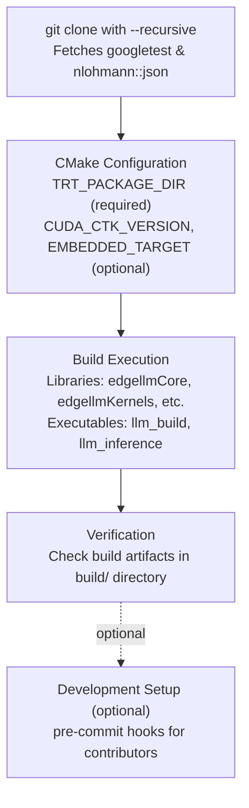

**Sources**: [CMakeLists.txt:16-21](), [CMakeLists.txt:129-130](), [CMakeLists.txt:158-159]()

---

## Prerequisites

Before beginning installation, ensure the following dependencies are available on your system:

| Dependency | Requirement | Notes |
|------------|-------------|-------|
| **CMake** | ≥ 3.20 | Required for build configuration [CMakeLists.txt:16-16]() |
| **C++ Compiler** | C++17 support | Specified via `CMAKE_CXX_STANDARD` [CMakeLists.txt:24-25]() |
| **CUDA Toolkit** | Default: 12.8 | Customizable via `CUDA_CTK_VERSION` [CMakeLists.txt:82-83]() |
| **TensorRT** | Must be specified | Set via `TRT_PACKAGE_DIR` [cmake/FindTensorRT.cmake:18-20]() |
| **Git** | With submodule support | For cloning repository dependencies |

The system automatically detects native GPU architectures (SM 80, 86, 89, and if CUDA ≥12.8: SM 100a, 120) [CMakeLists.txt:85-90]() or uses target-specific architectures when `EMBEDDED_TARGET` is specified in the toolchain.

---

## Cloning the Repository

### Basic Clone with Submodules

The repository contains submodules for third-party dependencies like `googletest`, `nlohmannJson`, and `NVTX`. Clone with the `--recursive` flag to automatically fetch these:

```bash
git clone --recursive https://github.com/NVIDIA/TensorRT-Edge-LLM.git
cd TensorRT-Edge-LLM
```

### Submodule Structure

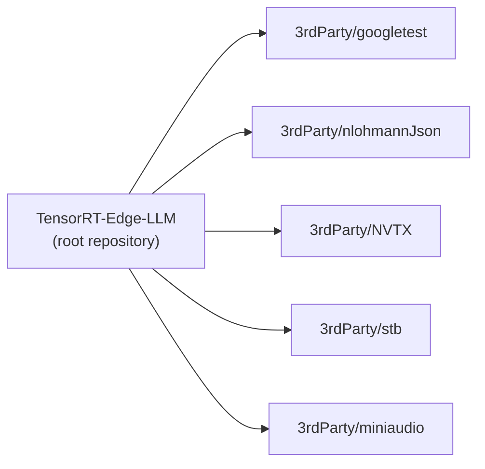

The `googletest` submodule is initialized via `.gitmodules` [.gitmodules:1-3](). The `nlohmannJson`, `stb`, and `miniaudio` headers are included via `COMMON_INCLUDE_DIRS` [CMakeLists.txt:165-171]().

**Sources**: [.gitmodules:1-9](), [CMakeLists.txt:165-171]()

---

## CMake Configuration

### Required Variables

The `TRT_PACKAGE_DIR` variable is the primary root hint for locating TensorRT. If not set, the system falls back to standard system paths like `/usr` or `/opt/tensorrt` [cmake/FindTensorRT.cmake:18-21]().

```bash
cmake -DTRT_PACKAGE_DIR=/path/to/TensorRT -B build
```

### Optional Variables

| Variable | Default | Purpose |
|----------|---------|---------|
| `CUDA_CTK_VERSION` | `12.8` | CUDA Toolkit version [CMakeLists.txt:82-82]() |
| `EMBEDDED_TARGET` | (unset) | Target: `auto-thor`, `jetson-thor`, `jetson-orin`, `gb10` [CMakeLists.txt:94-94]() |
| `BUILD_UNIT_TESTS` | `OFF` | Enable building unit tests [CMakeLists.txt:42-42]() |
| `ENABLE_NVTX_PROFILING` | `OFF` | Enable NVTX profiling support [CMakeLists.txt:132-132]() |
| `ENABLE_CUTE_DSL` | `OFF` | Enable CuTe DSL unified kernel generation [CMakeLists.txt:183-184]() |
| `ENABLE_COVERAGE` | `OFF` | Enable gcov code coverage instrumentation [CMakeLists.txt:37-37]() |

### Configuration Logic

The `FindTensorRT.cmake` module defines the logic for locating the inference engine and ONNX parser:

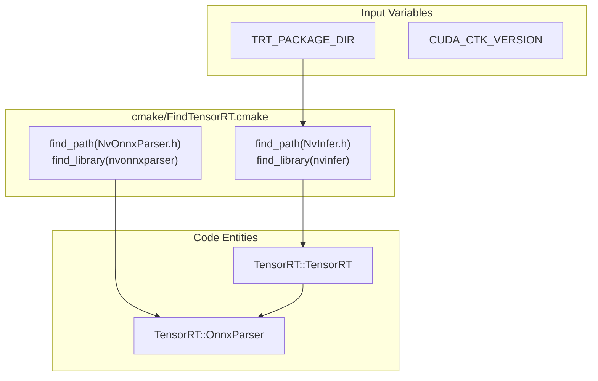

**Sources**: [cmake/FindTensorRT.cmake:25-45](), [cmake/FindTensorRT.cmake:81-97]()

---

## Building the SDK

### Standard Build Process

After configuration, build all targets:

```bash
cmake --build build -j$(nproc)
```

### Build Targets and Outputs

The build system links core components through `commonLibraryExt`, which includes TensorRT and the ONNX parser [CMakeLists.txt:173-176]().

| Target | Type | Description |
|--------|------|-------------|
| `commonLibraryExt` | Interface Lib | Base target linking TensorRT, OnnxParser, and CUDART [CMakeLists.txt:173-176]() |
| `edgellmCore` | Static Lib | Core runtime library (defined in `cpp/` subdirectory) |
| `edgellmBuilder` | Static Lib | Engine building library (defined in `cpp/` subdirectory) |

### Cross-Compilation for ARM64

For embedded platforms, use target-specific variables. The project handles `AARCH64_BUILD` logic to adjust library paths and linking options [CMakeLists.txt:58-72]().

```bash
cmake -DEMBEDDED_TARGET=jetson-orin \
      -DTRT_PACKAGE_DIR=/path/to/aarch64/TRT \
      -B build
```

The build system configures specific `CMAKE_CUDA_ARCHITECTURES` for the target and applies `TRT_EDGELLM_CUDA_LIBRARY_T_COMPAT` for Jetson Orin to handle `cudaLibrary_t` compatibility [CMakeLists.txt:94-96]().

**Sources**: [CMakeLists.txt:57-73](), [CMakeLists.txt:94-96](), [CMakeLists.txt:173-181]()

---

## Troubleshooting

### CUDA Version Ambiguity
If you see an error regarding `CUDA_VERSION`, use `-DCUDA_CTK_VERSION` instead to avoid macro conflicts with CUDA internal macros [CMakeLists.txt:76-81]().

### Jetson Orin `cudaLibrary_t`
On Jetson Orin, `cuda.h` may lack `cudaLibrary_t`. Setting `EMBEDDED_TARGET` to `jetson-orin` automatically defines `TRT_EDGELLM_CUDA_LIBRARY_T_COMPAT` to enable a compatibility typedef [CMakeLists.txt:94-96]().

### Unresolved Symbols in Cross-Compilation
When cross-compiling, `libnvinfer.so` might link to `libnvdla_compilers`. The build system uses `INTERFACE` link options `-Wl,--unresolved-symbols=ignore-in-shared-libs` to allow these to be resolved at execution time on the target board [CMakeLists.txt:180-181]().

### NVTX Headers
If `ENABLE_NVTX_PROFILING` is ON, the build system expects NVTX3 headers at `3rdParty/NVTX/include/nvtx3`. Ensure the submodule is initialized if this fails [CMakeLists.txt:134-150]().

**Sources**: [CMakeLists.txt:76-83](), [CMakeLists.txt:94-96](), [CMakeLists.txt:134-150](), [CMakeLists.txt:180-181]()

---

# Page: Quick Start Tutorial

# Quick Start Tutorial

<details>
<summary>Relevant source files</summary>

The following files were used as context for generating this wiki page:

- [CMakeLists.txt](CMakeLists.txt)
- [README.md](README.md)

</details>


## Purpose and Scope

This tutorial provides a hands-on walkthrough of the complete TensorRT Edge-LLM deployment pipeline, from downloading a pretrained model to executing inference on an edge device. You will learn to:

1.  Quantize and export a HuggingFace model to ONNX format using Python tools.
2.  Build a TensorRT engine from ONNX files using the C++ builder (`LLMBuilder`).
3.  Execute inference using the C++ runtime with JSON input/output.

This tutorial demonstrates the workflow using a specific example model (Qwen3-0.6B) and should take approximately 15 minutes to complete.

**Prerequisites**: Before starting this tutorial, ensure you have completed the installation steps in **Installation (2.2)** and verified your system meets the requirements in **System Requirements (2.1)**.

---

## End-to-End Workflow Overview

The following diagram illustrates the complete deployment pipeline, showing the transition from a HuggingFace model to edge inference:

### Model Deployment Pipeline
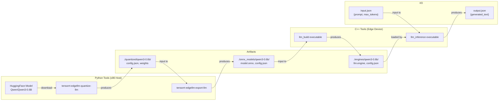

**Sources**: [README.md:24-28](), [README.md:46-55]()

---

## Step 1: Model Quantization

The first step converts a HuggingFace model to a quantized format. This step runs on an x86 host with a GPU and requires the Python export tools.

### Command Structure

```bash
tensorrt-edgellm-quantize-llm \
    --model_dir <HF_MODEL_NAME_OR_PATH> \
    --output_dir <QUANTIZED_OUTPUT_DIR> \
    --quantization <PRECISION>
```

### Parameters

| Parameter | Description | Example Values |
|-----------|-------------|----------------|
| `--model_dir` | HuggingFace model name or local path | `Qwen/Qwen3-0.6B`, `nvidia/Cosmos3-Edge` |
| `--output_dir` | Directory for quantized model output | `./quantized/qwen3-0.6b` |
| `--quantization` | Quantization precision | `fp16`, `fp8`, `nvfp4`, `int4`, `int4_awq` |

### Example: Quantizing Qwen3-0.6B to FP8

```bash
tensorrt-edgellm-quantize-llm \
    --model_dir Qwen/Qwen3-0.6B \
    --output_dir ./quantized/qwen3-0.6b \
    --quantization fp8
```

This command downloads the model, applies FP8 quantization, and saves the quantized weights and configuration to `./quantized/qwen3-0.6b/`.

**Sources**: [README.md:18-20](), [README.md:51-51]()

---

## Step 2: ONNX Export

The second step converts the quantized model to ONNX format, which can be ingested by the TensorRT engine builder.

### Example: Exporting Qwen3-0.6B to ONNX

```bash
tensorrt-edgellm-export-llm \
    --model_dir ./quantized/qwen3-0.6b \
    --output_dir ./onnx_models/qwen3-0.6b
```

**Output artifacts**: The ONNX directory contains:
- `model.onnx`: The main transformer network.
- `config.json`: Model configuration for the builder.
- Tokenizer files: Necessary for runtime string-to-token conversion.

**Sources**: [README.md:43-44](), [README.md:48-49]()

---

## Step 3: TensorRT Engine Building

The third step compiles the ONNX models into optimized TensorRT engines using the `llm_build` example. This process is handled by the C++ `edgellmBuilder` library.

### Example: Building Engine for Qwen3-0.6B

```bash
./build/examples/llm/llm_build \
    --onnxDir ./onnx_models/qwen3-0.6b \
    --engineDir ./engines/qwen3-0.6b \
    --maxBatchSize 1
```

### Build Logic
The building process involves:
1.  **Plugin Registration**: Loading custom CUDA kernels (e.g., Attention, MoE) into the TensorRT registry.
2.  **Network Parsing**: Parsing the ONNX graph into a TensorRT network.
3.  **Optimization**: Applying platform-specific optimizations for Jetson or DRIVE platforms (e.g., Orin/Thor).
4.  **Serialization**: Saving the optimized `.engine` file to disk.

**Sources**: [CMakeLists.txt:158-158](), [CMakeLists.txt:183-200](), [README.md:61-61]()

---

## Step 4: Running Inference

The final step executes inference using the `llm_inference` executable.

### Example: Running Inference

```bash
./build/examples/llm/llm_inference \
    --engineDir ./engines/qwen3-0.6b \
    --inputFile input.json \
    --outputFile output.json
```

### Input JSON Format (`input.json`)
```json
{
  "prompt": "What is the capital of France?",
  "max_tokens": 100,
  "temperature": 0.7,
  "top_p": 0.9,
  "enableContextReuse": true
}
```
*Note: The `--enableContextReuse` flag (introduced in 0.10.0) allows for multi-turn KV-cache reuse.*

**Sources**: [README.md:19-19](), [README.md:53-53]()

---

## Runtime Component Association

The following diagram bridges the high-level inference flow with the specific code entities involved in the process.

### Code Entity Mapping
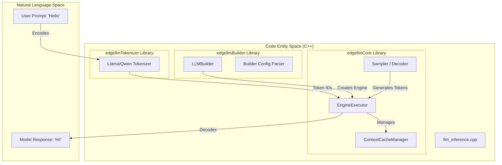

**Sources**: [CMakeLists.txt:165-171](), [README.md:62-64](), [README.md:19-19]()

---

## Experimental: Direct Engine Builder (ONNX-less)

As of version **0.10.0**, an experimental path allows building engines directly from checkpoints, bypassing the ONNX export step.

### Example: Direct Build

```bash
tensorrt-edgellm-build \
    --checkpoint_dir ./quantized/qwen3-0.6b \
    --output_dir ./engines/qwen3-0.6b
```

This uses the `NetworkModule` and `ops.functional` API to define the model architecture directly in the builder.

**Sources**: [README.md:19-19](), [README.md:44-44]()

---

## Troubleshooting Common Issues

### Issue: CUDA Version Mismatch
**Cause**: The SDK was built for a different CUDA version than the one installed.
**Check**: Verify `CUDA_CTK_VERSION` in `CMakeLists.txt`.
**Fix**: Ensure `-DCUDA_CTK_VERSION` matches your environment during CMake configuration.

### Issue: NVTX Profiling Headers Missing
**Cause**: NVTX submodule not initialized.
**Check**: `3rdParty/NVTX/include/nvtx3/nvtx3.hpp` existence.
**Fix**: Run `git submodule update --init 3rdParty/NVTX`.

### Issue: Missing Plugins
**Cause**: The TensorRT engine was built without custom edge-LLM plugins.
**Check**: Ensure `commonLibraryExt` is linked and `loadEdgellmPluginLib()` is called in the application.

**Sources**: [CMakeLists.txt:82-83](), [CMakeLists.txt:132-155](), [CMakeLists.txt:173-176]()

---

# Page: Model Deployment Workflow

# Model Deployment Workflow

<details>
<summary>Relevant source files</summary>

The following files were used as context for generating this wiki page:

- [cpp/builder/llmBuilder.cpp](cpp/builder/llmBuilder.cpp)
- [cpp/builder/llmBuilder.h](cpp/builder/llmBuilder.h)
- [cpp/builder/visualBuilder.cpp](cpp/builder/visualBuilder.cpp)

</details>


This document provides a comprehensive overview of the end-to-end process for deploying Large Language Models (LLMs), Vision-Language Models (VLMs), and Action models on NVIDIA edge platforms using TensorRT-Edge-LLM. The workflow spans from downloading HuggingFace model checkpoints to executing inference on target devices.

For detailed information on specific components:
- Python-based model preparation: see [Python Export Pipeline](#3.1)
- TensorRT engine creation: see [Engine Building](#3.2)
- Runtime execution details: see [Running Inference](#3.3)

---

## Overview

The deployment workflow is divided into four main stages executed sequentially:

1.  **Model Quantization**: Reduce model precision (FP16/FP8/NVFP4/INT4) to optimize for edge hardware constraints.
2.  **ONNX Export**: Convert quantized models from HuggingFace format to ONNX intermediate representation.
3.  **Engine Building**: Compile ONNX models into optimized TensorRT engines with optimization profiles.
4.  **Inference Execution**: Load engines and run inference with JSON-based I/O.

The first two stages use Python tools and typically run on an x86 development host with a GPU. Engine building and inference execute on target edge devices (Jetson/DRIVE).

**Sources**: [cpp/builder/llmBuilder.cpp:121-179](), [cpp/builder/visualBuilder.cpp:44-77]()

---

## Deployment Pipeline Architecture

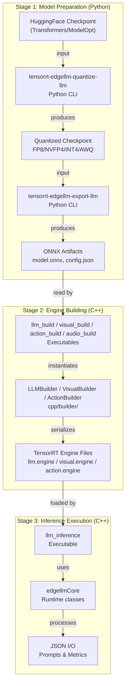

**Diagram 1**: Complete deployment pipeline showing the progression from HuggingFace checkpoints to running inference.

**Sources**: [cpp/builder/llmBuilder.cpp:165-183](), [cpp/builder/visualBuilder.cpp:71-77]()

---

## Stage 1: Model Preparation (Python)

The Python export pipeline transforms HuggingFace models into ONNX format suitable for TensorRT compilation.

### Quantization

The `tensorrt-edgellm-quantize-llm` command reduces model precision to optimize memory footprint and performance. Supported precision types include:

| Precision | Description |
|-----------|-------------|
| **FP16** | Half precision baseline |
| **FP8** | 8-bit floating point for balanced performance |
| **NVFP4** | NVIDIA 4-bit float for maximum compression |
| **INT4** | 4-bit integer (GPTQ/AWQ) |

**Sources**: [cpp/builder/llmBuilder.h:48](), [cpp/builder/llmBuilder.cpp:193-205]()

### ONNX Export

The `tensorrt-edgellm-export-llm` command converts the quantized model to ONNX. This process produces `model.onnx` and a `config.json` that includes architecture parameters like `hidden_size`, `num_attention_heads`, and `num_key_value_heads`. For LoRA-enabled models, it generates `lora_model.onnx`.

**Sources**: [cpp/builder/llmBuilder.cpp:167-176](), [cpp/builder/llmBuilder.h:47]()

---

## Stage 2: Engine Building (C++)

TensorRT engine building compiles ONNX models into optimized execution graphs. This is handled by specialized builder classes in the `trt_edgellm::builder` namespace.

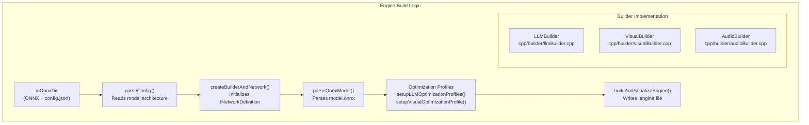

**Diagram 2**: Engine building process orchestrated by `LLMBuilder` and `VisualBuilder`.

**Sources**: [cpp/builder/llmBuilder.cpp:121-163](), [cpp/builder/visualBuilder.cpp:44-99]()

### Optimization Profiles

TensorRT engines support dynamic shapes through optimization profiles. The builder creates profiles for different execution phases:

-   **LLM Profiles**: Configured via `setupLLMOptimizationProfiles`, these handle the context (prefill) and generation (decode) phases, supporting parameters like `maxBatchSize` and `maxInputLen`. [cpp/builder/llmBuilder.cpp:126-130]()
-   **Visual Profiles**: Configured via `setupVisualOptimizationProfile`, these handle image inputs for VLMs, supporting varying image dimensions (e.g., `mImageSizeH`, `mImageSizeW`). [cpp/builder/visualBuilder.cpp:96-99]()

### Builder Configuration

The builder classes use configuration structures (`LLMBuilderConfig`, `VisualBuilderConfig`) to define build-time limits. For example, `LLMBuilderConfig` tracks `maxKVCacheCapacity` and `maxKVPoolPages` for paged KV-cache management.

**Sources**: [cpp/builder/llmBuilder.h:41-54](), [cpp/builder/llmBuilder.cpp:141-156]()

---

## Stage 3: Inference Execution (C++)

The `llm_inference` executable loads the generated `.engine` files and executes inference.

### Execution Modes

-   **Standard LLM**: Loads `model.engine` (or `lora_model.engine`). [cpp/builder/llmBuilder.cpp:167-176]()
-   **Speculative Decoding**: Loads specialized engines for strategies like `eagle3`, `mtp`, `dflash`, `dspark`, or `gemma4_mtp`. The builder identifies these via `spec_decode_type` in `config.json`. [cpp/builder/llmBuilder.cpp:46-70]()
-   **Multimodal (VLM/Audio)**: Loads `visual.engine` or `audio.engine` alongside the LLM engine. For models like Phi-4MM or Nemotron-Omni, the builder ensures required weights like `phi4mm_gn_proj.safetensors` or `nemotron_omni_embedder.safetensors` are present. [cpp/builder/visualBuilder.cpp:124-132]()

---

## Artifact Flow and File Organization

The workflow produces a structured engine directory containing everything needed for runtime:

-   **Engines**: `model.engine`, `visual.engine`, or `audio.engine`. [cpp/builder/llmBuilder.cpp:211](), [cpp/builder/visualBuilder.cpp:135]()
-   **Configs**: `config.json` containing model metadata and `edgellm_version`. [cpp/builder/llmBuilder.cpp:136-140](), [cpp/builder/visualBuilder.cpp:159-160]()
-   **Specialized Weights**: modality-specific artifacts such as `phi4mm_gn_proj.safetensors`. [cpp/builder/visualBuilder.cpp:124-127]()

**Sources**: [cpp/builder/llmBuilder.cpp:207-213](), [cpp/builder/visualBuilder.cpp:134-148]()

---

# Page: Python Export Pipeline

# Python Export Pipeline

<details>
<summary>Relevant source files</summary>

The following files were used as context for generating this wiki page:

- [cpp/builder/builderUtils.cpp](cpp/builder/builderUtils.cpp)
- [cpp/builder/builderUtils.h](cpp/builder/builderUtils.h)

</details>


## Purpose and Scope

The Python Export Pipeline is the model preparation phase of TensorRT Edge-LLM, responsible for converting HuggingFace models into optimized ONNX format suitable for edge deployment. This document provides an overview of the two-stage pipeline: quantization and ONNX export, including both the standard script-based flow and the experimental `llm_loader` path.

For detailed information on specific stages:
- Quantization options and configuration: see [Model Quantization](#3.1.1)
- ONNX export process and model-specific handling: see [ONNX Export](#3.1.2)
- Engine building from exported ONNX files: see [Engine Building](#3.2)
- Advanced checkpoint loading and model registry: see [AutoModel and Model Registry](#4.5.1)

This pipeline runs on **x86_64 Linux hosts with GPU** during the development/preparation phase. The generated ONNX artifacts are then transferred to edge devices for engine building and inference.

**Sources**: [.github/ISSUE_TEMPLATE/2_bug_report_export.md:31-33](), [cpp/builder/builderUtils.h:97-102]()

---

## Pipeline Overview

The Python Export Pipeline transforms pretrained HuggingFace models into TensorRT-compatible ONNX format through a two-stage process. This separation allows for flexible quantization strategies while maintaining clean model conversion logic.

```mermaid
graph LR
    HF["HuggingFace Model<br/>(e.g., Qwen/Qwen3-0.6B)"]
    QUANT["tensorrt-edgellm-quantize-llm"]
    QUANTIZED["Quantized Checkpoint<br/>(safetensors)"]
    EXPORT["tensorrt-edgellm-export-llm"]
    ONNX["ONNX Models<br/>(model.onnx)"]
    BUILDER["builder::buildAndSerializeEngine"]
    
    HF -->|"download"| QUANT
    QUANT -->|"FP8/NVFP4/INT4"| QUANTIZED
    QUANTIZED -->|"model_dir"| EXPORT
    EXPORT -->|"graph surgery"| ONNX
    ONNX -->|"parsed by"| BUILDER
```

**Pipeline Stages:**

| Stage | Command | Input | Output | Purpose |
|-------|---------|-------|--------|---------|
| **Quantization** | `tensorrt-edgellm-quantize-llm` | HuggingFace model directory | Quantized checkpoint directory | Apply precision reduction (FP8, NVFP4, INT4) using NVIDIA ModelOpt |
| **ONNX Export** | `tensorrt-edgellm-export-llm` | Quantized checkpoint directory | ONNX model files | Convert PyTorch model to ONNX with TensorRT-compatible graph structure |

**Sources**: [.github/ISSUE_TEMPLATE/2_bug_report_export.md:19-24](), [cpp/builder/builderUtils.h:97-111]()

---

## Command-Line Interface

The pipeline is accessed through Python entry points installed as console scripts. These scripts facilitate the transition from Natural Language/HuggingFace space into the structured ONNX files required by the C++ `builder` utilities. The underlying C++ utilities also support JSON-based configuration management [cpp/builder/builderUtils.h:113-125]().

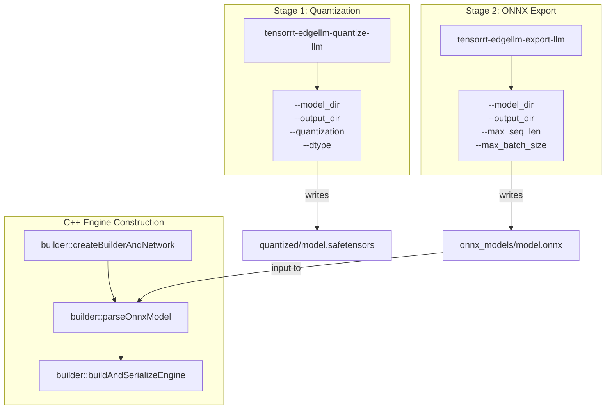

**Typical Usage Example:**

```bash
# Stage 1: Quantize a HuggingFace model to FP8
tensorrt-edgellm-quantize-llm \
    --model_dir Qwen/Qwen3-0.6B \
    --output_dir ./quantized/qwen3-0.6b \
    --quantization fp8

# Stage 2: Export quantized model to ONNX
tensorrt-edgellm-export-llm \
    --model_dir ./quantized/qwen3-0.6b \
    --output_dir ./onnx_models/qwen3-0.6b
```

**Sources**: [.github/ISSUE_TEMPLATE/2_bug_report_export.md:19-24](), [cpp/builder/builderUtils.cpp:97-111](), [cpp/builder/builderUtils.h:88-95]()

---

## Quantization Stage Summary

The quantization stage applies precision reduction to model weights and activations. This stage leverages NVIDIA ModelOpt for calibration and quantization. The C++ builder supports these precisions by parsing metadata and applying specific workarounds for advanced formats like NVFP4 [cpp/builder/builderUtils.cpp:63-74]().

**Supported Quantization Schemes:**

| Scheme | Description | Typical Use Case |
|--------|-------------|------------------|
| **FP8** | 8-bit floating point | Balanced accuracy/performance for most models |
| **NVFP4** | NVIDIA 4-bit floating point | Aggressive compression for Blackwell-based platforms |
| **INT4** | 4-bit integer quantization | High compression for memory-constrained devices |
| **INT4_GPTQ** | GPTQ-style 4-bit quantization | Support for existing pre-quantized checkpoints |

The quantization process produces a modified model checkpoint containing quantized weights and an updated `config.json` containing metadata like `model_type` and `embd_layer` [cpp/builder/builderUtils.h:34-38]().

**Sources**: [.github/ISSUE_TEMPLATE/2_bug_report_export.md:22-22](), [cpp/builder/builderUtils.cpp:70-74](), [cpp/builder/builderUtils.h:113-117]()

---

## ONNX Export Stage Summary

The ONNX export stage converts PyTorch models to ONNX format with TensorRT-specific optimizations. It handles complex graph structures and prepares the model for the C++ builder utilities.

**Key Export Features:**
- **AttentionPlugin Integration**: Replaces standard attention blocks with optimized TensorRT plugins.
- **Dynamic Shapes**: Configures inputs for variable sequence lengths and batch sizes, which are validated via `checkOptimizationProfileDims` [cpp/builder/builderUtils.cpp:112-131]().
- **Multimodal Support**: For VLMs, this stage exports both the visual encoder and the language model, identifying components via keys like `vision_config` and `image_embd_layer` [cpp/builder/builderUtils.h:35-38]().

The C++ builder utilities parse these ONNX files and apply necessary compile-time workarounds for stability and performance [cpp/builder/builderUtils.cpp:52-86]().

**Sources**: [cpp/builder/builderUtils.cpp:101-102](), [cpp/builder/builderUtils.cpp:141-152](), [cpp/builder/builderUtils.h:34-38]()

---

## Artifact Structure

The pipeline produces well-defined directory structures at each stage. The `builder` namespace utilities in the C++ SDK specifically look for these files during the engine build process.

**Stage 2 Output: ONNX Model Directory**

```
onnx_models/qwen3-0.6b/
├── model.onnx                 # Primary ONNX graph (parsed by parseOnnxModel)
├── config.json                # Model metadata (loaded via loadJsonConfig)
├── tokenizer.json             # Tokenizer config
└── [additional files]
```

**C++ SDK Interaction with Artifacts:**
- `builder::loadJsonConfig()`: Reads `config.json` to extract model parameters [cpp/builder/builderUtils.h:113-117]().
- `builder::parseOnnxModel()`: Loads `model.onnx` into the TensorRT network definition [cpp/builder/builderUtils.h:97-102]().
- `builder::saveConfigWithBuilderInfo()`: Saves the final configuration alongside the engine [cpp/builder/builderUtils.h:119-125]().
- `builder::applyCompileWorkarounds()`: Sets environment variables like `__LUNOWUD` based on the target precision and batch size before building [cpp/builder/builderUtils.cpp:52-86]().

**Sources**: [cpp/builder/builderUtils.cpp:101-102](), [cpp/builder/builderUtils.h:113-117](), [cpp/builder/builderUtils.h:119-125](), [cpp/builder/builderUtils.cpp:81-85]()

---

## System Requirements

The Python Export Pipeline has specific requirements distinct from the edge deployment targets.

| Requirement | Specification | Rationale |
|-------------|--------------|-----------|
| **CPU Architecture** | x86_64 | Required for ModelOpt and CUDA-based export tools |
| **Operating System** | Linux (Ubuntu 22.04+) | Native PyTorch and TensorRT support |
| **GPU** | NVIDIA (H100, A100, RTX 4090, etc.) | Required for quantization calibration |
| **Software** | Python 3.8+, PyTorch, Transformers, ModelOpt | Core export stack |

**Sources**: [.github/ISSUE_TEMPLATE/2_bug_report_export.md:28-43]()

---

## Integration with Engine Building

The ONNX files produced by the export pipeline serve as input to the engine building process. The C++ `builder` utilities coordinate the transition from ONNX to a serialized TensorRT engine.

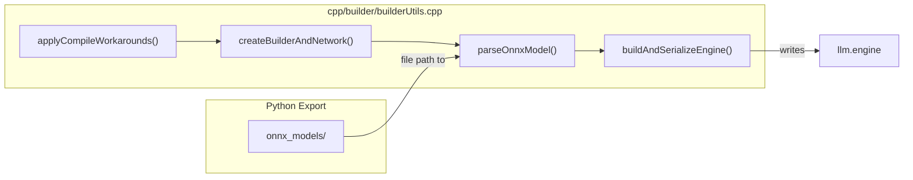

**Workflow Integration:**
1. **Export**: Run Python scripts on an x86 host to generate the ONNX directory.
2. **Transfer**: Move the directory to the target edge platform.
3. **Build**: Use `buildAndSerializeEngine()` to generate the optimized engine file [cpp/builder/builderUtils.h:110-111]().

**Sources**: [cpp/builder/builderUtils.h:82-86](), [cpp/builder/builderUtils.h:88-95](), [cpp/builder/builderUtils.h:110-111]()

---

# Page: Model Quantization

# Model Quantization

<details>
<summary>Relevant source files</summary>

The following files were used as context for generating this wiki page:

- [cpp/builder/builderUtils.cpp](cpp/builder/builderUtils.cpp)
- [cpp/builder/builderUtils.h](cpp/builder/builderUtils.h)

</details>


## Purpose and Scope

This document explains the model quantization process in TensorRT-Edge-LLM, focusing on the Python-based `tensorrt-edgellm-quantize-llm` tool and supported precision formats. Quantization reduces model weight precision to enable efficient deployment on edge devices with constrained memory and compute resources.

The quantization step occurs before ONNX export in the Python export pipeline. It operates on HuggingFace model checkpoints and produces quantized model artifacts that are subsequently converted to ONNX format.

## Overview

Model quantization converts high-precision floating-point weights (typically FP32 or FP16) to lower-precision representations (FP8, NVFP4, INT4) while preserving model accuracy. This process:

- **Reduces memory footprint**: Lower precision weights consume less GPU memory, enabling larger models or longer context lengths on edge devices.
- **Improves inference throughput**: Reduced data movement and specialized hardware instructions for low-precision arithmetic accelerate computation.
- **Maintains accuracy**: Calibration-based quantization schemes preserve model quality within acceptable bounds.

**Sources**: [.github/ISSUE_TEMPLATE/2_bug_report_export.md:19-24](), [.github/ISSUE_TEMPLATE/2_bug_report_export.md:36-44]()

## Quantization Pipeline Architecture

The following diagram maps the logical quantization flow to the Python ecosystem and the `tensorrt-edgellm-quantize-llm` tool components.

### Quantization Data Flow

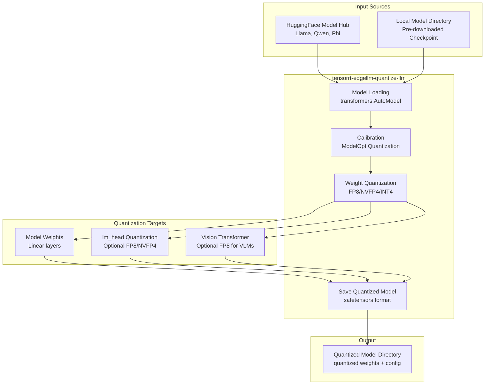

**Sources**: [.github/ISSUE_TEMPLATE/2_bug_report_export.md:19-24]()

## Supported Quantization Formats

TensorRT-Edge-LLM supports multiple quantization formats optimized for NVIDIA edge platforms. While the Python pipeline handles the conversion, the C++ runtime `edgellmCore` manages these types via the `Tensor` class and `DataType` enumeration.

| Format | Bit Width | Description | Use Cases |
|--------|-----------|-------------|-----------|
| **FP16** | 16-bit | Half-precision floating point (baseline) | Default precision, no quantization step required |
| **FP8** | 8-bit | 8-bit floating point (E4M3 format) | Balanced accuracy/performance for LLMs and VLMs |
| **NVFP4** | 4-bit | NVIDIA proprietary 4-bit floating point | Maximum compression with acceptable accuracy |
| **INT4** | 4-bit | 4-bit integer quantization | Compatible with standard INT4 workflows |
| **INT4_GPTQ** | 4-bit | GPTQ-quantized 4-bit integer checkpoints | Pre-quantized models from GPTQ pipelines |
| **INT4_AWQ** | 4-bit | Activation-aware Weight Quantization | High accuracy 4-bit quantization for MoE models |

### Precision Format Details

**FP8 Quantization**
- Uses E4M3 (4-bit exponent, 3-bit mantissa) representation.
- In C++, this is represented by `nvinfer1::DataType::kFP8` [cpp/common/tensor.cpp:58-58]().
- Applied to both LLM backbone and `lm_head` components.
- Often used for Vision Transformers (VIT) in multimodal models to maintain visual feature quality.

**NVFP4 Quantization**
- NVIDIA proprietary 4-bit floating point format.
- Achieves higher compression ratios than FP8 with minimal accuracy loss.
- Supports `lm_head` quantization for additional memory savings.
- Represented in the C++ `Tensor` class as `nvinfer1::DataType::kFP4` (available in TRT 10.8+) [cpp/common/tensor.cpp:148-148]().
- **Workaround Note**: When building engines with NVFP4, the builder applies specific compiler flags like `-mlir:collective:fp4=off` to avoid miscompilation on certain platforms [cpp/builder/builderUtils.cpp:72-72]().

**INT4/INT4_GPTQ/INT4_AWQ Quantization**
- Standard 4-bit integer representation.
- `INT4_GPTQ` and `INT4_AWQ` support pre-quantized checkpoints.
- Handled in C++ via `nvinfer1::DataType::kINT4` [cpp/common/tensor.cpp:148-150]().
- Version 0.10.0 adds support for INT4 AWQ MoE models such as Gemma 4 26B-A4B and Qwen3-Omni 30B-A3B.

**Sources**: [.github/ISSUE_TEMPLATE/2_bug_report_export.md:19-24](), [.github/ISSUE_TEMPLATE/2_bug_report_export.md:42-43](), [cpp/common/tensor.cpp:58-62](), [cpp/common/tensor.cpp:147-154](), [cpp/builder/builderUtils.cpp:70-74]()

## The tensorrt-edgellm-quantize-llm Tool

### Command-Line Interface

The `tensorrt-edgellm-quantize-llm` command is the primary entry point for quantizing models. It leverages `nvidia-modelopt` for calibration and weight transformation.

**Basic Usage Pattern:**
```bash
tensorrt-edgellm-quantize-llm \
    --model_dir <MODEL_PATH> \
    --output_dir <OUTPUT_PATH> \
    --quantization <PRECISION>
```

### Example Commands

**Quantizing Qwen3 to FP8:**
```bash
# Example from bug report template
tensorrt-edgellm-quantize-llm --model_dir Qwen/Qwen3-0.6B --output_dir ./quantized/qwen3-0.6b --quantization fp8
```

**Sources**: [.github/ISSUE_TEMPLATE/2_bug_report_export.md:22-22]()

## Implementation Details: C++ Tensor Representation

While quantization logic resides in Python, the C++ runtime must handle the resulting tensors. The `trt_edgellm::rt::Tensor` class manages memory allocation and metadata for these quantized buffers.

### Runtime Data Type Handling
The `getTypeSize` utility function determines the memory footprint for various data types. Note that sub-byte types like `kINT4` and `kFP4` are handled as special cases in the constructor because they require packed storage that `getTypeSize` does not directly return a byte-size for in a standard linear layout.

| DataType | Size (Bytes) | Source |
| :--- | :--- | :--- |
| `kFLOAT` / `kINT32` | 4 | [cpp/common/tensor.cpp:45-50]() |
| `kHALF` / `kBF16` | 2 | [cpp/common/tensor.cpp:51-55]() |
| `kFP8` / `kINT8` | 1 | [cpp/common/tensor.cpp:58-63]() |

### System Entity Mapping: Python to C++

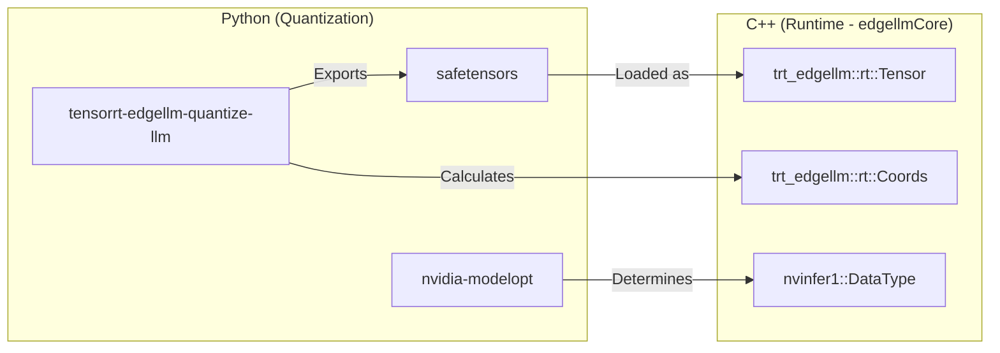

**Sources**: [cpp/common/tensor.h:221-222](), [cpp/common/tensor.cpp:35-72](), [cpp/common/tensor.cpp:144-175]()

## Output Format and Structure

The `tensorrt-edgellm-quantize-llm` tool produces a directory containing the quantized model in a format compatible with HuggingFace transformers:

```
output_dir/
├── model.safetensors           # Quantized weights in safetensors format
├── config.json                 # Model configuration with quantization metadata
├── tokenizer.json              # Tokenizer vocabulary and merges
├── tokenizer_config.json       # Tokenizer configuration
└── ...                         # Other metadata files
```

**Key Characteristics:**
- **safetensors format**: Used for efficient and secure weight serialization.
- **Quantization metadata**: Embedded in `config.json` to inform the downstream `tensorrt-edgellm-export-llm` process.
- **HuggingFace compatibility**: Output directory can be loaded using `transformers.AutoModel.from_pretrained()`.

**Sources**: [.github/ISSUE_TEMPLATE/2_bug_report_export.md:19-24]()

## Quantization Dependencies

The quantization process requires specific Python library versions for correct operation on the x86 host:

| Library | Purpose |
|---------|---------|
| `nvidia-modelopt` | Core quantization engine providing algorithms for FP8/NVFP4/INT4. |
| `transformers` | HuggingFace model ecosystem integration for loading weights and configs. |
| `torch` | PyTorch backend used for model manipulation during quantization. |
| `onnx` | Required for validating and preparing the model for the export stage. |

**Sources**: [.github/ISSUE_TEMPLATE/2_bug_report_export.md:36-43]()

## Quantization Process Flow

The following sequence diagram details the interaction between the user, the CLI tool, and external libraries.

```mermaid
sequenceDiagram
    participant User
    participant CLI as tensorrt-edgellm-quantize-llm
    participant ModelOpt as nvidia-modelopt
    participant HF as HuggingFace Hub
    participant FS as Filesystem
    
    User->>CLI: Execute quantization command
    CLI->>HF: Request model checkpoint
    HF->>CLI: Return model files
    CLI->>ModelOpt: Load model in FP32/FP16
    ModelOpt->>ModelOpt: Run calibration dataset
    ModelOpt->>ModelOpt: Compute quantization scales
    ModelOpt->>ModelOpt: Apply quantization to weights
    Note over ModelOpt: Quantize lm_head if specified
    Note over ModelOpt: Quantize VIT if VLM model
    ModelOpt->>CLI: Return quantized model
    CLI->>FS: Write model.safetensors
    CLI->>FS: Write config.json with metadata
    CLI->>FS: Copy tokenizer files
    FS->>User: Quantized model directory ready
```

**Sources**: [.github/ISSUE_TEMPLATE/2_bug_report_export.md:19-24](), [.github/ISSUE_TEMPLATE/2_bug_report_export.md:42-43]()

---

# Page: ONNX Export

# ONNX Export

<details>
<summary>Relevant source files</summary>

The following files were used as context for generating this wiki page:

- [cpp/builder/builderUtils.cpp](cpp/builder/builderUtils.cpp)
- [cpp/common/safetensorsUtils.cpp](cpp/common/safetensorsUtils.cpp)

</details>


## Purpose and Scope

This page documents the ONNX export process, the second stage in the Python Export Pipeline. It covers the `tensorrt-edgellm-export-llm` command-line tool and the underlying `llm_loader` logic, which converts quantized HuggingFace models into ONNX format suitable for TensorRT engine building. This export step transforms PyTorch models into a standardized intermediate representation that the C++ builder can consume.

For information about the quantization step that precedes ONNX export, see [Model Quantization](3.1.1). For details on building TensorRT engines from the exported ONNX files, see [Engine Building](3.2).

**Key Responsibilities:**
- Convert quantized PyTorch models to ONNX format.
- Apply model-specific graph transformations and fusion.
- Register custom operators (e.g., `AttentionPlugin`) as torch custom ops.
- Generate metadata files describing model architecture and precision.
- Support both text-only LLMs and vision-language models (VLMs).
- Handle file management and checkpoint mapping via `file_io` utilities.

**System Requirements:**
- x86-64 Linux host with NVIDIA GPU [.github/ISSUE_TEMPLATE/2_bug_report_export.md:31-33]()
- Python environment with PyTorch, Transformers, ModelOpt, and ONNX libraries [.github/ISSUE_TEMPLATE/2_bug_report_export.md:40-43]()
- Input: Quantized model directory (output from `tensorrt-edgellm-quantize-llm`) [.github/ISSUE_TEMPLATE/2_bug_report_export.md:22-23]()
- Output: ONNX files and configuration metadata.

---

## Export Pipeline Overview

The ONNX export process sits between model quantization and TensorRT engine building, converting PyTorch computational graphs into a format optimized for TensorRT consumption.

### Data Flow Diagram
"ONNX Export Data Flow"
```mermaid
graph LR
    subgraph "Input"
        QUANT["Quantized Model<br/>(PyTorch checkpoint)"]
        CONFIG["Model Config<br/>(config.json)"]
    end
    
    subgraph "tensorrt-edgellm-export-llm"
        LOAD["Load PyTorch Model"]
        TORCH_OPS["Register Torch Custom Ops<br/>(AttentionPlugin)"]
        EXPORT["ONNX Export<br/>(torch.onnx.export)"]
        METADATA["Generate Metadata Files"]
    end
    
    subgraph "Output"
        ONNX_LLM["LLM ONNX<br/>(decoder.onnx)"]
        ONNX_VIT["VIT ONNX<br/>(visual.onnx)"]
        META["Metadata<br/>(edgellm_config.json)"]
        FILES["Copied Artifacts<br/>(tokenizer.json, etc.)"]
    end
    
    QUANT --> LOAD
    CONFIG --> LOAD
    LOAD --> TORCH_OPS
    TORCH_OPS --> EXPORT
    EXPORT --> ONNX_LLM
    EXPORT --> ONNX_VIT
    EXPORT --> METADATA
    METADATA --> META
    QUANT -.-> FILES
```

**Sources:** [.github/ISSUE_TEMPLATE/2_bug_report_export.md:19-24](), [cpp/common/fileUtils.cpp:29-62]()

---

## Command-Line Interface

The `tensorrt-edgellm-export-llm` command exports quantized models to ONNX format. This tool is installed as a console script when installing the TensorRT-Edge-LLM Python package.

### Basic Usage

```bash
tensorrt-edgellm-export-llm \
    --model_dir ./quantized/qwen3-0.6b \
    --output_dir ./onnx_models/qwen3-0.6b
```

### Common Arguments

| Argument | Type | Description | Required |
|----------|------|-------------|----------|
| `--model_dir` | Path | Directory containing quantized model checkpoint | Yes |
| `--output_dir` | Path | Destination directory for ONNX files | Yes |
| `--max_seq_len` | Integer | Maximum sequence length for model export | No |
| `--batch_size` | Integer | Batch size for ONNX export (static shape) | No |

**Sources:** [.github/ISSUE_TEMPLATE/2_bug_report_export.md:23]()

---

## Supported Model Architectures

The export tool supports a diverse set of model architectures, spanning text-only LLMs and vision-language multimodal models.

### Text-Only LLMs
"Supported LLM Architectures"
```mermaid
graph TD
    subgraph "Llama Family"
        LLAMA["Llama Models<br/>(Llama3-1B, etc.)"]
    end
    
    subgraph "Qwen Family"
        QWEN2["Qwen2 Models<br/>(0.5B, 1.5B, 3B, 7B)"]
        QWEN25["Qwen2.5 Models<br/>(0.5B, 1.5B, 3B, 7B)"]
        QWEN3["Qwen3 Models<br/>(0.6B, 1.7B, etc.)"]
    end
    
    subgraph "Phi Family"
        PHI["Phi Models<br/>(Phi-3, Phi-4)"]
    end
    
    EXPORT["tensorrt-edgellm-export-llm"]
    
    LLAMA --> EXPORT
    QWEN2 --> EXPORT
    QWEN25 --> EXPORT
    QWEN3 --> EXPORT
    PHI --> EXPORT
```

### Vision-Language Models (VLMs)

The export process handles multimodal architectures by generating separate ONNX graphs for vision and language components. Supported families include Qwen2-VL, Qwen3-VL, Phi-4-Multimodal, and InternVL3.

**Sources:** [.github/ISSUE_TEMPLATE/2_bug_report_export.md:22-23]()

---

## Torch Custom Operators for TensorRT Plugins

A key architectural feature of the export pipeline is the use of torch custom operators to bridge PyTorch models and TensorRT custom layers.

### AttentionPlugin Custom Operator

The export process registers the `AttentionPlugin` as a torch custom operator, allowing it to be embedded directly in the ONNX graph during `torch.onnx.export()`.

### Code to Graph Mapping
"Torch Custom Op to ONNX Node Mapping"
```mermaid
graph TB
    subgraph "PyTorch Model"
        ATTN_LAYER["Attention Layer<br/>(torch.nn.Module)"]
    end
    
    subgraph "Export Process"
        CUSTOM_OP["Register Torch Custom Op<br/>(@torch.library.custom_op)"]
        ONNX_EXPORT["torch.onnx.export()"]
    end
    
    subgraph "ONNX Graph"
        CUSTOM_NODE["Custom Node<br/>(domain: trt.plugins)"]
        PLUGIN_ATTRS["Plugin Attributes<br/>(num_heads, head_size, etc.)"]
    end
    
    subgraph "TensorRT Engine Building"
        PLUGIN_REGISTRY["Plugin Registry<br/>(NvInfer_edgellm_plugin)"]
        ATTN_PLUGIN["AttentionPlugin<br/>(C++ implementation)"]
    end
    
    ATTN_LAYER --> CUSTOM_OP
    CUSTOM_OP --> ONNX_EXPORT
    ONNX_EXPORT --> CUSTOM_NODE
    CUSTOM_NODE --> PLUGIN_ATTRS
    PLUGIN_ATTRS --> PLUGIN_REGISTRY
    PLUGIN_REGISTRY --> ATTN_PLUGIN
```

---

## Technical Implementation Details

### Precision and Data Types
The export pipeline supports various data types for model weights and activations. These are mapped between safetensors strings and TensorRT `nvinfer1::DataType` during the export and loading process.

| Safetensors String | TensorRT DataType | File Mapping |
|--------------------|-------------------|--------------|
| `F32` | `kFLOAT` | [cpp/common/safetensorsUtils.cpp:48]() |
| `F16` | `kHALF` | [cpp/common/safetensorsUtils.cpp:49]() |
| `BF16` | `kBF16` | [cpp/common/safetensorsUtils.cpp:50]() |
| `F8_E4M3` | `kFP8` | [cpp/common/safetensorsUtils.cpp:56]() |
| `I32` | `kINT32` | [cpp/common/safetensorsUtils.cpp:54]() |

### Optimization Profile Configuration
During the export and subsequent build, optimization profiles are validated to ensure that `min <= opt <= max` for all dimensions. This is enforced by `checkOptimizationProfileDims` [cpp/builder/builderUtils.cpp:112-131]().

### Compile Workarounds
The builder utility `applyCompileWorkarounds` [cpp/builder/builderUtils.cpp:52-86]() applies specific environment flags (via `__LUNOWUD`) to the TensorRT compiler to avoid miscompilations in specific versions (e.g., TRT 10.13/10.14 dual-GEMM fusion) [cpp/builder/builderUtils.cpp:60-62]().

---

## File Handling and Artifact Management

During export, specific artifacts (tokenizer files, config files) must be moved from the source directory to the export directory. This is handled by the `trt_edgellm::file_io` namespace.

### File Copy Implementation
The utility function `copyFile` [cpp/common/fileUtils.cpp:29-62]() ensures that artifacts are correctly placed for the subsequent C++ builder. It includes checks for path equivalence [cpp/common/fileUtils.cpp:40-43]() and uses `std::filesystem::copy_options::overwrite_existing` [cpp/common/fileUtils.cpp:46-47]() to handle updates.

**Sources:** [cpp/common/fileUtils.cpp:29-62](), [cpp/common/fileUtils.h:22-38](), [cpp/common/safetensorsUtils.cpp:44-59]()

---

## Troubleshooting Export Issues

Common issues during ONNX export and their resolutions:

| Issue | Symptom | Resolution |
|-------|---------|------------|
| Unsupported model architecture | Export fails with "model type not supported" | Verify model is in supported list |
| Missing quantization metadata | Export fails to detect quantization type | Ensure input directory contains output from `tensorrt-edgellm-quantize-llm` |
| ONNX version mismatch | Export succeeds but builder fails | Verify ONNX library version matches requirements |
| Out-of-memory during export | Process killed during large model export | Export on host with sufficient GPU memory |
| File IO Errors | "Error copying... - filesystem error" | Check disk space and permissions using `copyFile` logs [cpp/common/fileUtils.cpp:52-56]() |

### Debugging with Bug Report Template

When filing export-related issues, use the **Python Export Pipeline bug report template** [.github/ISSUE_TEMPLATE/2_bug_report_export.md:1-139](), which captures critical system information including:
- OS and CPU architecture [.github/ISSUE_TEMPLATE/2_bug_report_export.md:31-32]()
- GPU name and memory size [.github/ISSUE_TEMPLATE/2_bug_report_export.md:33-34]()
- Library versions (PyTorch, Transformers, ModelOpt, ONNX) [.github/ISSUE_TEMPLATE/2_bug_report_export.md:40-43]()
- Exact export command used [.github/ISSUE_TEMPLATE/2_bug_report_export.md:19-24]()

**Sources:** [.github/ISSUE_TEMPLATE/2_bug_report_export.md:1-139](), [cpp/common/fileUtils.cpp:18-65](), [cpp/builder/builderUtils.cpp:52-86]()

---

# Page: Engine Building

# Engine Building

<details>
<summary>Relevant source files</summary>

The following files were used as context for generating this wiki page:

- [cpp/builder/llmBuilder.cpp](cpp/builder/llmBuilder.cpp)
- [cpp/builder/llmBuilder.h](cpp/builder/llmBuilder.h)
- [cpp/builder/visualBuilder.cpp](cpp/builder/visualBuilder.cpp)
- [cpp/builder/visualBuilder.h](cpp/builder/visualBuilder.h)

</details>


## Purpose and Scope

This document covers the TensorRT engine building process in TensorRT-Edge-LLM, which converts ONNX model files or direct checkpoints into optimized TensorRT engine files for inference on edge devices. Engine building is the bridge between model export (see [Python Export Pipeline](#3.1)) and inference execution (see [Running Inference](#3.3)).

The SDK supports two primary building paths:
1.  **Standard ONNX Path**: Uses specialized builder classes like `LLMBuilder` and `VisualBuilder` to parse ONNX models and compile them via the TensorRT C++ API.
2.  **Experimental ONNX-less Path**: Introduced in version 0.10.0, this path builds engines directly from checkpoints using a C++-based model definition API (`NetworkModule`), bypassing the ONNX export step for faster iterations.

For detailed documentation, see [LLM Engine Builder](#3.2.1), [Visual, Audio, and Action Engine Builders](#3.2.2), and [Experimental ONNX-less Builder](#3.2.3).

**Sources:** [cpp/builder/llmBuilder.cpp:121-183](), [cpp/builder/llmBuilder.h:38-54]()

## Overview

Engine building transforms model definitions into TensorRT engines through the following steps:

1.  **Model Definition**: Load and parse ONNX model files using TensorRT's ONNX parser, or define the network graph directly using the `NetworkModule` API.
2.  **Optimization Profile Setup**: Define dynamic input shapes for different execution phases, such as context (prefill) and generation (decode).
3.  **Engine Compilation**: Build serialized TensorRT engines with specified optimizations, including precision (FP16, FP8, INT4) and kernel fusions.
4.  **Artifact Generation**: Copy configuration files, tokenizer files, and auxiliary data (like LoRA weights or speculative decoding artifacts) to the engine directory.

The process produces self-contained engine directories that include the compiled TensorRT engine, model configuration, and all necessary runtime metadata.

**Sources:** [cpp/builder/llmBuilder.cpp:158-243](), [cpp/builder/builderUtils.cpp:98-105]()

## Builder Architecture

```mermaid
graph TB
    subgraph "Builder Interface Space"
        LLMBuilder["LLMBuilder (C++ Class)"]
        VisualBuilder["VisualBuilder (C++ Class)"]
        CLI["tensorrt-edgellm-build (CLI)"]
    end
    
    subgraph "Code Entity Space"
        IBuilder["nvinfer1::IBuilder"]
        INetwork["nvinfer1::INetworkDefinition"]
        IParser["nvonnxparser::IParser"]
        NetMod["NetworkModule (ONNX-less)"]
        Prof["IOptimizationProfile"]
    end
    
    subgraph "Input Artifacts"
        ONNX["model.onnx"]
        CKPT["model.safetensors"]
        JSON["config.json"]
    end
    
    subgraph "Output Space"
        ENG["llm.engine / visual.engine"]
        OUT_JSON["config.json (Updated)"]
    end
    
    ONNX --> IParser
    CKPT --> NetMod
    JSON --> LLMBuilder
    JSON --> VisualBuilder
    
    LLMBuilder --> IBuilder
    VisualBuilder --> IBuilder
    CLI --> NetMod
    
    IParser --> INetwork
    NetMod --> INetwork
    
    IBuilder --> Prof
    INetwork --> IBuilder
    
    IBuilder --> ENG
    LLMBuilder --> OUT_JSON
```

**Diagram: Builder Class Architecture and Code Entities**

The builder system uses specialized classes that share a common structure:

| Builder Class | Purpose | ONNX Input | Engine Output |
| :--- | :--- | :--- | :--- |
| `LLMBuilder` | Text-based language models | `model.onnx` or `lora_model.onnx` | `llm.engine`, `draft.engine`, or `base.engine` |
| `VisualBuilder` | Vision encoders for VLMs | `model.onnx` | `visual.engine` |
| `AudioBuilder` | Audio encoders (e.g. Qwen3-ASR) | `model.onnx` | `audio.engine` |
| `ActionBuilder` | Trajectory/Action models | `model.onnx` | `action.engine` |

Key TensorRT interfaces used include:
*   `nvinfer1::IBuilder`: Creates network definitions and builds engines [cpp/builder/builderUtils.h:84-89]().
*   `nvinfer1::INetworkDefinition`: Represents the neural network graph [cpp/builder/builderUtils.h:84-84]().
*   `nvonnxparser::IParser`: Parses ONNX files into TensorRT networks [cpp/builder/builderUtils.h:91-96]().
*   `nvinfer1::IBuilderConfig`: Specifies build-time configuration and optimization settings [cpp/builder/builderUtils.h:89-89]().
*   `nvinfer1::IOptimizationProfile`: Defines dynamic input shape ranges [cpp/builder/builderUtils.cpp:85-96]().

**Sources:** [cpp/builder/llmBuilder.h:147-171](), [cpp/builder/builderUtils.h:84-105](), [cpp/builder/visualBuilder.h:103-123]()

## Build Configuration

Builder classes accept configuration structures that control engine building.

### LLMBuilderConfig
The `LLMBuilderConfig` structure [cpp/builder/llmBuilder.h:41-80]() controls parameters such as `maxBatchSize`, `maxInputLen`, and `maxKVCacheCapacity`. It also manages speculative decoding parameters like `maxVerifyTreeSize` and `maxDraftTreeSize`.

### VisualBuilderConfig
The `VisualBuilderConfig` structure [cpp/builder/visualBuilder.h:39-98]() handles VLM-specific parameters, including `maxImageTokens` and the choice of using TRT native ViT attention via `useTrtNativeVitAttn`.

### Speculative Decoding Roles
The builder supports different engine roles for speculative decoding strategies like EAGLE3, MTP, DFlash, and DSpark. These are identified via `spec_decode_type` and `engine_role` in the model configuration [cpp/builder/llmBuilder.cpp:46-75]().

**Sources:** [cpp/builder/llmBuilder.h:41-103](), [cpp/builder/visualBuilder.h:39-59](), [cpp/builder/llmBuilder.cpp:46-75]()

## Optimization Profiles

TensorRT engines require optimization profiles to handle dynamic input shapes. The builder creates distinct profiles for LLM inference:

```mermaid
graph TB
    subgraph "Natural Language Context"
        PREFILL["Prefill Phase"]
        DECODE["Decode Phase"]
    end
    
    subgraph "Code Entity Space"
        CTX_PROF["context_profile (IOptimizationProfile)"]
        GEN_PROF["generation_profile (IOptimizationProfile)"]
        
        IN_IDS["input_ids (Binding)"]
        CTX_LEN["context_lengths (Binding)"]
        KV_START["kvcache_start_index (Binding)"]
    end
    
    PREFILL --> CTX_PROF
    DECODE --> GEN_PROF
    
    CTX_PROF --> IN_IDS
    CTX_PROF --> CTX_LEN
    CTX_PROF --> KV_START
    
    GEN_PROF --> IN_IDS
    GEN_PROF --> CTX_LEN
    GEN_PROF --> KV_START
```

**Diagram: Optimization Profile Mapping to Runtime Phases**

*   **Context Profile**: Optimized for variable-length input sequences (up to `maxInputLen`) during initial prompt processing.
*   **Generation Profile**: Optimized for single-token inputs during autoregressive decoding.

**Sources:** [cpp/builder/llmBuilder.cpp:237-240](), [cpp/builder/builderUtils.cpp:151-182]()

### Paged KV Cache Configuration
A critical part of the build process is configuring the physical Paged KV Cache pool. The builder calculates the required number of pages based on `maxBatchSize` and `maxKVCacheCapacity` using `rt::computeMinimumKvPoolPages` [cpp/builder/llmBuilder.h:66-70](). This pool size is then serialized into the engine binding shapes.

**Sources:** [cpp/builder/llmBuilder.h:59-79](), [cpp/builder/llmBuilder.cpp:141-156]()

## Build Workflow

The build process executes these steps in order:

1.  **Plugin Loading**: Load `libedgellm_plugin.so` to register custom kernels like `AttentionPlugin` and `MambaPlugin` [cpp/builder/llmBuilder.cpp:133-133]().
2.  **Configuration Parsing**: Read `config.json` to extract model architecture parameters [cpp/builder/llmBuilder.cpp:136-139]().
3.  **Builder Creation**: Instantiate TensorRT builder and network objects [cpp/builder/llmBuilder.cpp:159-163]().
4.  **Model Loading**: 
    *   **ONNX Path**: Parse ONNX model file into the network definition [cpp/builder/llmBuilder.cpp:178-183]().
    *   **ONNX-less Path**: Use the `NetworkModule` registry to build the graph directly [experimental/builder/build_llm.cpp]().
5.  **Profile Setup**: Configure optimization profiles for dynamic input shapes [cpp/builder/llmBuilder.cpp:237-240]().
6.  **Engine Building**: Compile the network into a serialized engine [cpp/builder/builderUtils.cpp:98-105]().
7.  **Artifact Generation**: Write engine file and save updated configuration with builder info [cpp/builder/builderUtils.cpp:113-119]().

**Sources:** [cpp/builder/llmBuilder.cpp:121-243](), [cpp/builder/builderUtils.cpp:84-122]()

## Utility Functions

The builder implementation includes several utility functions for common operations:

| Function | Purpose | Location |
| :--- | :--- | :--- |
| `createDims()` | Convert vector to `nvinfer1::Dims` | [cpp/builder/builderUtils.cpp:35-49]() |
| `checkOptimizationProfileDims()` | Validate profile dimension constraints | [cpp/builder/builderUtils.cpp:56-75]() |
| `setOptimizationProfile()` | Set min/opt/max dimensions on profile | [cpp/builder/builderUtils.cpp:85-96]() |
| `printNetworkInfo()` | Debug output of network inputs/outputs | [cpp/builder/builderUtils.cpp:102-143]() |
| `buildAndSerializeEngine()` | High-level wrapper for TRT engine build | [cpp/builder/builderUtils.cpp:98-105]() |

**Sources:** [cpp/builder/builderUtils.cpp:31-232]()

---

# Page: LLM Engine Builder

# LLM Engine Builder

<details>
<summary>Relevant source files</summary>

The following files were used as context for generating this wiki page:

- [cpp/builder/builderUtils.cpp](cpp/builder/builderUtils.cpp)
- [cpp/builder/llmBuilder.cpp](cpp/builder/llmBuilder.cpp)
- [cpp/builder/llmBuilder.h](cpp/builder/llmBuilder.h)

</details>


## Purpose and Scope

The LLM Engine Builder is responsible for converting ONNX-exported language models into optimized TensorRT engines for inference on NVIDIA edge platforms. This page documents the `LLMBuilder` class, which handles text-only LLMs and text components of vision-language models, including support for vanilla autoregressive decoding, EAGLE3 speculative decoding, MTP (Multi-Token Prediction), DFlash, DSpark, and LoRA adaptations.

For building vision transformer engines in multimodal models, see [Visual Engine Builder](3.2.2). For the overall engine building workflow, see [Engine Building](3.2).

**Sources:** [cpp/builder/llmBuilder.cpp:113-121](), [cpp/builder/llmBuilder.h:32-36]()

---

## LLMBuilder Class Overview

The `LLMBuilder` class orchestrates the conversion of ONNX models to TensorRT engines. It takes ONNX files from a source directory, parses model configuration, sets up optimization profiles for different inference scenarios, builds the TensorRT engine, and copies necessary runtime files to the engine directory.

```mermaid
graph TB
    subgraph "Input"
        ONNX_DIR["ONNX Directory<br/>model.onnx or lora_model.onnx<br/>config.json<br/>tokenizer files"]
    end
    
    subgraph "LLMBuilder Class"
        CONSTRUCTOR["LLMBuilder::LLMBuilder<br/>cpp/builder/llmBuilder.cpp:113-119"]
        BUILD["LLMBuilder::build()<br/>Main Orchestration"]
        PARSE["LLMBuilder::parseConfig()<br/>Parse model configuration"]
        SETUP_PROFILES["LLMBuilder::setupLLMOptimizationProfiles()<br/>Configure TensorRT profiles"]
        COPY_FILES["File Copy Methods<br/>copyConfig(), copyTokenizerFiles(), etc."]
    end
    
    subgraph "TensorRT Components"
        IBUILER["nvinfer1::IBuilder<br/>TensorRT Builder"]
        INETWORK["nvinfer1::INetworkDefinition<br/>Network Graph"]
        ONNX_PARSER["nvonnxparser::IParser<br/>ONNX Parser"]
        ICONFIG["nvinfer1::IBuilderConfig<br/>Build Configuration"]
        PROFILES["nvinfer1::IOptimizationProfile<br/>Context & Generation Profiles"]
    end
    
    subgraph "Output"
        ENGINE_DIR["Engine Directory<br/>llm.engine or eagle_draft.engine or eagle_base.engine<br/>config.json with builder_config<br/>tokenizer files"]
    end
    
    ONNX_DIR --> CONSTRUCTOR
    CONSTRUCTOR --> BUILD
    BUILD --> PARSE
    BUILD --> IBUILER
    BUILD --> INETWORK
    BUILD --> ONNX_PARSER
    BUILD --> ICONFIG
    BUILD --> SETUP_PROFILES
    SETUP_PROFILES --> PROFILES
    PROFILES --> ICONFIG
    IBUILER --> ENGINE_DIR
    BUILD --> COPY_FILES
    COPY_FILES --> ENGINE_DIR
    
    ONNX_PARSER -.parses.-> ONNX_DIR
    IBUILER -.builds.-> ENGINE_DIR
```

**Sources:** [cpp/builder/llmBuilder.cpp:121-261](), [cpp/builder/llmBuilder.h:176-218]()

---

## LLMBuilderConfig Structure

The `LLMBuilderConfig` structure defines all parameters controlling engine generation. These parameters determine optimization profiles, decoding strategies, and model capabilities.

| Configuration Field | Type | Description |
|---------------------|------|-------------|
| `maxBatchSize` | `int64_t` | Maximum number of sequences processed concurrently |
| `maxInputLen` | `int64_t` | Maximum input sequence length for context phase |
| `maxKVCacheCapacity` | `int64_t` | Maximum KV cache size per sequence |
| `maxKVPoolPages` | `int64_t` | Exact physical K-page count for the engine's KV pool |
| `specBase` | `bool` | Build speculative-decoding base model engine |
| `specDraft` | `bool` | Build speculative-decoding draft model engine |
| `maxDraftTreeSize` | `int64_t` | Maximum tree size for draft model generation |
| `maxVerifyTreeSize` | `int64_t` | Maximum tree size for base model verification |
| `maxLoraRank` | `int64_t` | Maximum LoRA rank (0 disables LoRA) |
| `profilingDetailed` | `bool` | Enable detailed profiling verbosity |

The configuration is serialized to JSON via `toJson()` [cpp/builder/llmBuilder.h:83-103]() and saved alongside the engine for runtime parsing. The `resolvedKVPoolPages()` method [cpp/builder/llmBuilder.h:59-79]() ensures the KV pool size meets minimum active requirements.

**Sources:** [cpp/builder/llmBuilder.h:41-157]()

---

## Build Process Flow

The `build()` method orchestrates the entire engine building process through the following stages:

```mermaid
graph TD
    START["LLMBuilder::build() Entry Point<br/>cpp/builder/llmBuilder.cpp:121"]
    
    WORKAROUNDS["Apply Compile Workarounds<br/>applyCompileWorkarounds()<br/>cpp/builder/builderUtils.cpp:52"]
    
    LOAD_PLUGIN["Load Plugin Library<br/>loadEdgellmPluginLib()<br/>cpp/common/trtUtils.h"]
    
    PARSE_CONFIG["Parse Model Config<br/>LLMBuilder::parseConfig()<br/>cpp/builder/llmBuilder.cpp:328"]
    
    CREATE_BUILDER["Create TRT Builder/Network<br/>LLMBuilder::createBuilderAndNetwork()<br/>cpp/builder/llmBuilder.cpp:408"]
    
    PARSE_ONNX["Parse ONNX Model<br/>LLMBuilder::parseOnnxModel()<br/>cpp/builder/llmBuilder.cpp:428"]
    
    CREATE_CONFIG["Create Builder Config<br/>LLMBuilder::createBuilderConfig()<br/>cpp/builder/llmBuilder.cpp:441"]
    
    SETUP_OPT["Setup Optimization Profiles<br/>LLMBuilder::setupLLMOptimizationProfiles()<br/>cpp/builder/llmBuilder.cpp:484"]
    
    BUILD_ENGINE["Build Serialized Engine<br/>LLMBuilder::buildAndSerializeEngine()<br/>cpp/builder/llmBuilder.cpp:253"]
    
    COPY_CONFIG["Copy Config Files<br/>LLMBuilder::copyConfig()<br/>cpp/builder/llmBuilder.cpp:278"]
    
    COPY_TOKENIZER["Copy Tokenizer Files<br/>LLMBuilder::copyTokenizerFiles()<br/>cpp/builder/llmBuilder.cpp:283"]
    
    END["Return Success"]
    
    START --> WORKAROUNDS
    WORKAROUNDS --> LOAD_PLUGIN
    LOAD_PLUGIN --> PARSE_CONFIG
    PARSE_CONFIG --> CREATE_BUILDER
    CREATE_BUILDER --> PARSE_ONNX
    PARSE_ONNX --> CREATE_CONFIG
    CREATE_CONFIG --> SETUP_OPT
    SETUP_OPT --> BUILD_ENGINE
    BUILD_ENGINE --> COPY_CONFIG
    COPY_CONFIG --> COPY_TOKENIZER
    COPY_TOKENIZER --> END
```

**Engine File Naming:**
The engine filename is determined by the `engine_role` in the model config:
- `base`: `eagle_base.engine`, `mtp_base.engine`, etc.
- `draft`: `eagle_draft.engine`, `mtp_draft.engine`, etc.
- Default: `llm.engine`

**Sources:** [cpp/builder/llmBuilder.cpp:121-261](), [cpp/builder/llmBuilder.cpp:263-276]()

---

## Configuration Parsing

The `parseConfig()` method extracts model architecture parameters from `config.json` required for optimization profile setup. It handles standard LLMs as well as speculative decoding types like `mtp`, `eagle3`, `dflash`, `dspark`, and `gemma4_mtp`.

```mermaid
graph LR
    CONFIG_JSON["config.json<br/>ONNX Directory"]
    
    PARSE["LLMBuilder::parseConfig()<br/>cpp/builder/llmBuilder.cpp:328"]
    
    subgraph "Extracted Parameters"
        HIDDEN_SIZE["mHiddenSize<br/>Model hidden dimension"]
        NUM_KV_HEADS["mNumKVHeads<br/>Number of KV heads"]
        HEAD_SIZE["mHeadSize<br/>Attention head size"]
        ROTARY_DIM["mRotaryDim<br/>RoPE dimension"]
        NB_KV_INPUTS["mNbKVCacheInputs<br/>Number of decoder layers"]
    end
    
    CONFIG_JSON --> PARSE
    PARSE --> HIDDEN_SIZE
    PARSE --> NUM_KV_HEADS
    PARSE --> HEAD_SIZE
    PARSE --> ROTARY_DIM
    PARSE --> NB_KV_INPUTS
```

The method also performs version compatibility checks and detects specific architecture requirements, such as the `mTargetModelOutputHiddenDim` for MTP draft models.

**Sources:** [cpp/builder/llmBuilder.cpp:328-406]()

---

## Optimization Profiles

TensorRT optimization profiles define the range of dynamic input shapes the engine can handle. The `LLMBuilder` creates two profiles for different inference phases:

1. **Context Profile**: For processing initial input sequences (prefill phase).
2. **Generation Profile**: For autoregressive token generation (decode phase).

```mermaid
graph TB
    SETUP_MAIN["LLMBuilder::setupLLMOptimizationProfiles()<br/>cpp/builder/llmBuilder.cpp:484"]
    
    CONTEXT_PROFILE["Context Profile<br/>builder.createOptimizationProfile()"]
    GENERATION_PROFILE["Generation Profile<br/>builder.createOptimizationProfile()"]
    
    subgraph "Profile Setup Methods"
        COMMON["setupCommonProfiles()<br/>cpp/builder/llmBuilder.cpp:535"]
        VANILLA["setupVanillaProfiles()<br/>cpp/builder/llmBuilder.cpp:569"]
        SPEC["setupSpeculativeProfiles()<br/>cpp/builder/llmBuilder.cpp:592"]
        VLM["setupVLMProfiles()<br/>cpp/builder/llmBuilder.cpp:698"]
        LORA["setupLoraProfiles()<br/>cpp/builder/llmBuilder.cpp:756"]
        KVCACHE["setupKVCacheProfiles()<br/>cpp/builder/llmBuilder.cpp:838"]
    end
    
    SETUP_MAIN --> CONTEXT_PROFILE
    SETUP_MAIN --> GENERATION_PROFILE
    
    CONTEXT_PROFILE --> COMMON
    GENERATION_PROFILE --> COMMON
    
    COMMON --> VANILLA
    COMMON --> SPEC
    VANILLA --> VLM
    SPEC --> VLM
    VLM --> LORA
    LORA --> KVCACHE
```

**Sources:** [cpp/builder/llmBuilder.cpp:484-533]()

### Common Profiles

The `setupCommonProfiles()` method configures inputs shared by most models:

| Input Name | Binding Name Constant | Min Shape | Opt Shape | Max Shape |
|------------|----------------------|-----------|-----------|-----------|
| Context Lengths | `kContextLengths` | `[1]` | `[maxBatchSize]` | `[maxBatchSize]` |
| RoPE Cos/Sin | `kRopeCosSin` | `[1, maxKVCacheCapacity, rotaryDim]` | `[maxBatchSize, maxKVCacheCapacity, rotaryDim]` | Same as opt |
| KV Cache Start Index | `kKVCacheStartIndex` | `[0]` | `[maxBatchSize]` | `[maxBatchSize]` |

**Sources:** [cpp/builder/llmBuilder.cpp:535-567]()

### Vanilla Profiles

For standard autoregressive decoding:

| Input Name | Binding Name | Context Profile | Generation Profile |
|------------|--------------|-----------------|-------------------|
| Input IDs | `kInputIds` | `[1,1]` to `[maxBatchSize, maxInputLen]` | `[1,1]` to `[maxBatchSize, 1]` |
| Last Token IDs | `kLastTokenIds` | `[1,1]` to `[maxBatchSize, 1]` | `[1,1]` to `[maxBatchSize, 1]` |

**Sources:** [cpp/builder/llmBuilder.cpp:569-590]()

### Speculative Profiles

`setupSpeculativeProfiles()` handles multiple speculative decoding strategies (EAGLE3, MTP, DFlash, DSpark). It configures inputs for tree-based verification (base models) and tree-based generation (draft models).

- **Base Model Verification**: Configures `input_ids`, `attention_mask`, and `attention_pos_id` to handle up to `maxVerifyTreeSize` [cpp/builder/llmBuilder.cpp:645-667]().
- **Draft Model Generation**: Configures hidden state inputs and `input_ids` up to `maxDraftTreeSize` [cpp/builder/llmBuilder.cpp:602-643]().

**Sources:** [cpp/builder/llmBuilder.cpp:592-696]()

### VLM and LoRA Profiles

- **VLM**: `setupVLMProfiles()` detects `image_embeds` and sets up prefill profiles. It also supports `deepstack_features_*` for Qwen3-VL models [cpp/builder/llmBuilder.cpp:698-754]().
- **LoRA**: `setupLoraProfiles()` iterates through network inputs searching for `lora_A_*` and `lora_B_*` prefixes and configures the rank dimension from 0 to `maxLoraRank` [cpp/builder/llmBuilder.cpp:756-836]().

### KV Cache Profiles

`setupKVCacheProfiles()` iterates through `mNbKVCacheInputs` to configure each layer's `past_key_value_{i}_input` with shape `[batch_size, 2, num_kv_heads, kv_cache_length, head_size]`.

**Sources:** [cpp/builder/llmBuilder.cpp:838-860]()

---

# Page: Visual, Audio, and Action Engine Builders

# Visual, Audio, and Action Engine Builders

<details>
<summary>Relevant source files</summary>

The following files were used as context for generating this wiki page:

- [cpp/builder/actionBuilder.cpp](cpp/builder/actionBuilder.cpp)
- [cpp/builder/actionBuilder.h](cpp/builder/actionBuilder.h)
- [cpp/builder/audioBuilder.cpp](cpp/builder/audioBuilder.cpp)
- [cpp/builder/audioBuilder.h](cpp/builder/audioBuilder.h)
- [cpp/builder/visualBuilder.cpp](cpp/builder/visualBuilder.cpp)
- [cpp/builder/visualBuilder.h](cpp/builder/visualBuilder.h)

</details>


## Purpose and Scope

The **Visual, Audio, and Action Engine Builders** are a suite of specialized builder classes in the `edgellmBuilder` library responsible for converting ONNX models of non-text modalities into optimized TensorRT engines. This includes **VisualBuilder** for vision encoders (Vision Transformers), **AudioBuilder** for audio encoders, speech synthesis (Code2Wav), and ASR decoders, and **ActionBuilder** for robotics trajectory models. These builders handle modality-specific optimization profiles, dynamic shape ranges, and specialized weight management (e.g., Grid Newline projections). Starting in version 0.9.x, these builders support unified multimodal models like **Gemma 4** which feature encoder-free framed-PCM audio and position-aware visual pooling. Version 0.10.0 adds support for **Nemotron-3.5-ASR** RNN-T step engines.

**Sources:** [cpp/builder/visualBuilder.cpp:44-148](), [cpp/builder/audioBuilder.cpp:97-227](), [cpp/builder/actionBuilder.cpp:40-102]()

---

## Architectural Overview

The builders follow a consistent factory-like pattern: they parse a `config.json`, determine the specific model architecture (e.g., Qwen-VL vs InternVL), set up TensorRT optimization profiles for dynamic inputs, and serialize the resulting engine.

### Builder Entity Mapping

The following diagram bridges the logical model types to the specific C++ builder entities and their primary output artifacts.

```mermaid
graph TD
    subgraph "Builder Classes"
        VB["VisualBuilder"]
        AB["AudioBuilder"]
        ACB["ActionBuilder"]
    end

    subgraph "Logic & Model Types"
        VT["multimodal::ModelType"]
        AT["AudioBuildType"]
        ACT["Alpamayo 1 (Action)"]
    end

    subgraph "Output Engines"
        VE["visual.engine"]
        AE["audio_encoder.engine<br/>code2wav.engine<br/>rnnt_step.engine"]
        ACE["action.engine"]
    end

    VB -- "uses" --> VT
    VB -- "builds" --> VE
    
    AB -- "uses" --> AT
    AB -- "builds" --> AE
    
    ACB -- "defines" --> ACT
    ACB -- "builds" --> ACE

    style VB fill:#ffffff,stroke:#333,stroke-width:2px
    style AB fill:#ffffff,stroke:#333,stroke-width:2px
    style ACB fill:#ffffff,stroke:#333,stroke-width:2px
```

**Sources:** [cpp/builder/visualBuilder.h:103-143](), [cpp/builder/audioBuilder.h:81-104](), [cpp/builder/actionBuilder.h:87-107]()

---

## VisualBuilder

The `VisualBuilder` constructs engines for Vision Transformers (ViT) used in Vision-Language Models (VLMs). It supports dynamic image resolutions by configuring spatial dimensions based on "image tokens".

### Supported Visual Models
| Model Type | Enum | Strategy |
| :--- | :--- | :--- |
| **Qwen2/2.5/3-VL** | `QWEN2_VL`, etc. | Dynamic HW patches with spatial merging [cpp/builder/visualBuilder.cpp:244-272]() |
| **InternVL / Phi-4MM** | `INTERNVL`, `PHI4MM` | Fixed-size block batching (256 tokens/block) [cpp/builder/visualBuilder.cpp:274-278]() |
| **Nemotron-Omni** | `NEMOTRON_OMNI_VISION_ENCODER` | RADIO vision encoder with dynamic tile batching [cpp/builder/visualBuilder.cpp:211-227]() |
| **Gemma4 Unified** | `GEMMA4_UNIFIED_VISION` | Ragged patch, position-id, and position-aware pooling [cpp/builder/visualBuilder.cpp:229-242]() |
| **Cosmos3 Edge** | `COSMOS3_EDGE_VISION_ENCODER` | Specialized ViT for Cosmos3 reasoning models [cpp/builder/visualBuilder.cpp:237-242]() |

### Build Flow & Optimization
The `VisualBuilder::build()` method [cpp/builder/visualBuilder.cpp:44-148]() orchestrates:
1. **Config Parsing**: Detects `model_type` from `vision_config` or top-level JSON [cpp/builder/visualBuilder.cpp:150-179]().
2. **Profile Setup**: 
    - **Qwen**: Sets up `visual_input`, `rotary_pos_emb`, and `attention_mask`. Qwen2.5/3 include window attention masks and fast position embeddings [cpp/builder/visualBuilder.cpp:300-382]().
    - **Gemma4**: Configures ragged patches and `pos_ids` for position-aware pooling [cpp/builder/visualBuilder.cpp:424-468]().
    - **InternVL/Phi-4MM**: Validates that `min/maxImageTokens` are multiples of 256 [cpp/builder/visualBuilder.cpp:387-395]().
3. **Weight Management**: For **Phi-4MM** and **Nemotron-Omni**, it copies required weight files (e.g., `phi4mm_gn_proj.safetensors`, `nemotron_omni_embedder.safetensors`) to the engine directory [cpp/builder/visualBuilder.cpp:114-133]().

**Sources:** [cpp/builder/visualBuilder.cpp:44-148](), [cpp/builder/visualBuilder.h:39-98]()

---

## AudioBuilder

The `AudioBuilder` handles three distinct audio-related tasks: encoding raw audio features, synthesizing speech from codes (Code2Wav), and RNN-T decoding for ASR.

### Audio Build Types
The builder auto-detects the task based on the presence of specific config keys in `config.json` [cpp/builder/audioBuilder.cpp:254-276]().

| Task | Build Type | Output Engine |
| :--- | :--- | :--- |
| **Audio Encoding** | `AUDIO_ENCODER` | `audio_encoder.engine` |
| **Speech Synthesis** | `CODE2WAV` | `code2wav.engine` |
| **RNN-T ASR Step** | `RNNT_DECODER` | `rnnt_step.engine` |

### Optimization Profiles
- **Audio Encoder**: Configures dynamic time steps. For **Gemma4 Unified**, it supports encoder-free framed-PCM inputs [cpp/builder/audioBuilder.cpp:307-327](), [cpp/builder/audioBuilder.cpp:427-451]().
- **Code2Wav**: Configures dynamic code lengths for the generator, used in Qwen3-Omni [cpp/builder/audioBuilder.cpp:333-351]().
- **RNN-T Decoder**: Uses fully static I/O for single decode steps, requiring no optimization profile [cpp/builder/audioBuilder.cpp:180-186]().

**Sources:** [cpp/builder/audioBuilder.cpp:128-153](), [cpp/builder/audioBuilder.h:39-72]()

---

## ActionBuilder

The `ActionBuilder` is designed for robotics and trajectory models, specifically supporting the **Alpamayo 1** architecture. These models utilize diffusion-based trajectory generation.

### Key Configuration Parameters
The builder extracts specific architecture parameters from `config.json` [cpp/builder/actionBuilder.cpp:104-146]():
- `num_hidden_layers`: Number of transformer layers.
- `num_key_value_heads`: Head count for KV cache.
- `n_diffusion_tokens`: Number of waypoints in the trajectory (e.g., 64).

### Optimization Profile Setup
`ActionBuilder::setupActionOptimizationProfile` [cpp/builder/actionBuilder.cpp:148-208]() configures:
- **Noise Trajectory**: `[batch, num_diffusion_tokens, 2]` for 2D waypoint coordinates.
- **KV Cache**: Dynamic batching for `k_cache` and `v_cache` across all layers. It infers `maxKVCacheCapacity` directly from the ONNX input dimensions [cpp/builder/actionBuilder.cpp:175-189]().

**Sources:** [cpp/builder/actionBuilder.cpp:32-102](), [cpp/builder/actionBuilder.h:37-82]()

---

## Engine Building Data Flow

The following diagram illustrates the data flow from the Python-exported ONNX artifacts through the C++ Builder classes into the final TensorRT engines.

```mermaid
graph LR
    subgraph "ONNX Artifacts"
        ONNX["model.onnx"]
        JSON["config.json"]
        SAFTE["*.safetensors"]
    end

    subgraph "edgellmBuilder Logic"
        direction TB
        PARSE["parseConfig()"]
        PROF["setupOptimizationProfile()"]
        SERIAL["buildAndSerializeEngine()"]
    end

    subgraph "Runtime Engines"
        V_ENG["visual.engine"]
        A_ENG["audio_encoder.engine"]
        ACT_ENG["action.engine"]
    end

    ONNX --> PARSE
    JSON --> PARSE
    PARSE --> PROF
    PROF --> SERIAL
    SERIAL --> V_ENG
    SERIAL --> A_ENG
    SERIAL --> ACT_ENG
    SAFTE -.->|"copied by VisualBuilder"| V_ENG

    style ONNX fill:#ffffff,stroke:#333
    style JSON fill:#ffffff,stroke:#333
    style V_ENG fill:#ffffff,stroke:#333,stroke-dasharray: 5 5
```

**Sources:** [cpp/builder/visualBuilder.cpp:44-148](), [cpp/builder/audioBuilder.cpp:97-227](), [cpp/builder/actionBuilder.cpp:40-102]()

---

## Shared Builder Utilities

All modality builders utilize common helper functions defined in `builderUtils.h` and `trtUtils.h`:

- **`loadEdgellmPluginLib()`**: Dynamically loads custom TensorRT plugins (e.g., `AttentionPlugin`, `ViTAttentionPlugin`, `Gemma4AudioAttentionPlugin`) required for inference [cpp/builder/visualBuilder.cpp:47]().
- **`createBuilderAndNetwork()`**: Initializes the `nvinfer1::IBuilder` and `nvinfer1::INetworkDefinition` [cpp/builder/visualBuilder.cpp:65]().
- **`parseOnnxModel()`**: Invokes the NV ONNX parser to populate the network from the `.onnx` file [cpp/builder/visualBuilder.cpp:73]().
- **`buildAndSerializeEngine()`**: Performs the heavy-duty TensorRT compilation and writes the `.engine` file to disk [cpp/builder/visualBuilder.cpp:135]().

**Sources:** [cpp/builder/visualBuilder.cpp:44-83](), [cpp/builder/audioBuilder.cpp:100-123](), [cpp/builder/actionBuilder.cpp:42-62]()

---

# Page: Experimental ONNX-less Builder

# Experimental ONNX-less Builder

<details>
<summary>Relevant source files</summary>

The following files were used as context for generating this wiki page:

- [CMakeLists.txt](CMakeLists.txt)
- [cmake/CuteDsl.cmake](cmake/CuteDsl.cmake)

</details>


The **Experimental ONNX-less Builder** is a direct checkpoint-to-engine compilation path introduced in version 0.10.0. It bypasses the traditional ONNX export step, allowing for faster iterations, lower memory overhead during builds, and tighter integration with the `ops.functional` API. This workflow is centered around the `tensorrt-edgellm-build` CLI and the `NetworkModule` abstraction.

## Overview and Data Flow

In the standard workflow, models are exported to ONNX before being consumed by the TensorRT builder. The ONNX-less path allows the builder to directly instantiate a model definition in Python using the `tensorrt` (TensorRT-LLM style) functional API and populate weights from checkpoints.

### Direct Build Pipeline
The following diagram illustrates the transition from raw checkpoints to a finalized TensorRT engine without intermediate ONNX files.

**Diagram: ONNX-less Build Sequence**
```mermaid
graph TD
    subgraph "Natural Language Space"
        A["Model Weights & Config"]
        B["Build Command"]
    end

    subgraph "Code Entity Space"
        C["llm_loader.AutoModel"]
        D["builder.NetworkModule"]
        E["ops.functional API"]
        F["tensorrt-edgellm-build CLI"]
        G["LLMBuilder (C++)"]
    end

    A --> C
    B --> F
    F --> C
    C --> D
    D --> E
    E --> G
    G --> H["TRT Engine (.engine)"]
```
**Sources:** [CMakeLists.txt:20-21](), [cmake/CuteDsl.cmake:28-36]()

## Key Components

### 1. `tensorrt-edgellm-build` CLI
This is the primary entry point for the experimental builder. It coordinates the model loading, network definition, and engine optimization process. It utilizes the `llm_loader` to parse model configurations and dispatch to the correct architecture implementation.

### 2. `NetworkModule` and `ops.functional`
The `NetworkModule` acts as a container for the model's computational graph. Instead of parsing an ONNX graph, it uses a functional API (`ops.functional`) to define layers (Attention, MLP, LayerNorm) directly as TensorRT network layers. This allows for:
* **Direct Plugin Insertion:** Seamlessly injecting `AttentionPlugin` or `MambaPlugin` without OIR (ONNX Intermediate Representation) matching.
* **Quantization Awareness:** Applying precision logic (FP8, NVFP4, INT4) during the graph construction phase.

### 3. Component Registry
The builder leverages a registry system similar to the `llm_loader.AutoModel` [4.5.1. AutoModel and Model Registry](). When a model family (e.g., Qwen3, Gemma4) is specified, the builder looks up the corresponding `NetworkModule` implementation to construct the engine.

## Implementation Details

### CuTe DSL Integration
The ONNX-less builder is tightly coupled with the **CuTe DSL** unified kernel library. During the build process, the builder identifies the target architecture (e.g., `sm_87` for Jetson Orin or `sm_121` for GB10) and links the optimized kernel artifacts generated by `kernelSrcs/build_cutedsl.py`.

| Feature | Description |
| :--- | :--- |
| **Artifact Tag** | Auto-selected based on `EMBEDDED_TARGET` (e.g., `jetson-orin` -> `sm_87`). |
| **Kernel Groups** | Configurable via `ENABLE_CUTE_DSL` (e.g., `fmha`, `gdn`, `f16_moe`). |
| **Direct Linking** | The builder links `libcutedsl_<arch>.a` directly into the runtime environment. |

**Sources:** [cmake/CuteDsl.cmake:28-52](), [cmake/CuteDsl.cmake:115-130](), [CMakeLists.txt:183-195]()

### Mapping System Names to Code Entities
The following diagram maps the high-level build concepts to the specific CMake and Python variables used in the implementation.

**Diagram: Build System Mapping**
```mermaid
graph LR
    subgraph "System Names"
        ARCH["Target Architecture"]
        KERNELS["Kernel Selection"]
        BUILDER["Build Entry"]
    end

    subgraph "Code Entities"
        TAG["CUTE_DSL_ARTIFACT_TAG"]
        ENABLE["ENABLE_CUTE_DSL"]
        CLI["tensorrt-edgellm-build"]
    end

    ARCH -- "maps to" --> TAG
    KERNELS -- "controlled by" --> ENABLE
    BUILDER -- "invokes" --> CLI
```
**Sources:** [cmake/CuteDsl.cmake:55-67](), [cmake/CuteDsl.cmake:187-203]()

## Adding a New Model Family

To support a new model family in the ONNX-less builder:
1. **Define the Network:** Create a new class inheriting from `NetworkModule` in the `experimental/builder` directory.
2. **Implement Layers:** Use `ops.functional` to define the model's blocks (e.g., `Attention`, `RMSNorm`).
3. **Register the Model:** Add the model family to the builder registry, associating it with the new `NetworkModule`.
4. **Configure Precision:** Define how weights from the `llm_loader` checkpoint should be mapped to the TensorRT layers, including any quantization scaling factors.
5. **Verify with CuTe DSL:** Ensure that the required kernels (like FMHA or MoE) are enabled in `CMakeLists.txt` via the `ENABLE_CUTE_DSL` flag.

**Sources:** [CMakeLists.txt:183-195](), [cmake/CuteDsl.cmake:28-42]()

---

# Page: Running Inference

# Running Inference

<details>
<summary>Relevant source files</summary>

The following files were used as context for generating this wiki page:

- [cpp/common/fileUtils.cpp](cpp/common/fileUtils.cpp)
- [cpp/common/fileUtils.h](cpp/common/fileUtils.h)
- [cpp/common/stringUtils.cpp](cpp/common/stringUtils.cpp)

</details>


## Purpose and Scope

This page documents the inference execution phase using the `llm_inference` executable, which is the primary entry point for running LLM and VLM inference on edge devices. This page covers command-line usage, JSON input/output formats, runtime configuration options, and the internal execution workflow.

For information about building TensorRT engines before inference, see [Engine Building](#3.2). For details on the underlying runtime architecture and components, see [Runtime Components](#4.3).

**Sources**: [.github/ISSUE_TEMPLATE/1_bug_report_runtime.md:22-27]()

---

## llm_inference Executable Overview

The `llm_inference` executable is the unified interface for executing inference on TensorRT engines created by `llm_build`. It accepts JSON-formatted inputs and produces JSON-formatted outputs, supporting both text-only (LLM) and multimodal (VLM) workloads.

### Command-Line Interface

```bash
./build/examples/llm/llm_inference \
  --engineDir <path_to_engine_directory> \
  --inputFile <path_to_input.json> \
  --outputFile <path_to_output.json>
```

| Argument | Required | Description |
|----------|----------|-------------|
| `--engineDir` | Yes | Directory containing TensorRT engine files and configuration |
| `--inputFile` | Yes | Path to JSON file containing inference requests |
| `--outputFile` | Yes | Path to JSON file for inference results |

**Sources**: [.github/ISSUE_TEMPLATE/1_bug_report_runtime.md:24-27]()

---

## System Architecture

The following diagram shows how `llm_inference` integrates with the runtime components and utilizes the unified binding names defined in the codebase.

### Inference Component Integration
```mermaid
graph TB
    INPUT["input.json<br/>(User Request)"]
    EXEC["llm_inference executable<br/>(examples/llm/)"]
    
    subgraph "edgellmCore Library"
        CONFIG["Config Parser<br/>(nlohmann::json)"]
        LOADER["Engine Loader<br/>(TensorRT Runtime)"]
        RUNTIME["LLM Runtime<br/>(Decoder + Sampler)"]
        TOKENIZER["edgellmTokenizer<br/>(Text Processing)"]
        TENSOR["Tensor Memory Manager<br/>(cpp/core/tensor.h)"]
    end
    
    subgraph "TensorRT Execution Bindings"
        direction LR
        K_IN["kInputsEmbeds<br/>(inputs_embeds)"]
        K_LOGITS["kLogits<br/>(logits)"]
        K_KV["kPastKeyValuesTemplate<br/>(past_key_values_n)"]
    end
    
    subgraph "TensorRT Engine"
        ENGINE["TensorRT Engine<br/>(.engine file)"]
        PLUGIN["AttentionPlugin<br/>(cpp/plugins/attentionPlugin/)"]
        CUDAGRAPH["CUDA Graph<br/>(Optional Optimization)"]
    end
    
    OUTPUT["output.json<br/>(Generated Text + Metrics)"]
    
    INPUT --> EXEC
    EXEC --> CONFIG
    CONFIG --> LOADER
    LOADER --> ENGINE
    ENGINE --> PLUGIN
    RUNTIME --> ENGINE
    RUNTIME --> TOKENIZER
    RUNTIME --> TENSOR
    RUNTIME --> CUDAGRAPH
    RUNTIME --> OUTPUT
    EXEC --> OUTPUT
    
    TENSOR -.manages memory for.-> RUNTIME
    CUDAGRAPH -.optimizes.-> ENGINE
    ENGINE --- K_IN
    ENGINE --- K_LOGITS
    ENGINE --- K_KV
```

**Sources**: [cpp/builder/llmBuilder.cpp:20-25](), [cpp/builder/llmBuilder.cpp:47-49](), [cpp/common/bindingNames.h:44-73](), [cpp/common/bindingNames.h:150-150]()

---

## JSON Input Format

The `llm_inference` executable expects a JSON file containing one or more inference requests. The structure varies based on whether you're running text-only (LLM) or multimodal (VLM) inference.

### Text-Only (LLM) Input Structure

```json
{
  "requests": [
    {
      "prompt": "What is the capital of France?",
      "max_tokens": 100,
      "temperature": 0.7,
      "top_p": 0.9,
      "top_k": 50
    }
  ]
}
```

### Multimodal (VLM) Input Structure

For vision-language models, the input includes image paths alongside text prompts. The runtime handles the embedding fusion for visual features.

```json
{
  "requests": [
    {
      "prompt": "Describe this image in detail.",
      "image_path": "/path/to/image.jpg",
      "max_tokens": 200,
      "temperature": 0.7
    }
  ]
}
```

### Input Field Specifications and Security Limits

The runtime enforces several security and resource limits defined in `cpp/common/inputLimits.h` to prevent Denial-of-Service (DoS) attacks.

| Field | Type | Required | Default | Security Limit | Description |
|-------|------|----------|---------|----------------|-------------|
| `prompt` | string | Yes | - | 1MB Text [cpp/common/inputLimits.h:66]() | Text prompt for the model |
| `image_path` | string | VLM only | - | - | Path to image file for multimodal models |
| `max_tokens` | integer | No | 512 | - | Maximum number of tokens to generate |
| `temperature` | float | No | 1.0 | - | Sampling temperature (0.0 = deterministic) |
| `top_p` | float | No | 1.0 | - | Nucleus sampling threshold |
| `top_k` | integer | No | 0 | - | Top-K sampling parameter (0 = disabled) |

**Sources**: [cpp/builder/llmBuilder.cpp:192-198](), [cpp/builder/llmBuilder.cpp:204-210](), [cpp/common/inputLimits.h:40-67]()

---

## JSON Output Format

The output JSON contains generated text, token information, and performance metrics.

### Output Structure

```json
{
  "responses": [
    {
      "generated_text": "The capital of France is Paris.",
      "num_tokens": 8,
      "finish_reason": "stop",
      "metrics": {
        "total_time_ms": 245.3,
        "time_to_first_token_ms": 52.1,
        "tokens_per_second": 32.6,
        "engine_load_time_ms": 1234.5
      }
    }
  ]
}
```

**Sources**: [.github/ISSUE_TEMPLATE/1_bug_report_runtime.md:26-27]()

---

## Inference Execution Workflow

The following diagram illustrates the internal execution flow within `llm_inference`:

### Execution Pipeline Flow
```mermaid
graph TB
    START["Start Inference"]
    PARSE["Parse input.json<br/>(nlohmann::json)"]
    LOAD["Load TensorRT Engine<br/>(from engineDir)"]
    INIT["Initialize Runtime<br/>(Decoder + Sampler)"]
    
    subgraph "Per Request Processing"
        TOKENIZE["Tokenize Prompt<br/>(edgellmTokenizer)"]
        VISION["Process Image<br/>(VLM only, stb_image)"]
        EMBED["Create Input Embeddings<br/>(Tensor class)"]
        
        subgraph "Decoding Loop"
            PREFILL["Prefill Phase<br/>(Process all input tokens)"]
            DECODE["Decode Phase<br/>(Autoregressive generation)"]
            SAMPLE["Sample Next Token<br/>(Sampler component)"]
            CHECK{"Stopping<br/>Criteria?"}
        end
        
        DETOKENIZE["Detokenize Output<br/>(edgellmTokenizer)"]
    end
    
    COLLECT["Collect Metrics<br/>(Timing + Throughput)"]
    WRITE["Write output.json"]
    END["End Inference"]
    
    START --> PARSE
    PARSE --> LOAD
    LOAD --> INIT
    INIT --> TOKENIZE
    TOKENIZE --> VISION
    VISION --> EMBED
    EMBED --> PREFILL
    PREFILL --> DECODE
    DECODE --> SAMPLE
    SAMPLE --> CHECK
    CHECK -->|No| DECODE
    CHECK -->|Yes| DETOKENIZE
    DETOKENIZE --> COLLECT
    COLLECT --> WRITE
    WRITE --> END
```

**Sources**: [cpp/builder/llmBuilder.cpp:45-54](), [cpp/builder/llmBuilder.cpp:143-147](), [cpp/builder/llmBuilder.cpp:169-172]()

---

## Runtime Components and Memory Management

### Tensor Class and Unified Bindings

The runtime uses a `Tensor` class to manage all inference memory. During execution, these tensors are bound to specific names required by the TensorRT engine, as defined in `cpp/common/bindingNames.h`.

### Code-to-System Memory Flow
```mermaid
graph LR
    subgraph "Memory Producers"
        TOKENIZER_P["edgellmTokenizer<br/>(Produces token IDs)"]
        PREFILL["Prefill Stage<br/>(Produces KV cache)"]
        DECODER_P["Decoder<br/>(Produces logits)"]
    end
    
    subgraph "Tensor Memory Pool (Named Bindings)"
        INPUT_TENSOR["kInputsEmbeds<br/>(inputs_embeds)"]
        KV_TENSOR["kPastKeyValuesTemplate<br/>(past_key_values_*)"]
        LOGITS_TENSOR["kLogits<br/>(logits)"]
        OUTPUT_TENSOR["Output IDs"]
    end
    
    subgraph "Memory Consumers"
        ENGINE["TensorRT Engine<br/>(Consumes inputs)"]
        SAMPLER_C["Sampler<br/>(Consumes kLogits)"]
        DETOKENIZER["Detokenizer<br/>(Consumes Output IDs)"]
    end
    
    TOKENIZER_P --> INPUT_TENSOR
    INPUT_TENSOR --> ENGINE
    ENGINE --> KV_TENSOR
    ENGINE --> LOGITS_TENSOR
    LOGITS_TENSOR --> SAMPLER_C
    SAMPLER_C --> OUTPUT_TENSOR
    OUTPUT_TENSOR --> DETOKENIZER
    KV_TENSOR --> ENGINE
```

**Sources**: [cpp/builder/llmBuilder.cpp:149-161](), [cpp/common/bindingNames.h:44-150]()

---

## Decoding Strategies

The runtime supports several decoding strategies through a pluggable interface:

### Vanilla and MTP Decoding
Standard autoregressive token generation (Vanilla) and Multi-Token Prediction (MTP) for models that predict multiple tokens per step.

### Speculative Decoding (EAGLE3 and DFlash)
Advanced strategies that use draft models to predict multiple tokens in parallel. EAGLE3 uses tree-based speculation, while DFlash supports hybrid models.

```mermaid
graph TB
    subgraph "Speculative Decoding Pipeline"
        INPUT_E3["Input Context"]
        DRAFT["Draft Model<br/>(eagle_draft.engine)"]
        TREE["Tree Attention<br/>(Parallel speculation)"]
        BASE["Base Model<br/>(eagle_base.engine)"]
        VERIFY["Verification Step"]
        ACCEPT{"Accept<br/>Draft?"}
        OUTPUT_E3["Accepted Tokens"]
    end
    
    INPUT_E3 --> DRAFT
    DRAFT --> TREE
    TREE --> BASE
    BASE --> VERIFY
    VERIFY --> ACCEPT
    ACCEPT -->|Yes| OUTPUT_E3
    ACCEPT -->|No, retry| DRAFT
    OUTPUT_E3 --> INPUT_E3
```

**Sources**: [cpp/builder/llmBuilder.cpp:123-135](), [cpp/common/bindingNames.h:66-87]()

---

## Runtime Optimizations

### CUDA Graph Optimization
The runtime supports capturing CUDA Graphs to reduce kernel launch overhead, especially beneficial for the decode phase where batch sizes and sequence lengths are small.

### Vocabulary Reduction and Logit Bias
The runtime can apply a `logit_bias` to specific tokens during sampling, subject to security guardrails (max 1024 tokens, range -100 to 100).

**Sources**: [cpp/builder/llmBuilder.cpp:138-142](), [cpp/common/inputLimits.h:46-49]()

---

## Engine Directory Structure

The `--engineDir` argument should point to a directory containing artifacts generated by `LLMBuilder::build()`:

```
engineDir/
├── config.json              # Model configuration [cpp/builder/llmBuilder.cpp:194]
├── llm.engine               # Main TensorRT engine [cpp/builder/llmBuilder.cpp:133]
├── tokenizer.json           # Tokenizer config [cpp/builder/llmBuilder.cpp:169]
├── ple_embedding.safetensors # Gemma4 sidecar [cpp/common/bindingNames.h:102]
├── eagle_draft.engine       # Optional EAGLE draft [cpp/builder/llmBuilder.cpp:125]
└── eagle_base.engine        # Optional EAGLE base [cpp/builder/llmBuilder.cpp:129]
```

**Sources**: [cpp/builder/llmBuilder.cpp:121-135](), [cpp/common/bindingNames.h:102-102]()

---

## File Utilities and Helper Functions

The inference runtime utilizes common utility functions for file management and string formatting to handle I/O operations and logging.

### File Operations
The `trt_edgellm::file_io` namespace provides robust file handling, such as `copyFile` [cpp/common/fileUtils.cpp:29-62](), which uses `std::filesystem` to safely move model artifacts or input/output files. It includes checks for existence [cpp/common/fileUtils.cpp:34-38]() and path equivalence [cpp/common/fileUtils.cpp:40-43]().

### String Formatting
For logging and JSON construction, the `trt_edgellm::format` namespace provides `fmtstr` [cpp/common/stringUtils.cpp:60-75](), a type-safe wrapper around `vsnprintf` [cpp/common/stringUtils.cpp:38-58]() that dynamically manages memory for formatted strings.

**Sources**: [cpp/common/fileUtils.cpp:29-62](), [cpp/common/fileUtils.h:22-38](), [cpp/common/stringUtils.cpp:38-75]()

---

## Error Handling and Validation

The runtime performs rigorous validation before starting inference:
1.  **Batch Size**: Checks against `kReasonableMaxBatchSize` (16) [cpp/common/inputLimits.h:40]().
2.  **Message Size**: Content items are limited to 128KB [cpp/common/inputLimits.h:43]().
3.  **Tokenization**: Input text is capped at 1MB to prevent excessive memory usage [cpp/common/inputLimits.h:66]().

**Sources**: [cpp/common/inputLimits.h:32-71](), [.github/ISSUE_TEMPLATE/1_bug_report_runtime.md:9-14]()

---

# Page: Architecture

# Architecture

<details>
<summary>Relevant source files</summary>

The following files were used as context for generating this wiki page:

- [.github/CODEOWNERS](.github/CODEOWNERS)
- [cpp/CMakeLists.txt](cpp/CMakeLists.txt)

</details>


## Purpose and Scope

This document provides a comprehensive overview of the TensorRT-Edge-LLM system architecture, describing the major components and their interactions. The architecture spans from Python-based model preparation through C++ runtime execution on edge devices, optimized for NVIDIA platforms such as Jetson and DRIVE.

For detailed information on specific components:
- Python-to-C++ deployment flow: see [System Overview](#4.1)
- C++ library internals (edgellmCore, edgellmKernels, etc.): see [C++ Core Libraries](#4.2)
- Runtime execution, memory management, and KV cache: see [Runtime Components](#4.3)
- Custom TensorRT layers (Attention, Mamba, MoE): see [TensorRT Plugins](#4.4)
- Experimental loader and server: see [Experimental LLM Loader](#4.5)

---

## Architectural Overview

The TensorRT-Edge-LLM system follows a two-stage deployment architecture: **offline model preparation** and **online inference execution**.

### Deployment Pipeline

```mermaid
graph TB
    subgraph Python["Python Layer (Model Preparation)"]
        HF["HuggingFace Models<br/>transformers library"]
        QUANT["tensorrt-edgellm-quantize-llm<br/>Quantization CLI"]
        EXPORT["tensorrt-edgellm-export-llm<br/>ONNX Export CLI"]
        ONNX["ONNX Model Files<br/>.onnx"]
        LLM_LOADER["experimental/llm_loader<br/>AutoModel/Registry"]
    end
    
    subgraph CPP["C++ Build Layer (Engine Generation)"]
        BUILDER_LIB["edgellmBuilder<br/>Static Library"]
        CORE_LIB["edgellmCore<br/>Static Library"]
        KERNELS_LIB["edgellmKernels<br/>Static Library"]
        TOKENIZER_LIB["edgellmTokenizer<br/>Static Library"]
        PLUGIN_LIB["NvInfer_edgellm_plugin.so<br/>Shared Library"]
    end
    
    subgraph Apps["Executables"]
        BUILD_EXE["llm_build<br/>Engine Builder"]
        INFER_EXE["llm_inference<br/>Inference Runner"]
    end
    
    subgraph Runtime["Runtime Artifacts"]
        ENGINE["TensorRT Engine<br/>.engine files"]
        JSON_IN["Input JSON<br/>requests.json"]
        JSON_OUT["Output JSON<br/>responses.json"]
    end
    
    HF --> QUANT
    QUANT --> EXPORT
    EXPORT --> ONNX
    HF --> LLM_LOADER
    LLM_LOADER --> ONNX
    
    ONNX --> BUILD_EXE
    BUILDER_LIB --> BUILD_EXE
    PLUGIN_LIB --> BUILD_EXE
    
    BUILD_EXE --> ENGINE
    
    ENGINE --> INFER_EXE
    JSON_IN --> INFER_EXE
    CORE_LIB --> INFER_EXE
    TOKENIZER_LIB --> INFER_EXE
    PLUGIN_LIB --> INFER_EXE
    KERNELS_LIB --> INFER_EXE
    
    INFER_EXE --> JSON_OUT
```

**Sources:** [cpp/common/trtUtils.h:60-92](), [cpp/common/version.h:28-34](), [cpp/CMakeLists.txt:62-120]()

The pipeline separates **model preparation** (flexible Python environment) from **inference execution** (optimized C++ runtime). This design enables model conversion on development hosts while inference runs on resource-constrained edge devices.

---

## Component Layers

The system is organized into distinct layers, each with specific responsibilities.

### Layer Architecture

```mermaid
graph TB
    subgraph Layer1["Layer 1: Model Preparation (Python)"]
        PY_QUANT["quantize_llm.py<br/>Quantization logic"]
        PY_EXPORT["export_llm.py<br/>ONNX export logic"]
        LLM_LOADER["llm_loader/auto_model.py<br/>AutoModel class"]
    end
    
    subgraph Layer2["Layer 2: Build Infrastructure (C++)"]
        BUILDER["builder/builder.cpp<br/>LLMBuilder class"]
        ONNX_PARSER["nvonnxparser<br/>TensorRT ONNX Parser"]
        TRT_BUILDER["nvinfer<br/>IBuilder"]
    end
    
    subgraph Layer3["Layer 3: Runtime Execution (C++)"]
        DECODER["runtime/decoder.cpp<br/>Decoder class"]
        SAMPLER["sampler/sampler.cu<br/>Sampling kernels"]
        TENSOR["common/tensor.h<br/>Tensor class"]
        MULTIMODAL["multimodal/runner.cpp<br/>MultimodalRunner"]
    end
    
    subgraph Shared["Shared Components"]
        PLUGIN["plugins/attentionPlugin.cpp<br/>AttentionPlugin"]
        KERNELS["kernels/<br/>CUDA kernel implementations"]
        TOKENIZER["tokenizer/llamaTokenizer.cpp<br/>qwenTokenizer.cpp"]
    end
    
    PY_EXPORT -.ONNX files.-> BUILDER
    LLM_LOADER -.ONNX files.-> BUILDER
    
    BUILDER --> ONNX_PARSER
    BUILDER --> TRT_BUILDER
    
    BUILDER -.engine files.-> DECODER
    
    DECODER --> SAMPLER
    DECODER --> TENSOR
    MULTIMODAL --> DECODER
    
    PLUGIN --> BUILDER
    PLUGIN --> DECODER
    KERNELS --> PLUGIN
    KERNELS --> SAMPLER
    TOKENIZER --> DECODER
```

**Sources:** [cpp/common/trtUtils.h:96-97](), [cpp/common/trtUtils.h:181-182](), [cpp/CMakeLists.txt:101-106]()

---

## C++ Library Dependencies

The C++ codebase is organized into four static libraries and one shared library to manage dependencies and visibility.

### Library Dependency Graph

```mermaid
graph TD
    subgraph External["External Dependencies"]
        CUDA["CUDA Runtime<br/>cudart"]
        TRT["TensorRT<br/>nvinfer"]
        ONNX["ONNX Parser<br/>nvonnxparser"]
        JSON["nlohmann::json"]
    end
    
    subgraph Static["Static Libraries"]
        KERNELS["edgellmKernels<br/>kernels/*.cu + common/*.cpp"]
        TOKENIZER["edgellmTokenizer<br/>tokenizer/*.cpp"]
        BUILDER["edgellmBuilder<br/>builder/*.cpp"]
        CORE["edgellmCore<br/>runtime/* + sampler/* + multimodal/*"]
    end
    
    subgraph Shared["Shared Library"]
        PLUGIN["NvInfer_edgellm_plugin.so<br/>plugins/*.cpp"]
    end
    
    CUDA --> KERNELS
    CUDA --> CORE
    TRT --> BUILDER
    TRT --> PLUGIN
    ONNX --> BUILDER
    JSON --> CORE
    JSON --> BUILDER
    
    KERNELS --> CORE
    KERNELS --> PLUGIN
    TOKENIZER --> CORE
    
    BUILDER --> CORE
    PLUGIN --> CORE
```

**Sources:** [cpp/common/trtUtils.h:20-30](), [cpp/common/trtUtils.cpp:18-34](), [cpp/CMakeLists.txt:62-120]()

### Library Composition

| Library | Purpose | Key Symbols |
|---------|---------|-------------|
| `edgellmKernels` | Low-level CUDA kernels (FMHA, MoE, Mamba) and base utilities. | `captureTRTCudaGraph` [cpp/common/trtUtils.h:96](), `cudaUtils.h` |
| `edgellmTokenizer` | Text tokenization for supported model families (Llama, Qwen). | `llamaTokenizer.cpp`, `qwenTokenizer.cpp` |
| `edgellmBuilder` | Engine building logic using `nvonnxparser`. | `deserializeCudaEngineFromFile` [cpp/common/trtUtils.h:181]() |
| `edgellmCore` | High-level runtime orchestration, including samplers and multimodal runners. | `AuxStreamSet` [cpp/common/trtUtils.h:102](), `version::checkVersion` [cpp/common/version.h:34]() |
| `NvInfer_edgellm_plugin` | Shared library for custom TensorRT layers required by the engine. | `initEdgellmPlugins` [cpp/common/trtUtils.h:85](), `DlDeleter` [cpp/common/trtUtils.h:39]() |

**Sources:** [cpp/CMakeLists.txt:62-120]()

---

## Key Design Patterns

### Runtime Resource Management

The system utilizes specialized RAII classes to manage complex TensorRT and CUDA resources, ensuring safe lifecycle management on edge devices.

```mermaid
graph LR
    subgraph RAII["RAII Resource Managers"]
        AUX["AuxStreamSet<br/>trtUtils.h"]
        DL["DlDeleter<br/>trtUtils.h"]
        BUF["PinnedHostBuffer<br/>trtUtils.cpp"]
    end
    
    subgraph TRT_Context["TRT Context"]
        CTX["IExecutionContext"]
        ENG["ICudaEngine"]
    end
    
    AUX -->|"manages"| CTX
    DL -->|"manages"| ENG
    BUF -->|"accelerates"| ENG
```

**Sources:** [cpp/common/trtUtils.h:39-50](), [cpp/common/trtUtils.h:102-157](), [cpp/common/trtUtils.cpp:56-153]()

- **`DlDeleter`**: Handles proper cleanup of dynamically loaded plugin libraries using `dlclose` with `RTLD_NODELETE` to avoid teardown crashes [cpp/common/trtUtils.h:74-76]().
- **`AuxStreamSet`**: Manages non-blocking auxiliary streams for `IExecutionContext::setAuxStreams()`, ensuring they outlive the context [cpp/common/trtUtils.h:99-102]().
- **`PinnedHostBuffer`**: Facilitates efficient engine deserialization by managing pinned memory and CUDA events for asynchronous transfers [cpp/common/trtUtils.cpp:59-81]().

### Optimized Engine Loading

The `FileStreamReaderV2` implementation enables deserializing TensorRT engine plans from disk without mapping the entire plan into process memory, which is critical for memory-constrained edge devices [cpp/common/trtUtils.h:181-182](). It uses a chunked transfer mechanism via `PinnedHostBuffer` to stream data to the device [cpp/common/trtUtils.cpp:160-162]().

---

## Execution Flow

### Inference Pipeline

The execution flow starts from engine deserialization and moves through tokenization to the autoregressive generation loop.

```mermaid
graph TB
    subgraph Init["Initialization"]
        PLUGIN_LOAD["loadEdgellmPluginLib()<br/>trtUtils.h"]
        ENGINE_LOAD["deserializeCudaEngineFromFile()<br/>trtUtils.h"]
        VERSION_CHECK["version::checkVersion()<br/>version.h"]
    end
    
    subgraph Loop["Generation Loop"]
        EXEC["IExecutionContext::enqueueV3()"]
        SAMPLE["Sampler::sample()"]
        GRAPH["captureTRTCudaGraph()<br/>(Optional optimization)"]
    end
    
    PLUGIN_LOAD --> ENGINE_LOAD
    ENGINE_LOAD --> VERSION_CHECK
    VERSION_CHECK --> EXEC
    EXEC --> SAMPLE
    SAMPLE --> EXEC
    EXEC -.-> GRAPH
```

**Sources:** [cpp/common/trtUtils.h:60-97](), [cpp/common/version.h:34]()

For details on how these components interact in specific scenarios, see the child pages:
- [System Overview](#4.1)
- [C++ Core Libraries](#4.2)
- [Runtime Components](#4.3)
- [TensorRT Plugins](#4.4)
- [Experimental LLM Loader](#4.5)

---

# Page: System Overview

# System Overview

<details>
<summary>Relevant source files</summary>

The following files were used as context for generating this wiki page:

- [.github/CODEOWNERS](.github/CODEOWNERS)
- [cpp/common/version.cpp](cpp/common/version.cpp)
- [cpp/common/version.h](cpp/common/version.h)

</details>


## Purpose and Scope

This page describes the high-level architecture of TensorRT-Edge-LLM, explaining how the Python export pipeline, C++ libraries, and inference runtime work together to enable LLM and VLM deployment on NVIDIA edge platforms. It covers the end-to-end flow from HuggingFace model checkpoints to production inference on Jetson, DRIVE, and DGX Spark devices.

TensorRT-Edge-LLM is optimized for resource-constrained environments, providing a C++ inference runtime that supports state-of-the-art features like **Gemma 4** multimodal processing (text, image, audio), **NVFP4** precision for Nemotron-3, and **DFlash** speculative decoding. The project maintains versioning to ensure compatibility between exported models and the runtime environment [cpp/common/version.h:28-34]().

For detailed information about specific components:
- C++ library internals: see [C++ Core Libraries](#4.2)
- Runtime execution and memory management: see [Runtime Components](#4.3)
- Custom TensorRT layers: see [TensorRT Plugins](#4.4)
- Python export commands and options: see [Python Export Pipeline](#3.1)
- Engine building configuration: see [Engine Building](#3.2)

---

## Two-Stage Deployment Architecture

TensorRT-Edge-LLM follows a two-stage deployment model that separates model conversion from inference execution. This design enables offline optimization on development hosts while keeping the runtime lightweight for edge devices.

### Deployment Pipeline Diagram

```mermaid
graph TB
    subgraph Stage1["Stage 1: Model Preparation (Development Host)"]
        HF["HuggingFace<br/>Checkpoint"]
        QUANT["tensorrt-edgellm-quantize-llm<br/>Python CLI"]
        EXPORT["tensorrt-edgellm-export-llm<br/>Python CLI"]
        ONNX["ONNX Files<br/>(model.onnx)"]
        BUILD["llm_build<br/>C++ Executable"]
        ENGINE["TensorRT Engine<br/>(*.engine)"]
    end
    
    subgraph Stage2["Stage 2: Inference Execution (Edge Device)"]
        ENGINE_COPY["TensorRT Engine<br/>(deployed)"]
        INFERENCE["llm_inference<br/>C++ Executable"]
        JSON_IN["JSON Input<br/>(requests)"]
        JSON_OUT["JSON Output<br/>(responses)"]
    end
    
    HF -->|"download"| QUANT
    QUANT -->|"quantized model"| EXPORT
    EXPORT -->|"produces"| ONNX
    ONNX -->|"consumed by"| BUILD
    BUILD -->|"generates"| ENGINE
    ENGINE -.->|"transfer to edge"| ENGINE_COPY
    ENGINE_COPY -->|"loaded by"| INFERENCE
    JSON_IN -->|"input"| INFERENCE
    INFERENCE -->|"output"| JSON_OUT
```

**Stage 1: Model Preparation** runs on x86_64 or ARM64 development machines. Python tools perform quantization (FP8, NVFP4, INT4) and ONNX export. The `llm_build` C++ tool then compiles these into optimized TensorRT engines.

**Stage 2: Inference Execution** runs on edge platforms (Jetson Thor, Jetson Orin, NVIDIA DRIVE). The `llm_inference` executable processes requests and responses in JSON format.

---

## Complete System Architecture

The system is modularized into specialized C++ libraries and a shared plugin library for TensorRT. The codebase is organized into distinct ownership areas for C++, Python, and build configurations [.github/CODEOWNERS:1-18]().

### Code Entity Association Diagram

```mermaid
graph TB
    subgraph PythonLayer["Python Export Layer (tensorrt_edgellm)"]
        HFModels["HuggingFace Models"]
        QuantizeCLI["tensorrt-edgellm-quantize-llm"]
        ExportCLI["tensorrt-edgellm-export-llm"]
        LLMLoader["experimental/llm_loader<br/>(AutoModel)"]
    end
    
    subgraph CppLibs["C++ Static Libraries (cpp/)"]
        edgellmKernels["edgellmKernels<br/>(CUDA Kernels)"]
        edgellmTokenizer["edgellmTokenizer<br/>(Tokenization)"]
        edgellmBuilder["edgellmBuilder<br/>(Engine Building)"]
        edgellmCore["edgellmCore<br/>(Runtime/Sampler)"]
        edgellmVersion["version.cpp<br/>(Version Validation)"]
    end
    
    subgraph PluginLib["TensorRT Plugin"]
        Plugin["NvInfer_edgellm_plugin.so"]
        AttentionPlugin["AttentionPlugin"]
        MambaPlugin["MambaPlugin"]
    end
    
    subgraph Applications["C++ Executables"]
        llm_build["llm_build"]
        llm_inference["llm_inference"]
    end
    
    HFModels --> QuantizeCLI
    QuantizeCLI --> ExportCLI
    ExportCLI --> LLMLoader
    
    edgellmKernels --> edgellmCore
    edgellmKernels --> Plugin
    edgellmTokenizer --> edgellmCore
    edgellmVersion --> edgellmCore
    
    edgellmBuilder --> llm_build
    edgellmCore --> llm_inference
    Plugin --> llm_inference
```

**Sources:** [.github/CODEOWNERS:1-18](), [cpp/common/version.cpp:18-20]()

---

## C++ Core Libraries

The C++ backend is organized into static libraries to optimize binary size and maintainability.

### Library Responsibilities

| Library | Key Responsibilities | Source Path |
|---------|----------------------|-------------|
| `edgellmKernels` | CUDA kernels for FMHA, XQA, MoE, and SSD. Includes CuTe DSL generated kernels. | `cpp/kernels/` |
| `edgellmTokenizer` | Text tokenization for Llama, Qwen, and specialized multimodal models. | `cpp/tokenizer/` |
| `edgellmBuilder` | Interface for `nvonnxparser` and TensorRT engine generation. | `cpp/builder/` |
| `edgellmCore` | Orchestrates runtime, `Sampler`, multimodal processing (vision/audio), and `EngineExecutor`. | `cpp/core/` |
| `NvInfer_edgellm_plugin` | Shared library for custom TensorRT layers (Attention, Mamba, GatedDeltaNet). | `cpp/plugins/` |
| `edgellmVersion` | Validates compatibility between model versions and runtime [cpp/common/version.cpp:73-108](). | `cpp/common/version.cpp` |

**Sources:** [cpp/common/version.h:28-34](), [cpp/common/version.cpp:73-108]()

---

## Versioning and Compatibility

To ensure system stability, the runtime performs strict version checking when loading models. The current runtime version is tracked via `kRUNTIME_VERSION` [cpp/common/version.h:28-28]().

### Version Validation Flow

```mermaid
graph TD
    START["Load Model Config"] --> V_CHECK{"checkVersion()"}
    V_CHECK -->|Empty Version| WARN["Log Warning: Missing Version"]
    V_CHECK -->|Format Error| ERR["Log Error: Invalid Format"]
    V_CHECK -->|Major=0, Minor < 9| UNSUPPORTED["Log Error: Version < 0.9.0 Unsupported"]
    V_CHECK -->|Version Mismatch| MISMATCH["Log Warning: Version Mismatch"]
    V_CHECK -->|Match| SUCCESS["Version Validated"]
    
    subgraph Logic["cpp/common/version.cpp"]
        parseVersion["parseVersion()"]
        checkVersion["checkVersion()"]
    end
```

The system specifically rejects models exported with versions earlier than `0.9.0` to ensure compatibility with modern features like paged KV-cache and multimodal runners [cpp/common/version.cpp:92-99]().

**Sources:** [cpp/common/version.h:28-34](), [cpp/common/version.cpp:34-70](), [cpp/common/version.cpp:73-119]()

---

## Data Flow: From Checkpoint to Token

```mermaid
graph LR
    subgraph Offline["Offline (Host)"]
        Weights["HF Weights"] -->|"Quantize"| QWeights["Quantized Checkpoint"]
        QWeights -->|"Export"| ONNX["ONNX Graph"]
        ONNX -->|"llm_build"| Engine["TRT Engine"]
    end
    
    subgraph Online["Online (Edge)"]
        Engine -->|"Load"| Runtime["edgellmCore Runtime"]
        Runtime -->|"Verify"| VersionCheck["checkVersion()"]
        Input["JSON Request"] -->|"Tokenizer"| IDs["Input IDs"]
        IDs -->|"EngineExecutor"| Logits["Logits"]
        Logits -->|"Sampler"| NextToken["Next Token"]
        NextToken -->|"Streaming"| Output["JSON Response"]
    end
```

**Sources:** [cpp/common/version.cpp:73-108](), [cpp/common/version.h:28-28]()

---

# Page: C++ Core Libraries

# C++ Core Libraries

<details>
<summary>Relevant source files</summary>

The following files were used as context for generating this wiki page:

- [cpp/CMakeLists.txt](cpp/CMakeLists.txt)
- [cpp/common/trtUtils.cpp](cpp/common/trtUtils.cpp)
- [cpp/common/trtUtils.h](cpp/common/trtUtils.h)

</details>


## Purpose and Scope

This document provides an overview of the four core C++ static libraries and one shared plugin library that form the foundation of the TensorRT-Edge-LLM runtime system. These libraries are:

- **edgellmKernels**: CUDA kernels and common utilities.
- **edgellmTokenizer**: Text tokenization for Llama and Qwen models.
- **edgellmBuilder**: TensorRT engine building from ONNX models.
- **edgellmCore**: Unified runtime library integrating all components.
- **NvInfer_edgellm_plugin**: TensorRT plugin shared library.

For detailed documentation of each individual library's implementation, see the sub-pages: [edgellmCore Library](#4.2.1), [edgellmKernels Library](#4.2.2), [edgellmTokenizer Library](#4.2.3), and [edgellmBuilder Library](#4.2.4). For information about the TensorRT plugin system, see [AttentionPlugin](#4.4.1).

**Sources**: [cpp/CMakeLists.txt:62-123]()

---

## Library Architecture Overview

The C++ libraries follow a modular layered architecture where lower-level components provide reusable functionality to higher-level components. The following table summarizes each library's purpose, linkage type, and primary consumers:

| Library | Type | Purpose | Primary Consumers | Key Dependencies |
|---------|------|---------|-------------------|------------------|
| `edgellmKernels` | Static | CUDA kernels and common utilities shared across components | `edgellmCore`, `NvInfer_edgellm_plugin` | CUDA Runtime, CuTe DSL |
| `edgellmTokenizer` | Static | Text tokenization for Llama and Qwen tokenizer implementations | `edgellmCore` | None (standalone) |
| `edgellmBuilder` | Static | TensorRT engine building and ONNX parsing | `llm_build` executable | TensorRT, ONNX Parser |
| `edgellmCore` | Static | Complete inference runtime with decoder, sampler, multimodal support | `llm_inference` executable | All above libraries, TensorRT, JSON |
| `NvInfer_edgellm_plugin` | Shared | TensorRT custom layer plugins (AttentionPlugin, Mamba, etc.) | TensorRT Engine Runtime | `edgellmKernels`, TensorRT |

**Sources**: [cpp/CMakeLists.txt:62-123](), [cpp/CMakeLists.txt:140-141]()

---

## Library Dependency Graph

```mermaid
graph TD
    subgraph "External Dependencies"
        ["CUDA Runtime<br/>(cudart, cuda driver)"]
        ["TensorRT<br/>(nvinfer)"]
        ["ONNX Parser<br/>(nvonnxparser)"]
        ["nlohmann::json"]
    end
    
    subgraph "Core Static Libraries"
        ["edgellmKernels<br/>cpp/kernels/*.cu<br/>cpp/common/*.cpp"]
        ["edgellmTokenizer<br/>cpp/tokenizer/*.cpp"]
        ["edgellmBuilder<br/>cpp/builder/*.cpp"]
        ["edgellmCore<br/>cpp/runtime/*.cpp<br/>cpp/sampler/*.cu<br/>cpp/multimodal/*.cpp"]
    end
    
    subgraph "Plugin System"
        ["NvInfer_edgellm_plugin<br/>cpp/plugins/*.cpp<br/>libNvInfer_edgellm_plugin.so"]
    end
    
    subgraph "Applications"
        ["llm_build executable"]
        ["llm_inference executable"]
    end
    
    ["CUDA Runtime<br/>(cudart, cuda driver)"] --> ["edgellmKernels<br/>cpp/kernels/*.cu<br/>cpp/common/*.cpp"]
    ["CUDA Runtime<br/>(cudart, cuda driver)"] --> ["edgellmCore<br/>cpp/runtime/*.cpp<br/>cpp/sampler/*.cu<br/>cpp/multimodal/*.cpp"]
    ["CUDA Runtime<br/>(cudart, cuda driver)"] --> ["NvInfer_edgellm_plugin<br/>cpp/plugins/*.cpp<br/>libNvInfer_edgellm_plugin.so"]
    ["TensorRT<br/>(nvinfer)"] --> ["edgellmBuilder<br/>cpp/builder/*.cpp"]
    ["TensorRT<br/>(nvinfer)"] --> ["edgellmCore<br/>cpp/runtime/*.cpp<br/>cpp/sampler/*.cu<br/>cpp/multimodal/*.cpp"]
    ["TensorRT<br/>(nvinfer)"] --> ["NvInfer_edgellm_plugin<br/>cpp/plugins/*.cpp<br/>libNvInfer_edgellm_plugin.so"]
    ["ONNX Parser<br/>(nvonnxparser)"] --> ["edgellmBuilder<br/>cpp/builder/*.cpp"]
    ["nlohmann::json"] --> ["edgellmCore<br/>cpp/runtime/*.cpp<br/>cpp/sampler/*.cu<br/>cpp/multimodal/*.cpp"]
    ["nlohmann::json"] --> ["edgellmBuilder<br/>cpp/builder/*.cpp"]
    
    ["edgellmKernels<br/>cpp/kernels/*.cu<br/>cpp/common/*.cpp"] --> ["edgellmCore<br/>cpp/runtime/*.cpp<br/>cpp/sampler/*.cu<br/>cpp/multimodal/*.cpp"]
    ["edgellmKernels<br/>cpp/kernels/*.cu<br/>cpp/common/*.cpp"] --> ["NvInfer_edgellm_plugin<br/>cpp/plugins/*.cpp<br/>libNvInfer_edgellm_plugin.so"]
    ["edgellmTokenizer<br/>cpp/tokenizer/*.cpp"] --> ["edgellmCore<br/>cpp/runtime/*.cpp<br/>cpp/sampler/*.cu<br/>cpp/multimodal/*.cpp"]
    
    ["edgellmBuilder<br/>cpp/builder/*.cpp"] --> ["llm_build executable"]
    ["edgellmCore<br/>cpp/runtime/*.cpp<br/>cpp/sampler/*.cu<br/>cpp/multimodal/*.cpp"] --> ["llm_inference executable"]
    ["NvInfer_edgellm_plugin<br/>cpp/plugins/*.cpp<br/>libNvInfer_edgellm_plugin.so"] -.loaded at runtime.-> ["llm_inference executable"]
```

**Diagram: C++ Library Dependency Architecture**

This diagram shows the dependency relationships between the core libraries. `edgellmKernels` sits at the foundation, providing CUDA kernel implementations that are linked into both `edgellmCore` and `NvInfer_edgellm_plugin` [cpp/CMakeLists.txt:62-117](). This separation allows the TensorRT plugin to depend only on kernel code without pulling in the full runtime. `edgellmBuilder` focuses solely on engine construction from ONNX files using the `nvonnxparser` [cpp/CMakeLists.txt:103-105](). `edgellmCore` aggregates all runtime components including kernels, tokenizer, decoder, sampler, and multimodal processing [cpp/CMakeLists.txt:76-88]().

**Sources**: [cpp/CMakeLists.txt:62-123]()

---

## Runtime Object and Logging Mapping

```mermaid
graph LR
    subgraph "Natural Language Space"
        ["Logging System"]
        ["Plugin Loading"]
        ["Engine Deserialization"]
        ["CUDA Graph Capture"]
    end

    subgraph "Code Entity Space"
        ["trt_edgellm::gLogger"]
        ["trt_edgellm::loadEdgellmPluginLib()"]
        ["trt_edgellm::deserializeCudaEngineFromFile()"]
        ["trt_edgellm::captureTRTCudaGraph()"]
        ["trt_edgellm::FileStreamReaderV2"]
    end

    ["Logging System"] -- implemented by --> ["trt_edgellm::gLogger"]
    ["Plugin Loading"] -- executes via --> ["trt_edgellm::loadEdgellmPluginLib()"]
    ["Engine Deserialization"] -- optimized by --> ["trt_edgellm::deserializeCudaEngineFromFile()"]
    ["Engine Deserialization"] -- streams via --> ["trt_edgellm::FileStreamReaderV2"]
    ["CUDA Graph Capture"] -- executes via --> ["trt_edgellm::captureTRTCudaGraph()"]
```

**Diagram: System Concept to Code Entity Mapping**

This diagram bridges abstract system concepts to specific C++ classes and functions. Logging is handled by the global `gLogger` instance [cpp/common/trtUtils.h:93](). The dynamic loading of the plugin library is handled by `loadEdgellmPluginLib()` [cpp/common/trtUtils.h:65](). Efficient engine management is provided by `deserializeCudaEngineFromFile()` [cpp/common/trtUtils.h:186](), which utilizes `FileStreamReaderV2` [cpp/common/trtUtils.cpp:158]() to minimize memory overhead during loading. Performance optimization via CUDA Graphs is handled by `captureTRTCudaGraph()` [cpp/common/trtUtils.h:101]().

**Sources**: [cpp/common/trtUtils.h:58-102](), [cpp/common/trtUtils.h:186-187](), [cpp/common/trtUtils.cpp:158-159]()

---

## edgellmKernels - Foundation Kernel Library

The `edgellmKernels` static library provides CUDA kernel implementations and common utilities shared across multiple components. It is the lowest-level library with no dependencies on other project libraries.

**Build Configuration**:
- **Source Files**: [cpp/common/*.cpp](), [cpp/kernels/*.cpp](), [cpp/kernels/*.cu]()
- **Target Definition**: [cpp/CMakeLists.txt:62-63]()
- **Dependencies**: CUDA Runtime, CuTe DSL (optional) [cpp/CMakeLists.txt:140-141]()

The library supports relocatable device code for specialized MoE Marlin kernels [cpp/CMakeLists.txt:59-60](). It also integrates generated sources from the XQA cubin setup [cpp/CMakeLists.txt:39]().

**Sources**: [cpp/CMakeLists.txt:37-72]()

---

## edgellmTokenizer - Text Processing Library

The `edgellmTokenizer` static library implements tokenization for supported model families. It is a standalone library with no dependencies on other project components.

**Build Configuration**:
- **Source Files**: [cpp/tokenizer/*.cpp]()
- **Target Definition**: [cpp/CMakeLists.txt:74-88]() (linked into `edgellmCore`)
- **Dependencies**: None (standalone)

The tokenizer library is linked into `edgellmCore` for use by the inference runtime [cpp/CMakeLists.txt:88](). Its design allows it to be used independently for preprocessing tasks or testing.

**Sources**: [cpp/CMakeLists.txt:74-88]()

---

## edgellmBuilder - Engine Construction Library

The `edgellmBuilder` static library handles TensorRT engine building from ONNX model files. It provides the infrastructure for creating optimized TensorRT engines for LLMs and vision-language models.

**Build Configuration**:
- **Source Files**: [cpp/builder/*.cpp](), [cpp/common/*.cpp]()
- **Target Definition**: [cpp/CMakeLists.txt:102]()
- **Dependencies**: TensorRT ONNX Parser (`nvonnxparser`), TensorRT Core [cpp/CMakeLists.txt:105]()

The builder library is linked by building tools and is not required at inference time. This separation keeps the inference runtime lightweight.

**Sources**: [cpp/CMakeLists.txt:101-106]()

---

## edgellmCore - Unified Runtime Library

The `edgellmCore` static library is the primary runtime component that aggregates all functionality needed for LLM inference. It includes decoder logic, sampling kernels, multimodal processing, and profiling utilities.

**Build Configuration**:
- **Source Files**: 
  - [cpp/common/*.cpp]() - Common utilities
  - [cpp/kernels/*.cpp, cpp/kernels/*.cu]() - Kernel implementations
  - [cpp/sampler/*.cpp, cpp/sampler/*.cu]() - Sampling logic and kernels
  - [cpp/multimodal/*.cpp]() - Vision-language model support
  - [cpp/action/*.cpp]() - Action/robotics model support
  - [cpp/runtime/*.cpp]() - Runtime orchestration
  - [cpp/profiling/*.cpp]() - Performance profiling
  - [cpp/tokenizer/*.cpp]() - Tokenizer support
- **Target Definition**: [cpp/CMakeLists.txt:76-88]()
- **Dependencies**: TensorRT, CUDA Runtime, `edgellmKernels`, `edgellmTokenizer`

The library provides critical runtime utilities like `deserializeCudaEngineFromFile` for optimized memory-mapped engine loading [cpp/common/trtUtils.h:186-187]() and `AuxStreamSet` for managing auxiliary execution streams [cpp/common/trtUtils.h:107]().

**Sources**: [cpp/CMakeLists.txt:76-98](), [cpp/common/trtUtils.h:107-187]()

---

## NvInfer_edgellm_plugin - TensorRT Plugin Library

The `NvInfer_edgellm_plugin` shared library implements custom TensorRT layer plugins.

**Build Configuration**:
- **Source Files**: [cpp/plugins/*.cpp]()
- **Target Definition**: [cpp/CMakeLists.txt:110]()
- **Library Properties**:
  - Shared library (`.so`)
  - Version: 1.0, SOVERSION: 1 [cpp/CMakeLists.txt:111]()
- **Dependencies**: `edgellmKernels`, TensorRT, CUDA Runtime and Driver [cpp/CMakeLists.txt:117-118]()

The plugin is loaded dynamically at runtime via `loadEdgellmPluginLib()` [cpp/common/trtUtils.h:65](). It registers custom layers with the TensorRT plugin registry using the `initEdgellmPlugins` entry point [cpp/common/trtUtils.h:90](). To avoid teardown crashes, the library is loaded with `RTLD_NODELETE` to stay mapped for the process lifetime [cpp/common/trtUtils.h:81]().

**Sources**: [cpp/CMakeLists.txt:109-123](), [cpp/common/trtUtils.h:65-97]()

---

## Compiler Flags and Build Settings

The C++ libraries are compiled with specific optimization and warning settings:

**C++ Compiler Flags** ([cpp/CMakeLists.txt:12-14]()):
```
-Wfatal-errors -Wall -Wextra -Wno-unknown-pragmas -Wno-deprecated -fPIC
```

**CUDA Compiler Flags** ([cpp/CMakeLists.txt:17-21]()):
```
--expt-relaxed-constexpr -t 0 -fPIC
-lineinfo -res-usage --use_fast_math -Xptxas='-warn-lmem-usage -warn-double-usage -warn-spills'
```

The build system also utilizes `edgellm_set_hidden_visibility` to hide internal C++ symbols, preventing duplicate-symbol collisions when multiple libraries are loaded together [cpp/CMakeLists.txt:28-31]().

**Sources**: [cpp/CMakeLists.txt:12-31]()

---

# Page: edgellmCore Library

# edgellmCore Library

<details>
<summary>Relevant source files</summary>

The following files were used as context for generating this wiki page:

- [cpp/common/tensor.cpp](cpp/common/tensor.cpp)
- [cpp/common/tensor.h](cpp/common/tensor.h)
- [cpp/common/tensorUtils.cpp](cpp/common/tensorUtils.cpp)
- [cpp/common/trtUtils.cpp](cpp/common/trtUtils.cpp)
- [cpp/common/trtUtils.h](cpp/common/trtUtils.h)

</details>


## Purpose and Scope

The `edgellmCore` library is the primary static library responsible for executing LLM and VLM inference at runtime. It aggregates all inference-critical components including runtime execution logic, CUDA kernels, sampling algorithms, multimodal processing, and performance profiling. This library is linked by the `llm_inference` executable and serves as the central orchestration layer for all inference operations.

For details on the CUDA kernels used by `edgellmCore`, see [edgellmKernels Library](#4.2.2). For tokenization functionality, see [edgellmTokenizer Library](#4.2.3). For engine building (separate from runtime execution), see [edgellmBuilder Library](#4.2.4). For deeper architectural details on runtime components, see [Runtime Components](#4.3).

## Library Composition

The `edgellmCore` library is built as a static library combining multiple subsystems. The CMake build configuration aggregates source files from six distinct directories within the `cpp/` folder.

```mermaid
graph TB
    subgraph "Source Directories"
        COMMON["cpp/common/<br/>(Common utilities)"]
        KERNELS["cpp/kernels/<br/>(CUDA kernels)"]
        SAMPLER["cpp/sampler/<br/>(Sampling algorithms)"]
        MULTIMODAL["cpp/multimodal/<br/>(VLM processing)"]
        RUNTIME["cpp/runtime/<br/>(Execution logic)"]
        PROFILER["cpp/profiling/<br/>(Performance metrics)"]
    end
    
    subgraph "Build Artifacts"
        CORE_LIB["edgellmCore<br/>(Static Library)"]
        INFERENCE_APP["llm_inference<br/>(Executable)"]
    end
    
    COMMON -->|"COMMON_CPP_SRCS"| CORE_LIB
    KERNELS -->|"KERNELS_CPP_SRCS<br/>KERNELS_CU_SRCS"| CORE_LIB
    SAMPLER -->|"SAMPLER_CU_SRCS"| CORE_LIB
    MULTIMODAL -->|"MULTIMODAL_CPP_SRCS"| CORE_LIB
    RUNTIME -->|"RUNTIME_CPP_SRCS"| CORE_LIB
    PROFILER -->|"PROFILER_CPP_SRCS"| CORE_LIB
    
    CORE_LIB -->|"links"| INFERENCE_APP
```

**Sources**: [cpp/CMakeLists.txt:24-46]()

The library includes both C++ (`.cpp`) and CUDA (`.cu`) source files. The following table summarizes the file categories:

| Subsystem | Variable Name | File Types | Purpose |
|-----------|---------------|------------|---------|
| Common | `COMMON_CPP_SRCS`, `COMMON_CU_SRCS` | `.cpp`, `.cu` | Shared utilities and data structures |
| Kernels | `KERNELS_CPP_SRCS`, `KERNELS_CU_SRCS` | `.cpp`, `.cu` | CUDA kernel implementations |
| Sampler | `SAMPLER_CU_SRCS` | `.cu` | Token sampling CUDA kernels |
| Multimodal | `MULTIMODAL_CPP_SRCS` | `.cpp` | Vision-language model runners |
| Runtime | `RUNTIME_CPP_SRCS` | `.cpp` | Decoder and inference orchestration |
| Profiling | `PROFILER_CPP_SRCS` | `.cpp` | Performance monitoring |

**Sources**: [cpp/CMakeLists.txt:24-30](), [cpp/CMakeLists.txt:36-45]()

## Core Subsystems

### Runtime Subsystem

The runtime subsystem (`cpp/runtime/`) contains the core inference execution logic, implementing both vanilla autoregressive decoding and advanced speculative decoding strategies. The runtime uses a consumer-producer design pattern with the `Tensor` class managing all memory allocations [cpp/common/tensor.h:221-222]().

Key responsibilities:
- Orchestrate TensorRT engine execution using `nvinfer1::IExecutionContext` [cpp/common/trtUtils.h:102]().
- Manage inference state across decoding iterations.
- Coordinate between prefill and generation phases.
- Handle dynamic batch processing and auxiliary streams [cpp/common/trtUtils.h:107-168]().

The runtime implements several primary decoding strategies:
1. **Vanilla Decoding**: Standard autoregressive generation.
2. **Speculative Decoding**: Including EAGLE3 and DFlash strategies using tree attention.
3. **Non-Autoregressive Decoding**: Support for BlockDiffusion models.

**Sources**: [cpp/common/tensor.h:221-222](), [cpp/common/trtUtils.h:102-168]()

### Sampler Subsystem

The sampler subsystem (`cpp/sampler/`) implements token selection algorithms that run on GPU. The sampler processes logits from the language model head (`lm_head`) and selects the next token based on configured sampling strategies.

```mermaid
graph LR
    LOGITS["Logits<br/>(from lm_head)"]
    SAMPLER["Sampler Component<br/>(cpp/sampler/)"]
    TOKEN["Selected Token ID"]
    
    LOGITS -->|"float array"| SAMPLER
    SAMPLER -->|"int32_t"| TOKEN
    
    subgraph "Sampling Strategies"
        GREEDY["Greedy Sampling"]
        TOPK["Top-K Sampling"]
        TOPP["Top-P (Nucleus)"]
    end
    
    SAMPLER -.uses.-> GREEDY
    SAMPLER -.uses.-> TOPK
    SAMPLER -.uses.-> TOPP
```

The sampler benefits from vocabulary reduction optimization which reduces `lm_head` computation time by limiting the active vocabulary.

**Sources**: [cpp/CMakeLists.txt:27-27]()

### Multimodal Subsystem

The multimodal subsystem (`cpp/multimodal/`) provides runtime support for Vision-Language Models (VLMs). This subsystem processes image embeddings alongside text tokens, enabling models like Qwen2.5-VL, Qwen3-VL, Phi-4-Multimodal, and InternVL3-1B.

Multimodal capabilities:
- Image embedding integration with text tokens.
- Vision Transformer (VIT) output processing with FP8 quantization.
- Deepstack template-based fusion.
- Support for multiple image inputs per inference request.

**Sources**: [cpp/CMakeLists.txt:28-28]()

### Profiling Subsystem

The profiling subsystem (`cpp/profiling/`) provides performance monitoring capabilities for measuring inference latency, throughput, and resource utilization. 

Key metrics tracked:
- Time-to-First-Token (TTFT).
- Inter-Token Latency (ITL).
- Tokens per second throughput.
- Memory bandwidth utilization.
- CUDA Graph execution overhead via `captureTRTCudaGraph` [cpp/common/trtUtils.h:101-102]().

**Sources**: [cpp/CMakeLists.txt:30-30](), [cpp/common/trtUtils.h:101-102]()

## Memory Management with Tensor Class

The `Tensor` class [cpp/common/tensor.h:221-222]() is the central memory management abstraction for `edgellmCore`. It manages all GPU and CPU memory allocations during inference, enabling a clean consumer-producer design pattern. It supports up to 8 dimensions using the `Coords` class [cpp/common/tensor.h:48-85]().

```mermaid
graph TB
    subgraph "Tensor Class Responsibilities"
        ALLOC["Memory Allocation<br/>(cudaMalloc/cudaMallocHost)"]
        LIFETIME["Lifetime Management<br/>(RAII)"]
        SHAPE["Shape Tracking<br/>(Coords class)"]
        STRIDES["Stride Calculation<br/>(computeStrides)"]
    end
    
    subgraph "Consumer-Producer Design"
        PRODUCER["Producer<br/>(TensorRT Engine)"]
        TENSOR_POOL["Tensor Instance<br/>(cpp/common/tensor.cpp)"]
        CONSUMER["Consumer<br/>(Sampler/Post-processing)"]
    end
    
    ALLOC --> TENSOR_POOL
    LIFETIME --> TENSOR_POOL
    SHAPE --> TENSOR_POOL
    STRIDES --> TENSOR_POOL
    
    PRODUCER -->|"writes to data pointer"| TENSOR_POOL
    TENSOR_POOL -->|"reads from data pointer"| CONSUMER
```

The consumer-producer pattern enables:
- **Clear ownership semantics**: Tensors can own memory (`ownMemory = true`) [cpp/common/tensor.cpp:159]() or wrap existing buffers [cpp/common/tensor.cpp:184]().
- **Zero-copy data flow**: Producers write directly to consumer-visible memory.
- **Simplified error handling**: RAII ensures cleanup via `releaseResource()` during destruction [cpp/common/tensor.cpp:203-216]().
- **Unified Interface**: Supports multiple data types including `kFLOAT`, `kHALF`, `kBF16`, `kINT32`, and `kFP8` [cpp/common/tensor.cpp:35-72]().

### Mathematical Safety in Tensor Ops
The library utilizes a `math::less` utility to perform safe integer comparisons across signed and unsigned types, avoiding common C++ pitfalls like sign-conversion errors during index or size calculations [cpp/common/mathUtils.h:132-137](). It also provides `math::cast<T>(S s)` for safe integer casting with explicit `OverflowError` and `UnderflowError` checks [cpp/common/mathUtils.h:145-215]().

**Sources**: [cpp/common/tensor.h:48-222](), [cpp/common/tensor.cpp:35-216](), [cpp/common/mathUtils.h:132-215]()

## Integration with Other Libraries

### Dependency on edgellmKernels

`edgellmCore` includes all source files from `edgellmKernels`, creating a superset relationship. This design allows `edgellmCore` to directly invoke CUDA kernels for operations like Attention computation support and RoPE calculation. The separation of `edgellmKernels` as a distinct library enables the TensorRT plugin (`NvInfer_edgellm_plugin`) to link only kernel code. The core library can load this plugin dynamically using `loadEdgellmPluginLib()` [cpp/common/trtUtils.h:65-97]().

**Sources**: [cpp/CMakeLists.txt:32-34](), [cpp/common/trtUtils.h:65-97]()

### Integration with TensorRT

`edgellmCore` interacts with TensorRT through several utility functions and the `EdgeLLMLogger` class [cpp/common/logger.h:69-70](), which implements the `nvinfer1::ILogger` interface.

Key integration points:
1. **Logging**: `EdgeLLMLogger` provides automatic source location tracking for TensorRT internal messages [cpp/common/logger.h:80-92]().
2. **CUDA Graphs**: `captureTRTCudaGraph` allows capturing TensorRT execution contexts into CUDA graphs for lower latency [cpp/common/trtUtils.h:101-102]().
3. **Engine Loading**: `deserializeCudaEngineFromFile` allows efficient deserialization of engine plans from disk without mapping the full plan into process memory [cpp/common/trtUtils.h:186-187]().
4. **Engine Inspection**: `printEngineInfo` and `isEngineInput` provide metadata about the loaded TensorRT engines [cpp/common/trtUtils.h:180-183]().

**Sources**: [cpp/common/logger.h:69-92](), [cpp/common/trtUtils.h:65-187]()

## Key Runtime Features

### CUDA Graph Support

CUDA Graph optimization reduces kernel launch overhead by capturing sequences of CUDA operations into a graph structure. This is facilitated by `captureTRTCudaGraph` which takes an `IExecutionContext` and a `cudaStream_t` [cpp/common/trtUtils.h:101-102]().

**Sources**: [cpp/common/trtUtils.h:101-102]()

### Precision Support

`edgellmCore` supports multiple precision formats via the `Tensor` class and `getTypeSize` utility [cpp/common/tensor.cpp:35-72]():
- **FP16/HALF**: 2 bytes per element.
- **BF16**: 2 bytes per element.
- **FP8**: 1 byte per element.
- **INT32/FLOAT**: 4 bytes per element.
- **INT64**: 8 bytes per element.

**Sources**: [cpp/common/tensor.cpp:35-72]()

### Debugging and Visualization
The library provides advanced string formatting for tensors through `utils::formatString(Tensor const& tensor)` [cpp/common/tensorUtils.cpp:211](). This utility uses a recursive approach (`buildStringRecursive`) to print PyTorch-style summaries of large tensors, showing head and tail elements while skipping intermediate values to prevent console flooding [cpp/common/tensorUtils.cpp:124-209]().

**Sources**: [cpp/common/tensorUtils.cpp:124-211](), [cpp/common/stringUtils.h:35]()

## Build Configuration

The `edgellmCore` library is built with specific compiler flags optimized for performance:

```cmake
set(CMAKE_CXX_FLAGS
    "${CMAKE_CXX_FLAGS} -Wfatal-errors -Wall -Wextra -Wno-unknown-pragmas -Wno-deprecated -fPIC"
)

set(CMAKE_CUDA_FLAGS "${CMAKE_CUDA_FLAGS} --expt-relaxed-constexpr -t 0 -fPIC")
set(CMAKE_CUDA_FLAGS_RELEASE
    "${CMAKE_CUDA_FLAGS_RELEASE} -lineinfo -res-usage --use_fast_math -Xptxas='${CUDA_PTXAS_FLAGS}'"
)
```

Key flags:
- `-fPIC`: Position-independent code for library linking.
- `--expt-relaxed-constexpr`: Enable extended `constexpr` usage in CUDA.
- `--use_fast_math`: Enable fast math approximations.
- `-lineinfo -res-usage`: Include profiling information for performance analysis.

**Sources**: [cpp/CMakeLists.txt:11-20]()

## Usage in Applications

The primary consumer of `edgellmCore` is the `llm_inference` executable. The application orchestrates:
1. Loading TensorRT engines from disk via `deserializeCudaEngineFromFile` [cpp/common/trtUtils.h:186]().
2. Initializing the global logger `gLogger` [cpp/common/logger.h:234]().
3. Loading custom plugins via `loadEdgellmPluginLib` [cpp/common/trtUtils.h:65]().
4. Invoking runtime components in `edgellmCore` to execute inference.

```mermaid
graph LR
    INPUT["JSON Input<br/>(prompts, config)"]
    APP["llm_inference<br/>(Executable)"]
    CORE["edgellmCore<br/>(Static Library)"]
    PLUGIN["libNvInfer_edgellm_plugin.so<br/>(Dynamic Plugin)"]
    OUTPUT["JSON Output<br/>(tokens, metrics)"]
    
    INPUT --> APP
    APP -->|"links"| CORE
    APP -->|"dlopen"| PLUGIN
    CORE -->|"uses logger"| EdgeLLMLogger
    APP --> OUTPUT
```

**Sources**: [cpp/common/logger.h:234](), [cpp/common/trtUtils.h:65-187]()

---

# Page: edgellmKernels Library

# edgellmKernels Library

<details>
<summary>Relevant source files</summary>

The following files were used as context for generating this wiki page:

- [cpp/kernels/audioAttentionKernels/gemma4AudioAttention.cu](cpp/kernels/audioAttentionKernels/gemma4AudioAttention.cu)
- [cpp/kernels/audioAttentionKernels/gemma4AudioAttention.h](cpp/kernels/audioAttentionKernels/gemma4AudioAttention.h)
- [cpp/kernels/common/argmaxKernel.cu](cpp/kernels/common/argmaxKernel.cu)
- [cpp/kernels/common/argmaxKernel.h](cpp/kernels/common/argmaxKernel.h)
- [cpp/kernels/common/vectorizedTypes.cuh](cpp/kernels/common/vectorizedTypes.cuh)
- [cpp/kernels/contextAttentionKernels/attentionScaleUtils.h](cpp/kernels/contextAttentionKernels/attentionScaleUtils.h)
- [cpp/kernels/contextAttentionKernels/cuteDslFMHARunner.cpp](cpp/kernels/contextAttentionKernels/cuteDslFMHARunner.cpp)
- [cpp/kernels/contextAttentionKernels/cuteDslFMHARunner.h](cpp/kernels/contextAttentionKernels/cuteDslFMHARunner.h)
- [cpp/kernels/contextAttentionKernels/cuteDslFMHAV2Runner.cpp](cpp/kernels/contextAttentionKernels/cuteDslFMHAV2Runner.cpp)
- [cpp/kernels/contextAttentionKernels/cuteDslFMHAV2Runner.h](cpp/kernels/contextAttentionKernels/cuteDslFMHAV2Runner.h)

</details>


## Purpose and Scope

The `edgellmKernels` library is a foundational static library that provides CUDA kernel implementations and common utilities shared across the TensorRT-Edge-LLM codebase. This library serves as a low-level compute layer, containing optimized CUDA kernels for attention mechanisms (FMHA, XQA, and the specialized Gemma4 Audio Attention), Mixture of Experts (MoE), Mamba architectures, and memory management utilities.

Starting in version 0.10.0, the library heavily utilizes the **CuTe DSL** (Domain Specific Language) for generating high-performance kernels for Blackwell (SM100/101/110) and Hopper architectures, replacing legacy cubin-based implementations for FMHA-v2 [cpp/kernels/contextAttentionKernels/cuteDslFMHAV2Runner.h:58-59]().

## Library Architecture

### Data Vectorization and Memory Access

A core utility within the library is the `DVec` template, which provides efficient vectorized memory load/store operations for CUDA kernels. This abstraction is specialized for various data types to ensure optimal memory coalescing and bandwidth utilization on edge platforms.

| Specialization | Vector Size | Hardware Instruction / Type | Primary Use Case |
| :--- | :--- | :--- | :--- |
| `DVec<float>` | 8 | 2x `float4` (32 bytes) | Cos/Sin cache loading [cpp/kernels/common/vectorizedTypes.cuh:71-74]() |
| `DVec<half>` | 8 | `uint4` (16 bytes) | Half-precision KV cache access [cpp/kernels/common/vectorizedTypes.cuh:118-121]() |
| `DVec<__nv_bfloat16>` | 8 | `uint4` (16 bytes) | BF16 memory access [cpp/kernels/common/vectorizedTypes.cuh:162-165]() |
| `DVec<uint8_t>` | 16 | `uint4` (16 bytes) | Byte-granularity copies / FP8 KV [cpp/kernels/common/vectorizedTypes.cuh:202-205]() |

**Sources**: [cpp/kernels/common/vectorizedTypes.cuh:39-218]()

### Component Interaction and Dispatch

The library provides high-level "Runner" classes that encapsulate the complexity of CUDA kernel configuration, resource management, and dispatch.

#### Natural Language to Code Entity Space: Attention Dispatch

```mermaid
graph LR
    subgraph "Natural Language Space"
        Prefill["Prefill Phase Attention"]
        AudioAttn["Gemma4 Audio Attention"]
        VectorOps["Vectorized Memory Access"]
        Argmax["Greedy Token Selection"]
    end

    subgraph "Code Entity Space"
        Prefill --> CFH["CuteDslFMHARunner"]
        AudioAttn --> GAA["gemma4AudioAttentionForward"]
        VectorOps --> DV["DVec<T>"]
        Argmax --> IR["invokeRowwiseArgmax"]
        
        CFH --> LKM["LazyKernelModule"]
        GAA --> FCK["fusedChunkKernel"]
    end
```

**Sources**: [cpp/kernels/contextAttentionKernels/cuteDslFMHARunner.h:51-52](), [cpp/kernels/audioAttentionKernels/gemma4AudioAttention.h:69-71](), [cpp/kernels/common/vectorizedTypes.cuh:40-41](), [cpp/kernels/common/argmaxKernel.h:47-48]()

## CuTe DSL FMHA Runners

The library provides unified runners for CuTe DSL compiled FMHA kernels, specialized for different hardware generations and attention variants.

### CuteDslFMHARunner (Blackwell SM100+)
This runner targets NVIDIA Blackwell architectures. It supports two primary modes:
1.  **LLM Mode**: Batched Q + combined/paged KV cache with causal masking and optional sliding window [cpp/kernels/contextAttentionKernels/cuteDslFMHARunner.h:43-44]().
2.  **ViT Mode**: Packed variable-length separate Q/K/V with bidirectional attention [cpp/kernels/contextAttentionKernels/cuteDslFMHARunner.h:46-47]().

It includes specialized support for **FP8 input** with FP16 output, as well as **skip-softmax (BLASST)** variants which approximate the attention calculation by skipping negligible KV tiles [cpp/kernels/contextAttentionKernels/cuteDslFMHARunner.h:94-98]().

### CuteDslFMHAV2Runner (SM80 to SM121)
The `CuteDslFMHAV2Runner` provides a broader compatibility range, covering Ampere through Blackwell. It implements several mask contracts:
*   `kCAUSAL` and `kSLIDING_CAUSAL` for standard LLM prefill [cpp/kernels/contextAttentionKernels/cuteDslFMHAV2Runner.h:47-48]().
*   `kPADDING` for dense non-causal attention [cpp/kernels/contextAttentionKernels/cuteDslFMHAV2Runner.h:49]().
*   `kVISION_BLOCK` for Gemma4 vision-block attention, supporting same-image-block logic [cpp/kernels/contextAttentionKernels/cuteDslFMHAV2Runner.h:50](), [cpp/kernels/contextAttentionKernels/cuteDslFMHAV2Runner.h:109-112]().

#### Implementation Detail: Lazy Module Loading
Both runners utilize `LazyKernelModule` to manage AOT-compiled kernel variants. Kernels are only loaded into the CUDA context when `preflightLlm()` or `preflightPaged()` is called, ensuring minimal memory footprint for unused variants [cpp/kernels/contextAttentionKernels/cuteDslFMHARunner.cpp:44-48](), [cpp/kernels/contextAttentionKernels/cuteDslFMHAV2Runner.cpp:80-84]().

**Sources**: [cpp/kernels/contextAttentionKernels/cuteDslFMHARunner.h:39-140](), [cpp/kernels/contextAttentionKernels/cuteDslFMHAV2Runner.h:44-116](), [cpp/kernels/contextAttentionKernels/cuteDslFMHARunner.cpp:57-98]()

## Gemma4 Audio Attention

The library includes a highly specialized fused kernel for the Gemma 4 audio-encoder tower. This kernel handles chunked local attention with query-dependent relative-position scores.

### Kernel Features
- **Fused Operations**: Fuses Q/K scaling, content scores, relative-position scores (with Transformer-XL style shift), tanh soft-cap, masking, softmax, and value mixing into a single kernel [cpp/kernels/audioAttentionKernels/gemma4AudioAttention.cu:19-58]().
- **Shared Memory Staging**: Uses shared memory to stage scaled Q, K, V, and P (relative key) tensors. It utilizes a padded row stride (`LDS = D + 2`) to avoid bank conflicts [cpp/kernels/audioAttentionKernels/gemma4AudioAttention.cu:143-162]().
- **Specialized Configuration**: Optimized for Gemma 4 audio defaults: `chunkSize=12`, `leftHorizon=12`, `contextSize=24`, and `headDim=128` [cpp/kernels/audioAttentionKernels/gemma4AudioAttention.h:36-42]().

### Data Flow: Gemma4 Audio Fused Kernel

```mermaid
graph TD
    subgraph "Gemma4 Audio Attention Logic"
        IN["Input: qRaw, kRaw, v, relKey, gamma"]
        SC["Scaling: Q = qRaw * softplus(gamma), K = kRaw * kScale"]
        CS["Content Score: AC = Q * K.T"]
        RS["Relative-Pos Score: BD = RelShift(Q * P.T)"]
        CAP["Soft-Cap: S = tanh((AC + BD) / cap)"]
        SMX["Softmax: A = exp(S) / sum(exp(S))"]
        OUT["Value Mix: O = A * V"]
    end
    
    IN --> SC
    SC --> CS
    CS --> CAP
    RS --> CAP
    CAP --> SMX
    SMX --> OUT
```

**Sources**: [cpp/kernels/audioAttentionKernels/gemma4AudioAttention.cu:19-58](), [cpp/kernels/audioAttentionKernels/gemma4AudioAttention.h:36-71]()

## Common Utility Kernels

### Argmax Kernel
The library provides a bit-stable row-wise `argmax` implementation (`invokeRowwiseArgmax`).
*   **Tie-breaking**: Resolves ties to the **lowest** column index to match PyTorch greedy reference behavior [cpp/kernels/common/argmaxKernel.h:31-33]().
*   **Precision**: Performs comparisons in `float` even for `half` inputs to ensure stability across different launch shapes [cpp/kernels/common/argmaxKernel.h:35-37]().
*   **Implementation**: Uses one block per row with intra-warp shuffle and shared-memory reduction [cpp/kernels/common/argmaxKernel.cu:64-98]().

### Attention Scaling
The library includes utilities to validate and resolve the `QK^T` multiplier (`attentionScale`). If no scale is provided, it defaults to `1.0 / sqrt(headSize)` [cpp/kernels/contextAttentionKernels/attentionScaleUtils.h:37-47]().

**Sources**: [cpp/kernels/common/argmaxKernel.h:28-48](), [cpp/kernels/common/argmaxKernel.cu:46-98](), [cpp/kernels/contextAttentionKernels/attentionScaleUtils.h:29-47]()

## Kernel Categories

### Attention Kernels
- **FMHA (Flash Multi-Head Attention)**: Memory-efficient attention for context phase, now primarily driven by CuTe DSL runners [cpp/kernels/contextAttentionKernels/cuteDslFMHARunner.h:51-52]().
- **XQA (eXtended Query Attention)**: Optimized for generation phase (decoding).
- **Gemma4 Audio Attention**: Specialized chunked attention for audio encoders [cpp/kernels/audioAttentionKernels/gemma4AudioAttention.h:44-58]().
- **DFlash Kernels**: Support for the DFlash target KV cache update and speculative decoding.

### Specialized Architecture Kernels
- **MoE (Mixture of Experts)**: Kernels for gated activation and expert routing.
- **Mamba/SSD**: Support for State Space Models (SSM) and Selective State Space models.
- **Gated Delta Net (GDN)**: Specialized kernels for linear attention variants.

### Sampling Kernels
- Implements `Top-K`, `Top-P`, and `Temperature` scaling for token selection during the generation phase.

## Build and Integration

### Precision Support
The library supports multiple precision types, including `half`, `__nv_bfloat16`, and `float`. For critical operations like the Gemma4 audio attention, internal accumulation (scores and softmax) is performed in `fp32` to maintain accuracy [cpp/kernels/audioAttentionKernels/gemma4AudioAttention.h:54-56]().

### Runtime Integration
The `edgellmCore` library links `edgellmKernels` to provide the computational backbone for its high-level components. For instance, the `Decoder` coordinates the dispatch of FMHA/XQA runners, and the `Sampler` invokes sampling kernels or the `argmax` kernel for final token selection.

**Sources**: [cpp/kernels/audioAttentionKernels/gemma4AudioAttention.h:52-58](), [cpp/kernels/contextAttentionKernels/cuteDslFMHARunner.h:51-52](), [cpp/kernels/common/argmaxKernel.h:47-48]()

---

# Page: edgellmTokenizer Library

# edgellmTokenizer Library

<details>
<summary>Relevant source files</summary>

The following files were used as context for generating this wiki page:

- [cpp/common/stringUtils.cpp](cpp/common/stringUtils.cpp)
- [cpp/common/stringUtils.h](cpp/common/stringUtils.h)
- [cpp/common/utf8.cpp](cpp/common/utf8.cpp)
- [cpp/common/utf8.h](cpp/common/utf8.h)

</details>


## Purpose and Scope

The `edgellmTokenizer` library provides text tokenization and detokenization capabilities for Large Language Models (LLMs) in the TensorRT-Edge-LLM SDK. This library converts raw text input into token IDs that can be processed by the model, and converts output token IDs back into human-readable text. It currently supports tokenizer formats for Llama and Qwen model families.

A critical component of this library is its robust handling of UTF-8 streams, ensuring that multi-byte characters generated incrementally by the model are correctly reconstructed before being returned to the user.

**Sources**: [cpp/common/utf8.h:23-26](), [cpp/common/stringUtils.h:23-26]()

---

## Library Overview

The `edgellmTokenizer` library is a standalone C++ static library. It is designed to be lightweight and dependency-minimal, focusing solely on the text processing layer without requiring TensorRT or CUDA runtime dependencies. The library is linked into `edgellmCore` to provide tokenization services to the inference runtime.

### Natural Language to Code Entity Mapping

The following diagram bridges the gap between high-level NLP concepts and the specific C++ entities implemented in the library and its supporting utilities.

```mermaid
graph TD
    subgraph "Natural Language Space"
        TEXT["Raw Text / Prompt"]
        STREAM["Token Stream"]
        MALFORMED["Malformed UTF-8 Bytes"]
        FORMATTED["Formatted Log Strings"]
    end

    subgraph "Code Entity Space (edgellmTokenizer & Common)"
        UTF8_S["trt_edgellm::utf8::sanitizeUtf8Streaming"]
        UTF8_F["trt_edgellm::utf8::sanitizeUtf8Flush"]
        LBYTE["trt_edgellm::utf8::leaderByteLen"]
        DCODE["trt_edgellm::utf8::decodeCodepoint"]
        FMT["trt_edgellm::format::fmtstr"]
        
        subgraph "Tokenizer Implementations"
            LLAMA["Llama Tokenizer"]
            QWEN["Qwen Tokenizer"]
        end
    end

    TEXT --> LLAMA
    TEXT --> QWEN
    LLAMA --> STREAM
    QWEN --> STREAM
    STREAM --> UTF8_S
    MALFORMED --> UTF8_S
    UTF8_S --> LBYTE
    LBYTE --> DCODE
    UTF8_S -- "End of Stream" --> UTF8_F
    LLAMA -.-> FMT
    QWEN -.-> FMT
    FMT --> FORMATTED
```

**Sources**: [cpp/common/utf8.h:36-97](), [cpp/common/utf8.cpp:33-147](), [cpp/common/stringUtils.h:35-35](), [cpp/common/stringUtils.cpp:60-75]()

---

## UTF-8 Streaming Support

LLMs generate tokens one by one. Often, a single UTF-8 codepoint (like an emoji or a non-Latin character) is split across multiple tokens. The `edgellmTokenizer` library utilizes a specialized UTF-8 utility namespace `trt_edgellm::utf8` to handle these partial sequences.

### Key UTF-8 Functions

| Function | File Reference | Purpose |
| :--- | :--- | :--- |
| `leaderByteLen` | [cpp/common/utf8.cpp:33-52]() | Determines the expected length (1-4 bytes) of a codepoint based on the first byte. Returns 0 for invalid leaders. |
| `decodeCodepoint` | [cpp/common/utf8.cpp:54-68]() | Converts a sequence of bytes into a 32-bit Unicode codepoint using bitwise shifts. |
| `isValidCodepointForLen` | [cpp/common/utf8.cpp:70-76]() | Validates against overlong encodings, UTF-16 surrogates (U+D800-U+DFFF), and values > U+10FFFF. |
| `sanitizeUtf8Streaming` | [cpp/common/utf8.cpp:78-135]() | The primary interface for detokenization. It holds incomplete trailing bytes in a `pending` buffer. |
| `sanitizeUtf8Flush` | [cpp/common/utf8.cpp:137-147]() | Clears the `pending` buffer, replacing each leftover byte with U+FFFD (replacement character `\xEF\xBF\xBD`). |

### Streaming Data Flow

When the model predicts a token that represents only part of a character, the system must wait for the next token before it can display the text.

```mermaid
sequenceDiagram
    participant D as Decoder/Runtime
    participant S as sanitizeUtf8Streaming
    participant P as Pending Buffer (std::string)
    
    D->>S: Send "0xE2 0x82" (Partial Euro Symbol)
    Note over S: leaderByteLen(0xE2) returns 3
    Note over S: Input size (2) < needed (3)
    S->>P: Store "0xE2 0x82" in pending
    S-->>D: Return empty string ""
    
    D->>S: Send "0xAC" (Final byte of Euro)
    Note over S: Prepend P to input -> "0xE2 0x82 0xAC"
    S->>S: decodeCodepoint(...) -> U+20AC
    Note over S: isValidCodepointForLen(U+20AC, 3) -> true
    S-->>D: Return "€"
```

**Sources**: [cpp/common/utf8.h:58-97](), [cpp/common/utf8.cpp:78-135]()

---

## String Formatting Utilities

The library shares common string utilities in the `trt_edgellm::format` namespace for internal logging and error message construction.

| Function | File Reference | Description |
| :--- | :--- | :--- |
| `fmtstr` | [cpp/common/stringUtils.cpp:60-75]() | A wrapper around `vsnprintf` that returns a `std::string`. It handles buffer sizing dynamically. |
| `vformat` | [cpp/common/stringUtils.cpp:38-58]() | Internal helper using `va_list` to perform the actual string formatting and buffer resizing. |

**Sources**: [cpp/common/stringUtils.h:35-35](), [cpp/common/stringUtils.cpp:38-75]()

---

## Supported Tokenizer Types

The library implements tokenization logic for two major model families: **Llama** and **Qwen**.

### Llama Tokenizer
The Llama tokenizer supports models in the Llama family (Llama 2, 3, 3.1, 3.2).
- **Vocabulary Format**: Sentence-piece based.
- **Byte Fallback**: Handles out-of-vocabulary characters via byte-level encoding.

### Qwen Tokenizer
The Qwen tokenizer supports Qwen2, Qwen2.5, and Qwen3 variants.
- **Vocabulary Format**: BPE (Byte Pair Encoding) using tiktoken-style vocabularies.
- **Special Tokens**: Extensive support for `<|im_start|>` and `<|im_end|>` control tokens.

---

## Integration with Core Runtime

The tokenizer is consumed by the core runtime to bridge the gap between user strings and model tensors.

```mermaid
graph LR
    subgraph "edgellmTokenizer & Common"
        TOK_BASE["Tokenizer Interface"]
        UTF8_UTIL["trt_edgellm::utf8"]
        STRING_UTIL["trt_edgellm::format"]
    end
    
    subgraph "edgellmCore"
        RUNTIME["Inference Runtime"]
        SAMPLER["Sampler"]
    end

    RUNTIME -- "Detokenize" --> TOK_BASE
    TOK_BASE -- "Sanitize" --> UTF8_UTIL
    TOK_BASE -- "Format Error" --> STRING_UTIL
    SAMPLER -- "token_id" --> RUNTIME
```

**Sources**: [cpp/common/utf8.h:23-26](), [cpp/common/stringUtils.h:23-26]()

---

# Page: edgellmBuilder Library

# edgellmBuilder Library

<details>
<summary>Relevant source files</summary>

The following files were used as context for generating this wiki page:

- [cpp/builder/builderUtils.cpp](cpp/builder/builderUtils.cpp)
- [cpp/builder/builderUtils.h](cpp/builder/builderUtils.h)
- [cpp/builder/llmBuilder.cpp](cpp/builder/llmBuilder.cpp)
- [cpp/builder/llmBuilder.h](cpp/builder/llmBuilder.h)

</details>


## Purpose and Scope

The `edgellmBuilder` library is responsible for converting ONNX models to optimized TensorRT engines for both text-only LLMs and multimodal models (VLMs, audio, action). This library handles TensorRT engine generation, optimization profile configuration, and packaging of auxiliary files required for runtime inference. It supports advanced decoding features including MTP, EAGLE3, DFlash, and DSpark.

For information about the runtime that loads and executes these engines, see [edgellmCore Library](4.2.1). For the overall engine building workflow from the application perspective, see [Engine Building](3.2).

**Sources:** [cpp/builder/builderUtils.cpp:1-16](), [cpp/builder/llmBuilder.cpp:1-16]()

---

## Library Overview

The `edgellmBuilder` library is a static C++ library that wraps TensorRT's ONNX parser and builder APIs. It provides specialized builder classes:

- **`LLMBuilder`**: Builds TensorRT engines for text-only language models and multimodal models, including support for speculative decoding (EAGLE3, DFlash, DSpark, MTP) and LoRA adapters. Defined in [cpp/builder/llmBuilder.h:113-119]().
- **`VisualBuilder`**: Builds TensorRT engines for vision transformers (InternVL, Phi-4-MM, Qwen-VL). Defined in [cpp/builder/visualBuilder.h]().
- **`AudioBuilder`**: Builds TensorRT engines for audio encoders (Qwen3-ASR, Nemotron-3.5-ASR).
- **`ActionBuilder`**: Builds TensorRT engines for action/trajectory models (Alpamayo 1).

The library utilizes `nvonnxparser` to parse ONNX models and `nvinfer` to generate TensorRT engines.

**Sources:** [cpp/builder/llmBuilder.cpp:37-43](), [cpp/builder/builderUtils.h:97-102](), [cpp/builder/llmBuilder.h:113-119]()

---

## Build System Integration

The following diagram bridges the build-time entities to their C++ code representations.

**Diagram: Build-Time Entity Space Mapping**
```mermaid
graph LR
    subgraph "Static Library Definition"
        BUILDER_SRCS["BUILDER_CPP_SRCS<br/>cpp/builder/*.cpp"]
        UTILS_SRCS["cpp/builder/builderUtils.cpp"]
    end
    
    subgraph "edgellmBuilder Library"
        LIB["edgellmBuilder<br/>STATIC"]
    end
    
    subgraph "External Dependencies"
        ONNX_PARSER["NV_ONNX_PARSER_LIB<br/>libnvonnxparser.so"]
        TRT_INFER["nvinfer1::IBuilder"]
        JSON_LIB["nlohmann::json"]
    end
    
    subgraph "Consumers"
        LLM_BUILD["llm_build executable"]
    end
    
    BUILDER_SRCS --> LIB
    UTILS_SRCS --> LIB
    ONNX_PARSER --> LIB
    TRT_INFER --> LIB
    JSON_LIB --> LIB
    LIB --> LLM_BUILD
```

The library is compiled from source files in `cpp/builder/` and includes common utilities. It links against TensorRT's ONNX parser library and exposes a clean API for engine building.

**Sources:** [cpp/builder/builderUtils.h:20-27](), [cpp/builder/llmBuilder.cpp:18-25]()

---

## LLMBuilder Class

### Class Structure and Build Flow

The `LLMBuilder::build()` method orchestrates the entire engine building process. Key steps include applying compile workarounds for specific TensorRT versions, loading the custom TensorRT plugin via `loadEdgellmPluginLib()`, parsing the ONNX model, and configuring optimization profiles.

**Diagram: LLMBuilder Execution Flow**
```mermaid
graph TD
    subgraph "LLMBuilder Public Interface"
        CONSTRUCTOR["LLMBuilder::LLMBuilder()<br/>onnxDir, engineDir, config"]
        BUILD_METHOD["LLMBuilder::build()<br/>returns bool"]
    end
    
    subgraph "Internal Build Pipeline"
        WORKAROUNDS["applyCompileWorkarounds()<br/>Set __LUNOWUD flags"]
        LOAD_PLUGIN["loadEdgellmPluginLib()<br/>Load NvInfer_edgellm_plugin.so"]
        PARSE_CONFIG["LLMBuilder::parseConfig()<br/>Read config.json"]
        CREATE_BUILDER["builder::createBuilderAndNetwork()"]
        PARSE_ONNX["builder::parseOnnxModel()<br/>model.onnx or lora_model.onnx"]
        DFLASH_CFG["edgellm_dflash_configure_pages_per_slot<br/>(if DFlash/DSpark draft)"]
        SETUP_PROFILES["LLMBuilder::setupLLMOptimizationProfiles()"]
        BUILD_ENGINE["builder::buildAndSerializeEngine()"]
        SAVE_ENGINE["Write to *.engine"]
        COPY_FILES["LLMBuilder::copyConfig()<br/>copyTokenizerFiles()<br/>copyEagleFiles()"]
    end
    
    CONSTRUCTOR --> BUILD_METHOD
    BUILD_METHOD --> WORKAROUNDS
    WORKAROUNDS --> LOAD_PLUGIN
    LOAD_PLUGIN --> PARSE_CONFIG
    PARSE_CONFIG --> CREATE_BUILDER
    CREATE_BUILDER --> PARSE_ONNX
    PARSE_ONNX --> DFLASH_CFG
    DFLASH_CFG --> SETUP_PROFILES
    SETUP_PROFILES --> BUILD_ENGINE
    BUILD_ENGINE --> SAVE_ENGINE
    SAVE_ENGINE --> COPY_FILES
```

**Sources:** [cpp/builder/llmBuilder.cpp:121-238](), [cpp/builder/builderUtils.cpp:52-86]()

---

### Optimization Profile Setup

The `LLMBuilder` creates two profiles: `contextProfile` and `generationProfile` [cpp/builder/llmBuilder.cpp:416-417](). These define the min/opt/max dimensions for all dynamic input tensors.

```mermaid
graph TB
    subgraph "setupLLMOptimizationProfiles()"
        ENTRY["Entry Point"]
        CREATE_PROFILES["Create contextProfile and<br/>generationProfile"]
        
        COMMON["setupCommonProfiles()<br/>kContextLengths, kRopeCosSin"]
        
        SPEC_CHECK{"specDraft or<br/>specBase?"}
        VANILLA["setupVanillaProfiles()<br/>kInputIds, kLastTokenIds"]
        SPEC["setupSpeculativeProfiles()<br/>kInputIds, kAttentionMask"]
        
        VLM_CHECK{"isVlm?"}
        VLM["setupVLMProfiles()<br/>kImageEmbeds"]
        
        LORA_CHECK{"maxLoraRank > 0?"}
        LORA["setupLoraProfiles()<br/>lora_A.*, lora_B.*"]
        
        KV_CACHE["setupKVCacheProfiles()<br/>kvcache_*"]
        
        ADD_PROFILES["config->addOptimizationProfile()"]
    end
    
    ENTRY --> CREATE_PROFILES
    CREATE_PROFILES --> COMMON
    COMMON --> SPEC_CHECK
    SPEC_CHECK -->|No| VANILLA
    SPEC_CHECK -->|Yes| SPEC
    VANILLA --> VLM_CHECK
    SPEC --> VLM_CHECK
    VLM_CHECK -->|Yes| VLM
    VLM_CHECK -->|No| LORA_CHECK
    VLM --> LORA_CHECK
    LORA_CHECK -->|Yes| LORA
    LORA_CHECK -->|No| ADD_PROFILES
    LORA --> ADD_PROFILES
    COMMON --> KV_CACHE
```

**Sources:** [cpp/builder/llmBuilder.cpp:410-454]()

---

### Common Profiles

All models require core optimization profiles handled in `setupCommonProfiles` [cpp/builder/llmBuilder.cpp:456]():

| Input Binding | Context Profile (min, opt, max) | Generation Profile (min, opt, max) | Purpose |
|---------------|----------------------------------|-------------------------------------|---------|
| `kContextLengths` | (1), (maxBS), (maxBS) | (1), (maxBS), (maxBS) | Active tokens per sequence |
| `kRopeCosSin` | (1, maxKVCap, rotDim) to (maxBS, maxKVCap, rotDim) | Same as context | Rotary embeddings |
| `kKVCacheStartIndex` | (0) to (maxBS) | (1) to (maxBS) | KV cache write offset |
| `kvcache_*` | (maxBS, 2, heads, 0, hDim) to (maxBS, 2, heads, poolPages, hDim) | Same as context | Paged KV cache pool |

**Sources:** [cpp/builder/llmBuilder.cpp:456-488](), [cpp/builder/llmBuilder.cpp:710-730]()

---

### Speculative Decoding Profiles

For speculative models (EAGLE3, DFlash, DSpark, MTP), `setupSpeculativeProfiles` [cpp/builder/llmBuilder.cpp:511]() manages tree-based input shapes:

- **`kInputIds`**: Context [1, 1] to [maxBS, maxInputLen]; Generation [1, 1] to [maxBS, maxTreeSize] [cpp/builder/llmBuilder.cpp:517-535]().
- **`kAttentionMask`**: Specifically for tree attention, shapes up to [maxBS, 1, maxTreeSize, maxTreeSize] [cpp/builder/llmBuilder.cpp:537-550]().
- **`kDraftModelHiddenStates`**: Used by draft models to receive base model state [cpp/builder/llmBuilder.cpp:552-564]().

**Sources:** [cpp/builder/llmBuilder.cpp:511-574]()

---

## Utility Functions in builderUtils

### Compile Workarounds

`applyCompileWorkarounds` [cpp/builder/builderUtils.cpp:52-86]() applies environment variable flags (`__LUNOWUD`) to bypass known TensorRT compiler issues, such as dual-GEMM fusion miscompilations on Blackwell (sm12x) or specific MLIR autotuning threads.

**Sources:** [cpp/builder/builderUtils.cpp:52-86]()

### Profile Management

- `setOptimizationProfile`: Sets `kMIN`, `kOPT`, and `kMAX` dimensions for a named input [cpp/builder/builderUtils.cpp:141-152]().
- `checkOptimizationProfileDims`: Validates that `min <= opt <= max` [cpp/builder/builderUtils.cpp:112-131]().

**Sources:** [cpp/builder/builderUtils.cpp:112-152]()

### Engine Building

`buildAndSerializeEngine` [cpp/builder/builderUtils.cpp:258-294]() triggers the TensorRT build process, monitors memory if supported (TRT >= 10.6), and serializes the resulting `ICudaEngine` to disk.

**Sources:** [cpp/builder/builderUtils.cpp:258-294]()

---

## Configuration Management

After building the engine, `LLMBuilder` serializes a combined configuration file containing both the original model metadata and the builder-specific parameters (e.g., `max_batch_size`, `max_kv_pool_pages`).

| Method | Files Copied | Conditions |
|--------|-------------|------------|
| `copyConfig()` | `config.json` | Always (includes `builder_config`) [cpp/builder/llmBuilder.cpp:732]() |
| `copyTokenizerFiles()` | `tokenizer.json`, `tokenizer_config.json` | Skipped for `specDraft` [cpp/builder/llmBuilder.cpp:771]() |
| `copyEagleFiles()` | `d2t.safetensors` | Only for `eagle3` draft [cpp/builder/llmBuilder.cpp:802]() |
| `copyVocabMappingFiles()` | `vocab_map.safetensors` | If `reduced_vocab_size` is active [cpp/builder/llmBuilder.cpp:816]() |

**Sources:** [cpp/builder/llmBuilder.cpp:732-841](), [cpp/builder/llmBuilder.h:83-103]()

---

## Error Handling

The library uses a combination of boolean return values and `ELLM_CHECK` macros for validation:

| Component | Validation | Action |
|-----------|------------|--------|
| `LLMBuilderConfig` | `resolvedKVPoolPages()` [cpp/builder/llmBuilder.h:59-79]() | Throws `std::runtime_error` on invalid sizes |
| ONNX Parser | `parseOnnxModel()` [cpp/builder/builderUtils.cpp:226-256]() | Logs parser errors and returns `nullptr` |
| Builder | `createBuilderAndNetwork()` [cpp/builder/builderUtils.cpp:189-209]() | Logs failure and returns `{nullptr, nullptr}` |

**Sources:** [cpp/builder/llmBuilder.h:59-79](), [cpp/builder/builderUtils.cpp:189-256]()

---

# Page: Runtime Components

# Runtime Components

<details>
<summary>Relevant source files</summary>

The following files were used as context for generating this wiki page:

- [cpp/common/hashUtils.h](cpp/common/hashUtils.h)
- [cpp/common/pagedKvTypes.h](cpp/common/pagedKvTypes.h)
- [cpp/common/tensor.cpp](cpp/common/tensor.cpp)
- [cpp/common/tensor.h](cpp/common/tensor.h)

</details>


## Purpose and Scope

This page documents the runtime architecture and components responsible for executing LLM inference on edge devices. The runtime system manages memory, coordinates TensorRT engine execution, performs token sampling, and handles the inference pipeline from input to output. 

The core of the runtime is built around the `edgellmCore` library, which provides the foundational `Tensor` class for memory management, the `ContextCacheManager` for KV-cache reuse, and the `EngineExecutor` for orchestrating model execution.

**Sources:** [cpp/common/tensor.h:35-45](), [cpp/common/tensor.cpp:27-30](), [cpp/common/pagedKvTypes.h:23-27]()

---

## Runtime Architecture Overview

The runtime system implements a consumer-producer design pattern centered around the `Tensor` class. The architecture consists of several cooperating components that bridge the gap between high-level inference requests and low-level CUDA execution.

### Natural Language to Code Entity Mapping
The following diagram maps high-level system concepts to their specific C++ class implementations and file locations.

```mermaid
graph TB
    subgraph "Application Layer"
        EXE["llm_inference Executable"]
    end
    
    subgraph "Core Runtime Entities (edgellmCore)"
        TENSOR["rt::Tensor<br/>cpp/common/tensor.h"]
        COORDS["rt::Coords<br/>cpp/common/tensor.h"]
        DEVICE["rt::DeviceType<br/>cpp/common/tensor.h"]
    end
    
    subgraph "Memory & Cache Management"
        CCM["rt::ContextCacheManager<br/>cpp/runtime/"]
        PKV["rt::kTOKENS_PER_PAGE<br/>cpp/common/pagedKvTypes.h"]
        HASH["hash_utils::hashCombine<br/>cpp/common/hashUtils.h"]
    end
    
    subgraph "Execution & Logic"
        EXECUTOR["rt::EngineExecutor<br/>cpp/runtime/"]
        DECODER["rt::DecodingStrategy<br/>cpp/runtime/"]
        SAMPLER["rt::Sampler<br/>cpp/sampler/"]
    end
    
    subgraph "External Integration"
        TRT["nvinfer1::ICudaEngine"]
        CUDA["CUDA Runtime API"]
    end
    
    EXE --> EXECUTOR
    EXECUTOR --> DECODER
    DECODER --> SAMPLER
    DECODER --> TENSOR
    EXECUTOR --> CCM
    CCM --> HASH
    TENSOR --> COORDS
    TENSOR --> DEVICE
    TENSOR --> TRT : "Binding addresses"
    TENSOR --> CUDA : "cudaMalloc/cudaFree"
```

**Sources:** [cpp/common/tensor.h:41-48](), [cpp/common/tensor.h:85-86](), [cpp/common/tensor.h:221-222](), [cpp/common/pagedKvTypes.h:27-30](), [cpp/common/hashUtils.h:40-45]()

---

## Memory Management and Paged KV Cache

The runtime employs a sophisticated memory management system to handle both general-purpose tensors and specialized KV caches for Transformer and Mamba models.

### Tensor Lifecycle and Memory Allocation
The `Tensor` class is the primary memory abstraction. It supports both owned memory (allocated via `cudaMalloc` or `cudaMallocHost`) and non-owned memory (reusing existing pointers). It automatically computes strides for linear memory layout [cpp/common/tensor.cpp:74-86]().

### Paged KV Cache and Context Reuse
For efficient memory utilization, the runtime uses a paged KV cache system.
- **Page Size**: Fixed at `kTOKENS_PER_PAGE = 128` [cpp/common/pagedKvTypes.h:27]().
- **Capacity Management**: Functions like `computeMaxPagesPerSeq` and `computeMinimumKvPoolPages` calculate the required pool size based on batch size and sequence length [cpp/common/pagedKvTypes.h:46-61]().
- **Context Reuse**: The `ContextCacheManager` uses `hash_utils::hashCombine` to generate unique keys for prompt prefixes, allowing the runtime to reuse KV blocks across multi-turn conversations [cpp/common/hashUtils.h:40-65]().

**Sources:** [cpp/common/tensor.h:221-235](), [cpp/common/tensor.cpp:144-175](), [cpp/common/pagedKvTypes.h:27-61](), [cpp/common/hashUtils.h:30-45]()

---

## Execution Flow and Data Handling

The runtime orchestrates the flow of data from input tensors through the TensorRT engine via the `EngineExecutor`.

### Data Flow: From Engine to Token
This diagram illustrates how the `Tensor` class acts as the data carrier between the TensorRT execution context and the sampling logic.

```mermaid
sequenceDiagram
    participant Executor as "rt::EngineExecutor"
    participant OutputTensor as "rt::Tensor (GPU)"
    participant Sampler as "rt::Sampler"
    participant Strategy as "rt::DecodingStrategy"

    Executor->>OutputTensor: Execute Engine (Logits)
    Note over OutputTensor: GPU Memory
    OutputTensor->>Sampler: consume(data_ptr)
    Sampler-->>Strategy: Produced Token ID
    Strategy->>Executor: Update KV Cache / Next Step
```

**Tensor Utilities:**
The runtime provides robust debugging tools in `tensorUtils.cpp`, including specialized formatting for `half`, `__nv_bfloat16`, and `fp8` [cpp/common/tensorUtils.cpp:82-135](), and a PyTorch-style tensor printer `buildStringRecursive` [cpp/common/tensorUtils.cpp:149-210]().

**Sources:** [cpp/common/tensorUtils.cpp:38-61](), [cpp/common/tensorUtils.cpp:149-160]()

---

## Key Components Summary

| Component | Code Entity | Role |
| :--- | :--- | :--- |
| **Memory Buffer** | `rt::Tensor` | Encapsulates `void* data` with shape and device info [cpp/common/tensor.h:221](). |
| **Shape Descriptor** | `rt::Coords` | Handles dimension math and TRT `Dims` conversion [cpp/common/tensor.h:85](). |
| **Cache Manager** | `rt::ContextCacheManager` | Manages paged KV-cache reuse and eviction. |
| **Hashing Utility** | `hash_utils::Hash` | Provides composite hashing for paged cache keys [cpp/common/hashUtils.h:57-65](). |
| **Execution Engine** | `rt::EngineExecutor` | Manages TRT execution contexts and CUDA graph capture. |
| **Type System** | `rt::utils::getTypeSize` | Maps `nvinfer1::DataType` to byte sizes [cpp/common/tensor.cpp:35](). |

For detailed information on specific components, see:
- [Tensor Memory Management](#4.3.1) — Deep dive into the Tensor class and consumer-producer design pattern.
- [Decoder and Sampler](#4.3.2) — Explain decoder component, sampler logic for token generation, and pluggable decoding strategies.
- [Paged KV-Cache Reuse](#4.3.3) — Document the ContextCacheManager system for paged KV-cache reuse across multi-turn LLM requests.

**Sources:** [cpp/common/tensor.h:41-48](), [cpp/common/tensor.h:221-225](), [cpp/common/tensor.cpp:35-40](), [cpp/common/pagedKvTypes.h:27-30](), [cpp/common/hashUtils.h:75-76]()

---

# Page: Tensor Memory Management

# Tensor Memory Management

<details>
<summary>Relevant source files</summary>

The following files were used as context for generating this wiki page:

- [cpp/common/cudaMacros.h](cpp/common/cudaMacros.h)
- [cpp/common/cudaUtils.h](cpp/common/cudaUtils.h)
- [cpp/common/tensor.cpp](cpp/common/tensor.cpp)
- [cpp/common/tensor.h](cpp/common/tensor.h)
- [cpp/common/tensorUtils.cpp](cpp/common/tensorUtils.cpp)

</details>


## Purpose and Scope

This document provides a deep dive into the `Tensor` class and the consumer-producer design pattern used for memory management in the `trt_edgellm` runtime. The `Tensor` class is the core abstraction that manages all runtime memory for inference operations, serving as the foundation for both vanilla and speculative decoding strategies.

The implementation is located in the `trt_edgellm::rt` namespace and provides a unified interface for CUDA device memory and pinned host memory allocations.

**Sources:** [cpp/common/tensor.h:35-39](), [cpp/common/tensor.cpp:27-30]()

---

## Overview

The `Tensor` class is a lightweight wrapper around memory buffers. It manages the lifecycle of memory and tracks metadata such as shape, data type, and device location. It is designed to bridge the gap between high-level runtime logic and low-level TensorRT engine execution.

### Natural Language to Code Entity Mapping

The following diagram maps conceptual memory management terms to their specific C++ class and function implementations in the codebase.

**Diagram: System Concepts to Code Entities**
```mermaid
graph TD
    subgraph "Natural Language Space"
        SHAPE["Shape/Dimensions"]
        MEM["Memory Buffer"]
        LOC["Memory Location"]
        TYPE["Data Type"]
        UTIL["Strides/Size Utils"]
    end

    subgraph "Code Entity Space"
        COORDS["class Coords<br/>(cpp/common/tensor.h)"]
        TENSOR["class Tensor<br/>(cpp/common/tensor.h)"]
        DEVTYPE["enum class DeviceType<br/>(cpp/common/tensor.h)"]
        DTYPE["enum class nvinfer1::DataType<br/>(NvInferRuntime.h)"]
        TUTILS["namespace utils<br/>(cpp/common/tensor.cpp)"]
    end

    SHAPE --- COORDS
    MEM --- TENSOR
    LOC --- DEVTYPE
    TYPE --- DTYPE
    UTIL --- TUTILS

    TENSOR -->|"uses"| COORDS
    TENSOR -->|"uses"| DEVTYPE
    TENSOR -->|"uses"| DTYPE
    TENSOR -->|"calls"| TUTILS
```
**Sources:** [cpp/common/tensor.h:41-45](), [cpp/common/tensor.h:85-86](), [cpp/common/tensor.h:221-222](), [cpp/common/tensor.cpp:32-33]()

---

## The Coords Class

The `Coords` class manages multi-dimensional shapes for tensors, supporting up to `kMAX_DIMS` (8) dimensions.

### Implementation Details
- **Storage**: Uses a fixed-size `std::array<int64_t, kMAX_DIMS>` to avoid heap allocations during shape manipulation [cpp/common/tensor.h:213-214]().
- **TRT Integration**: Provides `getTRTDims()` to convert internal shapes to `nvinfer1::Dims` required by the TensorRT API [cpp/common/tensor.cpp:117-126]().
- **Volume Calculation**: The `volume()` method calculates the total number of elements by multiplying all dimensions [cpp/common/tensor.cpp:103-115]().
- **Iterators**: Supports construction from iterator ranges or initializer lists for flexible shape definitions [cpp/common/tensor.h:138-152]().

**Sources:** [cpp/common/tensor.h:48-48](), [cpp/common/tensor.h:85-215](), [cpp/common/tensor.cpp:89-142]()

---

## The Tensor Class

The `Tensor` class implements a robust memory management policy. It can either **own** memory (allocating via `cudaMalloc` or `cudaMallocHost`) or **wrap** existing memory (acting as a non-owning view).

### Core Implementation
| Feature | Implementation Detail |
| :--- | :--- |
| **Ownership** | Controlled by `ownMemory` boolean. If true, `releaseResource()` calls `cudaFree` or `cudaFreeHost` [cpp/common/tensor.cpp:278-294](). |
| **Move Semantics** | Supports move construction and assignment to transfer ownership efficiently without copying data [cpp/common/tensor.cpp:218-267](). |
| **Reshaping** | `reshape()` allows changing dimensions without reallocating if the new volume fits within `memoryCapacity` [cpp/common/tensor.cpp:313-324](). |
| **Data Access** | `data<T>()` provides type-safe access to the underlying pointer with debug-time checks [cpp/common/tensor.h:351-361](). |
| **Sub-byte Types** | Currently, sub-byte types like `kINT4` or `kFP4` are explicitly prohibited during construction [cpp/common/tensor.cpp:147-154](). |

### Memory Allocation Flow
The following diagram illustrates how a `Tensor` is initialized and how memory is allocated based on the `DeviceType`.

**Diagram: Tensor Allocation Flow**
```mermaid
sequenceDiagram
    participant User
    participant Tensor as "Tensor::Tensor()"
    participant Utils as "utils::getTypeSize()"
    participant CUDA as "CUDA Runtime"

    User->>Tensor: Construct(shape, deviceType, dataType)
    Tensor->>Utils: getTypeSize(dataType)
    Utils-->>Tensor: size_t (e.g., 2 for kHALF)
    Tensor->>Tensor: Calculate memoryCapacity
    
    alt deviceType == kCPU
        Tensor->>CUDA: cudaMallocHost(&data, capacity)
    else deviceType == kGPU
        Tensor->>CUDA: cudaMalloc(&data, capacity)
    end
    
    CUDA-->>Tensor: pointer
    Tensor->>Tensor: Set ownMemory = true
    Tensor-->>User: Tensor Object
```
**Sources:** [cpp/common/tensor.cpp:144-175](), [cpp/common/tensor.cpp:35-72]()

---

## Consumer-Producer Design Pattern

The runtime utilizes a consumer-producer pattern to manage data flow between the engine execution (producer) and the sampling/post-processing logic (consumer).

### Pattern Roles
1. **Producer (Engine Runner)**: 
   - Pre-allocates `Tensor` objects for engine outputs.
   - Binds `tensor.data` pointers to TensorRT execution context.
   - Triggers `enqueueV3` to populate buffers.
2. **Consumer (Sampler/Decoder)**:
   - Receives `Tensor` objects from the runner.
   - Uses `tensor.toHost()` if results are needed on CPU for sampling [cpp/common/tensor.cpp:381]().
   - Accesses elements using `tensor.at<T>(coords)` [cpp/common/tensor.h:363-380]().

### Data Transfer Operations
The `Tensor` class provides built-in utilities for moving data between producers and consumers across different memory spaces:

- **`toHost()`**: Synchronously copies data from GPU to a CPU-allocated `Tensor` [cpp/common/tensor.cpp:381]().
- **`toDevice()`**: Synchronously copies data from CPU to a GPU-allocated `Tensor` [cpp/common/tensor.cpp:381]().
- **`copyFrom()`**: General-purpose copy between any two tensors, handling `cudaMemcpyDeviceToHost`, `DeviceToDevice`, etc., based on their `mDeviceType` [cpp/common/tensor.cpp:349-381]().

**Sources:** [cpp/common/tensor.cpp:349-381](), [cpp/common/tensor.h:320-336]()

---

## CUDA Hardware and Feature Detection

The runtime includes utilities to query hardware capabilities and manage scoped device changes, which are critical for correct tensor allocation on multi-GPU systems or specific architectures.

### Scoped Device Management
The `CudaDeviceGuard` class ensures that scoped initialization runs on a target device without leaking thread-local device changes back to the caller [cpp/common/cudaUtils.h:163-195]().

### Feature Detection
The codebase centralizes CUDA-version-based feature detection to avoid scattered preprocessor checks. This affects which data types the `Tensor` class and associated kernels can support.

| Feature Macro | Condition | Supported Data Types |
| :--- | :--- | :--- |
| `SUPPORTS_FP8` | CUDA >= 11.8 | `__nv_fp8_e4m3` [cpp/common/cudaMacros.h:52-57]() |
| `SUPPORTS_FP4` | CUDA >= 12.8 | `cuda_fp4.h` types [cpp/common/cudaMacros.h:65-70]() |

**Sources:** [cpp/common/cudaUtils.h:55-93](), [cpp/common/cudaMacros.h:26-70]()

---

## Formatting and Debugging Utilities

To facilitate debugging, the codebase includes a `tensorUtils.cpp` file that implements sophisticated string formatting for tensors, mimicking PyTorch-style printing.

### Implementation of `toString()`
- **Recursive Building**: `buildStringRecursive` traverses the `Coords` to format multi-dimensional arrays [cpp/common/tensorUtils.cpp:124-126]().
- **Edge Item Logic**: For large tensors, it only prints the "head" and "tail" of the data, using `SCALAR_PRINT_THRESHOLD` (32) for the last dimension and `VECTOR_PRINT_THRESHOLD` (5) for higher dimensions to keep logs readable [cpp/common/tensorUtils.cpp:132-135]().
- **Type Handling**: `formatElement<T>` handles conversion of `half`, `__nv_bfloat16`, and `__nv_fp8_e4m3` to strings for logging, upcasting to `float` for precision control [cpp/common/tensorUtils.cpp:57-110]().

**Sources:** [cpp/common/tensorUtils.cpp:57-110](), [cpp/common/tensorUtils.cpp:124-209](), [cpp/common/tensor.cpp:381]()

---

# Page: Decoder and Sampler

# Decoder and Sampler

<details>
<summary>Relevant source files</summary>

The following files were used as context for generating this wiki page:

- [cpp/common/hashUtils.h](cpp/common/hashUtils.h)
- [cpp/common/mmapReader.cpp](cpp/common/mmapReader.cpp)
- [cpp/common/pagedKvTypes.h](cpp/common/pagedKvTypes.h)
- [cpp/common/ropeUtils.h](cpp/common/ropeUtils.h)

</details>


## Purpose and Scope

This document explains the **Decoder** and **Sampler** components, which form the core of the autoregressive token generation pipeline in the TensorRT-Edge-LLM runtime. The decoder manages the inference loop that produces logits from the language model, while the sampler implements token selection strategies to convert logits into output tokens.

These components implement a consumer-producer design pattern using the `Tensor` class for memory management. The system supports advanced features such as KV cache management, streaming output, and a pluggable `DecodingStrategy` interface to support speculative decoding (EAGLE, DFlash, DSpark) and multi-token prediction (MTP).

**Sources:** [cpp/common/tensor.h:221-222](), [cpp/common/ropeUtils.h:50-63]()

---

## Architecture Overview

The interaction between the Decoder and Sampler is mediated by the `Tensor` class, which handles memory ownership and layout. The `DecodingStrategy` interface allows for different execution flows depending on the model architecture.

```mermaid
graph TB
    subgraph "Runtime Context"
        INPUT["Input Token IDs"]
        TRT_ENGINE["TensorRT Engine<br/>(LLM Backbone)"]
        OUTPUT["Output Tokens"]
    end
    
    subgraph "DecodingStrategy Interface"
        VANILLA["VanillaDecoder<br/>(Autoregressive)"]
        EAGLE["EagleDecoder<br/>(Speculative)"]
        MTP["MTPDecoder<br/>(Multi-Token)"]
        DFLASH["DFlashDecoder<br/>(DDTree)"]
        DSPARK["DSparkDecoder<br/>(Speculative)"]
        DIFFUSION["BlockDiffusionDecoder"]
        GEMMA4["Gemma4MTPDecoder"]
    end
    
    subgraph "Decoder Component"
        DECODER["Decoder Logic"]
        CONTEXT_PHASE["Context Phase<br/>(Prefill)"]
        GEN_PHASE["Generation Phase<br/>(Decode)"]
        PRODUCER["Tensor Producer<br/>(Writes Logits)"]
    end
    
    subgraph "Sampler Component"
        SAMPLER["Sampler Logic"]
        CONSUMER["Tensor Consumer<br/>(Reads Logits)"]
        TOKEN_SELECT["Token Selection<br/>(Top-K, Top-P)"]
    end
    
    INPUT --> DECODER
    DECODER --> VANILLA
    DECODER --> EAGLE
    VANILLA --> CONTEXT_PHASE
    CONTEXT_PHASE --> GEN_PHASE
    
    GEN_PHASE --> TRT_ENGINE
    TRT_ENGINE --> PRODUCER
    PRODUCER --> TENSOR_CLASS["trt_edgellm::rt::Tensor"]
    
    TENSOR_CLASS --> CONSUMER
    CONSUMER --> TOKEN_SELECT
    TOKEN_SELECT --> OUTPUT
```

**Diagram: Decoder and Sampler Data Flow**

This diagram illustrates how the decoder produces logits by invoking the TensorRT engine and manages them through the `Tensor` class, while the sampler consumes those logits to select the next token.

**Sources:** [cpp/common/tensor.h:221-233](), [cpp/common/tensor.h:85-87]()

---

## Decoder Component and Strategies

### Role and Responsibilities

The decoder manages the autoregressive inference loop. It orchestrates the transition between processing the initial prompt (Context Phase) and generating new tokens (Generation Phase). The specific behavior is defined by the `DecodingStrategy`.

| Strategy | Implementation Class | Use Case |
| :--- | :--- | :--- |
| **Standard** | `VanillaDecoder` | Standard autoregressive generation. |
| **Speculative** | `EagleDecoder` | Uses a draft model to predict multiple tokens, validated by the target model. |
| **Multi-Token** | `MTPDecoder` | Parallel prediction of multiple future tokens. |
| **DFlash** | `DFlashDecoder` | Specialized speculative decoding with DDTree for Qwen3/3.5 hybrid models. |
| **DSpark** | `DSparkDecoder` | Speculative decoding with DDTree drafting for DSpark models. |
| **Diffusion** | `BlockDiffusionDecoder` | Non-autoregressive decoding for BlockDiffusion models. |
| **Gemma4** | `Gemma4MTPDecoder` | Unified MTP strategy for Gemma4 multimodal architectures. |

### KV Cache Management

The decoder maintains the state of the model across steps using a Key-Value (KV) cache. The runtime utilizes a paged-KV layout with a default page size `kTOKENS_PER_PAGE` of 128 tokens [cpp/common/pagedKvTypes.h:27-27](). 

For RoPE-based models, the `getRotaryDim` utility determines the cache width per head, supporting variants like partial RoPE, LongRoPE, and Proportional RoPE [cpp/common/ropeUtils.h:50-63]().

- **Partial RoPE**: Only a fraction of the head dimension is rotated; the rest bypasses rotation [cpp/common/ropeUtils.h:31-34]().
- **Proportional RoPE**: Keeps a full-head cache (`rotaryDim == headDim`) and uses `partial_rotary_factor` to apply non-identity cos/sin values to specific slots [cpp/common/ropeUtils.h:42-49]().

The maximum KV cache capacity is constrained by `kMAX_KV_CACHE_CAPACITY`, ensuring page-aligned values fit within an `int32` [cpp/common/pagedKvTypes.h:37-37]().

### Streaming Output

To minimize perceived latency, the decoder supports streaming. As soon as the Sampler selects a token, it is pushed to a callback or queue before the next iteration of the decoder begins.

**Sources:** [cpp/common/ropeUtils.h:27-49](), [cpp/common/ropeUtils.h:50-63](), [cpp/common/pagedKvTypes.h:27-61]()

---

## Sampler Component

### Token Selection Logic

The sampler converts raw logits into discrete token IDs. It uses the `Tensor` class to access GPU memory safely [cpp/common/tensor.h:221-233]().

```mermaid
graph LR
    subgraph "Sampler Pipeline"
        LOGITS["Raw Logits<br/>trt_edgellm::rt::Tensor"]
        TEMP["Temperature Scaling"]
        TOPK["Top-K Filtering"]
        TOPP["Top-P (Nucleus) Filtering"]
        SAMPLE["Multinomial Sampling"]
        TOKEN["Selected Token ID"]
    end
    
    LOGITS --> TEMP
    TEMP --> TOPK
    TOPK --> TOPP
    TOPP --> SAMPLE
    SAMPLE --> TOKEN
```

**Diagram: Sampler Token Selection Pipeline**

### Hashing for Cache Lookup

The sampler and decoder utilize a specialized `HashMap` for efficient bucket lookups, employing a `hashCombine` algorithm to create composite hash values for complex keys like tuples [cpp/common/hashUtils.h:30-45](). This is critical for managing session states and `ContextCacheManager` lookups where keys consist of multiple sequence identifiers.

**Sources:** [cpp/common/hashUtils.h:41-45](), [cpp/common/hashUtils.h:75-76]()

---

## Tensor Class Integration

The `Tensor` class is the primary data structure passed between the Decoder and Sampler.

### Consumer-Producer Design Pattern

The decoder acts as the **Producer**, filling the `Tensor` with logits from the TensorRT engine. The sampler acts as the **Consumer**, reading the `Tensor` to perform selection.

```mermaid
sequenceDiagram
    participant D as "Decoder (Producer)"
    participant T as "trt_edgellm::rt::Tensor"
    participant S as "Sampler (Consumer)"
    participant H as "hash_utils::Hash"
    
    D->>T: "Allocates/Reshapes memory"
    D->>T: "Writes Logits (GPU)"
    Note over T: "Data is ready"
    S->>T: "data() / getByteData()"
    S->>S: "Run CUDA Sampling Kernels"
    S->>H: "hashCombine(seed, token)"
    S-->>D: "Return Token ID"
```

**Diagram: Component Interaction via Tensor Entity**

### Data Types and Memory
The `Tensor` class supports high-precision and quantized types including `half`, `__nv_bfloat16`, and `__nv_fp8_e4m3` [cpp/common/tensor.h:57-80](). It tracks memory location via `DeviceType::kCPU` or `DeviceType::kGPU` [cpp/common/tensor.h:41-45](). For large-scale data loading (e.g., weights or large context windows), the `MmapReader` provides efficient memory-mapped file access [cpp/common/mmapReader.cpp:67-111]().

**Sources:** [cpp/common/tensor.h:221-233](), [cpp/common/hashUtils.h:41-45](), [cpp/common/mmapReader.cpp:99-108]()

---

# Page: Paged KV-Cache Reuse

# Paged KV-Cache Reuse

<details>
<summary>Relevant source files</summary>

The following files were used as context for generating this wiki page:

- [cpp/common/hashUtils.h](cpp/common/hashUtils.h)
- [cpp/common/pagedKvTypes.h](cpp/common/pagedKvTypes.h)

</details>


The `ContextCacheManager` is a sophisticated memory management system designed to optimize multi-turn Large Language Model (LLM) and Vision-Language Model (VLM) inference by reusing Key-Value (KV) cache data across requests. Introduced in version 0.10.0, this system utilizes a hashing mechanism to identify redundant prefix sequences and media content, significantly reducing computation during the context phase of subsequent requests.

## System Overview

In standard autoregressive decoding, the KV-cache stores the hidden states of all previously processed tokens. For multi-turn conversations or scenarios with static system prompts, recomputing these states is inefficient. The `ContextCacheManager` addresses this by partitioning the KV-cache into discrete pages and caching these pages based on the hash of the tokens (or media data) they represent.

### Key Components

*   **Block Hashing**: A mechanism to generate unique identifiers for sequences of tokens or media features.
*   **Eviction Planning**: A Least Recently Used (LRU) based strategy to manage the finite pool of KV pages.
*   **Cache Leases**: A locking mechanism to prevent pages currently in use by an active request from being evicted.
*   **Paged KV Layout**: A memory architecture where the KV-cache is not a contiguous buffer per sequence but a collection of indices into a global pool of pages.

Sources: [cpp/common/pagedKvTypes.h:26-61](), [cpp/common/hashUtils.h:26-78]()

## Implementation Details

### Paged KV Types and Constraints
The system operates on a fixed page size, defined by `kTOKENS_PER_PAGE` (set to 128) [cpp/common/pagedKvTypes.h:27](). The total capacity of the KV pool is constrained to ensure that indices fit within `int32_t` limits when considering both K and V components [cpp/common/pagedKvTypes.h:34-37]().

The runtime calculates the required page table dimensions using `computeMaxPagesPerSeq` [cpp/common/pagedKvTypes.h:48-49]() and determines the minimum pool size required for a specific batch configuration via `computeMinimumKvPoolPages` [cpp/common/pagedKvTypes.h:56-61]().

### Hashing Mechanism
The `ContextCacheManager` uses a composite hashing strategy to identify reusable blocks. It leverages a boost-style `hashCombine` algorithm to merge the hash of a new value into an existing seed [cpp/common/hashUtils.h:41-45]().

For complex keys, such as those involving multiple token IDs or media metadata, a `std::tuple` is hashed by successively applying `hashCombine` to each element [cpp/common/hashUtils.h:57-65](). This allows the system to differentiate between identical token sequences that might have different metadata (e.g., different visual embeddings in a VLM).

### Logical to Physical Mapping

The following diagram illustrates how the `ContextCacheManager` bridges the gap between the logical sequence of tokens and the physical pages in the GPU memory pool.

**Diagram: ContextCacheManager Entity Mapping**
```mermaid
graph TD
    subgraph "Logical Space (Request)"
        A["Request Tokens/Media"] -- "hashing" --> B["Block Hashes"]
        B -- "lookup" --> C["ContextCacheManager"]
    组织
    subgraph "Code Entity Space (ContextCacheManager)"
        C --> D["HashMap<HashKey, PageIndex>"]
        D -- "references" --> E["PageManager"]
        E -- "tracks" --> F["LRU Eviction Queue"]
        E -- "manages" --> G["Active Leases"]
    end

    subgraph "Physical Space (GPU Memory)"
        G -- "index into" --> H["KV Pool (Tensors)"]
        H -- "contains" --> I["Page 0...N"]
    end
```
Sources: [cpp/common/hashUtils.h:75-76](), [cpp/common/pagedKvTypes.h:27-31]()

## Execution Flow

When a request arrives with `--enableContextReuse` active, the `EngineExecutor` interacts with the `ContextCacheManager` to determine which parts of the input can be skipped.

1.  **Prefix Matching**: The system hashes the input sequence in chunks of `kTOKENS_PER_PAGE`.
2.  **Cache Lookup**: It queries the `HashMap` to see if a physical page already exists for the hash of the current prefix.
3.  **Lease Acquisition**: If a match is found, the page's "lease" is renewed, moving it to the back of the LRU eviction queue.
4.  **Page Table Population**: The physical page indices are written into the request's page table, which is then passed to the `AttentionPlugin`.
5.  **Partial Context Computation**: Only the tokens that were *not* found in the cache (the suffix) are processed by the transformer layers. The resulting KV values are written into new pages allocated by the `ContextCacheManager`.

**Diagram: Context Reuse Data Flow**
```mermaid
sequenceDiagram
    participant R as Request
    participant CM as ContextCacheManager
    participant PT as PageTable (GPU)
    participant KVP as KV Pool (GPU)

    R->>CM: get_cached_pages(tokens, media)
    loop For each block of 128 tokens
        CM->>CM: compute_hash(block)
        alt Hash Hit
            CM->>CM: renew_lease(page_id)
            CM-->>R: return page_id
        else Hash Miss
            CM->>CM: allocate_free_page()
            CM-->>R: return new_page_id
        end
    end
    R->>PT: write page_ids
    R->>KVP: AttentionPlugin reads/writes via PT
```
Sources: [cpp/common/pagedKvTypes.h:27-31](), [cpp/common/hashUtils.h:41-45]()

## Media-Aware KV Reuse

For Vision-Language Models (VLMs), the `ContextCacheManager` supports media-aware reuse. Visual features are often static across multiple turns of a conversation about an image or video.

*   **Visual Hashing**: Instead of hashing raw pixel data, the system hashes the visual embeddings or a unique identifier associated with the media asset.
*   **Multimodal Alignment**: The cache ensures that the KV states for visual tokens are correctly aligned with the text tokens in the paged structure.

## Configuration and Flags

*   **`--enableContextReuse`**: A runtime flag introduced in 0.10.0 that enables the `ContextCacheManager`. Without this flag, the system defaults to standard paged KV-cache without cross-request persistence.
*   **`kMAX_KV_POOL_PAGES`**: Defines the upper bound of the global pool to prevent overflow of 32-bit signed integers when indexing [cpp/common/pagedKvTypes.h:34]().
*   **`kUNUSED_PAGE_ENTRY`**: A sentinel value (`-1`) used in the page table to indicate that a slot has no assigned physical page [cpp/common/pagedKvTypes.h:30]().

Sources: [cpp/common/pagedKvTypes.h:30-37]()

---

# Page: TensorRT Plugins

# TensorRT Plugins

<details>
<summary>Relevant source files</summary>

The following files were used as context for generating this wiki page:

- [cpp/kernels/audioAttentionKernels/gemma4AudioAttention.cu](cpp/kernels/audioAttentionKernels/gemma4AudioAttention.cu)
- [cpp/kernels/audioAttentionKernels/gemma4AudioAttention.h](cpp/kernels/audioAttentionKernels/gemma4AudioAttention.h)
- [cpp/kernels/contextAttentionKernels/cuteDslFmhaParams.h](cpp/kernels/contextAttentionKernels/cuteDslFmhaParams.h)
- [cpp/kernels/contextAttentionKernels/cuteDslTensorDescriptors.h](cpp/kernels/contextAttentionKernels/cuteDslTensorDescriptors.h)

</details>


## Purpose and Scope

This page documents the custom TensorRT plugin system in TensorRT-Edge-LLM. TensorRT plugins extend the framework's layer catalog by implementing custom operations not natively supported by TensorRT. The codebase provides the `NvInfer_edgellm_plugin` shared library containing specialized layers optimized for LLM and VLM inference on edge devices.

The plugin system supports a wide range of architectures including traditional Transformer attention, Mamba-based recurrent states, Gated Delta Nets (GDN), and Mixture of Experts (MoE) with specialized precision like NVFP4. It also includes new plugins for multimodal processing (Gemma4 audio) and optimized KV cache updates (DFlash).

For detailed information about the `AttentionPlugin` implementation, see [AttentionPlugin](#4.4.1). For the CUDA kernels used by plugins, see [edgellmKernels Library](#4.2.2).

**Sources:** [cpp/common/trtUtils.h:56-92](), [cpp/common/trtUtils.cpp:18-35]()

---

## TensorRT Plugin System Overview

TensorRT plugins enable custom layer implementations that integrate seamlessly with TensorRT's execution engine. In TensorRT-Edge-LLM, plugins are compiled into a shared library that is loaded dynamically at runtime.

```mermaid
graph TB
    subgraph "Build System (cpp/CMakeLists.txt)"
        PLUGIN_SRC["Plugin Source Code<br/>cpp/plugins/*.cpp"]
        KERNELS["edgellmKernels Library<br/>CUDA Kernels / CuTe DSL"]
        PLUGIN_LIB["libNvInfer_edgellm_plugin.so<br/>Shared Library"]
        
        PLUGIN_SRC --> PLUGIN_LIB
        KERNELS --> PLUGIN_LIB
    end
    
    subgraph "Initialization (cpp/common/trtUtils.h)"
        LOADER["loadEdgellmPluginLib()"]
        ENV["EDGELLM_PLUGIN_PATH"]
        DLOPEN["dlopen(RTLD_NODELETE)"]
        INIT_FN["initEdgellmPlugins()"]
        
        LOADER --> ENV
        ENV --> DLOPEN
        DLOPEN --> INIT_FN
    end
    
    subgraph "Execution (cpp/common/trtUtils.cpp)"
        ENGINE["ICudaEngine"]
        CONTEXT["IExecutionContext"]
        GRAPH["captureTRTCudaGraph()"]
        
        INIT_FN -- "Registers Plugins" --> ENGINE
        ENGINE --> CONTEXT
        CONTEXT --> GRAPH
    end
```

**Diagram: TensorRT Plugin Lifecycle** - Custom plugins are compiled into a shared library, loaded via `dlopen`, and their creators are registered with the TensorRT `IPluginRegistry`.

**Sources:** [cpp/common/trtUtils.h:39-92](), [cpp/common/trtUtils.cpp:94-98]()

---

## Plugin Loading and Management

The runtime utilizes `loadEdgellmPluginLib` to discover and initialize plugins. A critical detail is the use of `RTLD_NODELETE` to prevent crashes during engine destruction.

### Dynamic Loading Logic
1.  **Environment Variable**: The system checks `EDGELLM_PLUGIN_PATH`. If not set, it defaults to `build/libNvInfer_edgellm_plugin.so` [cpp/common/trtUtils.h:62-72]().
2.  **Library Handle**: `dlopen` is called with `RTLD_LAZY | RTLD_NODELETE`. The `RTLD_NODELETE` flag ensures the library stays mapped for the process lifetime, as TensorRT engines may use plugin code even after the handle is technically closed [cpp/common/trtUtils.h:74-76]().
3.  **Plugin Initialization**: The symbol `initEdgellmPlugins` is resolved via `dlsym`. This function synchronizes the plugin's logging with the main `gLogger` and registers plugin creators with the global TensorRT registry [cpp/common/trtUtils.h:84-90]().

### Utility Functions
The `trtUtils` component provides additional support for managing plugin execution within the TensorRT context:
*   **CUDA Graph Capture**: `captureTRTCudaGraph` captures the execution of a context (including plugins) into a `cudaGraph_t` for reduced launch overhead [cpp/common/trtUtils.cpp:485]().
*   **Auxiliary Streams**: `setNonBlockingAuxStreams` manages non-blocking streams required by some plugins for internal parallelization [cpp/common/trtUtils.cpp:485]().

**Sources:** [cpp/common/trtUtils.h:39-182](), [cpp/common/trtUtils.cpp:485]()

---

## Supported Plugins

### 1. AttentionPlugin
The primary plugin for Transformer models. It supports:
*   **Static shape attention** for edge-optimized execution.
*   **RoPE (Rotary Position Embeddings)** and **Longrope**.
*   **Speculative Decoding**: Support for tree attention used in EAGLE3.
*   **Precision**: FP16 and FP8 KV cache support.

For details, see [AttentionPlugin](#4.4.1).

### 2. Mamba and Recurrent Plugins
Used for SSM (State Space Model) architectures like Mamba and linear-attention layers like Gated Delta Net (GDN). These plugins manage complex recurrent states across inference steps.
*   **MambaPlugin**: Implements selective scan and convolution states.
*   **GatedDeltaNet**: Specialized linear attention mechanism for recurrent models.

### 3. Mixture of Experts (MoE) Plugins
Supports high-performance routing and expert execution for models like DeepSeek or Qwen-MoE.
*   **INT4/NVFP4 MoE**: Specialized kernels for low-precision expert weights (NVFP4 for Blackwell/GB100 targets).
*   **Grouped MoE**: Optimizations for routing multiple tokens to expert subsets efficiently.

### 4. Multimodal and Specialized Plugins
*   **VIT Attention Plugin**: A specialized version of the attention plugin optimized for Vision Transformers (ViT). It utilizes `VitFmhaParams` [cpp/kernels/contextAttentionKernels/cuteDslFmhaParams.h:94-110]() for MHA variants and `FmhaV2VitParams` [cpp/kernels/contextAttentionKernels/cuteDslFmhaParams.h:141-158]() for GQA variants.
*   **Gemma4AudioAttentionPlugin**: A dedicated plugin for the Gemma4 unified audio architecture. It implements a fused forward pass `gemma4AudioAttentionForward` [cpp/kernels/audioAttentionKernels/gemma4AudioAttention.h:69-71]() specialized for audio-encoder chunked local attention (C=12, L=12, M=24) [cpp/kernels/audioAttentionKernels/gemma4AudioAttention.cu:143-143]().
*   **DFlash Target KV Cache Update**: A specialized plugin for DFlash speculative decoding that updates the target model's KV cache based on verified tokens from the draft model.

---

## Kernel Interface and CuTe DSL Integration

Modern plugins in TensorRT-Edge-LLM leverage the **CuTe DSL** for kernel generation. The plugin layer interacts with these kernels using structured parameter bundles defined in `cuteDslFmhaParams.h`.

```mermaid
graph TD
    subgraph "Plugin Layer (C++)"
        ATTN_PLUG["AttentionPlugin"]
        VIT_PLUG["VitPlugin"]
    end

    subgraph "Kernel Parameter Space (cpp/kernels/contextAttentionKernels/cuteDslFmhaParams.h)"
        LLM_PARAMS["LlmFmhaParams<br/>(Dense LLM)"]
        PAGED_PARAMS["LlmFmhaPagedParams<br/>(Paged KV Cache)"]
        VIT_PARAMS["VitFmhaParams<br/>(Vision Transformer)"]
    end

    subgraph "CuTe DSL Runtime (cpp/kernels/contextAttentionKernels/cuteDslTensorDescriptors.h)"
        PACKED["makePackedTensor()"]
        STRIDED["makeStridedTensor()"]
        CUSEQ["makeCuSeqLenTensor()"]
    end

    ATTN_PLUG --> LLM_PARAMS
    ATTN_PLUG --> PAGED_PARAMS
    VIT_PLUG --> VIT_PARAMS

    LLM_PARAMS --> PACKED
    PAGED_PARAMS --> CUSEQ
    VIT_PARAMS --> STRIDED
```

**Diagram: Plugin to Kernel Parameter Mapping** - This shows how high-level plugins populate specific `Params` structs which are then converted into CuTe-compatible descriptors using `makePackedTensor` [cpp/kernels/contextAttentionKernels/cuteDslTensorDescriptors.h:112-124]() and `makeStridedTensor` [cpp/kernels/contextAttentionKernels/cuteDslTensorDescriptors.h:83-107]().

**Sources:** [cpp/kernels/contextAttentionKernels/cuteDslFmhaParams.h:37-158](), [cpp/kernels/contextAttentionKernels/cuteDslTensorDescriptors.h:83-137]()

---

## Data Type Support

Plugins interact with TensorRT using a variety of data types, mapped to human-readable strings for logging and debugging.

| TensorRT DataType | String Representation |
|-------------------|-----------------------|
| `kFLOAT`          | "FLOAT32"             |
| `kHALF`           | "FLOAT16"             |
| `kBF16`           | "BFLOAT16"            |
| `kFP8`            | "FLOAT8_E4M3"         |
| `kINT4`           | "INT4"                |
| `kE8M0`           | "FLOAT8_E8M0"         |

**Sources:** [cpp/common/trtUtils.h:186-210]()

---

## Engine Deserialization with Plugins

To handle large LLM engines efficiently on memory-constrained edge devices, `deserializeCudaEngineFromFile` uses a custom `FileStreamReaderV2`. This reader avoids mapping the entire engine plan into process memory by using a chunked transfer strategy with pinned host buffers [cpp/common/trtUtils.cpp:41-42]().

```mermaid
graph LR
    subgraph "FileStreamReaderV2 (cpp/common/trtUtils.cpp)"
        CHUNK["4MB Pinned Buffers"]
        DISK["Engine File (.plan)"]
        DEVICE["Device Memory"]
        
        DISK -- "readToHost" --> CHUNK
        CHUNK -- "cudaMemcpyAsync" --> DEVICE
    end
```

**Diagram: Optimized Engine Loading** - The `FileStreamReaderV2` uses a double-buffering scheme (`kEngineDeviceTransferBufferCount = 2`) to overlap disk I/O and device transfers during engine deserialization.

**Sources:** [cpp/common/trtUtils.cpp:41-154](), [cpp/common/trtUtils.cpp:208-212]()

---

# Page: AttentionPlugin

# AttentionPlugin

<details>
<summary>Relevant source files</summary>

The following files were used as context for generating this wiki page:

- [cpp/kernels/contextAttentionKernels/attentionScaleUtils.h](cpp/kernels/contextAttentionKernels/attentionScaleUtils.h)
- [cpp/kernels/contextAttentionKernels/cuteDslFMHARunner.cpp](cpp/kernels/contextAttentionKernels/cuteDslFMHARunner.cpp)
- [cpp/kernels/contextAttentionKernels/cuteDslFMHARunner.h](cpp/kernels/contextAttentionKernels/cuteDslFMHARunner.h)
- [cpp/kernels/contextAttentionKernels/utilKernels.cu](cpp/kernels/contextAttentionKernels/utilKernels.cu)
- [cpp/kernels/contextAttentionKernels/utilKernels.h](cpp/kernels/contextAttentionKernels/utilKernels.h)

</details>


## Purpose and Scope

This document provides detailed technical documentation of the `AttentionPlugin`, a custom TensorRT plugin that implements optimized attention mechanisms for LLM and VLM inference. The plugin supports static-shape attention with Rotary Position Embeddings (RoPE), LongRoPE extensions, and specialized configurations for modern architectures like Qwen3 and Gemma4. It manages the dispatch of high-performance kernels including context-phase fused multi-head attention (FMHA), FP8 KV cache support, and speculative decoding tree attention.

A significant update in version 0.10.0 is the integration of **CuTe DSL** for FMHA, providing optimized kernels for Blackwell (SM100/101/110) architectures and supporting complex vision-block bidirectional attention patterns.

**Sources:** [cpp/kernels/contextAttentionKernels/cuteDslFMHARunner.h:38-50](), [cpp/kernels/contextAttentionKernels/attentionScaleUtils.h:30-47]()

---

## Overview

### What is AttentionPlugin

`AttentionPlugin` is a custom TensorRT `IPluginV2DynamicExt` implementation. It is specifically optimized for the static-shape, edge-deployment scenarios that TensorRT-Edge-LLM targets. The plugin acts as a high-level orchestrator that selects between different backend runners (e.g., legacy FMHA, XQA, or the new CuTe DSL runner) based on the target hardware and model configuration.

```mermaid
graph TB
    subgraph "TensorRT Engine"
        ONNX["ONNX Model<br/>Attention Nodes"]
        PARSER["TensorRT ONNX Parser"]
        REGISTRY["Plugin Registry"]
        ENGINE["Compiled TRT Engine<br/>.engine file"]
    end
    
    subgraph "NvInfer_edgellm_plugin Shared Library"
        PLUGIN_REG["initEdgellmPlugins()"]
        ATTN_PLUGIN["AttentionPlugin Class"]
        CREATOR["AttentionPluginCreator"]
    end
    
    subgraph "Kernel Implementation Space"
        KERNELS["edgellmKernels Library"]
        CUTE_RUNNER["CuteDslFMHARunner"]
        UTIL_KERNELS["utilKernels.cu"]
        XQA["XQA Kernels"]
    end
    
    ONNX --> PARSER
    PARSER --> REGISTRY
    PLUGIN_REG --> REGISTRY
    REGISTRY --> ATTN_PLUGIN
    CREATOR --> ATTN_PLUGIN
    ATTN_PLUGIN --> ENGINE
    
    ATTN_PLUGIN --> KERNELS
    KERNELS --> CUTE_RUNNER
    KERNELS --> XQA
    KERNELS --> UTIL_KERNELS
    
    ENGINE -.runtime execution.-> ATTN_PLUGIN
```

**Diagram: AttentionPlugin Registration and Execution Flow**

**Sources:** [cpp/kernels/contextAttentionKernels/cuteDslFMHARunner.h:51-55](), [cpp/kernels/contextAttentionKernels/utilKernels.h:29-30]()

### Why a Custom Plugin

The decision to implement a custom attention plugin rather than using TensorRT's native attention operators stems from several requirements:

| Requirement | Rationale |
|------------|-----------|
| **Blackwell Support** | Integration of CuTe DSL compiled kernels for SM100/101/110 [cpp/kernels/contextAttentionKernels/cuteDslFMHARunner.cpp:39-42](). |
| **Paged KV Cache** | Native support for paged KV pools with fixed token-per-page (128) layouts [cpp/kernels/contextAttentionKernels/cuteDslFMHARunner.h:105-112](). |
| **Vision Bidirectional Masking** | Ability to handle disjoint contiguous vision runs within a sequence using `bidirectionalBlockBegin/End` [cpp/kernels/contextAttentionKernels/cuteDslFMHARunner.h:134-139](). |
| **Skip-Softmax (BLASST)** | Optimized variant that skips negligible KV tiles in causal attention [cpp/kernels/contextAttentionKernels/cuteDslFMHARunner.h:94-98](). |

**Sources:** [cpp/kernels/contextAttentionKernels/cuteDslFMHARunner.h:88-98](), [cpp/kernels/contextAttentionKernels/cuteDslFMHARunner.h:132-140]()

---

## Plugin Architecture

### CuTe DSL FMHA Runner

The `CuteDslFMHARunner` is the primary execution engine for Blackwell-class hardware. It manages AOT-compiled kernel modules for various head sizes (64, 128, 256, 512) and data types.

```mermaid
graph TD
    subgraph "CuteDslFMHARunner Lifecycle"
        PREFLIGHT["preflightLlm() / preflightPaged()"]
        LOAD_VAR["detail::LazyKernelModule Loader"]
        RUN_DISPATCH["run() / runPaged()"]
        DESC_GEN["cuteDslTensorDescriptors"]
    end

    PREFLIGHT --> LOAD_VAR
    LOAD_VAR --> RUN_DISPATCH
    RUN_DISPATCH --> DESC_GEN
```

**Diagram: CuteDslFMHARunner Operation Flow**

The runner handles:
- **Variant Loading:** Uses `LazyKernelModule` to load `.cubin` modules like `fmha_d128_paged` only when needed [cpp/kernels/contextAttentionKernels/cuteDslFMHARunner.cpp:76-77]().
- **Paged KV Management:** Maps logical K/V TMA tiles to physical pages in a pool [cpp/kernels/contextAttentionKernels/cuteDslFMHARunner.h:107-112]().
- **Precision Handling:** Supports FP16 outputs even when inputs (Q/KV) are FP8 E4M3 [cpp/kernels/contextAttentionKernels/cuteDslFMHARunner.h:78-80]().

**Sources:** [cpp/kernels/contextAttentionKernels/cuteDslFMHARunner.cpp:57-98](), [cpp/kernels/contextAttentionKernels/cuteDslFMHARunner.h:105-143]()

### Utility Kernels and Sequence Management

The plugin relies on `utilKernels.cu` to prepare the metadata required for fused kernels.

- **Sequence Length Calculation:** `calCuQCuKVSeqLensAndKVEndIdxs` computes the exclusive prefix-sum of sequence lengths and handles padding for `bottom_right_align` requirements in CuTe DSL [cpp/kernels/contextAttentionKernels/utilKernels.h:68-70]().
- **Vision Block Processing:** `launchBuildVisionBlockRanges` expands vision-block IDs into per-position intervals, enabling bidirectional attention within vision segments while maintaining causal masks for text [cpp/kernels/contextAttentionKernels/utilKernels.h:41-42]().
- **Layout Conversion:** `cvtKVLayoutBHSDToSplitKV` deinterleaves `[B, 2, H, S, D]` buffers into separate K and V tensors, applying FP8 dequantization if necessary [cpp/kernels/contextAttentionKernels/utilKernels.h:85-86]().

**Sources:** [cpp/kernels/contextAttentionKernels/utilKernels.cu:27-67](), [cpp/kernels/contextAttentionKernels/utilKernels.cu:110-146]()

---

## Features and Capabilities

### Context FMHA Support

The `AttentionPlugin` supports a variety of attention configurations for the prefill phase:

| Feature | Description |
|-----------|-------------|
| **Sliding Window** | Supports sliding window attention via `slidingWindowSize` parameter [cpp/kernels/contextAttentionKernels/cuteDslFMHARunner.h:89-89](). |
| **Paged KV Cache** | Fixed 128 tokens per page layout for TMA-optimized access [cpp/kernels/contextAttentionKernels/cuteDslFMHARunner.h:111-112](). |
| **FP8 Input Scaling** | Supports `qScale`, `kScale`, and `vScale` for dequantization during the attention operation [cpp/kernels/contextAttentionKernels/cuteDslFMHARunner.h:91-93](). |
| **Skip-Softmax** | Approximate attention that skips P*V GEMM for negligible tiles (FP16 causal only) [cpp/kernels/contextAttentionKernels/cuteDslFMHARunner.h:94-98](). |

**Sources:** [cpp/kernels/contextAttentionKernels/cuteDslFMHARunner.h:65-70](), [cpp/kernels/contextAttentionKernels/cuteDslFMHARunner.h:100-102]()

### Attention Scaling Logic

The plugin uses utility functions in `attentionScaleUtils.h` to manage the $1/\sqrt{d_k}$ multiplier.

- **Validation:** `validateAttentionScale` ensures the multiplier is finite and positive [cpp/kernels/contextAttentionKernels/attentionScaleUtils.h:30-34]().
- **Resolution:** `resolveAttentionScale` provides a default of $1/\sqrt{\text{headSize}}$ if no explicit scale is provided by the model configuration [cpp/kernels/contextAttentionKernels/attentionScaleUtils.h:37-47]().

**Sources:** [cpp/kernels/contextAttentionKernels/attentionScaleUtils.h:30-47]()

---

## Implementation Details

### Vision Block Range Expansion

For multimodal models, the plugin must identify which tokens belong to the same vision "block" to apply bidirectional attention.

```mermaid
graph TD
    ID_IN["visionBlockIds [B, S]"]
    LEN_IN["contextLengths [B]"]
    KERNEL["buildVisionBlockRangesKernel"]
    SCAN_BEGIN["Linear Scan Backwards (Run Start)"]
    SCAN_END["Linear Scan Forwards (Run End)"]
    OUT["blockBegin/End Tensors"]

    ID_IN --> KERNEL
    LEN_IN --> KERNEL
    KERNEL --> SCAN_BEGIN
    KERNEL --> SCAN_END
    SCAN_BEGIN --> OUT
    SCAN_END --> OUT
```

**Diagram: Vision Block Range Expansion Logic**

**Sources:** [cpp/kernels/contextAttentionKernels/utilKernels.cu:110-146]()

### Layout Deinterleaving

When using chunked-prefill or specific AOT kernels that require separate pointers, the plugin uses `cvtKVLayoutBHSDToSplitKV`. This kernel handles the transition from the runtime's interleaved KV format to the split format required by the FMHA backend.

| Parameter | Type | Description |
|-----------|------|-------------|
| `src` | `[B, 2, H, S, D]` | Interleaved source (FP16 or FP8) |
| `kDst` / `vDst` | `[B, S, H, D]` | Separate FP16 destinations |
| `kvScaleQuantOrig` | `[2]` | FP8 dequantization scales [cpp/kernels/contextAttentionKernels/utilKernels.h:81-82]() |

**Sources:** [cpp/kernels/contextAttentionKernels/utilKernels.cu:169-173](), [cpp/kernels/contextAttentionKernels/utilKernels.h:78-86]()

---

## Runtime Integration

### Blackwell FMHA Dispatch

The `CuteDslFMHARunner::run` and `runPaged` methods are the primary entry points during TensorRT execution. They perform runtime checks to ensure the requested configuration (e.g., sliding window, FP8) has a corresponding pre-loaded kernel variant.

- **SM Version Check:** Validates against SM100, 101, or 110 [cpp/kernels/contextAttentionKernels/cuteDslFMHARunner.cpp:39-42]().
- **Head Size Check:** Supports 64, 128, 256, and 512 [cpp/kernels/contextAttentionKernels/cuteDslFMHARunner.cpp:108-109]().

**Sources:** [cpp/kernels/contextAttentionKernels/cuteDslFMHARunner.cpp:106-116](), [cpp/kernels/contextAttentionKernels/cuteDslFMHARunner.h:100-143]()

---

# Page: Experimental LLM Loader

# Experimental LLM Loader

<details>
<summary>Relevant source files</summary>

The following files were used as context for generating this wiki page:

- [CMakeLists.txt](CMakeLists.txt)
- [cpp/common/safetensorsUtils.cpp](cpp/common/safetensorsUtils.cpp)
- [cpp/common/safetensorsUtils.h](cpp/common/safetensorsUtils.h)

</details>


The `experimental/llm_loader` is a high-level Python frontend designed to simplify the process of loading, quantizing, and exporting Large Language Models (LLMs) to ONNX for use with the TensorRT-Edge-LLM SDK. It introduces a checkpoint-based workflow that abstracts away the complexities of manual network construction, providing an `AutoModel` interface similar to popular deep learning libraries.

## Overview

The `llm_loader` serves as the primary entry point for modern model architectures within the repository. It handles configuration parsing, weight mapping, and the integration of advanced features like LoRA and quantization. This component bridges the gap between raw model checkpoints (e.g., from HuggingFace) and the optimized ONNX models required by the C++ `LLMBuilder`.

To support efficient weight handling, the system utilizes utilities for `safetensors` serialization, allowing tensors to be saved and loaded with consistent metadata across the Python and C++ boundaries.

### Key Components

| Component | Description |
| :--- | :--- |
| **AutoModel** | The central factory class for instantiating models based on their `config.json`. |
| **Model Registry** | A registration system that maps `model_type` strings to specific Python implementation classes. |
| **Config Parsing** | Logic to translate standard model configurations into the specific parameters required by the Edge-LLM runtime. |
| **Experimental Server** | An OpenAI-compatible HTTP server that leverages the `llm_loader` for rapid prototyping and deployment. |
| **Safetensors Utils** | C++ utilities (`safetensorsUtils.cpp`) for reading and writing model weights in the `safetensors` format. |

### System Relationship

The following diagram illustrates how the `llm_loader` interacts with the broader SDK ecosystem, specifically how Python-side entities relate to the underlying C++ builder and weight management.

**Model Export and Weight Flow**
```mermaid
graph TD
    subgraph "Python Space (experimental/llm_loader)"
        ["AutoModel.from_pretrained()"] --> ["Model Registry"]
        ["Model Registry"] --> ["Model Implementation (e.g., Qwen3, InternVL3)"]
        ["Model Implementation (e.g., Qwen3, InternVL3)"] --> ["ONNX Export Logic"]
        ["ONNX Export Logic"] --> E["model.onnx / lora_model.onnx"]
        ["Model Implementation (e.g., Qwen3, InternVL3)"] --> ["Weights (.safetensors)"]
    end

    subgraph "C++ Space (edgellmBuilder & Common)"
        E --> F["LLMBuilder::build()"]
        F --> G["parseOnnxModel()"]
        G --> H["buildAndSerializeEngine()"]
        H --> I["llm.engine"]
        ["Weights (.safetensors)"] -.-> ["loadSafetensors()"]
    end
    
    style E stroke-width:2px
    style F stroke-width:2px
```
Sources: [cpp/builder/llmBuilder.cpp:37-75](), [cpp/builder/llmBuilder.cpp:137-143](), [cpp/common/safetensorsUtils.cpp:189-203]()

## AutoModel and Model Registry

The `AutoModel` class provides a unified interface for loading various model families. By utilizing a central registry, it can automatically dispatch loading requests to the correct architecture implementation (such as `Qwen3`, `Gemma4`, `NemotronH`, or `InternVL3`) based on the `model_type` found in the checkpoint's configuration.

This layer also handles the generation of the `config.json` that accompanies the exported ONNX model, ensuring that metadata like `hidden_size`, `num_attention_heads`, and `partial_rotary_factor` are correctly preserved for the C++ builder.

For details, see [AutoModel and Model Registry](#4.5.1).

Sources: [cpp/builder/llmBuilder.cpp:192-228]()

## LoRA Support

The experimental loader includes integrated support for Low-Rank Adaptation (LoRA). When `max_lora_rank` is specified during the export process, the loader modifies the ONNX graph to include LoRA adapter inputs. This allows the resulting TensorRT engine to dynamically apply different LoRA weights at runtime without needing to re-build the engine for every adapter.

The `LLMBuilder` specifically looks for a `lora_model.onnx` file when LoRA rank is greater than zero.

For details, see [LoRA Support](#7.4.2).

Sources: [cpp/builder/llmBuilder.cpp:65-74]()

## Experimental Server

The `experimental/server` is a Python-based implementation of an OpenAI-compatible HTTP server. It utilizes the `llm_loader` and the Python LLM API to serve inference requests. It supports standard endpoints like `/v1/chat/completions`, `/v1/audio/speech`, and `/v1/audio/transcriptions`, making it easy to integrate TensorRT-Edge-LLM into existing LLM application frameworks.

The server serves as a reference implementation for how to handle streaming responses, tool-calling, and multi-modal inputs (including video) using the SDK's Python bindings.

For details, see [Experimental Server](#4.5.2).

**Server Entity Mapping**
```mermaid
graph LR
    subgraph "HTTP Interface"
        ["/v1/chat/completions"]
        ["/v1/audio/speech"]
        ["/v1/audio/transcriptions"]
    end

    subgraph "Python Logic (experimental/server)"
        ["/v1/chat/completions"] --> ["Server Implementation"]
        ["Server Implementation"] --> ["llm_loader / Python API"]
    end

    subgraph "C++ Runtime (edgellmCore)"
        ["llm_loader / Python API"] --> ["Runtime / Executor"]
    end
```

## Weight Serialization (Safetensors)

The loader and runtime utilize the `safetensors` format for efficient weight storage. The C++ core provides `saveSafetensors` and `loadSafetensors` functions to interoperate with these files. These utilities handle:
*   **Data Type Mapping**: Converting between TensorRT `nvinfer1::DataType` and safetensors `dtype` strings (e.g., `F16`, `BF16`, `F8_E4M3`). [cpp/common/safetensorsUtils.cpp:44-59]()
*   **Metadata Parsing**: Validating headers and extracting tensor shapes and offsets. [cpp/common/safetensorsUtils.cpp:104-168]()
*   **Memory Mapping**: Using `MmapReader` for fast, zero-copy access to large weight files. [cpp/common/safetensorsUtils.cpp:21]()
*   **Device Handling**: Asynchronous copying of tensors between GPU and CPU during serialization via `cudaStream_t`. [cpp/common/safetensorsUtils.h:69-82]()

Sources: [cpp/common/safetensorsUtils.cpp:43-84](), [cpp/common/safetensorsUtils.cpp:87-103](), [cpp/common/safetensorsUtils.cpp:189-203](), [cpp/common/safetensorsUtils.h:35-50]()

## Reporting Issues

Because the `llm_loader` and its associated export pipeline are experimental and rapidly evolving, users are encouraged to use the specific "Python Export Pipeline" bug report template when encountering issues with model quantization or ONNX export.

Sources: [.github/ISSUE_TEMPLATE/2_bug_report_export.md:1-24]()

---

# Page: AutoModel and Model Registry

# AutoModel and Model Registry

<details>
<summary>Relevant source files</summary>

The following files were used as context for generating this wiki page:

- [cpp/common/mmapReader.cpp](cpp/common/mmapReader.cpp)
- [cpp/common/mmapReader.h](cpp/common/mmapReader.h)
- [cpp/common/safetensorsUtils.cpp](cpp/common/safetensorsUtils.cpp)
- [cpp/common/safetensorsUtils.h](cpp/common/safetensorsUtils.h)

</details>


The `llm_loader` is an experimental Python-based checkpoint processing and ONNX export frontend designed to simplify the transition from HuggingFace-style model checkpoints to TensorRT-optimized engines. At its core, the `AutoModel` class provides a unified interface for loading various model architectures by dispatching to specific model implementations registered in a central registry.

## AutoModel Dispatch Mechanism

The `AutoModel` class serves as the primary entry point for users to load models without needing to specify the exact architecture class manually. This is achieved through the `from_pretrained` method, which inspects the model's configuration and dispatches the loading process to the appropriate registered model family.

### Data Flow for Model Loading

The following diagram illustrates how `AutoModel.from_pretrained` resolves a model directory into a concrete model instance and eventually exports it to ONNX.

**Model Loading and Export Flow**
```mermaid
graph TD
    subgraph "Natural Language Space"
        UserRequest["'Qwen/Qwen3-0.6B'"]
    end

    subgraph "Code Entity Space (llm_loader)"
        AM["AutoModel.from_pretrained()"]
        ConfigParser["Config Parser"]
        Registry["Model Registry"]
        ModelClass["Registered Model Class (e.g., Qwen3Model)"]
        Exporter["ONNX Exporter"]
    end

    UserRequest --> AM
    AM --> ConfigParser
    ConfigParser -- "architecture: Qwen3ForCausalLM" --> Registry
    Registry -- "Returns" --> ModelClass
    ModelClass -- "Instantiates" --> Instance["Model Instance"]
    Instance --> Exporter
    Exporter -- "Generates" --> ONNX["ONNX Graph"]
```

Sources: [experimental/llm_loader/README.md:1-20](), [.github/ISSUE_TEMPLATE/2_bug_report_export.md:20-24]()

## Model Registry and `register_model` API

The `llm_loader` maintains a registry that maps HuggingFace `architectures` (defined in `config.json`) to internal implementation classes. Developers can extend support for new model families using the `register_model` decorator.

### Supported Model Families

The registry supports a diverse set of model families across text, vision, and action domains, including recent additions for 0.10.0 like Cosmos3 and DSpark.

| Model Family | Registered Architecture Keys | Primary Use Case |
| :--- | :--- | :--- |
| **Qwen3** | `Qwen3ForCausalLM` | Text Generation, ASR, TTS |
| **Gemma4** | `Gemma4ForCausalLM` | Multimodal (Unified Audio/Vision) |
| **NemotronH** | `NemotronHForCausalLM` | High-performance Chat |
| **InternVL3** | `InternVL3ForCausalLM` | Multimodal Vision-Language |
| **Alpamayo** | `Alpamayo1ActionModel` | Robotics/Trajectory Prediction |
| **Cosmos3** | `Cosmos3EdgeForCausalLM` | Multimodal Reasoning/Policy |
| **DiffusionGemma**| `DiffusionGemmaBackbone` | Non-autoregressive Decoding |
| **DSpark** | `DSparkDraftModel` | Speculative Decoding Drafting |

### Implementation Detail: `register_model`
When a new model class is defined, it is decorated with `@register_model`. This adds the class to a global dictionary where the keys are the architecture strings found in model checkpoints. When `AutoModel.from_pretrained` is called, it reads the `config.json` from the provided path, extracts the `architectures` field, and lookups the corresponding class in this dictionary.

Sources: [experimental/llm_loader/README.md:10-30]()

## Checkpoint Config Parsing

Before a model is instantiated, the `llm_loader` must parse the checkpoint's configuration. This process involves mapping standard HuggingFace parameters to the internal configuration format required for ONNX export and engine building.

### Key Configuration Parameters
The parser handles several critical attributes:
*   **Hidden Size & Intermediate Size:** Defines the transformer layer dimensions.
*   **Number of Heads:** Both for Attention and Key-Value (supporting Multi-Query and Grouped-Query Attention).
*   **Activation Functions:** Maps strings like `silu` or `gelu` to internal operator types.
*   **Quantization Metadata:** If the model was quantized, the config will contain metadata for FP8, NVFP4, or INT4 scales.

**Config Parsing Logic**
```mermaid
graph LR
    subgraph "Input Files"
        JSON["config.json"]
        Quant["quant_config.json"]
    end

    subgraph "Code Entities"
        Parser["Config Parser"]
        ModelConfig["ModelConfig Object"]
    end

    JSON --> Parser
    Quant --> Parser
    Parser --> ModelConfig
    ModelConfig -- "Passed to" --> ModelClass["Model Class __init__"]
```

Sources: [.github/ISSUE_TEMPLATE/2_bug_report_export.md:22-23](), [experimental/llm_loader/README.md:5-15]()

## Weights and Serialization Utilities

The `llm_loader` and the broader runtime rely on efficient weight loading and serialization. The C++ core provides utilities for memory-mapped file access and `safetensors` format handling.

### Memory-Mapped I/O
The `trt_edgellm::file_io::MmapReader` class provides efficient file reading by mapping contents directly into memory without copying [cpp/common/mmapReader.h:35-36](). It supports `kReadOnly` and `kCopyOnWrite` modes [cpp/common/mmapReader.h:38-44]().

### Safetensors Integration
The runtime includes a robust `safetensors` implementation for serializing and deserializing weights.
*   **Metadata Parsing:** `parseMetadata` extracts the JSON header and tensor offsets from a memory-mapped buffer [cpp/common/safetensorsUtils.h:56-56]().
*   **Type Mapping:** `dataTypeFromString` converts safetensors strings (e.g., "F8_E4M3") to `nvinfer1::DataType` [cpp/common/safetensorsUtils.cpp:80-102]().
*   **Serialization:** `saveSafetensors` handles the creation of the JSON header and the raw data payload [cpp/common/safetensorsUtils.cpp:170-185]().

**Safetensors Loading Logic**
```mermaid
graph TD
    subgraph "File System"
        SF_File["model.safetensors"]
    end

    subgraph "Code Entity: trt_edgellm::rt::safetensors"
        Mmap["MmapReader"]
        Parse["parseMetadata()"]
        DT["dataTypeFromString()"]
        Load["loadSafetensors()"]
    end

    SF_File --> Mmap
    Mmap -- "Data Pointer" --> Parse
    Parse -- "JSON Header" --> DT
    DT -- "TRT Types" --> Load
    Load -- "Returns" --> TensorVec["std::vector<Tensor>"]
```

Sources: [cpp/common/mmapReader.h:35-55](), [cpp/common/safetensorsUtils.h:35-69](), [cpp/common/safetensorsUtils.cpp:80-102]()

## Integration with Export Pipeline

The `AutoModel` interface is the foundation for the `tensorrt-edgellm-export-llm` CLI tool. This tool leverages the registered models to perform the following sequence:

1.  **Initialization:** `AutoModel.from_pretrained(model_dir)` loads the weights and configuration.
2.  **Weight Mapping:** The registered model class defines how HuggingFace tensors map to the expected names in the ONNX graph.
3.  **Graph Construction:** The model class builds the computational graph using the SDK's internal graph construction API.
4.  **Serialization:** The resulting graph is exported as an ONNX file, which can then be consumed by the `LLMBuilder` or `VisualBuilder`.

Sources: [.github/ISSUE_TEMPLATE/2_bug_report_export.md:19-24]()

---

# Page: Experimental Server

# Experimental Server

<details>
<summary>Relevant source files</summary>

The following files were used as context for generating this wiki page:

- [cpp/common/stringUtils.cpp](cpp/common/stringUtils.cpp)
- [cpp/common/stringUtils.h](cpp/common/stringUtils.h)

</details>


The Experimental Server is a high-level Python-based component designed to provide a vLLM-style API and an OpenAI-compatible HTTP interface for TensorRT Edge-LLM. It leverages the `llm_loader` infrastructure to manage model loading, engine building, and inference execution, abstracting the underlying C++ runtime for ease of use in web services and rapid prototyping [README.md:42-42]().

## Overview and Purpose

The primary goal of the experimental server is to bridge the gap between the high-performance C++ core and standard web protocols. It allows developers to interact with models deployed on NVIDIA edge platforms using familiar tools and libraries that support the OpenAI Chat Completions API.

### Key Features
*   **OpenAI-Compatible Endpoint**: Implements the `/v1/chat/completions` REST API.
*   **Audio Support**: Provides `/v1/audio/speech` (TTS) and `/v1/audio/transcriptions` (ASR) endpoints.
*   **Multimodal Input**: Supports video and image input for vision-language models.
*   **High-Level Python LLM API**: Provides a simplified interface for model interaction within Python scripts.
*   **Automated Pipeline**: Handles the transition from HuggingFace checkpoints to optimized TensorRT engines via `llm_loader` [README.md:34-34]().
*   **Tool-Calling and Logit Bias**: Supports advanced LLM features including function calling and token probability manipulation.
*   **Integration**: Supports Claude Code and OpenClaw for agentic workflows.
*   **Edge-First Design**: Optimized for resource-constrained environments like NVIDIA Jetson and NVIDIA DRIVE [README.md:16-18]().

**Sources:** [README.md:16-18](), [README.md:34-34](), [README.md:42-42]()

---

## System Architecture

The server acts as a wrapper around the `llm_loader` and the C++ `llm_inference` runtime. It orchestrates the data flow from HTTP requests down to the hardware-accelerated inference kernels.

### Request Data Flow

The following diagram illustrates how a natural language request is processed through the various code entities:

**Title: Natural Language to Code Entity Mapping**
```mermaid
graph TD
    subgraph "External Client"
        A["HTTP Request (JSON)"]
    end

    subgraph "Python Experimental Server"
        B["FastAPI /v1/chat/completions"]
        C["LLM class (High-level API)"]
        D["llm_loader (AutoModel)"]
    end

    subgraph "C++ Runtime Core"
        E["llm_inference (Binary)"]
        F["edgellmCore (Runtime)"]
        G["TensorRT Engine"]
    end

    A -->|POST| B
    B -->|Calls| C
    C -->|Uses| D
    D -->|Spawns/Controls| E
    E -->|Loads| F
    F -->|Executes| G
```
**Sources:** [README.md:32-44](), [README.md:53-55]()

---

## Key Components

### 1. OpenAI-Compatible HTTP Server
The server implementation uses FastAPI to expose endpoints that mirror the OpenAI specification. This allows integration with existing LLM orchestration frameworks (e.g., LangChain, LlamaIndex).

*   **Chat Endpoint**: `/v1/chat/completions` for text and multimodal (image/video) interaction.
*   **Audio Endpoints**: `/v1/audio/speech` for text-to-speech and `/v1/audio/transcriptions` for speech-to-text.
*   **Input**: JSON payload containing messages, model name, and sampling parameters (temperature, top_p, etc.).
*   **Advanced Features**: Supports `logit_bias` for controlling token generation and `tools` for function calling.
*   **Output**: Streaming or non-streaming JSON responses following the Chat Completion object schema.

### 2. High-Level Python LLM API
The `LLM` class provides a programmatic way to interact with the models without manual management of the C++ process or JSON I/O files.

*   **`LLM(model_path, ...)`**: Initializes the model, triggers engine building if necessary, and prepares the runtime environment.
*   **`LLM.generate(prompts, sampling_params)`**: Synchronous or asynchronous method to generate text.

### 3. Integration with `llm_loader`
The server relies on the `llm_loader` to resolve model configurations and handle the export pipeline. It utilizes `AutoModel.from_pretrained` to dispatch to the correct model family (e.g., Qwen3, NemotronH, InternVL3) [README.md:34-34]().

**Title: Server Component Interaction**
```mermaid
sequenceDiagram
    participant Client
    participant Server as "FastAPI Server"
    participant LLMAPI as "Python LLM API"
    participant Loader as "llm_loader (AutoModel)"
    participant Runtime as "llm_inference (C++)"

    Client->>Server: POST /v1/chat/completions
    Server->>LLMAPI: generate(request_data)
    Note over LLMAPI, Loader: Check if Engine exists
    LLMAPI->>Loader: load_and_build()
    Loader-->>LLMAPI: Engine Path
    LLMAPI->>Runtime: Start Process (stdin/stdout)
    Runtime->>LLMAPI: Ready Signal
    LLMAPI->>Runtime: Send Input Tensors/JSON
    Runtime-->>LLMAPI: Streamed Tokens
    LLMAPI-->>Server: Yield Response Chunks
    Server-->>Client: HTTP Stream (SSE)
```
**Sources:** [README.md:34-34](), [README.md:42-42](), [README.md:53-55]()

---

## Utilities and Formatting

The server and underlying components utilize specialized string utilities for logging and error reporting. The `trt_edgellm::format::fmtstr` function provides a safe, `vsnprintf`-based formatting mechanism used throughout the C++ runtime to generate human-readable status updates for the Python server bridge [cpp/common/stringUtils.h:35-35](), [cpp/common/stringUtils.cpp:60-75]().

### String Formatting Logic
The implementation ensures robust memory management during string construction in `vformat` [cpp/common/stringUtils.cpp:38-58]():
1.  Calculates required buffer size using `vsnprintf` with `va_copy` [cpp/common/stringUtils.cpp:40-42]().
2.  Allocates a `std::string` buffer of the exact size plus null terminator [cpp/common/stringUtils.cpp:51-51]().
3.  Performs the actual format write using `std::vsnprintf` and validates the result [cpp/common/stringUtils.cpp:52-54]().
4.  Resizes the string to the final content length [cpp/common/stringUtils.cpp:55-55]().

**Sources:** [cpp/common/stringUtils.h:35-35](), [cpp/common/stringUtils.cpp:38-75]()

---

## Configuration and Deployment

The server is configured via command-line arguments or environment variables, allowing users to specify:
*   **Model Path**: Local path to the checkpoint or engine.
*   **Host/Port**: Network configuration for the HTTP server.
*   **Precision**: Desired quantization (e.g., FP8, NVFP4, INT4) which is passed to the `llm_loader` [README.md:41-41]().

### Example Server Launch
While specific code is not provided in the snippet, the typical entry point involves:
```bash
python3 -m tensorrt_edgellm.experimental.server --model_dir <path_to_model> --port 8000
```

## Implementation Details

| Component | Responsibility |
| :--- | :--- |
| **FastAPI App** | Handles HTTP routing, CORS, and request validation. |
| **Streaming Handler** | Manages Server-Sent Events (SSE) for real-time token delivery. |
| **Process Manager** | Monitors the lifecycle of the C++ `llm_inference` subprocess. |
| **JSON Bridge** | Converts OpenAI-style JSON requests into the internal JSON format required by `llm_inference` [README.md:43-43](). |
| **StringUtils** | Provides `fmtstr` for formatted logging and error messaging across the C++ bridge [cpp/common/stringUtils.h:35-35](). |

**Sources:** [README.md:16-18](), [README.md:42-43](), [cpp/common/stringUtils.h:35-35](), [cpp/common/stringUtils.cpp:60-75]()

---

# Page: Build System

# Build System

<details>
<summary>Relevant source files</summary>

The following files were used as context for generating this wiki page:

- [CMakeLists.txt](CMakeLists.txt)
- [cmake/FindTensorRT.cmake](cmake/FindTensorRT.cmake)
- [cpp/CMakeLists.txt](cpp/CMakeLists.txt)

</details>


This document describes the CMake-based build system that compiles TensorRT-Edge-LLM from source. The build system handles project configuration, dependency management, cross-compilation for ARM64 targets, and generation of static libraries, shared plugins, and executables.

For information about setting up the development environment and running builds, see [Installation](#2.2). For details on building and running unit tests, see [Testing](#6.5). For information about cross-compilation target platform options, see [Target Platform Configuration](#5.2.1).

## Build System Architecture

The build system uses a hierarchical CMake structure with three primary CMake files coordinating compilation of the entire project.

```mermaid
graph TB
    subgraph "CMake Configuration Files"
        ROOT["CMakeLists.txt<br/>(Root Project)"]
        TOOLCHAIN["cmake/aarch64_linux_toolchain.cmake<br/>(Cross-Compilation)"]
        CPP_CMAKE["cpp/CMakeLists.txt<br/>(C++ Libraries)"]
        EXAMPLES_CMAKE["examples/CMakeLists.txt<br/>(Executables)"]
    end
    
    subgraph "Configuration Variables"
        CUDA_VAR["CUDA_DIR<br/>CUDA_CTK_VERSION"]
        TARGET_VAR["EMBEDDED_TARGET<br/>(auto-thor/jetson-thor/jetson-orin/gb10)"]
        TEST_VAR["BUILD_UNIT_TESTS<br/>(ON/OFF)"]
        CUTE_VAR["ENABLE_CUTE_DSL<br/>(OFF/ALL/fmha/gdn/...)"]
        EXP_VAR["BUILD_EXPERIMENTAL_MODELS<br/>(ON/OFF)"]
    end
    
    subgraph "Build Outputs"
        STATIC_LIBS["Static Libraries:<br/>edgellmCore<br/>edgellmKernels<br/>edgellmBuilder"]
        PLUGIN_LIB["Shared Library:<br/>NvInfer_edgellm_plugin.so"]
        EXECUTABLES["Executables:<br/>llm_build<br/>llm_inference"]
        UNIT_TESTS["unitTest<br/>(Optional)"]
    end
    
    ROOT -->|"add_subdirectory"| CPP_CMAKE
    ROOT -->|"add_subdirectory"| EXAMPLES_CMAKE
    ROOT -->|"uses if EMBEDDED_TARGET set"| TOOLCHAIN
    
    CUDA_VAR --> ROOT
    CUDA_VAR --> TOOLCHAIN
    TARGET_VAR --> TOOLCHAIN
    TEST_VAR --> ROOT
    CUTE_VAR --> CPP_CMAKE
    EXP_VAR --> ROOT
    
    CPP_CMAKE -->|"generates"| STATIC_LIBS
    CPP_CMAKE -->|"generates"| PLUGIN_LIB
    EXAMPLES_CMAKE -->|"generates"| EXECUTABLES
    ROOT -->|"conditionally generates"| UNIT_TESTS
    
    TOOLCHAIN -->|"configures"| COMPILER["aarch64-linux-gnu-gcc<br/>aarch64-linux-gnu-g++<br/>nvcc"]
```

**Sources**: [CMakeLists.txt:16-199](), [cpp/CMakeLists.txt:1-141]()

## Root Project Configuration

The root [CMakeLists.txt:16-21]() defines the project `tensorrt_edgellm_sdk` with version `0.10.0` and enables C, C++, and CUDA languages. The project requires CMake 3.20 or higher.

### C++ and CUDA Standards

The build system enforces C++17 and CUDA 17 standards:

| Setting | Value | Source |
|---------|-------|--------|
| `CMAKE_CXX_STANDARD` | 17 | [CMakeLists.txt:24]() |
| `CMAKE_CXX_STANDARD_REQUIRED` | True | [CMakeLists.txt:25]() |
| `CMAKE_CUDA_STANDARD` | 17 | [CMakeLists.txt:26]() |

### Helper Macros

Two utility macros facilitate build configuration:

**`set_ifndef`** [CMakeLists.txt:50-55](): Sets a variable to a default value if not already defined, then prints the configured value. Used throughout the build system for optional configuration variables.

**`add_cross_build_link_options`** [CMakeLists.txt:57-73](): When `AARCH64_BUILD` is defined (indicating cross-compilation), adds linker flags to search CUDA libraries in the cross-compilation target directory. Applied to shared plugins and executables to ensure correct linking against stubs.

**Sources**: [CMakeLists.txt:16-73]()

## Configuration Variables

The build system accepts multiple configuration variables passed via `-D` flags to CMake. For details, see [CMake Configuration](#5.1).

### CUDA Configuration

CUDA configuration variables with defaults [CMakeLists.txt:82-83]():
- `CUDA_CTK_VERSION`: Default `12.8`
- `CUDA_DIR`: Default `/usr/local/cuda-${CUDA_CTK_VERSION}`

The build system finds CUDA components:
- `cuda_runtime_api.h` [CMakeLists.txt:98-101]()
- `libcudart.so` [CMakeLists.txt:103-106]()
- `libcuda.so` (driver) [CMakeLists.txt:108-112]()
- `curand_kernel.h` [CMakeLists.txt:120-124]()

### Native CUDA Architectures

For native builds (no `AARCH64_BUILD`), the default CUDA architectures are `80;86;89` [CMakeLists.txt:86](). If `CUDA_CTK_VERSION >= 12.8`, architectures `100a` and `120` are added [CMakeLists.txt:87-89]().

| Architecture | GPU Family |
|--------------|------------|
| 80 | Ampere (A100) |
| 86 | Ampere (RTX 30xx) |
| 89 | Ada Lovelace (RTX 40xx, L40) |
| 100a | Blackwell (B100) |
| 120 | Blackwell (GB200) |

**Sources**: [CMakeLists.txt:75-90]()

## Cross-Compilation Toolchain

When building for ARM64 embedded targets, the build system configures cross-compilation. This toolchain is activated by setting the `EMBEDDED_TARGET` variable. For details, see [Cross-Compilation for ARM64](#5.2).

### Target Platform Mapping

The `EMBEDDED_TARGET` variable maps to specific CUDA architectures and toolkit directories.

```mermaid
graph TB
    subgraph "EMBEDDED_TARGET Options"
        AUTO_THOR["auto-thor"]
        JETSON_THOR["jetson-thor"]
        JETSON_ORIN["jetson-orin"]
        GB10["gb10"]
    end
    
    subgraph "Platform Specifics"
        COMPAT["TRT_EDGELLM_CUDA_LIBRARY_T_COMPAT<br/>(Jetson Orin Only)"]
        SM87["CMAKE_CUDA_ARCHITECTURES: 87"]
        SM110["CMAKE_CUDA_ARCHITECTURES: 110a"]
        SM121["CMAKE_CUDA_ARCHITECTURES: 121a"]
    end
    
    JETSON_ORIN --> COMPAT
    JETSON_ORIN --> SM87
    JETSON_THOR --> SM110
    GB10 --> SM121
```

#### Target Details

| `EMBEDDED_TARGET` | Platform | Behavior | Source |
|-------------------|----------|-----------|--------|
| `jetson-orin` | Jetson Orin | Sets `TRT_EDGELLM_CUDA_LIBRARY_T_COMPAT` | [CMakeLists.txt:94-96]() |
| `auto-thor` | Automotive Thor | Cross-compilation for Thor platform | [CMakeLists.txt:73]() (implied by toolchain) |

**Sources**: [CMakeLists.txt:94-96]()

## Build Targets

The [cpp/CMakeLists.txt]() defines the build process for core libraries and the TensorRT plugin. For details, see [Build Targets](#5.4).

### Static Libraries

- **`edgellmKernels`** [cpp/CMakeLists.txt:62-73](): Contains CUDA kernels, common utilities, and MoE Marlin kernels. Uses `CUDA_SEPARABLE_COMPILATION` for MoE Marlin kernel templates.
- **`edgellmCore`** [cpp/CMakeLists.txt:76-98](): The main runtime library including samplers, multimodal, action models, tokenizer, and profiler.
- **`edgellmBuilder`** [cpp/CMakeLists.txt:101-106](): Handles TensorRT engine building and ONNX parsing.

### Shared Library

- **`NvInfer_edgellm_plugin`** [cpp/CMakeLists.txt:109-123](): A shared library implementing custom TensorRT plugins. It links against `edgellmKernels` and `commonLibraryExt` [cpp/CMakeLists.txt:116-118](). It uses `-Wl,--exclude-libs,ALL` to hide symbols from static archives.

### CuTe DSL Integration

The build system supports CuTe DSL-based kernel generation via the `ENABLE_CUTE_DSL` option [CMakeLists.txt:183-195](). Supported groups include `fmha`, `gdn`, `f16_moe`, `nvfp4_moe`, and `nvfp4_fused_moe`. If enabled, it links prebuilt static artifacts generated by `kernelSrcs/build_cutedsl.py` via the `cute_dsl_setup` macro [cpp/CMakeLists.txt:140-141]().

**Sources**: [cpp/CMakeLists.txt:62-141](), [CMakeLists.txt:183-195]()

## Compiler Flags

The build system configures multiple compiler flag categories for C++ and CUDA compilation.

### Root-Level Flags

Configured in [CMakeLists.txt:28-34]():

| Compiler | Flags | Purpose |
|----------|-------|---------|
| `CMAKE_CXX_FLAGS` | `-Wall -Werror -Wno-error=unused-parameter` | Standard warnings and error handling |
| `CMAKE_CUDA_FLAGS` | `-Xcompiler=-Werror,-Wno-error=unused-parameter` | Pass warning-as-error to host compiler |
| `CMAKE_SHARED_LINKER_FLAGS` | `-Wl,--no-undefined` | Fail if shared library has undefined symbols |

### CUDA Kernel Compilation Flags

Configured in [cpp/CMakeLists.txt:12-23]():

**Base CUDA flags** [cpp/CMakeLists.txt:17]():
```
CMAKE_CUDA_FLAGS: --expt-relaxed-constexpr -t 0 -fPIC
```

**PTX assembler flags** [cpp/CMakeLists.txt:18]():
```
CUDA_PTXAS_FLAGS: -warn-lmem-usage -warn-double-usage -warn-spills
```

**Release configuration** [cpp/CMakeLists.txt:19-21]():
```
CMAKE_CUDA_FLAGS_RELEASE: -lineinfo -res-usage --use_fast_math -Xptxas='${CUDA_PTXAS_FLAGS}'
```

**Sources**: [CMakeLists.txt:28-34](), [cpp/CMakeLists.txt:12-23]()

## Dependencies Management

The build system manages external dependencies including CUDA, TensorRT, and third-party libraries. For details, see [Dependencies Management](#5.3).

- **TensorRT**: Found via `find_package(TensorRT REQUIRED COMPONENTS OnnxParser)` [CMakeLists.txt:158](). The `cmake/FindTensorRT.cmake` script facilitates finding `nvinfer` or `tensorrt_rtx` [cmake/FindTensorRT.cmake:31-35]().
- **NVTX**: Profiling support is optional via `ENABLE_NVTX_PROFILING` [CMakeLists.txt:132](). It uses bundled headers in `3rdParty/NVTX` [CMakeLists.txt:138]().
- **Common Interface**: The `commonLibraryExt` interface library encapsulates TensorRT, OnnxParser, and CUDA runtime dependencies [CMakeLists.txt:173-176]().

**Sources**: [CMakeLists.txt:132-176](), [cmake/FindTensorRT.cmake:1-98]()

## Unit Test Build Target

Unit tests are conditionally built when `BUILD_UNIT_TESTS=ON` is set [CMakeLists.txt:42](). The build system also supports `ENABLE_CUTEDSL_MODULE_TEST_HOOK` for deterministic failure injection during testing [CMakeLists.txt:43-48]().

**Sources**: [CMakeLists.txt:42-48]()

---

# Page: CMake Configuration

# CMake Configuration

<details>
<summary>Relevant source files</summary>

The following files were used as context for generating this wiki page:

- [CMakeLists.txt](CMakeLists.txt)
- [cmake/CodeCoverage.cmake](cmake/CodeCoverage.cmake)
- [cmake/FindTensorRT.cmake](cmake/FindTensorRT.cmake)
- [cpp/CMakeLists.txt](cpp/CMakeLists.txt)

</details>


## Purpose and Scope

This page documents the root CMake configuration defined in [CMakeLists.txt:1-199](). It covers project settings, compiler configuration, required and optional build variables, CUDA and TensorRT setup, and build options. This is the entry point for the entire build system.

For cross-compilation specifics, see [5.2 Cross-Compilation for ARM64](). For detailed dependency management and third-party libraries, see [5.3 Dependencies Management](). For information on individual build targets (libraries and executables), see [5.4 Build Targets]().

**Sources:** [CMakeLists.txt:1-199]()

---

## Project Declaration and Versioning

The project is declared as `tensorrt_edgellm_sdk` with semantic versioning and support for C, C++, and CUDA languages:

 Title: Project Declaration Flow
```mermaid
graph LR
    subgraph "Project Metadata [CMakeLists.txt:18-21]"
        PROJECT["project(tensorrt_edgellm_sdk)"]
        VERSION["VERSION 0.10.0"]
        LANGUAGES["LANGUAGES C CXX CUDA"]
    end
    
    PROJECT --> VERSION
    PROJECT --> LANGUAGES
    
    subgraph "Standard Requirements [CMakeLists.txt:24-27]"
        CPP_17["CMAKE_CXX_STANDARD 17"]
        CUDA_17["CMAKE_CUDA_STANDARD 17"]
    end

    VERSION --> CPP_17
    VERSION --> CUDA_17
```

The project declaration is at [CMakeLists.txt:18-21]() and requires CMake version 3.20 or higher [CMakeLists.txt:16](). Both C++ and CUDA standards are set to 17 [CMakeLists.txt:24-27]().

**Sources:** [CMakeLists.txt:16-27]()

---

## Compiler Configuration

### Compiler Flags

The build system configures several compiler and linker flags to ensure code quality and compatibility:

| Flag Category | Variable | Flags | Purpose |
|---------------|----------|-------|---------|
| C++ Compiler | `CMAKE_CXX_FLAGS` | `-Wno-deprecated-declarations`<br>`-Wall`<br>`-Werror`<br>`-Wno-error=unused-parameter` | Suppress deprecation warnings, enable all warnings, treat warnings as errors (except unused parameters) [CMakeLists.txt:28-30]() |
| CUDA Compiler | `CMAKE_CUDA_FLAGS` | `-Wno-deprecated-declarations`<br>`-Xcompiler=-Werror,-Wno-error=unused-parameter` | Suppress deprecation warnings, pass error flags to host compiler [CMakeLists.txt:31-33]() |
| Shared Linker | `CMAKE_SHARED_LINKER_FLAGS` | `-Wl,--no-undefined` | Ensure all symbols are resolved at link time [CMakeLists.txt:34]() |

Internal C++ symbols are hidden by default using the `edgellm_set_hidden_visibility` function [cpp/CMakeLists.txt:28-31](), ensuring only `EDGELLM_PLUGIN_EXPORT` entry points are visible to prevent collisions [cpp/CMakeLists.txt:25-27]().

**Sources:** [CMakeLists.txt:28-34](), [cpp/CMakeLists.txt:25-31]()

---

## Configuration Variables and Macros

### Custom Macros

The build system defines utility macros for variable management and cross-compilation:

#### `set_ifndef` Macro
Defined at [CMakeLists.txt:50-55](), this macro sets a variable only if it's not already defined, and logs the final value. Used for providing default values with override capability.

#### `add_cross_build_link_options` Macro
Defined at [CMakeLists.txt:57-73](), this macro adds CUDA library link paths when `AARCH64_BUILD` is defined. It adds:
- `-L${CUDA_DIR}/lib`
- `-L${CUDA_DIR}/lib/stubs`

**Sources:** [CMakeLists.txt:50-73]()

---

## CUDA Configuration

### CUDA Variables and Architectures

The CUDA configuration uses `set_ifndef` to establish defaults. It also performs a check to ensure `CUDA_CTK_VERSION` is used instead of the ambiguous `CUDA_VERSION` [CMakeLists.txt:76-81]().

| Variable | Default | Lines | Description |
|----------|---------|-------|-------------|
| `CUDA_CTK_VERSION` | 12.8 | [CMakeLists.txt:82]() | CUDA toolkit version |
| `CUDA_DIR` | `/usr/local/cuda-${CUDA_CTK_VERSION}` | [CMakeLists.txt:83]() | CUDA installation directory |
| `CMAKE_CUDA_ARCHITECTURES` | 80; 86; 89 | [CMakeLists.txt:86]() | Default target GPU architectures |

For native builds, if `CUDA_CTK_VERSION` is 12.8 or higher, support for Blackwell architectures (`100a`, `120`) is automatically appended [CMakeLists.txt:87-89]().

### Embedded Target Specifics
For Jetson Orin targets (`EMBEDDED_TARGET` set to `jetson-orin`), a compatibility macro `TRT_EDGELLM_CUDA_LIBRARY_T_COMPAT` is defined to handle missing `cudaLibrary_t` in older headers [CMakeLists.txt:94-96]().

**Sources:** [CMakeLists.txt:76-96]()

---

## Dependency Discovery

### CUDA and TensorRT Discovery
The build system uses `find_path` and `find_library` to locate dependencies. TensorRT is required via `find_package` [CMakeLists.txt:158](), which relies on the custom `FindTensorRT.cmake` module.

 Title: Dependency Discovery and Linking
```mermaid
graph TD
    subgraph "External Discovery [FindTensorRT.cmake]"
        FIND_TRT["find_package(TensorRT REQUIRED)"]
        TRT_ROOT["TENSORRT_ROOT / TRT_PACKAGE_DIR"]
        FIND_TRT -.-> TRT_ROOT
    end

    subgraph "CUDA Discovery [CMakeLists.txt]"
        FIND_CUDA_H["find_path(CUDA_RUNTIME_API_INCLUDE_DIR)"]
        FIND_CUDART["find_library(CUDART_LIB)"]
        FIND_DRV["find_library(CUDA_DRIVER_LIB)"]
    end

    subgraph "Target Association [CMakeLists.txt:173-176]"
        commonLibraryExt["commonLibraryExt (INTERFACE)"]
    end

    FIND_TRT --> commonLibraryExt
    FIND_CUDART --> commonLibraryExt
    FIND_DRV -.-> commonLibraryExt
```

- **TensorRT Discovery**: `FindTensorRT.cmake` honors `TRT_PACKAGE_DIR` or `TENSORRT_ROOT` as primary root hints [cmake/FindTensorRT.cmake:18-21](). It defines the `TensorRT::TensorRT` and `TensorRT::OnnxParser` imported targets [cmake/FindTensorRT.cmake:81-97]().
- **CUDA Headers**: Located at [CMakeLists.txt:98-101]() and [CMakeLists.txt:120-124]().
- **CUDA Libraries**: `cudart` [CMakeLists.txt:103-106]() and `cuda` driver [CMakeLists.txt:108-112]().
- **System Includes**: TRT and CUDA headers are treated as `SYSTEM` includes to suppress third-party warnings [CMakeLists.txt:163]().

### NVTX Profiling
Profiling support is optional via `ENABLE_NVTX_PROFILING` [CMakeLists.txt:132](). When enabled, the system uses bundled NVTX3 headers from `3rdParty/NVTX` and defines the `ENABLE_NVTX_PROFILING` preprocessor macro [CMakeLists.txt:138-143]().

**Sources:** [CMakeLists.txt:98-163](), [cmake/FindTensorRT.cmake:1-98]()

---

## Common Library Interface

The `commonLibraryExt` interface library packages frequently-used dependencies to simplify downstream linking:

- **Linked Libraries**: `TensorRT::TensorRT`, `TensorRT::OnnxParser`, and `${CUDART_LIB}` [CMakeLists.txt:174-176]().
- **Cross-Compilation Workaround**: For ARM64, it ignores unresolved symbols in shared libraries to handle platform-specific TensorRT dependencies (like NVDLA) that are only present on-device [CMakeLists.txt:180-181]().

**Sources:** [CMakeLists.txt:173-181]()

---

## Code Coverage

Code coverage instrumentation using `gcov` is supported via the `ENABLE_COVERAGE` option [CMakeLists.txt:37-38]().

- **Scope**: Coverage is limited to C++ (`.cpp`) files. CUDA (`.cu`) files are intentionally excluded because `nvcc` generates ephemeral stub files in `/tmp/` that break `gcov` path resolution [cmake/CodeCoverage.cmake:22-26]().
- **Flags**: Appends `--coverage` and `-fprofile-abs-path` to `CMAKE_CXX_FLAGS` and linker flags [cmake/CodeCoverage.cmake:47-49]().

**Sources:** [CMakeLists.txt:37-38](), [cmake/CodeCoverage.cmake:1-56]()

---

## Build Options and Targets

### Feature Toggles
| Option | Default | Description |
|--------|---------|-------------|
| `ENABLE_COVERAGE` | OFF | Enable gcov instrumentation [CMakeLists.txt:37]() |
| `ENABLE_NVTX_PROFILING` | OFF | Enable NVTX profiling support [CMakeLists.txt:132]() |
| `BUILD_UNIT_TESTS` | OFF | Build GoogleTest-based unit tests [CMakeLists.txt:42]() |
| `ENABLE_CUTEDSL_MODULE_TEST_HOOK` | OFF | Enable deterministic CuTe DSL failure injection (requires `BUILD_UNIT_TESTS`) [CMakeLists.txt:43-48]() |
| `ENABLE_CUTE_DSL` | OFF | Enable CuTe DSL kernel generation (Choices: `fmha`, `gdn`, `f16_moe`, `nvfp4_moe`, `nvfp4_fused_moe`, `ALL`) [cpp/CMakeLists.txt:127-138]() |
| `BUILD_EXPERIMENTAL_MODELS` | OFF | Enable experimental model targets (Cosmos3, Nemotron-3.5-ASR) [cpp/CMakeLists.txt:141]() |

### Core Subdirectories and Libraries
The `cpp` subdirectory [cpp/CMakeLists.txt:1-141]() defines the primary library targets:

- **edgellmKernels**: Static library containing CUDA kernels, FMHA/XQA generated sources, and common utilities [cpp/CMakeLists.txt:62-72]().
- **edgellmCore**: Static library containing the runtime, samplers, multimodal, action, and tokenizer components [cpp/CMakeLists.txt:76-98]().
- **edgellmBuilder**: Static library for TensorRT engine building and ONNX parsing [cpp/CMakeLists.txt:101-106]().
- **NvInfer_edgellm_plugin**: Shared library containing custom TensorRT plugins [cpp/CMakeLists.txt:109-122]().

**Sources:** [CMakeLists.txt:37-48](), [cpp/CMakeLists.txt:62-141]()

---

# Page: Cross-Compilation for ARM64

# Cross-Compilation for ARM64

<details>
<summary>Relevant source files</summary>

The following files were used as context for generating this wiki page:

- [cmake/aarch64_linux_toolchain.cmake](cmake/aarch64_linux_toolchain.cmake)

</details>


## Purpose and Scope

This document explains the cross-compilation infrastructure for building TensorRT-Edge-LLM on x86_64 development hosts while targeting ARM64 edge platforms. The system uses a CMake toolchain file to configure GCC/G++ cross-compilers and CUDA for ARM64 architecture. This enables developers to build binaries for Jetson and DRIVE platforms without requiring direct access to the target hardware.

For specific target platform configurations (`auto-thor`, `jetson-thor`, `jetson-orin`, `gb10`), see [Target Platform Configuration](#5.2.1). For general CMake configuration and build variables, see [CMake Configuration](#5.1).

---

## Toolchain File Overview

Cross-compilation is enabled through the toolchain file [cmake/aarch64_linux_toolchain.cmake:1-101](), which CMake loads before processing the project. This file overrides default compiler detection and configures all build tools for ARM64 target architecture.

### Toolchain Logic Flow
The following diagram illustrates how the toolchain file bridges the configuration from natural language platform targets to specific code entities and compiler settings.

```mermaid
graph TB
    subgraph "Configuration Space"
        USER_INPUT["User -DEMBEDDED_TARGET"]
        TARGET_ORIN["jetson-orin"]
        TARGET_THOR["jetson-thor / auto-thor"]
        TARGET_GB10["gb10"]
    end
    
    subgraph "aarch64_linux_toolchain.cmake Logic"
        TOOLCHAIN_FILE["cmake/aarch64_linux_toolchain.cmake"]
        SET_GCC["CMAKE_CXX_COMPILER = /usr/bin/aarch64-linux-gnu-g++"]
        SET_NVCC["CMAKE_CUDA_COMPILER = /usr/local/cuda/bin/nvcc"]
        SET_ARCH["CMAKE_CUDA_ARCHITECTURES"]
    end
    
    subgraph "Code Entity Space"
        AARCH64_FLAG["AARCH64_BUILD = TRUE"]
        CUDA_DIR["CUDA_DIR"]
        CUDA_TARGET["CUDA_TARGET_DIR"]
    end
    
    USER_INPUT --> TARGET_ORIN
    USER_INPUT --> TARGET_THOR
    USER_INPUT --> TARGET_GB10
    
    TARGET_ORIN --> TOOLCHAIN_FILE
    TARGET_THOR --> TOOLCHAIN_FILE
    TARGET_GB10 --> TOOLCHAIN_FILE
    
    TOOLCHAIN_FILE --> SET_GCC
    TOOLCHAIN_FILE --> SET_NVCC
    
    SET_GCC --> AARCH64_FLAG
    SET_NVCC --> SET_ARCH
    
    SET_ARCH -- "87" --> CUDA_DIR
    SET_ARCH -- "110a" --> CUDA_TARGET
    SET_ARCH -- "121a" --> CUDA_TARGET
```

**Toolchain Activation**: The toolchain file is loaded early in CMake's initialization phase. It establishes the cross-compilation environment by setting system properties and compiler paths [cmake/aarch64_linux_toolchain.cmake:17-34]().

**Sources**: [cmake/aarch64_linux_toolchain.cmake:1-101]()

---

## Cross-Compiler Configuration

The toolchain specifies GNU cross-compilers targeting the `aarch64-linux-gnu` triplet. These compilers are typically provided by the `gcc-aarch64-linux-gnu` package on Ubuntu development hosts.

### Compiler Paths

| Variable | Value | Purpose |
|----------|-------|---------|
| `CMAKE_C_COMPILER` | `/usr/bin/aarch64-linux-gnu-gcc` | C compiler for ARM64 |
| `CMAKE_CXX_COMPILER` | `/usr/bin/aarch64-linux-gnu-g++` | C++ compiler for ARM64 |
| `CMAKE_C_COMPILER_TARGET` | `aarch64-linux-gnu` | Target triplet for C |
| `CMAKE_CXX_COMPILER_TARGET` | `aarch64-linux-gnu` | Target triplet for C++ |

**Sources**: [cmake/aarch64_linux_toolchain.cmake:21-25]()

### System Configuration

The toolchain sets fundamental CMake system properties:
- `CMAKE_SYSTEM_NAME`: Set to `Linux` [cmake/aarch64_linux_toolchain.cmake:17]().
- `CMAKE_SYSTEM_PROCESSOR`: Set to `aarch64` [cmake/aarch64_linux_toolchain.cmake:18]().

These settings inform CMake that the target is an ARM 64-bit Linux environment.

**Sources**: [cmake/aarch64_linux_toolchain.cmake:17-18]()

---

## CUDA Cross-Compilation Setup

Cross-compiling CUDA code requires configuring `nvcc` to use the ARM64 host compiler and target the correct GPU compute capability.

### CUDA Compiler Configuration
The toolchain forces the CUDA compiler to use the specified ARM64 C++ compiler as its host compiler [cmake/aarch64_linux_toolchain.cmake:28-31]().

```mermaid
graph LR
    subgraph "NVCC Configuration"
        NVCC_BIN["/usr/local/cuda/bin/nvcc"]
        HOST_COMPILER["CMAKE_CUDA_HOST_COMPILER"]
        GXX_ARM["/usr/bin/aarch64-linux-gnu-g++"]
    end
    
    NVCC_BIN --> HOST_COMPILER
    GXX_ARM --> HOST_COMPILER
    HOST_COMPILER -->|Set| FORCED["CMAKE_CUDA_COMPILER_FORCED = TRUE"]
```

**Sources**: [cmake/aarch64_linux_toolchain.cmake:27-34]()

### CUDA Architecture and Toolkit Paths

The toolchain selects `CMAKE_CUDA_ARCHITECTURES` and `CUDA_DIR` based on the `EMBEDDED_TARGET` variable [cmake/aarch64_linux_toolchain.cmake:51-93]().

| EMBEDDED_TARGET | CUDA_CTK_VERSION (Default) | CMAKE_CUDA_ARCHITECTURES | CUDA_DIR Path |
|-----------------|----------------------------|--------------------------|---------------|
| `auto-thor`     | 13.3                       | 110a (or 101a)           | `/usr/local/cuda/targets/aarch64-linux` |
| `jetson-thor`   | 13.0                       | 110a                     | `/usr/local/cuda/targets/sbsa-linux` |
| `jetson-orin`   | 12.6                       | 87                       | `/usr/local/cuda/targets/aarch64-linux` |
| `gb10`          | 13.0                       | 121a                     | `/usr/local/cuda/targets/sbsa-linux` |

**Sources**: [cmake/aarch64_linux_toolchain.cmake:51-93]()

---

## Build System Integration

### AARCH64_BUILD Flag
The toolchain file sets `AARCH64_BUILD` to `TRUE` [cmake/aarch64_linux_toolchain.cmake:101](). This variable is used in the main build system to apply conditional logic for ARM64-specific linking or configuration.

### Find Root Path Configuration
To prevent the build system from accidentally using host (x86_64) libraries, the toolchain restricts the search modes:

- `CMAKE_FIND_ROOT_PATH_MODE_PROGRAM`: Set to `NEVER` (use host programs like `nvcc`) [cmake/aarch64_linux_toolchain.cmake:96]().
- `CMAKE_FIND_ROOT_PATH_MODE_LIBRARY`: Set to `ONLY` (only find target-arch libraries) [cmake/aarch64_linux_toolchain.cmake:97]().
- `CMAKE_FIND_ROOT_PATH_MODE_INCLUDE`: Set to `ONLY` (only find target-arch headers) [cmake/aarch64_linux_toolchain.cmake:98]().

**Sources**: [cmake/aarch64_linux_toolchain.cmake:96-101]()

---

## Summary

The cross-compilation for ARM64 is a high-level process managed by `aarch64_linux_toolchain.cmake`. It handles:
1.  **Compiler Selection**: Redirecting CMake to use `aarch64-linux-gnu-gcc/g++`.
2.  **CUDA Redirection**: Ensuring `nvcc` uses the cross-compiler for host code.
3.  **Target Optimization**: Setting the correct `CMAKE_CUDA_ARCHITECTURES` for Orin, Thor, or GB10 platforms.
4.  **Path Management**: Locating the correct CUDA toolkit targets (e.g., `sbsa-linux` vs `aarch64-linux`).

For details on the specific hardware targets and their associated architectures, see [Target Platform Configuration](#5.2.1).

**Sources**: [cmake/aarch64_linux_toolchain.cmake:1-101]()

---

# Page: Target Platform Configuration

# Target Platform Configuration

<details>
<summary>Relevant source files</summary>

The following files were used as context for generating this wiki page:

- [cmake/XQACubins.cmake](cmake/XQACubins.cmake)
- [cmake/aarch64_linux_toolchain.cmake](cmake/aarch64_linux_toolchain.cmake)

</details>


This page documents the `EMBEDDED_TARGET` CMake variable and its supported values for cross-compiling TensorRT-Edge-LLM to NVIDIA edge platforms. Each target option configures platform-specific settings including CUDA architecture, toolkit directories, and compiler flags.

For general cross-compilation setup instructions, see [Cross-Compilation for ARM64](#5.2). For CMake build variables and overall build configuration, see [CMake Configuration](#5.1).

---

## Overview

The `EMBEDDED_TARGET` variable controls platform-specific build configuration when using the aarch64 cross-compilation toolchain. It is specified when invoking CMake with the toolchain file:

```bash
cmake .. \
  -DCMAKE_TOOLCHAIN_FILE=cmake/aarch64_linux_toolchain.cmake \
  -DEMBEDDED_TARGET=jetson-thor \
  -DTRT_PACKAGE_DIR=/path/to/TensorRT
```

The toolchain file [cmake/aarch64_linux_toolchain.cmake:51-93]() reads this variable and configures:
- `CMAKE_CUDA_ARCHITECTURES`: GPU compute capability for code generation.
- `CUDA_CTK_VERSION`: Expected CUDA toolkit version (replaces `CUDA_VERSION` to avoid macro ambiguity).
- `CUDA_DIR`: Path to CUDA toolkit libraries and headers.
- `CUDA_TARGET_DIR`: Optional secondary CUDA directory for specific platform paths.

**Sources**: [cmake/aarch64_linux_toolchain.cmake:44-93]()

---

## Supported Target Platforms

The following table summarizes all supported `EMBEDDED_TARGET` values:

| Target Value | Platform | CUDA Arch (SM) | Default CUDA Version | CUDA Toolkit Path (`CUDA_DIR`) |
|--------------|----------|----------------|----------------------|-------------------|
| `auto-thor` | NVIDIA DRIVE Auto-Thor | 101a or 110a* | 13.3 | `/usr/local/cuda/targets/aarch64-linux` |
| `jetson-thor` | NVIDIA Jetson Thor | 110a | 13.0 | `/usr/local/cuda/targets/sbsa-linux` |
| `jetson-orin` | NVIDIA Jetson Orin | 87 | 12.6 | `/usr/local/cuda/targets/aarch64-linux` or `sbsa-linux`* |
| `gb10` | NVIDIA DRIVE GB10 | 121a | 13.0 | `/usr/local/cuda/targets/sbsa-linux` |

\* `auto-thor` selects architecture based on `CUDA_CTK_VERSION` [cmake/aarch64_linux_toolchain.cmake:53-57]().
\* `jetson-orin` switches to `sbsa-linux` if `CUDA_CTK_VERSION >= 13.0` [cmake/aarch64_linux_toolchain.cmake:74-82]().

**Sources**: [cmake/aarch64_linux_toolchain.cmake:51-93]()

---

## Target Selection Flow

The following diagram illustrates how the `EMBEDDED_TARGET` variable propagates through the CMake toolchain to define architecture and paths.

### Platform Configuration Logic
```mermaid
graph TD
    ["START"] --> ["CHECK_TARGET"]
    
    ["CHECK_TARGET"] -- "auto-thor" --> ["AUTO_THOR"]
    ["CHECK_TARGET"] -- "jetson-thor" --> ["JETSON_THOR"]
    ["CHECK_TARGET"] -- "jetson-orin" --> ["JETSON_ORIN"]
    ["CHECK_TARGET"] -- "gb10" --> ["GB10"]
    
    ["AUTO_THOR"] --> ["CHECK_CUDA_THOR"]
    ["CHECK_CUDA_THOR"] -- "Yes" --> ["SM101"]
    ["CHECK_CUDA_THOR"] -- "No" --> ["SM110_AUTO"]
    
    ["JETSON_THOR"] --> ["SM110_JETSON"]
    
    ["JETSON_ORIN"] --> ["CHECK_CUDA_ORIN"]
    ["CHECK_CUDA_ORIN"] -- "Yes" --> ["ORIN_SBSA"]
    ["CHECK_CUDA_ORIN"] -- "No" --> ["ORIN_AARCH64"]
    
    ["GB10"] --> ["SM121"]
    
    ["SM101"] --> ["DONE"]
    ["SM110_AUTO"] --> ["DONE"]
    ["SM110_JETSON"] --> ["DONE"]
    ["ORIN_SBSA"] --> ["DONE"]
    ["ORIN_AARCH64"] --> ["DONE"]
    ["SM121"] --> ["DONE"]

    style START stroke-dasharray: 5 5
    style DONE stroke-width:4px
```

**Sources**: [cmake/aarch64_linux_toolchain.cmake:51-93]()

---

## Platform-Specific Configuration

### auto-thor (NVIDIA DRIVE Auto-Thor)

The `auto-thor` target is designed for NVIDIA DRIVE automotive platforms and includes version-adaptive logic:

**Configuration Logic** [cmake/aarch64_linux_toolchain.cmake:51-64]():
- **CUDA Version**: Defaults to 13.3.
- **Architecture**: 
  - If `CUDA_CTK_VERSION < 13.0`: Sets `CMAKE_CUDA_ARCHITECTURES` to `101a`.
  - If `CUDA_CTK_VERSION >= 13.0`: Sets `CMAKE_CUDA_ARCHITECTURES` to `110a`.
- **Paths**: 
  - `CUDA_DIR`: `/usr/local/cuda/targets/aarch64-linux`
  - `CUDA_TARGET_DIR`: `/usr/local/cuda/thor/targets/aarch64-linux`

**Sources**: [cmake/aarch64_linux_toolchain.cmake:51-64]()

### jetson-thor (NVIDIA Jetson Thor)

The `jetson-thor` target configures for next-generation Jetson platforms with Thor GPU architecture:

**Configuration** [cmake/aarch64_linux_toolchain.cmake:65-70]():
- **Architecture**: Fixed `110a`.
- **CUDA Version**: Defaults to 13.0.
- **Paths**: Uses SBSA (Server Base System Architecture) path: `/usr/local/cuda/targets/sbsa-linux`.

**Sources**: [cmake/aarch64_linux_toolchain.cmake:65-70]()

### jetson-orin (NVIDIA Jetson Orin)

The `jetson-orin` target supports current-generation Jetson AGX Orin, Orin NX, and Orin Nano platforms:

**Configuration** [cmake/aarch64_linux_toolchain.cmake:71-82]():
- **Architecture**: `87` (Ampere).
- **CUDA Version**: Defaults to 12.6.
- **Paths**: 
  - If `CUDA_CTK_VERSION >= 13.0`: `/usr/local/cuda/targets/sbsa-linux`.
  - Otherwise: `/usr/local/cuda/targets/aarch64-linux`.

**Sources**: [cmake/aarch64_linux_toolchain.cmake:71-82]()

### gb10 (NVIDIA DRIVE GB10)

The `gb10` target configures for NVIDIA DRIVE GB10 automotive compute platform:

**Configuration** [cmake/aarch64_linux_toolchain.cmake:83-93]():
- **Architecture**: `121a`.
- **CUDA Version**: Defaults to 13.0.
- **Paths**: 
  - `CUDA_DIR`: `/usr/local/cuda/targets/sbsa-linux`
  - `CUDA_TARGET_DIR`: `/usr/local/cuda/n1/targets/sbsa-linux`

**Sources**: [cmake/aarch64_linux_toolchain.cmake:83-93]()

---

## Kernel Specialization: XQA Cubins

The `CMAKE_CUDA_ARCHITECTURES` variable defined by the `EMBEDDED_TARGET` directly influences the generation of XQA (eXpert Query Attention) cubins. The function `edgellm_xqa_cubins_setup` parses these architectures to determine which kernels to compile.

### XQA Cubin Data Flow
```mermaid
graph LR
    subgraph "Build Configuration"
        ["EMBEDDED_TARGET"] --> ["CMAKE_CUDA_ARCHITECTURES"]
    end
    
    subgraph "XQA Cubin Generation"
        ["CMAKE_CUDA_ARCHITECTURES"] --> ["_edgellm_xqa_get_required_sms"]
        ["_edgellm_xqa_get_required_sms"] --> ["gen_cubins.py"]
        ["gen_cubins.py"] --> ["*.cubin.cpp"]
    end
    
    subgraph "Final Artifacts"
        ["*.cubin.cpp"] --> ["generateXQACubins"]
    end
```

**Implementation Details**:
- `_edgellm_xqa_get_required_sms` maps CMake architecture strings (e.g., `110a`) to integer SM versions (e.g., `101` or `110`) for the generator script [cmake/XQACubins.cmake:22-60](). It handles special cases like mapping SM `110` to `101` when necessary [cmake/XQACubins.cmake:47-49]().
- The `edgellm_xqa_cubins_setup` function uses `Python3` to execute the generator script [cmake/XQACubins.cmake:62-89]().
- The `generateXQACubins` custom target invokes `kernelSrcs/xqa/gen_cubins.py` to produce specialized kernels for the target platform [cmake/XQACubins.cmake:102-113]().

**Sources**: [cmake/XQACubins.cmake:22-113](), [cmake/aarch64_linux_toolchain.cmake:51-93]()

---

## CUDA Architecture Mapping

The mapping between platform targets and CUDA compute capabilities is managed via `CMAKE_CUDA_ARCHITECTURES`.

### Target to SM Architecture Mapping
```mermaid
graph LR
    subgraph "Jetson Platforms"
        ["jetson-orin"]
        ["jetson-thor"]
    end
    
    subgraph "DRIVE Platforms"
        ["auto-thor"]
        ["gb10"]
    end
    
    subgraph "SM Architectures"
        ["87"]
        ["101a"]
        ["110a"]
        ["121a"]
    end
    
    ["jetson-orin"] --> ["87"]
    ["auto-thor"] -- "CUDA < 13.0" --> ["101a"]
    ["auto-thor"] -- "CUDA >= 13.0" --> ["110a"]
    ["jetson-thor"] --> ["110a"]
    ["gb10"] --> ["121a"]
```

**Sources**: [cmake/aarch64_linux_toolchain.cmake:51-93]()

---

## Implementation Details

### Variable Initialization
The build system uses a `set_ifndef` macro to provide default values while allowing user overrides via the command line.

```cmake
macro(set_ifndef var val)
  if(NOT DEFINED ${var})
    set(${var} ${val})
  endif()
  message(STATUS "Configurable variable ${var} set to ${${var}}")
endmacro()
```
[cmake/aarch64_linux_toolchain.cmake:37-42]()

### CUDA Version Safety
To prevent ambiguity with internal CUDA macros, the build system mandates the use of `CUDA_CTK_VERSION` instead of `CUDA_VERSION`.

```cmake
if(DEFINED CUDA_VERSION)
  message(FATAL_ERROR "CUDA_VERSION can cause ambiguity... Please use -DCUDA_CTK_VERSION")
endif()
```
[cmake/aarch64_linux_toolchain.cmake:44-49]()

### Cross-Compiler Configuration
The toolchain explicitly sets the `aarch64-linux-gnu` compilers and the CUDA host compiler:

- **C/C++ Compiler**: `/usr/bin/aarch64-linux-gnu-gcc` and `g++` [cmake/aarch64_linux_toolchain.cmake:21-22]().
- **CUDA Host Compiler**: Forced to match the CXX compiler [cmake/aarch64_linux_toolchain.cmake:28-31]().
- **Search Paths**: The toolchain restricts CMake search paths to the target environment (`ONLY`) for libraries and includes, but allows `NEVER` for programs to ensure host build tools are used [cmake/aarch64_linux_toolchain.cmake:96-98]().

**Sources**: [cmake/aarch64_linux_toolchain.cmake:17-34](), [cmake/aarch64_linux_toolchain.cmake:96-101]()

---

# Page: Dependencies Management

# Dependencies Management

<details>
<summary>Relevant source files</summary>

The following files were used as context for generating this wiki page:

- [.gitmodules](.gitmodules)
- [3rdParty/miniaudio/miniaudio.h](3rdParty/miniaudio/miniaudio.h)
- [3rdParty/stb/stb_image.h](3rdParty/stb/stb_image.h)
- [3rdParty/stb/stb_image_resize2.h](3rdParty/stb/stb_image_resize2.h)

</details>


This page documents the external dependencies required by the TensorRT-Edge-LLM SDK, including how they are discovered, configured, and linked during the build process. This covers required runtime dependencies (CUDA, TensorRT) and third-party libraries including NVTX, miniaudio, and JSON utilities.

For information about CMake configuration variables and build options, see [CMake Configuration](#5.1). For cross-compilation toolchain setup, see [Cross-Compilation for ARM64](#5.2).

## Overview

The TensorRT-Edge-LLM SDK depends on several categories of external libraries:

| Category | Dependencies | Management Method | Required |
|----------|--------------|-------------------|----------|
| **CUDA Runtime** | `cudart`, `cuda` driver | CMake `find_library` | Yes |
| **TensorRT** | `nvinfer`, `nvonnxparser` | `FindTensorRT.cmake` module | Yes |
| **Git Submodules** | `googletest`, `nlohmann::json`, `NVTX` | Git submodules in `3rdParty/` | Conditional |
| **Header-only Libraries** | `stb_image.h`, `stb_image_resize2.h` | Vendored in `3rdParty/stb/` | Yes |
| **Audio Libraries** | `miniaudio.h` | Vendored in `3rdParty/miniaudio/` | Yes |

The build system uses a combination of standard CMake discovery and a custom `FindTensorRT.cmake` module to locate dependencies.

**Sources**: [.gitmodules:1-9](), [3rdParty/miniaudio/miniaudio.h:1-10]()

## Dependency Hierarchy

The following diagram maps the relationship between external system dependencies and the internal C++ core libraries.

**Diagram: Dependency Mapping to Code Entities**
```mermaid
graph TB
    subgraph "Required System Dependencies"
        CUDA_RT["CUDA Runtime<br/>cudart library"]
        CUDA_DRV["CUDA Driver<br/>cuda library"]
        CUDA_HDR["CUDA Headers<br/>cuda_runtime_api.h"]
    end
    
    subgraph "TensorRT Discovery (FindTensorRT.cmake)"
        TRT_ROOT["TRT_PACKAGE_DIR / TENSORRT_ROOT"]
        TRT_LIB["TensorRT Core<br/>nvinfer library"]
        TRT_ONNX["ONNX Parser<br/>nvonnxparser library"]
        TRT_HDR["TensorRT Headers<br/>NvInfer.h / NvOnnxParser.h"]
    end
    
    subgraph "CMake Imported Targets"
        TRT_TARGET["TensorRT::TensorRT"]
        ONNX_TARGET["TensorRT::OnnxParser"]
        NVTX_TARGET["NVTX::NVTX"]
    end
    
    subgraph "Project Libraries (Code Entities)"
        KERNELS["edgellmKernels"]
        CORE["edgellmCore"]
        BUILDER["edgellmBuilder"]
        PLUGIN["NvInfer_edgellm_plugin"]
    end
    
    TRT_ROOT --> TRT_LIB
    TRT_ROOT --> TRT_HDR
    
    TRT_LIB --> TRT_TARGET
    TRT_HDR --> TRT_TARGET
    
    TRT_ONNX --> ONNX_TARGET
    TRT_TARGET --> ONNX_TARGET
    
    CUDA_RT --> PLUGIN
    CUDA_DRV --> PLUGIN
    
    ONNX_TARGET --> BUILDER
    TRT_TARGET --> CORE
    TRT_TARGET --> PLUGIN
    NVTX_TARGET --> CORE
```

**Analysis**: This diagram illustrates how the build system abstracts installation paths into modern CMake imported targets. `TensorRT::OnnxParser` depends on `TensorRT::TensorRT`, ensuring that linking the parser automatically pulls in the core inference library. NVTX is integrated for profiling within the `edgellmCore` library.

**Sources**: [.gitmodules:7-9](), [3rdParty/miniaudio/miniaudio.h:77-83]()

## TensorRT Discovery and Linking

The SDK utilizes a specialized find module, `cmake/FindTensorRT.cmake`, to locate TensorRT and its ONNX parser component. This module prioritizes user-provided paths to support multiple TensorRT versions on the same system.

### Search Logic

The module searches for TensorRT using the following priority for root hints:
1. `TRT_PACKAGE_DIR` (Primary root hint)
2. `TENSORRT_ROOT`
3. Standard system paths: `/usr`, `/opt/tensorrt`

### Imported Targets

Upon successful discovery, the module creates two `UNKNOWN IMPORTED` libraries:

*   **`TensorRT::TensorRT`**: Maps to `nvinfer`.
*   **`TensorRT::OnnxParser`**: Maps to `nvonnxparser` and sets `TensorRT::TensorRT` as an interface link library.

This encapsulation ensures that downstream targets like `edgellmBuilder` only need to link against `TensorRT::OnnxParser` to receive all necessary include directories and transitive dependencies.

## CUDA and Performance Profiling

### CUDA Requirements
The SDK requires the CUDA Toolkit and the CUDA Driver. The build system specifically targets NVIDIA architectures. For native builds, it targets Ampere (80, 86) and Ada Lovelace (89). For CUDA 12.8+, it adds support for Blackwell (100, 120).

### NVTX (NVIDIA Tools Extension)
NVTX is used throughout the codebase to provide instrumentation for NVIDIA Nsight Systems. It is managed as a git submodule and provides the `nvtx3` C++ headers used for range markers and resource naming in the runtime.

**Sources**: [.gitmodules:7-9]()

## Third-Party Dependencies

### Git Submodules

The SDK includes several third-party libraries as git submodules in the `3rdParty/` directory:

#### googletest
*   **Location**: `3rdParty/googletest`
*   **Purpose**: Unit testing framework.
*   **Source**: [https://github.com/google/googletest.git](https://github.com/google/googletest.git) [.gitmodules:1-3]()

#### nlohmann::json
*   **Location**: `3rdParty/nlohmannJson`
*   **Purpose**: Modern JSON support for configuration parsing and I/O.
*   **Source**: [https://github.com/nlohmann/json.git](https://github.com/nlohmann/json.git) [.gitmodules:4-6]()

#### NVTX
*   **Location**: `3rdParty/NVTX`
*   **Purpose**: Instrumentation for performance profiling.
*   **Source**: [https://github.com/NVIDIA/NVTX.git](https://github.com/NVIDIA/NVTX.git) [.gitmodules:7-9]()

### Vendored Header-Only Libraries

#### Image Processing (stb)
The `3rdParty/stb/` directory contains image processing utilities:
*   **stb_image.h**: Public domain image loader for JPEG, PNG, TGA, BMP, PSD, GIF, HDR, and PIC [3rdParty/stb/stb_image.h:20-52](). It is integrated by defining `STB_IMAGE_IMPLEMENTATION` in a single C/C++ file [3rdParty/stb/stb_image.h:24-32]().
*   **stb_image_resize2.h**: High-performance image resizing for VLM input, supporting SSE2, AVX, and NEON SIMD [3rdParty/stb/stb_image_resize2.h:20-26]().

#### Audio Processing (miniaudio)
The `3rdParty/miniaudio/` directory provides audio playback and capture capabilities.
*   **miniaudio.h**: A single-file library for audio device abstraction [3rdParty/miniaudio/miniaudio.h:1-10]().
*   **Implementation**: The SDK uses the low-level API (`ma_device`) to interface with physical audio hardware for Omni models [3rdParty/miniaudio/miniaudio.h:47-60]().

**Sources**: [3rdParty/stb/stb_image.h:20-52](), [3rdParty/stb/stb_image_resize2.h:20-26](), [3rdParty/miniaudio/miniaudio.h:1-10]()

## Audio Dependency Implementation

The `miniaudio` library is used to handle asynchronous audio data delivery via callbacks. It follows a "transparent structure" design where the application allocates memory for objects [3rdParty/miniaudio/miniaudio.h:32-38]().

**Diagram: Audio Callback Data Flow**
```mermaid
sequenceDiagram
    participant App as "edgellmCore / AudioRunner"
    participant MA as "miniaudio (ma_device)"
    participant HW as "Audio Hardware"
    
    Note over App, MA: Config via ma_device_config
    App->>MA: ma_device_config_init(ma_device_type_playback)
    App->>MA: config.dataCallback = data_callback
    App->>MA: ma_device_init(NULL, &config, &device)
    App->>MA: ma_device_start(&device)
    
    loop Audio Stream
        HW->>MA: Needs Data
        MA->>App: data_callback(pDevice, pOutput, pInput, frameCount)
        Note right of App: Process frameCount frames
        App-->>MA: Copy processed audio to pOutput
        MA->>HW: Emit Sound
    end
    
    App->>MA: ma_device_uninit(&device)
```

**Analysis**: The implementation follows the config/init pattern [3rdParty/miniaudio/miniaudio.h:40-45](). The `ma_device_config` is initialized with `ma_device_config_init` to set logical defaults, then passed to `ma_device_init` [3rdParty/miniaudio/miniaudio.h:77-88](). The `data_callback` is the primary integration point where the SDK provides generated audio samples to the hardware [3rdParty/miniaudio/miniaudio.h:68-73]().

**Sources**: [3rdParty/miniaudio/miniaudio.h:32-45](), [3rdParty/miniaudio/miniaudio.h:68-96]()

## Build-Time vs. Runtime Dependencies

| Dependency | Phase | Role in Codebase |
|------------|-------|------------------|
| **NVCC** | Build | Compiles CUDA kernels in `edgellmKernels` |
| **nvonnxparser** | Build/Runtime | Used by `edgellmBuilder` to parse ONNX files |
| **nvinfer** | Runtime | Core engine execution in `edgellmCore` |
| **NVTX** | Runtime | Profiling and markers in `edgellmCore` |
| **miniaudio** | Runtime | Audio I/O for multimodal/Omni models |
| **googletest** | Build/Test | Unit testing in `tests/` and `unittests/` |

**Sources**: [.gitmodules:1-9](), [3rdParty/miniaudio/miniaudio.h:12-26]()

---

# Page: Build Targets

# Build Targets

<details>
<summary>Relevant source files</summary>

The following files were used as context for generating this wiki page:

- [CMakeLists.txt](CMakeLists.txt)
- [cmake/CuteDsl.cmake](cmake/CuteDsl.cmake)
- [cmake/XQACubins.cmake](cmake/XQACubins.cmake)

</details>


## Purpose and Scope

This page documents all CMake build targets defined in the TensorRT-Edge-LLM SDK build system. Build targets are the compilation outputs produced by the CMake build process, including static libraries, shared libraries, executables, and test binaries. Each target is defined with specific source files, include directories, link dependencies, and build properties.

This section also details the specialized CuTe DSL artifact generation workflow, the XQA cubin generation pipeline, and support for experimental models like Cosmos3 and Nemotron-3.5-ASR.

---

## Build Target Overview

The build system produces primary targets organized into core static libraries for internal linking, shared libraries for TensorRT plugin loading, interface libraries for dependency aggregation, and executables for model building and inference.

```mermaid
graph TD
    subgraph "Static Libraries"
        kernels["edgellmKernels"]
        core["edgellmCore"]
        builder["edgellmBuilder"]
    end
    
    subgraph "Shared Libraries"
        plugin["NvInfer_edgellm_plugin.so"]
    end
    
    subgraph "Interface Libraries"
        commonExt["commonLibraryExt"]
    end
    
    subgraph "Executables"
        llmBuild["llm_build"]
        llmInference["llm_inference"]
        cosmos3Policy["cosmos3_policy_inference"]
        nemotronAsr["nemotron_asr_inference"]
    end
    
    subgraph "External Artifacts"
        cuteDSL["CuTe DSL Artifacts (.a)"]
        xqaCubins["XQA Cubins (.cubin.cpp)"]
    end
    
    xqaCubins -.-> kernels
    cuteDSL -.-> kernels
    cuteDSL -.-> core
    cuteDSL -.-> plugin
    
    kernels --> plugin
    commonExt --> plugin
    builder --> llmBuild
    core --> llmInference
    plugin --> llmInference
    
    style kernels fill:#f9f9f9
    style core fill:#f9f9f9
    style builder fill:#f9f9f9
    style plugin fill:#e9e9e9
    style commonExt fill:#e9e9e9
    style cuteDSL stroke-dasharray: 5 5
    style xqaCubins stroke-dasharray: 5 5
```

**Sources**: [cpp/CMakeLists.txt:93-132](), [cpp/CMakeLists.txt:141](), [cmake/XQACubins.cmake:137-140](), [CMakeLists.txt:221-236]()

---

## Core Static Libraries

### edgellmKernels

**Build Definition**: [cpp/CMakeLists.txt:93-94]()

**Purpose**: Provides CUDA kernel implementations and common utilities. It serves as the foundation for both the runtime core and the TensorRT plugins.

**Implementation Details**:
- **Separable Compilation**: Enabled via `CUDA_SEPARABLE_COMPILATION ON` [cpp/CMakeLists.txt:99]() to support complex template-based kernels like MoE Marlin.
- **Relocatable Device Code (RDC)**: Specifically enabled for MoE Marlin and NVF4 decoding kernels [cpp/CMakeLists.txt:87-91]().
- **Conditional Compilation**: FMHA kernels are conditionally excluded based on the `CMAKE_CUDA_ARCHITECTURES` to reduce binary size [cpp/CMakeLists.txt:58-62]().
- **XQA Integration**: Automatically includes generated XQA cubin sources and sets up dependencies on the `generateXQACubins` target [cmake/XQACubins.cmake:137-140]().

### edgellmCore

**Build Definition**: [cpp/CMakeLists.txt:103-115]()

**Purpose**: The primary runtime library. It aggregates kernels, samplers, multimodal processing, action models, and the tokenizer.

**Key Components Linked**:
- `sampler/*.cpp, .cu`: Token sampling logic [cpp/CMakeLists.txt:79-80]().
- `multimodal/*.cpp`: Vision-language model support [cpp/CMakeLists.txt:81]().
- `action/*.cpp`: Robotics/Trajectory model support [cpp/CMakeLists.txt:82]().
- `tokenizer/*.cpp`: Llama and Qwen tokenization [cpp/CMakeLists.txt:101]().

### edgellmBuilder

**Build Definition**: [cpp/CMakeLists.txt:125]()

**Purpose**: Encapsulates the TensorRT engine building logic and ONNX parser integration [cpp/CMakeLists.txt:128]().

**Sources**: [cpp/CMakeLists.txt:73-128](), [cmake/XQACubins.cmake:127-140]()

---

## Shared Libraries

### NvInfer_edgellm_plugin.so

**Build Definition**: [cpp/CMakeLists.txt:132]()

**Purpose**: A shared library containing custom TensorRT plugins (e.g., `AttentionPlugin`, `MambaPlugin`). This is dynamically loaded by the TensorRT runtime during inference.

**Link Dependencies**:
- `edgellmKernels`: Provides the underlying CUDA implementations [cpp/CMakeLists.txt:141]().
- `commonLibraryExt`: Provides TensorRT and CUDA runtime symbols [cpp/CMakeLists.txt:141]().

**Sources**: [cpp/CMakeLists.txt:131-141]()

---

## CuTe DSL Artifact Generation

The build system integrates a specialized workflow for high-performance kernels generated via the CuTe Domain Specific Language (DSL).

### Configuration and Setup
The `ENABLE_CUTE_DSL` CMake flag controls which kernel groups are integrated [cmake/CuteDsl.cmake:54-59]():
- `OFF`: Disable CuTe DSL kernels.
- `ALL`: Enable all available groups (FMHA, GDN, SSD, GEMM, MoE).
- `fmha`: FP16 Context/ViT FMHA baseline (default).
- `fmha;gdn`: Semicolon-separated list for selective inclusion.

### Artifact Resolution Flow
Artifacts are static libraries (`libcutedsl_<arch>.a`) and headers located in `cpp/kernels/cuteDSLArtifact/{arch}/{artifact_tag}/` [cmake/CuteDsl.cmake:20-21](). If missing, the build system can auto-extract prebuilt tarballs from `kernelSrcs/cuteDSLPrebuilt/` [cmake/CuteDsl.cmake:23-24]().

```mermaid
graph TD
    A["CMake: cute_dsl_setup()"] --> B{"ENABLE_CUTE_DSL == OFF?"}
    B -- No --> C["_cute_dsl_infer_artifact_tag()"]
    C --> D{"Artifact Directory Exists?"}
    D -- No --> E["Extract Prebuilt Tarball from kernelSrcs/cuteDSLPrebuilt/"]
    D -- Yes --> F["Link Artifact to TARGETS"]
    E --> F
    F --> G["Set CUTE_DSL_GROUP_ENABLED Definitions"]
```

**Key Functions**:
- `_cute_dsl_infer_artifact_tag`: Automatically selects the GPU architecture tag (e.g., `sm_110` for `jetson-thor`) if not explicitly set via `CUTE_DSL_ARTIFACT_TAG` [cmake/CuteDsl.cmake:104-127]().
- `cute_dsl_setup`: Configures compile definitions (e.g., `CUTE_DSL_FMHA_ENABLED`) and links the artifact to `edgellmKernels`, `edgellmCore`, and `NvInfer_edgellm_plugin` [cmake/CuteDsl.cmake:183-215](), [cpp/CMakeLists.txt:141]().

**Sources**: [cmake/CuteDsl.cmake:18-215](), [cpp/CMakeLists.txt:141]()

---

## XQA Cubin Generation

The XQA (eXtreme Query Attention) kernels utilize a pre-compiled cubin approach to optimize build times and support multiple GPU architectures.

### Workflow
The `edgellm_xqa_cubins_setup` function orchestrates the generation process [cmake/XQACubins.cmake:62-125]():
1. **SM Detection**: Identifies required SM versions from `CMAKE_CUDA_ARCHITECTURES` (e.g., 80, 87, 101, 121) [cmake/XQACubins.cmake:22-60]().
2. **Cubin Generation**: Invokes `kernelSrcs/xqa/gen_cubins.py` using the Python interpreter to compile `.cu` files into `.cubin.cpp` artifacts [cmake/XQACubins.cmake:102-112]().
3. **Target Integration**: The `generateXQACubins` custom target is created to ensure cubins are generated before any dependent libraries are compiled [cmake/XQACubins.cmake:113]().

```mermaid
graph LR
    subgraph "Code Entity Space"
        genScript["kernelSrcs/xqa/gen_cubins.py"]
        cmakeFunc["edgellm_xqa_cubins_setup"]
        customTarget["generateXQACubins"]
        outFiles["*.cubin.cpp"]
    end
    
    cmakeFunc -- "executes" --> genScript
    genScript -- "produces" --> outFiles
    outFiles -- "attached to" --> customTarget
    customTarget -- "dependency of" --> kernels["edgellmKernels"]
```

**Sources**: [cmake/XQACubins.cmake:22-140]()

---

## Experimental Models Support

The build system provides an optional flag `BUILD_EXPERIMENTAL_MODELS` to include support for specialized architectures such as Cosmos3 and Nemotron-3.5-ASR.

### Cosmos3-Edge
When enabled, the system builds the `cosmos3_policy_inference` and `cosmos3_policy_build` executables [CMakeLists.txt:222-226](). These targets support multimodal reasoning and action-generation policies.

### Nemotron-3.5-ASR
Enabling experimental models also builds the `nemotron_asr_inference` target [CMakeLists.txt:232-236](). This implements an RNN-T transcription runtime for audio-to-text processing.

**Sources**: [CMakeLists.txt:217-236]()

---

## Code Coverage Instrumentation

When `ENABLE_COVERAGE` is set to `ON`, the build system instruments C++ source files for coverage analysis using `gcov`.

### Implementation
- **Compiler Flags**: Appends `--coverage -fprofile-abs-path` to `CMAKE_CXX_FLAGS` [cmake/CodeCoverage.cmake:47]().
- **Linker Flags**: Appends `--coverage` to executable and shared linker flags [cmake/CodeCoverage.cmake:48-49]().
- **CUDA Exclusion**: CUDA `.cu` files are intentionally **not** instrumented. Instrumentation of `nvcc` generated temporary files leads to unresolvable source references in `gcov` [cmake/CodeCoverage.cmake:22-26](), [cmake/CodeCoverage.cmake:51-53]().

**Sources**: [cmake/CodeCoverage.cmake:16-56](), [CMakeLists.txt:37-38]()

---

## Target Build Flags and Optimization

| Target Category | Key Flags | Purpose |
| :--- | :--- | :--- |
| **Global C++** | `-Wall -Werror -fPIC` | Standard safety and position-independent code [CMakeLists.txt:28-30](). |
| **Global CUDA** | `-Xcompiler=-Werror` | Enforce strict compilation for kernels [CMakeLists.txt:31-33](). |
| **MoE Kernels** | `-rdc=true` | Enable Relocatable Device Code for cross-compilation unit referencing [cpp/CMakeLists.txt:90-91](). |
| **FMHA Kernels** | `EXCLUDE_SM_XX` | Preprocessor defines to skip unused GPU architectures [cpp/CMakeLists.txt:58-62](). |
| **AARCH64 Link** | `-Wl,--unresolved-symbols=ignore-in-shared-libs` | Handle embedded board dependencies during cross-compilation [CMakeLists.txt:180-181](). |

**Sources**: [CMakeLists.txt:28-34](), [CMakeLists.txt:180-181](), [cpp/CMakeLists.txt:58-62](), [cpp/CMakeLists.txt:90-91]()

---

# Page: Development Guide

# Development Guide

<details>
<summary>Relevant source files</summary>

The following files were used as context for generating this wiki page:

- [.pre-commit-config.yaml](.pre-commit-config.yaml)
- [CODING_GUIDELINES.md](CODING_GUIDELINES.md)
- [CONTRIBUTING.md](CONTRIBUTING.md)

</details>


## Purpose and Scope

This page provides a comprehensive guide for developers contributing to the TensorRT-Edge-LLM project. It covers the development workflow, environment setup, coding standards, quality assurance tools, and contribution processes. This guide is designed for both internal NVIDIA developers and external open-source contributors.

For information about building the project for the first time, see [Installation](#2.2). For details on the CMake build system and cross-compilation, see [Build System](#5). For information on project architecture, see [Architecture](#4).

## Development Workflow Overview

The TensorRT-Edge-LLM project follows a fork-and-pull-request workflow with multiple quality gates enforced through automated tooling. Development contributions flow through local pre-commit checks, GitHub CI/CD validation, and human code review before integration into the main branch.

**Workflow: From Code to Merge**
```mermaid
graph TB
    [FORK] --> [CLONE]
    [CLONE] --> [SETUP]
    [SETUP] --> [ISSUE]
    [ISSUE] --> [BRANCH]
    [BRANCH] --> [CODE]
    
    [CODE] --> [COMMIT]
    [COMMIT] --> [PRECOMMIT]
    
    [PRECOMMIT] -- "Hooks Pass?" --> [HOOKS_PASS_YES]
    [PRECOMMIT] -- "Hooks Fail?" --> [FIX]
    [FIX] --> [CODE]
    
    [HOOKS_PASS_YES] --> [PUSH]
    [PUSH] --> [PR]
    [PR] --> [CI]
    [PR] --> [DCO]
    [CI] --> [REVIEW]
    [DCO] --> [REVIEW]
    
    [REVIEW] -- "Approved?" --> [APPROVAL_YES]
    [REVIEW] -- "Changes Requested?" --> [CHANGES]
    [CHANGES] --> [CODE]
    [APPROVAL_YES] --> [MERGE]

    subgraph "Local Development"
        [SETUP]["Setup: pre-commit install"]
        [CODE]["Write Code: Follow CODING_GUIDELINES.md"]
        [COMMIT]["git commit -s"]
        [PRECOMMIT]["pre-commit hooks"]
    end

    subgraph "Remote Process"
        [PR]["Pull Request: Conventional Commits"]
        [CI]["GitHub CI: Build + Test"]
        [DCO]["DCO: Sign-off Check"]
        [REVIEW]["Maintainer Review"]
    end
```
**Sources:** [CONTRIBUTING.md:80-98](), [CONTRIBUTING.md:133-146]()

## Repository Structure for Development

The project organizes development resources and guidelines in specific locations:

| Resource | File Path | Purpose |
|----------|-----------|---------|
| Coding Guidelines | `CODING_GUIDELINES.md` | C++ and Python style rules |
| Contribution Rules | `CONTRIBUTING.md` | PR process, DCO requirements |
| Pre-commit Config | `.pre-commit-config.yaml` | Automated quality checks |
| C++ Formatting | `.clang-format` | clang-format configuration |
| License Header | `LICENSE_HEADER` | Copyright header template |
| Issue Templates | `.github/ISSUE_TEMPLATE/` | Bug reports, feature requests |

**Sources:** [CONTRIBUTING.md:9-11](), [CONTRIBUTING.md:13-13](), [.pre-commit-config.yaml:1-72]()

## Setting Up Development Environment

### Initial Setup

Before contributing code, developers must configure their local environment. The project uses `pre-commit` to enforce code formatting and validation automatically.

**Environment Setup Flow**
```mermaid
graph LR
    [PIP_INSTALL] --> [PRECOMMIT_INSTALL]
    [PRECOMMIT_INSTALL] --> [HOOKS_READY]

    subgraph "Entity Mapping"
        [PIP_INSTALL]["pip install pre-commit"]
        [PRECOMMIT_INSTALL]["pre-commit install"]
        [HOOKS_READY]["git hooks active"]
    end
```

**Installation Commands:**

```bash
# Clone repository with submodules
git clone --recursive https://github.com/NVIDIA/TensorRT-Edge-LLM.git
cd TensorRT-Edge-LLM

# Install pre-commit
pip install pre-commit

# Install git hooks
pre-commit install
```

This setup ensures that every `git commit` automatically triggers formatting and validation checks. For detailed environment setup including build dependencies, see [Setting Up Development Environment](#6.1).

**Sources:** [CONTRIBUTING.md:36-42](), [CONTRIBUTING.md:82-91]()

## Code Quality Enforcement Layers

The project enforces code quality through multiple automated layers, each targeting different aspects of code consistency.

**Quality Gates**
```mermaid
graph TB
    subgraph "Local Hooks (.pre-commit-config.yaml)"
        [ISORT]["isort: Sort Imports"]
        [LICENSE]["insert-license: LICENSE_HEADER"]
        [CLANG]["clang-format: C++/CUDA"]
        [YAPF]["yapf: Python Formatting"]
        [SPELL]["codespell: Typo Check"]
        [AUTOFLAKE]["autoflake: Unused Imports"]
    end
    
    subgraph "CI & Review"
        [BUILD]["Build Validation"]
        [DCO_CHECK]["DCO Sign-off Verification"]
        [MAINTAINER]["Human Code Review"]
    end
    
    [COMMIT] --> [ISORT]
    [ISORT] --> [LICENSE]
    [LICENSE] --> [CLANG]
    [CLANG] --> [YAPF]
    [YAPF] --> [SPELL]
    [SPELL] --> [AUTOFLAKE]
    
    [AUTOFLAKE] --> [BUILD]
    [BUILD] --> [DCO_CHECK]
    [DCO_CHECK] --> [MAINTAINER]
    [MAINTAINER] --> [MERGE]
```
**Sources:** [.pre-commit-config.yaml:8-72](), [CONTRIBUTING.md:94-98](), [CONTRIBUTING.md:133-146]()

### Pre-commit Hook Details

The `.pre-commit-config.yaml` file configures several hooks that run on every commit:

| Hook | Repository | Purpose | Files Affected |
|------|-----------|---------|----------------|
| `isort` | pycqa/isort | Sort Python imports | `*.py` |
| `insert-license` | Lucas-C/pre-commit-hooks | Verify `LICENSE_HEADER` | `*.py`, `*.cpp`, `*.cu`, `*.h` |
| `yapf` | google/yapf | Format Python code | `*.py` |
| `clang-format` | pre-commit/mirrors-clang-format | Format C++/CUDA code | `*.cpp`, `*.cu`, `*.h`, `*.cuh` |
| `codespell` | codespell-project/codespell | Check spelling | All text files |
| `autoflake` | PyCQA/autoflake | Remove unused imports | `*.py` |

**Exclusion Patterns:**
- `3rdParty/*` - External code [.pre-commit-config.yaml:4-7]()
- `cpp/common/json/jsmn.h` - External JSON parser [.pre-commit-config.yaml:5-5]()
- `kernelSrcs/*` - CuTe DSL generated artifacts [.pre-commit-config.yaml:6-6]()

For detailed information on pre-commit hooks, see [Code Quality Tools](#6.4).

**Sources:** [.pre-commit-config.yaml:1-72](), [CONTRIBUTING.md:44-72]()

## Coding Standards Overview

The project maintains strict coding standards documented in `CODING_GUIDELINES.md`, primarily derived from the Google C++ Style Guide.

### Key C++ Standards

**Naming Conventions:**

| Entity Type | Convention | Example |
|-------------|-----------|---------|
| Filenames | Camel case, lowercase first | `thisIsAFilename.cpp` [CODING_GUIDELINES.md:44-46]() |
| Classes/Types | Camel case, uppercase first | `FooBarClass` [CODING_GUIDELINES.md:48-49]() |
| Local variables | Camel case, lowercase first | `localFooBar` [CODING_GUIDELINES.md:51-52]() |
| Member variables | Prefix `m`, camel case | `mNbFooValues` [CODING_GUIDELINES.md:63-65]() |
| Constants | Uppercase snake_case, prefix `k` | `kDIGIT_NUM` [CODING_GUIDELINES.md:67-70]() |

**Memory and Formatting:**
- Use smart pointers (`unique_ptr`, `shared_ptr`) [CODING_GUIDELINES.md:102-104]().
- Use Allman indentation (braces on new lines) [CODING_GUIDELINES.md:36-41]().
- 4 spaces indentation, no tabs [CODING_GUIDELINES.md:87-89]().
- Maximum 120 characters per line [CODING_GUIDELINES.md:92-94]().

For comprehensive C++ coding guidelines, see [Coding Standards](#6.2).

**Sources:** [CODING_GUIDELINES.md:1-180]()

### Key Python Standards

Python code is formatted using `black` and `yapf` with a line length of 120 characters [CONTRIBUTING.md:22-28]().

For comprehensive Python coding guidelines, see [Coding Standards](#6.2).

**Sources:** [CONTRIBUTING.md:22-28](), [.pre-commit-config.yaml:42-45]()

## Contributing Workflow

### Issue Creation
All changes must begin with a [TensorRT-Edge-LLM Issue Request](https://github.com/nvidia/TensorRT-Edge-LLM/issues) [CONTRIBUTING.md:4-7](). Issues must be approved by engineers prior to code submission [CONTRIBUTING.md:7-7]().

### Pull Request Submission
PR titles must follow [Conventional Commits](https://www.conventionalcommits.org/en/v1.0.0/) [CONTRIBUTING.md:100-103](). 

**Examples:**
- `feat: Add support for starcoder-v2 FP8` [CONTRIBUTING.md:108-108]()
- `fix: a Memory leak issue in C++ runtime` [CONTRIBUTING.md:112-112]()

**DCO Sign-off:**
Contributors must "sign-off" commits using `git commit -s` to certify work originality [CONTRIBUTING.md:133-146]().

For detailed PR submission guidelines, see [Contributing Workflow](#6.3).

**Sources:** [CONTRIBUTING.md:4-7](), [CONTRIBUTING.md:100-146]()

## Debugging and Accuracy Validation

Accuracy validation involves comparing TensorRT engine outputs against HuggingFace reference models. This is facilitated by the `IDebugListener` interface for tensor injection and the `compare_hf_trt_tensors.py` script for validation.

For details, see [Debugging and Accuracy Validation](#6.6).

---

## Summary of Child Pages

For detailed information on specific development topics, refer to the following pages:
- [Setting Up Development Environment](#6.1) — Configuring tools and pre-commit.
- [Coding Standards](#6.2) — Detailed C++ and Python style guides.
- [Contributing Workflow](#6.3) — Step-by-step PR and issue process.
- [Code Quality Tools](#6.4) — In-depth look at linters and formatters.
- [Debugging and Accuracy Validation](#6.6) — Tools for model verification using `IDebugListener`.

---

# Page: Setting Up Development Environment

# Setting Up Development Environment

<details>
<summary>Relevant source files</summary>

The following files were used as context for generating this wiki page:

- [.gitmodules](.gitmodules)
- [.pre-commit-config.yaml](.pre-commit-config.yaml)
- [AGENTS.md](AGENTS.md)
- [CLAUDE.md](CLAUDE.md)

</details>


This page provides technical guidance for configuring a local development environment for TensorRT-Edge-LLM. It details repository initialization, Git submodule management, and the configuration of automated quality enforcement tools.

## Overview

The TensorRT-Edge-LLM development environment is designed to ensure consistency across C++ and Python components. Key elements include:
- **Git Submodules**: Management of third-party C++ libraries like `googletest` and `NVTX`.
- **Pre-commit Hooks**: Automated validation of code style, licensing, and correctness.
- **Developer Guidelines**: Adherence to `AGENTS.md` and `CLAUDE.md` for contribution rules and DCO sign-offs.
- **Build Artifact Isolation**: A `.gitignore` configuration that prevents local build files and cache data from entering the version control system.

## Repository Structure and Submodules

The project utilizes Git submodules to maintain external dependencies without bloating the primary source tree. These are defined in the `.gitmodules` file and reside within the `3rdParty/` directory.

### Submodule Architecture
```mermaid
graph TD
    ROOT["TensorRT-Edge-LLM<br/>(root repository)"]
    SUBMODULE_DIR["3rdParty/<br/>(submodules directory)"]
    GTEST["3rdParty/googletest<br/>google/googletest"]
    JSON["3rdParty/nlohmannJson<br/>nlohmann/json"]
    NVTX["3rdParty/NVTX<br/>NVIDIA/NVTX"]
    
    ROOT --> SUBMODULE_DIR
    SUBMODULE_DIR --> GTEST
    SUBMODULE_DIR --> JSON
    SUBMODULE_DIR --> NVTX
    
    GTEST -.defined in.-> GITMODULES[".gitmodules:1-3"]
    JSON -.defined in.-> GITMODULES[".gitmodules:4-6"]
    NVTX -.defined in.-> GITMODULES[".gitmodules:7-9"]
```

**Sources**: [.gitmodules:1-9]()

### Submodule Dependencies

| Submodule Path | Repository URL | Purpose |
|----------------|----------------|---------|
| `3rdParty/googletest` | `https://github.com/google/googletest.git` | C++ unit testing framework [.gitmodules:1-3]() |
| `3rdParty/nlohmannJson` | `https://github.com/nlohmann/json.git` | JSON parsing and serialization for C++ [.gitmodules:4-6]() |
| `3rdParty/NVTX` | `https://github.com/NVIDIA/NVTX.git` | NVIDIA Tools Extension for performance profiling [.gitmodules:7-9]() |

## Cloning and Initialization

### Initial Clone
To ensure all dependencies are available for the build system, use the `--recursive` flag:
```bash
git clone --recursive https://github.com/NVIDIA/TensorRT-Edge-LLM.git
```

### Manual Initialization
If the repository was cloned without submodules, they must be initialized and updated as required by the developer rules:
```bash
git submodule update --init --recursive
```
**Sources**: [AGENTS.md:18](), [.gitmodules:1-9]()

## Pre-commit Hook Configuration

The repository uses the `pre-commit` framework to enforce coding standards before code is committed. The configuration is defined in `.pre-commit-config.yaml`. Developers are required to run these hooks, and if files are modified by the hooks, they must re-stage and commit again [AGENTS.md:14-15]().

### Hook Execution Pipeline
The following diagram illustrates how the `pre-commit` framework processes files during a `git commit` operation, mapping specific hooks to their respective code entities.

```mermaid
graph TB
    COMMIT_CMD["git commit -s"]
    
    subgraph "Pre-commit Framework"
        direction TB
        ISORT["isort<br/>(Python Imports)"]
        LIC_PY["insert-license<br/>(Python Headers)"]
        LIC_CPP["insert-license<br/>(C++/CUDA Headers)"]
        YAPF["yapf<br/>(Python Formatter)"]
        CLANG["clang-format<br/>(C++/CUDA Formatter)"]
        CMAKE["cmake-format<br/>(Build Scripts)"]
        SPELL["codespell<br/>(Documentation/Strings)"]
        FLAKE["autoflake<br/>(Unused Python Code)"]
    end

    COMMIT_CMD --> ISORT
    ISORT --> LIC_PY
    LIC_PY --> LIC_CPP
    LIC_CPP --> YAPF
    YAPF --> CLANG
    CLANG --> CMAKE
    CMAKE --> SPELL
    SPELL --> FLAKE
    
    FLAKE -->|"Pass"| SUCCESS["Commit Recorded"]
    FLAKE -->|"Fail"| BLOCK["Commit Blocked"]
    
    ISORT -.config.-> PRE_CFG[".pre-commit-config.yaml:10-13"]
    LIC_PY -.config.-> PRE_CFG2[".pre-commit-config.yaml:18-26"]
    LIC_CPP -.config.-> PRE_CFG3[".pre-commit-config.yaml:27-41"]
    YAPF -.config.-> PRE_CFG4[".pre-commit-config.yaml:42-45"]
    CLANG -.config.-> PRE_CFG5[".pre-commit-config.yaml:46-56"]
    CMAKE -.config.-> PRE_CFG6[".pre-commit-config.yaml:57-60"]
    SPELL -.config.-> PRE_CFG7[".pre-commit-config.yaml:61-67"]
    FLAKE -.config.-> PRE_CFG8[".pre-commit-config.yaml:68-72"]
```

**Sources**: [.pre-commit-config.yaml:1-72](), [AGENTS.md:12-15]()

### Hook Details and Exclusions

| Hook ID | File Types | Key Arguments / Logic |
|:---|:---|:---|
| `insert-license` | `.py`, `.cpp`, `.cu`, `.h` | Injects `LICENSE_HEADER` content into the top 20 lines [.pre-commit-config.yaml:18-41]() |
| `yapf` | `.py` | Python code formatting [.pre-commit-config.yaml:45]() |
| `clang-format` | `c++`, `c`, `cuda` | C++/CUDA formatting [.pre-commit-config.yaml:49-50]() |
| `codespell` | All (except `.json`) | Ignores technical terms like `rouge`, `inout`, `strat` [.pre-commit-config.yaml:61-67]() |
| `autoflake` | `.py` | Removes unused imports and variables in-place [.pre-commit-config.yaml:71-72]() |

### Exclusion Rules
The project defines strict exclusion patterns to prevent hooks from modifying third-party code or generated artifacts:
- **Global Exclusions**: All files in `3rdParty/`, `kernelSrcs/`, and `cpp/common/json/jsmn.h` are ignored [.pre-commit-config.yaml:2-7]().
- **Generated Artifacts**: Files ending in `cubin.cpp` or `_cubin.h` are excluded from license and formatting checks [.pre-commit-config.yaml:30-34, 52-56]().

**Sources**: [.pre-commit-config.yaml:1-72]()

## Developer Rules and Workflow

Developers must follow specific guidelines for code changes and environment setup as outlined in `AGENTS.md`.

### Critical Requirements
- **DCO Sign-off**: All commits must use `git commit -s` for Developer Certificate of Origin sign-off [AGENTS.md:12]().
- **Copyright Headers**: NVIDIA copyright headers are mandatory for all new files; the `insert-license` hook manages this automatically for supported extensions [AGENTS.md:11]().
- **Path Configuration**:
    - `TRT_PACKAGE_DIR`: Must be set for all C++ builds [AGENTS.md:16]().
    - `LLM_SDK_DIR`: Must be set for all Python tests [AGENTS.md:16]().
    - `LD_LIBRARY_PATH`: Must include `$TRT_PACKAGE_DIR/lib` before running binaries [AGENTS.md:17]().

### Developer Guidance Flow
The following diagram maps the relationship between the shared rules (`AGENTS.md`) and local overrides (`AGENTS.local.md`) used by development tools.

```mermaid
graph LR
    subgraph "Rule Definition Space"
        AM["AGENTS.md"]
        ALM["AGENTS.local.md"]
        CM["CLAUDE.md"]
    end

    subgraph "Code Entity Space"
        PRE_HOOKS[".pre-commit-config.yaml"]
        L_HDR["LICENSE_HEADER"]
        GIT_MODS[".gitmodules"]
    end

    CM --"@references"--> AM
    ALM --"overrides"--> AM
    AM --"mandates"--> PRE_HOOKS
    AM --"requires"--> L_HDR
    AM --"initializes"--> GIT_MODS
```

**Sources**: [AGENTS.md:1-26](), [CLAUDE.md:1-18]()

## Setup Verification

1. **Install Pre-commit**:
   ```bash
   pip install pre-commit
   pre-commit install
   ```
2. **Run on All Files**:
   To ensure the local environment matches the repository standards immediately:
   ```bash
   pre-commit run --all-files
   ```
3. **Verify Submodules**:
   Check that `3rdParty/googletest` and other submodules contain files:
   ```bash
   ls 3rdParty/googletest/README.md
   ```

**Sources**: [.pre-commit-config.yaml:1-72](), [AGENTS.md:43]()

---

# Page: Coding Standards

# Coding Standards

<details>
<summary>Relevant source files</summary>

The following files were used as context for generating this wiki page:

- [.clang-format](.clang-format)
- [CODING_GUIDELINES.md](CODING_GUIDELINES.md)

</details>


## Purpose and Scope

This document defines the coding standards that all contributors to TensorRT-Edge-LLM must follow. These standards ensure code consistency, readability, and maintainability across the C++ runtime libraries and Python export tools. The standards are enforced through automated tooling configured via [.clang-format:1-107]() and [.pre-commit-config.yaml:1-72]().

For detailed language-specific guidelines, see:
- **C++ Style Guide**: [C++ Style Guide](#6.2.1) - Comprehensive C++ coding rules based on the Google C++ Style Guide.
- **Python Style Guide**: [Python Style Guide](#6.2.2) - Python-specific conventions including formatting with `black` and `yapf`.
- **Pre-commit Hooks**: [Pre-commit Hooks](#6.4.1) - Automated enforcement details.
- **Development Environment Setup**: [Setting Up Development Environment](#6.1) - Installing formatting tools.

**Sources:** [CODING_GUIDELINES.md:2-7](), [.clang-format:1-107](), [.pre-commit-config.yaml:1-72]()

---

## Standards Architecture

The coding standards system consists of three layers: documentation, configuration files, and automated enforcement. The following diagram illustrates how these components relate:

**Standards Enforcement Pipeline**
```mermaid
graph TB
    subgraph "Standards Documentation"
        [GUIDE]["CODING_GUIDELINES.md Source of Truth"]
        [CPP_DOC]["C++ Standards Lines 4-339"]
        [PY_DOC]["Python Standards Lines 340-482"]
        [COPY_DOC]["Copyright Header Lines 483-503"]
    end
    
    subgraph "Configuration Files"
        [CLANG_FMT][".clang-format C++ Formatting Rules"]
        [PRECOMMIT][".pre-commit-config.yaml Hook Configuration"]
        [LICENSE]["LICENSE_HEADER Copyright Template"]
    end
    
    subgraph "Enforcement Tools"
        [CLANG_TOOL]["clang-format v20.1.8"]
        [YAPF_TOOL]["yapf v0.43.0"]
        [ISORT_TOOL]["isort v6.0.1"]
        [LICENSE_TOOL]["insert-license v1.5.5"]
        [SPELL_TOOL]["codespell v2.4.1"]
        [AUTOFLAKE_TOOL]["autoflake v2.3.1"]
        [CMAKE_FMT]["cmake-format v0.6.13"]
    end
    
    subgraph "Developer Workflow"
        [DEV_CODE]["Write Code"]
        [GIT_COMMIT]["git commit"]
        [HOOKS_RUN]["Pre-commit Hooks Execute"]
        [FORMAT_CHECK]["Formatting Check"]
        [CODE_PASS]["Commit Success"]
    end
    
    [GUIDE] --> [CPP_DOC]
    [GUIDE] --> [PY_DOC]
    [GUIDE] --> [COPY_DOC]
    
    [CPP_DOC] -.-> [CLANG_FMT]
    [PY_DOC] -.-> [PRECOMMIT]
    [COPY_DOC] -.-> [LICENSE]
    
    [CLANG_FMT] --> [CLANG_TOOL]
    [PRECOMMIT] --> [CLANG_TOOL]
    [PRECOMMIT] --> [YAPF_TOOL]
    [PRECOMMIT] --> [ISORT_TOOL]
    [PRECOMMIT] --> [LICENSE_TOOL]
    [PRECOMMIT] --> [SPELL_TOOL]
    [PRECOMMIT] --> [AUTOFLAKE_TOOL]
    [PRECOMMIT] --> [CMAKE_FMT]
    
    [LICENSE] --> [LICENSE_TOOL]
    
    [DEV_CODE] --> [GIT_COMMIT]
    [GIT_COMMIT] --> [HOOKS_RUN]
    [HOOKS_RUN] --> [CLANG_TOOL]
    [HOOKS_RUN] --> [YAPF_TOOL]
    [HOOKS_RUN] --> [ISORT_TOOL]
    [HOOKS_RUN] --> [LICENSE_TOOL]
    [HOOKS_RUN] --> [SPELL_TOOL]
    [HOOKS_RUN] --> [AUTOFLAKE_TOOL]
    [HOOKS_RUN] --> [CMAKE_FMT]
    [CLANG_TOOL] --> [FORMAT_CHECK]
    [YAPF_TOOL] --> [FORMAT_CHECK]
    [ISORT_TOOL] --> [FORMAT_CHECK]
    [LICENSE_TOOL] --> [FORMAT_CHECK]
    [SPELL_TOOL] --> [FORMAT_CHECK]
    [AUTOFLAKE_TOOL] --> [FORMAT_CHECK]
    [CMAKE_FMT] --> [FORMAT_CHECK]
    [FORMAT_CHECK] -->|pass| [CODE_PASS]
    [FORMAT_CHECK] -->|fail| [DEV_CODE]
```

**Sources:** [CODING_GUIDELINES.md:1-502](), [.pre-commit-config.yaml:8-72]()

---

## C++ Coding Standards Overview

The TensorRT-Edge-LLM C++ standards are derived from the [Google C++ Style Guide](https://google.github.io/styleguide/cppguide.html) with project-specific modifications. All C++ code must conform to these standards before being committed.

### Key Standards Summary

| Category | Standard | Configuration |
|----------|----------|---------------|
| **Indentation Style** | Allman style with 4 spaces | [.clang-format:25-44]() `BreakBeforeBraces: Custom` |
| **Line Length** | 120 characters maximum | [.clang-format:48]() `ColumnLimit: 120` |
| **Pointer Alignment** | Left-aligned (`int* ptr`) | [.clang-format:84]() `PointerAlignment: Left` |
| **Const Qualifier** | East const (`int const x`) | [.clang-format:105]() `QualifierAlignment: Right` |
| **Namespace Comments** | Required closing comments | [CODING_GUIDELINES.md:11-17]() |
| **Smart Pointers** | Prefer `unique_ptr`, `shared_ptr` | [CODING_GUIDELINES.md:103-105]() |
| **Standard** | C++17 | [.clang-format:98]() `Standard: c++17` |

### Naming Conventions

The following diagram maps naming rules to specific code entities found in the project:

**C++ Naming Convention Mapping**
```mermaid
graph LR
    subgraph "Naming Rules (CODING_GUIDELINES.md)"
        [FILES]["File Names camelCase first lower Lines 44-46"]
        [TYPES]["Type Names CamelCase first upper Lines 48-49"]
        [LOCALS]["Local Variables camelCase first lower Lines 51-52"]
        [GLOBALS]["Global Variables gPrefix or sPrefix Lines 54-61"]
        [MEMBERS]["Member Variables mPrefix Lines 63-65"]
        [CONSTANTS]["Constants kUPPER_SNAKE Lines 67-75"]
        [MACROS]["Macros UPPER_SNAKE Lines 77-79"]
    end
    
    subgraph "Code Entity Examples"
        [FILE_EX]["edgellmCore.cpp builder.cpp"]
        [TYPE_EX]["LLMBuilder Tensor AttentionPlugin"]
        [LOCAL_EX]["localFooBar nbInputs"]
        [GLOBAL_EX]["gDontUseGlobalFoos sMutableStaticGlobal"]
        [MEMBER_EX]["mNbLayers mNbFooValues"]
        [CONST_EX]["kDIGIT_NUM kNbInputsWBias"]
        [MACRO_EX]["FOO_VERSION API_ENTRY_TRY"]
    end
    
    [FILES] --> [FILE_EX]
    [TYPES] --> [TYPE_EX]
    [LOCALS] --> [LOCAL_EX]
    [GLOBALS] --> [GLOBAL_EX]
    [MEMBERS] --> [MEMBER_EX]
    [CONSTANTS] --> [CONST_EX]
    [MACROS] --> [MACRO_EX]
```

**Sources:** [CODING_GUIDELINES.md:43-85](), [.clang-format:1-107]()

For comprehensive C++ guidelines including memory management and exception handling, see [C++ Style Guide](#6.2.1).

---

## Python Coding Standards Overview

Python code must conform to Python 3.8+ standards with project-specific conventions enforced by `yapf`, `isort`, and `autoflake`.

### Key Python Standards

| Category | Standard | Enforcement |
|----------|----------|-------------|
| **Python Version** | Python 3.8+ | [CODING_GUIDELINES.md:342]() |
| **Indentation** | 4 spaces, no tabs | [CODING_GUIDELINES.md:345]() |
| **Formatter** | yapf | [.pre-commit-config.yaml:41-44]() |
| **Import Sorting** | isort | [.pre-commit-config.yaml:9-12]() |
| **Dead Code Removal** | autoflake | [.pre-commit-config.yaml:68-72]() |
| **Docstrings** | Google style | [CODING_GUIDELINES.md:402]() |

### Python Naming Conventions

Python follows standard PEP 8-like naming but with specific project prefixes for globals:

- **Files**: `snake_case.py` [CODING_GUIDELINES.md:369]()
- **Classes**: `PascalCase` [CODING_GUIDELINES.md:372]()
- **Functions/Methods**: `snake_case` [CODING_GUIDELINES.md:375]()
- **Global Variables**: `G_UPPER_SNAKE` [CODING_GUIDELINES.md:384]()
- **Constants**: `UPPER_SNAKE` [CODING_GUIDELINES.md:387]()

For complete Python guidelines including import logic and error handling, see [Python Style Guide](#6.2.2).

**Sources:** [CODING_GUIDELINES.md:340-482]()

---

## Automated Enforcement via Pre-commit Hooks

All standards are automatically enforced when developers commit code. The pre-commit framework configured in [.pre-commit-config.yaml:1-72]() runs multiple quality checks before allowing commits.

### Pre-commit Hook Execution Flow

```mermaid
sequenceDiagram
    participant Dev as Developer
    participant Git as git commit
    participant PreCommit as .pre-commit-config.yaml
    participant Tools as Formatting Tools
    participant Repo as Repository
    
    Dev->>Git: git commit -m 'message'
    Git->>PreCommit: Trigger hooks
    
    PreCommit->>Tools: 1. remove-crlf
    Tools-->>PreCommit: Pass/Fail
    
    PreCommit->>Tools: 2. insert-license (Python)
    Note over Tools: Lines 17-25
    Tools-->>PreCommit: Pass/Fail
    
    PreCommit->>Tools: 3. insert-license (C++/CUDA)
    Note over Tools: Lines 26-40
    Tools-->>PreCommit: Pass/Fail
    
    PreCommit->>Tools: 4. yapf (Python formatting)
    Note over Tools: Lines 41-44
    Tools-->>PreCommit: Pass/Fail
    
    PreCommit->>Tools: 5. clang-format (C++/CUDA)
    Note over Tools: Lines 45-56
    Tools-->>PreCommit: Pass/Fail
    
    PreCommit->>Tools: 6. cmake-format
    Note over Tools: Lines 57-60
    Tools-->>PreCommit: Pass/Fail
    
    PreCommit->>Tools: 7. codespell
    Note over Tools: Lines 61-67
    Tools-->>PreCommit: Pass/Fail
    
    PreCommit->>Tools: 8. autoflake
    Note over Tools: Lines 68-72
    Tools-->>PreCommit: Pass/Fail
    
    alt All Checks Pass
        PreCommit->>Git: Hooks passed
        Git->>Repo: Create commit
        Repo-->>Dev: Success
    else Any Check Fails
        PreCommit->>Git: Hooks failed
        Git-->>Dev: Commit blocked
        Note over Dev: Fix issues and retry
    end
```

**Sources:** [.pre-commit-config.yaml:1-72]()

---

## clang-format Configuration

The C++ formatter is configured with specific rules in [.clang-format:1-107]() to ensure consistency across the codebase.

### Critical Formatting Rules

| Rule | Value | Purpose | Line Reference |
|------|-------|---------|----------------|
| `BasedOnStyle` | `None` | Custom configuration | [.clang-format:19]() |
| `ColumnLimit` | `120` | Maximum line length | [.clang-format:48]() |
| `IndentWidth` | `4` | Spaces per indentation level | [.clang-format:67]() |
| `UseTab` | `Never` | Enforce spaces over tabs | [.clang-format:101]() |
| `Standard` | `c++17` | C++ standard version | [.clang-format:98]() |
| `QualifierAlignment` | `Right` | East const (`int const x`) | [.clang-format:105]() |

**Sources:** [.clang-format:1-107]()

---

## Copyright and Licensing Requirements

All source files must include the NVIDIA Apache 2.0 copyright header. This requirement is enforced by the `insert-license` pre-commit hook.

### Required Copyright Header

Every source file must include the license block starting with `Copyright (c) 2025, NVIDIA CORPORATION` [CODING_GUIDELINES.md:484-502]().

| File Type | Comment Style | Hook Configuration |
|-----------|---------------|--------------------|
| Python (`*.py`) | `#` | [.pre-commit-config.yaml:17-25]() |
| C++/CUDA (`*.cpp`, `*.cu`, `*.h`, etc.) | `/* */` | [.pre-commit-config.yaml:26-40]() |

**Sources:** [CODING_GUIDELINES.md:483-502](), [.pre-commit-config.yaml:13-40]()

---

# Page: C++ Style Guide

# C++ Style Guide

<details>
<summary>Relevant source files</summary>

The following files were used as context for generating this wiki page:

- [.clang-format](.clang-format)
- [CODING_GUIDELINES.md](CODING_GUIDELINES.md)

</details>


## Purpose and Scope

This document specifies the C++ coding standards for the TensorRT-Edge-LLM project. These guidelines ensure consistency across the codebase, improve code readability, and reduce common programming errors. The style is primarily based on the [Google C++ Style Guide](https://google.github.io/styleguide/cppguide.html) with project-specific customizations.

For Python coding standards, see [Python Style Guide](#6.2.2). For the automated enforcement of these rules, see [Pre-commit Hooks](#6.4.1).

**Sources**: [CODING_GUIDELINES.md:1-6]()

---

## Formatting Configuration

All C++ code in this project is automatically formatted using `clang-format`. The configuration enforces consistent spacing, indentation, and brace placement across the codebase.

### Clang-Format Rules Overview

The following diagram maps the key formatting rules defined in `.clang-format` to their effect on code structure:

Title: Clang-Format Configuration Logic
```mermaid
graph TD
    subgraph "Indentation Rules"
        IND["IndentWidth: 4<br/>UseTab: Never"]
        ACCESS["AccessModifierOffset: -4"]
        CONT["ContinuationIndentWidth: 4"]
    end
    
    subgraph "Line Length & Breaking"
        COLUMN["ColumnLimit: 120"]
        BREAK_BIN["BreakBeforeBinaryOperators: All"]
        BREAK_TERN["BreakBeforeTernaryOperators: true"]
        MULTILINE["AlwaysBreakBeforeMultilineStrings: true"]
    end
    
    subgraph "Brace Style"
        ALLMAN["BreakBeforeBraces: Custom<br/>Allman-based Style"]
        BRACE_WRAP["BraceWrapping:<br/>AfterCaseLabel: true<br/>AfterClass: true<br/>AfterFunction: true<br/>AfterNamespace: true<br/>AfterControlStatement: Always<br/>BeforeCatch/Else: true"]
    end
    
    subgraph "Alignment & Spacing"
        ALIGN_COMMENT["AlignTrailingComments: true"]
        NO_ALIGN_OP["AlignOperands: false"]
        PTR_ALIGN["PointerAlignment: Left"]
    end
    
    subgraph "C++17 Standards"
        STANDARD["Standard: c++17"]
        CONST["QualifierAlignment: Right<br/>East-const enforcement"]
    end
    
    IND --> CODE_STRUCT["Code Structure"]
    ACCESS --> CODE_STRUCT
    COLUMN --> CODE_STRUCT
    ALLMAN --> CODE_STRUCT
    BRACE_WRAP --> CODE_STRUCT
    PTR_ALIGN --> CODE_STRUCT
    CONST --> CODE_STRUCT
    
    CODE_STRUCT --> FORMATTED["Formatted C++ Files<br/>.cpp/.h/.cu"]
```

**Key Rules**:

| Rule Category | Setting | Description | File:Line |
|--------------|---------|-------------|-----------|
| **Indentation** | 4 spaces, no tabs | [.clang-format:67-101]() |
| **Column Limit** | 120 characters | [.clang-format:48-48]() |
| **Brace Style** | Custom Allman | [.clang-format:25-44]() |
| **Pointer Alignment** | Left (`int* ptr`) | [.clang-format:84-84]() |
| **Const Qualification** | East-const (right) | [.clang-format:105-105]() |
| **C++ Standard** | C++17 | [.clang-format:98-98]() |

### Allman Brace Style

The project uses a customized Allman indentation style where opening braces are placed on their own line for classes, functions, and control statements. This is controlled by the `BreakBeforeBraces: Custom` and `BraceWrapping` parameters in the configuration. [ .clang-format:25-44]()

```cpp
// Correct
void function()
{
    if (condition)
    {
        statement();
    }
    else
    {
        otherStatement();
    }
}

// Incorrect - inline braces
void function() {
    if (condition) {
        statement();
    }
}
```

**Sources**: [.clang-format:1-107](), [CODING_GUIDELINES.md:36-40]()

---

## Naming Conventions

The project employs a comprehensive naming scheme that uses prefixes and casing to communicate variable scope and mutability.

### Naming Convention Taxonomy

Title: Naming Convention to Code Entity Mapping
```mermaid
graph TB
    subgraph "Type Names"
        TYPE["CamelCase with uppercase first<br/>Examples: FooBarClass, TensorMemory"]
    end
    
    subgraph "Variable Names"
        LOCAL["localVariableName<br/>lowercase first, camelCase"]
        MEMBER["mMemberVariable<br/>prefix 'm', camelCase"]
        STATIC_LOCAL["sStaticLocal<br/>prefix 's', camelCase"]
        STATIC_GLOBAL["sStaticGlobal<br/>prefix 's', camelCase"]
        NON_STATIC_GLOBAL["gGlobalVariable<br/>prefix 'g', camelCase"]
    end
    
    subgraph "Constants"
        CONST_MAGIC["kCONSTANT_NAME<br/>prefix 'k', UPPER_SNAKE_CASE"]
        CONST_NONMAGIC["localConstName<br/>lowercase, camelCase"]
    end
    
    subgraph "Files"
        FILE["fileName.cpp<br/>camelCase, lowercase first"]
        DIR["directoryName/<br/>camelCase, lowercase first"]
    end
    
    TYPE -.defines.-> MEMBER
    LOCAL -.scope: function.-> CONST_NONMAGIC
    CONST_MAGIC -.scope: global/class/enum.-> TYPE
```

### Naming Rules by Category

| Category | Format | Prefix | Example | Citation |
|----------|--------|--------|---------|----------|
| **Types** (classes, structs, enums) | CamelCase | None | `FooBarClass` | [CODING_GUIDELINES.md:48-49]() |
| **Local variables** | camelCase | None | `localFooBar` | [CODING_GUIDELINES.md:51-52]() |
| **Member variables** | camelCase | `m` | `mNbFooValues` | [CODING_GUIDELINES.md:63-65]() |
| **Global non-static** | camelCase | `g` | `gDontUseGlobalFoos` | [CODING_GUIDELINES.md:54-55]() |
| **Global static/anonymous namespace** | camelCase | `s` | `sMutableStaticGlobal` | [CODING_GUIDELINES.md:57-58]() |
| **Local static** | camelCase | `s` | `sFlag` | [CODING_GUIDELINES.md:60-61]() |
| **Magic number constants** | UPPER_SNAKE_CASE | `k` | `kDIGIT_NUM` | [CODING_GUIDELINES.md:68-71]() |
| **Non-magic constants** (function-scope) | camelCase | None | `pass` | [CODING_GUIDELINES.md:72-75]() |
| **Macros** | UPPER_SNAKE_CASE | None | `FOO_VERSION` | [CODING_GUIDELINES.md:77-79]() |
| **Files and directories** | camelCase | None | `thisIsAFilename.cpp` | [CODING_GUIDELINES.md:44-46]() |

### Special Cases

**Abbreviations**: Hungarian notation is generally discouraged, with the exception of 'apps hungarian' prefixes like `nb` to indicate count (e.g., `mNbLayers`). [CODING_GUIDELINES.md:81-82]()

**Constructor parameter conflicts**: If a constructor's parameter name `foo` conflicts with a public member name `foo`, add a trailing underscore to the parameter:
```cpp
Foo(int foo_) : foo(foo_) {}  // foo_ parameter, foo member
```
[CODING_GUIDELINES.md:83-83]()

**Literal suffixes**: Use uppercase for literal suffixes:
```cpp
uint64_t value = 1234L;  // Correct
uint64_t value = 1234l;  // Incorrect
```
[CODING_GUIDELINES.md:84-84]()

**Sources**: [CODING_GUIDELINES.md:43-84]()

---

## Code Organization

### Namespaces

Closing braces of namespaces must have a comment identifying the namespace being closed:

```cpp
namespace foo
{
    // ... implementation ...
} // namespace foo
```

**Sources**: [CODING_GUIDELINES.md:10-17]()

### Constants

Prefer `const` or `constexpr` variables over `#define` macros. Constants make debugging easier since they are visible to the compiler. [CODING_GUIDELINES.md:19-22]()

All literals except `0` (used for signness/existence/emptiness checks), `nullptr`, `true`, and `false` should only be used for variable initialization. Direct usage of magic numbers in logic is discouraged:

```cpp
// Incorrect
if (nbInputs == 2U) { /* ... */ }

// Correct
constexpr size_t kNbInputsWBias = 2U;
if (nbInputs == kNbInputsWBias) { /* ... */ }
```

**Sources**: [CODING_GUIDELINES.md:24-34]()

### Brace Notation

The statement forming the body of `switch`, `while`, `do..while`, or `for` must be a compound statement (brace-delimited), even for single statements. [CODING_GUIDELINES.md:36-40]()

Empty loop bodies must have their semicolon on a new line:
```cpp
while (condition())
;  // Semicolon on new line
```

**Sources**: [CODING_GUIDELINES.md:36-40]()

---

## Memory Management and Pointers

### Smart Pointers

Use smart pointers for heap-allocated objects. Use `unique_ptr` for single resource ownership and `shared_ptr` for shared resource ownership. `weak_ptr` should only be used in exceptional cases. [CODING_GUIDELINES.md:102-105]()

**Priority**: `unique_ptr` > `shared_ptr` > `weak_ptr`

Do not use smart pointers that have been deprecated in C++11 (e.g., `auto_ptr`).

**Sources**: [CODING_GUIDELINES.md:102-105]()

### Casting

Use the least forceful cast necessary:

| Scenario | Correct Cast | Avoid |
|----------|-------------|-------|
| Pointer to `void*` | Implicit | Any explicit cast |
| `void*` to `T*` | `static_cast` | `reinterpret_cast` |
| Removing `const` | `const_cast` | C-style cast |
| Type punning | `reinterpret_cast` | C-style cast |

**Never**:
- Use C-style casts (except void casts).
- Use functional notation casts (other than explicit constructor calls).
- Use `dynamic_cast`.

**Sources**: [CODING_GUIDELINES.md:167-174]()

---

## Comments and Documentation

### C++ Style Comments

Use C++ style (`//`) comments exclusively. C-style comments (`/* */`) are only allowed for special inline parameter documentation to clarify calls where parameters are not obvious from inspection. [CODING_GUIDELINES.md:108-114]()

```cpp
// This is a single-line comment

doSomeOperation(/* checkForErrors = */ false);
```

### Doxygen Documentation

Follow Doxygen rules for documenting new class interfaces and function prototypes. Use `//!` for single-line comments and `//!<` for documenting class members. [CODING_GUIDELINES.md:115-127]()

**Example**:
```cpp
//! This is a Doxygen comment for a class
class Foo
{
    int x; //!< This is a Doxygen comment for members
};
```

**Sources**: [CODING_GUIDELINES.md:115-127]()

### Disabling Code

Use `#if` / `#endif` with mnemonic conditions to disable code. Do NOT use comments to hide code. Avoid "dead code" (e.g., `if (false)` blocks). [CODING_GUIDELINES.md:129-161]()

**Sources**: [CODING_GUIDELINES.md:129-161]()

---

## Exceptions

**Exceptions must not be thrown across library boundaries.** [CODING_GUIDELINES.md:163-164]()

This is a critical requirement for maintaining binary compatibility and stable runtime behavior when the SDK is linked against different applications or when multiple shared libraries (`edgellmCore`, `edgellmBuilder`) interact.

**Sources**: [CODING_GUIDELINES.md:163-164]()

---

## Enforcement Pipeline

The C++ style guide is automatically enforced through a multi-stage pipeline using `clang-format` and pre-commit hooks.

Title: Automated Style Enforcement Pipeline
```mermaid
graph TB
    DEV["Developer writes C++ code"]
    
    subgraph "Local Enforcement"
        COMMIT["git commit"]
        PRECOMMIT["pre-commit hook triggers"]
        CLANG_FMT["clang-format<br/>Auto-formats code"]
        QUALIFIER["QualifierAlignment: Right<br/>Enforces East-const"]
    end
    
    DEV --> COMMIT
    COMMIT --> PRECOMMIT
    PRECOMMIT --> CLANG_FMT
    CLANG_FMT --> QUALIFIER
    
    QUALIFIER -->|Pass| COMMIT_SUCCESS["Commit succeeds"]
    QUALIFIER -->|Fail| COMMIT_FAIL["Commit fails<br/>Developer must re-add changes"]
```

### Formatting Tools

The project utilizes `LLVM clang-format` for automated formatting. A maximum of 120 characters per line is enforced. [CODING_GUIDELINES.md:92-94]()

Exceptions to formatting rules can be specified using:
```cpp
// clang-format off
...
// clang-format on
```
[CODING_GUIDELINES.md:95-100]()

**Sources**: [.clang-format:1-107](), [CODING_GUIDELINES.md:87-100]()

---

# Page: Python Style Guide

# Python Style Guide

<details>
<summary>Relevant source files</summary>

The following files were used as context for generating this wiki page:

- [.pre-commit-config.yaml](.pre-commit-config.yaml)
- [CODING_GUIDELINES.md](CODING_GUIDELINES.md)

</details>


## Purpose and Scope

This document specifies the Python coding standards for the TensorRT-Edge-LLM project. These guidelines apply to all Python code in the repository, including model export scripts, quantization tools, and utility modules. The standards are enforced through automated pre-commit hooks and manual code review.

For C++ coding standards, see [C++ Style Guide](6.2.1). For information about the overall contribution workflow and quality assurance process, see [Contributing Workflow](6.3) and [Code Quality Tools](6.4).

**Sources**: [CODING_GUIDELINES.md:2-6](), [CODING_GUIDELINES.md:340-482]()

---

## Python Version Requirement

The codebase conforms to **Python 3.8+** standards. All code must be compatible with Python 3.8 and later versions to ensure broad platform support across development and deployment environments.

**Sources**: [CODING_GUIDELINES.md:341-342]()

---

## Formatting Standards

### Indentation

All Python code uses **4 spaces** for indentation. Tabs are strictly prohibited. This is automatically enforced by the `yapf` formatter configured in the pre-commit hooks.

Title: Formatting Enforcement Pipeline
```mermaid
graph LR
    PY_FILE["Python File<br/>.py"]
    YAPF["yapf formatter<br/>v0.43.0"]
    INDENT["4-space indentation<br/>No tabs allowed"]
    
    PY_FILE -->|"pre-commit hook"| YAPF
    YAPF -->|"enforces"| INDENT
```

**Diagram 1**: Formatting enforcement pipeline showing how `yapf` ensures consistent indentation.

**Sources**: [CODING_GUIDELINES.md:344-345](), [.pre-commit-config.yaml:42-45]()

### Automated Formatting

The project uses `yapf` (Yet Another Python Formatter) version 0.43.0 for automatic code formatting. This tool is integrated as a pre-commit hook and runs automatically on all `.py` files before commits are finalized.

**Sources**: [.pre-commit-config.yaml:42-45]()

---

## Naming Conventions

The following table summarizes naming conventions for different Python identifiers:

| Identifier Type | Convention | Format | Example |
|----------------|-----------|---------|---------|
| Files | snake_case | Lowercase with underscores | `some_file.py` |
| Classes | PascalCase | Capitalized words, no underscores | `class SomeClass` |
| Functions/Methods | snake_case | Lowercase with underscores | `def my_awesome_function():` |
| Local Variables | snake_case | Lowercase with underscores | `my_variable = ...` |
| Numeric-prefix Variables | k prefix + snake_case | Prefix `k` for number-starting names | `k_99th_percentile = ...` |
| Global Variables | UPPER_SNAKE_CASE with G prefix | All caps with `G_` prefix | `G_MY_GLOBAL = ...` |
| Constants | UPPER_SNAKE_CASE | All caps with underscores | `MY_CONSTANT = ...` |

Title: Python Naming Convention Hierarchy
```mermaid
graph TD
    subgraph "File Level"
        FILE["some_file.py<br/>snake_case"]
        CONST["MY_CONSTANT<br/>UPPER_SNAKE_CASE"]
        GLOBAL["G_MY_GLOBAL<br/>G_ + UPPER_SNAKE_CASE"]
    end
    
    subgraph "Class Level"
        CLASS["SomeClass<br/>PascalCase"]
        METHOD["my_method()<br/>snake_case"]
        ATTR["self.instance_var<br/>snake_case"]
    end
    
    subgraph "Function Level"
        FUNC["my_function()<br/>snake_case"]
        LOCAL["my_variable<br/>snake_case"]
        NUMERIC["k_99th_percentile<br/>k + snake_case"]
    end
    
    FILE -.->|"contains"| CONST
    FILE -.->|"contains"| GLOBAL
    FILE -.->|"contains"| CLASS
    CLASS -.->|"contains"| METHOD
    CLASS -.->|"contains"| ATTR
    FILE -.->|"contains"| FUNC
    FUNC -.->|"contains"| LOCAL
    FUNC -.->|"contains"| NUMERIC
```

**Diagram 2**: Naming convention hierarchy showing identifier patterns used throughout Python code in the project.

### Identifier Guidelines

1. **Avoid variable shadowing**: Do not reuse variable names from outer scopes within inner scopes.
2. **Initialize class members**: All externally visible members of a class must be initialized in the `__init__` constructor.

**Sources**: [CODING_GUIDELINES.md:369-393]()

---

## Import Guidelines

### Namespace Preservation

Always maintain the namespace when importing modules. This improves code readability and makes it clear where classes and functions originate.

**Incorrect patterns:**

```python
# Anti-pattern 1: Direct import loses namespace context
from package.subpackage.foo import SomeClass
SomeClass()

# Anti-pattern 2: Over-qualified imports are verbose
import package
package.subpackage.foo.SomeClass()
```

**Correct pattern:**

```python
# Preferred: Import the module, use qualified names
from package.subpackage import foo
foo.SomeClass()
```

This pattern provides the optimal balance between namespace clarity and import brevity.

### Import Organization

The `isort` tool (version 8.0.1) automatically organizes imports according to standard conventions. It is configured as a pre-commit hook and runs on all Python files.

Title: Import Organization Workflow
```mermaid
graph TB
    PY_SRC["Python Source<br/>Unordered imports"]
    ISORT["isort v8.0.1<br/>Import Sorter"]
    
    subgraph "Import Organization"
        STD["Standard Library<br/>import os, sys"]
        THIRD["Third-party<br/>import torch, numpy"]
        LOCAL["Local Modules<br/>from . import utils"]
    end
    
    PY_SRC -->|"pre-commit"| ISORT
    ISORT -->|"organizes into"| STD
    ISORT -->|"organizes into"| THIRD
    ISORT -->|"organizes into"| LOCAL
```

**Diagram 3**: Import organization workflow showing how `isort` structures import statements.

**Sources**: [CODING_GUIDELINES.md:347-367](), [.pre-commit-config.yaml:10-13]()

---

## Comments and Docstrings

### Docstrings for External Interfaces

For interfaces that may be used outside a file (public APIs, exported functions, public classes), prefer **docstrings** over comments. Use the [Google Python Style Guide](https://google.github.io/styleguide/pyguide.html) format, which is parseable by Sphinx documentation generators.

### Comments for Internal Logic

Reserve comments for:
- Code logic within function bodies
- Internal helper functions local to a file
- Complex algorithm explanations

### Docstring Syntax

**For Classes and Functions:**

```python
class MyClass:
    """
    Description of the class.
    
    Args:
        param1: Description of param1
        param2: Description of param2
        
    Returns:
        Description of return value
    """
```

**For Attributes and Variables (inline documentation):**

```python
class MyClass:
    """
    Description of the class.
    """
    def __init__(self):
        self.x = 5
        """int: Description of 'x'"""

y = 2
"""int: Description of 'y'"""
```

Attribute docstrings are rendered under the class docstring in generated documentation.

**Sources**: [CODING_GUIDELINES.md:395-417]()

---

## Error Handling Best Practices

### Specific Exception Handling

Limit `except` blocks to the smallest, most specific set of exceptions possible. Avoid bare `except:` clauses.

**Incorrect:**

```python
try:
    open(path, "r").read()
except:  # Anti-pattern: catches everything including KeyboardInterrupt
    print("Failed to open file")
```

**Correct:**

```python
try:
    open(path, "r").read()
except FileNotFoundError:
    print("Failed to open file")
```

### Duck-Typing with Try-Except

When using try-except for duck-typing (handling multiple variable types), minimize the `try` block body and use `else` for the main logic.

**Incorrect:**

```python
try:
    f.seek(0)
    f.read()  # If this fails, we can't distinguish type vs. read error
except AttributeError:
    ... # Not a file-like object, do something else
```

**Correct:**

```python
try:
    f.seek  # Check attribute existence only, don't call
except AttributeError:
    ... # Not a file-like object, do something else
else:
    f.seek(0)
    f.read()  # Main logic in else block
```

This pattern minimizes the chance of catching unrelated exceptions within the `try` block.

**Sources**: [CODING_GUIDELINES.md:437-481]()

---

## Code Quality Guidelines

### Avoid Unnecessary Reflection

Functionality should be implemented directly when possible, rather than using reflection or metaprogramming.

**Incorrect:**

```python
def make_complex(*args):
    x, y = args
    return dict(**locals())  # Uses reflection via locals()
```

**Correct:**

```python
def make_complex(x, y):
    return {'x': x, 'y': y}  # Explicit, clear, maintainable
```

**Sources**: [CODING_GUIDELINES.md:419-435]()

---

## Automated Enforcement Tools

The project uses multiple automated tools to enforce Python coding standards. These tools are integrated as pre-commit hooks and run automatically before each commit.

Title: Pre-commit Hook Pipeline
```mermaid
graph TB
    COMMIT["git commit"]
    
    subgraph "Pre-commit Hook Pipeline"
        ISORT["isort<br/>Import organization"]
        LICENSE["insert-license<br/>Copyright headers"]
        YAPF["yapf<br/>Code formatting"]
        CODESPELL["codespell<br/>Spelling checker"]
        AUTOFLAKE["autoflake<br/>Unused import removal"]
    end
    
    subgraph "Exclusions"
        THIRD["3rdParty/*<br/>Excluded"]
        KERNEL["kernelSrcs/*<br/>Excluded"]
        JSON_FILE["*.json<br/>Excluded from codespell"]
    end
    
    COMMIT -->|"triggers"| ISORT
    ISORT --> LICENSE
    LICENSE --> YAPF
    YAPF --> CODESPELL
    CODESPELL --> AUTOFLAKE
    
    ISORT -.->|"excludes"| THIRD
    LICENSE -.->|"excludes"| KERNEL
    CODESPELL -.->|"excludes"| JSON_FILE
    
    AUTOFLAKE -->|"all pass"| SUCCESS["Commit Allowed"]
    AUTOFLAKE -->|"any fail"| REJECT["Commit Blocked<br/>Fix and retry"]
```

**Diagram 4**: Pre-commit hook execution pipeline for Python files showing the sequence of automated quality checks.

### Tool Configuration Details

| Tool | Version | Purpose | Configuration |
|------|---------|---------|---------------|
| `isort` | 8.0.1 | Organizes import statements | Runs on all `.py` files [.pre-commit-config.yaml:10-13]() |
| `yapf` | v0.43.0 | Formats Python code | Runs on all `.py` files [.pre-commit-config.yaml:42-45]() |
| `autoflake` | v2.3.3 | Removes unused imports and variables | `--remove-all-unused-imports`, `--remove-unused-variables`, `--in-place`, `--recursive` [.pre-commit-config.yaml:68-72]() |
| `codespell` | v2.4.2 | Checks for common typos | Excludes `.json` files, ignores words: `rouge`, `inout`, `atleast`, `strat`, `nd`, `subtile`, `thrid`, `ans`, `datas`, `thw` [.pre-commit-config.yaml:61-67]() |
| `insert-license` | v1.5.6 | Ensures copyright headers | Uses `LICENSE_HEADER` file, `#` comment style for Python [.pre-commit-config.yaml:18-26]() |

### Excluded Files

The following files and directories are excluded from Python pre-commit checks:
- `3rdParty/*` - Third-party libraries maintain their own style [.pre-commit-config.yaml:4]()
- `kernelSrcs/*` - Kernel-specific code with different requirements [.pre-commit-config.yaml:6]()
- `cpp/common/json/jsmn.h` [.pre-commit-config.yaml:5]()
- JSON files (excluded from `codespell` only) [.pre-commit-config.yaml:67]()

**Sources**: [.pre-commit-config.yaml:1-72]()

---

## Copyright Headers

All Python source files must include the NVIDIA copyright header. The `insert-license` pre-commit hook automatically adds or verifies this header.

**Required header format:**

```python
#
# Copyright (c) 2025, NVIDIA CORPORATION. All rights reserved.
#
# Licensed under the Apache License, Version 2.0 (the "License");
# you may not use this file except in compliance with the License.
# You may obtain a copy of the License at
#
#     http://www.apache.org/licenses/LICENSE-2.0
#
# Unless required by applicable law or agreed to in writing, software
# distributed under the License is distributed on an "AS IS" BASIS,
# WITHOUT WARRANTIES OR CONDITIONS OF ANY KIND, either express or implied.
# See the License for the specific language governing permissions and
# limitations under the License.
#
```

The header is automatically inserted by the pre-commit hook if missing and detected within the top 20 lines if present.

**Sources**: [CODING_GUIDELINES.md:483-502](), [.pre-commit-config.yaml:18-26]()

---

## Integration with Development Workflow

These Python style guidelines are enforced at multiple stages:

1. **Local Development**: Pre-commit hooks run automatically on `git commit` [.pre-commit-config.yaml:9-72]()
2. **Pull Request Submission**: CI/CD checks verify compliance.
3. **Code Review**: Reviewers verify adherence to guidelines not caught by automation.

For detailed information on setting up pre-commit hooks, see [Pre-commit Hooks](6.4.1). For the complete contribution workflow, see [Contributing Workflow](6.3).

**Sources**: [CODING_GUIDELINES.md:340-482](), [.pre-commit-config.yaml:1-72]()

---

# Page: Contributing Workflow

# Contributing Workflow

<details>
<summary>Relevant source files</summary>

The following files were used as context for generating this wiki page:

- [.github/PULL_REQUEST_TEMPLATE.md](.github/PULL_REQUEST_TEMPLATE.md)
- [CONTRIBUTING.md](CONTRIBUTING.md)

</details>


This page provides a step-by-step guide to the contribution process for TensorRT-Edge-LLM, from creating an issue to having your code merged into the main branch. The workflow emphasizes quality gates at multiple stages to ensure code quality and maintainability.

For information about setting up your development environment, see [Setting Up Development Environment](#6.1). For detailed coding standards, see [Coding Standards](#6.2). For specifics on automated quality tools, see [Code Quality Tools](#6.4).

## Workflow Overview

The contribution workflow follows a structured process with mandatory checkpoints to ensure code quality and proper review. All code contributions follow this path:

```mermaid
graph TB
    START["Developer identifies<br/>need for change"]
    
    ISSUE["Create GitHub Issue<br/>.github/ISSUE_TEMPLATE/"]
    APPROVAL["Issue reviewed<br/>by maintainers"]
    
    FORK["Fork repository<br/>github.com/NVIDIA/TensorRT-Edge-LLM"]
    CLONE["Clone fork locally"]
    BRANCH["Create feature branch<br/>git checkout -b feature-name"]
    
    CODE["Write code<br/>C++ or Python"]
    PRECOMMIT["Pre-commit hooks run<br/>.pre-commit-config.yaml"]
    COMMIT["Git commit with sign-off<br/>git commit -s"]
    
    PUSH["Push to fork<br/>git push origin feature-name"]
    PR["Create Pull Request<br/>.github/PULL_REQUEST_TEMPLATE.md"]
    
    CI["CI/CD checks"]
    DCO["DCO verification"]
    REVIEW["Code review by maintainers"]
    
    CHANGES{"Changes<br/>requested?"}
    APPROVED{"Approved?"}
    
    MERGE["Merge to main branch"]
    
    START --> ISSUE
    ISSUE --> APPROVAL
    APPROVAL --> FORK
    FORK --> CLONE
    CLONE --> BRANCH
    BRANCH --> CODE
    
    CODE --> PRECOMMIT
    PRECOMMIT --> COMMIT
    COMMIT --> PUSH
    PUSH --> PR
    
    PR --> CI
    PR --> DCO
    PR --> REVIEW
    
    CI --> CHANGES
    DCO --> CHANGES
    REVIEW --> CHANGES
    
    CHANGES -->|Yes| CODE
    CHANGES -->|No| APPROVED
    APPROVED -->|Yes| MERGE
    APPROVED -->|No| CODE
```

**Sources:** [CONTRIBUTING.md:1-175]()

## Mandatory Prerequisites

Before any code can be reviewed, three mandatory requirements must be satisfied:

| Requirement | Description | Enforced By | Reference |
|------------|-------------|-------------|-----------|
| **GitHub Issue** | All enhancements, bugfixes, or changes must begin with a GitHub issue | Manual review | [CONTRIBUTING.md:4-7]() |
| **Issue Approval** | Issue must be reviewed and approved by TensorRT Edge-LLM engineers | Manual review | [CONTRIBUTING.md:7]() |
| **DCO Sign-off** | All commits must be signed off certifying Developer Certificate of Origin | Automated check | [CONTRIBUTING.md:133-174]() |

**Sources:** [CONTRIBUTING.md:4-7](), [CONTRIBUTING.md:133-174]()

## Step-by-Step Workflow

### Step 1: Create and Get Issue Approved

All contributions begin with creating a GitHub issue. The repository provides structured templates for different issue types. For details on reporting bugs or requesting features, see [Creating Issues and Feature Requests](#6.3.1).

```mermaid
graph LR
    NEED["Contribution need"]
    
    BUG[".github/ISSUE_TEMPLATE/<br/>1_bug_report_*.md"]
    FEATURE[".github/ISSUE_TEMPLATE/<br/>3_feature_request.md"]
    
    FIELDS_BUG["Bug description<br/>Reproduction steps<br/>Environment info<br/>Expected behavior"]
    
    FIELDS_FEATURE["Detailed description<br/>Timeline & impact<br/>Alternatives considered<br/>Target hardware/use case"]
    
    REVIEW["TensorRT Edge-LLM<br/>engineer review"]
    APPROVED["Issue approved<br/>Can proceed with code"]
    
    NEED --> BUG
    NEED --> FEATURE
    
    BUG --> FIELDS_BUG
    FEATURE --> FIELDS_FEATURE
    
    FIELDS_BUG --> REVIEW
    FIELDS_FEATURE --> REVIEW
    
    REVIEW --> APPROVED
```

**Sources:** [CONTRIBUTING.md:4-7]()

### Step 2: Fork and Clone Repository

Once the issue is approved, fork the upstream repository and clone it locally:

```bash
# Fork at https://github.com/NVIDIA/TensorRT-Edge-LLM
# Then clone your fork
git clone https://github.com/YOUR_USERNAME/YOUR_FORK.git TensorRT-Edge-LLM
cd TensorRT-Edge-LLM
```

**Sources:** [CONTRIBUTING.md:82-91]()

### Step 3: Create Feature Branch

Create a descriptive branch name for your changes:

```bash
# Checkout the targeted branch (typically main)
git checkout main

# Create and switch to feature branch
git checkout -b <local-branch>
```

**Sources:** [CONTRIBUTING.md:86-91]()

### Step 4: Make Code Changes

Write your code following the project's coding standards. The codebase is partitioned by ownership to ensure specialized review:

**Conciseness principles** ([CONTRIBUTING.md:30-32]()):
- Avoid committing commented-out code.
- Each PR should address a single concern when possible.
- For complex changes, consider multiple dependent PRs to facilitate faster review.

**Code formatting** is handled automatically by pre-commit hooks:
- C++ code uses `.clang-format` configuration ([CONTRIBUTING.md:13-20]()).
- Python code uses `black` formatter ([CONTRIBUTING.md:22-28]()).

**Sources:** [CONTRIBUTING.md:9-33]()

### Step 5: Commit with Pre-commit Hooks

The project uses `pre-commit` to enforce code quality automatically. When you commit, multiple hooks execute to ensure formatting and quality standards are met.

```mermaid
graph TD
    COMMIT["git commit -s -m 'message'"]
    
    subgraph "Pre-commit Hook Execution"
        ISORT["isort"]
        CRLF["CRLF remover"]
        YAPF["yapf"]
        LARGE["large files check"]
        MERGE["conflict check"]
        SYMLINK["symlink check"]
        PRIVATE["private key check"]
        EOF["fix end of files"]
        YAML["check yaml"]
        TRIM["trim whitespace"]
        TOML["check toml"]
        MIXED["mixed line ending"]
        DEBUG["debug check"]
        JSON["check json"]
        AUTOFLAKE["autoflake"]
        CLANG["clang-format"]
        CMAKE["cmake-format"]
        SPELL["codespell"]
        RUFF["ruff"]
        RUFF_FMT["ruff-format"]
        MD["mdformat"]
    end
    
    PASS["All hooks passed"]
    FAIL["Hooks modified files"]
    RESTAGE["Re-stage and commit again"]
    
    COMMIT --> ISORT
    ISORT --> CRLF
    CRLF --> YAPF
    YAPF --> LARGE
    LARGE --> MERGE
    MERGE --> SYMLINK
    SYMLINK --> PRIVATE
    PRIVATE --> EOF
    EOF --> YAML
    YAML --> TRIM
    TRIM --> TOML
    TOML --> MIXED
    MIXED --> DEBUG
    DEBUG --> JSON
    JSON --> AUTOFLAKE
    AUTOFLAKE --> CLANG
    CLANG --> CMAKE
    CMAKE --> SPELL
    SPELL --> RUFF
    RUFF --> RUFF_FMT
    RUFF_FMT --> MD
    
    MD --> PASS
    MD --> FAIL
    
    FAIL --> RESTAGE
    RESTAGE --> COMMIT
```

**DCO sign-off requirement:** All commits must be signed off using the `-s` flag ([CONTRIBUTING.md:133-146]()):

```bash
git commit -s -m "feat: Add support for new model"
```

**Sources:** [CONTRIBUTING.md:36-75](), [CONTRIBUTING.md:133-146]()

### Step 6: Push Changes to Fork

Push your commits to a branch on your fork:

```bash
git push -u origin <local-branch>:<remote-branch>
```

**Sources:** [CONTRIBUTING.md:86-91]()

### Step 7: Create Pull Request

Create a Pull Request from your fork's branch to the upstream repository. For detailed submission guidelines, see [Pull Request Process](#6.3.2).

**PR Title Naming Convention:** Follow [Conventional Commits](https://www.conventionalcommits.org/) format ([CONTRIBUTING.md:102]()):
- `feat: ...` for new features.
- `fix: ...` for bug fixes.
- `BREAKING CHANGE: ...` for API-breaking changes.
- `chore: ...` or `None: ...` for maintenance tasks.

**Sources:** [CONTRIBUTING.md:100-115]()

### Step 8: PR Description Requirements

The PR template ([.github/PULL_REQUEST_TEMPLATE.md:1-28]()) requires providing a background/motivation, summary of changes, and potential performance impacts ([CONTRIBUTING.md:117-123]()).

**Sources:** [.github/PULL_REQUEST_TEMPLATE.md:1-28](), [CONTRIBUTING.md:117-123]()

## Review and Merge Process

Once a PR is submitted, it enters the review process involving automated CI checks and manual engineer review. For a detailed breakdown of review criteria and labels, see [Pull Request Process](#6.3.2).

```mermaid
graph TB
    PR["Pull Request Submitted"]
    
    subgraph "Automated Checks"
        CI["CI/CD Build & Test"]
        DCO_CHECK["DCO Sign-off Verification"]
    end
    
    ASSIGN["TensorRT Edge-LLM engineer<br/>assigned for review"]
    LABEL_PENDING["Label: 'Pending Review'"]
    
    REVIEW["Code Review"]
    
    CHANGES_REQ{"Changes<br/>requested?"}
    LABEL_CHANGES["Label: 'Changes Requested'"]
    
    FIX["Developer fixes issues"]
    
    APPROVED["Review approved"]
    
    CI_RUN["CI validation launched"]
    CI_PASS{"CI<br/>passes?"}
    
    CI_FAIL["Developer fixes CI failures"]
    
    MERGE["Reviewer merges PR"]
    
    PR --> CI
    PR --> DCO_CHECK
    PR --> ASSIGN
    
    ASSIGN --> LABEL_PENDING
    LABEL_PENDING --> REVIEW
    
    REVIEW --> CHANGES_REQ
    
    CHANGES_REQ -->|Yes| LABEL_CHANGES
    LABEL_CHANGES --> FIX
    FIX --> REVIEW
    
    CHANGES_REQ -->|No| APPROVED
    
    APPROVED --> CI_RUN
    CI_RUN --> CI_PASS
    
    CI_PASS -->|Yes| MERGE
    CI_PASS -->|No| CI_FAIL
    CI_FAIL --> FIX
```

**Sources:** [CONTRIBUTING.md:93-98]()

## Special Considerations

### NVIDIA Internal Developers

NVIDIA developers must follow additional internal tracking procedures ([CONTRIBUTING.md:104-106](), [CONTRIBUTING.md:125-130]()):
- Include JIRA number or NVBUG ID in the PR title.
- Submit fixes to the specific branch indicated in the nvbug **Keywords** field (e.g., `release/0.4.0`).
- Mark critical PRs with the "release blocker" label.

**Sources:** [CONTRIBUTING.md:100-131]()

---

# Page: Creating Issues and Feature Requests

# Creating Issues and Feature Requests

<details>
<summary>Relevant source files</summary>

The following files were used as context for generating this wiki page:

- [.github/ISSUE_TEMPLATE/1_bug_report_runtime.md](.github/ISSUE_TEMPLATE/1_bug_report_runtime.md)
- [.github/ISSUE_TEMPLATE/2_bug_report_export.md](.github/ISSUE_TEMPLATE/2_bug_report_export.md)
- [.github/ISSUE_TEMPLATE/3_feature_request.md](.github/ISSUE_TEMPLATE/3_feature_request.md)

</details>


## Purpose and Scope

This page documents the process of creating issues and feature requests in the TensorRT-Edge-LLM project. The project uses structured GitHub issue templates to ensure bug reports and feature requests contain the necessary information for maintainers to reproduce, diagnose, and prioritize issues effectively.

TensorRT-Edge-LLM provides three distinct issue templates, each designed for specific problem domains within the codebase. For information about the Pull Request process that follows issue creation, see [Pull Request Process]().

**Sources**: [.github/ISSUE_TEMPLATE/1_bug_report_runtime.md:1-147](), [.github/ISSUE_TEMPLATE/2_bug_report_export.md:1-139](), [.github/ISSUE_TEMPLATE/3_feature_request.md:1-18]()

---

## Issue Template Overview

The repository provides three specialized issue templates, each mapped to a specific architectural layer of the system:

### Template Mapping to System Components

```mermaid
graph TB
    subgraph "Issue_Types"
        RUNTIME["Bug Report:<br/>C++ Runtime<br/>Label: bug, runtime"]
        EXPORT["Bug Report:<br/>Python Export Pipeline<br/>Label: bug, export"]
        FEATURE["Feature Request<br/>Label: feature request"]
    end
    
    subgraph "Target_Systems"
        CPP_LIBS["C++ Libraries<br/>edgellmCore<br/>edgellmBuilder<br/>edgellmKernels<br/>edgellmTokenizer"]
        PLUGIN["TensorRT Plugin<br/>NvInfer_edgellm_plugin<br/>AttentionPlugin"]
        EXECUTABLES["Executables<br/>llm_build<br/>llm_inference"]
        PYTHON["Python Tools<br/>tensorrt-edgellm-quantize-llm<br/>tensorrt-edgellm-export-llm"]
    end
    
    subgraph "Platform_Context"
        EDGE["Edge Devices<br/>Jetson Thor/Orin<br/>NVIDIA DRIVE<br/>ARM64 + GPU"]
        HOST["x86 Host<br/>GPU-enabled<br/>Model Export"]
    end
    
    RUNTIME --> CPP_LIBS
    RUNTIME --> PLUGIN
    RUNTIME --> EXECUTABLES
    RUNTIME --> EDGE
    
    EXPORT --> PYTHON
    EXPORT --> HOST
    
    FEATURE --> CPP_LIBS
    FEATURE --> PYTHON
    FEATURE --> PLUGIN
```

This diagram shows how each issue template corresponds to specific parts of the codebase and execution environments. Runtime bugs target the C++ inference stack running on ARM64 edge platforms, while export bugs target the Python model preparation pipeline running on x86 hosts with GPUs.

**Sources**: [.github/ISSUE_TEMPLATE/1_bug_report_runtime.md:2-7](), [.github/ISSUE_TEMPLATE/2_bug_report_export.md:2-7](), [.github/ISSUE_TEMPLATE/3_feature_request.md:2-7]()

---

## Bug Report: C++ Runtime

The C++ Runtime bug template is used for issues in the engine building and inference execution phases. This template targets the `llm_build` and `llm_inference` executables, along with the underlying C++ libraries.

### Required Information

The template requires the following structured information:

| Section | Content | Purpose |
|---------|---------|---------|
| **Bug Description** | Impact level (blocker/should have/nice to have), error messages, stack traces | Initial triage and priority assessment |
| **Steps to Reproduce** | Minimal reproduction code/commands | Enable maintainers to reproduce the issue |
| **Build Configuration** | CMake command with all flags | Identify build-time configuration issues |
| **Runtime Command** | Exact command(s) that triggered the bug | Reproduce runtime behavior |
| **Expected Behavior** | What should have happened | Clarify the regression or defect |
| **System Information** | Platform, software versions, hardware specs | Environment-specific debugging |

**Sources**: [.github/ISSUE_TEMPLATE/1_bug_report_runtime.md:9-48]()

### Build Configuration Context

When reporting runtime bugs, the build configuration must be specified:

```bash
# Example build configuration to include in bug report
cmake .. -DCMAKE_BUILD_TYPE=Release \
         -DTRT_PACKAGE_DIR=/path/to/TensorRT \
         -DCMAKE_TOOLCHAIN_FILE=cmake/aarch64_linux_toolchain.cmake \
         -DEMBEDDED_TARGET=jetson-thor
```

**Sources**: [.github/ISSUE_TEMPLATE/1_bug_report_runtime.md:16-20]()

### Runtime Command Structure

```mermaid
graph LR
    subgraph "llm_build_Execution"
        BUILD_CMD["llm_build command"]
        ONNX_DIR["--onnxDir<br/>ONNX model files"]
        ENGINE_DIR["--engineDir<br/>Output directory"]
        BATCH["--maxBatchSize<br/>Batch configuration"]
    end
    
    subgraph "llm_inference_Execution"
        INFER_CMD["llm_inference command"]
        ENGINE_INPUT["--engineDir<br/>TensorRT engine files"]
        JSON_IN["--inputFile<br/>input.json"]
        JSON_OUT["--outputFile<br/>output.json"]
    end
    
    BUILD_CMD --> ONNX_DIR
    BUILD_CMD --> ENGINE_DIR
    BUILD_CMD --> BATCH
    
    INFER_CMD --> ENGINE_INPUT
    INFER_CMD --> JSON_IN
    INFER_CMD --> JSON_OUT
    
    ENGINE_DIR -.produces.-> ENGINE_INPUT
```

**Sources**: [.github/ISSUE_TEMPLATE/1_bug_report_runtime.md:22-27]()

### System Information Collection

The template includes an automated Python script for collecting system information. This script queries the edge device to populate the following fields:

### Collection Script Architecture

```mermaid
graph TD
    subgraph "Automated_Collection_Script"
        SCRIPT["Python system info script<br/>.github/ISSUE_TEMPLATE/1_bug_report_runtime.md"]
    end
    
    subgraph "Hardware_Detection"
        ARCH["platform.machine<br/>CPU architecture"]
        GPU_CAP["nvidia-smi --query-gpu=compute_cap<br/>get_gpu_compute_capability()"]
        MEM["free -h | grep Mem<br/>get_total_memory()"]
    end
    
    subgraph "Software_Detection"
        CUDA_VER["nvcc --version<br/>get_cuda_version()"]
        TRT_VER["dpkg -l | grep tensorrt<br/>get_tensorrt_version()"]
        GCC_VER["gcc --version<br/>get_gcc_version()"]
    end
    
    subgraph "Output_Fields"
        PLATFORM["Platform field<br/>e.g., Jetson Thor"]
        SW_RELEASE["Software release<br/>e.g., JetPack 7.1"]
        BUILD_INFO["Build configuration<br/>CMAKE_TOOLCHAIN_FILE<br/>EMBEDDED_TARGET"]
    end
    
    SCRIPT --> ARCH
    SCRIPT --> GPU_CAP
    SCRIPT --> MEM
    SCRIPT --> CUDA_VER
    SCRIPT --> TRT_VER
    SCRIPT --> GCC_VER
    
    ARCH --> PLATFORM
    GPU_CAP --> PLATFORM
    CUDA_VER --> SW_RELEASE
    TRT_VER --> SW_RELEASE
    GCC_VER --> BUILD_INFO
```

The script uses `subprocess.check_output()` to invoke system utilities and regex patterns to extract version information. Key functions include:

- `get_cuda_version()`: Extracts CUDA version from `nvcc --version` output [[.github/ISSUE_TEMPLATE/1_bug_report_runtime.md:59-66]()]
- `get_tensorrt_version()`: Parses TensorRT version from `dpkg -l` output [[.github/ISSUE_TEMPLATE/1_bug_report_runtime.md:69-76]()]
- `get_gcc_version()`: Extracts GCC version string [[.github/ISSUE_TEMPLATE/1_bug_report_runtime.md:79-86]()]
- `get_gpu_compute_capability()`: Queries `nvidia-smi` for compute capability, formats as "SM87", "SM110", etc. [[.github/ISSUE_TEMPLATE/1_bug_report_runtime.md:89-101]()]

**Sources**: [.github/ISSUE_TEMPLATE/1_bug_report_runtime.md:50-147]()

---

## Bug Report: Python Export Pipeline

The Python Export Pipeline bug template is used for issues in model quantization and ONNX export, which occur on x86 development hosts.

### Export Pipeline Bug Report Scope

```mermaid
graph TB
    subgraph "Issue_Scope"
        QUANT_ISSUE["Quantization Issues<br/>tensorrt-edgellm-quantize-llm"]
        EXPORT_ISSUE["Export Issues<br/>tensorrt-edgellm-export-llm"]
    end
    
    subgraph "Python_CLI_Commands"
        QUANT_CMD["tensorrt-edgellm-quantize-llm<br/>--model_dir<br/>--output_dir<br/>--quantization"]
        EXPORT_CMD["tensorrt-edgellm-export-llm<br/>--model_dir<br/>--output_dir"]
    end
    
    subgraph "Dependencies"
        PYTORCH["PyTorch<br/>get_package_version('torch')"]
        TRANSFORMERS["Transformers<br/>get_package_version('transformers')"]
        MODELOPT["ModelOpt<br/>get_package_version('modelopt')"]
        ONNX["ONNX<br/>get_package_version('onnx')"]
    end
    
    QUANT_ISSUE --> QUANT_CMD
    EXPORT_ISSUE --> EXPORT_CMD
    
    QUANT_CMD --> PYTORCH
    QUANT_CMD --> TRANSFORMERS
    QUANT_CMD --> MODELOPT
    
    EXPORT_CMD --> PYTORCH
    EXPORT_CMD --> TRANSFORMERS
    EXPORT_CMD --> ONNX
```

**Sources**: [.github/ISSUE_TEMPLATE/2_bug_report_export.md:19-24](), [.github/ISSUE_TEMPLATE/2_bug_report_export.md:85-89]()

### Export System Information

The export pipeline template includes a script optimized for x86 hosts:
- Uses `nvidia-smi` to query multiple GPUs via `get_nvidia_gpu_info()` [[.github/ISSUE_TEMPLATE/2_bug_report_export.md:55-72]()]
- Collects Python package versions via `get_package_version(package)` [[.github/ISSUE_TEMPLATE/2_bug_report_export.md:85-89]()]
- Specifically captures the `tensorrt_edgellm` version or commit hash [[.github/ISSUE_TEMPLATE/2_bug_report_export.md:92-97]()]
- Captures OS release information from `/etc/os-release` [[.github/ISSUE_TEMPLATE/2_bug_report_export.md:102-111]()]

**Sources**: [.github/ISSUE_TEMPLATE/2_bug_report_export.md:46-139]()

---

## Feature Requests

The feature request template is designed for proposing new capabilities, model support, or architectural improvements.

### Feature Request Evaluation Flow

```mermaid
graph TB
    subgraph "Feature_Request_Components"
        DESC["Detailed Description<br/>What is being requested?"]
        TIMELINE["Timeline<br/>Required by when?"]
        ALTERNATIVES["Alternatives Considered<br/>Workarounds"]
        TARGET["Target Hardware/Use Case<br/>Specific platforms"]
    end
    
    subgraph "Potential_Target_Areas"
        NEW_MODEL["New Model Support"]
        NEW_FEATURE["Runtime Feature"]
        NEW_QUANT["Quantization Method"]
    end
    
    DESC --> NEW_MODEL
    DESC --> NEW_FEATURE
    TIMELINE --> NEW_MODEL
    TARGET --> NEW_MODEL
```

**Sources**: [.github/ISSUE_TEMPLATE/3_feature_request.md:1-18]()

---

## Best Practices for Issue Creation

### Minimal Reproduction

When creating bug reports, provide minimal steps:
1. Use a publicly available model or provide a reproducible model.
2. Include exact command-line arguments (e.g., `tensorrt-edgellm-quantize-llm --model_dir Qwen/Qwen3-0.6B --quantization fp8`) [[.github/ISSUE_TEMPLATE/2_bug_report_export.md:22-23]()].
3. Specify input file formats and sizes.

**Sources**: [.github/ISSUE_TEMPLATE/1_bug_report_runtime.md:12-14](), [.github/ISSUE_TEMPLATE/2_bug_report_export.md:12-14]()

### Error Message Inclusion

Always include complete error messages and stack traces. The templates specifically prompt for these to aid in triage [[.github/ISSUE_TEMPLATE/1_bug_report_runtime.md:10]()], [[.github/ISSUE_TEMPLATE/2_bug_report_export.md:10]()].

### Label Assignment

The issue templates automatically assign labels to facilitate triage:

| Template | Automatic Labels |
|----------|-----------------|
| Bug report - C++ Runtime | `bug`, `runtime` |
| Bug report - Python Export Pipeline | `bug`, `export` |
| Feature request | `feature request` |

**Sources**: [.github/ISSUE_TEMPLATE/1_bug_report_runtime.md:5](), [.github/ISSUE_TEMPLATE/2_bug_report_export.md:5](), [.github/ISSUE_TEMPLATE/3_feature_request.md:5]()

### Expected Behavior Specification

Clearly state the expected outcome to distinguish between bugs and feature gaps [[.github/ISSUE_TEMPLATE/1_bug_report_runtime.md:29]()], [[.github/ISSUE_TEMPLATE/2_bug_report_export.md:26]()].

---

# Page: Pull Request Process

# Pull Request Process

<details>
<summary>Relevant source files</summary>

The following files were used as context for generating this wiki page:

- [.github/PULL_REQUEST_TEMPLATE.md](.github/PULL_REQUEST_TEMPLATE.md)
- [CONTRIBUTING.md](CONTRIBUTING.md)

</details>


This document provides detailed guidelines for submitting, reviewing, and merging Pull Requests (PRs) in the TensorRT-Edge-LLM project. It covers PR naming conventions, the structured PR template, review workflows, and mandatory requirements including Developer Certificate of Origin (DCO) sign-off and CI validation.

For information about setting up your development environment and installing pre-commit hooks, see [Setting Up Development Environment](#6.1). For details about the automated checks that run on commits, see [Pre-commit Hooks](#6.4.1).

## PR Submission Workflow

The Pull Request process follows a structured workflow from initial fork to final merge. All code contributions must go through this process.

### Developer Workflow Stages

```mermaid
graph TB
    FORK["Fork Repository<br/>github.com/nvidia/TensorRT-Edge-LLM"]
    CLONE["Clone Fork<br/>git clone"]
    BRANCH["Create Feature Branch<br/>git checkout -b feature-branch"]
    COMMIT["Commit Changes<br/>git commit -s"]
    PUSH["Push to Fork<br/>git push -u origin"]
    CREATE_PR["Create Pull Request<br/>Target: main branch"]
    REVIEW_START["PR Created<br/>Label: 'Pending Review'"]
    ASSIGN["Reviewer Assigned<br/>TensorRT-Edge-LLM engineer"]
    CI_CHECK["CI/CD Validation<br/>Build + Test"]
    REVIEW["Code Review<br/>By maintainer"]
    CHANGES["Changes Requested?"]
    CHANGES_LABEL["Label: 'Changes Requested'"]
    FIX["Fix Issues<br/>Push updates"]
    APPROVE["Review Approved"]
    CI_PASS["CI Passes"]
    MERGE["Merge to main<br/>Squash + Rebase"]
    
    FORK --> CLONE
    CLONE --> BRANCH
    BRANCH --> COMMIT
    COMMIT --> PUSH
    PUSH --> CREATE_PR
    CREATE_PR --> REVIEW_START
    REVIEW_START --> ASSIGN
    ASSIGN --> CI_CHECK
    CI_CHECK --> REVIEW
    REVIEW --> CHANGES
    CHANGES -->|Yes| CHANGES_LABEL
    CHANGES_LABEL --> FIX
    FIX --> CI_CHECK
    CHANGES -->|No| APPROVE
    APPROVE --> CI_PASS
    CI_PASS --> MERGE
```

**Sources**: [CONTRIBUTING.md:79-99]()

The workflow begins with developers forking the upstream repository. All changes are made on feature branches in the personal fork, then pushed to the fork's remote. Once ready, a PR is opened targeting the `main` branch of the upstream repository.

## Fork and Branch Setup

Developers must work from a personal fork of the TensorRT-Edge-LLM repository:

```bash
# Fork the repository on GitHub, then clone your fork
git clone https://github.com/YOUR_USERNAME/YOUR_FORK.git TensorRT-Edge-LLM
cd TensorRT-Edge-LLM

# Create a feature branch
git checkout -b feature/my-new-feature

# Make changes, then push to your fork
git push -u origin feature/my-new-feature
```

**Sources**: [CONTRIBUTING.md:82-91]()

## PR Naming Conventions

Pull Request titles must follow the [Conventional Commits](https://www.conventionalcommits.org/en/v1.0.0/) specification. This standardized format enables automated changelog generation and clear communication of change types.

### PR Title Format

| Type | Usage | Example |
|------|-------|---------|
| `feat:` | New features | `feat: Add support for starcoder-v2 FP8 base + FP16/BF16 LoRA` |
| `fix:` | Bug fixes | `fix https://github.com/NVIDIA/TensorRT-Edge-LLM/issues/700: a Memory leak issue in C++ runtime` |
| `chore:` | Maintenance tasks | `chore: Remove version from plugins .so` |
| `BREAKING CHANGE:` | API breaking changes | `BREAKING CHANGE: Set default max batch size to 2048` |
| `None:` | Minor changes | `None: Stringized enums for better error msgs` |

For NVIDIA developers, PR titles should include the JIRA number or NVBUG ID when applicable. For feature or bug fixes, submit to the dedicated branch specified in the nvbug Keywords field (e.g., `release/0.4.0` instead of `main`). Additionally, add the "release blocker" label to any PRs that could potentially cause a release delay.

**Sources**: [CONTRIBUTING.md:100-130]()

## PR Template Structure

All Pull Requests must use the provided template structure in `.github/PULL_REQUEST_TEMPLATE.md` to ensure comprehensive documentation of changes.

### Code Entity Association

The following diagram maps the PR Template requirements to the specific repository locations and configuration files.

```mermaid
graph LR
    subgraph "PR Submission"
        TEMPLATE[".github/PULL_REQUEST_TEMPLATE.md"]
        OWNERS[".github/CODEOWNERS"]
    end

    subgraph "Checklist Actions"
        HOOKS["pre-commit run --all-files"]
        UNIT["tests/ & unittests/"]
        DOCS_GEN["docs/"]
    end

    TEMPLATE -- "Mandatory Checklist" --> HOOKS
    TEMPLATE -- "Test Requirement" --> UNIT
    TEMPLATE -- "Documentation Requirement" --> DOCS_GEN
    OWNERS -- "Determines Reviewer" --> REVIEWER["@NVIDIA/tensorrt-edgellm-dev"]
```

**Sources**: [.github/PULL_REQUEST_TEMPLATE.md:1-38](), [.github/CODEOWNERS:1-18]()

### Required PR Template Sections

#### 1. What does this PR do?

Specify the **Type of change** (Bug fix, new feature, new example, new tests, documentation) and provide a high-level **Overview** of the changes.

**Sources**: [.github/PULL_REQUEST_TEMPLATE.md:1-5]()

#### 2. Usage

Include a code snippet demonstrating how to use the new feature or changed functionality. For Python changes, use the provided code block format:

```python
# Add a code snippet demonstrating how to use this
```

**Sources**: [.github/PULL_REQUEST_TEMPLATE.md:7-12]()

#### 3. Pull Request Checklist

Before marking the PR as "Ready for review", verify all checklist items:

| Item | Requirement | File/Line |
|------|-------------|-----------|
| **Pre-commit Checks** | Run `pre-commit run --all-files` and fix issues | [.github/PULL_REQUEST_TEMPLATE.md:19-23]() |
| **Tests** | Added or updated; all passing | [.github/PULL_REQUEST_TEMPLATE.md:25-28]() |
| **Documentation** | Updated necessary documentation | [.github/PULL_REQUEST_TEMPLATE.md:31-32]() |
| **Compatibility** | Verify backward compatibility | [.github/PULL_REQUEST_TEMPLATE.md:34-35]() |

**Sources**: [.github/PULL_REQUEST_TEMPLATE.md:14-35]()

#### 4. Additional Information

Provide any relevant context such as related issues or NVBUG IDs. In the PR description, address the background/motivation, summarize changes in one paragraph, and explain why large PRs cannot be broken down.

**Sources**: [.github/PULL_REQUEST_TEMPLATE.md:37-38](), [CONTRIBUTING.md:117-124]()

## Code Ownership and Review Assignment

The project uses a `.github/CODEOWNERS` file to automatically assign reviewers based on the files modified in the PR. The `@NVIDIA/tensorrt-edgellm-dev` team is the primary owner for all core components.

| Component | Path | Owner |
|-----------|------|-------|
| C++ Core | `cpp/` | `@NVIDIA/tensorrt-edgellm-dev` |
| Python SDK | `tensorrt_edgellm/` | `@NVIDIA/tensorrt-edgellm-dev` |
| Build System | `CMakeLists.txt`, `cmake/` | `@NVIDIA/tensorrt-edgellm-dev` |
| Documentation | `docs/` | `@NVIDIA/tensorrt-edgellm-dev` |
| CI/CD Ops | `.github/` | `@NVIDIA/tensorrt-edgellm-dev` |

**Sources**: [.github/CODEOWNERS:1-18]()

## Developer Certificate of Origin (DCO)

All contributions must be signed-off to certify acceptance of the Developer Certificate of Origin (DCO). This certifies that the contribution is your original work or you have the rights to submit it under the same license.

### Signing Commits

Use the `--signoff` or `-s` flag when committing:

```bash
git commit -s -m "Add cool feature."
```

This appends the sign-off line to the commit message:

```
Signed-off-by: Your Name <your@email.com>
```

**Sources**: [CONTRIBUTING.md:133-146]()

## Review Process

The review process involves multiple stages with specific labels and actions.

```mermaid
stateDiagram-v2
    [*] --> PR_Created: PR opened
    PR_Created --> Pending_Review: Reviewer assigned
    Pending_Review --> CI_Running: Trigger CI/CD
    CI_Running --> CI_Failed: Build/test failure
    CI_Running --> Code_Review: CI passes
    CI_Failed --> Changes_Requested: Notify requester
    Code_Review --> Changes_Requested: Issues found
    Code_Review --> Approved: No issues
    Changes_Requested --> PR_Updated: Push fixes
    PR_Updated --> CI_Running: Re-run CI
    Approved --> Merged: Merge to main
    Merged --> [*]
    
    note right of Pending_Review
        Label: "Pending Review"
    end note
    
    note right of Changes_Requested
        Label: "Changes Requested"
    end note
```

**Sources**: [CONTRIBUTING.md:93-98]()

### Review Stages

#### 1. PR Creation and Assignment

When a PR is created:
- Reviewers are automatically assigned via `.github/CODEOWNERS` [.github/CODEOWNERS:1-18]().
- The label **"Pending Review"** is added to the PR.

**Sources**: [CONTRIBUTING.md:94-95]()

#### 2. Changes Requested

If the reviewer identifies issues:
- The label **"Changes Requested"** is added to the PR.
- The requester must address all feedback and push updates.

**Sources**: [CONTRIBUTING.md:96]()

#### 3. CI Validation

The CI pipeline runs automatically on each push:
- Build validation and unit test execution.
- If CI reports failures, the requester must fix all failures before requesting another review.
- Once changes are approved and CI passes, the reviewer will merge the PR.

**Sources**: [CONTRIBUTING.md:97-98]()

## PR Size and Scope

Keep PRs concise and focused to ensure timely reviews:

- **Single Concern**: Each PR should address a single issue or feature when possible.
- **No Commented Code**: Avoid committing commented-out code.
- **Dependencies**: If multiple changes are needed, open separate PRs and indicate dependencies in descriptions.
- **Impact Assessment**: Inform reviewers of potential performance or functional impacts and risks.

**Sources**: [CONTRIBUTING.md:30-32](), [CONTRIBUTING.md:122]()

## Issue Tracking Requirement

All PRs must be associated with a GitHub issue:

- Enhancement, bugfix, or change requests must begin with creation of a [TensorRT-Edge-LLM Issue Request](https://github.com/nvidia/TensorRT-Edge-LLM/issues).
- The issue must be reviewed and approved by TensorRT Edge-LLM engineers prior to code review.

**Sources**: [CONTRIBUTING.md:4-7]()

## Summary

The Pull Request process ensures code quality through:
1. **Structured workflow**: Fork → Branch → Commit (with DCO sign-off) → Push → PR.
2. **Standardized naming**: Conventional Commits format for clear change communication.
3. **Comprehensive documentation**: PR template covering purpose, usage, testing, and impact.
4. **Quality gates**: Pre-commit hooks, CI validation, and human review via `CODEOWNERS`.
5. **Legal compliance**: Mandatory DCO sign-off on all commits.

**Sources**: [CONTRIBUTING.md:1-146](), [.github/PULL_REQUEST_TEMPLATE.md:1-38](), [.github/CODEOWNERS:1-18]()

---

# Page: Code Quality Tools

# Code Quality Tools

<details>
<summary>Relevant source files</summary>

The following files were used as context for generating this wiki page:

- [.clang-format](.clang-format)
- [.pre-commit-config.yaml](.pre-commit-config.yaml)

</details>


## Purpose and Scope

This page documents the automated code quality tools used in TensorRT-Edge-LLM to maintain consistent formatting, enforce license compliance, and catch common errors before code review. These tools run automatically via pre-commit hooks during local development and as part of CI/CD pipelines.

For detailed information about configuring and using specific pre-commit hooks, see [Pre-commit Hooks](#6.4.1). For broader contribution guidelines including PR submission and review processes, see [Contributing Workflow](#6.3).

---

## Quality Assurance Tool Ecosystem

The project employs a multi-layered quality assurance strategy combining formatters, linters, and validators that operate on different file types and serve complementary purposes. The orchestration of these tools is managed by the `pre-commit` framework.

### Tool Categories

```mermaid
graph TB
    subgraph "C++ Quality Tools"
        CLANG_FMT["clang-format<br/>.clang-format config"]
        CLANG_VER["clang-format v22.1.8<br/>Hook version"]
    end
    
    subgraph "Python Quality Tools"
        YAPF["yapf v0.43.0<br/>Primary formatter"]
        ISORT["isort v8.0.1<br/>Import sorter"]
        AUTOFLAKE["autoflake v2.3.3<br/>Dead code remover"]
    end
    
    subgraph "Build System Tools"
        CMAKE_FMT["cmake-format v0.6.13<br/>CMakeLists.txt formatter"]
    end
    
    subgraph "Cross-Language Validators"
        LICENSE["insert-license v1.5.6<br/>License header checker"]
        CODESPELL["codespell v2.4.2<br/>Spelling validator"]
        CRLF["remove-crlf v1.5.6<br/>Line ending normalizer"]
    end
    
    subgraph "Integration Point"
        PRECOMMIT["pre-commit framework<br/>.pre-commit-config.yaml"]
    end
    
    CLANG_FMT --> PRECOMMIT
    CLANG_VER --> CLANG_FMT
    YAPF --> PRECOMMIT
    ISORT --> PRECOMMIT
    AUTOFLAKE --> PRECOMMIT
    CMAKE_FMT --> PRECOMMIT
    LICENSE --> PRECOMMIT
    CODESPELL --> PRECOMMIT
    CRLF --> PRECOMMIT
    
    PRECOMMIT -->|"triggers on"| GIT_COMMIT["git commit"]
    
    style PRECOMMIT fill:#f9f9f9
    style GIT_COMMIT fill:#f9f9f9
```

**Sources**: [.pre-commit-config.yaml:9-72]()

---

## C++ Code Formatting

### clang-format Configuration

The project uses `clang-format` with a custom configuration file [`.clang-format`](.clang-format) based on a modified Allman brace style with east-const enforcement. Key formatting rules include:

| Configuration Parameter | Value | Purpose |
|------------------------|-------|---------|
| `ColumnLimit` | 120 | Maximum line length [.clang-format:48]() |
| `IndentWidth` | 4 | Spaces per indentation level [.clang-format:67]() |
| `PointerAlignment` | Left | Pointer/reference alignment: `int* ptr` [.clang-format:84]() |
| `QualifierAlignment` | Right | East-const: `int const` instead of `const int` [.clang-format:105]() |
| `Standard` | c++17 | C++ language version [.clang-format:98]() |
| `BreakBeforeBraces` | Custom | Brace placement strategy [.clang-format:25]() |

The configuration enforces braces on new lines after control structures, classes, functions, and namespaces [.clang-format:26-44](). It specifically enables `QualifierAlignment: Right` to enforce the "East-Const" style across the codebase [.clang-format:105]().

### Application Scope

clang-format applies to C++ source files with specific exclusions defined in [.pre-commit-config.yaml:46-56]():

```mermaid
graph LR
    INPUT["C++ File Types<br/>*.cpp, *.cu, *.cuh<br/>*.h, *.hpp"]
    
    FILTER["File Filter"]
    
    EXCLUDED["Excluded Patterns<br/>*cubin.cpp<br/>*_cubin.h<br/>3rdParty/*"]
    
    FORMATTED["Formatted Files<br/>Applied .clang-format rules"]
    
    INPUT --> FILTER
    FILTER -->|"exclude"| EXCLUDED
    FILTER -->|"format"| FORMATTED
    
    style EXCLUDED fill:#f9f9f9
    style FORMATTED fill:#f9f9f9
```

Generated cubin files and third-party code are excluded from automatic formatting to preserve original structure [.pre-commit-config.yaml:53-55]().

**Sources**: [.clang-format:1-107](), [.pre-commit-config.yaml:46-56]()

---

## Python Code Formatting

### Primary Formatter: yapf

The project uses `yapf` (v0.43.0) as the primary Python formatter configured in the pre-commit pipeline [.pre-commit-config.yaml:42-45]().

### Import Organization: isort

The `isort` tool (v8.0.1) automatically sorts and organizes Python imports [.pre-commit-config.yaml:10-13](). This ensures consistent import ordering across all Python modules.

### Dead Code Removal: autoflake

The `autoflake` tool (v2.3.3) removes unused imports and variables [.pre-commit-config.yaml:68-72](). It is configured with `--remove-all-unused-imports` and `--remove-unused-variables` to modify files in-place [.pre-commit-config.yaml:72]().

**Sources**: [.pre-commit-config.yaml:10-13,42-45,68-72]()

---

## License Compliance and Validation

### License Header Insertion

The `insert-license` hook (v1.5.6) verifies and inserts license headers in source files.

#### Python License Headers
Applied to `*.py` files with shell comment style [.pre-commit-config.yaml:18-26]():
- License template: `LICENSE_HEADER` file [.pre-commit-config.yaml:22]()
- Comment style: `#` [.pre-commit-config.yaml:24]()
- Checks the top 20 lines for existing licenses [.pre-commit-config.yaml:25]()

#### C++ License Headers
Applied to C++, CUDA, and Header files [.pre-commit-config.yaml:27-41]():
- License template: `LICENSE_HEADER` file [.pre-commit-config.yaml:37]()
- Comment style: `/*| *| */` [.pre-commit-config.yaml:39]()
- Exclusions: `*cubin.cpp`, `*_cubin.h`, and `3rdParty/` [.pre-commit-config.yaml:29-34]()

### Spelling Validation: codespell

The `codespell` tool (v2.4.2) checks for common spelling mistakes [.pre-commit-config.yaml:61-67](). It uses a custom ignore list for domain-specific terms like `rouge`, `inout`, `atleast`, `strat`, `nd`, `subtile`, `thrid`, `ans`, `datas`, `thw`, and `mot` [.pre-commit-config.yaml:66](). JSON files are excluded from spelling checks [.pre-commit-config.yaml:67]().

### Line Ending Normalization

The `remove-crlf` hook ensures Unix-style line endings (LF) across the repository [.pre-commit-config.yaml:17]().

**Sources**: [.pre-commit-config.yaml:14-41,61-67]()

---

## Build System Formatting

### cmake-format

CMake build files are formatted using `cmake-format` (v0.6.13) [.pre-commit-config.yaml:57-60](). This ensures consistent formatting in `CMakeLists.txt` and `.cmake` files.

**Sources**: [.pre-commit-config.yaml:57-60]()

---

## Global Exclusion Patterns

The pre-commit configuration defines repository-wide exclusions to prevent quality tools from modifying external or generated code [.pre-commit-config.yaml:1-7]():

| Pattern | Reason |
|---------|--------|
| `3rdParty/.*` | External dependencies with their own style |
| `cpp/common/json/jsmn.h` | Third-party JSON parser library |
| `kernelSrcs/.*` | Generated or DSL-based kernel sources (e.g., CuTe DSL) |

**Sources**: [.pre-commit-config.yaml:1-7]()

---

## Tool Version Requirements

The following table summarizes the pinned versions for the quality tools as defined in the pre-commit configuration:

| Tool | Version (Revision) | Source |
|------|---------|--------|
| `isort` | 8.0.1 | [.pre-commit-config.yaml:11]() |
| `insert-license` | v1.5.6 | [.pre-commit-config.yaml:15]() |
| `yapf` | v0.43.0 | [.pre-commit-config.yaml:43]() |
| `clang-format` | v22.1.8 | [.pre-commit-config.yaml:47]() |
| `cmake-format` | v0.6.13 | [.pre-commit-config.yaml:58]() |
| `codespell` | v2.4.2 | [.pre-commit-config.yaml:62]() |
| `autoflake` | v2.3.3 | [.pre-commit-config.yaml:69]() |

**Sources**: [.pre-commit-config.yaml:9-72]()

---

# Page: Pre-commit Hooks

# Pre-commit Hooks

<details>
<summary>Relevant source files</summary>

The following files were used as context for generating this wiki page:

- [.clang-format](.clang-format)
- [.pre-commit-config.yaml](.pre-commit-config.yaml)
- [LICENSE_HEADER](LICENSE_HEADER)

</details>


## Purpose and Scope

This document provides comprehensive documentation of the pre-commit hook system used in TensorRT-Edge-LLM to enforce code quality standards before commits reach the repository. Pre-commit hooks automatically format code, verify license headers, check spelling, and remove unused imports across Python, C++, CUDA, and CMake files.

The system is configured via `.pre-commit-config.yaml` and leverages standard tools like `clang-format` for C++ and `yapf` for Python to maintain a consistent style across the codebase.

---

## Pre-commit System Architecture

The pre-commit framework executes a series of automated checks when developers run `git commit`. Each hook operates on specific file types and performs targeted quality checks, failing the commit if issues are detected and automatically fixing many problems.

### Hook Execution Flow

```mermaid
graph LR
    DEV["Developer runs<br/>git commit"]
    PRECOMMIT["pre-commit framework<br/>reads .pre-commit-config.yaml"]
    
    subgraph "Hook Execution Sequence"
        ISORT["isort<br/>Python import sorting"]
        CRLF["remove-crlf<br/>Line ending normalization"]
        LICENSE_PY["insert-license<br/>Python files"]
        LICENSE_CPP["insert-license<br/>C++/CUDA files"]
        YAPF["yapf<br/>Python formatting"]
        CLANG["clang-format<br/>C++/CUDA formatting"]
        CMAKE["cmake-format<br/>CMake formatting"]
        SPELL["codespell<br/>Spell checking"]
        AUTOFLAKE["autoflake<br/>Remove unused imports"]
    end
    
    PASS["Commit succeeds"]
    FAIL["Commit blocked<br/>Fix issues and retry"]
    
    DEV --> PRECOMMIT
    PRECOMMIT --> ISORT
    ISORT --> CRLF
    CRLF --> LICENSE_PY
    LICENSE_PY --> LICENSE_CPP
    LICENSE_CPP --> YAPF
    YAPF --> CLANG
    CLANG --> CMAKE
    CMAKE --> SPELL
    SPELL --> AUTOFLAKE
    
    AUTOFLAKE -->|All pass| PASS
    AUTOFLAKE -->|Any fail| FAIL
```

**Sources**: [.pre-commit-config.yaml:9-72]()

---

## Configuration File Structure

The pre-commit hooks are defined in `.pre-commit-config.yaml` at the repository root. The configuration uses a repository-based architecture where each hook sources from an upstream Git repository at a pinned revision.

### Global Exclusions

The configuration excludes specific directories and files from all hook processing to prevent modification of third-party or generated code:

| Pattern | Description |
|---------|-------------|
| `3rdParty/.*` | Third-party libraries managed externally [.pre-commit-config.yaml:4]() |
| `cpp/common/json/jsmn.h` | External JSON parser header [.pre-commit-config.yaml:5]() |
| `kernelSrcs/.*` | CuTe DSL and generated kernel source files [.pre-commit-config.yaml:6]() |

**Sources**: [.pre-commit-config.yaml:1-7]()

### Hook Repository Structure

```mermaid
graph TB
    CONFIG[".pre-commit-config.yaml"]
    
    subgraph "Hook Repositories"
        PYCQA["https://github.com/pycqa/isort<br/>rev: 8.0.1"]
        LUCAS["https://github.com/Lucas-C/pre-commit-hooks.git<br/>rev: v1.5.6"]
        YAPF_REPO["https://github.com/google/yapf<br/>rev: v0.43.0"]
        CLANG_REPO["https://github.com/pre-commit/mirrors-clang-format<br/>rev: v22.1.8"]
        CMAKE_REPO["https://github.com/cheshirekow/cmake-format-precommit<br/>rev: v0.6.13"]
        SPELL_REPO["https://github.com/codespell-project/codespell<br/>rev: v2.4.2"]
        AUTOFLAKE_REPO["https://github.com/PyCQA/autoflake<br/>rev: v2.3.3"]
    end
    
    subgraph "Hook Instances"
        ISORT_HOOK["isort"]
        CRLF_HOOK["remove-crlf"]
        LICENSE_HOOK["insert-license x2"]
        YAPF_HOOK["yapf"]
        CLANG_HOOK["clang-format"]
        CMAKE_HOOK["cmake-format"]
        SPELL_HOOK["codespell"]
        AUTOFLAKE_HOOK["autoflake"]
    end
    
    CONFIG --> PYCQA
    CONFIG --> LUCAS
    CONFIG --> YAPF_REPO
    CONFIG --> CLANG_REPO
    CONFIG --> CMAKE_REPO
    CONFIG --> SPELL_REPO
    CONFIG --> AUTOFLAKE_REPO
    
    PYCQA --> ISORT_HOOK
    LUCAS --> CRLF_HOOK
    LUCAS --> LICENSE_HOOK
    YAPF_REPO --> YAPF_HOOK
    CLANG_REPO --> CLANG_HOOK
    CMAKE_REPO --> CMAKE_HOOK
    SPELL_REPO --> SPELL_HOOK
    AUTOFLAKE_REPO --> AUTOFLAKE_HOOK
```

**Sources**: [.pre-commit-config.yaml:9-72]()

---

## Hook Descriptions

### isort: Python Import Sorting

The `isort` hook automatically organizes Python import statements according to PEP 8 conventions, grouping standard library, third-party, and local imports.

**Configuration**:
- Repository: `https://github.com/pycqa/isort` [.pre-commit-config.yaml:10]()
- Revision: `8.0.1` [.pre-commit-config.yaml:11]()

**Sources**: [.pre-commit-config.yaml:10-13]()

---

### remove-crlf: Line Ending Normalization

Ensures consistent Unix-style line endings (LF) across the codebase by removing Windows-style carriage returns (CRLF).

**Configuration**:
- Repository: `https://github.com/Lucas-C/pre-commit-hooks.git` [.pre-commit-config.yaml:14]()
- Revision: `v1.5.6` [.pre-commit-config.yaml:15]()

**Sources**: [.pre-commit-config.yaml:14-17]()

---

### insert-license: License Header Enforcement

The `insert-license` hook is configured twice to handle different file types with appropriate comment styles. It reads the license text from `LICENSE_HEADER` and inserts it at the top of source files if not already present.

#### Python License Insertion

```mermaid
graph LR
    PY_FILES["*.py files"]
    LICENSE_HEADER["LICENSE_HEADER file<br/>Apache 2.0 text"]
    CHECK["Detect license in<br/>top 20 lines"]
    INSERT["Insert with # comment style"]
    
    PY_FILES --> CHECK
    LICENSE_HEADER --> INSERT
    CHECK -->|Missing| INSERT
    CHECK -->|Present| SKIP["Skip file"]
```

**Configuration**:
- File pattern: `\.py$` [.pre-commit-config.yaml:19]()
- Comment style: `#` [.pre-commit-config.yaml:24]()
- License file: `LICENSE_HEADER` [.pre-commit-config.yaml:22]()
- Detection: Top 20 lines [.pre-commit-config.yaml:25]()
- Arguments: `--allow-past-years` [.pre-commit-config.yaml:26]()

**Sources**: [.pre-commit-config.yaml:18-26](), [LICENSE_HEADER:1-14]()

#### C++/CUDA License Insertion

**Configuration**:
- File patterns: `\.(cpp|cu|cuh|h|hpp)$` [.pre-commit-config.yaml:28]()
- Exclusions: [.pre-commit-config.yaml:29-34]()
  - `.*cubin.cpp$` (generated CUDA binary files)
  - `.*_cubin.h` (generated CUDA headers)
  - `3rdParty/.*` (third-party code)
- Comment style: `/*| *| */` (C-style block comments) [.pre-commit-config.yaml:39]()
- License file: `LICENSE_HEADER` [.pre-commit-config.yaml:37]()

**Sources**: [.pre-commit-config.yaml:27-41]()

#### License Header Content

The `LICENSE_HEADER` file contains the SPDX-compliant Apache 2.0 license header:

```text
SPDX-FileCopyrightText: Copyright (c) 2025-2026 NVIDIA CORPORATION & AFFILIATES. All rights reserved.
SPDX-License-Identifier: Apache-2.0
```

**Sources**: [LICENSE_HEADER:1-14]()

---

### yapf: Python Code Formatting

The `yapf` (Yet Another Python Formatter) hook automatically formats Python code to match the project's style guidelines.

**Configuration**:
- Repository: `https://github.com/google/yapf` [.pre-commit-config.yaml:42]()
- Revision: `v0.43.0` [.pre-commit-config.yaml:43]()

**Sources**: [.pre-commit-config.yaml:42-45]()

---

### clang-format: C++/CUDA Formatting

The `clang-format` hook enforces consistent formatting for C++, C, and CUDA source files based on the project's `.clang-format` specification.

**Configuration**:
- Repository: `https://github.com/pre-commit/mirrors-clang-format` [.pre-commit-config.yaml:46]()
- Revision: `v22.1.8` [.pre-commit-config.yaml:47]()
- Target types: `c++`, `c`, `cuda` [.pre-commit-config.yaml:50]()
- Exclusions: `.*cubin.cpp$`, `.*_cubin.h`, `3rdParty/.*` [.pre-commit-config.yaml:51-56]()

#### Formatting Specification (`.clang-format`)
The repository uses a custom configuration that mandates:
- **Column Limit**: 120 characters [.clang-format:48]()
- **Indentation**: 4 spaces, no tabs [.clang-format:67, 101]()
- **Brace Wrapping**: Custom style (Allman-like) where braces follow case labels, classes, namespaces, and functions [.clang-format:25-32]()
- **Pointer Alignment**: Left-aligned (`T* var`) [.clang-format:84]()
- **Qualifier Alignment**: Right-aligned (East-const) [.clang-format:105]()
- **Standard**: C++17 [.clang-format:98]()

**Sources**: [.pre-commit-config.yaml:46-56](), [.clang-format:1-107]()

---

### codespell: Spell Checking

The `codespell` hook detects common spelling mistakes in source code and comments. It uses a custom ignore list for technical terms and domain-specific jargon.

**Configuration**:
- Repository: `https://github.com/codespell-project/codespell` [.pre-commit-config.yaml:61]()
- Revision: `v2.4.2` [.pre-commit-config.yaml:62]()
- Ignored words: `rouge,inout,atleast,strat,nd,subtile,thrid,ans,datas,thw,mot` [.pre-commit-config.yaml:66]()
- Exclusions: `.*\.json$` [.pre-commit-config.yaml:67]()

**Sources**: [.pre-commit-config.yaml:61-67]()

---

### autoflake: Unused Import Removal

The `autoflake` hook automatically removes unused imports and unused variables from Python files.

**Configuration**:
- Repository: `https://github.com/PyCQA/autoflake` [.pre-commit-config.yaml:68]()
- Revision: `v2.3.3` [.pre-commit-config.yaml:69]()
- Arguments: `--remove-all-unused-imports`, `--remove-unused-variables`, `--in-place`, `--recursive` [.pre-commit-config.yaml:72]()

**Sources**: [.pre-commit-config.yaml:68-72]()

---

## File Type to Hook Mapping

The following diagram illustrates how different source file types are routed through the pre-commit pipeline.

```mermaid
graph TB
    subgraph "File Types"
        PY[".py files"]
        CPP[".cpp/.h/.hpp files"]
        CUDA[".cu/.cuh files"]
        CMAKE["CMakeLists.txt<br/>*.cmake files"]
    end
    
    subgraph "Python Hooks"
        PY_ISORT["isort"]
        PY_LICENSE["insert-license<br/># style"]
        PY_YAPF["yapf"]
        PY_AUTOFLAKE["autoflake"]
    end
    
    subgraph "C++/CUDA Hooks"
        CPP_LICENSE["insert-license<br/>/* */ style"]
        CPP_CLANG["clang-format"]
    end
    
    subgraph "CMake Hooks"
        CMAKE_FORMAT["cmake-format"]
    end
    
    subgraph "Universal Hooks"
        CRLF["remove-crlf"]
        SPELL["codespell"]
    end
    
    PY --> PY_ISORT
    PY --> PY_LICENSE
    PY --> PY_YAPF
    PY --> PY_AUTOFLAKE
    
    CPP --> CPP_LICENSE
    CPP --> CPP_CLANG
    
    CUDA --> CPP_LICENSE
    CUDA --> CPP_CLANG
    
    CMAKE --> CMAKE_FORMAT
    
    PY --> CRLF
    CPP --> CRLF
    CUDA --> CRLF
    CMAKE --> CRLF
    
    PY --> SPELL
    CPP --> SPELL
    CUDA --> SPELL
    CMAKE --> SPELL
```

**Sources**: [.pre-commit-config.yaml:9-72]()

---

## Installation and Usage

### Installing Pre-commit Hooks

Pre-commit hooks must be installed once in the local repository environment:

```bash
pip install pre-commit
pre-commit install
```

### Manual Execution

Run all hooks on all files without committing:

```bash
pre-commit run --all-files
```

Run a specific hook (e.g., `clang-format`):

```bash
pre-commit run clang-format --all-files
```

### Bypassing Hooks

In rare cases where hook bypass is necessary (not recommended for contributions):

```bash
git commit --no-verify
```

**Sources**: Based on standard pre-commit framework usage patterns and [.pre-commit-config.yaml:1-72]().

---

# Page: Debugging and Accuracy Validation

# Debugging and Accuracy Validation

<details>
<summary>Relevant source files</summary>

The following files were used as context for generating this wiki page:

- [.claude/agents/inject-debug-tensors.md](.claude/agents/inject-debug-tensors.md)
- [.claude/agents/inject-debug-tensors/compare_hf_trt_tensors.py](.claude/agents/inject-debug-tensors/compare_hf_trt_tensors.py)
- [.claude/agents/inject-debug-tensors/debugTensorDumper.cpp](.claude/agents/inject-debug-tensors/debugTensorDumper.cpp)
- [.claude/agents/inject-debug-tensors/debugTensorDumper.h](.claude/agents/inject-debug-tensors/debugTensorDumper.h)
- [.claude/agents/inject-debug-tensors/debug_README.md](.claude/agents/inject-debug-tensors/debug_README.md)
- [.claude/agents/inject-debug-tensors/existing_files.patch](.claude/agents/inject-debug-tensors/existing_files.patch)

</details>


This page documents the workflow for validating the numerical accuracy of TensorRT engines against HuggingFace reference models. The system utilizes TensorRT's `IDebugListener` API (available in TRT >= 10.12) to capture intermediate activations without modifying the model architecture.

## Overview

The validation workflow follows a three-stage process to isolate numerical divergence:
1.  **Build**: Compile engines with debug metadata using the `--debugTensors` flag.
2.  **Dump**: Execute inference using `llm_inference` with `--dumpTensors` to export every unfused activation to `.safetensors` files.
3.  **Compare**: Use the `compare_hf_trt_tensors.py` script to run the same prompt through a HuggingFace reference model and compute layer-by-layer similarity metrics.

### System Flow: Natural Language to Code Entities

The following diagram illustrates how user-level debugging requests translate into specific C++ and Python components within the codebase.

**Accuracy Validation Architecture**
```mermaid
graph TD
    User["User Request: /inject-debug-tensors"] -- "Triggers" --> Agent[".claude/agents/inject-debug-tensors.md"]
    Agent -- "Patches" --> Builder["LLMBuilder (cpp/builder/llmBuilder.cpp)"]
    Agent -- "Injects" --> Dumper["DebugTensorDumper (cpp/debug/debugTensorDumper.cpp)"]
    
    subgraph "C++ Runtime Space"
        Builder -- "calls" --> MarkTRT["network->markUnfusedTensorsAsDebugTensors()"]
        Dumper -- "implements" --> IDebug["nvinfer1::IDebugListener"]
        Inference["llm_inference"] -- "uses" --> Dumper
    end

    subgraph "Validation Space"
        Inference -- "outputs" --> TRTDump["step_NNN.safetensors"]
        HFScript["compare_hf_trt_tensors.py"] -- "runs" --> HFModel["HFTensorCapture"]
        HFModel -- "outputs" --> HFCapture["HF Tensors"]
        TRTDump -- "compare" --> HFScript
        HFCapture -- "compare" --> HFScript
    end
```
Sources: [.claude/agents/inject-debug-tensors.md:1-10](), [.claude/agents/inject-debug-tensors/debug_README.md:9-15](), [.claude/agents/inject-debug-tensors/debugTensorDumper.h:44-45](), [.claude/agents/inject-debug-tensors/existing_files.patch:38-41]()

## The `inject-debug-tensors` Agent

The `inject-debug-tensors` agent is a specialized automation tool that temporarily modifies the working tree to enable deep-tensor inspection. It performs a "clean" injection by ensuring the git status is clear before applying patches and reverting all changes after the validation is complete [.claude/agents/inject-debug-tensors.md:31-45]().

### Key Responsibilities
- **Environment Verification**: Checks for TensorRT version >= 10.12 via `NvInferVersion.h` to ensure `IDebugListener` support [.claude/agents/inject-debug-tensors.md:61-68]().
- **Source Injection**: Copies `DebugTensorDumper.cpp/h` into the core library and patches `LLMBuilder` and `VisualBuilder` to support the `debugTensors` configuration [.claude/agents/inject-debug-tensors.md:74-88]().
- **Automated Pipeline**: Handles the full lifecycle: Building C++ tools -> Exporting ONNX -> Building Engine -> Running Inference -> Comparing Tensors [.claude/agents/inject-debug-tensors.md:92-191]().

Sources: [.claude/agents/inject-debug-tensors.md:1-191]()

## C++ Debug Infrastructure

The core of the debugging system is the `DebugTensorDumper` class, which implements the TensorRT `IDebugListener` interface.

### `DebugTensorDumper` Class
Located in `.claude/agents/inject-debug-tensors/debugTensorDumper.h`, this class intercepts every intermediate tensor produced by the TRT engine during execution.

| Function | Description |
| :--- | :--- |
| `processDebugTensor` | Callback invoked by TRT for each unfused tensor. It performs a `cudaMemcpy` from device to a host-side `rt::Tensor` [.claude/agents/inject-debug-tensors/debugTensorDumper.cpp:75-133](). |
| `beginStep` | Resets the internal state and sets a label (e.g., "prefill", "decode") for the next inference pass [.claude/agents/inject-debug-tensors/debugTensorDumper.cpp:42-47](). |
| `flush` | Serializes all captured tensors for the current step into a `.safetensors` file using `rt::safetensors::saveSafetensors` [.claude/agents/inject-debug-tensors/debugTensorDumper.cpp:49-73](). |

### Engine Building Requirements
To enable runtime dumping, engines must be built with the `debugTensors` flag set to `true` in `LLMBuilderConfig` or `VisualBuilderConfig`. This triggers a call to `network->markUnfusedTensorsAsDebugTensors()` during the network definition phase [.claude/agents/inject-debug-tensors/existing_files.patch:38-41]().

### Multimodal Extensions
The debug infrastructure is integrated into multimodal runners to ensure parity across vision and audio components. For example, `Qwen3OmniAudioRunner` uses `mDebugTensorDumper` to label and capture audio encoder chunks during preprocessing [.claude/agents/inject-debug-tensors/existing_files.patch:163-167]().

Sources: [.claude/agents/inject-debug-tensors/debugTensorDumper.h:44-86](), [.claude/agents/inject-debug-tensors/debugTensorDumper.cpp:27-137](), [.claude/agents/inject-debug-tensors/existing_files.patch:68](), [.claude/agents/inject-debug-tensors/existing_files.patch:116](), [.claude/agents/inject-debug-tensors/existing_files.patch:163-167]()

## Accuracy Comparison Logic

The `compare_hf_trt_tensors.py` script acts as the ground-truth reference. It uses HuggingFace `transformers` to capture activations and matches them against TRT outputs.

### Data Flow: HF vs TRT Comparison
```mermaid
sequenceDiagram
    participant S as compare_hf_trt_tensors.py
    participant HF as HuggingFace Model
    participant D as TRT Dump Directory

    S->>HF: Register forward_hooks on layers
    S->>HF: model.generate(prompt)
    HF-->>S: Capture hidden_states (Step 0...N)
    S->>D: Load step_NNN.safetensors
    S->>S: Match tensors by name/heuristic
    S->>S: Compute Cosine Similarity & Max Abs Diff
    S->>User: Report Verdict (PASS/WARN/FAIL)
```
Sources: [.claude/agents/inject-debug-tensors/compare_hf_trt_tensors.py:162-171](), [.claude/agents/inject-debug-tensors/compare_hf_trt_tensors.py:26-41]()

### Comparison Metrics
The script evaluates the following metrics for every matched tensor pair:
- **Cosine Similarity**: Primary metric for vector orientation alignment. Targets `> 0.999` for FP16 precision [.claude/agents/inject-debug-tensors/debug_README.md:119]().
- **Max Absolute Difference**: Measures the largest element-wise divergence [.claude/agents/inject-debug-tensors/debug_README.md:120]().
- **Relative L∞ error**: Max difference normalized by the maximum value in the TRT tensor [.claude/agents/inject-debug-tensors/debug_README.md:121]().

### Handling Multimodal Models
For Vision-Language Models (VLMs), the script accounts for architectural differences in prefill:
- **Prefill Mismatch**: In models like Qwen3-VL, HF might embed raw patches while TRT uses compressed visual features. The script identifies these expected shape mismatches [.claude/agents/inject-debug-tensors/debug_README.md:166-170]().
- **Visual Encoder**: The script can separately compare the visual backbone using `--multimodal-trt-dump` [.claude/agents/inject-debug-tensors/compare_hf_trt_tensors.py:65]().

Sources: [.claude/agents/inject-debug-tensors/compare_hf_trt_tensors.py:15-75](), [.claude/agents/inject-debug-tensors/debug_README.md:105-123]()

---

# Page: Advanced Features

# Advanced Features

<details>
<summary>Relevant source files</summary>

The following files were used as context for generating this wiki page:

- [cpp/common/pagedKvTypes.h](cpp/common/pagedKvTypes.h)
- [cpp/common/ropeUtils.h](cpp/common/ropeUtils.h)

</details>


This document covers the advanced capabilities of TensorRT-Edge-LLM that extend beyond basic LLM inference. These features include specialized decoding strategies for improved throughput, multimodal vision and audio processing, action models for robotics, quantization techniques for memory and compute efficiency, and performance optimizations for reducing latency on edge devices.

For basic inference workflow and engine building, see [Model Deployment Workflow](#3). For core architecture components, see [Architecture](#4).

---

## Overview of Advanced Capabilities

TensorRT-Edge-LLM provides several categories of advanced features designed for production edge deployments:

| Feature Category | Key Capabilities | Primary Benefit |
|-----------------|------------------|-----------------|
| **Decoding Strategies** | Vanilla, EAGLE3, MTP, DFlash, DSpark, BlockDiffusion | Improved throughput via parallel token generation |
| **Multimodal Support** | VLM (Vision), ASR/TTS (Audio), Omni models | Process images, audio, and text in unified pipelines |
| **Action Models** | Alpamayo 1 trajectory prediction | Low-latency inference for robotics control |
| **Precision/Quantization** | FP16, FP8, NVFP4, INT4/INT4_GPTQ/AWQ | Reduced memory footprint and compute cost |
| **Performance Optimizations** | CUDA Graph, LoRA, Paged KV Cache Reuse | Lower latency and efficient memory utilization |
| **CuTe DSL Kernels** | Just-in-time kernel generation | Highly optimized hardware-specific kernels |

```mermaid
graph TB
    subgraph "Advanced Feature Categories"
        DECODE["Decoding Strategies<br/>DecodingStrategy Interface"]
        MULTI["Multimodal Support<br/>VisualBuilder / AudioBuilder"]
        ACTION["Action Models<br/>ActionBuilder"]
        QUANT["Precision Control<br/>FP16/FP8/NVFP4/INT4"]
        CUTE["CuTe DSL Kernels<br/>build_cutedsl.py"]
    end
    
    subgraph "Builder Implementation"
        LLM_BUILDER["LLMBuilder"]
        VISUAL_BUILDER["VisualBuilder"]
        AUDIO_BUILDER["AudioBuilder"]
        ACTION_BUILDER["ActionBuilder"]
    end
    
    subgraph "Engine Artifacts"
        LLM_ENGINE["llm.engine"]
        EAGLE_DRAFT["eagle_draft.engine"]
        VISUAL_ENGINE["visual.engine"]
        AUDIO_ENGINE["audio_encoder.engine"]
        ACTION_ENGINE["action.engine"]
    end
    
    DECODE --> LLM_BUILDER
    MULTI --> VISUAL_BUILDER
    MULTI --> AUDIO_BUILDER
    ACTION --> ACTION_BUILDER
    QUANT --> LLM_BUILDER
    
    LLM_BUILDER --> LLM_ENGINE
    LLM_BUILDER --> EAGLE_DRAFT
    VISUAL_BUILDER --> VISUAL_ENGINE
    AUDIO_BUILDER --> AUDIO_ENGINE
    ACTION_BUILDER --> ACTION_ENGINE
```

**Sources**: [cpp/builder/llmBuilder.cpp:37-189](), [cpp/builder/visualBuilder.cpp:41-130](), [cpp/builder/audioBuilder.cpp:91-208]()

---

## Decoding Strategies

TensorRT-Edge-LLM supports multiple decoding approaches that trade off implementation complexity for throughput gains. The system utilizes a pluggable `DecodingStrategy` interface to manage these behaviors. For details, see [Decoding Strategies](#7.1).

*   **Vanilla and MTP**: Standard autoregressive generation and Multi-Token Prediction.
*   **EAGLE3 Speculative Decoding**: Uses tree-structured token candidates with a Draft and Base model pair [cpp/builder/llmBuilder.cpp:123-130]().
*   **DFlash**: Speculative decoding with `DDTree` for Qwen3/Qwen3.5 hybrid models.
*   **DSpark and BlockDiffusion**: Advanced strategies for DSpark drafting and non-autoregressive diffusion-based generation.

---

## Multimodal Support

The SDK extends language models with vision and audio capabilities through specialized builders and runners. For details, see [Multimodal Support](#7.2).

### Vision-Language Models (VLM)
The `VisualBuilder` handles Vision Transformer (VIT) models. It supports dynamic image token counts and specialized features like Phi-4MM GN projection weights [cpp/builder/visualBuilder.cpp:101-115]().

### Audio and Omni Models
The `AudioBuilder` supports audio processing components including Audio Encoders and Code2Wav engines for models like Qwen3-Omni [cpp/builder/audioBuilder.cpp:122-141](). It manages optimization profiles for variable time steps and code lengths.

---

## Precision and Quantization

TensorRT-Edge-LLM supports multiple precision formats to balance accuracy and efficiency on edge hardware. For details, see [Precision and Quantization](#7.3).

| Precision | Bits | Data Type | Usage |
|-----------|------|-----------|-------|
| **FP8** | 8 | E4M3 | Supported for KV cache and weights |
| **NVFP4** | 4 | 4-bit float | Next-gen efficiency |
| **INT4** | 4 | Integer | Weight-only, GPTQ, or AWQ (e.g., Gemma4 26B-A4B) |

The `LLMBuilder` also implements **Vocabulary Reduction**, which shrinks the `lm_head` projection size to improve performance [cpp/builder/llmBuilder.cpp:179-183]().

---

## Performance Optimizations

Advanced runtime and build-time optimizations are available to maximize hardware utilization. For details, see [Performance Optimizations](#7.4).

*   **CUDA Graph**: The `EngineExecutor` allows capturing kernel sequences to eliminate CPU launch overhead.
*   **Paged KV Cache Reuse**: The `ContextCacheManager` enables reusing KV cache blocks across multi-turn requests using a hashing mechanism. Page sizes are fixed at `kTOKENS_PER_PAGE = 128` [cpp/common/pagedKvTypes.h:27-27]().
*   **RoPE Optimizations**: The system handles various Rotary Positional Embedding variants including Gemma4 sliding RoPE, LongRoPE, and Proportional RoPE via `getRotaryDim` [cpp/common/ropeUtils.h:27-63]().
*   **LoRA Support**: `LLMBuilder` supports LoRA-enabled ONNX models, allowing dynamic rank adaptation [cpp/builder/llmBuilder.cpp:65-70]().

---

## Action Models

For robotics and trajectory prediction use cases, the SDK supports **Alpamayo 1** action models. The `ActionBuilder` generates engines specifically for these trajectory-based inference pipelines. For details, see [Action Models](#7.5).

---

## CuTe DSL Kernel Sources

The `kernelSrcs/` directory contains templates for generating highly optimized CUDA kernels using the CuTe DSL. This includes kernels for FMHA, XQA, GatedDeltaNet (GDN), and MoE. For details, see [CuTe DSL Kernel Sources](#7.6).

```mermaid
graph LR
    subgraph "Code Entity: build_cutedsl.py"
        PY_SCRIPT["build_cutedsl.py"]
        TEMPLATES["kernelSrcs/*.cu templates"]
        CMAKE["CMake (ENABLE_CUTE_DSL)"]
    end
    
    subgraph "Code Entity: edgellmKernels"
        FMHA["FMHA Kernels"]
        XQA["XQA Kernels"]
        GDN["GatedDeltaNet"]
        MOE["MoE Kernels"]
    end
    
    TEMPLATES --> PY_SCRIPT
    CMAKE --> PY_SCRIPT
    PY_SCRIPT --> FMHA
    PY_SCRIPT --> XQA
    PY_SCRIPT --> GDN
    PY_SCRIPT --> MOE
```

**Sources**: [cpp/common/ropeUtils.h:27-63](), [cpp/common/pagedKvTypes.h:23-63](), [cpp/builder/llmBuilder.cpp:1-200](), [cpp/builder/visualBuilder.cpp:1-131](), [cpp/builder/audioBuilder.cpp:1-208]()

---

# Page: Decoding Strategies

# Decoding Strategies

<details>
<summary>Relevant source files</summary>

The following files were used as context for generating this wiki page:

- [cpp/common/hashUtils.h](cpp/common/hashUtils.h)
- [cpp/common/pagedKvTypes.h](cpp/common/pagedKvTypes.h)
- [cpp/common/ropeUtils.h](cpp/common/ropeUtils.h)

</details>


## Purpose and Scope

This document provides a high-level overview of the decoding strategies implemented in TensorRT-Edge-LLM for autoregressive text generation. It explains the pluggable decoding architecture, including standard autoregressive (Vanilla), Multi-Token Prediction (MTP), and speculative execution methods (EAGLE3, DFlash, and DSpark), as well as non-autoregressive strategies like BlockDiffusion. These strategies leverage a consumer-producer design pattern with the `Tensor` class for memory management and the `ContextCacheManager` for paged KV-cache reuse.

For detailed implementation of each strategy, see:
- [Vanilla and MTP Decoding](#7.1.1) — Standard autoregressive decoding (`VanillaDecoder`) and Multi-Token Prediction (`MTPDecoder`).
- [EAGLE3 and DFlash Speculative Decoding](#7.1.2) — Tree-based speculative execution (`EagleDecoder`) and DFlash with `DDTree` for hybrid models.
- [DSpark and BlockDiffusion Decoding](#7.1.3) — DSpark speculative decoding with `DDTree` drafting and BlockDiffusion non-autoregressive decoding for `DiffusionGemma`.

For information about the runtime components that support these strategies, see [Runtime Components](#4.3).

---

## Overview

TensorRT-Edge-LLM supports several decoding strategies to optimize inference for different model architectures and performance requirements. As of version 0.10.0, the framework supports the following strategies:

| Strategy | Description | Key Feature | Use Case |
|----------|-------------|-------------|----------|
| **Vanilla Decoding** | Standard autoregressive token generation | Single-token prediction per iteration | Baseline inference, guaranteed correctness |
| **MTP Decoding** | Multi-Token Prediction | Predicts $N$ future tokens in one pass | DeepSeek-style MTP architectures |
| **EAGLE3 Speculative** | Tree-based speculative execution | Draft model + Parallel verification | Accelerated inference via speculative draft |
| **DFlash / DDTree** | Speculative decoding for hybrid models | Dual-path (e.g., Qwen3/3.5) verification | Hybrid Transformer/Mamba or specialized hybrids |
| **DSpark Speculative** | Draft-Verify speculative decoding | `DDTree` drafting logic | High-performance speculative inference (v0.10.0) |
| **BlockDiffusion** | Non-autoregressive decoding | Block-wise diffusion generation | `DiffusionGemma` architectures (v0.10.0) |
| **Gemma4MTP** | Unified multimodal MTP | Optimized for Gemma4 architectures | Audio/Vision unified MTP generation |

**Sources:** [CHANGELOG.md:4-4](), [CHANGELOG.md:12-12](), [cpp/builder/llmBuilder.cpp:123-134]()

---

## Architectural Differences

### Standard vs. Speculative vs. Diffusion Flow

```mermaid
graph TB
    subgraph "Standard Decoding (Vanilla/MTP)"
        V_INPUT["Input IDs"]
        V_CONTEXT["Context Phase<br/>(Prefill)"]
        V_GEN["Generation Phase<br/>(VanillaDecoder / MTPDecoder)"]
        V_SAMPLER["Sampler"]
        V_OUTPUT["Output Token(s)"]
        
        V_INPUT --> V_CONTEXT
        V_CONTEXT --> V_GEN
        V_GEN --> V_SAMPLER
        V_SAMPLER --> V_OUTPUT
        V_OUTPUT -.next iteration.-> V_GEN
    end
    
    subgraph "Speculative Decoding (EAGLE3/DFlash/DSpark)"
        E_INPUT["Input IDs"]
        E_CONTEXT["Context Phase<br/>(Prefill)"]
        E_DRAFT["Draft Logic<br/>(EagleDraftEngineRunner / DSparkDraftModel)"]
        E_TREE["Tree Attention / DDTree<br/>(Parallel Verification)"]
        E_VERIFY["Verification Logic"]
        E_SAMPLER["Sampler"]
        E_OUTPUT["Accepted Tokens"]
        
        E_INPUT --> E_CONTEXT
        E_CONTEXT --> E_DRAFT
        E_DRAFT --> E_TREE
        E_TREE --> E_VERIFY
        E_VERIFY --> E_SAMPLER
        E_SAMPLER --> E_OUTPUT
        E_OUTPUT -.next iteration.-> E_DRAFT
    end

    subgraph "Non-Autoregressive (BlockDiffusion)"
        D_INPUT["Input Latents/IDs"]
        D_BACKBONE["DiffusionGemmaBackbone"]
        D_BLOCK["BlockDiffusionDecoder"]
        D_OUTPUT["Generated Block"]

        D_INPUT --> D_BACKBONE
        D_BACKBONE --> D_BLOCK
        D_BLOCK --> D_OUTPUT
    end
```

**Diagram: High-Level Comparison of Decoding Flows**

**Sources:** [CHANGELOG.md:4-4](), [CHANGELOG.md:12-12](), [cpp/builder/llmBuilder.cpp:123-134]()

---

## Consumer-Producer Architecture

All decoding strategies use a unified consumer-producer design pattern where the `Tensor` class manages runtime memory.

### Memory Management and Hashing

The `Tensor` class provides centralized memory management, zero-copy views, and lifetime management. To manage complex mappings (such as tensor names or shapes to memory locations), the codebase utilizes `hash_utils::HashMap` [cpp/common/hashUtils.h:75-76](), which employs a `hashCombine` algorithm [cpp/common/hashUtils.h:40-45]() to create composite hash values for tuples.

```mermaid
graph LR
    subgraph "Tensor Class (Memory Manager)"
        TENSOR_ALLOC["allocate()"]
        TENSOR_FREE["free()"]
        TENSOR_VIEW["view()"]
    end
    
    subgraph "Producer Components"
        DECODER["EngineExecutor<br/>(llm.engine)"]
        DRAFT["EagleDraftEngineRunner / DSparkDraftModel"]
    end
    
    subgraph "Consumer Components"
        SAMPLER["Sampler"]
        ATTN_PLUGIN["AttentionPlugin"]
        DFLASH_PLUGIN["DFlashTargetKVCacheUpdatePlugin"]
    end
    
    DECODER -->|"produces logits"| TENSOR_ALLOC
    DRAFT -->|"produces draft tokens"| TENSOR_ALLOC
    
    TENSOR_VIEW -->|"consumes logits"| SAMPLER
    TENSOR_VIEW -->|"consumes KV cache"| ATTN_PLUGIN
    TENSOR_VIEW -->|"updates KV"| DFLASH_PLUGIN
    
    SAMPLER -->|"releases memory"| TENSOR_FREE
```

**Diagram: Consumer-Producer Design with Tensor Class**

**Sources:** [CHANGELOG.md:12-12](), [cpp/common/hashUtils.h:40-76](), [cpp/builder/llmBuilder.cpp:123-134]()

---

## Paged KV-Cache Management

A critical component for all decoding strategies is the paged KV-cache system. This system allows for efficient memory allocation and cross-request reuse.

- **Page Size**: Defined as `kTOKENS_PER_PAGE = 128` [cpp/common/pagedKvTypes.h:27]().
- **Pool Management**: The system calculates the minimum required pages for a KV pool based on `maxBatchSize` and `maxKVCacheCapacity` [cpp/common/pagedKvTypes.h:56-61]().
- **Addressing**: Uses `kUNUSED_PAGE_ENTRY = -1` for unallocated entries [cpp/common/pagedKvTypes.h:30]().

**Sources:** [cpp/common/pagedKvTypes.h:26-61]()

---

## Runtime Integration

### Component Interaction

The `llm_inference` executable selects the appropriate runtime based on configuration. All strategies interface with core kernels for performance.

```mermaid
graph TB
    subgraph "llm_inference"
        MAIN["main()"]
        STRATEGY_SELECT["Strategy Selection"]
    end
    
    subgraph "edgellmCore"
        VANILLA_RT["VanillaDecoder"]
        EAGLE_RT["EagleDecoder"]
        MTP_RT["MTPDecoder"]
        DFLASH_RT["DFlashDecoder"]
        DSPARK_RT["DSparkDecoder"]
        DIFFUSION_RT["BlockDiffusionDecoder"]
    end
    
    subgraph "edgellmKernels"
        TREE_ATTN["Tree Attention Kernels"]
        DFLASH_KERNELS["DFlash Kernels"]
        SAMPLING_KERNELS["Sampling Kernels"]
    end
    
    MAIN --> STRATEGY_SELECT
    
    STRATEGY_SELECT --> VANILLA_RT
    STRATEGY_SELECT --> EAGLE_RT
    STRATEGY_SELECT --> MTP_RT
    STRATEGY_SELECT --> DFLASH_RT
    STRATEGY_SELECT --> DSPARK_RT
    STRATEGY_SELECT --> DIFFUSION_RT
    
    EAGLE_RT --> TREE_ATTN
    DFLASH_RT --> DFLASH_KERNELS
    DSPARK_RT --> TREE_ATTN
    VANILLA_RT --> SAMPLING_KERNELS
```

**Diagram: Runtime Components and Decoding Strategy Integration**

**Sources:** [CHANGELOG.md:14-17](), [CHANGELOG.md:53-53](), [cpp/common/trtUtils.h:56-75]()

---

## Configuration and Selection

### Strategy Selection

The decoding strategy is determined at runtime based on the model configuration. The `LLMBuilder` differentiates between base and draft engines during the build phase:

```cpp
// Determine engine file name based on builder config
if (mBuilderConfig.eagleDraft) {
    engineFileName = "eagle_draft.engine";
} else if (mBuilderConfig.eagleBase) {
    engineFileName = "eagle_base.engine";
} else {
    engineFileName = "llm.engine";
}
```
[cpp/builder/llmBuilder.cpp:123-134]()

### RoPE Configuration

Decoding strategies also rely on proper RoPE (Rotary Positional Embedding) configuration, especially for tree-based attention. The system supports various RoPE types, including `proportional` RoPE, which affects the `rotaryDim` consumed by the attention plugin [cpp/common/ropeUtils.h:50-63]().

**Sources:** [cpp/builder/llmBuilder.cpp:123-134](), [cpp/common/ropeUtils.h:50-63]()

---

## Optimization Features

### CUDA Graph Support
All decoding strategies support CUDA Graph optimization to reduce kernel launch overhead. The runtime can capture graphs from the execution context via `captureTRTCudaGraph` [cpp/common/trtUtils.h:90-91]().

### Vocab Reduction
The vocab reduction optimization improves `lm_head` computation time by limiting the vocabulary size during token prediction, managed via `copyVocabMappingFiles()` [cpp/builder/llmBuilder.cpp:179-182]().

**Sources:** [CHANGELOG.md:6-6](), [cpp/common/trtUtils.h:90-91](), [cpp/builder/llmBuilder.cpp:179-182]()

---

## Summary

TensorRT-Edge-LLM provides a pluggable decoding framework that accommodates:

1.  **Standard Autoregressive**: Vanilla and MTP for direct token generation.
2.  **Speculative Execution**: EAGLE3, DFlash, and DSpark for high-throughput verification-based decoding.
3.  **Non-Autoregressive**: BlockDiffusion for modern diffusion-based language models.

These strategies ensure efficient resource utilization across NVIDIA edge platforms by leveraging optimized CUDA kernels, paged KV-cache management, and a unified memory management system.

**Sources:** [CHANGELOG.md:4-4](), [CHANGELOG.md:12-12](), [cpp/common/pagedKvTypes.h:26-61](), [cpp/builder/llmBuilder.cpp:123-134]()

---

# Page: Vanilla and MTP Decoding

# Vanilla and MTP Decoding

<details>
<summary>Relevant source files</summary>

The following files were used as context for generating this wiki page:

- [cpp/common/pagedKvTypes.h](cpp/common/pagedKvTypes.h)
- [cpp/common/ropeUtils.h](cpp/common/ropeUtils.h)

</details>


## Overview

This section documents the two primary autoregressive decoding strategies implemented in the TensorRT-Edge-LLM runtime: **Vanilla Decoding** and **Multi-Token Prediction (MTP) Decoding**. Both strategies utilize a pluggable `DecodingStrategy` interface and follow a strict consumer-producer design pattern centered around the `Tensor` class for memory management.

Vanilla decoding represents the baseline sequential generation, while MTP decoding enables the model to predict multiple future tokens in a single forward pass, significantly increasing throughput for supported architectures like Qwen3 and Gemma4.

**Sources:** [cpp/common/tensor.h:217-221](), [cpp/common/bindingNames.h:73-80]()

---

## Consumer-Producer Design Pattern

Both decoding strategies rely on a unified architectural pattern where memory ownership and data flow are decoupled. The `trt_edgellm::rt::Tensor` class serves as the shared medium between the inference engine (producer) and the sampling logic (consumer).

```mermaid
graph TB
    subgraph "Producer Space (EngineExecutor)"
        ENGINE["nvinfer1::IExecutionContext<br/>executeV3()"]
        PROD_LOGITS["Logits Production"]
        PROD_HIDDEN["Hidden States Production<br/>(for MTP/Speculative)"]
    end
    
    subgraph "Code Entity Space (Memory Management)"
        TENSOR["trt_edgellm::rt::Tensor<br/>(cpp/common/tensor.h)"]
        BINDINGS["binding_names::kLogits<br/>binding_names::kOutputHiddenStates"]
    end
    
    subgraph "Consumer Space (DecodingStrategy)"
        VANILLA["VanillaDecoder<br/>(Standard AR)"]
        MTP["MTPDecoder<br/>(Multi-Token)"]
        SAMPLER["Sampler Component<br/>(Top-K/Top-P/Greedy)"]
    end
    
    ENGINE -->|"writes to"| TENSOR
    PROD_LOGITS -->|"populates"| BINDINGS
    PROD_HIDDEN -->|"populates"| BINDINGS
    
    TENSOR -->|"provides data to"| VANILLA
    TENSOR -->|"provides data to"| MTP
    VANILLA -->|"calls"| SAMPLER
    MTP -->|"calls"| SAMPLER
```

The `Tensor` class manages memory across `DeviceType::kCPU` and `DeviceType::kGPU` [cpp/common/tensor.h:41-45](). It enforces explicit ownership transfer by disabling copy constructors [cpp/common/tensor.h:228-230](), ensuring that buffers like `kLogits` [cpp/common/bindingNames.h:73]() and `kOutputHiddenStates` [cpp/common/bindingNames.h:80]() are safely accessed by the decoders.

**Sources:** [cpp/common/tensor.h:41-45](), [cpp/common/tensor.h:217-233](), [cpp/common/bindingNames.h:73-80]()

---

## Paged KV-Cache Management

A critical component shared by both decoding strategies is the Paged KV-Cache system. Instead of contiguous memory allocation, the KV cache is divided into pages of fixed size, defined by `kTOKENS_PER_PAGE` (128 tokens) [cpp/common/pagedKvTypes.h:27]().

### KV Pool Configuration
The runtime calculates the required pool size based on the maximum batch size and capacity. The minimum active pages are computed as `maxBatchSize * ceil(maxKVCacheCapacity / kTOKENS_PER_PAGE)` [cpp/common/pagedKvTypes.h:56-61]().

```mermaid
graph LR
    subgraph "Code Entity Space (Paged KV)"
        P_TYPE["pagedKvTypes.h"]
        P_SIZE["kTOKENS_PER_PAGE = 128"]
        P_MAX["kMAX_KV_POOL_PAGES"]
        P_CALC["computeMaxPagesPerSeq()"]
    end

    subgraph "Runtime Allocation"
        POOL["KV Pool (GPU Memory)"]
        TABLE["Page Table (int32_t)"]
    end

    P_SIZE --> P_CALC
    P_CALC --> TABLE
    P_MAX --> POOL
```

The page table uses `kUNUSED_PAGE_ENTRY` (-1) to denote unallocated slots [cpp/common/pagedKvTypes.h:30](). This paged architecture allows for efficient `ContextCacheManager` reuse across multi-turn requests.

**Sources:** [cpp/common/pagedKvTypes.h:27-61]()

---

## Vanilla Decoding

Vanilla decoding is the standard sequential generation strategy. It generates exactly one token per iteration.

### Generation Process
1.  **Prefill Phase**: The engine processes the entire input prompt. It populates the KV cache for all context tokens and produces the first set of logits.
2.  **Decode Phase**: The engine takes the last generated token ID, updates the KV cache, and produces logits for the next token.

### Data Flow for Vanilla
For vanilla decoding, the primary interaction is with the `kLogits` binding. The shape is typically `[batch_size, vocab_size]` for the decode phase [cpp/common/bindingNames.h:71-73]().

**Sources:** [cpp/common/bindingNames.h:69-73](), [cpp/common/trtUtils.h:88-91]()

---

## Multi-Token Prediction (MTP) Decoding

MTP decoding is an advanced strategy where the model is trained with additional "MTP heads" that predict $N$ future tokens simultaneously. This is distinct from speculative decoding as it typically uses a single model with multiple output heads rather than a separate draft model.

### MTP Architecture in Code
MTP relies on specific bindings to handle multiple sets of logits or hidden states. The `MTPDecoder` coordinates the extraction of these multiple tokens.

```mermaid
sequenceDiagram
    participant Executor as EngineExecutor
    participant MTP as MTPDecoder
    participant TRT as TensorRT Engine
    participant Sampler
    
    MTP->>Executor: Setup Bindings (kLogits, kOutputHiddenStates)
    Executor->>TRT: executeV3()
    TRT-->>Executor: Return Multiple Logits/Hidden States
    Executor->>MTP: Signal Completion
    
    loop For each predicted token N
        MTP->>Sampler: Sample from Logits[N]
        Sampler-->>MTP: Token ID [N]
    end
    
    MTP-->>Executor: Return Token Sequence
```

### Key Bindings for MTP
-   **`kLogits`**: In MTP, this may contain multiple rows per batch item, representing predictions for $t+1, t+2, \dots, t+N$ [cpp/common/bindingNames.h:73]().
-   **`kOutputHiddenStates`**: Used if the MTP strategy requires intermediate representations to refine subsequent token predictions [cpp/common/bindingNames.h:80]().
-   **`kLastTokenIds`**: Used to specify which positions in the sequence should produce output logits [cpp/common/bindingNames.h:66]().

**Sources:** [cpp/common/bindingNames.h:62-80](), [cpp/common/trtUtils.h:99-103]()

---

## RoPE and Rotary Dimension Handling

Both decoders interact with Rotary Positional Embeddings (RoPE). The `getRotaryDim` utility determines the width of the `rope_rotary_cos_sin` cache [cpp/common/ropeUtils.h:27-33]().

### RoPE Variants
The system supports several RoPE configurations via `rope_scaling` JSON objects [cpp/common/ropeUtils.h:52-54]():
- **Standard/Partial RoPE**: Controlled by `partial_rotary_factor` [cpp/common/ropeUtils.h:61-62]().
- **Proportional RoPE**: A variant where the full head dimension is used (`rotaryDim == headDim`) and identity values are materialized for inactive slots [cpp/common/ropeUtils.h:56-59]().

**Sources:** [cpp/common/ropeUtils.h:27-63]()

---

## Performance Optimizations

### CUDA Graph Integration
Both Vanilla and MTP decoders support CUDA Graph capturing via `captureTRTCudaGraph()` [cpp/common/trtUtils.h:90-91](). This is particularly effective for the **Decode Phase** where the execution pattern (grid dimensions, kernel sequences) is identical for every single-token step, allowing the runtime to bypass CPU-side kernel launch overhead.

### Precision Support
The decoders are agnostic to the underlying precision, provided the `Tensor` descriptors match the engine's requirements. The system supports:
-   **FP8 KV Cache**: Reducing memory footprint for long-context generation.
-   **NVFP4/INT4 Quantization**: Supported through custom plugins like `loadEdgellmPluginLib` [cpp/common/trtUtils.h:56-70]().

**Sources:** [cpp/common/trtUtils.h:56-91](), [cpp/common/tensor.h:68-80]()

---

# Page: EAGLE3 and DFlash Speculative Decoding

# EAGLE3 and DFlash Speculative Decoding

<details>
<summary>Relevant source files</summary>

The following files were used as context for generating this wiki page:

- [cpp/kernels/contextAttentionKernels/cuteDslFMHARunner.cpp](cpp/kernels/contextAttentionKernels/cuteDslFMHARunner.cpp)
- [cpp/kernels/contextAttentionKernels/cuteDslFMHARunner.h](cpp/kernels/contextAttentionKernels/cuteDslFMHARunner.h)
- [cpp/kernels/contextAttentionKernels/cuteDslFmhaParams.h](cpp/kernels/contextAttentionKernels/cuteDslFmhaParams.h)

</details>


## Purpose and Scope

This document provides a technical deep dive into the speculative decoding implementations within the TensorRT-Edge-LLM codebase, specifically focusing on **EAGLE3** (Extrapolation Algorithm for Greater Language-model Efficiency 3) and **DFlash** with **DDTree**. These strategies accelerate inference by using draft models to generate candidate tokens that are verified in parallel by a base model using specialized tree attention mechanisms.

The implementation leverages high-performance C++ execution, specialized TensorRT optimization profiles, and custom CUDA kernels for tree-based KV cache management and attention. A key component of the 0.10.0 release is the integration of **CuTe DSL** for generating highly optimized Flash Attention (FMHA) kernels, including specialized variants for speculative decoding.

**Sources:** [cpp/builder/llmBuilder.cpp:123-134](), [cpp/builder/llmBuilder.cpp:206-208](), [cpp/common/ropeUtils.h:27-49](), [cpp/kernels/contextAttentionKernels/cuteDslFMHARunner.h:38-50]()

---

## EAGLE3 Speculative Decoding

EAGLE3 accelerates inference by executing two models in tandem:
1.  **Draft Model**: A smaller model that generates multiple speculative token candidates organized in a tree structure.
2.  **Base Model**: The primary model that verifies candidates from the draft model in parallel using tree attention.

### EAGLE3 Workflow Logic

```mermaid
graph TB
    subgraph "Iteration N"
        INPUT["Input Tokens<br/>(accepted from prev iteration)"]
        DRAFT["Draft Model Forward<br/>eagle_draft.engine"]
        D2T["Draft-to-Target Mapping<br/>d2t.safetensors"]
        TREE["Tree Construction<br/>Candidate Token Tree"]
        BASE["Base Model Verification<br/>eagle_base.engine<br/>Tree Attention"]
        VERIFY["Token Verification<br/>Accept/Reject Candidates"]
    end
    
    INPUT --> DRAFT
    DRAFT --> |"kDraftModelHiddenStates"| D2T
    D2T --> TREE
    TREE --> |"kAttentionMask<br/>kAttentionPosId"| BASE
    BASE --> |"logits"| VERIFY
    VERIFY --> |"accepted tokens"| INPUT
    
    style DRAFT fill:#ffffff
    style BASE fill:#ffffff
    style TREE fill:#ffffff
```

**Sources:** [cpp/builder/llmBuilder.cpp:123-134](), [cpp/builder/llmBuilder.cpp:206-208]()

### Engine Building for EAGLE3
The `LLMBuilder` class handles the creation of these specialized engines. For EAGLE3, the draft model often outputs an expanded hidden state dimension to provide richer information for base model verification.

*   **Draft Model**: `mTargetModelOutputHiddenDim` is set to `mHiddenSize * 3`. [cpp/builder/llmBuilder.cpp:206-208]()
*   **Base Model**: `mTargetModelOutputHiddenDim` is set to standard `mHiddenSize`. [cpp/builder/llmBuilder.cpp:129-131]()
*   **Artifacts**: The `copyEagleFiles()` method ensures the `d2t.safetensors` (Draft-to-Target mapping) is bundled with the engine. [cpp/builder/llmBuilder.cpp:174-177]()

---

## DFlash and DDTree Decoding

DFlash is a speculative decoding strategy optimized for hybrid models like **Qwen3/Qwen3.5**. It utilizes a **DDTree** (Dynamic Decoding Tree) structure to manage speculative candidates.

### DFlash Specific Components
DFlash introduces specific architectural requirements, particularly regarding Rotary Positional Embeddings (RoPE) and KV cache management.

#### Rotary Dimension and Scaling
DFlash and Qwen3 models often utilize complex RoPE configurations, such as "proportional" RoPE. The `getRotaryDim` function determines the width of the `rope_rotary_cos_sin` cache.
*   For `proportional` RoPE, `rotaryDim` equals the full `headDim`. [cpp/common/ropeUtils.h:56-59]()
*   Other variants use a `partial_rotary_factor` to shrink the rotated prefix. [cpp/common/ropeUtils.h:61-62]()

#### Optimized FMHA Kernels (CuTe DSL)
DFlash and speculative decoding paths benefit from the `CuteDslFMHARunner`, which provides Blackwell-optimized kernels for LLM prefill and paged KV cache attention.

*   **Skip-Softmax (BLASST)**: The runner supports a `skipSoftmaxThresholdLog2` parameter. This dispatches a kernel variant that skips the $P \times V$ GEMM for KV tiles whose contribution is negligible, significantly accelerating speculative verification on long sequences. [cpp/kernels/contextAttentionKernels/cuteDslFMHARunner.h:94-98]()
*   **Paged KV Cache**: The `runPaged` method handles logical descriptors of `[numPages, H_kv, tokensPerPage, D]` mapping to physical `NHD` layouts, optimized for 128-token tile widths. [cpp/kernels/contextAttentionKernels/cuteDslFMHARunner.h:104-115]()

---

## C++ Implementation and Data Flow

The `EagleDecoder` and `DFlashDecoder` (implementations of the `DecodingStrategy` interface) manage the runtime execution loop.

### Code Entity Association

```mermaid
graph LR
    subgraph "C++ Core Space"
        E_EXEC["EngineExecutor"]
        DEC_STRAT["DecodingStrategy<br/>(Interface)"]
        EAGLE_DEC["EagleDecoder"]
        DFLASH_DEC["DFlashDecoder"]
        CUTE_RUNNER["CuteDslFMHARunner"]
    end

    subgraph "Builder Space"
        LLM_BUILD["LLMBuilder"]
        OPT_PROF["OptimizationProfile"]
    end

    LLM_BUILD -->|builds| E_EXEC
    E_EXEC -->|uses| DEC_STRAT
    DEC_STRAT <|-- EAGLE_DEC
    DEC_STRAT <|-- DFLASH_DEC
    
    DFLASH_DEC -->|invokes| CUTE_RUNNER
    
    LLM_BUILD -->|configures| OPT_PROF
    OPT_PROF -->|defines| TREE_SHAPES["Tree Attention Shapes<br/>(max_batch, max_tree_size)"]
```

**Sources:** [cpp/builder/llmBuilder.cpp:45-135](), [cpp/builder/llmBuilder.cpp:105-108](), [cpp/kernels/contextAttentionKernels/cuteDslFMHARunner.h:51-55]()

### Hidden State Mapping
Speculative decoding involves a "Draft-to-Target" transformation. This is managed via `hash_utils::HashMap` in some internal implementations to track and cache mapping weights or state transitions.

```cpp
// Example of hash utility usage for composite keys in speculative decoding
template <typename K, typename V>
using HashMap = std::unordered_map<K, V, Hash<K>>;
```
**Sources:** [cpp/common/hashUtils.h:75-76]()

---

## Key Functions and Classes

### LLMBuilder
*   `build()`: Orchestrates engine serialization for draft and base models. [cpp/builder/llmBuilder.cpp:45-190]()
*   `parseConfig()`: Extracts model metadata and determines if the engine is an EAGLE draft/base or MTP model. [cpp/builder/llmBuilder.cpp:192-235]()
*   `setupLLMOptimizationProfiles()`: Configures TensorRT profiles to handle variable tree sizes in the generation phase. [cpp/builder/llmBuilder.cpp:105-108]()

### CuteDslFMHARunner
*   `preflightPaged()`: Ensures the exact paged LLM variant (causal vs. bidirectional) is loaded for the current hardware. [cpp/kernels/contextAttentionKernels/cuteDslFMHARunner.h:68-70]()
*   `run()`: LLM FMHA for batched Q + combined KV cache, supporting FP8-input/FP16-output variants. [cpp/kernels/contextAttentionKernels/cuteDslFMHARunner.h:100-102]()
*   `LlmFmhaPagedParams`: Argument bundle for paged attention, including `bidirectionalBlockBegin/End` for hybrid vision/text sequences. [cpp/kernels/contextAttentionKernels/cuteDslFmhaParams.h:62-90]()

### RoPE Utilities
*   `getRotaryDim()`: Calculates the RoPE cache width, handling `proportional` scaling used in advanced speculative models. [cpp/common/ropeUtils.h:50-63]()

### Hash Utilities
*   `hashCombine()`: A boost-style algorithm used to create composite hashes for mapping tables in the speculative decoding runtime. [cpp/common/hashUtils.h:40-45]()

**Sources:** [cpp/builder/llmBuilder.cpp:1-235](), [cpp/common/ropeUtils.h:1-65](), [cpp/common/hashUtils.h:1-79](), [cpp/kernels/contextAttentionKernels/cuteDslFMHARunner.cpp:57-98](), [cpp/kernels/contextAttentionKernels/cuteDslFmhaParams.h:37-59]()

---

# Page: DSpark and BlockDiffusion Decoding

# DSpark and BlockDiffusion Decoding

<details>
<summary>Relevant source files</summary>

The following files were used as context for generating this wiki page:

- [cpp/kernels/contextAttentionKernels/cuteDslFMHARunner.cpp](cpp/kernels/contextAttentionKernels/cuteDslFMHARunner.cpp)
- [cpp/kernels/contextAttentionKernels/cuteDslFMHAV2Runner.cpp](cpp/kernels/contextAttentionKernels/cuteDslFMHAV2Runner.cpp)
- [cpp/kernels/contextAttentionKernels/cuteDslFMHAV2Runner.h](cpp/kernels/contextAttentionKernels/cuteDslFMHAV2Runner.h)

</details>


This page documents the high-performance decoding strategies introduced in version 0.10.0: **DSpark speculative decoding** and **BlockDiffusion non-autoregressive decoding**. These strategies are designed to accelerate inference for advanced model architectures like Qwen3 and DiffusionGemma by leveraging parallel token generation and tree-based verification.

## DSpark Speculative Decoding

DSpark is a speculative decoding strategy that utilizes a dedicated draft model to generate multiple candidate tokens, which are then verified in parallel by the target LLM. It specifically integrates the **DDTree** (Dynamic Decoding Tree) structure for efficient multi-candidate management.

### Architecture and Data Flow

The DSpark system consists of two primary C++ entities: `DSparkDraftModel` for candidate generation and `DSparkDecoder` for managing the speculation-verification loop.

**DSpark Decoding Pipeline**
```mermaid
graph TD
    subgraph "Natural Language Space"
        Input["User Prompt"]
        Output["Verified Tokens"]
    end

    subgraph "Code Entity Space (edgellmCore)"
        direction TB
        DS_DEC["DSparkDecoder [cpp/runtime/decoding/dsparkDecoder.cpp]"]
        DS_DRAFT["DSparkDraftModel [cpp/runtime/decoding/dsparkDraftModel.cpp]"]
        DDTREE["DDTree Management"]
        
        Input --> DS_DEC
        DS_DEC -->|1. Request Draft| DS_DRAFT
        DS_DRAFT -->|2. Generate Candidates| DDTREE
        DDTREE -->|3. Speculative Tokens| DS_DEC
        DS_DEC -->|4. Verify with Target Engine| DS_DEC
        DS_DEC -->|5. Accept/Reject| Output
    end
```

### Key Components

| Class | Role | Source |
| :--- | :--- | :--- |
| `DSparkDecoder` | Implements `DecodingStrategy`. Orchestrates the draft model and handles the verification of tree-structured tokens. | [cpp/runtime/decoding/dsparkDecoder.h]() |
| `DSparkDraftModel` | Manages the lightweight draft engine. Responsible for generating speculative token sequences. | [cpp/runtime/decoding/dsparkDraftModel.h]() |
| `CuteDslFMHARunner` | Provides the underlying CUDA kernels for tree attention during the verification phase. | [cpp/kernels/contextAttentionKernels/cuteDslFMHARunner.cpp:57-98]() |

**Sources:** [cpp/runtime/decoding/dsparkDecoder.cpp](), [cpp/runtime/decoding/dsparkDraftModel.cpp](), [cpp/kernels/contextAttentionKernels/cuteDslFMHARunner.cpp:57-98]()

---

## BlockDiffusion Decoding

BlockDiffusion is a non-autoregressive decoding strategy implemented for models like **DiffusionGemma**. Unlike standard LLMs that predict one token at a time, BlockDiffusion generates a "block" of tokens simultaneously through a diffusion process in the token embedding space.

### System Mapping

The following diagram maps the logical diffusion decoding process to the C++ classes and kernel runners implemented in the SDK.

**BlockDiffusion Code Entity Map**
```mermaid
graph LR
    subgraph "Logic"
        DiffProc["Diffusion Process"]
        Backbone["Backbone Forward"]
        BlockGen["Block Generation"]
    end

    subgraph "Code Entities"
        BDD["BlockDiffusionDecoder"]
        DGB["DiffusionGemmaBackbone"]
        FMHA["CuteDslFMHAV2Runner"]
    end

    DiffProc --- BDD
    Backbone --- DGB
    BlockGen --- FMHA
    
    BDD -->|Uses| DGB
    DGB -->|Executes Kernels| FMHA
```

### Implementation Details

*   **BlockDiffusionDecoder**: This class manages the iterative refinement process. It handles the transition from noise to discrete tokens across multiple diffusion steps. [cpp/runtime/decoding/blockDiffusionDecoder.cpp]()
*   **DiffusionGemmaBackbone**: A specialized backbone implementation that supports the unique requirements of diffusion models, including temporal embeddings and block-parallel processing.
*   **Attention Kernels**: BlockDiffusion utilizes the `CuteDslFMHAV2Runner` for context attention. Specifically, it supports sliding-causal and vision-block masks required for complex multimodal diffusion tasks. [cpp/kernels/contextAttentionKernels/cuteDslFMHAV2Runner.h:45-51]()

### Kernel Support for BlockDiffusion
The `CuteDslFMHAV2Runner` provides specialized mask types to support the non-standard attention patterns found in BlockDiffusion:
*   `kCAUSAL`: Standard autoregressive masking.
*   `kSLIDING_CAUSAL`: For long-context diffusion.
*   `kVISION_BLOCK`: Specifically for Gemma4 vision-block attention (same-image-block logic). [cpp/kernels/contextAttentionKernels/cuteDslFMHAV2Runner.h:109-112]()

**Sources:** [cpp/runtime/decoding/blockDiffusionDecoder.cpp](), [cpp/kernels/contextAttentionKernels/cuteDslFMHAV2Runner.h:45-51](), [cpp/kernels/contextAttentionKernels/cuteDslFMHAV2Runner.cpp:88-106]()

---

## Comparison of Advanced Decoding Strategies

| Feature | DSpark | BlockDiffusion |
| :--- | :--- | :--- |
| **Strategy Type** | Speculative (Autoregressive Verification) | Non-Autoregressive (Diffusion) |
| **Model Compatibility** | Qwen3, DSpark-compatible hybrids | DiffusionGemma |
| **Parallelism** | Tree-based candidate verification | Block-wide token generation |
| **Key Kernel** | `CuteDslFMHARunner` (Tree Attention) | `CuteDslFMHAV2Runner` (Vision Block) |
| **Introduced In** | v0.10.0 | v0.10.0 |

**Sources:** [cpp/kernels/contextAttentionKernels/cuteDslFMHARunner.cpp:106-110](), [cpp/kernels/contextAttentionKernels/cuteDslFMHAV2Runner.cpp:127-131]()

---

# Page: Multimodal Support

# Multimodal Support

<details>
<summary>Relevant source files</summary>

The following files were used as context for generating this wiki page:

- [cpp/kernels/audioAttentionKernels/gemma4AudioAttention.cu](cpp/kernels/audioAttentionKernels/gemma4AudioAttention.cu)
- [cpp/kernels/audioAttentionKernels/gemma4AudioAttention.h](cpp/kernels/audioAttentionKernels/gemma4AudioAttention.h)

</details>


## Purpose and Scope

This document describes the multimodal capabilities of TensorRT-Edge-LLM, which enable Vision-Language Models (VLMs) and Audio-Language Models to process image, audio, and text inputs. The system supports multiple multimodal architectures with different encoders (Vision Transformers, Audio Encoders) and fusion strategies. For details on specific supported models, see [Supported Multimodal Models](#7.2.1). For vision transformer implementation details, see [Vision Transformer Integration](#7.2.2).

**Sources:** [cpp/builder/visualBuilder.cpp:162-212](), [cpp/builder/visualBuilder.h:35-37]()

## Multimodal Architecture Overview

The multimodal inference pipeline separates non-text processing from language model execution through a multi-engine architecture. A dedicated encoder engine (Vision Transformer or Audio Encoder) processes raw signals into embeddings, which are then fused with text tokens for autoregressive generation in the LLM engine.

```mermaid
graph TB
    subgraph "Input Processing"
        IMG["Image Input<br/>(Raw Pixels)"]
        AUD["Audio Input<br/>(Mel Spectrogram/PCM)"]
        TXT["Text Input<br/>(Token IDs)"]
    end
    
    subgraph "Encoder Engines"
        VIT_ENGINE["VisualBuilder::build()<br/>(visual.engine)"]
        AUD_ENGINE["AudioBuilder::build()<br/>(audio.engine)"]
    end
    
    subgraph "Model-Specific Processing"
        QWEN_PROC["Qwen-VL Processing<br/>Spatial merge + RoPE"]
        PHI4_PROC["Phi-4-MM Processing<br/>Grid blocks + GN projection"]
        GEMMA4_PROC["Gemma4 Processing<br/>Ragged patches + Aware pooling"]
        RADIO_PROC["Nemotron-Omni RADIO<br/>Dynamic tile batching"]
    end
    
    subgraph "Fusion Layer"
        CONCAT["Embedding Concatenation"]
        DEEPSTACK["Deepstack Template Fusion<br/>(Qwen3-VL)"]
    end
    
    subgraph "LLM Engine"
        LLM_INPUT["binding_names::kImageEmbeds<br/>binding_names::kAudioEmbeds<br/>binding_names::kInputIds"]
        ATTENTION["AttentionPlugin /<br/>Gemma4AudioAttentionPlugin"]
        DECODER["Decoder Layers"]
        OUTPUT["Generated Content"]
    end
    
    IMG --> VIT_ENGINE
    AUD --> AUD_ENGINE
    
    VIT_ENGINE --> QWEN_PROC
    VIT_ENGINE --> PHI4_PROC
    VIT_ENGINE --> GEMMA4_PROC
    VIT_ENGINE --> RADIO_PROC
    
    QWEN_PROC --> CONCAT
    PHI4_PROC --> CONCAT
    GEMMA4_PROC --> CONCAT
    RADIO_PROC --> CONCAT
    
    QWEN_PROC --> DEEPSTACK
    
    TXT --> LLM_INPUT
    CONCAT --> LLM_INPUT
    DEEPSTACK --> LLM_INPUT
    
    LLM_INPUT --> ATTENTION
    ATTENTION --> DECODER
    DECODER --> OUTPUT
```

**Diagram: End-to-End Multimodal Pipeline**

**Sources:** [cpp/builder/visualBuilder.cpp:41-131](), [cpp/builder/visualBuilder.cpp:164-212](), [cpp/builder/audioBuilder.cpp:43-132](), [cpp/kernels/audioAttentionKernels/gemma4AudioAttention.h:44-71]()

## Vision Processing System

The vision processing system is managed by the `VisualBuilder` class, which creates optimized TensorRT engines for different VLM architectures. Each model type requires specific input configurations and optimization profiles.

### VisualBuilder Class

The `VisualBuilder` [cpp/builder/visualBuilder.h:99-170]() constructs vision transformer engines from ONNX models. Key responsibilities:

| Responsibility | Method | Description |
|----------------|--------|-------------|
| Configuration parsing | `parseConfig()` [cpp/builder/visualBuilder.cpp:133-255]() | Reads model type and vision-specific parameters from `config.json` |
| Engine building | `build()` [cpp/builder/visualBuilder.cpp:41-131]() | Creates TensorRT engine with optimization profiles |
| Profile setup | `setupVisualOptimizationProfile()` [cpp/builder/visualBuilder.cpp:257-302]() | Configures dynamic shape ranges for vision inputs |
| Architecture profiles | `setupQwenViTProfile()` / `setupInternPhi4ViTProfile()` / `setupGemma4ViTProfile()` | Sets up architecture-specific optimization profiles |

**Sources:** [cpp/builder/visualBuilder.cpp:33-131](), [cpp/builder/visualBuilder.h:99-170]()

### Model Type Detection

The builder determines the multimodal architecture from the configuration file structure:

```mermaid
graph TD
    CONFIG["config.json"]
    VISION_CHECK{"Contains<br/>vision_config?"}
    TOP_CHECK{"Contains<br/>model_type<br/>at top level?"}
    
    QWEN_TYPE["multimodal::ModelType::QWEN2_VL<br/>multimodal::ModelType::QWEN2_5_VL<br/>multimodal::ModelType::QWEN3_VL"]
    PHI4_TYPE["multimodal::ModelType::PHI4MM"]
    GEMMA4_TYPE["multimodal::ModelType::GEMMA4_UNIFIED_VISION"]
    RADIO_TYPE["multimodal::ModelType::NEMOTRON_OMNI_VISION_ENCODER"]
    
    CONFIG --> VISION_CHECK
    VISION_CHECK -->|Yes| VISION_MODEL_TYPE["vision_config.model_type"]
    VISION_CHECK -->|No| TOP_CHECK
    
    VISION_MODEL_TYPE --> QWEN_TYPE
    
    TOP_CHECK -->|Yes| TOP_MODEL_TYPE["model_type"]
    
    TOP_MODEL_TYPE --> PHI4_TYPE
    TOP_MODEL_TYPE --> GEMMA4_TYPE
    TOP_MODEL_TYPE --> RADIO_TYPE
```

**Diagram: Model Type Detection Logic**

**Sources:** [cpp/builder/visualBuilder.cpp:146-162](), [cpp/builder/visualBuilder.h:125-126]()

## Optimization Profiles for Multimodal Models

Multimodal models require dynamic shape optimization profiles to handle variable input token counts (e.g., different image resolutions or audio lengths).

### Qwen-VL Profile Configuration
Qwen-VL models (Qwen2-VL, Qwen2.5-VL, Qwen3-VL) use a spatial merge approach where visual tokens depend on image resolution. The `setupQwenViTProfile()` [cpp/builder/visualBuilder.cpp:304-365]() method configures mandatory inputs like `kVisualInput` and version-specific inputs like `kFastPosEmbIdx` (Qwen3-VL).

### Gemma4 Unified Vision Profile
Gemma4 models utilize a specific vision encoder requiring ragged patches and position-aware pooling. The `setupGemma4ViTProfile()` [cpp/builder/visualBuilder.cpp:425-467]() method configures the optimization profile for these unique inputs, including `ragged_patch_ids` and `pos_ids`.

### Audio Profile Configuration
For audio models like Qwen3-ASR or Gemma4-Audio, the `AudioBuilder` handles optimization profiles via `setupAudioOptimizationProfile()` [cpp/builder/audioBuilder.cpp:177-217](), configuring inputs such as `kAudioInput` and `kAudioInputLen`.

**Sources:** [cpp/builder/visualBuilder.cpp:304-467](), [cpp/builder/audioBuilder.cpp:177-217]()

## Multimodal Fusion Strategies

### Embedding Concatenation
Standard fusion treats image or audio embeddings as additional tokens in the input sequence. This is the baseline approach for most supported VLMs (Qwen-VL, Phi-4-MM, InternVL).

### Deepstack Template-Based Fusion
Qwen3-VL introduces a template-based fusion mechanism using Deepstack features. This allows for structured composition of visual features with text using predefined templates, requiring specific optimization profiles for `deepstack_features_*` inputs [cpp/builder/visualBuilder.cpp:209-253]().

**Sources:** [cpp/builder/visualBuilder.cpp:209-253]()

## Audio Processing and Attention

For specialized audio models like Gemma 4, the runtime includes optimized kernels for the audio-encoder attention body. This includes the `gemma4AudioAttentionForward` function [cpp/kernels/audioAttentionKernels/gemma4AudioAttention.h:69-71](), which implements fused chunked local attention.

Key features of the audio attention kernel:
* **Fused Execution:** One CTA handles a full (batch, head, chunk) calculation, fusing scaling, GEMMs, relative shift, soft-cap, masking, and softmax [cpp/kernels/audioAttentionKernels/gemma4AudioAttention.cu:50-54]().
* **Scaling and Cap:** Implements per-dim learned query scale via `softplus(gamma)` and a `tanh` soft-cap on logits [cpp/kernels/audioAttentionKernels/gemma4AudioAttention.cu:26-39]().
* **Relative Position:** Uses query-dependent relative-position scores with Transformer-XL blocked shift [cpp/kernels/audioAttentionKernels/gemma4AudioAttention.cu:33-37]().

**Sources:** [cpp/kernels/audioAttentionKernels/gemma4AudioAttention.cu:19-59](), [cpp/kernels/audioAttentionKernels/gemma4AudioAttention.h:36-71]()

## File Artifacts for Multimodal Models

| File | Purpose | Models | Source Code |
|------|---------|--------|-------------|
| `visual.engine` | TensorRT engine for vision transformer | All VLMs | [cpp/builder/visualBuilder.cpp:118-122]() |
| `audio.engine` | TensorRT engine for audio encoder | Audio/Omni Models | [cpp/builder/audioBuilder.cpp:119-123]() |
| `phi4mm_gn_proj.safetensors` | Grid Newline projection weights | Phi-4-MM only | [cpp/builder/visualBuilder.cpp:101-115]() |

**Sources:** [cpp/builder/visualBuilder.cpp:101-122](), [cpp/builder/audioBuilder.cpp:119-123]()

---

# Page: Supported Multimodal Models

# Supported Multimodal Models

<details>
<summary>Relevant source files</summary>

The following files were used as context for generating this wiki page:

- [cpp/kernels/audioAttentionKernels/README.md](cpp/kernels/audioAttentionKernels/README.md)
- [cpp/kernels/audioAttentionKernels/gemma4AudioAttention.cu](cpp/kernels/audioAttentionKernels/gemma4AudioAttention.cu)
- [cpp/kernels/audioAttentionKernels/gemma4AudioAttention.h](cpp/kernels/audioAttentionKernels/gemma4AudioAttention.h)

</details>


## Purpose and Scope

This page documents the multimodal models currently supported by TensorRT-Edge-LLM, including Vision-Language Models (VLMs), Audio-Language Models, and Audio-to-Audio models. These models enable the processing of visual or auditory data in conjunction with text, or direct audio-to-audio translation and synthesis.

The documentation covers architectural details, configuration requirements, and engine building specifics for each supported model family, including Qwen-VL, Qwen2.5-VL, Phi-4-Multimodal, InternVL, Nemotron-Omni, Gemma4 unified multimodal, Cosmos3-Omni, and Qwen3 audio variants.

## Overview

TensorRT-Edge-LLM provides a modular framework for building multimodal engines. The system uses specialized builder classes to handle different modalities:
- `VisualBuilder`: Creates optimized TensorRT engines for vision transformers (ViT) and encoders.
- `AudioBuilder`: Creates optimized engines for audio encoders and speech synthesis (Code2Wav) components.
- `LLMBuilder`: Handles the standard language model component, which fuses modality embeddings with text tokens.

**Sources:** [cpp/builder/audioBuilder.cpp:89-204](), [cpp/builder/audioBuilder.h:80-103]()

## Supported Model Families

The following table summarizes the supported multimodal models and their key characteristics:

| Modality | Model Family | Variants | Input Format | Special Requirements |
| :--- | :--- | :--- | :--- | :--- |
| **Vision** | **Qwen-VL** | Qwen2-VL, Qwen2.5-VL, Qwen3-VL | Dynamic HW patches | 2D RoPE, window attention |
| **Vision** | **InternVL** | InternVL3, InternVL3.5 | Fixed 256-token blocks | Multiples of 256 tokens |
| **Vision** | **Phi-4-MM** | Phi-4-Multimodal | Fixed crop (448×448) | GN projection weights |
| **Vision** | **Nemotron** | Nemotron-Omni | Fixed image size | RADIO encoder |
| **Vision** | **Gemma4** | Gemma4 Unified | Framed-PCM/Images | Unified vision-audio builder |
| **Vision** | **Cosmos3** | Cosmos3-Omni | High-res patches | High-resolution ViT runner |
| **Audio** | **Qwen3-ASR** | Qwen3-Omni-ASR | Mel-spectrogram | Audio encoder engine |
| **Audio** | **Qwen3-TTS** | Qwen3-Omni-Code2Wav | Audio codes | Code2Wav engine |
| **Audio** | **Qwen3-Omni** | Qwen3-Omni | Full duplex audio | Audio encoder + Code2Wav |
| **Audio** | **Gemma4-Audio**| Gemma4 Unified | Framed-PCM | `Gemma4AudioAttentionPlugin` |
| **Audio** | **Nemotron-ASR**| Nemotron-3.5-ASR | Mel-spectrogram | RNN-T transcription runtime |

**Sources:** [cpp/builder/audioBuilder.h:126-131](), [cpp/builder/audioBuilder.cpp:128-147](), [cpp/kernels/audioAttentionKernels/README.md:1-9]()

## Vision-Language Models (VLMs)

### Model Type Detection

The `VisualBuilder` determines the model type from `config.json`. It looks for `vision_config.model_type` or a top-level `model_type` key to dispatch to the correct optimization profile.

```mermaid
graph TD
    ConfigParse["VisualBuilder::parseConfig()"]
    CheckVisionConfig{"Contains<br/>vision_config?"}
    CheckModelType{"Contains<br/>vision_config.model_type?"}
    CheckTopLevel{"Contains<br/>top-level model_type?"}
    ReadVisionType["Read vision_config.model_type"]
    ReadTopType["Read top-level model_type"]
    Convert["multimodal::stringToModelType()"]
    
    ConfigParse --> CheckVisionConfig
    CheckVisionConfig -->|Yes| CheckModelType
    CheckVisionConfig -->|No| CheckTopLevel
    CheckModelType -->|Yes| ReadVisionType
    CheckModelType -->|No| CheckTopLevel
    CheckTopLevel -->|Yes| ReadTopType
    ReadVisionType --> Convert
    ReadTopType --> Convert
```

## Audio Models

The `AudioBuilder` supports three primary audio tasks: encoding for speech recognition (ASR), synthesis (Code2Wav), and unified multimodal processing for Gemma4.

### Audio Build Types

The builder determines the `AudioBuildType` based on the configuration keys present in the model's `config.json`:
- **AUDIO_ENCODER**: Triggered by `audio_config` or `sound_config`. Used for Qwen3-Omni-ASR and Nemotron-Omni.
- **CODE2WAV**: Triggered by `code2wav_config`. Used for Qwen3-Omni-TTS.

**Sources:** [cpp/builder/audioBuilder.h:66-71](), [cpp/builder/audioBuilder.cpp:128-147]()

### Audio Pipeline Architecture

The diagram below shows how `AudioBuilder` interacts with the configuration to produce specialized engines.

```mermaid
graph TB
    Start["AudioBuilder::build()"]
    Parse["AudioBuilder::parseConfig()"]
    CheckASR{"Has audio_config<br/>or sound_config?"}
    CheckTTS{"Has code2wav_config?"}
    
    SetASR["mBuildType = AUDIO_ENCODER"]
    SetTTS["mBuildType = CODE2WAV"]
    
    ProfileASR["AudioBuilder::setupAudioEncoderProfile()"]
    ProfileTTS["AudioBuilder::setupCode2WavProfile()"]
    
    Serialize["buildAndSerializeEngine()"]
    
    Start --> Parse
    Parse --> CheckASR
    CheckASR -->|Yes| SetASR
    CheckASR -->|No| CheckTTS
    CheckTTS -->|Yes| SetTTS
    
    SetASR --> ProfileASR
    SetTTS --> ProfileTTS
    
    ProfileASR --> Serialize
    ProfileTTS --> Serialize
```

**Sources:** [cpp/builder/audioBuilder.cpp:97-213](), [cpp/builder/audioBuilder.cpp:160-178]()

### Gemma4 Audio Attention

Gemma4 unified models utilize a specialized attention mechanism for audio processing. This is implemented via a fused CUDA kernel `trt_edgellm::kernel::gemma4AudioAttentionForward` that handles scaling, content scoring, relative-position scoring (Transformer-XL style), soft-capping, and masking.

**Key Kernel Operations:**
1. **Scaling**: Per-dim learned query scale (`softplus(gamma)`) and fixed key scale (`ln(1+e) / ln2`). [cpp/kernels/audioAttentionKernels/gemma4AudioAttention.cu:26-28]()
2. **Relative-position score**: `Q.Pᵀ` then Transformer-XL blocked shift (`rel_shift`). [cpp/kernels/audioAttentionKernels/gemma4AudioAttention.cu:33-37]()
3. **Soft-cap**: `S = cap * tanh( (AC + BD) / cap )` with a default cap of 50. [cpp/kernels/audioAttentionKernels/gemma4AudioAttention.cu:39]()
4. **Local-causal Masking**: Enforced within the fused kernel using a 24-slot K/V context gather. [cpp/kernels/audioAttentionKernels/gemma4AudioAttention.cu:41-43]()

The kernel is specialized for the Gemma 4 audio configuration: `chunkSize=12`, `leftHorizon=12`, `contextSize=24`, `relPosLen=13`, and `headDim=128`. It supports **fp16**, **bf16**, and **fp32** data types.

**Sources:** [cpp/kernels/audioAttentionKernels/README.md:5-21](), [cpp/kernels/audioAttentionKernels/gemma4AudioAttention.cu:21-59](), [cpp/kernels/audioAttentionKernels/gemma4AudioAttention.h:36-42]()

### Audio Implementation Detail: Gemma4 Attention Data Flow

```mermaid
graph LR
    subgraph "Gemma4AudioAttention Kernel Space"
        qRaw["qRaw [B,S,H,D]"]
        kRaw["kRaw [B,S,H,D]"]
        vRaw["v [B,S,H,D]"]
        gamma["gamma [D]"]
        relKey["relKey [P,H,D]"]
        
        Scaling["1. Scaling (softplus)"]
        ContentScore["2. Content Score (Q.K)"]
        RelScore["3. RelPos Score (Q.P)"]
        RelShift["4. Rel Shift Index Map"]
        SoftCap["5. Tanh Soft-Cap"]
        Softmax["6. FP32 Softmax"]
        ValueMix["7. Value Mix (A.V)"]
        
        Out["out [B,S,H,D]"]
    end
    
    qRaw --> Scaling
    gamma --> Scaling
    Scaling --> ContentScore
    kRaw --> ContentScore
    Scaling --> RelScore
    relKey --> RelScore
    RelScore --> RelShift
    ContentScore --> SoftCap
    RelShift --> SoftCap
    SoftCap --> Softmax
    Softmax --> ValueMix
    vRaw --> ValueMix
    ValueMix --> Out
```

**Sources:** [cpp/kernels/audioAttentionKernels/gemma4AudioAttention.cu:21-49](), [cpp/kernels/audioAttentionKernels/gemma4AudioAttention.h:60-71]()

### Configuration Parameters

| Parameter | Component | Purpose |
| :--- | :--- | :--- |
| `min_time_steps` | Audio Encoder | Minimum mel-spectrogram time steps (default: 100) |
| `max_time_steps` | Audio Encoder | Maximum mel-spectrogram time steps (default: 6000) |
| `use_trt_native_audio_attn` | Audio Encoder | Whether to use TRT IAttention instead of custom plugins |
| `min_code_len` | Code2Wav | Minimum audio code sequence length (default: 1) |
| `max_code_len` | Code2Wav | Maximum audio code sequence length (default: 2000) |
| `chunkSize` | Gemma4 Audio | Query block size (default: 12) |
| `leftHorizon` | Gemma4 Audio | Effective left context (default: 12) |

**Sources:** [cpp/builder/audioBuilder.h:42-49](), [cpp/builder/audioBuilder.cpp:33-44](), [cpp/kernels/audioAttentionKernels/gemma4AudioAttention.h:38-41]()

## Audio Engine Building Flow

The `AudioBuilder::build()` method orchestrates the creation of the audio engine, including specialized profile setup for different architectures like Nemotron-Omni (Parakeet) and Qwen3-Omni.

```mermaid
graph LR
    subgraph "AudioBuilder Class"
        Build["AudioBuilder::build()"]
        Parse["AudioBuilder::parseConfig()"]
        Profile["setupAudioEncoderProfile()"]
    end
    
    subgraph "Specialized Profiles"
        Qwen3["setupQwen3OmniAudioEncoderProfile()"]
        Nemotron["setupNemotronOmniAudioEncoderProfile()"]
        Gemma4["setupGemma4AudioEncoderProfile()"]
    end
    
    Build --> Parse
    Build --> Profile
    Profile --> Qwen3
    Profile --> Nemotron
    Profile --> Gemma4
```

**Sources:** [cpp/builder/audioBuilder.cpp:139-158](), [cpp/builder/audioBuilder.h:142-157]()

## Multimodal Input Binding Names

Consistent naming is used across the C++ core and builders to identify multimodal tensors:

| Name | Code Entity |
| :--- | :--- |
| `audio_input` | `binding_names::kAudioInput` |
| `audio_embeds` | `binding_names::kAudioEmbeds` |
| `code_input` | `binding_names::kCodeInput` |
| `mel_bins` | `binding_names::kMelBins` |
| `input_features` | `binding_names::kInputFeatures` |

**Sources:** [cpp/builder/audioBuilder.cpp:20](), [cpp/builder/audioBuilder.h:37]()

---

# Page: Vision Transformer Integration

# Vision Transformer Integration

<details>
<summary>Relevant source files</summary>

The following files were used as context for generating this wiki page:

- [cpp/kernels/audioAttentionKernels/gemma4AudioAttention.cu](cpp/kernels/audioAttentionKernels/gemma4AudioAttention.cu)
- [cpp/kernels/contextAttentionKernels/attentionScaleUtils.h](cpp/kernels/contextAttentionKernels/attentionScaleUtils.h)

</details>


## Purpose and Scope

This page documents the Vision Transformer (ViT) integration system in TensorRT-Edge-LLM, which enables Vision-Language Model (VLM) support. The ViT component processes image inputs and generates embeddings that are subsequently fused with text embeddings in the LLM backbone. This page covers the `VisualBuilder` class, optimization profile configurations for different ViT architectures (including Qwen, InternVL, Phi-4-MM, Nemotron-Omni, Gemma4, and Cosmos3), and specialized vision kernels.

For information about multimodal model support and embedding fusion strategies, see [Multimodal Support](7.2). For details on the LLM backbone integration, see [Supported Multimodal Models](7.2.1).

## Overview

Vision Transformer integration follows a two-stage deployment model: first, the ViT component is built into a separate TensorRT engine using `VisualBuilder`, then at inference time, the vision engine processes images to produce embeddings that are fed into the LLM engine. This separation allows independent optimization of vision and language components.

**Vision-to-Code Pipeline Mapping**
The following diagram bridges high-level vision processing concepts to the specific C++ classes and files responsible for them.

```mermaid
graph TB
    subgraph "Vision Processing Pipeline (Logical)"
        IMG["Image Input<br/>(Pixel Arrays)"]
        PREPROC["Image Preprocessing<br/>(Resize, Normalize)"]
        VIT_ENGINE["Visual TensorRT Engine<br/>(visual.engine)"]
        EMBEDS["Image Embeddings<br/>[N, hidden_size]"]
    end
    
    subgraph "Code Entity Space (C++)"
        RUNNER_BASE["ViTRunner (multimodal/viTRunner.h)"]
        QWEN_RUNNER["QwenViTRunner (multimodal/qwenViTRunner.h)"]
        INTERN_RUNNER["InternViTRunner (multimodal/internViTRunner.h)"]
        GEMMA_RUNNER["Gemma4ViTRunner (multimodal/gemma4ViTRunner.h)"]
        COSMOS_RUNNER["Cosmos3EdgeViTRunner (multimodal/cosmos3EdgeViTRunner.h)"]
        BUILDER["VisualBuilder (builder/visualBuilder.cpp)"]
    end
    
    IMG --> PREPROC
    PREPROC --> RUNNER_BASE
    RUNNER_BASE -.-> VIT_ENGINE
    VIT_ENGINE --> EMBEDS
    
    BUILDER -- "Generates" --> VIT_ENGINE
    
    RUNNER_BASE -- "Inherited by" --> QWEN_RUNNER
    RUNNER_BASE -- "Inherited by" --> INTERN_RUNNER
    RUNNER_BASE -- "Inherited by" --> GEMMA_RUNNER
    RUNNER_BASE -- "Inherited by" --> COSMOS_RUNNER
```

**Sources:** [cpp/builder/visualBuilder.cpp:41-131]()

## VisualBuilder Class

The `VisualBuilder` class is responsible for constructing TensorRT engines for Vision Transformer components. It parallels the `LLMBuilder` class but specializes in vision model requirements.

### Class Structure

The `VisualBuilder` class (defined in [cpp/builder/visualBuilder.h:93-167]()) uses `VisualBuilderConfig` to manage constraints like token counts and profiling verbosity.

```mermaid
graph TB
    subgraph "VisualBuilder Components"
        BUILDER["VisualBuilder (visualBuilder.h)"]
        CONFIG["VisualBuilderConfig (visualBuilder.h)<br/>minImageTokens<br/>maxImageTokens<br/>maxImageTokensPerImage"]
        ONNX_DIR["ONNX Directory<br/>model.onnx<br/>config.json"]
        ENGINE_DIR["Engine Directory<br/>visual.engine<br/>config.json"]
    end
    
    subgraph "Build Process Methods"
        BUILD["build() (visualBuilder.cpp)<br/>Orchestrates engine creation"]
        PARSE["parseConfig() (visualBuilder.cpp)<br/>Reads model configuration"]
        SETUP_PROFILE["setupVisualOptimizationProfile() (visualBuilder.cpp)<br/>Configures dynamic shapes"]
        COPY["copyConfig() (visualBuilder.cpp)<br/>Saves metadata"]
    end
    
    subgraph "Model Type Handlers"
        QWEN["setupQwenViTProfile()"]
        INTERN_PHI["setupInternPhi4ViTProfile()"]
        NEMO["setupNemotronOmniViTProfile()"]
        GEMMA["setupGemma4ViTProfile()"]
        COSMOS["setupCosmos3ViTProfile()"]
    end
    
    BUILDER --> CONFIG
    BUILDER --> ONNX_DIR
    BUILDER --> ENGINE_DIR
    
    BUILD --> PARSE
    BUILD --> SETUP_PROFILE
    BUILD --> COPY
    
    SETUP_PROFILE --> QWEN
    SETUP_PROFILE --> INTERN_PHI
    SETUP_PROFILE --> NEMO
    SETUP_PROFILE --> GEMMA
    SETUP_PROFILE --> COSMOS
```

**Sources:** [cpp/builder/visualBuilder.h:38-167](), [cpp/builder/visualBuilder.cpp:41-131]()

### Key Properties

The `VisualBuilder` class maintains model-specific properties parsed from `config.json` during the `parseConfig()` call [cpp/builder/visualBuilder.cpp:133-215]():

| Property | Type | Description | Relevant Models |
|----------|------|-------------|-----------------|
| `mModelType` | `multimodal::ModelType` | Identifies ViT architecture | All VLMs |
| `mNumChannels` | `int64_t` | Image channel count (typically 3) | InternVL, Phi-4-MM, Nemotron-Omni |
| `mImageSizeH` | `int64_t` | Image height in pixels | InternVL, Phi-4-MM, Nemotron-Omni |
| `mImageSizeW` | `int64_t` | Image width in pixels | InternVL, Phi-4-MM, Nemotron-Omni |

**Sources:** [cpp/builder/visualBuilder.h:161-166](), [cpp/builder/visualBuilder.cpp:164-212]()

## Supported Vision Transformer Architectures

The system supports distinct ViT architecture families, each with different input requirements and optimization profiles.

### Qwen-VL Family

Qwen-VL models (Qwen2-VL, Qwen2.5-VL) use a dynamic spatial resolution approach. The number of visual tokens varies based on image resolution.

**Key characteristics:**
- Input shape: `[HW, inputDim]` where `HW` represents the flattened spatial dimensions.
- Requires rotary position embeddings: `rotary_pos_emb`.
- Uses complex attention masks and windowing information for Qwen2.5-VL.

**Sources:** [cpp/builder/visualBuilder.h:140-140](), [cpp/builder/visualBuilder.cpp:254-325]()

### InternVL and Phi-4-MM Family

InternVL and Phi-4-MM use a block-based approach where images are processed in tiles.

**Key characteristics:**
- Input shape: `[numBlocks, numChannels, imageHeight, imageWidth]`.
- InternVL: Reads dimensions from `vision_config.num_channels` and `vision_config.image_size` [cpp/builder/visualBuilder.cpp:166-170]().
- Phi-4-MM: Uses 3 channels with configurable crop size (default 448×448) [cpp/builder/visualBuilder.cpp:172-189]().
- **Phi-4-MM Specific**: Requires copying `phi4mm_gn_proj.safetensors` (Grid Newline projection weights) to the engine directory [cpp/builder/visualBuilder.cpp:101-115]().

**Sources:** [cpp/builder/visualBuilder.cpp:166-189](), [cpp/builder/visualBuilder.cpp:101-115]()

### Nemotron-Omni (RADIO)

Nemotron-Omni utilizes the RADIO vision encoder which supports dynamic tile batching.

**Key characteristics:**
- Input shape: `[numTiles, 3, imageSize, imageSize]`.
- Configuration requires `force_image_size` in the `config.json` [cpp/builder/visualBuilder.cpp:194-207]().

**Sources:** [cpp/builder/visualBuilder.cpp:191-207](), [cpp/builder/visualBuilder.cpp:358-385]()

### Gemma4 Unified Vision

Gemma4 utilizes a unified multimodal architecture where vision tokens are managed within a fixed budget.

**Key characteristics:**
- Fixed per-image soft-token budget recorded in `builder_config` [cpp/builder/visualBuilder.cpp:214-220]().
- Supports multiple images per profile by scaling the total request budget [cpp/builder/visualBuilder.cpp:220-225]().

**Sources:** [cpp/builder/visualBuilder.cpp:209-245]()

### Cosmos3 Edge Vision

Cosmos3-Edge models utilize a specialized vision encoder for multimodal reasoning.

**Key characteristics:**
- Configuration involves `cosmos3_edge_vision_config` or `vision_config` [cpp/builder/visualBuilder.cpp:208-212]().
- Optimization profile manages dynamic token counts via `setupCosmos3ViTProfile` [cpp/builder/visualBuilder.cpp:388-410]().

**Sources:** [cpp/builder/visualBuilder.cpp:208-212](), [cpp/builder/visualBuilder.cpp:388-410]()

## Optimization Profile Configuration

The `VisualBuilder` sets up optimization profiles to accommodate variable numbers of image tokens or tiles.

### Profile Logic for Different Families

| Model Family | Primary Dynamic Dimension | Profile Method |
|--------------|---------------------------|----------------|
| Qwen ViT | `HW` (flattened tokens) | `setupQwenViTProfile` |
| InternVL / Phi-4-MM | `num_blocks` | `setupInternPhi4ViTProfile` |
| Nemotron-Omni | `num_tiles` | `setupNemotronOmniViTProfile` |
| Gemma4 | `num_images` / `num_tokens` | `setupGemma4ViTProfile` |
| Cosmos3 | `num_tokens` | `setupCosmos3ViTProfile` |

For InternVL/Phi-4-MM, the number of blocks is derived by dividing total tokens by 256:
- `minBlocks = minImageTokens / 256` [cpp/builder/visualBuilder.cpp:337]()
- `maxBlocks = maxImageTokens / 256` [cpp/builder/visualBuilder.cpp:339]()

**Sources:** [cpp/builder/visualBuilder.cpp:217-252](), [cpp/builder/visualBuilder.cpp:327-356]()

## Model Configuration Parsing

The `parseConfig()` method extracts vision-specific parameters from `config.json`. It looks for `model_type` in two locations:
1. `vision_config.model_type` [cpp/builder/visualBuilder.cpp:147-150]()
2. Top-level `model_type` [cpp/builder/visualBuilder.cpp:151-154]()

```mermaid
graph TB
    CONFIG_FILE["config.json"]
    
    subgraph "Common Fields"
        VERSION["edgellm_version"]
        MODEL_TYPE["model_type or<br/>vision_config.model_type"]
    end
    
    subgraph "InternVL Fields"
        VISION_CFG["vision_config"]
        NUM_CH["num_channels"]
        IMG_SIZE["image_size: [H, W]"]
    end
    
    subgraph "Phi-4-MM Fields"
        EMBD_LAYER["embd_layer"]
        IMG_EMBD["image_embd_layer"]
        CROP["crop_size"]
    end
    
    CONFIG_FILE --> VERSION
    CONFIG_FILE --> MODEL_TYPE
    
    CONFIG_FILE --> VISION_CFG
    VISION_CFG --> NUM_CH
    VISION_CFG --> IMG_SIZE
    
    CONFIG_FILE --> EMBD_LAYER
    EMBD_LAYER --> IMG_EMBD
    IMG_EMBD --> CROP
    
    VERSION --> PARSE["VisualBuilder::parseConfig()"]
    MODEL_TYPE --> PARSE
```

**Sources:** [cpp/builder/visualBuilder.cpp:133-215]()

## Specialized Vision Kernels

The runtime includes specialized CUDA kernels to optimize multimodal attention mechanisms, such as the Gemma 4 audio-encoder attention (which shares architectural patterns with the vision encoder).

### Gemma 4 Audio Attention Kernel
The `fusedChunkKernel` in [cpp/kernels/audioAttentionKernels/gemma4AudioAttention.cu:139-170]() implements a fully fused attention body including:
1. **Scaling**: Learned query scale + fixed key scale [cpp/kernels/audioAttentionKernels/gemma4AudioAttention.cu:26-29]().
2. **Content Score**: GEMM-based $Q \cdot K^T$ [cpp/kernels/audioAttentionKernels/gemma4AudioAttention.cu:30-32]().
3. **Relative-position Score**: Transformer-XL blocked shift [cpp/kernels/audioAttentionKernels/gemma4AudioAttention.cu:33-37]().
4. **Soft-cap**: $tanh$ based logit capping [cpp/kernels/audioAttentionKernels/gemma4AudioAttention.cu:39-40]().

**Sources:** [cpp/kernels/audioAttentionKernels/gemma4AudioAttention.cu:19-59](), [cpp/kernels/audioAttentionKernels/gemma4AudioAttention.cu:139-170]()

## FP8 Quantization for Vision Transformers

FP8 quantization is supported for Vision Transformers to reduce memory footprint and improve throughput. This is typically enabled by the quantization tool during the export pipeline.

In the C++ builder, if `profilingDetailed` is enabled in `VisualBuilderConfig`, the builder sets the profiling verbosity to `kDETAILED` [cpp/builder/visualBuilder.cpp:77-81](), which helps in analyzing the performance of quantized layers.

**Sources:** [cpp/builder/visualBuilder.h:43-43](), [cpp/builder/visualBuilder.cpp:77-81]()

## Build Process Flow

The `VisualBuilder::build()` method ( [cpp/builder/visualBuilder.cpp:41-131]() ) orchestrates the complete engine building process:

1. **Load Plugins**: Calls `loadEdgellmPluginLib()` to ensure custom vision layers are available [cpp/builder/visualBuilder.cpp:44]().
2. **Parse Config**: Reads `config.json` to determine `mModelType` and dimensions [cpp/builder/visualBuilder.cpp:47]().
3. **Initialize Network**: Creates the TensorRT builder and network definition [cpp/builder/visualBuilder.cpp:53]().
4. **Parse ONNX**: Uses `parseOnnxModel()` to load the model into the network [cpp/builder/visualBuilder.cpp:61]().
5. **Setup Profiles**: Configures dynamic shapes via `setupVisualOptimizationProfile()` [cpp/builder/visualBuilder.cpp:84]().
6. **Handle Model Specifics**: For Phi-4-MM, copies the GN projection weights [cpp/builder/visualBuilder.cpp:101-115]().
7. **Serialize Engine**: Builds and saves `visual.engine` [cpp/builder/visualBuilder.cpp:118-122]().
8. **Finalize**: Copies the configuration to the engine directory [cpp/builder/visualBuilder.cpp:125]().

**Sources:** [cpp/builder/visualBuilder.cpp:41-131]()

## Configuration Files

After engine building, the `VisualBuilder` copies configuration metadata to the engine directory using `copyConfig()` [cpp/builder/visualBuilder.cpp:425-460]().

### config.json Structure

The saved `config.json` includes the original model configuration and the `builder_config` section containing:
- `min_image_tokens`
- `max_image_tokens`
- `max_image_tokens_per_image`

### preprocessor_config.json

The builder also attempts to copy `preprocessor_config.json` from the source ONNX directory if it exists [cpp/builder/visualBuilder.cpp:451-455](). This file contains critical image normalization and resizing parameters used by the runtime processing pipeline.

**Sources:** [cpp/builder/visualBuilder.cpp:425-460](), [cpp/builder/visualBuilder.h:45-54]()

---

# Page: Precision and Quantization

# Precision and Quantization

<details>
<summary>Relevant source files</summary>

The following files were used as context for generating this wiki page:

- [cpp/builder/builderUtils.cpp](cpp/builder/builderUtils.cpp)
- [cpp/builder/builderUtils.h](cpp/builder/builderUtils.h)

</details>


## Purpose and Scope

This page provides a high-level guide to the precision types and quantization strategies supported by TensorRT-Edge-LLM. It covers the quantization pipeline, supported formats (FP16, FP8, NVFP4, INT4), and the integration between Python-based quantization tools and the C++ engine building process.

For detailed technical specifications of each format, see [Quantization Options](#7.3.1). For advanced optimizations like `lm_head` quantization and KV cache precision, see [Component-Specific Quantization](#7.3.2).

---

## Overview

TensorRT-Edge-LLM balances model accuracy, inference speed, and memory footprint on edge devices through a variety of precision formats. The system supports:

- **FP16/BF16**: Standard 16-bit floating-point formats used as baselines.
- **FP8**: 8-bit floating-point (E4M3), providing ~2x memory reduction.
- **NVFP4**: NVIDIA 4-bit floating-point format for aggressive optimization (SM 120+).
- **INT4 (GPTQ/AWQ)**: 4-bit integer quantization for maximum compression, including specialized support for MoE models like Gemma 4 26B-A4B.

Quantization metadata is typically preserved during the ONNX export phase and then consumed by the `LLMBuilder` to generate optimized TensorRT engines.

**Sources:** [cpp/builder/llmBuilder.cpp:141-142](), [cpp/common/trtUtils.h:186-203]()

---

## Quantization Pipeline

The quantization process is a multi-stage workflow starting from HuggingFace checkpoints and ending with a serialized TensorRT engine.

### End-to-End Precision Flow

```mermaid
graph TB
    subgraph "Python Export Layer (llm_loader / legacy)"
        HF["HuggingFace Checkpoint<br/>(BF16/FP32)"]
        QUANT["Quantization Tooling<br/>(AWQ/GPTQ/FP8 Calib)"]
        ONNX["ONNX Export<br/>(tensorrt-edgellm-export-llm)"]
    end
    
    subgraph "C++ Build Layer (edgellmBuilder)"
        BUILDER["LLMBuilder<br/>(cpp/builder/llmBuilder.cpp)"]
        WORKAROUNDS["applyCompileWorkarounds<br/>(cpp/builder/builderUtils.cpp)"]
        ENGINE["TensorRT Engine<br/>(.engine)"]
    end
    
    subgraph "C++ Runtime (edgellmCore)"
        RUNTIME["EngineExecutor<br/>(Runtime Inference)"]
    end
    
    HF --> QUANT
    QUANT --> ONNX
    ONNX --> BUILDER
    BUILDER --> WORKAROUNDS
    WORKAROUNDS --> ENGINE
    ENGINE --> RUNTIME

    style BUILDER stroke-width:2px
    style WORKAROUNDS stroke-width:2px
```

**Diagram: Precision Lifecycle** - Shows how precision is defined in Python and implemented via the `LLMBuilder` and specialized compile-time workarounds.

**Sources:** [cpp/builder/builderUtils.cpp:52-86](), [cpp/builder/llmBuilder.cpp:37-77]()

---

## Supported Precision Types

The C++ builder and runtime map high-level quantization choices to specific TensorRT `nvinfer1::DataType` values and environment configurations.

| Precision | Bit-Width | Primary Use Case | TRT Data Type |
|-----------|-----------|------------------|---------------|
| **FP16** | 16-bit | Baseline for most edge GPUs | `kHALF` |
| **BF16** | 16-bit | Training parity (Orin/Thor) | `kBF16` |
| **FP8** | 8-bit | SM 89+ (Orin) optimization | `kFP8` |
| **NVFP4** | 4-bit | SM 120+ (Thor) optimization | `kFP4` |
| **INT4** | 4-bit | GPTQ/AWQ Compression | Plugin-based |

### Hardware-Specific Workarounds
During the engine build process, `applyCompileWorkarounds` in `builderUtils.cpp` manages environment variables like `__LUNOWUD` to handle precision-specific compiler behavior, such as disabling dual-GEMM fusion for NVFP4 on specific SM versions.

**Sources:** [cpp/builder/builderUtils.cpp:60-75](), [cpp/common/trtUtils.h:186-203]()

---

## Component-Specific Precision

TensorRT-Edge-LLM allows for heterogeneous precision within a single model. This is critical for maintaining accuracy while reducing the footprint of the largest components.

```mermaid
graph LR
    subgraph "Model Components"
        direction TB
        COMP1["Transformer Blocks<br/>(NVFP4 / INT4)"]
        COMP2["KV Cache<br/>(FP8 / FP16)"]
        COMP3["lm_head<br/>(FP8 / NVFP4)"]
    end

    subgraph "C++ Implementation"
        direction TB
        ENTITY1["AttentionPlugin<br/>(cpp/plugins/attentionPlugin)"]
        ENTITY2["LLMBuilder::build<br/>(cpp/builder/llmBuilder.cpp)"]
    end

    COMP1 --- ENTITY1
    COMP2 --- ENTITY1
    COMP3 --- ENTITY2
```

**Diagram: Component-to-Code Mapping** - Associates specific model components with the C++ entities that handle their precision settings.

### Key Optimization Areas
- **`lm_head` Quantization**: The final projection layer can be quantized independently to reduce memory spikes during vocabulary prediction.
- **KV Cache Precision**: The `AttentionPlugin` supports FP8 KV caching to double the effective context length on memory-constrained devices.
- **Vocab Reduction**: The builder can optimize the vocabulary size based on the model configuration to reduce the `lm_head` weight matrix.

For details on configuring these, see [Component-Specific Quantization](#7.3.2).

**Sources:** [cpp/builder/llmBuilder.cpp:179-182](), [cpp/builder/builderUtils.h:35-38]()

---

## Code Entity Reference

| Code Entity | Location | Role |
|-------------|----------|------|
| `applyCompileWorkarounds` | [cpp/builder/builderUtils.cpp:52]() | Configures TRT compiler flags for FP4/FP8 |
| `LLMBuilder` | [cpp/builder/llmBuilder.cpp:37]() | Orchestrates the build with precision metadata |
| `createBuilderConfig` | [cpp/builder/builderUtils.cpp:95]() | Initializes TRT builder with optimization flags |
| `getDataTypeString` | [cpp/common/trtUtils.h:186]() | Utility for logging precision types |

For implementation details, see child pages:
- [Quantization Options](#7.3.1)
- [Component-Specific Quantization](#7.3.2)

**Sources:** [cpp/builder/builderUtils.cpp:52-111](), [cpp/builder/llmBuilder.cpp:37-189]()

---

# Page: Quantization Options

# Quantization Options

<details>
<summary>Relevant source files</summary>

The following files were used as context for generating this wiki page:

- [cpp/builder/builderUtils.cpp](cpp/builder/builderUtils.cpp)
- [cpp/builder/builderUtils.h](cpp/builder/builderUtils.h)

</details>


## Purpose and Scope

This page documents the quantization precision types supported by TensorRT-Edge-LLM and their usage in the model deployment workflow. Quantization reduces model weight precision to achieve smaller memory footprints and faster inference on edge devices. This document covers FP16, FP8, NVFP4, and INT4/INT4_GPTQ/INT4_AWQ quantization methods, including new support for **Gemma 4 26B-A4B INT4 AWQ MoE** and **Qwen3-Omni 30B-A3B INT4 AWQ** introduced in version 0.10.0.

The core logic for handling these precisions during the build phase resides in the `LLMBuilder` class, which parses model configurations and sets up the TensorRT network accordingly [cpp/builder/llmBuilder.cpp:37-43](). The runtime utilities also provide helper functions to identify data types during logging and error reporting [cpp/common/trtUtils.h:186-203]().

## Overview

TensorRT-Edge-LLM implements quantization in the Python export pipeline using the `tensorrt-edgellm-quantize-llm` command-line tool [.github/ISSUE_TEMPLATE/2_bug_report_export.md:22-22](). Quantization is applied before ONNX export and engine building. The system supports multiple quantization schemes optimized for different model types (text-only LLMs vs. vision-language models) and hardware capabilities.

The quantization workflow operates as a preprocessing step that transforms full-precision model weights into lower-precision representations. These quantized weights are then embedded in the ONNX graph and subsequently compiled into optimized TensorRT engines by the `LLMBuilder` [cpp/builder/llmBuilder.cpp:133-146]().

**Sources:** [.github/ISSUE_TEMPLATE/2_bug_report_export.md:22-22](), [cpp/builder/llmBuilder.cpp:37-43](), [cpp/builder/llmBuilder.cpp:133-146](), [cpp/common/trtUtils.h:186-203]()

## Quantization Workflow in the Pipeline

### Natural Language to Code Entity Space: Export Pipeline
The following diagram maps the high-level quantization concepts to the specific Python tools and C++ builder classes used in the codebase.

```mermaid
graph TD
    subgraph "Python User Space"
        CMD["tensorrt-edgellm-quantize-llm"]
        EXPORT_CMD["tensorrt-edgellm-export-llm"]
    end
    
    subgraph "Logic Layer (Python)"
        MODELOPT["NVIDIA ModelOpt<br/>(Quantization Engine)"]
        ONNX_EXP["ONNX Export Logic"]
    end
    
    subgraph "Code Entity Space (C++)"
        BUILDER["LLMBuilder Class<br/>(cpp/builder/llmBuilder.cpp)"]
        PARSER["parseOnnxModel function<br/>(cpp/builder/llmBuilder.cpp:77)"]
        CFG_LOAD["loadJsonConfig function<br/>(cpp/builder/llmBuilder.cpp:195)"]
        DTYPE_STR["getDataTypeString function<br/>(cpp/common/trtUtils.h:186)"]
        WORKAROUNDS["applyCompileWorkarounds<br/>(cpp/builder/builderUtils.cpp:52)"]
    end

    CMD --> MODELOPT
    MODELOPT --> EXPORT_CMD
    EXPORT_CMD --> ONNX_EXP
    ONNX_EXP -- "Generates model.onnx" --> PARSER
    ONNX_EXP -- "Generates config.json" --> CFG_LOAD
    CFG_LOAD --> BUILDER
    PARSER --> BUILDER
    BUILDER -- "Sets TRT Flags" --> WORKAROUNDS
    BUILDER -- "Logs DataType" --> DTYPE_STR
```
**Sources:** [.github/ISSUE_TEMPLATE/2_bug_report_export.md:22-24](), [cpp/builder/llmBuilder.cpp:77-78](), [cpp/builder/llmBuilder.cpp:194-196](), [cpp/common/trtUtils.h:186-186](), [cpp/builder/builderUtils.cpp:52-52]()

## Supported Precision Types

The following table summarizes the precision types supported by TensorRT-Edge-LLM and how they are identified in the C++ runtime [cpp/common/trtUtils.h:186-206]():

| Precision Type | Bits per Weight | TensorRT DataType | Primary Use Case |
|---|---|---|---|
| **FP16** | 16 bits | `kHALF` | Baseline precision, highest accuracy |
| **BF16** | 16 bits | `kBF16` | High dynamic range, modern architectures |
| **FP8** | 8 bits | `kFP8` (E4M3) | Balanced precision/speed |
| **NVFP4** | 4 bits | `kFP4` | Aggressive compression (Thor/Blackwell) |
| **INT4 / AWQ** | 4 bits (integer) | `kINT4` | Standard integer quantization, optimized for MoE |
| **INT8** | 8 bits (integer) | `kINT8` | Legacy integer quantization |

## FP16 and BF16 (Half Precision)

FP16 serves as the baseline precision for edge deployment. BF16 is also supported for models trained in BFloat16 format. During the engine build process, `LLMBuilder` parses the model configuration to identify architecture parameters like `hidden_size` and `num_attention_heads` to set up the network [cpp/builder/llmBuilder.cpp:204-209]().

### Usage
FP16 quantization is requested via:
```bash
tensorrt-edgellm-quantize-llm --model_dir <model_path> --output_dir <output_path> --quantization fp16
```
**Sources:** [.github/ISSUE_TEMPLATE/2_bug_report_export.md:22-22](), [cpp/builder/llmBuilder.cpp:204-209](), [cpp/common/trtUtils.h:193-195]()

## FP8 (8-bit Floating Point)

FP8 quantization reduces weight precision to 8 bits (typically E4M3 format). The system uses NVIDIA ModelOpt for calibration. The `getDataTypeString` utility maps `nvinfer1::DataType::kFP8` to "FLOAT8_E4M3" [cpp/common/trtUtils.h:195-195]().

### FP8 Vision Transformer (VIT) Recipe
For multimodal models like Qwen3-VL, the `LLMBuilder` detects specialized inputs like `deepstack_embeds` [cpp/builder/llmBuilder.cpp:150-157](). The FP8 recipe for VIT ensures that the vision encoder maintains accuracy when quantized alongside the LLM backbone.

```mermaid
graph LR
    subgraph "Quantization Mapping"
        VLM["VLM Model"]
        VIT["VIT Component"]
        LLM["LLM Backbone"]
    end
    
    subgraph "C++ Builder Logic"
        DS_DET["mNumDeepstackFeatures<br/>(llmBuilder.cpp:149)"]
        BUILD["buildAndSerializeEngine<br/>(llmBuilder.cpp:143)"]
        PLUGIN["loadEdgellmPluginLib<br/>(cpp/common/trtUtils.h:60)"]
    end
    
    VIT -- "FP8 VIT Recipe" --> DS_DET
    LLM -- "Standard FP8" --> BUILD
    DS_DET --> BUILD
    PLUGIN -- "Load Quantized Kernels" --> BUILD
```
**Sources:** [cpp/builder/llmBuilder.cpp:143-143](), [cpp/builder/llmBuilder.cpp:149-161](), [cpp/common/trtUtils.h:60-61](), [cpp/common/trtUtils.h:195-195]()

## NVFP4 (NVIDIA 4-bit Floating Point)

NVFP4 is a specialized 4-bit floating-point format. The build process for NVFP4 models involves specific environment variables to handle optimization. The `applyCompileWorkarounds` function manages these flags, specifically disabling `match_dual_gemm` and `collective:fp4` for TensorRT 11.x on sm12x (Thor) to ensure stability [cpp/builder/builderUtils.cpp:64-74]().

### Usage
```bash
tensorrt-edgellm-quantize-llm --model_dir <model_path> --output_dir <output_path> --quantization nvfp4
```
**Sources:** [cpp/builder/builderUtils.cpp:63-74](), [cpp/common/trtUtils.h:204-205]()

## INT4, GPTQ, and AWQ

INT4 quantization uses 4-bit integer representation. The `LLMBuilder` handles these by parsing the ONNX model which contains quantized weights and scales [cpp/builder/llmBuilder.cpp:77-78]().

### INT4 AWQ (Activation-aware Weight Quantization)
Starting in version 0.10.0, the runtime supports advanced INT4 AWQ for large-scale Mixture-of-Experts (MoE) and multimodal models:
- **Gemma 4 26B-A4B:** Supports INT4 AWQ MoE architectures.
- **Qwen3-Omni 30B-A3B:** Supports INT4 AWQ for omni-modal inference.

The builder applies specific workarounds for INT4-FP16 kernels using the `__LUNOWUD` environment variable, which is configured in `applyCompileWorkarounds` [cpp/builder/builderUtils.cpp:52-86]().

### INT4_GPTQ
GPTQ models are detected automatically. The `LLMBuilder` loads the model configuration via `loadJsonConfig` [cpp/builder/llmBuilder.cpp:195-196](), which includes the quantization metadata required for TensorRT to select the correct kernels. The runtime identifies INT4 as `kINT4` [cpp/common/trtUtils.h:206-206]().

**Sources:** [cpp/builder/builderUtils.cpp:52-86](), [cpp/builder/llmBuilder.cpp:77-78](), [cpp/common/trtUtils.h:206-206]()

## Component-Specific Quantization Support

### Mixed Precision and Speculative Decoding
The `LLMBuilder` supports building specialized engines for speculative decoding, such as `eagle_draft.engine` or `eagle_base.engine` [cpp/builder/llmBuilder.cpp:123-133](). These engines can utilize different quantization levels to balance the speed of the draft model with the accuracy of the base model.

### Configuration Parsing
The quantization and model parameters are extracted in `LLMBuilder::parseConfig()`:
- **Hidden Size:** `mHiddenSize` [cpp/builder/llmBuilder.cpp:204-204]()
- **KV Heads:** `mNumKVHeads` [cpp/builder/llmBuilder.cpp:208-208]()
- **Rotary Dim:** `mRotaryDim` [cpp/builder/llmBuilder.cpp:220-227]()

**Sources:** [cpp/builder/llmBuilder.cpp:123-133](), [cpp/builder/llmBuilder.cpp:192-235]()

## Precision Selection Guidelines

| Consideration | FP16/BF16 | FP8 | NVFP4 | INT4 (GPTQ/AWQ) |
|---|---|---|---|---|
| **Memory Efficiency** | Baseline | 2x | 4x | 4x |
| **Accuracy** | Highest | High | Moderate | Moderate/High |
| **Hardware** | All GPUs | Thor/Hopper+ | Thor/Blackwell | All GPUs |

### Build Process for Quantized Engines
The `LLMBuilder::build()` function orchestrates the entire process of turning quantized ONNX models into executable engines:
1. **Apply Workarounds:** `applyCompileWorkarounds()` is called to set `__LUNOWUD` flags [cpp/builder/builderUtils.cpp:52-86]().
2. **Load Plugins:** `loadEdgellmPluginLib()` [cpp/builder/llmBuilder.cpp:48-48](). This loads the custom kernels required for quantized inference [cpp/common/trtUtils.h:60-91]().
3. **Parse Config:** `parseConfig()` [cpp/builder/llmBuilder.cpp:51-51]()
4. **Setup Network:** `createBuilderAndNetwork()` [cpp/builder/llmBuilder.cpp:57-57]()
5. **Serialize:** `buildAndSerializeEngine()` [cpp/builder/llmBuilder.cpp:143-143]()

**Sources:** [cpp/builder/builderUtils.cpp:52-86](), [cpp/builder/llmBuilder.cpp:45-189](), [cpp/common/trtUtils.h:60-91]()

---

# Page: Component-Specific Quantization

# Component-Specific Quantization

<details>
<summary>Relevant source files</summary>

The following files were used as context for generating this wiki page:

- [cpp/builder/builderUtils.cpp](cpp/builder/builderUtils.cpp)
- [cpp/common/inputLimits.h](cpp/common/inputLimits.h)

</details>


## Purpose and Scope

This page documents component-level quantization strategies that allow different parts of an LLM to use different precision formats. Specifically, it covers **lm_head quantization**, **vocab reduction** optimizations, **FP8 KV cache** integration, and the application of **named per-modality calibration datasets**. These features allow fine-grained control over the precision of specific model components to optimize memory bandwidth and compute throughput on edge devices while maintaining accuracy across multimodal inputs.

---

## Overview

Component-specific quantization enables control over precision at the layer level. The most significant targets are the `lm_head` layer, which performs vocabulary-sized matrix multiplication, and the KV cache, which dominates memory usage during long-context inference. Additionally, the system uses compile-time workarounds and input limits to ensure stability when deploying these quantized graphs.

### Component to Code Mapping

The following diagram maps high-level model components to the specific code entities and configuration parameters that manage their quantization and optimization.

```mermaid
graph TB
    subgraph "Model Components (Code Entities)"
        LLMB["LLMBuilder Class (cpp/builder/llmBuilder.cpp)"]
        PLUG["AttentionPlugin (cpp/plugins/attentionPlugin/attentionPlugin.cpp)"]
        LMH["lm_head Layer (ONNX/TensorRT Node)"]
        BUTL["builderUtils (cpp/builder/builderUtils.cpp)"]
    end
    
    subgraph "Quantization & Optimization"
        FP8KV["FP8 KV Cache (mKVCachePrecision)"]
        VOCAB["Vocab Reduction (copyVocabMappingFiles)"]
        LMQ["lm_head Quantization (FP8/NVFP4/INT4_GPTQ)"]
        WORK["Compile Workarounds (applyCompileWorkarounds)"]
    end
    
    subgraph "Data Flow"
        INPUT["Input Tokens"] --> LLMB
        LLMB --> PLUG
        PLUG -- "Stores" --> KVC["KV Cache Memory"]
        LLMB --> LMH
        LMH --> OUTPUT["Logits"]
        BUTL -. "Applies Workarounds" .-> LLMB
    end
    
    FP8KV -. "Configures" .-> PLUG
    VOCAB -. "Optimizes" .-> LMH
    LMQ -. "Applied to" .-> LMH
    WORK -. "Disables Dual-GEMM/FP4 Fusions" .-> BUTL

    style LLMB stroke-dasharray: 5 5
    style PLUG stroke-dasharray: 5 5
```
**Sources**: [cpp/builder/llmBuilder.cpp:179-182](), [cpp/builder/llmBuilder.cpp:253-261](), [cpp/builder/builderUtils.cpp:52-86]()

---

## lm_head Quantization and Vocab Reduction

### lm_head Optimization
The `lm_head` (language modeling head) maps hidden states to logits over the vocabulary. In `LLMBuilder`, the system handles optimized `lm_head` configurations by managing vocabulary mapping files and specific quantization formats like `NVFP4` and `INT4_GPTQ`.

| Feature | Implementation Detail | Code Reference |
| :--- | :--- | :--- |
| **Vocab Reduction** | Filters `lm_head` weights to a subset of tokens; managed via `copyVocabMappingFiles`. | [cpp/builder/llmBuilder.cpp:179-182]() |
| **Quantization Formats** | Supports `FP8`, `NVFP4`, and `INT4_GPTQ` for the final projection. | [cpp/common/tensorUtils.cpp:89-95]() |
| **Compile Stability** | Disables `match_dual_gemm` for NVFP4 graphs on specific SM versions. | [cpp/builder/builderUtils.cpp:63-69]() |

### Implementation in LLMBuilder
The `LLMBuilder::build()` function orchestrates the inclusion of these optimizations by copying necessary mapping artifacts to the engine directory.

```mermaid
sequenceDiagram
    participant B as LLMBuilder::build (cpp/builder/llmBuilder.cpp)
    participant BU as builderUtils (cpp/builder/builderUtils.cpp)
    participant C as Config Parser
    participant F as File System
    
    B->>BU: applyCompileWorkarounds(maxBatchSize)
    BU-->>B: lunowudFlags (e.g., -peep:match_dual_gemm=off)
    B->>C: parseConfig()
    C-->>B: mModelConfig (vocab_size, etc.)
    B->>B: buildAndSerializeEngine()
    Note over B: lm_head precision set in ONNX/TRT
    B->>F: copyVocabMappingFiles()
    Note right of F: Saves vocab mapping for runtime de-reduction
```
**Sources**: [cpp/builder/llmBuilder.cpp:45-189](), [cpp/builder/llmBuilder.cpp:179-182](), [cpp/builder/builderUtils.cpp:52-86]()

---

## FP8 KV Cache

### Mechanism
The KV cache stores Key and Value tensors for all previous tokens to avoid redundant computation. In memory-constrained edge environments, the `AttentionPlugin` supports quantizing these tensors to **FP8** (8-bit floating point). This halves the memory footprint compared to FP16 while maintaining higher dynamic range than INT8.

The `formatElement` utility in the codebase specifically handles `__nv_fp8_e4m3` types for debugging and logging, ensuring that even quantized components can be inspected during development.

**Sources**: [cpp/common/tensorUtils.cpp:89-95]()

### Configuration and Data Flow
The `LLMBuilder` detects the desired KV cache precision from the model configuration and passes it to the `AttentionPlugin` during engine construction.

```mermaid
graph LR
    subgraph "LLMBuilder (cpp/builder/llmBuilder.cpp)"
        PARSE["parseConfig()"]
        SET_PREC["mKVCachePrecision"]
    end

    subgraph "AttentionPlugin (Plugin Logic)"
        ATTN["Attention Computation"]
        STORE["Store KV in FP8"]
    end

    PARSE -->|Reads config.json| SET_PREC
    SET_PREC -->|Sets Plugin Field| ATTN
    ATTN --> STORE
```
**Sources**: [cpp/builder/llmBuilder.cpp:253-261](), [cpp/common/trtUtils.h:49-56]()

---

## Precision and Utility Support

To support component-specific quantization, the codebase provides robust utilities for safe integer arithmetic and tensor inspection.

### Safe Integer Comparisons
When dealing with quantized indices or large vocabulary sizes, the `math::less` utility provides safe comparison between signed and unsigned integers, preventing common overflow/underflow issues in quantization logic.

**Sources**: [cpp/common/mathUtils.h:132-137]()

### Guardrails and Limits
To prevent DoS attacks or memory exhaustion when handling quantized inputs (which may involve large logit biases), the system enforces strict security limits.

*   **Max Logit Bias Tokens**: 1024 tokens [cpp/common/inputLimits.h:47]().
*   **Logit Bias Range**: -100.0F to 100.0F [cpp/common/inputLimits.h:48-49]().

### Tensor Inspection
The `formatString` and `formatElement` functions allow developers to print and inspect tensors of various precisions, including `half`, `__nv_bfloat16`, and `__nv_fp8_e4m3`. This is critical for validating that quantization hasn't introduced excessive noise into specific components like the `lm_head`.

**Sources**: [cpp/common/tensorUtils.cpp:57-110]()

---

## Performance and Accuracy Trade-offs

The use of component-specific quantization allows for a "mixed-precision" approach where sensitive layers remain in high precision while bottlenecks are aggressively quantized.

| Component | Optimization | Performance Gain | Accuracy Impact |
| :--- | :--- | :--- | :--- |
| **KV Cache** | FP8 Quantization | 2x Memory reduction for context | Negligible |
| **lm_head** | NVFP4/INT4 | Faster final GEMM | Low to Moderate |
| **lm_head** | Vocab Reduction | Proportional to reduction ratio | Zero (if tokens used are in set) |
| **Engine Build** | Workarounds | Stability for NVFP4/FP4 | None (prevents miscompilation) |

---

## Summary of Key Functions

| Function | File | Description |
| :--- | :--- | :--- |
| `LLMBuilder::parseConfig` | [cpp/builder/llmBuilder.cpp:192]() | Parses `kv_cache_precision` and model dimensions. |
| `LLMBuilder::copyVocabMappingFiles` | [cpp/builder/llmBuilder.cpp:179]() | Handles artifacts for reduced vocabulary models. |
| `applyCompileWorkarounds` | [cpp/builder/builderUtils.cpp:52]() | Sets `__LUNOWUD` flags to disable problematic fusions in TRT 10.x/11.x. |
| `math::less` | [cpp/common/mathUtils.h:132]() | Safe integer comparison for quantization indices. |
| `formatElement` | [cpp/common/tensorUtils.cpp:57]() | Formats FP8 and other types for tensor logging. |

**Sources**: [cpp/builder/llmBuilder.cpp:45-190](), [cpp/builder/builderUtils.cpp:52-86](), [cpp/common/mathUtils.h:132-137](), [cpp/common/tensorUtils.cpp:57-110]()

---

# Page: Performance Optimizations

# Performance Optimizations

<details>
<summary>Relevant source files</summary>

The following files were used as context for generating this wiki page:

- [cpp/common/hashUtils.h](cpp/common/hashUtils.h)
- [cpp/common/pagedKvTypes.h](cpp/common/pagedKvTypes.h)
- [cpp/common/ropeUtils.h](cpp/common/ropeUtils.h)

</details>


## Purpose and Scope

This page documents the comprehensive set of performance optimizations implemented in TensorRT-Edge-LLM to maximize inference throughput and minimize latency on resource-constrained NVIDIA edge platforms. The optimizations span multiple layers: kernel execution, memory management, quantization, and model-specific strategies like paged KV cache reuse and RoPE precomputation.

For detailed coverage of specific optimizations:
- CUDA Graph kernel launch optimization: see [CUDA Graph Optimization](#7.4.1)
- Dynamic LoRA adaptation: see [LoRA Support](#7.4.2)
- Speculative decoding with EAGLE3, DFlash, and DSpark: see [Decoding Strategies](#7.1)
- Paged KV-cache reuse and hashing: see [Paged KV-Cache Reuse](#4.3.3)
- Quantization methods (FP8, NVFP4, INT4): see [Precision and Quantization](#7.3)

---

## Performance Optimization Architecture

The following diagram maps high-level optimization concepts to the specific C++ classes and components that implement them within the `trt_edgellm` namespace.

### Logic to Code Entity Map
```mermaid
graph TB
    subgraph "Memory & Resource Management"
        TENSOR["rt::Tensor<br/>cpp/common/tensor.h"]
        MMAP["file_io::MmapReader<br/>cpp/common/mmapReader.h"]
        KV_TYPES["pagedKvTypes.h constants<br/>cpp/common/pagedKvTypes.h"]
    end
    
    subgraph "Execution Optimizations"
        GRAPH_CAP["captureTRTCudaGraph()<br/>cpp/common/trtUtils.h"]
        HASH_UTILS["hash_utils::hashCombine<br/>cpp/common/hashUtils.h"]
        ATTN_PLUGIN["AttentionPlugin<br/>(Custom TRT Plugin)"]
    end
    
    subgraph "Attention & Generation"
        ROPE_OPT["ropeUtils.h: getRotaryDim<br/>cpp/common/ropeUtils.h"]
        TREE_ATTN["Tree Attention Kernels<br/>(EAGLE3 / DFlash)"]
        PAGED_KV["Paged KV Cache Pool<br/>(kTOKENS_PER_PAGE=128)"]
    end
    
    subgraph "Adaptive Features"
        LORA_MGR["LoRA Weight Management<br/>(insert_lora / merge_lora)"]
    end

    TENSOR -. "Manages Buffers For" .-> ATTN_PLUGIN
    MMAP -. "Efficient Loading For" .-> ATTN_PLUGIN
    GRAPH_CAP -. "Captures Execution Of" .-> ATTN_PLUGIN
    HASH_UTILS -. "Cache Key Hashing" .-> PAGED_KV
    ROPE_OPT -. "Configures" .-> ATTN_PLUGIN
    PAGED_KV -. "Layout Defined By" .-> KV_TYPES
    LORA_MGR -. "Updates Weights In" .-> ATTN_PLUGIN
```
**Sources**: [cpp/common/tensor.h:221-230](), [cpp/common/trtUtils.h:56-91](), [cpp/common/mmapReader.h:35-36](), [cpp/common/hashUtils.h:75-76](), [cpp/common/pagedKvTypes.h:27-30](), [cpp/common/ropeUtils.h:50-63]()

---

## Kernel Execution Optimizations

### CUDA Graph
CUDA Graph is a critical optimization that captures sequences of CUDA kernel launches into a graph structure, allowing the entire sequence to be replayed with a single API call. This eliminates kernel launch overhead, which is significant on edge devices. The utility function `captureTRTCudaGraph` in `cpp/common/trtUtils.h` is responsible for capturing the execution state from a `nvinfer1::IExecutionContext` into a `cudaGraph_t` [cpp/common/trtUtils.h:88-91]().

### RoPE and Rotary Dimension Optimization
Rotary Position Embeddings (RoPE) are optimized by pre-calculating the rotary dimension and handling variants like Proportional RoPE or Partial RoPE via `getRotaryDim`. By identifying the `rotaryDim` versus the `headDim`, the system avoids unnecessary rotations in the attention kernel for channels outside the rotary dimension [cpp/common/ropeUtils.h:27-63]().

---

## Memory and I/O Optimizations

### Paged KV Cache Layout
To support long-context and multi-turn conversations efficiently, the system uses a paged KV cache layout. The layout is defined by a fixed page size (tokens per page) to enable flexible allocation and reuse.

| Constant / Function | Value / Logic | Purpose |
| :--- | :--- | :--- |
| `kTOKENS_PER_PAGE` | `128` | Standard page size for paged-KV layout [cpp/common/pagedKvTypes.h:27]() |
| `kUNUSED_PAGE_ENTRY` | `-1` | Sentinel for unallocated page-table entries [cpp/common/pagedKvTypes.h:30]() |
| `computeMinimumKvPoolPages` | `maxBatchSize * pagesPerSequence` | Calculates minimum pool size for allocation [cpp/common/pagedKvTypes.h:56-61]() |

**Sources**: [cpp/common/pagedKvTypes.h:27-61]()

### Tensor Class and Consumer-Producer Pattern
The `rt::Tensor` class is the foundational memory abstraction. It supports linear layout tensors where memory can either be owned by the object or reused from another allocation. This design is central to the consumer-producer pattern used throughout the runtime to minimize memory allocation overhead.

**Key Benefits**:
- **Explicit Ownership**: Disables copy constructors to enforce explicit memory ownership transfer [cpp/common/tensor.h:228-230]().
- **Zero-Copy**: Support for constructing non-owned tensors that wrap existing device memory.
- **Dynamic Reshaping**: Supports reshapes without reallocation if the underlying buffer has sufficient capacity [cpp/common/tensor.h:219-220]().

**Sources**: [cpp/common/tensor.h:217-230]()

### High-Performance Hashing
For internal lookups—such as managing cached states in the `ContextCacheManager` or identifying unique configurations—the system employs `hash_utils::HashMap`. This implementation uses a boost-style `hashCombine` algorithm to create composite hash values from tuples of keys.

**Implementation Details**:
- **Composite Keys**: Supports `std::tuple` as a key by successively applying `hashCombine` to each element [cpp/common/hashUtils.h:56-65]().
- **Performance-focused**: Uses a fixed delta constant `0x9e3779b9` to ensure uniform distribution of hash values [cpp/common/hashUtils.h:41-45]().

**Sources**: [cpp/common/hashUtils.h:30-45](), [cpp/common/hashUtils.h:75-76]()

---

## Summary of Performance Features

| Feature | Code Reference | Primary Benefit |
| :--- | :--- | :--- |
| **CUDA Graph** | `captureTRTCudaGraph` | Zero kernel launch overhead |
| **Paged KV Cache** | `kTOKENS_PER_PAGE` | Memory efficiency for long contexts |
| **Tensor Management** | `rt::Tensor` | Minimal allocation/Zero-copy |
| **Mmap Reading** | `file_io::MmapReader` | Efficient zero-copy weight loading |
| **RoPE Scaling** | `getRotaryDim` | Optimized rotary embedding application |
| **Composite Hashing**| `hash_utils::Hash` | Fast lookup for KV-cache reuse keys |

**Sources**: [cpp/common/tensor.h:221-230](), [cpp/common/trtUtils.h:56-91](), [cpp/common/mmapReader.h:35-36](), [cpp/common/hashUtils.h:56-65](), [cpp/common/pagedKvTypes.h:27-30](), [cpp/common/ropeUtils.h:50-63]()

---

# Page: CUDA Graph Optimization

# CUDA Graph Optimization

<details>
<summary>Relevant source files</summary>

The following files were used as context for generating this wiki page:

- [cpp/common/cudaMacros.h](cpp/common/cudaMacros.h)
- [cpp/common/cudaUtils.h](cpp/common/cudaUtils.h)

</details>


## Purpose and Scope

This document explains CUDA Graph optimization in TensorRT-Edge-LLM, a runtime feature that reduces inference latency by capturing and replaying sequences of CUDA operations. CUDA Graph optimization eliminates per-kernel launch overhead during the decoding phase of LLM inference, improving throughput and reducing latency on edge devices.

For information about the runtime architecture that executes CUDA Graphs, see [Runtime Components](4.3). For information about the decoding strategies that benefit from CUDA Graph optimization, see [Decoding Strategies](7.1).

---

## Overview of CUDA Graph

CUDA Graphs are a CUDA programming model feature that allows applications to define workflows as graphs where nodes represent CUDA operations (kernels, memory copies) and edges represent dependencies. Instead of launching each kernel individually during inference, the runtime can capture a sequence of CUDA operations into a graph during an initial pass and replay the entire captured graph with a single launch operation on subsequent iterations.

This optimization is particularly effective for LLM inference because the decode phase executes the same computational pattern repeatedly (autoregressive token generation), making it an ideal candidate for graph capture and replay.

### Version-Specific Implementation

The codebase provides a compatibility layer to handle API differences between CUDA versions:
*   **CUDA < 12.0**: Uses the legacy `cudaGraphInstantiate` signature with extra arguments [cpp/common/cudaUtils.h:108-109]().
*   **CUDA >= 12.0**: Uses the simplified `cudaGraphInstantiate` signature [cpp/common/cudaUtils.h:111]().

The utility function `instantiateCudaGraph` in `cpp/common/cudaUtils.h` abstracts these differences [cpp/common/cudaUtils.h:106-113]().

**Sources:** [cpp/common/cudaUtils.h:106-113](), [cpp/common/cudaMacros.h:22-31]()

---

## CUDA Graph in the Inference Pipeline

The following diagram bridges the natural language concept of "Inference Execution" to the specific code entities used to manage CUDA Graphs.

### Diagram: Code-to-Logic Mapping for CUDA Graphs

```mermaid
graph TB
    subgraph "Capture Logic (cpp/common/trtUtils.h)"
        CAPTURE_FN["captureTRTCudaGraph()"]
    end

    subgraph "Execution Context (TensorRT)"
        CONTEXT["nvinfer1::IExecutionContext"]
        STREAM["cudaStream_t"]
    end

    subgraph "CUDA Runtime Wrappers (cpp/common/cudaUtils.h)"
        INSTANTIATE["instantiateCudaGraph()"]
        SM_VER["getSMVersion()"]
    end

    subgraph "Graph Entities"
        GRAPH_T["cudaGraph_t"]
        EXEC_T["cudaGraphExec_t"]
    end

    CONTEXT --> CAPTURE_FN
    STREAM --> CAPTURE_FN
    CAPTURE_FN --> GRAPH_T
    GRAPH_T --> INSTANTIATE
    INSTANTIATE --> EXEC_T
    SM_VER -.->|"Check Compatibility"| INSTANTIATE
```

**Sources:** [cpp/common/cudaUtils.h:96-113](), [cpp/common/cudaUtils.h:55-64]()

---

## Implementation Details

### Capture Strategy

The capture process involves recording operations into a `cudaGraph_t`. The codebase provides helper utilities to manage this transition, particularly ensuring that the graph is instantiated correctly for the target CUDA environment.

| Operation | Code Entity | File |
|-----------|-------------|------|
| **Instantiate Graph** | `instantiateCudaGraph` | [cpp/common/cudaUtils.h:106-113]() |
| **Compute Capability Check** | `getSMVersion` | [cpp/common/cudaUtils.h:55-64]() |
| **Multiprocessor Query** | `getDeviceMultiProcessorCount` | [cpp/common/cudaUtils.h:78-93]() |

### Device Management

During graph capture and execution, it is critical to ensure the correct CUDA device is active. The `CudaDeviceGuard` class provides RAII-based device switching to prevent thread-local device state leakage [cpp/common/cudaUtils.h:163-195]().

*   **RAII Safety**: `CudaDeviceGuard` stores the previous device and restores it upon destruction [cpp/common/cudaUtils.h:169-187]().
*   **Error Handling**: It uses `CUDA_CHECK` during construction to ensure the target device is valid, while the destructor handles restoration gracefully [cpp/common/cudaUtils.h:169-181]().

**Sources:** [cpp/common/cudaUtils.h:106-113](), [cpp/common/cudaUtils.h:163-195](), [cpp/common/cudaUtils.h:55-64]()

---

## Hardware and Feature Detection

CUDA Graph behavior and performance can vary based on the hardware and CUDA version. The runtime includes macros and utilities to detect these features.

### Diagram: Hardware and Version Detection Flow

```mermaid
graph LR
    subgraph "Feature Detection (cpp/common/cudaMacros.h)"
        FP8_MACRO["SUPPORTS_FP8"]
        FP4_MACRO["SUPPORTS_FP4"]
        CLUSTER_MACRO["SUPPORTS_CLUSTER_LAUNCH"]
    end

    subgraph "Runtime Query (cpp/common/cudaUtils.h)"
        SM_QUERY["getSMVersion()"]
        SM_COUNT["getDeviceMultiProcessorCount()"]
        CUDA_ATTR["cudaDevAttrComputeCapability"]
    end

    subgraph "Optimization Selection"
        GRAPH_OPT["CUDA Graph Instantiation"]
        PRECISION["Precision Selection (FP8/FP4)"]
    end

    FP8_MACRO --> PRECISION
    FP4_MACRO --> PRECISION
    SM_QUERY --> GRAPH_OPT
    SM_COUNT --> GRAPH_OPT
    CUDA_ATTR --> SM_QUERY
```

*   **SM Version**: `getSMVersion()` queries `cudaDevAttrComputeCapabilityMajor` and `Minor` to determine the GPU architecture (e.g., SM 8.9 or 9.0) [cpp/common/cudaUtils.h:55-64]().
*   **Precision Support**: Macros like `SUPPORTS_FP8` (CUDA >= 11.8) [cpp/common/cudaMacros.h:52-57]() and `SUPPORTS_FP4` (CUDA >= 12.8) [cpp/common/cudaMacros.h:65-70]() ensure that the kernels captured within the graph are compatible with the installed CUDA toolkit.
*   **Cluster Launch**: The `SUPPORTS_CLUSTER_LAUNCH` macro (CUDA >= 11.8) identifies support for Thread Block Clusters, which can be captured within graphs for Hopper-class hardware [cpp/common/cudaMacros.h:59-63]().
*   **SM Count**: `getDeviceMultiProcessorCount()` caches the SM count of the device, which is used to size persistent grids for CuTe DSL kernels captured in graphs [cpp/common/cudaUtils.h:78-93]().

**Sources:** [cpp/common/cudaMacros.h:52-70](), [cpp/common/cudaUtils.h:55-64](), [cpp/common/cudaUtils.h:78-93]()

---

## Usage Guidelines

### Capture and Instantiation Flow

1.  **Warmup**: Execute the model normally to initialize all internal TensorRT state.
2.  **Capture**: Record the sequence of operations into a `cudaGraph_t` using the CUDA Stream Capture API.
3.  **Instantiation**: Convert the `cudaGraph_t` to a `cudaGraphExec_t` using `instantiateCudaGraph` to handle version-specific API requirements [cpp/common/cudaUtils.h:106-113]().
4.  **Replay**: Launch the `cudaGraphExec_t` during the decode loop instead of calling standard kernel or TensorRT enqueue methods.

### Performance Impact

CUDA Graph optimization provides the most benefit in these scenarios:
*   **Single-batch inference**: Typical for edge deployment where CPU overhead is a significant portion of the total latency.
*   **High-frequency kernels**: When the model consists of many small kernels (common in specialized LLM layers), the launch overhead reduction is most noticeable.
*   **Static Shapes**: The decode phase, where sequence length increments by 1 and input shapes are often fixed to 1 token, is the primary target for this optimization.

**Sources:** [cpp/common/cudaUtils.h:106-113](), [cpp/common/cudaMacros.h:52-70](), [cpp/common/cudaUtils.h:163-195]()

---

# Page: LoRA Support

# LoRA Support

<details>
<summary>Relevant source files</summary>

The following files were used as context for generating this wiki page:

- [cpp/common/fileUtils.cpp](cpp/common/fileUtils.cpp)
- [cpp/common/fileUtils.h](cpp/common/fileUtils.h)

</details>


## Purpose and Scope

This document describes the Low-Rank Adaptation (LoRA) support in TensorRT-Edge-LLM, which enables dynamic fine-tuning of deployed models without rebuilding TensorRT engines. LoRA allows efficient model adaptation by adding trainable low-rank matrices to specific layers while keeping the base model weights frozen.

This page covers the dynamic LoRA implementation, including configuration parameters, engine building with LoRA inputs, and optimization profile setup via the `LLMBuilder` class. It also documents the underlying file I/O mechanisms used for weight management, such as the `MmapReader` for efficient memory mapping of large adapter weights and `file_io::copyFile` for filesystem operations.

**Note**: As of version 0.3.0, only dynamic LoRA is supported. Static and merged LoRA support has been removed.

**Sources**: [cpp/builder/llmBuilder.cpp:65-74](), [cpp/builder/llmBuilder.cpp:1200-1277]()

---

## LoRA Architecture Overview

LoRA decomposes weight updates into low-rank matrices. For a weight matrix $W$, the LoRA-adapted forward pass computes:

$$output = (W + \alpha \cdot A \cdot B) \cdot input$$

Where:
- **W**: Frozen pre-trained weight matrix.
- **A**: LoRA "down-projection" matrix with shape `[gemm_k, lora_rank]`.
- **B**: LoRA "up-projection" matrix with shape `[lora_rank, gemm_n]`.
- **$\alpha$**: Scaling factor.
- **lora_rank**: $<< min(gemm_k, gemm_n)$, making the adaptation parameter-efficient.

### Data Flow and Code Entities

The following diagram maps the mathematical LoRA concept to the specific naming conventions used in the codebase, particularly within `binding_names`.

**LoRA Tensor Mapping Diagram**
```mermaid
graph TB
    subgraph "Base Model Computation"
        INPUT["Input Tensor<br/>(e.g., hidden_states)"]
        BASE_WEIGHT["Frozen Base Weight W<br/>(Part of engine)"]
        BASE_OUT["Base Output"]
    end
    
    subgraph "LoRA Adaptation Path"
        LORA_A["LoRA A Matrix<br/>binding_names::kLoraAPrefix<br/>[gemm_k, lora_rank]"]
        LORA_B["LoRA B Matrix<br/>binding_names::kLoraBPrefix<br/>[lora_rank, gemm_n]"]
        LORA_OUT["LoRA Delta"]
        SCALE["Scaling Factor α"]
    end
    
    subgraph "Combined Output"
        ADD["Element-wise Add"]
        FINAL["Final Output"]
    end
    
    INPUT --> BASE_WEIGHT
    BASE_WEIGHT --> BASE_OUT
    
    INPUT --> LORA_A
    LORA_A --> LORA_B
    LORA_B --> LORA_OUT
    LORA_OUT --> SCALE
    
    BASE_OUT --> ADD
    SCALE --> ADD
    ADD --> FINAL
```

**Sources**: [cpp/builder/llmBuilder.cpp:1200-1277]()

---

## LoRA Configuration

### LLMBuilderConfig Parameters

LoRA support is controlled by the `maxLoraRank` parameter within the `LLMBuilderConfig` structure passed to the `LLMBuilder`.

| Parameter | Type | Description | Default |
|-----------|------|-------------|---------|
| `maxLoraRank` | `int32_t` | Maximum LoRA rank for optimization profiles. Set to 0 to disable LoRA. | 0 |

When `maxLoraRank > 0`, the `LLMBuilder` performs the following actions:
1. Searches for `lora_model.onnx` instead of the standard `model.onnx` [cpp/builder/llmBuilder.cpp:65-74]().
2. Configures dynamic optimization profiles for all detected LoRA weight inputs [cpp/builder/llmBuilder.cpp:1200-1205]().

**Sources**: [cpp/builder/llmBuilder.cpp:37-43](), [cpp/builder/llmBuilder.cpp:65-74]()

---

## Weight Management and File I/O

For high-performance loading and management of LoRA weights, the codebase utilizes memory mapping via the `MmapReader` class and utility functions in `file_io`.

### File Operations
The `trt_edgellm::file_io::copyFile` function provides a safe wrapper for copying adapter files, handling `std::filesystem::filesystem_error` and logging errors through `LOG_ERROR` [cpp/common/fileUtils.cpp:29-62](). It specifically uses `std::filesystem::copy_options::overwrite_existing` to ensure updates to adapter weights are correctly applied [cpp/common/fileUtils.cpp:46-47]().

### MmapReader Implementation
The `MmapReader` class provides a wrapper around the POSIX `mmap` system call:
- **`loadFile`**: Opens the file using `open(..., O_RDONLY)` and maps it using `mmap(..., PROT_READ, MAP_SHARED, ...)` [cpp/common/mmapReader.cpp:73-97]().
- **Memory Safety**: The destructor automatically calls `release()`, which invokes `munmap` to free resources [cpp/common/mmapReader.cpp:52-65]().
- **Access**: Provides `getData()` and `getByteData()` to retrieve pointers to the mapped memory region [cpp/common/mmapReader.cpp:111-119]().

**Sources**: [cpp/common/fileUtils.cpp:29-62](), [cpp/common/fileUtils.h:27-35](), [cpp/common/mmapReader.h:35-82](), [cpp/common/mmapReader.cpp:18-125]()

---

## Engine Building with LoRA

### ONNX Model Selection

The `LLMBuilder::build()` function branches its ONNX parsing logic based on the LoRA configuration.

**Model Selection Logic**
```mermaid
graph LR
    START["LLMBuilder::build()"]
    CHECK{"mBuilderConfig.maxLoraRank > 0?"}
    LORA_ONNX["onnxFilePath = lora_model.onnx"]
    STD_ONNX["onnxFilePath = model.onnx"]
    PARSE["parseOnnxModel()"]

    START --> CHECK
    CHECK -->|Yes| LORA_ONNX
    CHECK -->|No| STD_ONNX
    LORA_ONNX --> PARSE
    STD_ONNX --> PARSE
```

**Sources**: [cpp/builder/llmBuilder.cpp:65-74]()

### Implementation in llmBuilder.cpp

The core logic for configuring LoRA within the TensorRT network resides in `LLMBuilder::setupLoraProfiles`. This function is called during the engine configuration phase to ensure the builder allocates sufficient space for dynamic LoRA weights.

1. **Input Identification**: The builder iterates through all network inputs [cpp/builder/llmBuilder.cpp:1212]().
2. **Prefix Matching**: It looks for input names containing `binding_names::kLoraAPrefix` or `binding_names::kLoraBPrefix` [cpp/builder/llmBuilder.cpp:1215-1244]().
3. **Dynamic Shape Range**:
   - **Min Rank**: 0 (allows running the engine without any LoRA applied) [cpp/builder/llmBuilder.cpp:1225]().
   - **Opt Rank**: `maxLoraRank / 2` [cpp/builder/llmBuilder.cpp:1226]().
   - **Max Rank**: `maxLoraRank` [cpp/builder/llmBuilder.cpp:1227]().

**Sources**: [cpp/builder/llmBuilder.cpp:1200-1277]()

---

## Optimization Profile Setup

The `setupLoraProfiles` function ensures that both the **Context Profile** (for prefill) and **Generation Profile** (for decode) are configured with the same dynamic LoRA dimensions.

### LoRA A Matrix Setup
For inputs matching `kLoraAPrefix`, the shape is `[gemm_k, lora_rank]`.
- **Min**: `[gemm_k, 0]`
- **Opt**: `[gemm_k, maxLoraRank / 2]`
- **Max**: `[gemm_k, maxLoraRank]`

### LoRA B Matrix Setup
For inputs matching `kLoraBPrefix`, the shape is `[lora_rank, gemm_n]`.
- **Min**: `[0, gemm_n]`
- **Opt**: `[maxLoraRank / 2, gemm_n]`
- **Max**: `[maxLoraRank, gemm_n]`

**Optimization Profile Flow**
```mermaid
graph TB
    subgraph "LLMBuilder::setupLoraProfiles"
        SCAN["Scan Network Inputs"]
        MATCH_A["Match kLoraAPrefix"]
        MATCH_B["Match kLoraBPrefix"]
        SET_PROFILE["setSensorProfileDims()"]
    end

    SCAN --> MATCH_A
    SCAN --> MATCH_B
    MATCH_A --> SET_PROFILE
    MATCH_B --> SET_PROFILE
    SET_PROFILE -->|"Context Profile"| CTX["Profile 0"]
    SET_PROFILE -->|"Generation Profile"| GEN["Profile 1"]
```

**Sources**: [cpp/builder/llmBuilder.cpp:1212-1271]()

---

## Runtime Management

While the builder prepares the engine for LoRA, the runtime (implemented in `edgellmCore`) manages the actual loading and binding of weights.

### Plugin Integration
LoRA operations often rely on the custom plugins provided by `libNvInfer_edgellm_plugin.so`. The `LLMBuilder` loads this library at the start of the build process using `loadEdgellmPluginLib()` to ensure all custom LoRA layers are recognized by the ONNX parser.

**Sources**: [cpp/builder/llmBuilder.cpp:48](), [cpp/common/trtUtils.h:56-86]()

### Weight Binding
At runtime, LoRA weights are bound as dynamic tensors to the `IExecutionContext`. If no LoRA weights are provided for a specific request, the runtime provides tensors with a rank dimension of 0, effectively bypassing the LoRA path as configured by the `Min` profile dimension `[gemm_k, 0]` [cpp/builder/llmBuilder.cpp:1225](), [cpp/builder/llmBuilder.cpp:1254]().

**Sources**: [cpp/builder/llmBuilder.cpp:1225-1254](), [cpp/common/mmapReader.h:35-82](), [cpp/common/fileUtils.cpp:29-62]()

---

# Page: Action Models

# Action Models

<details>
<summary>Relevant source files</summary>

The following files were used as context for generating this wiki page:

- [cpp/action/actionModelTypes.h](cpp/action/actionModelTypes.h)
- [cpp/action/actionUtils.cpp](cpp/action/actionUtils.cpp)
- [cpp/action/actionUtils.h](cpp/action/actionUtils.h)
- [cpp/action/alpamayo1ActionRunner.cpp](cpp/action/alpamayo1ActionRunner.cpp)
- [cpp/action/alpamayo1ActionRunner.h](cpp/action/alpamayo1ActionRunner.h)
- [cpp/action/alpamayo1RunnerUtils.h](cpp/action/alpamayo1RunnerUtils.h)
- [cpp/builder/actionBuilder.cpp](cpp/builder/actionBuilder.cpp)
- [cpp/builder/actionBuilder.h](cpp/builder/actionBuilder.h)

</details>


Action models represent a specialized class of trajectory prediction and robotics-oriented models within the TensorRT-Edge-LLM ecosystem. Specifically, the SDK supports the **Alpamayo 1** architecture, which utilizes a flow-matching head for trajectory prediction based on historical data and multimodal inputs.

## Overview

The action model pipeline is designed for robotics use cases where a model predicts future trajectories (waypoints) based on a past trajectory history. This history is tokenized and embedded into the LLM's prompt space, and a specialized "action expert" head processes the resulting hidden states to generate the final trajectory.

The implementation consists of three primary components:
1.  **`ActionBuilder`**: Handles the compilation of ONNX action models into optimized TensorRT engines [cpp/builder/actionBuilder.h:87-140]().
2.  **`Alpamayo1ActionRunner`**: Manages the runtime execution, including preprocessing of trajectory data and inference orchestration [cpp/action/alpamayo1ActionRunner.h:59-128]().
3.  **`action_utils`**: Provides utility functions for mapping physical coordinates to discrete token IDs [cpp/action/actionUtils.h:28-35]().

### Supported Model Types
The system currently defines supported action models via the `ActionModelType` enum:
| Type | Description |
| :--- | :--- |
| `ALPAMAYO1` | Alpamayo 1 trajectory prediction with a flow-matching head. |

Sources: [cpp/action/actionModelTypes.h:28-32](), [cpp/action/alpamayo1ActionRunner.h:93-96]()

---

## Action Model Pipeline

The data flow for an action model involves converting physical trajectory points into tokens that the LLM can understand, followed by a specialized inference pass to predict future movements.

### Trajectory Tokenization
Physical coordinates (X, Y, Z) are converted into discrete tokens using `trajectoryToTokenIds`. This process involves:
1.  Calculating relative coordinates between consecutive points [cpp/action/actionUtils.cpp:63-68]().
2.  Clamping values within a predefined ego-centric bounding box (±4m for X/Y, ±10m for Z) [cpp/action/actionUtils.cpp:34-49]().
3.  Mapping the normalized coordinates to a specific range of trajectory tokens defined in the model configuration [cpp/action/actionUtils.cpp:40-53]().

### Inference Data Flow
The following diagram illustrates how the `Alpamayo1ActionRunner` bridges the natural language request space with the specialized action inference code.

**Trajectory Processing and Inference Flow**
```mermaid
graph TD
    subgraph "Request Space [LLMGenerationRequest]"
        REQ["LLMGenerationRequest::Request"]
        TRAJ["req.pastTrajectory (std::vector<PastTrajectoryPoint>)"]
    end

    subgraph "Preprocessing [Alpamayo1ActionRunner::preprocess]"
        UTIL["action_utils::trajectoryToTokenIds"]
        TOK["tokenizer::Tokenizer"]
        BATCH["batchedInputIds (std::vector<std::vector<int32_t>>)"]
    end

    subgraph "Execution [Alpamayo1ActionRunner::sampleTrajectory]"
        CONTEXT["nvinfer1::IExecutionContext"]
        NOISE["initializeNoiseTrajectory"]
        KV["HybridCacheManager"]
        OUT["FutureTrajectoryPoint (accel, kappa)"]
    end

    REQ --> TRAJ
    TRAJ --> UTIL
    UTIL --> BATCH
    TOK --> BATCH
    BATCH --> CONTEXT
    NOISE --> CONTEXT
    KV --> CONTEXT
    CONTEXT --> OUT
```
Sources: [cpp/action/alpamayo1ActionRunner.cpp:49-135](), [cpp/action/actionUtils.cpp:29-73](), [cpp/action/alpamayo1ActionRunner.h:119-120]()

---

## Engine Building: ActionBuilder

The `ActionBuilder` class is responsible for converting the action model's ONNX representation into a TensorRT engine. It configures specific optimization profiles required for the trajectory-specific inputs.

### Key Configuration Parameters
The builder extracts several parameters from the model's `config.json`:
*   `n_diffusion_tokens`: The number of waypoints/tokens used in the diffusion/flow-matching process [cpp/builder/actionBuilder.cpp:138-143]().
*   `num_hidden_layers`, `num_key_value_heads`, `head_dim`: Standard transformer architecture parameters [cpp/builder/actionBuilder.cpp:117-136]().

### Optimization Profiles
`ActionBuilder::setupActionOptimizationProfile` configures the following dynamic shapes using `binding_names`:
*   **`kvcache_start_index`**: Tracks the length of the past KV cache per batch row [cpp/builder/actionBuilder.cpp:155-156]().
*   **`noise_trajectory`**: Input noise for the flow-matching head, shaped as `[batch, num_waypoints, 2]` [cpp/builder/actionBuilder.cpp:159-161]().
*   **`rope_rotary_cos_sin`**: Rotary embeddings for the action head [cpp/builder/actionBuilder.cpp:164-167]().
*   **`k_cache` / `v_cache`**: Paged KV cache tensors, typically shaped as `[batch, num_heads, max_capacity, head_dim]` [cpp/builder/actionBuilder.cpp:174-202]().

Sources: [cpp/builder/actionBuilder.cpp:32-102](), [cpp/builder/actionBuilder.cpp:148-202](), [cpp/builder/actionBuilder.h:37-82]()

---

## Runtime Execution: Alpamayo1ActionRunner

The `Alpamayo1ActionRunner` handles the lifecycle of an action model inference, specifically for the Alpamayo 1 architecture.

### Preprocessing Logic
During `preprocess`, the runner searches for special placeholder tokens in the input text:
1.  Identifies `<|traj_history_start|>`, `<|traj_history_pad|>`, and `<|traj_history_end|>` tokens [cpp/action/alpamayo1ActionRunner.cpp:65-78]().
2.  Replaces the padding tokens (`<|traj_history|>`) with the encoded trajectory tokens generated by `action_utils` [cpp/action/alpamayo1ActionRunner.cpp:102-116]().
3.  Initializes the noise trajectory for the flow-matching process via `initializeNoiseTrajectory` [cpp/action/alpamayo1ActionRunner.cpp:125-133]().

### Memory Management
Action models often share KV cache or device memory with a base LLM.
*   **`getRequiredContextMemorySize()`**: Returns the device memory required by the action engine via the TensorRT execution context [cpp/action/alpamayo1ActionRunner.cpp:192-195]().
*   **`setContextMemory()`**: Allows the runner to use a pre-allocated `rt::Tensor`, facilitating memory sharing between models [cpp/action/alpamayo1ActionRunner.cpp:197-208]().

### Trajectory Sampling
The `sampleTrajectory` method performs the denoising loop:
*   It runs a fixed number of denoising steps (defined by `kNumDenoiseSteps = 10`) [cpp/action/alpamayo1ActionRunner.h:132]().
*   It consumes the VLM's KV cache via `HybridCacheManager` [cpp/action/alpamayo1ActionRunner.h:119-120]().
*   It produces `FutureTrajectoryPoint` pairs representing acceleration and curvature (kappa) [cpp/action/alpamayo1RunnerUtils.h:37-38]().

**Action Model Class Relationships**
```mermaid
classDiagram
    class ActionBuilder {
        +build() bool
        +parseConfig() bool
        -setupActionOptimizationProfile() bool
    }
    class Alpamayo1ActionRunner {
        +preprocess(LLMGenerationRequest, batchedInputIds) bool
        +sampleTrajectory(cudaStream_t, activeBatchSize, HybridCacheManager)
        +setContextMemory(rt::Tensor) bool
        -mContext : std::unique_ptr~IExecutionContext~
        -mEngine : std::shared_ptr~ICudaEngine~
    }
    class action_utils {
        <<namespace>>
        +trajectoryToTokenIds() vector~Rank~
    }
    
    ActionBuilder ..> Alpamayo1ActionRunner : "Builds action.engine"
    Alpamayo1ActionRunner --> action_utils : "Calls for trajectory encoding"
    Alpamayo1ActionRunner --> HybridCacheManager : "Accesses VLM KV Cache"
```
Sources: [cpp/action/alpamayo1ActionRunner.cpp:137-190](), [cpp/action/alpamayo1ActionRunner.h:59-128](), [cpp/builder/actionBuilder.cpp:32-40](), [cpp/action/alpamayo1RunnerUtils.h:32-34]()

---

# Page: CuTe DSL Kernel Sources

# CuTe DSL Kernel Sources

<details>
<summary>Relevant source files</summary>

The following files were used as context for generating this wiki page:

- [cmake/CuteDsl.cmake](cmake/CuteDsl.cmake)
- [cpp/kernels/contextAttentionKernels/cuteDslFMHARunner.cpp](cpp/kernels/contextAttentionKernels/cuteDslFMHARunner.cpp)
- [cpp/kernels/contextAttentionKernels/cuteDslFMHAV2Runner.cpp](cpp/kernels/contextAttentionKernels/cuteDslFMHAV2Runner.cpp)
- [cpp/kernels/contextAttentionKernels/cuteDslFmhaParams.h](cpp/kernels/contextAttentionKernels/cuteDslFmhaParams.h)
- [cpp/kernels/contextAttentionKernels/cuteDslTensorDescriptors.h](cpp/kernels/contextAttentionKernels/cuteDslTensorDescriptors.h)
- [cpp/kernels/cuteDslModuleLoader.cpp](cpp/kernels/cuteDslModuleLoader.cpp)

</details>


The `kernelSrcs/` directory and associated build infrastructure provide a domain-specific language (DSL) approach to CUDA kernel generation using **NVIDIA CuTe** (part of the CUTLASS library). This system automates the generation, compilation, and integration of high-performance kernels for critical LLM operations including Attention (FMHA/XQA), Gated Delta Net (GDN), Matrix Multiplication (GEMM), Mixture of Experts (MoE), Selective Structured State Space (SSD), and INT4-FP16 quantized kernels.

## Overview and Purpose

The CuTe DSL workflow addresses the complexity of maintaining hand-written CUDA kernels for diverse GPU architectures (e.g., SM80, SM90, SM110/121). In version 0.10.0, the legacy FMHA-v2 cubins were replaced by CuTe DSL-generated FMHA-v2 variants, providing a unified path for Blackwell (SM10x/110) and earlier architectures.

### Key Kernel Groups Supported
*   **FMHA (Fused Multi-Head Attention):** Optimized context-phase attention for LLM and ViT.
*   **XQA (eXtended Query Attention):** Optimized generation-phase (decoding) attention.
*   **GDN (Gated Delta Net):** Kernels for linear attention variants.
*   **GEMM:** Specialized matrix multiplications, including quantized variants.
*   **MoE (Mixture of Experts):** Specialized routing and GEMM kernels for sparse models.
*   **SSD:** Selective Scan/State Space model kernels.
*   **INT4-FP16:** Specialized kernels for INT4 weight-only quantization.

**Sources:** [cmake/CuteDsl.cmake:18-52](), [cpp/kernels/contextAttentionKernels/cuteDslFMHAV2Runner.cpp:1-16]()

---

## Build System Integration

The integration is managed via `cmake/CuteDsl.cmake` and the `ENABLE_CUTE_DSL` CMake variable.

### Configuration Options
| Option | Description |
| :--- | :--- |
| `OFF` | Disables CuTe DSL kernels entirely. |
| `ALL` | Enables all kernel groups defined in the artifact metadata [cmake/CuteDsl.cmake:30](). |
| `fmha` | Enables FP16 Context/ViT FMHA baseline and Blackwell overlays (Default) [cmake/CuteDsl.cmake:31-32](). |
| `<group_name>` | Enables specific groups (e.g., `gdn`, `f16_moe`, `ssd`, `gemm`) [cmake/CuteDsl.cmake:33-36](). |

### Artifact Management
The build system looks for artifacts in `cpp/kernels/cuteDSLArtifact/{arch}/{artifact_tag}/`. If the directory does not exist, CMake auto-extracts a matching prebuilt tarball from `kernelSrcs/cuteDSLPrebuilt/` [cmake/CuteDsl.cmake:20-24](). Users can also generate artifacts locally using `python kernelSrcs/build_cutedsl.py --gpu_arch <sm_NN>` [cmake/CuteDsl.cmake:25-26]().

**Sources:** [cmake/CuteDsl.cmake:54-66](), [cmake/CuteDsl.cmake:20-26]()

---

## Implementation Details

### Kernel Dispatch and Lazy Loading
The C++ runtime uses `trt_edgellm::detail::LazyKernelModule` to manage the lifecycle of DSL kernels. Kernels are loaded into the CUDA Driver API only when first requested.

**Title: CuTe DSL Kernel Loading and Dispatch Flow**
```mermaid
graph TD
    subgraph "Application Space"
        A["CuteDslFMHARunner::run()"] --> B["preflightLlm()"]
        A --> C["cutedsl::makeStridedTensor()"]
    end

    subgraph "Lazy Loading Logic"
        B -- "Check Loaded" --> D["detail::ensureModuleLoaded()"]
        D -- "If Null" --> E["Module_Load()"]
        E -- "CUDA Driver API" --> F["cuModuleLoadData()"]
    end

    subgraph "Execution"
        C -- "Descriptor" --> G["cute_dsl_fmha_wrapper()"]
        F --> G
        G -- "Launch" --> H["CUDA Kernel"]
    end
```
**Sources:** [cpp/kernels/contextAttentionKernels/cuteDslFMHARunner.cpp:44-49](), [cpp/kernels/contextAttentionKernels/cuteDslFMHARunner.cpp:57-98](), [cpp/kernels/cuteDslModuleLoader.cpp:71-92]()

### Tensor Descriptors
The CuTe DSL C exporter generates specific descriptor structs (e.g., `fmha_d64_Tensor_q_tensor_t`). The `trt_edgellm::cutedsl` namespace provides helpers to populate these from C++:
*   `makeStridedTensor`: For non-packed physical layouts [cpp/kernels/contextAttentionKernels/cuteDslTensorDescriptors.h:83-107]().
*   `makePackedTensor`: For standard row-major layouts [cpp/kernels/contextAttentionKernels/cuteDslTensorDescriptors.h:112-124]().
*   `makeCuSeqLenTensor`: Specifically for Rank-1 cumulative sequence length tensors [cpp/kernels/contextAttentionKernels/cuteDslTensorDescriptors.h:128-137]().

### FMHA Runners
The codebase provides two primary runners for FMHA:
1.  **CuteDslFMHARunner:** Handles Blackwell-optimized variants (SM100/101/110) including skip-softmax (BLASST) and FP8 input support [cpp/kernels/contextAttentionKernels/cuteDslFMHARunner.cpp:39-42](), [cpp/kernels/contextAttentionKernels/cuteDslFMHARunner.cpp:68-74]().
2.  **CuteDslFMHAV2Runner:** The general-purpose runner supporting SM80 through SM121, covering Causal, Sliding Window, and Paged KV cache variants [cpp/kernels/contextAttentionKernels/cuteDslFMHAV2Runner.cpp:62-66](), [cpp/kernels/contextAttentionKernels/cuteDslFMHAV2Runner.cpp:88-106]().

**Title: FMHA Runner Architecture**
```mermaid
graph LR
    subgraph "C++ Runner Interface"
        R["CuteDslFMHAV2Runner"]
        P["FmhaV2LlmParams"]
    end

    subgraph "CuTe DSL Generated Layer"
        W["cute_dsl_fmha_v2_d128_sw_wrapper"]
        D["fmha_v2_d128_sw_Tensor_q_t"]
    end

    subgraph "Binary Artifacts"
        M["fmha_v2_d128_sw_Kernel_Module_t"]
    end

    R -- "Populates" --> P
    P -- "Mapped to" --> D
    R -- "Calls" --> W
    M -- "Passed to" --> W
```
**Sources:** [cpp/kernels/contextAttentionKernels/cuteDslFmhaParams.h:113-137](), [cpp/kernels/contextAttentionKernels/cuteDslFMHAV2Runner.cpp:32-52](), [cpp/kernels/contextAttentionKernels/cuteDslTensorDescriptors.h:45-58]()

---

## CMake Function: cute_dsl_setup

The `cute_dsl_setup` function in `cmake/CuteDsl.cmake` is the primary interface for C++ targets.

1.  **Tag Inference:** Detects the GPU architecture based on `EMBEDDED_TARGET` (e.g., `sm_121` for `gb10`, `sm_110` for `jetson_thor`, `sm_87` for `jetson_orin`) [cmake/CuteDsl.cmake:113-127]().
2.  **Compile Definitions:** Sets preprocessor flags like `CUTE_DSL_FMHA_ENABLED`, `CUTE_DSL_GDN_ENABLED`, and `CUTE_DSL_FMHA_BLACKWELL_ENABLED` [cmake/CuteDsl.cmake:44-51]().
3.  **Linking:** Links the DSL static library (`libcutedsl_<arch>.a`) to `LINK_TARGETS` [cmake/CuteDsl.cmake:181-184]().

**Sources:** [cmake/CuteDsl.cmake:104-175](), [cmake/CuteDsl.cmake:187-204]()

---

# Page: Experimental Models

# Experimental Models

<details>
<summary>Relevant source files</summary>

The following files were used as context for generating this wiki page:

- [cpp/builder/actionBuilder.cpp](cpp/builder/actionBuilder.cpp)
- [cpp/builder/actionBuilder.h](cpp/builder/actionBuilder.h)
- [cpp/builder/audioBuilder.cpp](cpp/builder/audioBuilder.cpp)
- [cpp/builder/audioBuilder.h](cpp/builder/audioBuilder.h)

</details>


The `experimental_models/` directory contains runtime implementations and command-line interfaces (CLIs) for specialized model architectures that fall outside the standard LLM/VLM autoregressive text generation pipeline. This includes the **Cosmos3-Edge** multimodal reasoning and policy generation runtime for robotics, and the **Nemotron-3.5-ASR** RNN-T transcription runtime.

Accessing these models requires enabling the `BUILD_EXPERIMENTAL_MODELS` CMake flag during the build process.

## Cosmos3-Edge Policy Runtime

Cosmos3-Edge is a multimodal model designed for reasoning and action generation (policy). Unlike standard LLMs, it integrates a flow-matching decoder (action expert) to generate trajectories or waypoints.

### Architecture and Data Flow

The Cosmos3-Edge runtime utilizes the `ActionBuilder` to compile the flow-matching decoder into a TensorRT engine. This engine handles the diffusion-based generation of action tokens.

**Natural Language to Code Entity Space: Action Generation**

```mermaid
graph TD
    subgraph "Natural Language Space"
        A["User Prompt & Visual Input"]
        B["Reasoning / Latent State"]
        C["Trajectory / Action Generation"]
    end

    subgraph "Code Entity Space (cpp/builder/actionBuilder.h)"
        direction TB
        D["ActionBuilder::build()"]
        E["ActionBuilderConfig"]
        F["setupActionOptimizationProfile()"]
        G["buildAndSerializeEngine()"]
    end

    A --> D
    D --> E
    E --> F
    F --> G
    G --> C
    B -.-> D
```
*Sources: [cpp/builder/actionBuilder.h:87-107](), [cpp/builder/actionBuilder.cpp:40-102]()*

### Engine Building
The `ActionBuilder` class manages the lifecycle of the action expert engine. It parses the model configuration to determine transformer layers, head dimensions, and the number of diffusion tokens (waypoints) [cpp/builder/actionBuilder.cpp:104-146]().

Key inputs configured during `setupActionOptimizationProfile` include:
* **`kvcache_start_index`**: Tracks the past-KV length per batch [cpp/builder/actionBuilder.cpp:155-156]().
* **`noise_trajectory`**: The initial noise for the diffusion process, shaped `[batch, num_waypoints, 2]` [cpp/builder/actionBuilder.cpp:159-161]().
* **`rope_rotary_cos_sin`**: Rotary embeddings for the diffusion tokens [cpp/builder/actionBuilder.cpp:164-167]().

### CLI Usage
The experimental build provides two primary CLIs for Cosmos3:
1. `cosmos3_policy_build`: Invokes `ActionBuilder` to create the `action.engine` [cpp/builder/actionBuilder.cpp:88-89]().
2. `cosmos3_policy_inference`: Executes the multimodal reasoning pipeline followed by the action generation step.

## Nemotron-3.5-ASR RNN-T Runtime

Nemotron-3.5-ASR implements an Automatic Speech Recognition (ASR) pipeline using an RNN-Transducer (RNN-T) architecture. This involves a FastConformer encoder and a specialized RNN-T decoder.

### RNN-T Components
The ASR pipeline is split into two distinct TensorRT engines:
1. **Audio Encoder**: A FastConformer model that processes Mel-spectrogram features [cpp/builder/audioBuilder.cpp:273-287]().
2. **RNN-T Decoder**: A "step engine" that performs the transducer joiner operations. This engine is unique because it uses fully static I/O shapes for a single decode step, requiring no optimization profile [cpp/builder/audioBuilder.cpp:180-186]().

**Natural Language to Code Entity Space: ASR Pipeline**

```mermaid
graph LR
    subgraph "Natural Language Space"
        Input["Audio Stream (PCM)"]
        Output["Text Transcription"]
    end

    subgraph "Code Entity Space (cpp/builder/audioBuilder.h)"
        E["AudioBuildType::AUDIO_ENCODER"]
        D["AudioBuildType::RNNT_DECODER"]
        P["parseNemotron35AsrAudioConfig()"]
        B["AudioBuilder::build()"]
    end

    Input --> P
    P --> B
    B --> E
    E --> D
    D --> Output
```
*Sources: [cpp/builder/audioBuilder.h:65-72](), [cpp/builder/audioBuilder.cpp:128-153]()*

### Implementation Details
The `AudioBuilder` detects the RNN-T requirement by checking for `encoder_config` in the model's `config.json` [cpp/builder/audioBuilder.cpp:312-327]().

| Feature | Audio Encoder | RNN-T Decoder |
| :--- | :--- | :--- |
| **Build Type** | `AUDIO_ENCODER` | `RNNT_DECODER` |
| **Engine Name** | `audio_encoder.engine` | `rnnt_step.engine` |
| **Input** | `input_features` (Mel-bins) | `encoder_outputs`, `decoder_outputs` |
| **Profile** | Dynamic (Time steps) | Static (Single step) |

*Sources: [cpp/builder/audioBuilder.cpp:130-147](), [cpp/builder/audioBuilder.cpp:273-305]()*

### CLI Usage
The `nemotron_asr_inference` CLI facilitates the transcription process. It manages the audio preprocessing (Mel-bin extraction), executes the FastConformer encoder, and loops through the RNN-T decoder step engine to generate the final text tokens.

## Build Configuration

To enable these experimental features, the project must be configured with the `BUILD_EXPERIMENTAL_MODELS` flag.

```bash
cmake -DBUILD_EXPERIMENTAL_MODELS=ON ..
make cosmos3_policy_build cosmos3_policy_inference nemotron_asr_inference
```

This flag triggers the inclusion of `ActionBuilder` and the RNN-T specific logic within `AudioBuilder`.

*Sources: [cpp/builder/audioBuilder.h:71-72](), [cpp/builder/actionBuilder.h:87-88]()*

---

# Page: Reference

# Reference

<details>
<summary>Relevant source files</summary>

The following files were used as context for generating this wiki page:

- [CHANGELOG.md](CHANGELOG.md)
- [LICENSE](LICENSE)

</details>


This page provides reference materials for the TensorRT-Edge-LLM project, including third-party library dependencies, version history, legal information, and community resources. For architectural documentation and implementation details, see [Architecture](#4). For development workflows and contribution guidelines, see [Development Guide](#6).

---

## Third-Party Dependencies

TensorRT-Edge-LLM integrates several external libraries to provide its functionality. For details, see [Third-Party Libraries](#8.1).

### Core Runtime Dependencies

The following diagram shows the primary external libraries used by the C++ runtime and their integration points:

```mermaid
graph TB
    subgraph "NVIDIA_Dependencies"
        CUDA["CUDA_Runtime<br/>cudart"]
        TRT["TensorRT<br/>nvinfer_+_nvonnxparser"]
        CUTLASS["nvidia-cutlass-dsl<br/>v4.5.1"]
    end
    
    subgraph "Image_Processing"
        STB_IMAGE["stb_image.h<br/>Image_Loading"]
        STB_RESIZE["stb_image_resize2.h<br/>Image_Resizing"]
    end
    
    subgraph "Configuration_&_Testing"
        JSON["nlohmann/json<br/>JSON_Parser"]
        GTEST["googletest<br/>Unit_Testing_Framework"]
    end
    
    subgraph "C++_Libraries"
        KERNELS["edgellmKernels"]
        CORE["edgellmCore"]
        BUILDER["edgellmBuilder"]
        PLUGIN["NvInfer_edgellm_plugin"]
    end
    
    subgraph "Applications"
        BUILD["llm_build"]
        INFER["llm_inference"]
        TESTS["Unit_Tests"]
    end
    
    CUDA --> KERNELS
    CUDA --> CORE
    TRT --> BUILDER
    TRT --> PLUGIN
    CUTLASS --> KERNELS
    
    STB_IMAGE --> CORE
    STB_RESIZE --> CORE
    JSON --> CORE
    JSON --> BUILDER
    GTEST --> TESTS
    
    KERNELS --> CORE
    KERNELS --> PLUGIN
    CORE --> INFER
    BUILDER --> BUILD
    PLUGIN --> INFER
    TESTS --> CORE
```

**Sources:** [CHANGELOG.md:47-53](), [CHANGELOG.md:141]()

### CUDA and TensorRT
The foundation of the inference runtime relies on NVIDIA's compute and inference frameworks. The project formally supports CUDA 13.x and has upgraded to TensorRT Plugin V3 for TensorRT 11 readiness [CHANGELOG.md:47](). The `edgellmKernels` library utilizes the `nvidia-cutlass-dsl` (version 4.5.1) for high-performance kernel generation [CHANGELOG.md:53]().

### Image and JSON Libraries
- **stb_image.h / stb_image_resize2.h**: Used for image loading and high-performance resizing in multimodal pipelines. For details, see [stb_image Library](#8.1.1) and [stb_image_resize2 Library](#8.1.2).
- **nlohmann/json**: Modern C++ JSON parser. It is used for all `llm_inference` inputs and outputs to manage configuration and inference requests [CHANGELOG.md:118]().

---

## Version History

The project follows semantic versioning, with major architectural shifts occurring in the 0.3.0, 0.8.0, and 0.10.0 releases. For a full list of changes, see [Version History](#8.2).

### Version Timeline

```mermaid
graph TD
    V070["v0.7.0<br/>llm_loader_Promoted<br/>Qwen3.5_Support"]
    V080["v0.8.0<br/>TRT_Plugin_V3<br/>Composable_Runtime"]
    V090["v0.9.0<br/>Gemma4_E2B/E4B<br/>DFlash_Support"]
    V091["v0.9.1<br/>Paged_KV-Cache<br/>Gemma4_12B/26B/31B"]
    V100["v0.10.0<br/>ONNX-less_Workflow<br/>Qwen3.8_&_Nemotron-3.5"]
    
    V070 --> V080
    V080 --> V090
    V090 --> V091
    V091 --> V100
```

**Sources:** [CHANGELOG.md:3-82]()

### Recent Milestones
- **v0.10.0**: Added an experimental ONNX-less workflow for direct engine building, support for Qwen3.8-27B and Nemotron-3.5, and paged KV-cache reuse for multi-turn requests [CHANGELOG.md:3-11]().
- **v0.9.1**: Expanded Gemma 4 support across 12B, 26B, and 31B variants with MTP, and introduced paged XQA decode support [CHANGELOG.md:23-26]().
- **v0.8.0**: Re-architected the C++ runtime with composable execution and state-management components, and externalized weights to reduce engine build memory [CHANGELOG.md:45-50]().

---

## Legal and Licensing

TensorRT-Edge-LLM is licensed under the **Apache License, Version 2.0**. This license allows for reproduction, preparation of derivative works, and distribution in source or object form, provided the terms are met [LICENSE:67-72]().

**Copyright:** Copyright (c) 2025, NVIDIA CORPORATION. All rights reserved.

**Sources:** [LICENSE:1-202]()

---

## Security Policy

NVIDIA is dedicated to software security. Potential vulnerabilities should be reported through official channels rather than GitHub issues.

**Reporting Channels:**
- **Web**: [Security Vulnerability Submission Form](https://www.nvidia.com/object/submit-security-vulnerability.html)
- **Email**: psirt@nvidia.com

For details, see [Security Policy](#8.4).

---

## Community Guidelines

Participation in the project is governed by standards for respectful and constructive collaboration. For details, see [Community Guidelines](#8.5).

---

## Ignored Files and Artifacts

The project maintains a `.gitignore` configuration to manage build artifacts and temporary files. For details, see [Ignored Files and Artifacts](#8.6).

**Common Artifacts:**
- `build/`: CMake build directory.
- `*.engine`: Serialized TensorRT engines [CHANGELOG.md:6]().
- `__pycache__/`: Python bytecode.
- `*.cubin`: Legacy CUDA binary kernels (replaced by CuTe DSL in 0.10.0) [CHANGELOG.md:14]().

**Sources:** [CHANGELOG.md:6](), [CHANGELOG.md:14]()

---

# Page: Third-Party Libraries

# Third-Party Libraries

<details>
<summary>Relevant source files</summary>

The following files were used as context for generating this wiki page:

- [3rdParty/miniaudio/miniaudio.h](3rdParty/miniaudio/miniaudio.h)
- [3rdParty/stb/stb_image.h](3rdParty/stb/stb_image.h)
- [3rdParty/stb/stb_image_resize2.h](3rdParty/stb/stb_image_resize2.h)

</details>


## Purpose and Scope

This page documents the external dependencies used by the TensorRT-Edge-LLM project, including their purpose, integration method, and usage patterns across the codebase. The page covers system-level dependencies (CUDA, TensorRT), bundled third-party libraries (STB image processing, miniaudio), and submodules (GoogleTest, nlohmann::json).

For information about build configuration and dependency management during compilation, see [CMake Configuration](#5.1). For details on specific library APIs and their usage in runtime components, refer to [edgellmCore Library](#4.2.1).

---

## Dependency Categories

The project relies on four categories of external dependencies:

| Category | Libraries | Integration Method | Purpose |
|----------|-----------|-------------------|---------|
| **System Dependencies** | CUDA Runtime, TensorRT, ONNX Parser | System packages | GPU acceleration, model optimization |
| **Git Submodules** | GoogleTest, nlohmann::json | `3rdParty/` submodules | Unit testing, JSON configuration parsing |
| **Vendored Header-Only** | stb_image.h, stb_image_resize2.h | `3rdParty/stb/` | Image loading and preprocessing |
| **Audio Libraries** | miniaudio.h | `3rdParty/miniaudio/` | Audio playback and capture for Omni models |

**Sources:** [3rdParty/stb/stb_image.h:20-32](), [3rdParty/stb/stb_image_resize2.h:20-31](), [3rdParty/miniaudio/miniaudio.h:12-26]()

---

## Dependency Architecture

The following diagram shows how different components of the system depend on third-party libraries:

Title: System Dependency Architecture
```mermaid
graph TB
    subgraph "System Dependencies"
        [CUDA] --> ["CUDA Runtime<br/>(cudart, cuda driver)"]
        [TRT] --> ["TensorRT Libraries<br/>(nvinfer, nvonnxparser)"]
    end
    
    subgraph "Git Submodules"
        [GTEST] --> ["googletest<br/>3rdParty/googletest"]
        [JSON] --> ["nlohmann::json<br/>3rdParty/nlohmannJson"]
    end
    
    subgraph "Vendored Libraries"
        [STB_IMG] --> ["stb_image.h<br/>3rdParty/stb/"]
        [STB_RESIZE] --> ["stb_image_resize2.h<br/>3rdParty/stb/"]
        [MINIAUDIO] --> ["miniaudio.h<br/>3rdParty/miniaudio/"]
    end
    
    subgraph "C++ Core Libraries"
        [KERNELS] --> ["edgellmKernels"]
        [CORE] --> ["edgellmCore"]
        [BUILDER] --> ["edgellmBuilder"]
        [PLUGIN] --> ["NvInfer_edgellm_plugin"]
    end
    
    subgraph "Applications"
        [BUILD] --> ["llm_build"]
        [INFER] --> ["llm_inference"]
        [TESTS] --> ["Unit Tests"]
    end
    
    [CUDA] --> [KERNELS]
    [CUDA] --> [CORE]
    [CUDA] --> [PLUGIN]
    
    [TRT] --> [BUILDER]
    [TRT] --> [PLUGIN]
    [TRT] --> [BUILD]
    
    [JSON] --> [CORE]
    [JSON] --> [BUILDER]
    
    [STB_IMG] --> [CORE]
    [STB_RESIZE] --> [CORE]
    [MINIAUDIO] --> [CORE]
    
    [GTEST] --> [TESTS]
    
    [KERNELS] --> [CORE]
    [KERNELS] --> [PLUGIN]
    
    [BUILDER] --> [BUILD]
    [CORE] --> [INFER]
    [CORE] --> [TESTS]
```

**Sources:** [3rdParty/stb/stb_image.h:1-20](), [3rdParty/stb/stb_image_resize2.h:1-20](), [3rdParty/miniaudio/miniaudio.h:1-10]()

---

## System Dependencies

### CUDA Runtime and Driver
The CUDA runtime provides GPU acceleration capabilities essential for inference performance on NVIDIA edge platforms. It is used by `edgellmKernels`, `edgellmCore`, and `NvInfer_edgellm_plugin`.

### TensorRT Libraries
TensorRT provides the inference optimization and execution engine. `edgellmBuilder` links against `nvinfer` and `nvonnxparser` to create optimized engines from ONNX models.

---

## Audio and Image Libraries

### miniaudio.h
**Version:** 0.11.22  
**Path:** `3rdParty/miniaudio/miniaudio.h`  

A single-header audio playback and capture library used for unified audio/vision models like Qwen3-Omni and Gemma4. [3rdParty/miniaudio/miniaudio.h:3-10]()

**Key Features:**
- **Low-Level API:** Direct access to raw audio data via `ma_device`. [3rdParty/miniaudio/miniaudio.h:47-56]()
- **Data Callbacks:** Asynchronous audio delivery using `ma_device_config.dataCallback`. [3rdParty/miniaudio/miniaudio.h:68-82]()
- **Format Support:** Supports `ma_format_f32`, `ma_format_s16`, and others. [3rdParty/miniaudio/miniaudio.h:117-126]()

**Sources:** [3rdParty/miniaudio/miniaudio.h:1-130]()

### stb_image.h
**Version:** 2.30  
**Path:** `3rdParty/stb/stb_image.h`  

A lightweight image loading library supporting JPEG, PNG, BMP, and GIF. [3rdParty/stb/stb_image.h:42-52]() It is integrated by defining `STB_IMAGE_IMPLEMENTATION` in a single C++ file. [3rdParty/stb/stb_image.h:23-25]() For details, see [stb_image Library](#8.1.1).

### stb_image_resize2.h
**Version:** 2.12  
**Path:** `3rdParty/stb/stb_image_resize2.h`

Used to resize input images to match Vision Transformer (VIT) input dimensions. It includes SIMD optimizations for NEON (ARM64) and SSE2/AVX (x86). [3rdParty/stb/stb_image_resize2.h:83-92]() For details, see [stb_image_resize2 Library](#8.1.2).

---

## Dependency Link Graph

This diagram maps code entities to specific third-party libraries:

Title: Natural Language to Code Entity Space Mapping
```mermaid
graph TB
    subgraph "Third-Party Headers"
        [CUDA_H] --> ["cuda_runtime.h<br/>cudaMalloc"]
        [TRT_H] --> ["NvInfer.h<br/>IBuilder"]
        [JSON_NS] --> ["nlohmann::json<br/>json::parse"]
        [MINI_H] --> ["miniaudio.h<br/>ma_device_init"]
        [STB_H] --> ["stb_image.h<br/>stbi_load"]
        [STB_RES_H] --> ["stb_image_resize2.h<br/>stbir_resize"]
    end
    
    subgraph "Code Components"
        [KERNELS_CU] --> ["edgellmKernels/*.cu"]
        [BUILDER_CPP] --> ["builder.cpp<br/>LLMBuilder"]
        [CORE_MULTI] --> ["edgellmCore<br/>Multimodal Processing"]
        [CORE_AUDIO] --> ["edgellmCore<br/>Audio Processing"]
        [RUNTIME_CPP] --> ["runtime components<br/>JSON I/O"]
    end
    
    [CUDA_H] --> [KERNELS_CU]
    [TRT_H] --> [BUILDER_CPP]
    [JSON_NS] --> [RUNTIME_CPP]
    [MINI_H] --> [CORE_AUDIO]
    [STB_H] --> [CORE_MULTI]
    [STB_RES_H] --> [CORE_MULTI]
```

**Sources:** [3rdParty/stb/stb_image.h:1-61](), [3rdParty/stb/stb_image_resize2.h:1-55](), [3rdParty/miniaudio/miniaudio.h:75-95]()

---

## Related Pages
- **stb_image.h** - See [stb_image Library](#8.1.1)
- **stb_image_resize2.h** - See [stb_image_resize2 Library](#8.1.2)
- **Dependency management** - See [Dependencies Management](#5.3)

---

# Page: stb_image Library

# stb_image Library

<details>
<summary>Relevant source files</summary>

The following files were used as context for generating this wiki page:

- [3rdParty/stb/stb_image.h](3rdParty/stb/stb_image.h)

</details>


## Purpose and Scope

This document provides reference documentation for the `stb_image` library, a third-party single-header image loading library integrated into TensorRT-Edge-LLM for multimodal processing. This page covers the library's role in loading image inputs for Vision-Language Models (VLMs), supported image formats, and technical implementation details within the `stb_image.h` header.

The library is primarily used to decode compressed image files (JPEG, PNG, etc.) into raw pixel buffers that can be subsequently processed by Vision Transformers (ViT) within the multimodal inference pipeline, such as those used in InternVL, Qwen-VL, and Phi-4-Multimodal.

Sources: [3rdParty/stb/stb_image.h:1-61](), [3rdParty/stb/stb_image.h:101-118]()

---

## Technical Overview

`stb_image` is a public domain, single-header C library (`stb_image.h`) that provides image loading functionality without external dependencies. In the TensorRT-Edge-LLM codebase, it is treated as a core dependency for all vision-related tasks, providing a lightweight alternative to larger libraries like OpenCV.

**Key Implementation Features:**
- **Single-header implementation**: The implementation is guarded by the `STB_IMAGE_IMPLEMENTATION` macro, which must be defined in exactly one C or C++ file [3rdParty/stb/stb_image.h:23-32]().
- **SIMD Acceleration**: Includes SIMD optimizations for x86/x64 (SSE2) and ARM (NEON), which is critical for performance on NVIDIA Jetson (Orin/Thor) and DRIVE platforms [3rdParty/stb/stb_image.h:59-59]().
- **Memory Management**: Allows overriding default allocation with `STBI_MALLOC`, `STBI_REALLOC`, and `STBI_FREE` to integrate with custom allocators if needed [3rdParty/stb/stb_image.h:35-35]().
- **Thread Safety**: Provides thread-local storage for failure reasons and configuration flags like vertical flipping, ensuring safety during concurrent inference requests [3rdParty/stb/stb_image.h:76-76]().

### Code Entity Mapping: Natural Language to Code Space

The following diagram maps high-level image loading concepts to the specific functions and macros defined in `stb_image.h`.

```mermaid
graph TD
    subgraph "Natural Language Concept"
        LOAD["Load Image to Memory"]
        QUERY["Query Image Metadata"]
        CLEAN["Memory Cleanup"]
        CONFIG["Global Configuration"]
    end

    subgraph "Code Entity Space (stb_image.h)"
        STBI_LOAD["stbi_load()"]
        STBI_INFO["stbi_info()"]
        STBI_FREE["stbi_image_free()"]
        STBI_FLIP["stbi_set_flip_vertically_on_load()"]
        STBI_IMPL["#define STB_IMAGE_IMPLEMENTATION"]
    end

    LOAD --- STBI_LOAD
    QUERY --- STBI_INFO
    CLEAN --- STBI_FREE
    CONFIG --- STBI_FLIP
    CONFIG --- STBI_IMPL
```

**Diagram: Mapping System Concepts to stb_image Code Entities**

Sources: [3rdParty/stb/stb_image.h:23-35](), [3rdParty/stb/stb_image.h:76-76](), [3rdParty/stb/stb_image.h:101-108]()

---

## Supported Image Formats

The library supports a wide array of formats relevant to VLM training and inference datasets. As of version 2.30, it continues to provide robust decoding for common formats.

| Format | Support Level | Technical Details |
| :--- | :--- | :--- |
| **JPEG** | Baseline & Progressive | 12 bpc/arithmetic not supported [3rdParty/stb/stb_image.h:42-42]() |
| **PNG** | 1/2/4/8/16-bit | Supports various bits-per-channel [3rdParty/stb/stb_image.h:43-43]() |
| **TGA** | Various | 16-bit TGA supported [3rdParty/stb/stb_image.h:94-94]() |
| **BMP** | Non-1bpp, Non-RLE | Standard bitmap support; 1-bit supported [3rdParty/stb/stb_image.h:46-46](), [3rdParty/stb/stb_image.h:83-83]() |
| **PSD** | Composited only | No extra channels, 8/16 bit [3rdParty/stb/stb_image.h:47-47]() |
| **GIF** | Static/Animated | Reports as 4-channel [3rdParty/stb/stb_image.h:49-49]() |
| **HDR** | Radiance rgbE | High Dynamic Range support [3rdParty/stb/stb_image.h:50-50]() |
| **PNM** | PPM and PGM | Binary format only; 16-bit support [3rdParty/stb/stb_image.h:52-52](), [3rdParty/stb/stb_image.h:73-73]() |

Sources: [3rdParty/stb/stb_image.h:38-53](), [3rdParty/stb/stb_image.h:70-95]()

---

## Data Flow and Integration

In the TensorRT-Edge-LLM pipeline, `stb_image` acts as the bridge between the filesystem and the `edgellmCore` tensor structures.

### Image Loading Flow

```mermaid
sequenceDiagram
    participant App as "Application/Runner"
    participant STBI as "stb_image.h"
    participant OS as "Filesystem/IO"
    participant Mem as "Heap Memory"

    App->>STBI: stbi_info(filename)
    STBI->>OS: Read header
    OS-->>STBI: Header Data
    STBI-->>App: width, height, channels

    App->>STBI: stbi_load(filename, &w, &h, &c, req_comp)
    STBI->>OS: Read full file
    STBI->>Mem: STBI_MALLOC(decoded_size)
    STBI->>STBI: Decode (JPEG/PNG/etc)
    STBI-->>App: uint8_t* (Raw Pixels)

    Note over App: Processing (Normalization/Resize)

    App->>STBI: stbi_image_free(ptr)
    STBI->>Mem: STBI_FREE(ptr)
```

**Diagram: Image Loading Sequence and Memory Interaction**

### Key Functions and Parameters

- **`stbi_load`**: The primary entry point. It takes a filename and returns a pointer to the pixel data. The `desired_channels` (or `req_comp`) parameter allows the caller to force the output to a specific number of channels (e.g., forcing RGBA by passing 4) [3rdParty/stb/stb_image.h:40-49]().
- **`stbi_info`**: Used to pre-calculate buffer sizes or validate inputs before committing to a full decode by reading only the image header [3rdParty/stb/stb_image.h:73-73]().
- **`stbi_load_16` / `stbi_loadf`**: Variants for 16-bit integer or 32-bit float (HDR) data. As of v2.16, all functions have 16-bit variants to support high-precision vision tasks [3rdParty/stb/stb_image.h:84-84]().

Sources: [3rdParty/stb/stb_image.h:20-61](), [3rdParty/stb/stb_image.h:101-118]()

---

## Build and Configuration

To use `stb_image` in the project, the implementation must be instantiated in exactly one source file within the build system.

### Implementation Setup
In the chosen C++ file within the multimodal processing component:
```cpp
#define STB_IMAGE_IMPLEMENTATION
#include "stb_image.h"
```
[3rdParty/stb/stb_image.h:23-32]()

### SIMD and Optimization
The library automatically detects support for:
- **SSE2**: Enabled for x64 non-GCC compilers by default [3rdParty/stb/stb_image.h:89-89]().
- **NEON**: Supported for ARM-based edge devices like NVIDIA Orin/Thor, providing significant speedups for mobile/embedded inference [3rdParty/stb/stb_image.h:59-59]().
- General optimizations for performance were added in version 2.29 [3rdParty/stb/stb_image.h:71-71]().

### Error Handling
If a load fails, the functions return `NULL`. The specific reason for failure can be retrieved via `stbi_failure_reason()`. This is thread-safe as of version 2.24, allowing for robust error logging in multi-threaded server environments [3rdParty/stb/stb_image.h:76-76]().

Sources: [3rdParty/stb/stb_image.h:23-36](), [3rdParty/stb/stb_image.h:70-95]()

---

# Page: stb_image_resize2 Library

# stb_image_resize2 Library

<details>
<summary>Relevant source files</summary>

The following files were used as context for generating this wiki page:

- [3rdParty/stb/stb_image_resize2.h](3rdParty/stb/stb_image_resize2.h)

</details>


## Purpose and Scope

This document provides reference documentation for the `stb_image_resize2.h` library, a high-performance, single-header image resizing library used in TensorRT-Edge-LLM for preprocessing vision inputs in multimodal models. This library handles the resizing of input images to match the expected dimensions of Vision Transformers (VIT) in supported Vision-Language Models (VLMs).

For information about image loading and format support, see [stb_image Library](8.1.1). For details on multimodal model support and VIT integration, see [Multimodal Support](7.2).

**Sources:** [3rdParty/stb/stb_image_resize2.h:20-27](), [3rdParty/stb/stb_image_resize2.h:33-47]()

## Library Overview

`stb_image_resize2` is a header-only C library from the STB collection that provides fast, high-quality image resizing with support for multiple edge handling modes, pixel layouts, and color spaces. It is the successor to the original `stb_image_resize.h`, offering improved performance and additional features like SIMD support for SSE2, AVX, Neon, and WASM.

### Key Characteristics

| Characteristic | Description |
|----------------|-------------|
| **Type** | Single-header library (`stb_image_resize2.h`) |
| **Language** | C (C++ compatible) |
| **License** | Public Domain / MIT |
| **Dependencies** | None (standalone) |
| **Memory Model** | User-provided buffers or internal allocation [3rdParty/stb/stb_image_resize2.h:48-49]() |
| **SIMD Support** | SSE2, AVX, AVX2, NEON, WASM [3rdParty/stb/stb_image_resize2.h:82-84]() |

The library is designed for integration into systems requiring deterministic, high-performance image preprocessing without external dependencies.

**Sources:** [3rdParty/stb/stb_image_resize2.h:1-27](), [3rdParty/stb/stb_image_resize2.h:82-84]()

## Library Architecture

The following diagram shows how `stb_image_resize2` fits into the image processing pipeline and associates system names with code entities:

Title: "Image Preprocessing Data Flow"
```mermaid
graph TD
    subgraph "Image-Input-Pipeline"
        FILE["Image File"]
        LOAD["stb_image.h<br/>stbi_load()"]
        PIXELS["Raw Pixel Buffer<br/>(uint8_t* / float*)"]
    end
    
    subgraph "Resizing-Stage-stb_image_resize2.h"
        RESIZE_CALL["stbir_resize_uint8_srgb()<br/>stbir_resize_float_linear()"]
        CONFIG["stbir_pixel_layout<br/>stbir_edge<br/>stbir_filter"]
    end
    
    subgraph "VLM-Processing"
        TARGET["Target Dimensions<br/>(e.g. 448x448)"]
        VIT_INPUT["Vision Transformer Input<br/>Normalized Tensor"]
    end
    
    FILE --> LOAD
    LOAD --> PIXELS
    PIXELS --> RESIZE_CALL
    CONFIG --> RESIZE_CALL
    TARGET --> RESIZE_CALL
    RESIZE_CALL --> VIT_INPUT
```

**Sources:** [3rdParty/stb/stb_image_resize2.h:36-46](), [3rdParty/stb/stb_image_resize2.h:52-55]()

## Core Features

### Resizing API Levels

`stb_image_resize2` provides three levels of API complexity [3rdParty/stb/stb_image_resize2.h:52-55]():

1.  **Easy API**: Downsamples with Mitchell filter and upsamples with cubic interpolation. Clamps to edges by default.
    *   `stbir_resize_uint8_srgb()` [3rdParty/stb/stb_image_resize2.h:36-38]()
    *   `stbir_resize_uint8_linear()` [3rdParty/stb/stb_image_resize2.h:40-42]()
    *   `stbir_resize_float_linear()` [3rdParty/stb/stb_image_resize2.h:44-46]()
2.  **Medium API**: Provides more control over filters and edge modes.
3.  **Extended API**: Supports threading and complex configurations.

### SIMD and Performance

The library is highly optimized for performance:
*   **Auto-selection**: Automatically detects SIMD support based on compiler switches (e.g., `/arch:AVX`, `-msse2`, `-mfpu=neon`) [3rdParty/stb/stb_image_resize2.h:85-95]().
*   **FMA Support**: Can be enabled via `STBIR_USE_FMA` for a ~15% speedup on supported CPUs [3rdParty/stb/stb_image_resize2.h:102-106]().
*   **Profiling**: Built-in profiling available via `STBIR_PROFILE` and `stbir_resize_extended_profile_info()` [3rdParty/stb/stb_image_resize2.h:77-80]().

**Sources:** [3rdParty/stb/stb_image_resize2.h:70-80](), [3rdParty/stb/stb_image_resize2.h:82-110]()

## Integration in TensorRT-Edge-LLM

`stb_image_resize2` is critical for preparing visual data for the `edgellmCore` multimodal pipeline.

Title: "Component Association for Multimodal Processing"
```mermaid
graph LR
    subgraph "edgellmCore-Preprocessing"
        STB_RESIZE["stb_image_resize2.h"]
        STB_LOAD["stb_image.h"]
    end

    subgraph "Code-Entities"
        RESIZE_FN["stbir_resize_uint8_linear"]
        LAYOUT_ENUM["stbir_pixel_layout"]
        DATATYPE_ENUM["stbir_datatype"]
    end

    STB_LOAD -- "provides pixels to" --> STB_RESIZE
    STB_RESIZE -- "implements" --> RESIZE_FN
    STB_RESIZE -- "defines" --> LAYOUT_ENUM
    STB_RESIZE -- "defines" --> DATATYPE_ENUM
```

### Alpha Channel Handling

The library supports weighted averages based on alpha values to prevent "color bleeding" from transparent pixels [3rdParty/stb/stb_image_resize2.h:112-130](). This is particularly important for models processing images with transparency.

**Sources:** [3rdParty/stb/stb_image_resize2.h:112-134]()

## Memory Management

By default, the library uses `malloc` and `free`, but these can be overridden using macros:
*   `STBIR_MALLOC(size, user_data)` [3rdParty/stb/stb_image_resize2.h:63]()
*   `STBIR_FREE(ptr, user_data)` [3rdParty/stb/stb_image_resize2.h:64]()

Each resize operation typically makes exactly one call to `malloc` and `free` unless the extended API is used to manage allocations for multiple resizes [3rdParty/stb/stb_image_resize2.h:66-67]().

**Sources:** [3rdParty/stb/stb_image_resize2.h:59-69]()

## Implementation Details

To use the library, the implementation must be created in exactly one C/C++ file by defining `STB_IMAGE_RESIZE_IMPLEMENTATION` before including the header [3rdParty/stb/stb_image_resize2.h:29-31]().

### Pixel Layouts
The library supports various pixel layouts defined in the `stbir_pixel_layout` enum, allowing for 1 to 4 channels and different interleaving strategies [3rdParty/stb/stb_image_resize2.h:36-46]().

### Edge Modes
Edge handling is critical for avoiding artifacts at the boundaries of resized images. Supported modes include:
*   `STBIR_EDGE_CLAMP`: (Default for Easy API) Clamps to the edge pixel [3rdParty/stb/stb_image_resize2.h:34]().
*   `STBIR_EDGE_REFLECT`
*   `STBIR_EDGE_WRAP`
*   `STBIR_EDGE_ZERO`

**Sources:** [3rdParty/stb/stb_image_resize2.h:29-31](), [3rdParty/stb/stb_image_resize2.h:34-46](), [3rdParty/stb/stb_image_resize2.h:72-75]()

---

# Page: Version History

# Version History

<details>
<summary>Relevant source files</summary>

The following files were used as context for generating this wiki page:

- [CHANGELOG.md](CHANGELOG.md)

</details>


This page provides a comprehensive chronological record of all TensorRT-Edge-LLM releases, documenting the evolution of features, architectural changes, bug fixes, and deprecations. Each version section details what was added, modified, or removed, enabling users to understand version-specific capabilities and migration requirements.

For information about third-party library versions and dependencies, see [Third-Party Libraries](#8.1). For contribution guidelines and development workflows, see [Development Guide](#6).

---

## Release Timeline

The following diagram shows the progression of major releases and their key themes, including the latest additions for multimodal and high-performance edge inference:

```mermaid
gantt
    title "TensorRT-Edge-LLM Release Timeline"
    dateFormat YYYY-MM
    section Foundation
    "0.0.1: Basic LLM Inference" :milestone, 2024-01, 0d
    "0.0.2: VLM + NVFP4" :milestone, 2024-02, 0d
    "0.0.3: Bug Fixes" :milestone, 2024-03, 0d
    section Advanced Features
    "0.1.0: EAGLE + LoRA" :milestone, 2024-04, 0d
    "0.1.1: More Models" :milestone, 2024-05, 0d
    section Modernization
    "0.2.0: CUDA 13.0 + Longrope" :milestone, 2024-06, 0d
    "0.3.0: Major Refactor (Tensor class)" :milestone, 2024-08, 0d
    "0.4.0: Multi-batch EAGLE3 + Vocab Reduction" :milestone, 2024-10, 0d
    section Optimization & Scale
    "0.5.0: FP8 KV Cache + Jetpack 6.2" :milestone, 2024-11, 0d
    "0.6.0: Audio (ASR/TTS) + Blackwell Optimizations" :milestone, 2024-12, 0d
    "0.7.0: llm_loader + NVFP4 MoE" :milestone, 2025-01, 0d
    "0.8.0: TRT 11 Readiness + Runtime Re-arch" :milestone, 2025-02, 0d
    "0.9.0: Gemma 4 + Unified Multimodal" :milestone, 2025-03, 0d
    "0.9.1: DFlash + Paged KV-Cache" :milestone, 2025-03, 0d
    section Current
    "0.10.0: ONNX-less Workflow + Qwen3.8 + Context Reuse" :crit, milestone, 2025-04, 0d
```

**Sources**: [CHANGELOG.md:1-135]()

---

## Feature Evolution Matrix

This table maps major features to the versions in which they were introduced or significantly modified:

| Feature | 0.7.0 | 0.8.0 | 0.9.0 | 0.9.1 | 0.10.0 |
|---------|-------|-------|-------|-------|-------|
| **Workflow** |
| ONNX-less Workflow | - | - | - | - | ✓ |
| llm_loader | ✓ | ✓ | ✓ | ✓ | ✓ |
| **Precision Support** |
| NVFP4 MoE | ✓ | ✓ | ✓ | ✓ | ✓ |
| INT4 AWQ MoE | - | - | - | - | ✓ |
| **Model Support** |
| Qwen3.8-27B | - | - | - | - | ✓ |
| Nemotron-3.5 Lightning | - | - | - | - | ✓ |
| Cosmos3-Edge | - | - | - | - | ✓ |
| **Decoding Strategies** |
| DFlash Speculative | - | - | ✓ | ✓ | ✓ |
| DSpark / BlockDiffusion | - | - | - | - | ✓ |
| MTP Replay Fixed | - | - | - | - | ✓ |
| **Optimizations** |
| Paged KV-Cache Reuse | - | - | - | ✓ | ✓ |
| CuTe DSL FMHA-v2 | - | - | - | - | ✓ |
| Media-aware KV Reuse | - | - | - | - | ✓ |

**Sources**: [CHANGELOG.md:3-84]()

---

## Version 0.10.0

**Release Focus**: Direct checkpoint-to-engine workflow, paged KV-cache reuse, and Qwen3.8/Nemotron-3.5 support.

### Key Changes
*   **ONNX-less Workflow**: Introduced an experimental workflow to build TensorRT engines directly from checkpoints, bypassing the intermediate ONNX export step. [CHANGELOG.md:6-6]()
*   **Context Cache Management**: Added paged KV-cache reuse for multi-turn requests and media-aware KV reuse for VLMs. [CHANGELOG.md:11-11]()
*   **New Architectures**: Day-0 support for Qwen3.8-27B, Nemotron-3.5 Lightning, and Cosmos3-Edge multimodal reasoning. [CHANGELOG.md:4-7]()
*   **Advanced Decoding**: Added DSpark speculative decoding with DDTree drafting and DiffusionGemma block-diffusion inference. [CHANGELOG.md:8-10]()
*   **Kernel Modernization**: Replaced legacy embedded-cubin FMHA-v2 with CuTe DSL FMHA-v2. [CHANGELOG.md:14-14]()
*   **Quantization**: Added Gemma 4 26B-A4B and Qwen3-Omni 30B-A3B INT4 AWQ MoE support. [CHANGELOG.md:16-17]()

---

## Version 0.9.1

**Release Focus**: Paged memory management, advanced speculative decoding, and CuTe DSL kernels.

### Key Changes
*   **Gemma 4 Full Support**: Added support for Gemma 4 12B, 26B-A4B, and 31B architectures including Multi-Token Prediction (MTP). [CHANGELOG.md:24-24]()
*   **DFlash & DDTree**: Expanded DFlash speculative decoding with DDTree support for Qwen3/3.5 hybrid models. [CHANGELOG.md:25-25]()
*   **Paged Memory**: Introduced paged KV-cache prefill and paged XQA decode support. [CHANGELOG.md:26-26]()
*   **CuTe DSL Kernels**: Integrated INT4-FP16 GEMM/GEMV kernels and FP16 MoE support for up to 256 experts. [CHANGELOG.md:29-29]()

---

## Version 0.9.0

**Release Focus**: Gemma 4 introduction and NVFP4 expansion.

### Major Features
*   **Gemma 4 Unified**: Added support for Gemma 4 E2B/E4B text and 12B unified multimodal inference. [CHANGELOG.md:35-36]()
*   **NVFP4 Expansion**: Added NVFP4 support for Qwen3-Omni-30B-A3B and expanded backend coverage for SM100/101/110. [CHANGELOG.md:38-42]()

---

## Architectural Evolution

The following diagram maps the modern composable runtime and the new ONNX-less builder path introduced in 0.10.0:

```mermaid
graph TB
    subgraph "Model Ingestion (Python)"
        CHECKPOINT["Model Checkpoint"]
        LOADER["llm_loader::AutoModel"]
        BUILD_CLI["tensorrt-edgellm-build"]
    end
    
    subgraph "Engine Construction (C++)"
        DIRECT_BUILD["edgellmBuilder::NetworkModule"]
        ONNX_PARSER["edgellmBuilder::ONNXParser"]
        BUILDER["edgellmBuilder::LLMBuilder"]
    end

    subgraph "Runtime Services (edgellmCore)"
        CACHE_MGR["edgellm::ContextCacheManager"]
        EXEC["edgellm::EngineExecutor"]
        DEC_STRAT["edgellm::DecodingStrategy"]
        DSPARK["edgellm::DSparkDecoder"]
        DIFFUSION["edgellm::BlockDiffusionDecoder"]
    end

    CHECKPOINT --> LOADER
    LOADER --> BUILD_CLI
    BUILD_CLI --> DIRECT_BUILD
    DIRECT_BUILD --> BUILDER
    ONNX_PARSER --> BUILDER
    BUILDER --> EXEC
    EXEC --> CACHE_MGR
    EXEC --> DEC_STRAT
    DEC_STRAT --> DSPARK
    DEC_STRAT --> DIFFUSION
```

**Sources**: [CHANGELOG.md:6-11](), [CHANGELOG.md:29-30]()

---

## Deprecation and Migration

### Deprecation Timeline

| Feature | Introduced | Deprecated | Removed | Reason |
|---------|-----------|------------|---------|--------|
| FMHA-v2 Cubins | 0.0.1 | 0.10.0 | 0.10.0 | Replaced by CuTe DSL FMHA-v2 |
| Legacy Exporter | 0.0.1 | 0.8.0 | - | Replaced by `llm_loader` / ONNX-less |
| Plugin V2 | 0.0.1 | 0.8.0 | 0.8.0 | Migrated to TensorRT Plugin V3 |

### Migration to Paged KV-Cache Reuse (0.10.0+)
The 0.10.0 release enables significant latency reductions for multi-turn conversations.
*   **Change**: Implementation of `ContextCacheManager` to track and reuse paged KV blocks based on hashing. [CHANGELOG.md:11-11]()
*   **Usage**: Enable via the `--enableContextReuse` flag in the runtime.

**Sources**: [CHANGELOG.md:1-21]()

---

# Page: Legal and Licensing

# Legal and Licensing

<details>
<summary>Relevant source files</summary>

The following files were used as context for generating this wiki page:

- [LICENSE](LICENSE)
- [LICENSE_HEADER](LICENSE_HEADER)

</details>


This page documents the licensing terms, copyright information, and legal obligations for using, modifying, and redistributing the TensorRT-Edge-LLM SDK. The project is released under the Apache License 2.0, with copyright held by NVIDIA CORPORATION & AFFILIATES. For information about vulnerability reporting procedures, see [Security Policy](#8.4). For contributor requirements including Developer Certificate of Origin (DCO), see [Pull Request Process](#6.3.2).

## License Overview

TensorRT-Edge-LLM is licensed under the **Apache License, Version 2.0** (January 2004). The full license text is available at [LICENSE:1-202]() and at http://www.apache.org/licenses/LICENSE-2.0.

### Copyright Holder

```text
Copyright (c) 2025-2026 NVIDIA CORPORATION & AFFILIATES. All rights reserved.
```

The copyright statement appears at [LICENSE_HEADER:1]() and applies to all original source code, documentation, and build configurations in the repository.

### License Type Summary

| Aspect | Details |
|--------|---------|
| License Type | Permissive open source |
| SPDX Identifier | `Apache-2.0` |
| Commercial Use | Permitted |
| Modification | Permitted |
| Distribution | Permitted |
| Patent Grant | Yes (Section 3) |
| Trademark Grant | No (Section 6) |
| Warranty | None (Section 7) |
| Liability | Limited (Section 8) |

**Sources**: [LICENSE:1-202](), [LICENSE_HEADER:1-2]()

## Apache 2.0 License Structure

The Apache License 2.0 consists of nine main sections that define the legal framework:

Title: Apache License 2.0 Sections
```mermaid
graph TD
    ["Apache License 2.0"] --> DEFS["Section 1: Definitions<br/>License, Licensor, Legal Entity,<br/>Work, Derivative Works,<br/>Contribution, Contributor"]
    ["Apache License 2.0"] --> COPYRIGHT["Section 2: Grant of Copyright License<br/>Perpetual, worldwide, non-exclusive,<br/>no-charge, royalty-free, irrevocable"]
    ["Apache License 2.0"] --> PATENT["Section 3: Grant of Patent License<br/>Patent claims licensable by Contributor<br/>Terminates if patent litigation filed"]
    ["Apache License 2.0"] --> REDIST["Section 4: Redistribution<br/>Must include license copy<br/>Mark modified files<br/>Retain attribution notices"]
    ["Apache License 2.0"] --> CONTRIB["Section 5: Submission of Contributions<br/>Contributions under same license<br/>Unless explicitly stated otherwise"]
    ["Apache License 2.0"] --> TRADEMARK["Section 6: Trademarks<br/>No permission to use trade names,<br/>trademarks, service marks"]
    ["Apache License 2.0"] --> WARRANTY["Section 7: Disclaimer of Warranty<br/>AS IS BASIS, NO WARRANTIES"]
    ["Apache License 2.0"] --> LIABILITY["Section 8: Limitation of Liability<br/>No liability for damages"]
    ["Apache License 2.0"] --> ACCEPT["Section 9: Accepting Warranty<br/>Optional additional liability"]
```

**Sources**: [LICENSE:6-177]()

## Key License Terms

### Copyright License Grant (Section 2)

Each contributor grants users a **perpetual, worldwide, non-exclusive, no-charge, royalty-free, irrevocable copyright license** to:

- Reproduce the Work
- Prepare Derivative Works
- Publicly display and perform
- Sublicense and distribute
- Use in Source or Object form

This grant is defined at [LICENSE:67-72]() and applies to both the original Work and any Derivative Works created from it.

### Patent License Grant (Section 3)

Contributors grant a **patent license** covering patent claims necessarily infringed by their contributions. Key conditions:

| Condition | Description |
|-----------|-------------|
| Scope | Only patent claims licensable by the Contributor |
| Trigger | Applies to Contribution(s) alone or in combination with the Work |
| Termination | Patent licenses terminate if recipient files patent litigation alleging infringement |
| Coverage | Make, have made, use, offer to sell, sell, import, transfer |

The patent license termination clause [LICENSE:83-88]() protects contributors from patent litigation by recipients.

**Sources**: [LICENSE:74-88]()

### Redistribution Requirements (Section 4)

When redistributing the Work or Derivative Works, you **must**:

1. **Include License Copy**: Provide recipients with a copy of the Apache License 2.0 [LICENSE:95-96]()
2. **Mark Modifications**: Modified files must carry prominent notices stating changes [LICENSE:98-99]()
3. **Retain Attributions**: Keep all copyright, patent, trademark, and attribution notices from the Source form [LICENSE:101-105]()
4. **Include NOTICE File**: If present, reproduce attribution notices in Derivative Works [LICENSE:107-122]()

Title: Redistribution Flow
```mermaid
graph LR
    ["TensorRT-Edge-LLM Source"] --> ["Your Derivative Work"]
    ["Your Derivative Work"] --> REQ1["Include LICENSE file"]
    ["Your Derivative Work"] --> REQ2["Mark modified files"]
    ["Your Derivative Work"] --> REQ3["Retain copyright notices"]
    ["Your Derivative Work"] --> REQ4["Include NOTICE attributions"]
    
    REQ1 --> ["Distributed Product"]
    REQ2 --> ["Distributed Product"]
    REQ3 --> ["Distributed Product"]
    REQ4 --> ["Distributed Product"]
```

You may add your own copyright statement to modifications [LICENSE:124]() and provide different license terms for your modifications, **provided** the use of the original Work complies with the Apache License [LICENSE:124-129]().

**Sources**: [LICENSE:90-129]()

### Contribution Licensing (Section 5)

Any Contribution submitted for inclusion in the Work is automatically under the Apache License 2.0 terms, **unless explicitly stated otherwise** [LICENSE:131-137](). This is the default licensing mechanism for all contributions.

For the Developer Certificate of Origin (DCO) requirement enforced during pull requests, see [Pull Request Process](#6.3.2).

**Sources**: [LICENSE:131-137]()

### Trademark Restrictions (Section 6)

The Apache License **does not grant permission** to use:
- Trade names
- Trademarks
- Service marks  
- Product names of the Licensor

Exception: Reasonable and customary use when describing the origin of the Work or reproducing the NOTICE file [LICENSE:139-142]().

**Sources**: [LICENSE:139-142]()

### Warranty Disclaimer and Liability Limitation

#### No Warranty (Section 7)

The Work is provided **"AS IS" BASIS, WITHOUT WARRANTIES OR CONDITIONS OF ANY KIND**, including:
- Title
- Non-infringement
- Merchantability
- Fitness for a particular purpose

Users are **solely responsible** for determining appropriateness of use and assume all risks [LICENSE:144-152]().

#### Limited Liability (Section 8)

Contributors are **not liable** for damages, including:
- Direct, indirect, special, incidental, consequential damages
- Loss of goodwill, work stoppage, computer failure
- Commercial damages or losses

This applies under any legal theory (tort, contract, or otherwise), even if advised of potential damages [LICENSE:154-164]().

**Sources**: [LICENSE:144-164]()

## License Headers in Source Files

All source files in the repository include a standardized license header defined at [LICENSE_HEADER:1-14](). This header uses the SPDX (Software Package Data Exchange) format for machine-readable licensing information.

### Standard Header Format

```text
SPDX-FileCopyrightText: Copyright (c) 2025-2026 NVIDIA CORPORATION & AFFILIATES. All rights reserved.
SPDX-License-Identifier: Apache-2.0

Licensed under the Apache License, Version 2.0 (the "License");
you may not use this file except in compliance with the License.
You may obtain a copy of the License at

http://www.apache.org/licenses/LICENSE-2.0

Unless required by applicable law or agreed to in writing, software
distributed under the License is distributed on an "AS IS" BASIS,
WITHOUT WARRANTIES OR CONDITIONS OF ANY KIND, either express or implied.
See the License for the specific language governing permissions and
limitations under the License.
```

### SPDX Identifiers

| Field | Value | Purpose |
|-------|-------|---------|
| `SPDX-FileCopyrightText` | `Copyright (c) 2025-2026 NVIDIA CORPORATION & AFFILIATES` | Machine-readable copyright notice |
| `SPDX-License-Identifier` | `Apache-2.0` | Standard SPDX license identifier |

The SPDX format enables automated license scanning and compliance checking tools to process the codebase.

### Enforcement via Pre-commit Hooks

License header presence is enforced through the `insert-license` pre-commit hook. This hook automatically:
- Checks all source files for the required license header
- Inserts the header if missing
- Prevents commits without proper licensing

For details on pre-commit hook configuration, see [Pre-commit Hooks](#6.4.1).

**Sources**: [LICENSE_HEADER:1-14]()

## Licensing of Components

The TensorRT-Edge-LLM SDK consists of multiple components, all covered under the Apache 2.0 license:

Title: SDK Component Licensing
```mermaid
graph TD
    ["TensorRT-Edge-LLM SDK Apache-2.0"] --> ["Python Export Tools"]
    ["TensorRT-Edge-LLM SDK Apache-2.0"] --> ["C++ Core Libraries edgellmCore"]
    ["TensorRT-Edge-LLM SDK Apache-2.0"] --> ["C++ Kernels edgellmKernels"]
    ["TensorRT-Edge-LLM SDK Apache-2.0"] --> ["TensorRT Plugins"]
    ["TensorRT-Edge-LLM SDK Apache-2.0"] --> ["Executable Apps llm_inference"]
    
    ["Python Export Tools"] -.-> ["LICENSE Apache-2.0"]
    ["C++ Core Libraries edgellmCore"] -.-> ["LICENSE Apache-2.0"]
    ["C++ Kernels edgellmKernels"] -.-> ["LICENSE Apache-2.0"]
    ["TensorRT Plugins"] -.-> ["LICENSE Apache-2.0"]
    ["Executable Apps llm_inference"] -.-> ["LICENSE Apache-2.0"]
```

### Third-Party Dependencies

The project depends on external libraries with their own licenses. These dependencies are **not** covered by the Apache 2.0 license of TensorRT-Edge-LLM itself. For detailed information about third-party library licenses, see [Third-Party Libraries](#8.1).

Key external dependencies include:
- **CUDA Runtime**: NVIDIA proprietary license
- **TensorRT**: NVIDIA proprietary license
- **GoogleTest**: BSD-3-Clause license
- **nlohmann::json**: MIT license
- **stb_image**: MIT/Public Domain
- **stb_image_resize2**: MIT/Public Domain

**Sources**: [LICENSE:1-202](), [LICENSE_HEADER:1-14]()

## Compliance Guidelines

### For Users

When using TensorRT-Edge-LLM in your projects:

1. **Include License File**: Ensure the `LICENSE` file is included in distributions [LICENSE:95-96]().
2. **Preserve Copyright Notices**: Do not remove NVIDIA copyright notices from source files [LICENSE:101-105]().
3. **Attribute Properly**: If including source files, maintain the license headers [LICENSE_HEADER:1-14]().
4. **No Trademark Use**: Do not use "NVIDIA" or "TensorRT" trademarks without permission (beyond factual description) [LICENSE:139-142]().
5. **Check Dependencies**: Review licenses of external dependencies (CUDA, TensorRT, etc.) separately.

### For Modifying and Redistributing

When creating derivative works:

1. **Mark Changes**: Add prominent notices to modified files indicating changes [LICENSE:98-99]().
2. **Retain Original License**: Keep the Apache 2.0 license with your distribution [LICENSE:95-96]().
3. **Add Your Copyright**: You may add your own copyright statement for your modifications [LICENSE:124]().
4. **Optional Dual Licensing**: You may license your modifications under different terms, provided the original Work remains Apache 2.0 compliant [LICENSE:126-129]().

### For Contributors

When contributing code to the repository:

1. **Automatic Licensing**: Your contributions are automatically licensed under Apache 2.0 [LICENSE:131-135]().
2. **DCO Sign-off**: Developer Certificate of Origin sign-off is required (see [Pull Request Process](#6.3.2)).
3. **License Headers**: Pre-commit hooks automatically insert required headers based on `LICENSE_HEADER`.

Title: Contribution Workflow
```mermaid
graph TD
    ["Contributor"] --> ["Write Code"]
    ["Write Code"] --> ["Pre-commit hook insert-license"]
    ["Pre-commit hook insert-license"] --> ["LICENSE_HEADER applied"]
    ["LICENSE_HEADER applied"] --> ["Git Commit with DCO"]
    ["Git Commit with DCO"] --> ["Pull Request Review"]
    ["Pull Request Review"] --> ["Merge to Main"]
    ["Merge to Main"] -.-> ["Governed by LICENSE"]
```

**Sources**: [LICENSE:90-137](), [LICENSE_HEADER:1-14]()

## Legal Definitions

The Apache License 2.0 defines key terms used throughout the license text [LICENSE:8-65]():

| Term | Definition |
|------|------------|
| **License** | Terms and conditions for use, reproduction, and distribution (Sections 1-9) |
| **Licensor** | Copyright owner or entity authorized by copyright owner |
| **Legal Entity** | Acting entity and all entities under common control (50%+ ownership) |
| **You/Your** | Individual or Legal Entity exercising permissions granted by the License |
| **Source Form** | Preferred form for modifications (source code, documentation, configuration files) |
| **Object Form** | Result of mechanical transformation (compiled code, generated docs, conversions) |
| **Work** | Work of authorship made available under the License |
| **Derivative Works** | Work based on or derived from the Work representing original authorship |
| **Contribution** | Work of authorship intentionally submitted for inclusion by copyright owner or authorized entity |
| **Contributor** | Licensor and any individual/entity whose Contribution has been incorporated |

**Sources**: [LICENSE:8-65]()

## Implications for Deployment

### Building and Running TensorRT Engines

The Apache 2.0 license permits:
- Building TensorRT engines from exported ONNX models using `llm_build`.
- Running inference using `llm_inference` on deployed edge devices.
- Modifying the runtime code for custom deployment scenarios.
- Integrating the SDK into commercial products.

### Distribution of Binaries

When distributing compiled binaries (e.g., `llm_inference` executable):

1. **License File Required**: Include the `LICENSE` file with binary distributions [LICENSE:95-96]().
2. **Copyright Notice**: Include NVIDIA copyright notice [LICENSE_HEADER:1]().
3. **Disclaimer**: The "AS IS" warranty disclaimer applies [LICENSE:144-152]().
4. **Source Availability**: Not required (Apache 2.0 permits binary-only distribution).
5. **Patent License**: Binary distribution includes the patent license grant [LICENSE:74-88]().

**Sources**: [LICENSE:67-88](), [LICENSE:90-96](), [LICENSE_HEADER:1]()

## Additional Legal Resources

| Resource | Purpose |
|----------|---------|
| Full License Text | [LICENSE:1-202]() |
| License Header Template | [LICENSE_HEADER:1-14]() |
| Apache License Official Site | http://www.apache.org/licenses/LICENSE-2.0 |
| SPDX License List | https://spdx.org/licenses/Apache-2.0.html |
| Third-Party Licenses | [Third-Party Libraries](#8.1) |
| Security Policy | [Security Policy](#8.4) |

**Sources**: [LICENSE:1-202](), [LICENSE_HEADER:1-14]()

---

# Page: Security Policy

# Security Policy

<details>
<summary>Relevant source files</summary>

The following files were used as context for generating this wiki page:

- [SECURITY.md](SECURITY.md)

</details>


## Purpose and Scope

This document outlines the security policy for the TensorRT-Edge-LLM project, including procedures for reporting security vulnerabilities, contact information for NVIDIA's Product Security Incident Response Team (PSIRT), and guidelines for secure communication. This policy applies to all source code, binaries, and artifacts within the TensorRT-Edge-LLM repository.

For information about community standards and acceptable behavior, see [Community Guidelines](#8.5). For legal and licensing information, see [Legal and Licensing](#8.3).

---

## NVIDIA Security Commitment

NVIDIA is dedicated to the security and trust of all software products and services, including open-source repositories managed through the NVIDIA organization [SECURITY.md:1-3](). The company maintains an active Product Security Incident Response Team (PSIRT) that handles vulnerability reports, coordinates disclosure, and manages security updates for all NVIDIA products.

**Sources:** [SECURITY.md:1-3]()

---

## Vulnerability Reporting

### Reporting Channels

Security vulnerabilities in TensorRT-Edge-LLM or any NVIDIA product **must not be reported through GitHub issues or pull requests** [SECURITY.md:5-6](). Instead, use the official NVIDIA security reporting channels to ensure proper handling of sensitive information.

**Reporting Decision Flow**

```mermaid
graph TB
    VULN["Security Vulnerability Discovered"]
    GITHUB["GitHub Issues/PRs"]
    WEB["NVIDIA Web Form"]
    EMAIL["PSIRT Email"]
    
    VULN -->|"❌ DO NOT USE"| GITHUB
    VULN -->|"✓ Use Web Form"| WEB
    VULN -->|"✓ Use Email"| EMAIL
    
    WEB --> FORM["nvidia.com/object/submit-security-vulnerability.html"]
    EMAIL --> PSIRT["psirt@nvidia.com"]
    EMAIL -->|"Optional PGP"| PGP["Encrypted with NVIDIA Public PGP Key"]
    
    FORM --> REVIEW["PSIRT Review and Coordination"]
    PSIRT --> REVIEW
    PGP --> REVIEW
```

**Primary Reporting Methods:**

| Method | Contact Point | Notes |
|--------|---------------|-------|
| Web Form | [Security Vulnerability Submission Form](https://www.nvidia.com/object/submit-security-vulnerability.html) | Preferred for structured reporting [SECURITY.md:10-10]() |
| Email | `psirt@nvidia.com` | Direct communication with PSIRT [SECURITY.md:11-11]() |
| Encrypted Email | PGP-encrypted to `psirt@nvidia.com` | [NVIDIA Public PGP Key](https://www.nvidia.com/en-us/security/pgp-key) [SECURITY.md:12-12]() |

**Sources:** [SECURITY.md:5-12]()

---

### Required Information for Vulnerability Reports

When reporting a potential security vulnerability, include the following information to facilitate efficient triage and remediation [SECURITY.md:13-13]():

**Information Architecture for Reports**

```mermaid
graph LR
    REPORT["Vulnerability Report"]
    
    REPORT --> PRODUCT["Product/Driver Name and Version/Branch"]
    REPORT --> TYPE["Vulnerability Type (code execution, DoS, buffer overflow, etc.)"]
    REPORT --> REPRO["Reproduction Instructions"]
    REPORT --> POC["Proof-of-Concept or Exploit Code"]
    REPORT --> IMPACT["Potential Impact and Exploitation Method"]
    
    PRODUCT --> EXAMPLE1["Example: TensorRT-Edge-LLM v0.10.0 edgellmCore library"]
    TYPE --> EXAMPLE2["Example: Buffer overflow in AttentionPlugin"]
    REPRO --> EXAMPLE3["Example: Step-by-step commands to trigger vulnerability"]
```

**Vulnerability Report Checklist:**

1.  **Product/Driver Name and Version/Branch**: Specify the exact component affected (e.g., `edgellmCore`, `AttentionPlugin`, `llm_inference` executable) and the version or git commit hash [SECURITY.md:14-14]().
2.  **Type of Vulnerability**: Classify the vulnerability (e.g., code execution, denial of service, buffer overflow, information disclosure, privilege escalation) [SECURITY.md:15-15]().
3.  **Instructions to Reproduce**: Provide step-by-step instructions that allow PSIRT engineers to reproduce the vulnerability consistently [SECURITY.md:16-16]().
4.  **Proof-of-Concept or Exploit Code**: Include working exploit code or a minimal reproducible example demonstrating the vulnerability [SECURITY.md:17-17]().
5.  **Potential Impact**: Describe how an attacker could exploit the vulnerability and the potential consequences (e.g., arbitrary code execution on edge devices, data exfiltration, model inference manipulation) [SECURITY.md:18-18]().

**Sources:** [SECURITY.md:13-18]()

---

## Coordinated Vulnerability Disclosure

### Disclosure Process

NVIDIA follows a coordinated vulnerability disclosure policy to balance security improvements with responsible information sharing.

**Vulnerability Lifecycle**

```mermaid
sequenceDiagram
    participant Reporter
    participant PSIRT as "NVIDIA PSIRT"
    participant Engineering as "Engineering Team"
    participant Public
    
    Reporter->>PSIRT: Submit vulnerability report
    PSIRT->>PSIRT: Triage and validate
    PSIRT->>Engineering: Coordinate remediation
    Engineering->>Engineering: Develop fix
    Engineering->>PSIRT: Fix ready for testing
    PSIRT->>Reporter: Request verification (if applicable)
    Reporter->>PSIRT: Confirm fix
    PSIRT->>Public: Coordinated disclosure
    PSIRT->>Reporter: Acknowledgement (if requested)
```

**Timeline and Acknowledgement:**

-   NVIDIA PSIRT coordinates with reporters on appropriate disclosure timelines.
-   External reporters who contribute to addressing security issues may receive acknowledgement under NVIDIA's coordinated vulnerability disclosure policy [SECURITY.md:20-20]().
-   While NVIDIA does not currently operate a bug bounty program, the company values and recognizes contributions from security researchers [SECURITY.md:20-20]().

**Sources:** [SECURITY.md:20-20]()

---

## Security Resources and Contact Information

### NVIDIA Product Security Portal

For comprehensive security information, policies, and updates, visit NVIDIA's Product Security portal at [https://www.nvidia.com/en-us/security](https://www.nvidia.com/en-us/security) [SECURITY.md:22-24]().

The portal provides:
-   Product security updates and bulletins
-   Coordinated vulnerability disclosure policies
-   Security best practices for NVIDIA products
-   Contact information for the PSIRT team

**Sources:** [SECURITY.md:22-24]()

### PSIRT Policy Documentation

Detailed PSIRT policies, including response timelines, severity classification, and disclosure procedures, are available at: [https://www.nvidia.com/en-us/security/psirt-policies](https://www.nvidia.com/en-us/security/psirt-policies) [SECURITY.md:20-20]().

**Sources:** [SECURITY.md:20-20]()

---

## Security Considerations for TensorRT-Edge-LLM

### Attack Surface Overview

The TensorRT-Edge-LLM runtime presents several potential attack surfaces that should be considered when deploying on edge devices.

**Data Flow and Security Boundaries**

```mermaid
graph TB
    subgraph "External Inputs"
        USER_INPUT["User Text Input via llm_inference"]
        IMAGE_INPUT["Image Data (VLM models)"]
        ENGINE_FILES["TensorRT Engine Files (.engine)"]
        ONNX_INPUT["ONNX Model Files (during build)"]
    end
    
    subgraph "TensorRT-Edge-LLM Components"
        TOKENIZER["edgellmTokenizer Library"]
        RUNTIME["edgellmCore Library"]
        PLUGIN["AttentionPlugin Custom Layer"]
        BUILDER["edgellmBuilder Library"]
    end
    
    subgraph "NVIDIA Dependencies"
        TRT["TensorRT nvinfer library"]
        CUDA["CUDA Runtime Device Kernels"]
    end
    
    USER_INPUT --> TOKENIZER
    IMAGE_INPUT --> RUNTIME
    ENGINE_FILES --> RUNTIME
    ONNX_INPUT --> BUILDER
    
    TOKENIZER --> RUNTIME
    RUNTIME --> PLUGIN
    RUNTIME --> TRT
    PLUGIN --> CUDA
    BUILDER --> TRT
```

**Key Attack Vectors:**

| Component | Potential Risk | Mitigation |
|-----------|---------------|------------|
| `edgellmTokenizer` | Malicious text input causing buffer overflows or crashes | Input validation and length sanitization |
| TensorRT Engine Files | Maliciously crafted `.engine` files exploiting deserialization | Validate engine sources and use secure boot/checksums |
| ONNX Model Files | Compromised model files during `llm_build` phase | Verify model provenance and file integrity |
| Image Processing | Malicious image data exploiting processing logic | Use validated image loaders (e.g., `stb_image`) and check dimensions |
| CUDA Kernels | Memory safety issues in custom kernels | Code review and testing of `edgellmKernels` |

**Best Practices for Deployment:**

1.  **Validate Input Sources**: Only accept TensorRT engine files from trusted sources.
2.  **Sandbox Runtime Environment**: Run `llm_inference` with minimal privileges required for GPU access.
3.  **Monitor Resource Usage**: Implement resource limits to prevent denial-of-service via memory exhaustion (e.g., managing `ContextCacheManager` limits).
4.  **Regular Updates**: Keep TensorRT and CUDA dependencies up-to-date with security patches.
5.  **Secure Communication**: Use encrypted channels for transmitting sensitive inputs/outputs.

**Sources:** [SECURITY.md:1-24]()

---

## Reporting Issues vs. Security Vulnerabilities

### Decision Tree for Issue Classification

```mermaid
graph TD
    ISSUE["Found an Issue"]
    
    ISSUE --> Q1{"Does it involve security or privacy?"}
    
    Q1 -->|"Yes"| Q2{"Can it be exploited to cause harm?"}
    Q1 -->|"No"| GITHUB["Use GitHub Issues Bug Report Template"]
    
    Q2 -->|"Yes"| SECURITY["Security Vulnerability Use PSIRT Channels"]
    Q2 -->|"Unsure"| SECURITY
    
    Q2 -->|"No"| Q3{"Is it a bug or feature request?"}
    
    Q3 -->|"Bug"| GITHUB
    Q3 -->|"Feature"| GITHUB
    
    SECURITY --> WEB["Web: nvidia.com/object/submit-security-vulnerability.html"]
    SECURITY --> EMAIL["Email: psirt@nvidia.com"]
```

**Examples of Security Issues:**
-   Buffer overflows in tokenization or inference code.
-   Memory corruption in CUDA kernels within `edgellmKernels`.
-   Privilege escalation vulnerabilities.
-   Information disclosure through model outputs or KV-cache leakage.
-   Denial-of-service through malicious inputs.

**Examples of Non-Security Issues:**
-   Performance regressions or optimization requests.
-   Compatibility problems with specific models.
-   Documentation errors or improvements.
-   Feature requests for new models or quantization types.

For non-security bugs and features, use the GitHub issue templates [SECURITY.md:5-5]().

**Sources:** [SECURITY.md:5-5]()

---

## Summary

The TensorRT-Edge-LLM project follows NVIDIA's comprehensive security policy, prioritizing responsible disclosure and coordinated remediation of security vulnerabilities. All security concerns must be reported through official NVIDIA PSIRT channels (`psirt@nvidia.com` or the web submission form), **never through GitHub issues or pull requests** [SECURITY.md:5-6](). Include detailed information about the vulnerability, reproduction steps, and potential impact to facilitate efficient handling. For general product security information and policies, consult the [NVIDIA Product Security portal](https://www.nvidia.com/en-us/security).

**Sources:** [SECURITY.md:1-24]()

---

# Page: Community Guidelines

# Community Guidelines

<details>
<summary>Relevant source files</summary>

The following files were used as context for generating this wiki page:

- [CODE_OF_CONDUCT.md](CODE_OF_CONDUCT.md)

</details>


## Purpose and Scope

This document describes the community participation standards and code of conduct for the TensorRT-Edge-LLM project. It establishes behavioral expectations for all contributors, maintainers, and participants in project spaces. For technical contribution processes (branching, pull requests, code review), see [Contributing Workflow](#6.3). For code formatting and style requirements, see [Coding Standards](#6.2).

The TensorRT-Edge-LLM project adopts the Contributor Covenant Code of Conduct (version 2.1) to ensure an inclusive, respectful, and harassment-free environment for all participants.

**Sources**: [CODE_OF_CONDUCT.md:1-3]()

---

## Community Pledge

The project community pledges to make participation a harassment-free experience for everyone, regardless of:

| Category | Protected Attributes |
|----------|---------------------|
| **Physical Characteristics** | Age, body size, visible or invisible disability |
| **Identity** | Gender identity and expression, sexual identity and orientation, ethnicity, race, caste, color |
| **Background** | Education, socio-economic status, nationality, personal appearance, religion |
| **Professional** | Level of experience |

The community commits to acting and interacting in ways that contribute to an open, welcoming, diverse, inclusive, and healthy environment.

**Sources**: [CODE_OF_CONDUCT.md:5-13]()

---

## Behavioral Standards

### Expected Behaviors

Contributors are expected to demonstrate the following behaviors in all project interactions:

**Natural Language to Code Entity Space: Behavioral Mapping**
```mermaid
graph TD
    subgraph "Natural Language Values"
        Kindness["Empathy and Kindness"]
        Respect["Respectful Discourse"]
        Feedback["Constructive Feedback"]
        Accountability["Accepting Responsibility"]
    end
    
    subgraph "Code Entity Space (Enforcement Actions)"
        PR_Review["PR Review Comments"]
        Issue_Disc["GitHub Issues"]
        Wiki_Edit["Wiki Contributions"]
        Commit_Msg["Commit Messages"]
    end

    Kindness --- PR_Review
    Respect --- Issue_Disc
    Feedback --- Wiki_Edit
    Accountability --- Commit_Msg
    
    PR_Review --> COC_Check{"Aligned with Code of Conduct?"}
    Issue_Disc --> COC_Check
    Wiki_Edit --> COC_Check
    Commit_Msg --> COC_Check
    
    COC_Check -- "Yes" --> Accept["Maintainer Approval"]
    COC_Check -- "No" --> Reject["Moderation Action (CODE_OF_CONDUCT.md:46-49)"]
```

**Expected Behaviors Table**:

| Behavior | Description |
|----------|-------------|
| **Empathy and Kindness** | Demonstrating empathy and kindness toward other people |
| **Respectful Discourse** | Being respectful of differing opinions, viewpoints, and experiences |
| **Constructive Feedback** | Giving and gracefully accepting constructive feedback |
| **Accountability** | Accepting responsibility and apologizing to those affected by mistakes, learning from the experience |
| **Community Focus** | Focusing on what is best not just for individuals, but for the overall community |

**Sources**: [CODE_OF_CONDUCT.md:17-26]()

### Unacceptable Behaviors

The following behaviors are explicitly prohibited:

| Violation Type | Examples |
|----------------|----------|
| **Sexual Misconduct** | Use of sexualized language or imagery, sexual attention or advances of any kind |
| **Harassment** | Trolling, insulting or derogatory comments, personal or political attacks, public or private harassment |
| **Privacy Violations** | Publishing others' private information (physical or email address) without explicit permission |
| **Professional Misconduct** | Other conduct which could reasonably be considered inappropriate in a professional setting |

**Sources**: [CODE_OF_CONDUCT.md:28-37]()

---

## Scope of Application

The Code of Conduct applies in the following contexts:

```mermaid
graph TB
    subgraph "Community Spaces"
        GH_ISSUES["GitHub Issues"]
        GH_PR["GitHub Pull Requests"]
        GH_DISC["GitHub Discussions"]
        WIKI["Wiki Contributions"]
        CODE_REVIEW["Code Reviews"]
    end
    
    subgraph "Official Representation"
        EMAIL["Official Email"]
        SOCIAL["Official Social Media"]
        EVENTS["Online/Offline Events"]
    end
    
    subgraph "Coverage"
        ALL_SPACES["All Community Spaces"]
        PUBLIC_REP["Public Representation"]
    end
    
    GH_ISSUES --> ALL_SPACES
    GH_PR --> ALL_SPACES
    GH_DISC --> ALL_SPACES
    WIKI --> ALL_SPACES
    CODE_REVIEW --> ALL_SPACES
    
    EMAIL --> PUBLIC_REP
    SOCIAL --> PUBLIC_REP
    EVENTS --> PUBLIC_REP
    
    ALL_SPACES --> COC_APPLIES["Code of Conduct<br/>Applies"]
    PUBLIC_REP --> COC_APPLIES
```

The Code of Conduct applies:
1. **Within all community spaces**: GitHub repositories, issues, pull requests, discussions, wiki edits, and code review comments [CODE_OF_CONDUCT.md:53-54]().
2. **When officially representing the community**: Using official email addresses, posting via official social media accounts, or acting as an appointed representative at events [CODE_OF_CONDUCT.md:54-57]().

**Sources**: [CODE_OF_CONDUCT.md:51-57]()

---

## Enforcement Process

### Reporting Violations

Instances of abusive, harassing, or otherwise unacceptable behavior should be reported through **GitHub's report functionality** [CODE_OF_CONDUCT.md:61-63]().

All complaints are:
- Reviewed and investigated **promptly and fairly** by administrators [CODE_OF_CONDUCT.md:64-65]().
- Handled with respect for the **privacy and security** of the reporter [CODE_OF_CONDUCT.md:67-68]().

**Sources**: [CODE_OF_CONDUCT.md:59-68]()

### Enforcement Workflow

**Natural Language to Code Entity Space: Enforcement Logic**
```mermaid
graph TD
    User_Action["User submits Commit/Comment"]
    
    subgraph "Enforcement Responsibility (CODE_OF_CONDUCT.md:39-49)"
        Maintainer_Review["Maintainer Review"]
        Moderation_Action["Moderation Decision"]
    end
    
    subgraph "Enforcement Guidelines (CODE_OF_CONDUCT.md:70-114)"
        Tier1["Tier 1: Correction"]
        Tier2["Tier 2: Warning"]
        Tier3["Tier 3: Temporary Ban"]
        Tier4["Tier 4: Permanent Ban"]
    end

    User_Action --> Maintainer_Review
    Maintainer_Review --> Moderation_Action
    Moderation_Action --> Tier1
    Moderation_Action --> Tier2
    Moderation_Action --> Tier3
    Moderation_Action --> Tier4
```

**Sources**: [CODE_OF_CONDUCT.md:39-49](), [CODE_OF_CONDUCT.md:70-114]()

---

## Community Impact Guidelines

Community leaders follow a four-tier escalation system when determining consequences for Code of Conduct violations:

### Tier 1: Correction

| Aspect | Details |
|--------|---------|
| **Community Impact** | Use of inappropriate language or other behavior deemed unprofessional or unwelcome in the community [CODE_OF_CONDUCT.md:77-79](). |
| **Consequence** | Private, written warning from community leaders providing clarity around the nature of the violation and explanation of why the behavior was inappropriate [CODE_OF_CONDUCT.md:80-82](). |
| **Possible Action** | A public apology may be requested [CODE_OF_CONDUCT.md:82-82](). |

**Sources**: [CODE_OF_CONDUCT.md:75-82]()

### Tier 2: Warning

| Aspect | Details |
|--------|---------|
| **Community Impact** | A violation through a single incident or series of actions [CODE_OF_CONDUCT.md:86-88](). |
| **Consequence** | Warning with consequences for continued behavior. No interaction with the people involved, including unsolicited interaction with those enforcing the Code of Conduct, for a specified period of time [CODE_OF_CONDUCT.md:89-91](). |
| **Restrictions** | Avoiding interactions in community spaces as well as external channels like social media [CODE_OF_CONDUCT.md:91-93](). |
| **Escalation** | Violating these terms may lead to a temporary or permanent ban [CODE_OF_CONDUCT.md:93-94](). |

**Sources**: [CODE_OF_CONDUCT.md:84-94]()

### Tier 3: Temporary Ban

| Aspect | Details |
|--------|---------|
| **Community Impact** | A serious violation of community standards, including sustained inappropriate behavior [CODE_OF_CONDUCT.md:98-100](). |
| **Consequence** | A temporary ban from any sort of interaction or public communication with the community for a specified period of time [CODE_OF_CONDUCT.md:101-103](). |
| **Restrictions** | No public or private interaction with the people involved, including unsolicited interaction with those enforcing the Code of Conduct [CODE_OF_CONDUCT.md:103-104](). |
| **Escalation** | Violating these terms may lead to a permanent ban [CODE_OF_CONDUCT.md:105-105](). |

**Sources**: [CODE_OF_CONDUCT.md:96-105]()

### Tier 4: Permanent Ban

| Aspect | Details |
|--------|---------|
| **Community Impact** | Demonstrating a pattern of violation of community standards, including sustained inappropriate behavior, harassment of an individual, or aggression toward or disparagement of classes of individuals [CODE_OF_CONDUCT.md:109-112](). |
| **Consequence** | A permanent ban from any sort of public interaction within the community [CODE_OF_CONDUCT.md:113-114](). |

**Sources**: [CODE_OF_CONDUCT.md:107-114]()

---

## Responsibilities of Community Leaders

Community leaders (repository maintainers and administrators) have the following responsibilities:

Community leaders have the authority to:
- **Remove, edit, or reject** comments, commits, code, wiki edits, issues, and other contributions that are not aligned to this Code of Conduct [CODE_OF_CONDUCT.md:46-48]().
- **Communicate reasons** for moderation decisions when appropriate [CODE_OF_CONDUCT.md:48-49]().
- Take **appropriate and fair corrective action** in response to inappropriate, threatening, offensive, or harmful behavior [CODE_OF_CONDUCT.md:41-45]().

**Sources**: [CODE_OF_CONDUCT.md:39-49]()

---

## Attribution and References

The TensorRT-Edge-LLM Code of Conduct is adapted from the **Contributor Covenant, version 2.1** [CODE_OF_CONDUCT.md:118-120]().

### External Resources

| Resource | URL |
|----------|-----|
| **Contributor Covenant Homepage** | https://www.contributor-covenant.org |
| **Version 2.1 Full Text** | https://www.contributor-covenant.org/version/2/1/code_of_conduct.html |
| **FAQ** | https://www.contributor-covenant.org/faq |
| **Translations** | https://www.contributor-covenant.org/translations |
| **Mozilla CoC Enforcement Ladder** | https://github.com/mozilla/diversity |

**Sources**: [CODE_OF_CONDUCT.md:116-133]()

---

# Page: Ignored Files and Artifacts

# Ignored Files and Artifacts

<details>
<summary>Relevant source files</summary>

The following files were used as context for generating this wiki page:

- [.dockerignore](.dockerignore)
- [.gitattributes](.gitattributes)
- [.gitignore](.gitignore)

</details>


## Purpose and Scope

This reference document details the version control exclusion patterns defined in [`.gitignore`]() and [`.gitattributes`]() and explains the build artifacts, intermediate files, and temporary data generated during development and deployment. Understanding these patterns is essential for developers to know which files are ephemeral and which should be committed to the repository. It also covers the [`.dockerignore`]() patterns used to optimize container image builds by excluding unnecessary files from the build context.

For information about the build system that generates these artifacts, see [Build System](#5).

---

## Overview

The TensorRT-Edge-LLM project generates numerous intermediate files and artifacts during the model deployment workflow, development, and testing processes. The `.gitignore` file ensures that only source code and configuration files are tracked in version control, while build outputs, data files, and environment-specific configurations remain local. Additionally, [`.gitattributes`]() handles how specific generated source files are treated by repository statistics and linguistic tools. The [`.dockerignore`]() file mirrors many of these patterns to ensure efficient Docker image creation.

**Sources**: [.gitignore:1-35](), [.gitattributes:1](), [.dockerignore:1-18]()

---

## Artifact Categories

The ignored files fall into several primary categories based on their generation source and purpose:

| Category | Pattern Examples | Generation Stage | Rationale |
|----------|-----------------|------------------|-----------|
| **Build Artifacts** | `build/`, `dist/`, `*.egg-info` | CMake compilation, Python packaging | Platform-specific binaries, non-reproducible |
| **Model Artifacts** | `engines/`, `*.engine`, `onnx*` | Engine building, ONNX export | Large binary files, model-specific |
| **Python Runtime** | `__pycache__/`, `venv*/`, `.pytest_cache` | Python interpretation, Environment setup | Auto-generated bytecode, local envs, test caches |
| **IDE Configuration** | `.vscode`, `.nvcode/`, `.cache` | Development environment | User-specific preferences |
| **Data Files** | `data/`, `data.tar`, `*.csv`, `*.tar.gz` | Testing, benchmarking | Test datasets, logs |
| **Internal/Docs** | `internal/`, `docs/cpp_docs/`, `docs/build/` | Documentation generation | Build-time generated docs, internal NVIDIA tools |
| **Kernel Artifacts** | `cpp/kernels/cuteDSLArtifact/` | CuTe DSL generation | Auto-generated CUDA source code |

**Sources**: [.gitignore:1-35](), [.dockerignore:1-18]()

---

## Build and Compilation Artifacts

### CMake Build Outputs

```mermaid
graph LR
    ["CMakeLists.txt"] -- "cmake --build" --> ["build/"]
    ["build/"] --> ["Static Libraries<br/>libedgellmCore.a<br/>libedgellmKernels.a"]
    ["build/"] --> ["Shared Plugins<br/>NvInfer_edgellm_plugin.so"]
    ["build/"] --> ["Executables<br/>llm_build<br/>llm_inference"]
    ["build/"] --> ["Unit Tests<br/>test_*"]
    
    style ["build/"] stroke-dasharray: 5 5
```

**Diagram: CMake Build Directory Structure**

The `build/` directory is the primary output location for CMake-generated artifacts. It contains:

- **Static libraries**: `edgellmCore`, `edgellmKernels`, `edgellmTokenizer`, `edgellmBuilder`
- **Shared plugins**: `NvInfer_edgellm_plugin.so` for TensorRT
- **Executables**: `llm_build` and `llm_inference` applications
- **Test binaries**: GoogleTest-based unit tests

**Ignored Patterns**:
- `build/` [[.gitignore:1]()] [[.dockerignore:12]()]
- `build*` [[.gitignore:2]()] [[.dockerignore:13]()]

**Sources**: [.gitignore:1-2](), [.dockerignore:12-13]()

### Python and Virtual Environments

Python package installation and environment management generate several artifact types:

- **`dist/`**: Contains built wheel (`.whl`) and source distribution (`.tar.gz`) packages [[.gitignore:6]()] [[.dockerignore:14]()].
- **`*.egg-info/`**: Package metadata directories created during `pip install -e` [[.gitignore:7]()] [[.dockerignore:11]()].
- **`__pycache__/`**: Python bytecode cache directories containing `.pyc` files [[.gitignore:11]()] [[.dockerignore:7]()].
- **`venv*/`**: Local Python virtual environments (e.g., `venv`, `venv-dev`) [[.gitignore:30]()].
- **Test Caches**: `.pytest_cache`, `.ruff_cache`, and `.mypy_cache` are excluded from Docker contexts [[.dockerignore:3-5]()].

**Sources**: [.gitignore:6-7,11,30](), [.dockerignore:3-7,11,14]()

---

## Kernel and CuTe DSL Artifacts

The project utilizes a CuTe DSL-based kernel generation workflow. This produces specific artifacts that are excluded from version control to ensure they are generated fresh for the target architecture.

### CuTe DSL Generation

```mermaid
graph TD
    ["kernelSrcs/"] -- "python build_cutedsl.py" --> ["cpp/kernels/cuteDSLArtifact/"]
    ["cpp/kernels/cuteDSLArtifact/"] --> ["*.cubin.cpp"]
    
    style ["cpp/kernels/cuteDSLArtifact/"] stroke-dasharray: 5 5
```

**Diagram: CuTe DSL Artifact Pipeline**

- **`cpp/kernels/cuteDSLArtifact/`**: This directory holds the C++ source files generated by the CuTe DSL build script. It is ignored to prevent architecture-specific kernel code from being committed [[.gitignore:27]()].
- **`*.cubin.cpp`**: These specific files are marked as `linguist-generated=true` in [`.gitattributes:1`](). This ensures they do not clutter pull request diffs or repository language statistics.

**Sources**: [.gitignore:27](), [.gitattributes:1]()

---

## Model Deployment Artifacts

### TensorRT Engine and ONNX Files

TensorRT engine files and ONNX intermediate representations are platform-specific and large, making them unsuitable for Git.

- **`engines/` and `*.engine`**: Optimized runtime artifacts produced by `llm_build`. These are tied to specific CUDA architectures [[.gitignore:3,9]()].
- **`onnx*` and `*_onnx/`**: Intermediate model representations exported from Python [[.gitignore:4,10]()].
- **`*_engine/`**: Directories containing engine build artifacts [[.gitignore:8]()].

**Sources**: [.gitignore:3-4,8-10]()

---

## Development and IDE Artifacts

### Editor and Agent Configuration

Development tools create workspace-specific configuration files that should not be shared:

| Pattern | Tool | Reason for Exclusion |
|---------|------|---------------------|
| `.vscode` | VS Code | User-specific paths, debugger configs [[.gitignore:12]()] |
| `.nvcode/` | NVIDIA Code | Proprietary editor state [[.gitignore:13]()] |
| `.cache` | Various | Tooling caches (clangd, etc.) [[.gitignore:14]()] [[.dockerignore:6]()] |
| `CLAUDE.local.md` | Claude | Local environment notes [[.gitignore:32]()] |
| `.claude/settings.local.json` | Claude | Personal/local overrides for project commands [[.gitignore:33]()] |
| `.claude/projects` | Claude | Local project state [[.gitignore:34]()] |
| `.claude/scheduled_tasks.lock` | Claude | Concurrency control for local tasks [[.gitignore:35]()] |

**Sources**: [.gitignore:12-14,32-35](), [.dockerignore:6]()

---

## Data and Documentation Artifacts

### Test Data and Logs

- **`data/` and `data.tar`**: Test assets, images for multimodal models, and datasets [[.gitignore:15-16]()].
- **`*.csv` and `*.log`**: Performance benchmarking results and runtime execution logs [[.gitignore:17,20]()] [[.dockerignore:18]()].
- **`*.tar.gz`**: General compressed archives, often used for log collection or model transfers [[.gitignore:18]()].
- **`ci-artifacts/`**: Artifacts generated during Continuous Integration runs [[.gitignore:28]()].

### Generated Documentation

Documentation build outputs are excluded as they are generated from source Markdown and RST files:

- **`docs/cpp_docs/`**: Doxygen output [[.gitignore:22]()].
- **`docs/build/`**: Sphinx HTML/PDF output [[.gitignore:23]()] [[.dockerignore:15]()].
- **`docs/source/cpp_api/`**: Automatically generated API reference stubs [[.gitignore:24]()].
- **`docs/source/*.rst`**: Automatically generated Python/C++ API root files [[.gitignore:25-26]()].

**Sources**: [.gitignore:15-18,20,22-26,28](), [.dockerignore:15,18]()

---

## Summary of Version Control Rules

```mermaid
graph TB
    subgraph ["Tracked in Git"]
        ["cpp/*.cpp"]
        ["cpp/*.h"]
        ["python/*.py"]
        ["CMakeLists.txt"]
    end
    
    subgraph ["Ignored (Local Only)"]
        ["build/"]
        ["*.engine"]
        ["onnx*"]
        ["cpp/kernels/cuteDSLArtifact/"]
        ["*.log"]
    end
    
    ["Tracked in Git"] -.->|Generates| ["Ignored (Local Only)"]
```

**Diagram: Tracked vs. Ignored Logic**

**Sources**: [.gitignore:1-35](), [.gitattributes:1]()

---

# Page: Glossary

# Glossary

<details>
<summary>Relevant source files</summary>

The following files were used as context for generating this wiki page:

- [CHANGELOG.md](CHANGELOG.md)
- [cpp/common/bindingNames.h](cpp/common/bindingNames.h)
- [cpp/common/inputLimits.h](cpp/common/inputLimits.h)
- [cpp/common/pagedKvTypes.h](cpp/common/pagedKvTypes.h)
- [cpp/common/tensor.h](cpp/common/tensor.h)
- [cpp/common/trtUtils.h](cpp/common/trtUtils.h)
- [cpp/common/version.h](cpp/common/version.h)

</details>


This page provides definitions for codebase-specific terminology, domain concepts, and technical jargon used within the TensorRT Edge-LLM project. It serves as a reference for engineers to understand the mapping between high-level LLM concepts and their specific implementations in the C++ and Python source code.

## Core System Concepts

### Engine Building and Inference
The project splits the lifecycle of a model into two distinct phases: **Building** (generating an optimized TensorRT engine) and **Inference** (executing the engine on an edge device).

| Term | Definition | Code Reference |
| :--- | :--- | :--- |
| **LLMBuilder** | The primary C++ class responsible for converting ONNX models into optimized TensorRT engines. | [cpp/builder/llmBuilder.h:148-149]() |
| **LLMBuilderConfig** | A configuration structure containing parameters like `maxBatchSize`, `maxInputLen`, and `maxKVCacheCapacity` used during the build process. | [cpp/builder/llmBuilder.h:37-45]() |
| **Context Phase** | Also known as "Prefill". The phase where the model processes the entire input prompt at once to populate the KV cache. | [cpp/kernels/contextAttentionKernels/contextFMHARunner.h:51-56]() |
| **Generation Phase** | Also known as "Decode". The autoregressive phase where the model generates one token at a time using the KV cache. | [cpp/builder/llmBuilder.h:54-55]() |
| **ONNX-less Builder** | An experimental workflow introduced in 0.10.0 to build engines directly from checkpoints, bypassing ONNX intermediate steps. | [CHANGELOG.md:6-6]() |

**Sources:** [cpp/builder/llmBuilder.h:37-149](), [cpp/kernels/contextAttentionKernels/contextFMHARunner.h:51-56](), [CHANGELOG.md:6-6]()

### Data Management
The runtime uses a custom abstraction for memory management to handle both CPU and GPU allocations efficiently.

*   **Tensor**: A wrapper class for linear layout tensors. It manages memory ownership (owned or reused) and supports reshapes if capacity allows. [cpp/common/tensor.h:221-226]()
*   **Coords**: A utility class to store tensor shapes (up to 8 dimensions). It provides conversion to TensorRT's `nvinfer1::Dims`. [cpp/common/tensor.h:85-118]()
*   **DeviceType**: An enumeration distinguishing between `kCPU` (0) and `kGPU` (1) memory locations. [cpp/common/tensor.h:41-45]()
*   **AuxStreamSet**: An RAII owner for non-blocking auxiliary CUDA streams used by the TensorRT execution context. [cpp/common/trtUtils.h:107-108]()
*   **Binding Names**: Centralized strings for tensor I/O (e.g., `kInputsEmbeds`, `kLogits`) used to ensure consistency between builder and runtime. [cpp/common/bindingNames.h:32-44]()

**Sources:** [cpp/common/tensor.h:41-226](), [cpp/common/trtUtils.h:107-108](), [cpp/common/bindingNames.h:32-44]()

## Specialized Architectures and Decoding

### Speculative Decoding and Non-Autoregressive Strategies
TensorRT Edge-LLM implements advanced decoding strategies to accelerate inference, moving beyond standard autoregressive generation.

*   **Eagle (EagleDecoder)**: A strategy using a smaller draft model to predict multiple candidate tokens, verified by the base model using tree-based attention. [cpp/builder/llmBuilder.h:40-41]()
*   **MTP (Multi-Token Prediction)**: A technique used in models like Gemma 4 and Qwen 3.5 to predict multiple future tokens simultaneously. [CHANGELOG.md:5-5](), [CHANGELOG.md:24-24]()
*   **DFlash**: A speculative decoding strategy utilizing `DDTree` for hybrid models. [CHANGELOG.md:25-25](), [CHANGELOG.md:37-37]()
*   **DSpark**: Speculative decoding using `DDTree` drafting, introduced in 0.10.0. [CHANGELOG.md:10-10]()
*   **BlockDiffusion**: Non-autoregressive decoding for DiffusionGemma models. [CHANGELOG.md:8-8]()

**Sources:** [cpp/builder/llmBuilder.h:40-41](), [CHANGELOG.md:5-37](), [CHANGELOG.md:8-10]()

### Multimodal and Experimental Models
*   **Cosmos3-Edge**: Multimodal reasoning and policy/action-generation support. [CHANGELOG.md:7-7]()
*   **Nemotron-3.5-ASR**: RNN-T based transcription runtime for audio processing. [CHANGELOG.md:9-9]()
*   **Alpamayo 1**: Trajectory prediction model using a flow-matching head for robotics. [CHANGELOG.md:60-60]()

**Sources:** [CHANGELOG.md:7-60]()

## Kernel and Plugin Terminology

### Attention and Cache Mechanisms
*   **FMHA (Fused Multi-Head Attention)**: Optimized kernels for the prefill phase. The legacy cubin backend was replaced in 0.10.0 with **CuTe DSL FMHA-v2**. [CHANGELOG.md:14-14](), [cpp/kernels/contextAttentionKernels/contextFMHARunner.h:51-56]()
*   **XQA**: Optimized attention kernels for the decode phase, supporting paged KV-cache and sliding-window attention. [CHANGELOG.md:26-26](), [CHANGELOG.md:43-43]()
*   **ContextCacheManager**: A system for paged KV-cache reuse across multi-turn requests and media-aware reuse for VLMs. [CHANGELOG.md:11-11]()
*   **kTOKENS_PER_PAGE**: The fixed page size (128 tokens) for paged KV layouts. [cpp/common/pagedKvTypes.h:27-27]()

**Sources:** [CHANGELOG.md:11-43](), [cpp/kernels/contextAttentionKernels/contextFMHARunner.h:51-56](), [cpp/common/pagedKvTypes.h:27-27]()

### Optimization Techniques
*   **CUDA Graph**: Captured sequences of kernels to reduce CPU overhead. [cpp/common/trtUtils.h:99-102]()
*   **CuTe DSL**: A domain-specific language for generating high-performance CUDA kernels (FMHA, XQA, GEMM, MoE). [CHANGELOG.md:14-14](), [CHANGELOG.md:29-29]()
*   **LoRA (Low-Rank Adaptation)**: Support for dynamic insertion and static merging of adapters. [CHANGELOG.md:69-73]()

**Sources:** [cpp/common/trtUtils.h:99-102](), [CHANGELOG.md:14-73]()

## System Space to Code Entity Mapping

### Inference Request Flow
The following diagram maps the conceptual flow of an inference request to specific code entities.

**Diagram: "Inference_Request_Pipeline"**
```mermaid
graph TD
    subgraph "Natural_Language_Space"
        [UserPrompt] --> ["JSON Request"]
    end

    subgraph "Code_Entity_Space"
        ["llm_inference"] --> ["EngineExecutor"]
        ["EngineExecutor"] --> ["LLMBuilder"]
        ["EngineExecutor"] --> ["ContextCacheManager"]
        ["LLMBuilder"] --> ["trt_edgellm::rt::Tensor"]
        ["trt_edgellm::rt::Tensor"] --> ["ContextFMHARunner"]
    end

    ["JSON Request"] -.-> ["llm_inference"]
```
**Sources:** [cpp/builder/llmBuilder.h:148-149](), [cpp/common/tensor.h:221-226](), [cpp/kernels/contextAttentionKernels/contextFMHARunner.h:57-58](), [CHANGELOG.md:11-11]()

### Model Export and Build Flow
This diagram maps the model conversion steps to specific tooling and the new ONNX-less path.

**Diagram: "Model_Export_Workflow"**
```mermaid
graph LR
    subgraph "Natural_Language_Space"
        [HF_Checkpoint] --> [Quantized_Weights]
    end

    subgraph "Code_Entity_Space"
        [llm_loader] --> [tensorrt_edgellm_quantize_llm]
        [tensorrt_edgellm_quantize_llm] --> [tensorrt_edgellm_export_llm]
        [tensorrt_edgellm_export_llm] --> [LLMBuilder]
        [HF_Checkpoint] -- "ONNX-less Path" --> [tensorrt_edgellm_build]
        [tensorrt_edgellm_build] --> [LLMBuilder]
    end

    [Quantized_Weights] -.-> [tensorrt_edgellm_quantize_llm]
```
**Sources:** [CHANGELOG.md:6-6](), [CHANGELOG.md:121-121](), [cpp/builder/llmBuilder.h:148-149]()

## Abbreviations Table

| Abbreviation | Full Term | Description |
| :--- | :--- | :--- |
| **VLM** | Vision-Language Model | Models processing text and images. |
| **ASR** | Automatic Speech Recognition | Speech-to-text processing (e.g., Nemotron-3.5-ASR). [CHANGELOG.md:9-9]() |
| **TTS** | Text-to-Speech | Text-to-audio generation (e.g., Qwen3-TTS). [CHANGELOG.md:13-13]() |
| **NVFP4** | NVIDIA FP4 | 4-bit floating point format for Blackwell. [CHANGELOG.md:38-42]() |
| **MoE** | Mixture of Experts | Model architecture using sparse conditional computation. [CHANGELOG.md:16-17]() |
| **MTP** | Multi-Token Prediction | Predicting multiple tokens in one forward pass. [CHANGELOG.md:5-5]() |
| **GDN** | Gated Delta Net | Linear attention architecture. [CHANGELOG.md:21-21]() |

**Sources:** [CHANGELOG.md:5-42]()