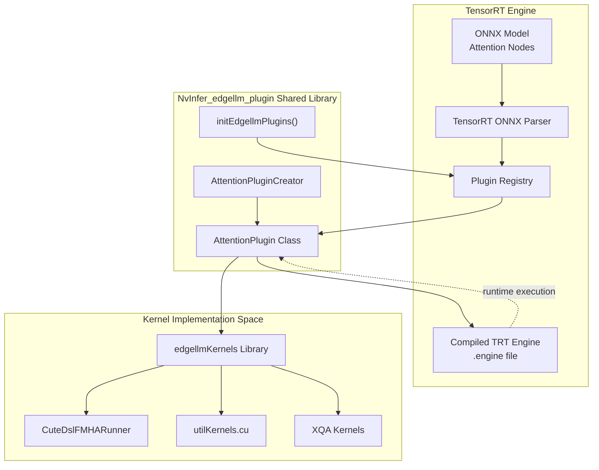
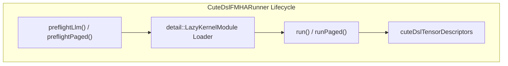
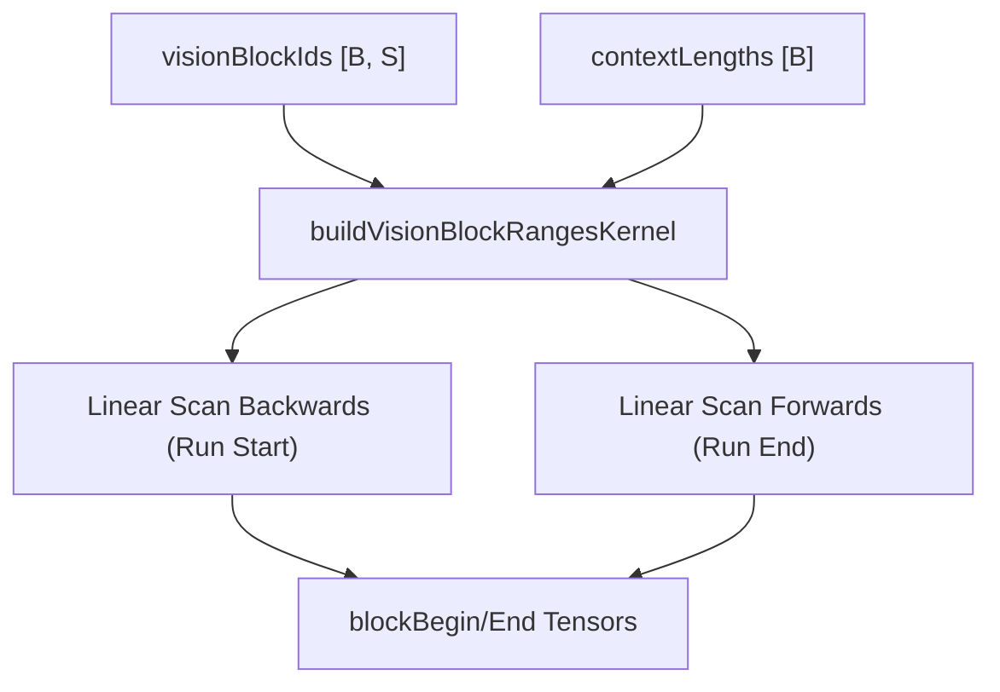

<!-- source: DeepWiki mcp.deepwiki.com · repo NVIDIA/TensorRT-Edge-LLM · extra page AttentionPlugin · fetched 2026-10-26 -->

# AttentionPlugin

Relevant source files

The following files were used as context for generating this wiki page:

- [cpp/kernels/contextAttentionKernels/attentionScaleUtils.h](cpp/kernels/contextAttentionKernels/attentionScaleUtils.h)
- [cpp/kernels/contextAttentionKernels/cuteDslFMHARunner.cpp](cpp/kernels/contextAttentionKernels/cuteDslFMHARunner.cpp)
- [cpp/kernels/contextAttentionKernels/cuteDslFMHARunner.h](cpp/kernels/contextAttentionKernels/cuteDslFMHARunner.h)
- [cpp/kernels/contextAttentionKernels/utilKernels.cu](cpp/kernels/contextAttentionKernels/utilKernels.cu)
- [cpp/kernels/contextAttentionKernels/utilKernels.h](cpp/kernels/contextAttentionKernels/utilKernels.h)

## Purpose and Scope

This document provides detailed technical documentation of the `AttentionPlugin`, a custom TensorRT plugin that implements optimized attention mechanisms for LLM and VLM inference. The plugin supports static-shape attention with Rotary Position Embeddings (RoPE), LongRoPE extensions, and specialized configurations for modern architectures like Qwen3 and Gemma4. It manages the dispatch of high-performance kernels including context-phase fused multi-head attention (FMHA), FP8 KV cache support, and speculative decoding tree attention.

A significant update in version 0.10.0 is the integration of **CuTe DSL** for FMHA, providing optimized kernels for Blackwell (SM100/101/110) architectures and supporting complex vision-block bidirectional attention patterns.

**Sources:** [cpp/kernels/contextAttentionKernels/cuteDslFMHARunner.h:38-50](), [cpp/kernels/contextAttentionKernels/attentionScaleUtils.h:30-47]()

---

## Overview

### What is AttentionPlugin

`AttentionPlugin` is a custom TensorRT `IPluginV2DynamicExt` implementation. It is specifically optimized for the static-shape, edge-deployment scenarios that TensorRT-Edge-LLM targets. The plugin acts as a high-level orchestrator that selects between different backend runners (e.g., legacy FMHA, XQA, or the new CuTe DSL runner) based on the target hardware and model configuration.

**Diagram: AttentionPlugin Registration and Execution Flow**

**Sources:** [cpp/kernels/contextAttentionKernels/cuteDslFMHARunner.h:51-55](), [cpp/kernels/contextAttentionKernels/utilKernels.h:29-30]()

### Why a Custom Plugin

The decision to implement a custom attention plugin rather than using TensorRT's native attention operators stems from several requirements:

| Requirement | Rationale |
|------------|-----------|
| **Blackwell Support** | Integration of CuTe DSL compiled kernels for SM100/101/110 [cpp/kernels/contextAttentionKernels/cuteDslFMHARunner.cpp:39-42](). |
| **Paged KV Cache** | Native support for paged KV pools with fixed token-per-page (128) layouts [cpp/kernels/contextAttentionKernels/cuteDslFMHARunner.h:105-112](). |
| **Vision Bidirectional Masking** | Ability to handle disjoint contiguous vision runs within a sequence using `bidirectionalBlockBegin/End` [cpp/kernels/contextAttentionKernels/cuteDslFMHARunner.h:134-139](). |
| **Skip-Softmax (BLASST)** | Optimized variant that skips negligible KV tiles in causal attention [cpp/kernels/contextAttentionKernels/cuteDslFMHARunner.h:94-98](). |

**Sources:** [cpp/kernels/contextAttentionKernels/cuteDslFMHARunner.h:88-98](), [cpp/kernels/contextAttentionKernels/cuteDslFMHARunner.h:132-140]()

---

## Plugin Architecture

### CuTe DSL FMHA Runner

The `CuteDslFMHARunner` is the primary execution engine for Blackwell-class hardware. It manages AOT-compiled kernel modules for various head sizes (64, 128, 256, 512) and data types.

**Diagram: CuteDslFMHARunner Operation Flow**

The runner handles:
- **Variant Loading:** Uses `LazyKernelModule` to load `.cubin` modules like `fmha_d128_paged` only when needed [cpp/kernels/contextAttentionKernels/cuteDslFMHARunner.cpp:76-77]().
- **Paged KV Management:** Maps logical K/V TMA tiles to physical pages in a pool [cpp/kernels/contextAttentionKernels/cuteDslFMHARunner.h:107-112]().
- **Precision Handling:** Supports FP16 outputs even when inputs (Q/KV) are FP8 E4M3 [cpp/kernels/contextAttentionKernels/cuteDslFMHARunner.h:78-80]().

**Sources:** [cpp/kernels/contextAttentionKernels/cuteDslFMHARunner.cpp:57-98](), [cpp/kernels/contextAttentionKernels/cuteDslFMHARunner.h:105-143]()

### Utility Kernels and Sequence Management

The plugin relies on `utilKernels.cu` to prepare the metadata required for fused kernels.

- **Sequence Length Calculation:** `calCuQCuKVSeqLensAndKVEndIdxs` computes the exclusive prefix-sum of sequence lengths and handles padding for `bottom_right_align` requirements in CuTe DSL [cpp/kernels/contextAttentionKernels/utilKernels.h:68-70]().
- **Vision Block Processing:** `launchBuildVisionBlockRanges` expands vision-block IDs into per-position intervals, enabling bidirectional attention within vision segments while maintaining causal masks for text [cpp/kernels/contextAttentionKernels/utilKernels.h:41-42]().
- **Layout Conversion:** `cvtKVLayoutBHSDToSplitKV` deinterleaves `[B, 2, H, S, D]` buffers into separate K and V tensors, applying FP8 dequantization if necessary [cpp/kernels/contextAttentionKernels/utilKernels.h:85-86]().

**Sources:** [cpp/kernels/contextAttentionKernels/utilKernels.cu:27-67](), [cpp/kernels/contextAttentionKernels/utilKernels.cu:110-146]()

---

## Features and Capabilities

### Context FMHA Support

The `AttentionPlugin` supports a variety of attention configurations for the prefill phase:

| Feature | Description |
|-----------|-------------|
| **Sliding Window** | Supports sliding window attention via `slidingWindowSize` parameter [cpp/kernels/contextAttentionKernels/cuteDslFMHARunner.h:89-89](). |
| **Paged KV Cache** | Fixed 128 tokens per page layout for TMA-optimized access [cpp/kernels/contextAttentionKernels/cuteDslFMHARunner.h:111-112](). |
| **FP8 Input Scaling** | Supports `qScale`, `kScale`, and `vScale` for dequantization during the attention operation [cpp/kernels/contextAttentionKernels/cuteDslFMHARunner.h:91-93](). |
| **Skip-Softmax** | Approximate attention that skips P*V GEMM for negligible tiles (FP16 causal only) [cpp/kernels/contextAttentionKernels/cuteDslFMHARunner.h:94-98](). |

**Sources:** [cpp/kernels/contextAttentionKernels/cuteDslFMHARunner.h:65-70](), [cpp/kernels/contextAttentionKernels/cuteDslFMHARunner.h:100-102]()

### Attention Scaling Logic

The plugin uses utility functions in `attentionScaleUtils.h` to manage the $1/\sqrt{d_k}$ multiplier.

- **Validation:** `validateAttentionScale` ensures the multiplier is finite and positive [cpp/kernels/contextAttentionKernels/attentionScaleUtils.h:30-34]().
- **Resolution:** `resolveAttentionScale` provides a default of $1/\sqrt{\text{headSize}}$ if no explicit scale is provided by the model configuration [cpp/kernels/contextAttentionKernels/attentionScaleUtils.h:37-47]().

**Sources:** [cpp/kernels/contextAttentionKernels/attentionScaleUtils.h:30-47]()

---

## Implementation Details

### Vision Block Range Expansion

For multimodal models, the plugin must identify which tokens belong to the same vision "block" to apply bidirectional attention.

**Diagram: Vision Block Range Expansion Logic**

**Sources:** [cpp/kernels/contextAttentionKernels/utilKernels.cu:110-146]()

### Layout Deinterleaving

When using chunked-prefill or specific AOT kernels that require separate pointers, the plugin uses `cvtKVLayoutBHSDToSplitKV`. This kernel handles the transition from the runtime's interleaved KV format to the split format required by the FMHA backend.

| Parameter | Type | Description |
|-----------|------|-------------|
| `src` | `[B, 2, H, S, D]` | Interleaved source (FP16 or FP8) |
| `kDst` / `vDst` | `[B, S, H, D]` | Separate FP16 destinations |
| `kvScaleQuantOrig` | `[2]` | FP8 dequantization scales [cpp/kernels/contextAttentionKernels/utilKernels.h:81-82]() |

**Sources:** [cpp/kernels/contextAttentionKernels/utilKernels.cu:169-173](), [cpp/kernels/contextAttentionKernels/utilKernels.h:78-86]()

---

## Runtime Integration

### Blackwell FMHA Dispatch

The `CuteDslFMHARunner::run` and `runPaged` methods are the primary entry points during TensorRT execution. They perform runtime checks to ensure the requested configuration (e.g., sliding window, FP8) has a corresponding pre-loaded kernel variant.

- **SM Version Check:** Validates against SM100, 101, or 110 [cpp/kernels/contextAttentionKernels/cuteDslFMHARunner.cpp:39-42]().
- **Head Size Check:** Supports 64, 128, 256, and 512 [cpp/kernels/contextAttentionKernels/cuteDslFMHARunner.cpp:108-109]().

**Sources:** [cpp/kernels/contextAttentionKernels/cuteDslFMHARunner.cpp:106-116](), [cpp/kernels/contextAttentionKernels/cuteDslFMHARunner.h:100-143]()

---

