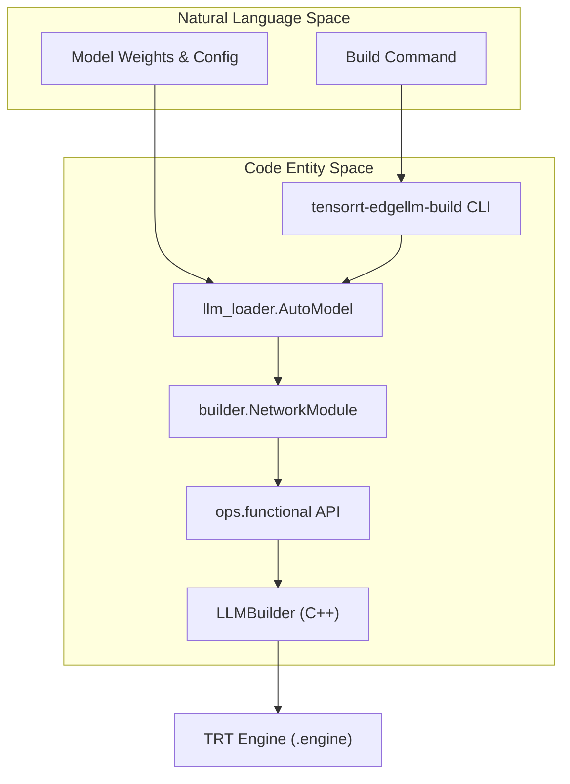
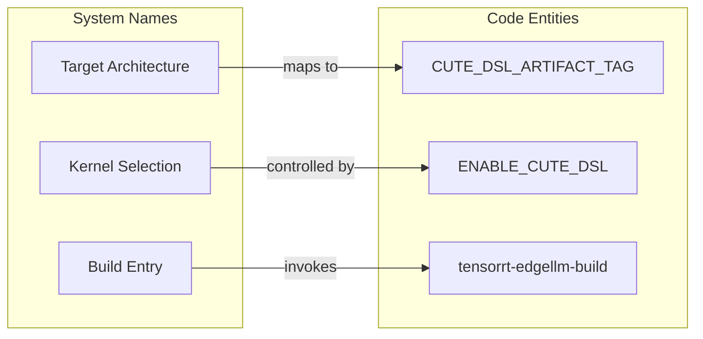

<!-- source: DeepWiki mcp.deepwiki.com · repo NVIDIA/TensorRT-Edge-LLM · extra page Experimental ONNX-less Builder · fetched 2026-10-26 -->

# Experimental ONNX-less Builder

Relevant source files

The following files were used as context for generating this wiki page:

- [CMakeLists.txt](CMakeLists.txt)
- [cmake/CuteDsl.cmake](cmake/CuteDsl.cmake)

The **Experimental ONNX-less Builder** is a direct checkpoint-to-engine compilation path introduced in version 0.10.0. It bypasses the traditional ONNX export step, allowing for faster iterations, lower memory overhead during builds, and tighter integration with the `ops.functional` API. This workflow is centered around the `tensorrt-edgellm-build` CLI and the `NetworkModule` abstraction.

## Overview and Data Flow

In the standard workflow, models are exported to ONNX before being consumed by the TensorRT builder. The ONNX-less path allows the builder to directly instantiate a model definition in Python using the `tensorrt` (TensorRT-LLM style) functional API and populate weights from checkpoints.

### Direct Build Pipeline
The following diagram illustrates the transition from raw checkpoints to a finalized TensorRT engine without intermediate ONNX files.

**Diagram: ONNX-less Build Sequence**

**Sources:** [CMakeLists.txt:20-21](), [cmake/CuteDsl.cmake:28-36]()

## Key Components

### 1. `tensorrt-edgellm-build` CLI
This is the primary entry point for the experimental builder. It coordinates the model loading, network definition, and engine optimization process. It utilizes the `llm_loader` to parse model configurations and dispatch to the correct architecture implementation.

### 2. `NetworkModule` and `ops.functional`
The `NetworkModule` acts as a container for the model's computational graph. Instead of parsing an ONNX graph, it uses a functional API (`ops.functional`) to define layers (Attention, MLP, LayerNorm) directly as TensorRT network layers. This allows for:
* **Direct Plugin Insertion:** Seamlessly injecting `AttentionPlugin` or `MambaPlugin` without OIR (ONNX Intermediate Representation) matching.
* **Quantization Awareness:** Applying precision logic (FP8, NVFP4, INT4) during the graph construction phase.

### 3. Component Registry
The builder leverages a registry system similar to the `llm_loader.AutoModel` [4.5.1. AutoModel and Model Registry](). When a model family (e.g., Qwen3, Gemma4) is specified, the builder looks up the corresponding `NetworkModule` implementation to construct the engine.

## Implementation Details

### CuTe DSL Integration
The ONNX-less builder is tightly coupled with the **CuTe DSL** unified kernel library. During the build process, the builder identifies the target architecture (e.g., `sm_87` for Jetson Orin or `sm_121` for GB10) and links the optimized kernel artifacts generated by `kernelSrcs/build_cutedsl.py`.

| Feature | Description |
| :--- | :--- |
| **Artifact Tag** | Auto-selected based on `EMBEDDED_TARGET` (e.g., `jetson-orin` -> `sm_87`). |
| **Kernel Groups** | Configurable via `ENABLE_CUTE_DSL` (e.g., `fmha`, `gdn`, `f16_moe`). |
| **Direct Linking** | The builder links `libcutedsl_<arch>.a` directly into the runtime environment. |

**Sources:** [cmake/CuteDsl.cmake:28-52](), [cmake/CuteDsl.cmake:115-130](), [CMakeLists.txt:183-195]()

### Mapping System Names to Code Entities
The following diagram maps the high-level build concepts to the specific CMake and Python variables used in the implementation.

**Diagram: Build System Mapping**

**Sources:** [cmake/CuteDsl.cmake:55-67](), [cmake/CuteDsl.cmake:187-203]()

## Adding a New Model Family

To support a new model family in the ONNX-less builder:
1. **Define the Network:** Create a new class inheriting from `NetworkModule` in the `experimental/builder` directory.
2. **Implement Layers:** Use `ops.functional` to define the model's blocks (e.g., `Attention`, `RMSNorm`).
3. **Register the Model:** Add the model family to the builder registry, associating it with the new `NetworkModule`.
4. **Configure Precision:** Define how weights from the `llm_loader` checkpoint should be mapped to the TensorRT layers, including any quantization scaling factors.
5. **Verify with CuTe DSL:** Ensure that the required kernels (like FMHA or MoE) are enabled in `CMakeLists.txt` via the `ENABLE_CUTE_DSL` flag.

**Sources:** [CMakeLists.txt:183-195](), [cmake/CuteDsl.cmake:28-42]()

---

