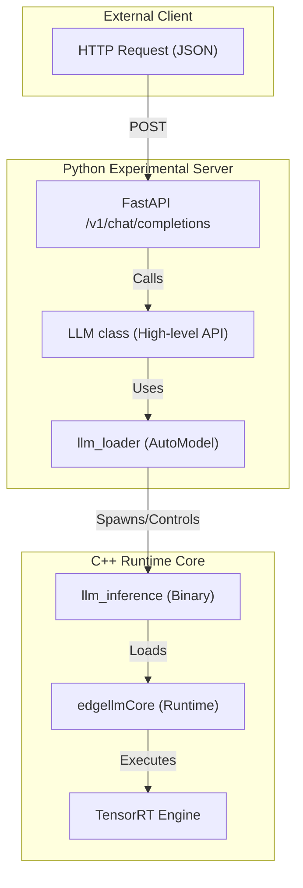
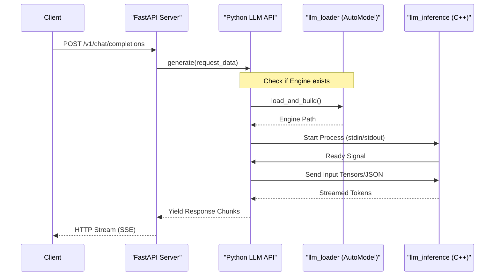

<!-- source: DeepWiki mcp.deepwiki.com · repo NVIDIA/TensorRT-Edge-LLM · extra page Experimental Server · fetched 2026-10-26 -->

# Experimental Server

<details>
<summary>Relevant source files</summary>

The following files were used as context for generating this wiki page:

- [cpp/common/stringUtils.cpp](cpp/common/stringUtils.cpp)
- [cpp/common/stringUtils.h](cpp/common/stringUtils.h)

</details>


The Experimental Server is a high-level Python-based component designed to provide a vLLM-style API and an OpenAI-compatible HTTP interface for TensorRT Edge-LLM. It leverages the `llm_loader` infrastructure to manage model loading, engine building, and inference execution, abstracting the underlying C++ runtime for ease of use in web services and rapid prototyping [README.md:42-42]().

## Overview and Purpose

The primary goal of the experimental server is to bridge the gap between the high-performance C++ core and standard web protocols. It allows developers to interact with models deployed on NVIDIA edge platforms using familiar tools and libraries that support the OpenAI Chat Completions API.

### Key Features
*   **OpenAI-Compatible Endpoint**: Implements the `/v1/chat/completions` REST API.
*   **Audio Support**: Provides `/v1/audio/speech` (TTS) and `/v1/audio/transcriptions` (ASR) endpoints.
*   **Multimodal Input**: Supports video and image input for vision-language models.
*   **High-Level Python LLM API**: Provides a simplified interface for model interaction within Python scripts.
*   **Automated Pipeline**: Handles the transition from HuggingFace checkpoints to optimized TensorRT engines via `llm_loader` [README.md:34-34]().
*   **Tool-Calling and Logit Bias**: Supports advanced LLM features including function calling and token probability manipulation.
*   **Integration**: Supports Claude Code and OpenClaw for agentic workflows.
*   **Edge-First Design**: Optimized for resource-constrained environments like NVIDIA Jetson and NVIDIA DRIVE [README.md:16-18]().

**Sources:** [README.md:16-18](), [README.md:34-34](), [README.md:42-42]()

---

## System Architecture

The server acts as a wrapper around the `llm_loader` and the C++ `llm_inference` runtime. It orchestrates the data flow from HTTP requests down to the hardware-accelerated inference kernels.

### Request Data Flow

The following diagram illustrates how a natural language request is processed through the various code entities:

**Title: Natural Language to Code Entity Mapping**

**Sources:** [README.md:32-44](), [README.md:53-55]()

---

## Key Components

### 1. OpenAI-Compatible HTTP Server
The server implementation uses FastAPI to expose endpoints that mirror the OpenAI specification. This allows integration with existing LLM orchestration frameworks (e.g., LangChain, LlamaIndex).

*   **Chat Endpoint**: `/v1/chat/completions` for text and multimodal (image/video) interaction.
*   **Audio Endpoints**: `/v1/audio/speech` for text-to-speech and `/v1/audio/transcriptions` for speech-to-text.
*   **Input**: JSON payload containing messages, model name, and sampling parameters (temperature, top_p, etc.).
*   **Advanced Features**: Supports `logit_bias` for controlling token generation and `tools` for function calling.
*   **Output**: Streaming or non-streaming JSON responses following the Chat Completion object schema.

### 2. High-Level Python LLM API
The `LLM` class provides a programmatic way to interact with the models without manual management of the C++ process or JSON I/O files.

*   **`LLM(model_path, ...)`**: Initializes the model, triggers engine building if necessary, and prepares the runtime environment.
*   **`LLM.generate(prompts, sampling_params)`**: Synchronous or asynchronous method to generate text.

### 3. Integration with `llm_loader`
The server relies on the `llm_loader` to resolve model configurations and handle the export pipeline. It utilizes `AutoModel.from_pretrained` to dispatch to the correct model family (e.g., Qwen3, NemotronH, InternVL3) [README.md:34-34]().

**Title: Server Component Interaction**

**Sources:** [README.md:34-34](), [README.md:42-42](), [README.md:53-55]()

---

## Utilities and Formatting

The server and underlying components utilize specialized string utilities for logging and error reporting. The `trt_edgellm::format::fmtstr` function provides a safe, `vsnprintf`-based formatting mechanism used throughout the C++ runtime to generate human-readable status updates for the Python server bridge [cpp/common/stringUtils.h:35-35](), [cpp/common/stringUtils.cpp:60-75]().

### String Formatting Logic
The implementation ensures robust memory management during string construction in `vformat` [cpp/common/stringUtils.cpp:38-58]():
1.  Calculates required buffer size using `vsnprintf` with `va_copy` [cpp/common/stringUtils.cpp:40-42]().
2.  Allocates a `std::string` buffer of the exact size plus null terminator [cpp/common/stringUtils.cpp:51-51]().
3.  Performs the actual format write using `std::vsnprintf` and validates the result [cpp/common/stringUtils.cpp:52-54]().
4.  Resizes the string to the final content length [cpp/common/stringUtils.cpp:55-55]().

**Sources:** [cpp/common/stringUtils.h:35-35](), [cpp/common/stringUtils.cpp:38-75]()

---

## Configuration and Deployment

The server is configured via command-line arguments or environment variables, allowing users to specify:
*   **Model Path**: Local path to the checkpoint or engine.
*   **Host/Port**: Network configuration for the HTTP server.
*   **Precision**: Desired quantization (e.g., FP8, NVFP4, INT4) which is passed to the `llm_loader` [README.md:41-41]().

### Example Server Launch
While specific code is not provided in the snippet, the typical entry point involves:
```bash
python3 -m tensorrt_edgellm.experimental.server --model_dir <path_to_model> --port 8000
```

## Implementation Details

| Component | Responsibility |
| :--- | :--- |
| **FastAPI App** | Handles HTTP routing, CORS, and request validation. |
| **Streaming Handler** | Manages Server-Sent Events (SSE) for real-time token delivery. |
| **Process Manager** | Monitors the lifecycle of the C++ `llm_inference` subprocess. |
| **JSON Bridge** | Converts OpenAI-style JSON requests into the internal JSON format required by `llm_inference` [README.md:43-43](). |
| **StringUtils** | Provides `fmtstr` for formatted logging and error messaging across the C++ bridge [cpp/common/stringUtils.h:35-35](). |

**Sources:** [README.md:16-18](), [README.md:42-43](), [cpp/common/stringUtils.h:35-35](), [cpp/common/stringUtils.cpp:60-75]()

---

