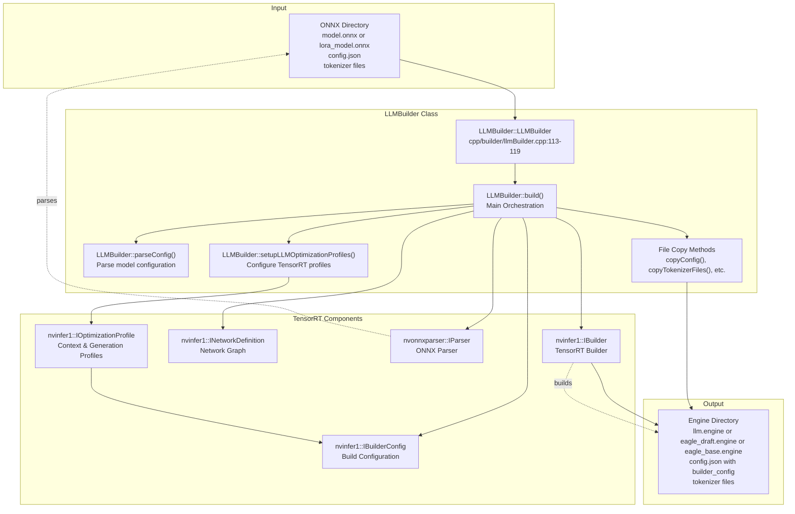
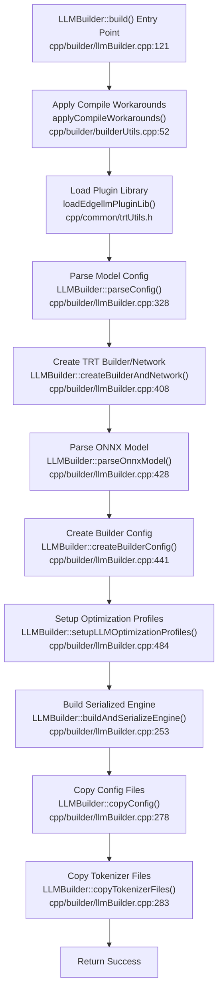
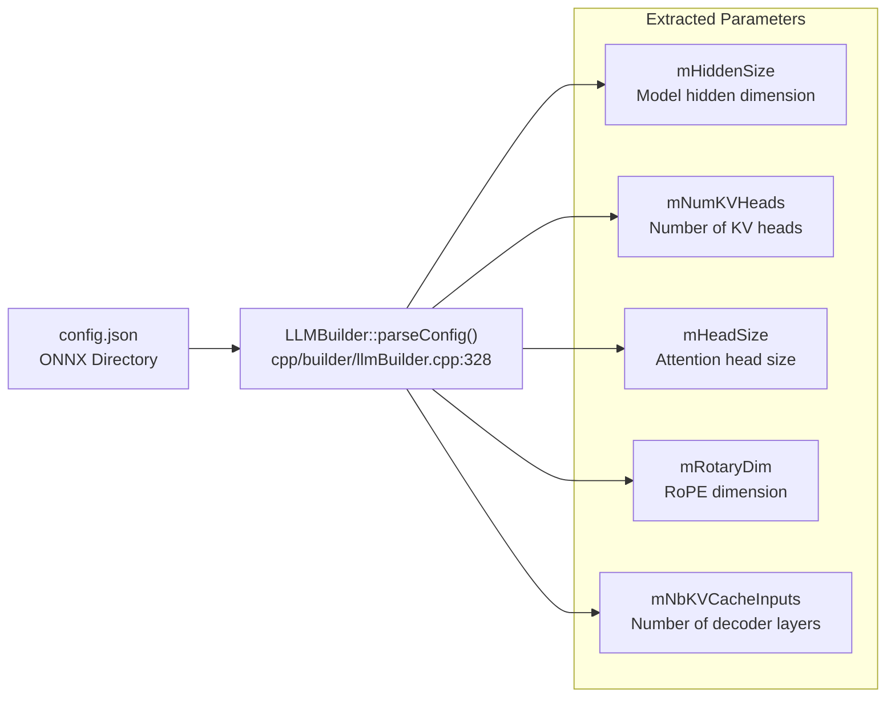
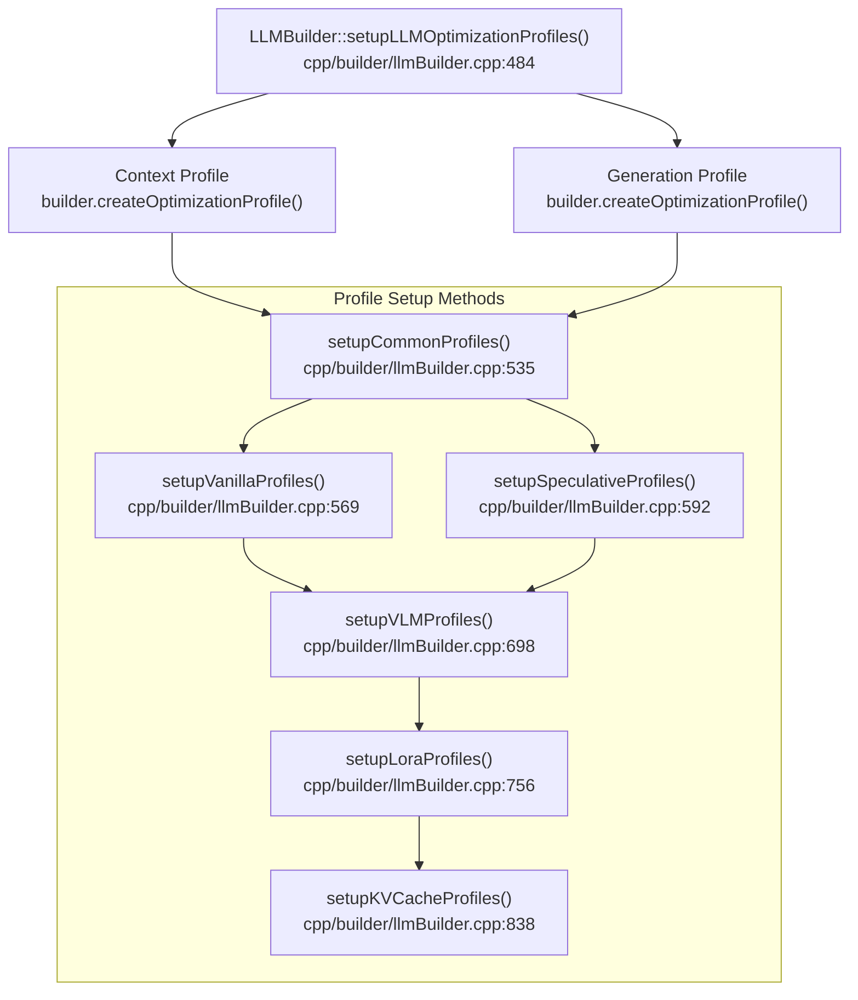

<!-- source: DeepWiki mcp.deepwiki.com · repo NVIDIA/TensorRT-Edge-LLM · extra page LLM Engine Builder · fetched 2026-10-26 -->

# LLM Engine Builder

Relevant source files

The following files were used as context for generating this wiki page:

- [cpp/builder/builderUtils.cpp](cpp/builder/builderUtils.cpp)
- [cpp/builder/llmBuilder.cpp](cpp/builder/llmBuilder.cpp)
- [cpp/builder/llmBuilder.h](cpp/builder/llmBuilder.h)

## Purpose and Scope

The LLM Engine Builder is responsible for converting ONNX-exported language models into optimized TensorRT engines for inference on NVIDIA edge platforms. This page documents the `LLMBuilder` class, which handles text-only LLMs and text components of vision-language models, including support for vanilla autoregressive decoding, EAGLE3 speculative decoding, MTP (Multi-Token Prediction), DFlash, DSpark, and LoRA adaptations.

For building vision transformer engines in multimodal models, see [Visual Engine Builder](3.2.2). For the overall engine building workflow, see [Engine Building](3.2).

**Sources:** [cpp/builder/llmBuilder.cpp:113-121](), [cpp/builder/llmBuilder.h:32-36]()

---

## LLMBuilder Class Overview

The `LLMBuilder` class orchestrates the conversion of ONNX models to TensorRT engines. It takes ONNX files from a source directory, parses model configuration, sets up optimization profiles for different inference scenarios, builds the TensorRT engine, and copies necessary runtime files to the engine directory.

**Sources:** [cpp/builder/llmBuilder.cpp:121-261](), [cpp/builder/llmBuilder.h:176-218]()

---

## LLMBuilderConfig Structure

The `LLMBuilderConfig` structure defines all parameters controlling engine generation. These parameters determine optimization profiles, decoding strategies, and model capabilities.

| Configuration Field | Type | Description |
|---------------------|------|-------------|
| `maxBatchSize` | `int64_t` | Maximum number of sequences processed concurrently |
| `maxInputLen` | `int64_t` | Maximum input sequence length for context phase |
| `maxKVCacheCapacity` | `int64_t` | Maximum KV cache size per sequence |
| `maxKVPoolPages` | `int64_t` | Exact physical K-page count for the engine's KV pool |
| `specBase` | `bool` | Build speculative-decoding base model engine |
| `specDraft` | `bool` | Build speculative-decoding draft model engine |
| `maxDraftTreeSize` | `int64_t` | Maximum tree size for draft model generation |
| `maxVerifyTreeSize` | `int64_t` | Maximum tree size for base model verification |
| `maxLoraRank` | `int64_t` | Maximum LoRA rank (0 disables LoRA) |
| `profilingDetailed` | `bool` | Enable detailed profiling verbosity |

The configuration is serialized to JSON via `toJson()` [cpp/builder/llmBuilder.h:83-103]() and saved alongside the engine for runtime parsing. The `resolvedKVPoolPages()` method [cpp/builder/llmBuilder.h:59-79]() ensures the KV pool size meets minimum active requirements.

**Sources:** [cpp/builder/llmBuilder.h:41-157]()

---

## Build Process Flow

The `build()` method orchestrates the entire engine building process through the following stages:

**Engine File Naming:**
The engine filename is determined by the `engine_role` in the model config:
- `base`: `eagle_base.engine`, `mtp_base.engine`, etc.
- `draft`: `eagle_draft.engine`, `mtp_draft.engine`, etc.
- Default: `llm.engine`

**Sources:** [cpp/builder/llmBuilder.cpp:121-261](), [cpp/builder/llmBuilder.cpp:263-276]()

---

## Configuration Parsing

The `parseConfig()` method extracts model architecture parameters from `config.json` required for optimization profile setup. It handles standard LLMs as well as speculative decoding types like `mtp`, `eagle3`, `dflash`, `dspark`, and `gemma4_mtp`.

The method also performs version compatibility checks and detects specific architecture requirements, such as the `mTargetModelOutputHiddenDim` for MTP draft models.

**Sources:** [cpp/builder/llmBuilder.cpp:328-406]()

---

## Optimization Profiles

TensorRT optimization profiles define the range of dynamic input shapes the engine can handle. The `LLMBuilder` creates two profiles for different inference phases:

1. **Context Profile**: For processing initial input sequences (prefill phase).
2. **Generation Profile**: For autoregressive token generation (decode phase).

**Sources:** [cpp/builder/llmBuilder.cpp:484-533]()

### Common Profiles

The `setupCommonProfiles()` method configures inputs shared by most models:

| Input Name | Binding Name Constant | Min Shape | Opt Shape | Max Shape |
|------------|----------------------|-----------|-----------|-----------|
| Context Lengths | `kContextLengths` | `[1]` | `[maxBatchSize]` | `[maxBatchSize]` |
| RoPE Cos/Sin | `kRopeCosSin` | `[1, maxKVCacheCapacity, rotaryDim]` | `[maxBatchSize, maxKVCacheCapacity, rotaryDim]` | Same as opt |
| KV Cache Start Index | `kKVCacheStartIndex` | `[0]` | `[maxBatchSize]` | `[maxBatchSize]` |

**Sources:** [cpp/builder/llmBuilder.cpp:535-567]()

### Vanilla Profiles

For standard autoregressive decoding:

| Input Name | Binding Name | Context Profile | Generation Profile |
|------------|--------------|-----------------|-------------------|
| Input IDs | `kInputIds` | `[1,1]` to `[maxBatchSize, maxInputLen]` | `[1,1]` to `[maxBatchSize, 1]` |
| Last Token IDs | `kLastTokenIds` | `[1,1]` to `[maxBatchSize, 1]` | `[1,1]` to `[maxBatchSize, 1]` |

**Sources:** [cpp/builder/llmBuilder.cpp:569-590]()

### Speculative Profiles

`setupSpeculativeProfiles()` handles multiple speculative decoding strategies (EAGLE3, MTP, DFlash, DSpark). It configures inputs for tree-based verification (base models) and tree-based generation (draft models).

- **Base Model Verification**: Configures `input_ids`, `attention_mask`, and `attention_pos_id` to handle up to `maxVerifyTreeSize` [cpp/builder/llmBuilder.cpp:645-667]().
- **Draft Model Generation**: Configures hidden state inputs and `input_ids` up to `maxDraftTreeSize` [cpp/builder/llmBuilder.cpp:602-643]().

**Sources:** [cpp/builder/llmBuilder.cpp:592-696]()

### VLM and LoRA Profiles

- **VLM**: `setupVLMProfiles()` detects `image_embeds` and sets up prefill profiles. It also supports `deepstack_features_*` for Qwen3-VL models [cpp/builder/llmBuilder.cpp:698-754]().
- **LoRA**: `setupLoraProfiles()` iterates through network inputs searching for `lora_A_*` and `lora_B_*` prefixes and configures the rank dimension from 0 to `maxLoraRank` [cpp/builder/llmBuilder.cpp:756-836]().

### KV Cache Profiles

`setupKVCacheProfiles()` iterates through `mNbKVCacheInputs` to configure each layer's `past_key_value_{i}_input` with shape `[batch_size, 2, num_kv_heads, kv_cache_length, head_size]`.

**Sources:** [cpp/builder/llmBuilder.cpp:838-860]()

---

