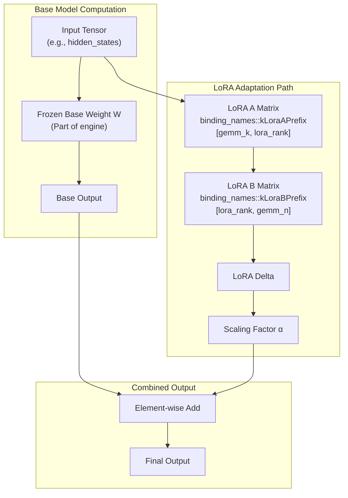
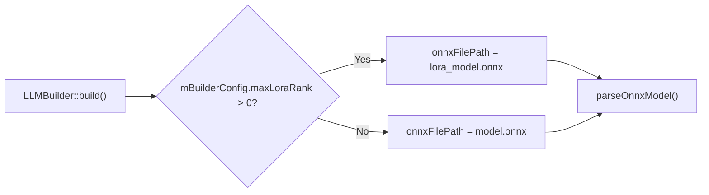
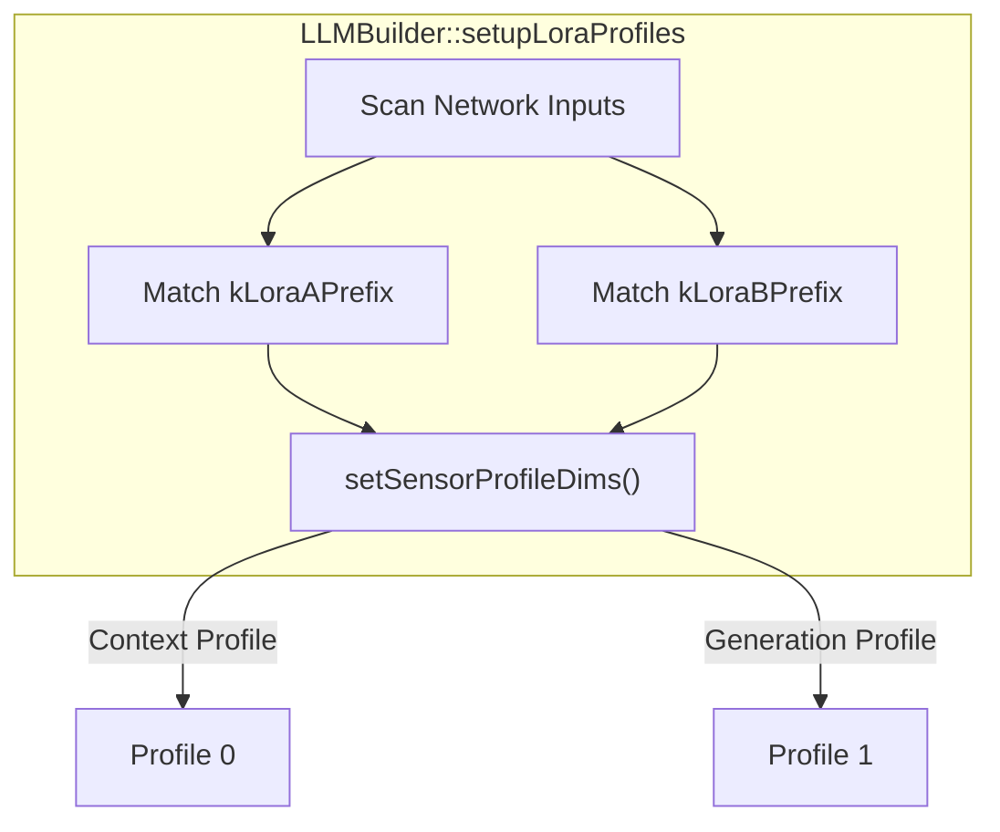

<!-- source: DeepWiki mcp.deepwiki.com · repo NVIDIA/TensorRT-Edge-LLM · extra page LoRA Support · fetched 2026-10-26 -->

# LoRA Support

Relevant source files

The following files were used as context for generating this wiki page:

- [cpp/common/fileUtils.cpp](cpp/common/fileUtils.cpp)
- [cpp/common/fileUtils.h](cpp/common/fileUtils.h)

## Purpose and Scope

This document describes the Low-Rank Adaptation (LoRA) support in TensorRT-Edge-LLM, which enables dynamic fine-tuning of deployed models without rebuilding TensorRT engines. LoRA allows efficient model adaptation by adding trainable low-rank matrices to specific layers while keeping the base model weights frozen.

This page covers the dynamic LoRA implementation, including configuration parameters, engine building with LoRA inputs, and optimization profile setup via the `LLMBuilder` class. It also documents the underlying file I/O mechanisms used for weight management, such as the `MmapReader` for efficient memory mapping of large adapter weights and `file_io::copyFile` for filesystem operations.

**Note**: As of version 0.3.0, only dynamic LoRA is supported. Static and merged LoRA support has been removed.

**Sources**: [cpp/builder/llmBuilder.cpp:65-74](), [cpp/builder/llmBuilder.cpp:1200-1277]()

---

## LoRA Architecture Overview

LoRA decomposes weight updates into low-rank matrices. For a weight matrix $W$, the LoRA-adapted forward pass computes:

$$output = (W + \alpha \cdot A \cdot B) \cdot input$$

Where:
- **W**: Frozen pre-trained weight matrix.
- **A**: LoRA "down-projection" matrix with shape `[gemm_k, lora_rank]`.
- **B**: LoRA "up-projection" matrix with shape `[lora_rank, gemm_n]`.
- **$\alpha$**: Scaling factor.
- **lora_rank**: $<< min(gemm_k, gemm_n)$, making the adaptation parameter-efficient.

### Data Flow and Code Entities

The following diagram maps the mathematical LoRA concept to the specific naming conventions used in the codebase, particularly within `binding_names`.

**LoRA Tensor Mapping Diagram**

**Sources**: [cpp/builder/llmBuilder.cpp:1200-1277]()

---

## LoRA Configuration

### LLMBuilderConfig Parameters

LoRA support is controlled by the `maxLoraRank` parameter within the `LLMBuilderConfig` structure passed to the `LLMBuilder`.

| Parameter | Type | Description | Default |
|-----------|------|-------------|---------|
| `maxLoraRank` | `int32_t` | Maximum LoRA rank for optimization profiles. Set to 0 to disable LoRA. | 0 |

When `maxLoraRank > 0`, the `LLMBuilder` performs the following actions:
1. Searches for `lora_model.onnx` instead of the standard `model.onnx` [cpp/builder/llmBuilder.cpp:65-74]().
2. Configures dynamic optimization profiles for all detected LoRA weight inputs [cpp/builder/llmBuilder.cpp:1200-1205]().

**Sources**: [cpp/builder/llmBuilder.cpp:37-43](), [cpp/builder/llmBuilder.cpp:65-74]()

---

## Weight Management and File I/O

For high-performance loading and management of LoRA weights, the codebase utilizes memory mapping via the `MmapReader` class and utility functions in `file_io`.

### File Operations
The `trt_edgellm::file_io::copyFile` function provides a safe wrapper for copying adapter files, handling `std::filesystem::filesystem_error` and logging errors through `LOG_ERROR` [cpp/common/fileUtils.cpp:29-62](). It specifically uses `std::filesystem::copy_options::overwrite_existing` to ensure updates to adapter weights are correctly applied [cpp/common/fileUtils.cpp:46-47]().

### MmapReader Implementation
The `MmapReader` class provides a wrapper around the POSIX `mmap` system call:
- **`loadFile`**: Opens the file using `open(..., O_RDONLY)` and maps it using `mmap(..., PROT_READ, MAP_SHARED, ...)` [cpp/common/mmapReader.cpp:73-97]().
- **Memory Safety**: The destructor automatically calls `release()`, which invokes `munmap` to free resources [cpp/common/mmapReader.cpp:52-65]().
- **Access**: Provides `getData()` and `getByteData()` to retrieve pointers to the mapped memory region [cpp/common/mmapReader.cpp:111-119]().

**Sources**: [cpp/common/fileUtils.cpp:29-62](), [cpp/common/fileUtils.h:27-35](), [cpp/common/mmapReader.h:35-82](), [cpp/common/mmapReader.cpp:18-125]()

---

## Engine Building with LoRA

### ONNX Model Selection

The `LLMBuilder::build()` function branches its ONNX parsing logic based on the LoRA configuration.

**Model Selection Logic**

**Sources**: [cpp/builder/llmBuilder.cpp:65-74]()

### Implementation in llmBuilder.cpp

The core logic for configuring LoRA within the TensorRT network resides in `LLMBuilder::setupLoraProfiles`. This function is called during the engine configuration phase to ensure the builder allocates sufficient space for dynamic LoRA weights.

1. **Input Identification**: The builder iterates through all network inputs [cpp/builder/llmBuilder.cpp:1212]().
2. **Prefix Matching**: It looks for input names containing `binding_names::kLoraAPrefix` or `binding_names::kLoraBPrefix` [cpp/builder/llmBuilder.cpp:1215-1244]().
3. **Dynamic Shape Range**:
   - **Min Rank**: 0 (allows running the engine without any LoRA applied) [cpp/builder/llmBuilder.cpp:1225]().
   - **Opt Rank**: `maxLoraRank / 2` [cpp/builder/llmBuilder.cpp:1226]().
   - **Max Rank**: `maxLoraRank` [cpp/builder/llmBuilder.cpp:1227]().

**Sources**: [cpp/builder/llmBuilder.cpp:1200-1277]()

---

## Optimization Profile Setup

The `setupLoraProfiles` function ensures that both the **Context Profile** (for prefill) and **Generation Profile** (for decode) are configured with the same dynamic LoRA dimensions.

### LoRA A Matrix Setup
For inputs matching `kLoraAPrefix`, the shape is `[gemm_k, lora_rank]`.
- **Min**: `[gemm_k, 0]`
- **Opt**: `[gemm_k, maxLoraRank / 2]`
- **Max**: `[gemm_k, maxLoraRank]`

### LoRA B Matrix Setup
For inputs matching `kLoraBPrefix`, the shape is `[lora_rank, gemm_n]`.
- **Min**: `[0, gemm_n]`
- **Opt**: `[maxLoraRank / 2, gemm_n]`
- **Max**: `[maxLoraRank, gemm_n]`

**Optimization Profile Flow**

**Sources**: [cpp/builder/llmBuilder.cpp:1212-1271]()

---

## Runtime Management

While the builder prepares the engine for LoRA, the runtime (implemented in `edgellmCore`) manages the actual loading and binding of weights.

### Plugin Integration
LoRA operations often rely on the custom plugins provided by `libNvInfer_edgellm_plugin.so`. The `LLMBuilder` loads this library at the start of the build process using `loadEdgellmPluginLib()` to ensure all custom LoRA layers are recognized by the ONNX parser.

**Sources**: [cpp/builder/llmBuilder.cpp:48](), [cpp/common/trtUtils.h:56-86]()

### Weight Binding
At runtime, LoRA weights are bound as dynamic tensors to the `IExecutionContext`. If no LoRA weights are provided for a specific request, the runtime provides tensors with a rank dimension of 0, effectively bypassing the LoRA path as configured by the `Min` profile dimension `[gemm_k, 0]` [cpp/builder/llmBuilder.cpp:1225](), [cpp/builder/llmBuilder.cpp:1254]().

**Sources**: [cpp/builder/llmBuilder.cpp:1225-1254](), [cpp/common/mmapReader.h:35-82](), [cpp/common/fileUtils.cpp:29-62]()

---

