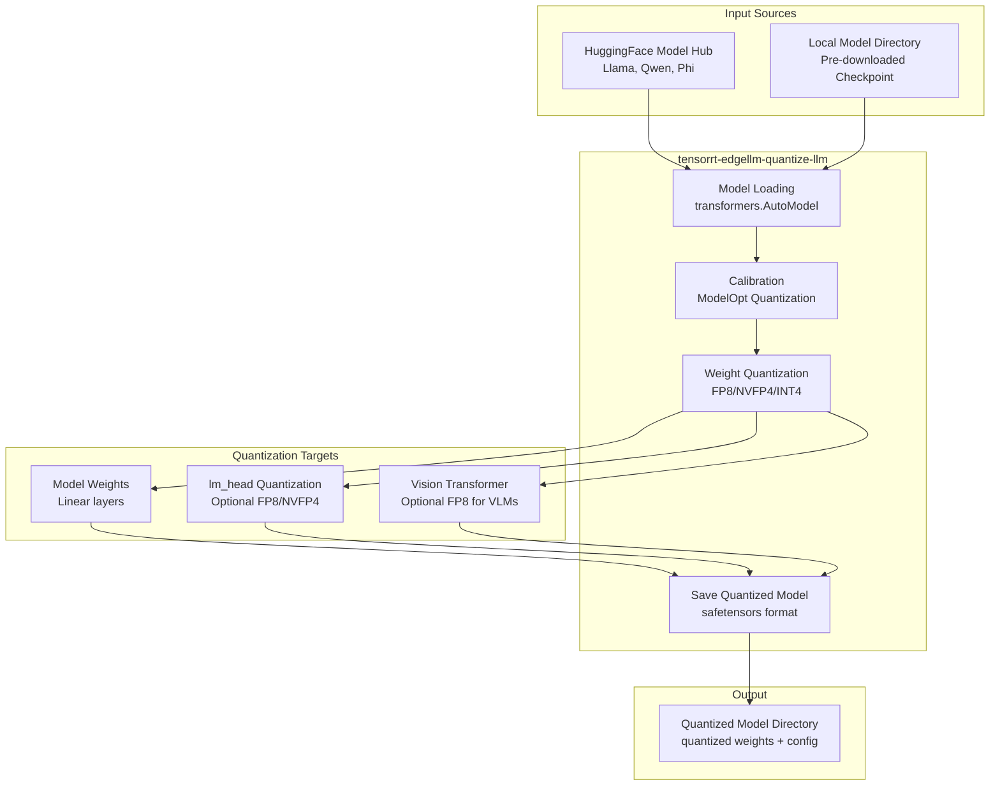
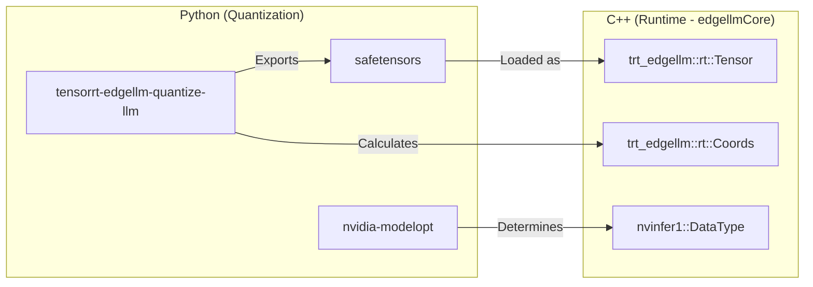
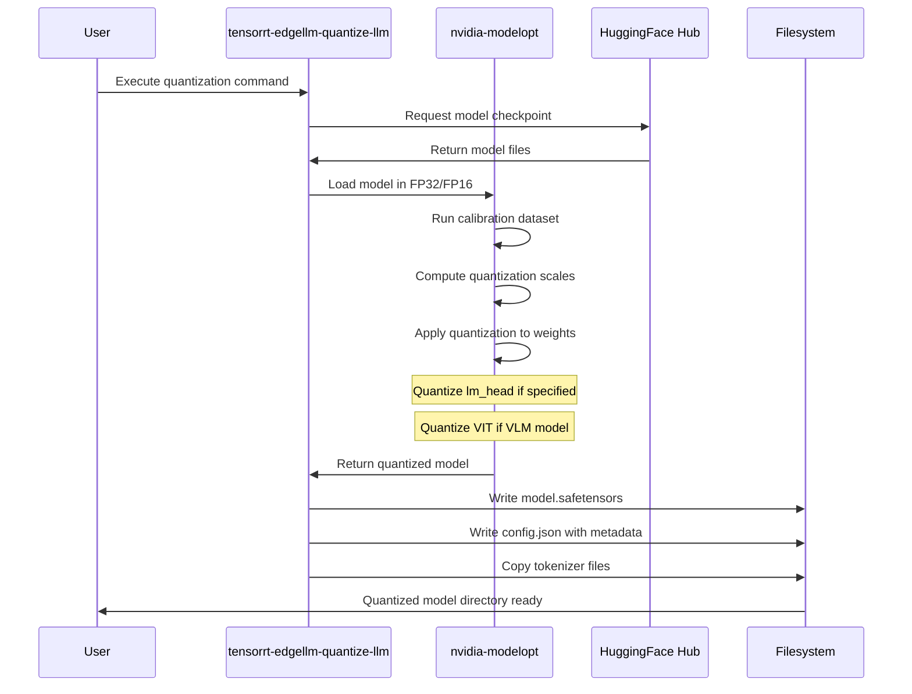

<!-- source: DeepWiki mcp.deepwiki.com · repo NVIDIA/TensorRT-Edge-LLM · extra page Model Quantization · fetched 2026-10-26 -->

# Model Quantization

<details>
<summary>Relevant source files</summary>

The following files were used as context for generating this wiki page:

- [cpp/builder/builderUtils.cpp](cpp/builder/builderUtils.cpp)
- [cpp/builder/builderUtils.h](cpp/builder/builderUtils.h)

</details>


## Purpose and Scope

This document explains the model quantization process in TensorRT-Edge-LLM, focusing on the Python-based `tensorrt-edgellm-quantize-llm` tool and supported precision formats. Quantization reduces model weight precision to enable efficient deployment on edge devices with constrained memory and compute resources.

The quantization step occurs before ONNX export in the Python export pipeline. It operates on HuggingFace model checkpoints and produces quantized model artifacts that are subsequently converted to ONNX format.

## Overview

Model quantization converts high-precision floating-point weights (typically FP32 or FP16) to lower-precision representations (FP8, NVFP4, INT4) while preserving model accuracy. This process:

- **Reduces memory footprint**: Lower precision weights consume less GPU memory, enabling larger models or longer context lengths on edge devices.
- **Improves inference throughput**: Reduced data movement and specialized hardware instructions for low-precision arithmetic accelerate computation.
- **Maintains accuracy**: Calibration-based quantization schemes preserve model quality within acceptable bounds.

**Sources**: [.github/ISSUE_TEMPLATE/2_bug_report_export.md:19-24](), [.github/ISSUE_TEMPLATE/2_bug_report_export.md:36-44]()

## Quantization Pipeline Architecture

The following diagram maps the logical quantization flow to the Python ecosystem and the `tensorrt-edgellm-quantize-llm` tool components.

### Quantization Data Flow



**Sources**: [.github/ISSUE_TEMPLATE/2_bug_report_export.md:19-24]()

## Supported Quantization Formats

TensorRT-Edge-LLM supports multiple quantization formats optimized for NVIDIA edge platforms. While the Python pipeline handles the conversion, the C++ runtime `edgellmCore` manages these types via the `Tensor` class and `DataType` enumeration.

| Format | Bit Width | Description | Use Cases |
|--------|-----------|-------------|-----------|
| **FP16** | 16-bit | Half-precision floating point (baseline) | Default precision, no quantization step required |
| **FP8** | 8-bit | 8-bit floating point (E4M3 format) | Balanced accuracy/performance for LLMs and VLMs |
| **NVFP4** | 4-bit | NVIDIA proprietary 4-bit floating point | Maximum compression with acceptable accuracy |
| **INT4** | 4-bit | 4-bit integer quantization | Compatible with standard INT4 workflows |
| **INT4_GPTQ** | 4-bit | GPTQ-quantized 4-bit integer checkpoints | Pre-quantized models from GPTQ pipelines |
| **INT4_AWQ** | 4-bit | Activation-aware Weight Quantization | High accuracy 4-bit quantization for MoE models |

### Precision Format Details

**FP8 Quantization**
- Uses E4M3 (4-bit exponent, 3-bit mantissa) representation.
- In C++, this is represented by `nvinfer1::DataType::kFP8` [cpp/common/tensor.cpp:58-58]().
- Applied to both LLM backbone and `lm_head` components.
- Often used for Vision Transformers (VIT) in multimodal models to maintain visual feature quality.

**NVFP4 Quantization**
- NVIDIA proprietary 4-bit floating point format.
- Achieves higher compression ratios than FP8 with minimal accuracy loss.
- Supports `lm_head` quantization for additional memory savings.
- Represented in the C++ `Tensor` class as `nvinfer1::DataType::kFP4` (available in TRT 10.8+) [cpp/common/tensor.cpp:148-148]().
- **Workaround Note**: When building engines with NVFP4, the builder applies specific compiler flags like `-mlir:collective:fp4=off` to avoid miscompilation on certain platforms [cpp/builder/builderUtils.cpp:72-72]().

**INT4/INT4_GPTQ/INT4_AWQ Quantization**
- Standard 4-bit integer representation.
- `INT4_GPTQ` and `INT4_AWQ` support pre-quantized checkpoints.
- Handled in C++ via `nvinfer1::DataType::kINT4` [cpp/common/tensor.cpp:148-150]().
- Version 0.10.0 adds support for INT4 AWQ MoE models such as Gemma 4 26B-A4B and Qwen3-Omni 30B-A3B.

**Sources**: [.github/ISSUE_TEMPLATE/2_bug_report_export.md:19-24](), [.github/ISSUE_TEMPLATE/2_bug_report_export.md:42-43](), [cpp/common/tensor.cpp:58-62](), [cpp/common/tensor.cpp:147-154](), [cpp/builder/builderUtils.cpp:70-74]()

## The tensorrt-edgellm-quantize-llm Tool

### Command-Line Interface

The `tensorrt-edgellm-quantize-llm` command is the primary entry point for quantizing models. It leverages `nvidia-modelopt` for calibration and weight transformation.

**Basic Usage Pattern:**
```bash
tensorrt-edgellm-quantize-llm \
    --model_dir <MODEL_PATH> \
    --output_dir <OUTPUT_PATH> \
    --quantization <PRECISION>
```

### Example Commands

**Quantizing Qwen3 to FP8:**
```bash
# Example from bug report template
tensorrt-edgellm-quantize-llm --model_dir Qwen/Qwen3-0.6B --output_dir ./quantized/qwen3-0.6b --quantization fp8
```

**Sources**: [.github/ISSUE_TEMPLATE/2_bug_report_export.md:22-22]()

## Implementation Details: C++ Tensor Representation

While quantization logic resides in Python, the C++ runtime must handle the resulting tensors. The `trt_edgellm::rt::Tensor` class manages memory allocation and metadata for these quantized buffers.

### Runtime Data Type Handling
The `getTypeSize` utility function determines the memory footprint for various data types. Note that sub-byte types like `kINT4` and `kFP4` are handled as special cases in the constructor because they require packed storage that `getTypeSize` does not directly return a byte-size for in a standard linear layout.

| DataType | Size (Bytes) | Source |
| :--- | :--- | :--- |
| `kFLOAT` / `kINT32` | 4 | [cpp/common/tensor.cpp:45-50]() |
| `kHALF` / `kBF16` | 2 | [cpp/common/tensor.cpp:51-55]() |
| `kFP8` / `kINT8` | 1 | [cpp/common/tensor.cpp:58-63]() |

### System Entity Mapping: Python to C++



**Sources**: [cpp/common/tensor.h:221-222](), [cpp/common/tensor.cpp:35-72](), [cpp/common/tensor.cpp:144-175]()

## Output Format and Structure

The `tensorrt-edgellm-quantize-llm` tool produces a directory containing the quantized model in a format compatible with HuggingFace transformers:

```
output_dir/
├── model.safetensors           # Quantized weights in safetensors format
├── config.json                 # Model configuration with quantization metadata
├── tokenizer.json              # Tokenizer vocabulary and merges
├── tokenizer_config.json       # Tokenizer configuration
└── ...                         # Other metadata files
```

**Key Characteristics:**
- **safetensors format**: Used for efficient and secure weight serialization.
- **Quantization metadata**: Embedded in `config.json` to inform the downstream `tensorrt-edgellm-export-llm` process.
- **HuggingFace compatibility**: Output directory can be loaded using `transformers.AutoModel.from_pretrained()`.

**Sources**: [.github/ISSUE_TEMPLATE/2_bug_report_export.md:19-24]()

## Quantization Dependencies

The quantization process requires specific Python library versions for correct operation on the x86 host:

| Library | Purpose |
|---------|---------|
| `nvidia-modelopt` | Core quantization engine providing algorithms for FP8/NVFP4/INT4. |
| `transformers` | HuggingFace model ecosystem integration for loading weights and configs. |
| `torch` | PyTorch backend used for model manipulation during quantization. |
| `onnx` | Required for validating and preparing the model for the export stage. |

**Sources**: [.github/ISSUE_TEMPLATE/2_bug_report_export.md:36-43]()

## Quantization Process Flow

The following sequence diagram details the interaction between the user, the CLI tool, and external libraries.



**Sources**: [.github/ISSUE_TEMPLATE/2_bug_report_export.md:19-24](), [.github/ISSUE_TEMPLATE/2_bug_report_export.md:42-43]()

---

