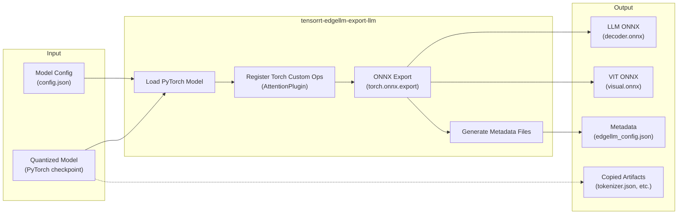
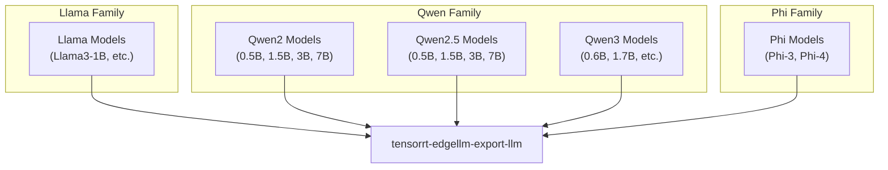
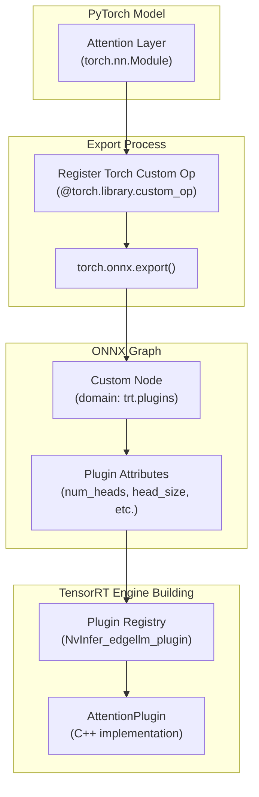

<!-- source: DeepWiki mcp.deepwiki.com · repo NVIDIA/TensorRT-Edge-LLM · extra page ONNX Export · fetched 2026-10-26 -->

# ONNX Export

<details>
<summary>Relevant source files</summary>

The following files were used as context for generating this wiki page:

- [cpp/builder/builderUtils.cpp](cpp/builder/builderUtils.cpp)
- [cpp/common/safetensorsUtils.cpp](cpp/common/safetensorsUtils.cpp)

</details>


## Purpose and Scope

This page documents the ONNX export process, the second stage in the Python Export Pipeline. It covers the `tensorrt-edgellm-export-llm` command-line tool and the underlying `llm_loader` logic, which converts quantized HuggingFace models into ONNX format suitable for TensorRT engine building. This export step transforms PyTorch models into a standardized intermediate representation that the C++ builder can consume.

For information about the quantization step that precedes ONNX export, see [Model Quantization](3.1.1). For details on building TensorRT engines from the exported ONNX files, see [Engine Building](3.2).

**Key Responsibilities:**
- Convert quantized PyTorch models to ONNX format.
- Apply model-specific graph transformations and fusion.
- Register custom operators (e.g., `AttentionPlugin`) as torch custom ops.
- Generate metadata files describing model architecture and precision.
- Support both text-only LLMs and vision-language models (VLMs).
- Handle file management and checkpoint mapping via `file_io` utilities.

**System Requirements:**
- x86-64 Linux host with NVIDIA GPU [.github/ISSUE_TEMPLATE/2_bug_report_export.md:31-33]()
- Python environment with PyTorch, Transformers, ModelOpt, and ONNX libraries [.github/ISSUE_TEMPLATE/2_bug_report_export.md:40-43]()
- Input: Quantized model directory (output from `tensorrt-edgellm-quantize-llm`) [.github/ISSUE_TEMPLATE/2_bug_report_export.md:22-23]()
- Output: ONNX files and configuration metadata.

---

## Export Pipeline Overview

The ONNX export process sits between model quantization and TensorRT engine building, converting PyTorch computational graphs into a format optimized for TensorRT consumption.

### Data Flow Diagram
"ONNX Export Data Flow"


**Sources:** [.github/ISSUE_TEMPLATE/2_bug_report_export.md:19-24](), [cpp/common/fileUtils.cpp:29-62]()

---

## Command-Line Interface

The `tensorrt-edgellm-export-llm` command exports quantized models to ONNX format. This tool is installed as a console script when installing the TensorRT-Edge-LLM Python package.

### Basic Usage

```bash
tensorrt-edgellm-export-llm \
    --model_dir ./quantized/qwen3-0.6b \
    --output_dir ./onnx_models/qwen3-0.6b
```

### Common Arguments

| Argument | Type | Description | Required |
|----------|------|-------------|----------|
| `--model_dir` | Path | Directory containing quantized model checkpoint | Yes |
| `--output_dir` | Path | Destination directory for ONNX files | Yes |
| `--max_seq_len` | Integer | Maximum sequence length for model export | No |
| `--batch_size` | Integer | Batch size for ONNX export (static shape) | No |

**Sources:** [.github/ISSUE_TEMPLATE/2_bug_report_export.md:23]()

---

## Supported Model Architectures

The export tool supports a diverse set of model architectures, spanning text-only LLMs and vision-language multimodal models.

### Text-Only LLMs
"Supported LLM Architectures"


### Vision-Language Models (VLMs)

The export process handles multimodal architectures by generating separate ONNX graphs for vision and language components. Supported families include Qwen2-VL, Qwen3-VL, Phi-4-Multimodal, and InternVL3.

**Sources:** [.github/ISSUE_TEMPLATE/2_bug_report_export.md:22-23]()

---

## Torch Custom Operators for TensorRT Plugins

A key architectural feature of the export pipeline is the use of torch custom operators to bridge PyTorch models and TensorRT custom layers.

### AttentionPlugin Custom Operator

The export process registers the `AttentionPlugin` as a torch custom operator, allowing it to be embedded directly in the ONNX graph during `torch.onnx.export()`.

### Code to Graph Mapping
"Torch Custom Op to ONNX Node Mapping"


---

## Technical Implementation Details

### Precision and Data Types
The export pipeline supports various data types for model weights and activations. These are mapped between safetensors strings and TensorRT `nvinfer1::DataType` during the export and loading process.

| Safetensors String | TensorRT DataType | File Mapping |
|--------------------|-------------------|--------------|
| `F32` | `kFLOAT` | [cpp/common/safetensorsUtils.cpp:48]() |
| `F16` | `kHALF` | [cpp/common/safetensorsUtils.cpp:49]() |
| `BF16` | `kBF16` | [cpp/common/safetensorsUtils.cpp:50]() |
| `F8_E4M3` | `kFP8` | [cpp/common/safetensorsUtils.cpp:56]() |
| `I32` | `kINT32` | [cpp/common/safetensorsUtils.cpp:54]() |

### Optimization Profile Configuration
During the export and subsequent build, optimization profiles are validated to ensure that `min <= opt <= max` for all dimensions. This is enforced by `checkOptimizationProfileDims` [cpp/builder/builderUtils.cpp:112-131]().

### Compile Workarounds
The builder utility `applyCompileWorkarounds` [cpp/builder/builderUtils.cpp:52-86]() applies specific environment flags (via `__LUNOWUD`) to the TensorRT compiler to avoid miscompilations in specific versions (e.g., TRT 10.13/10.14 dual-GEMM fusion) [cpp/builder/builderUtils.cpp:60-62]().

---

## File Handling and Artifact Management

During export, specific artifacts (tokenizer files, config files) must be moved from the source directory to the export directory. This is handled by the `trt_edgellm::file_io` namespace.

### File Copy Implementation
The utility function `copyFile` [cpp/common/fileUtils.cpp:29-62]() ensures that artifacts are correctly placed for the subsequent C++ builder. It includes checks for path equivalence [cpp/common/fileUtils.cpp:40-43]() and uses `std::filesystem::copy_options::overwrite_existing` [cpp/common/fileUtils.cpp:46-47]() to handle updates.

**Sources:** [cpp/common/fileUtils.cpp:29-62](), [cpp/common/fileUtils.h:22-38](), [cpp/common/safetensorsUtils.cpp:44-59]()

---

## Troubleshooting Export Issues

Common issues during ONNX export and their resolutions:

| Issue | Symptom | Resolution |
|-------|---------|------------|
| Unsupported model architecture | Export fails with "model type not supported" | Verify model is in supported list |
| Missing quantization metadata | Export fails to detect quantization type | Ensure input directory contains output from `tensorrt-edgellm-quantize-llm` |
| ONNX version mismatch | Export succeeds but builder fails | Verify ONNX library version matches requirements |
| Out-of-memory during export | Process killed during large model export | Export on host with sufficient GPU memory |
| File IO Errors | "Error copying... - filesystem error" | Check disk space and permissions using `copyFile` logs [cpp/common/fileUtils.cpp:52-56]() |

### Debugging with Bug Report Template

When filing export-related issues, use the **Python Export Pipeline bug report template** [.github/ISSUE_TEMPLATE/2_bug_report_export.md:1-139](), which captures critical system information including:
- OS and CPU architecture [.github/ISSUE_TEMPLATE/2_bug_report_export.md:31-32]()
- GPU name and memory size [.github/ISSUE_TEMPLATE/2_bug_report_export.md:33-34]()
- Library versions (PyTorch, Transformers, ModelOpt, ONNX) [.github/ISSUE_TEMPLATE/2_bug_report_export.md:40-43]()
- Exact export command used [.github/ISSUE_TEMPLATE/2_bug_report_export.md:19-24]()

**Sources:** [.github/ISSUE_TEMPLATE/2_bug_report_export.md:1-139](), [cpp/common/fileUtils.cpp:18-65](), [cpp/builder/builderUtils.cpp:52-86]()

---

