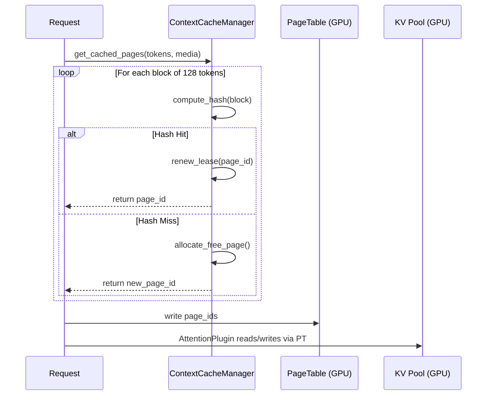

<!-- source: DeepWiki mcp.deepwiki.com · repo NVIDIA/TensorRT-Edge-LLM · extra page Paged KV-Cache Reuse · fetched 2026-10-26 -->

# Paged KV-Cache Reuse

<details>
<summary>Relevant source files</summary>

The following files were used as context for generating this wiki page:

- [cpp/common/hashUtils.h](cpp/common/hashUtils.h)
- [cpp/common/pagedKvTypes.h](cpp/common/pagedKvTypes.h)

</details>


The `ContextCacheManager` is a sophisticated memory management system designed to optimize multi-turn Large Language Model (LLM) and Vision-Language Model (VLM) inference by reusing Key-Value (KV) cache data across requests. Introduced in version 0.10.0, this system utilizes a hashing mechanism to identify redundant prefix sequences and media content, significantly reducing computation during the context phase of subsequent requests.

## System Overview

In standard autoregressive decoding, the KV-cache stores the hidden states of all previously processed tokens. For multi-turn conversations or scenarios with static system prompts, recomputing these states is inefficient. The `ContextCacheManager` addresses this by partitioning the KV-cache into discrete pages and caching these pages based on the hash of the tokens (or media data) they represent.

### Key Components

*   **Block Hashing**: A mechanism to generate unique identifiers for sequences of tokens or media features.
*   **Eviction Planning**: A Least Recently Used (LRU) based strategy to manage the finite pool of KV pages.
*   **Cache Leases**: A locking mechanism to prevent pages currently in use by an active request from being evicted.
*   **Paged KV Layout**: A memory architecture where the KV-cache is not a contiguous buffer per sequence but a collection of indices into a global pool of pages.

Sources: [cpp/common/pagedKvTypes.h:26-61](), [cpp/common/hashUtils.h:26-78]()

## Implementation Details

### Paged KV Types and Constraints
The system operates on a fixed page size, defined by `kTOKENS_PER_PAGE` (set to 128) [cpp/common/pagedKvTypes.h:27](). The total capacity of the KV pool is constrained to ensure that indices fit within `int32_t` limits when considering both K and V components [cpp/common/pagedKvTypes.h:34-37]().

The runtime calculates the required page table dimensions using `computeMaxPagesPerSeq` [cpp/common/pagedKvTypes.h:48-49]() and determines the minimum pool size required for a specific batch configuration via `computeMinimumKvPoolPages` [cpp/common/pagedKvTypes.h:56-61]().

### Hashing Mechanism
The `ContextCacheManager` uses a composite hashing strategy to identify reusable blocks. It leverages a boost-style `hashCombine` algorithm to merge the hash of a new value into an existing seed [cpp/common/hashUtils.h:41-45]().

For complex keys, such as those involving multiple token IDs or media metadata, a `std::tuple` is hashed by successively applying `hashCombine` to each element [cpp/common/hashUtils.h:57-65](). This allows the system to differentiate between identical token sequences that might have different metadata (e.g., different visual embeddings in a VLM).

### Logical to Physical Mapping

The following diagram illustrates how the `ContextCacheManager` bridges the gap between the logical sequence of tokens and the physical pages in the GPU memory pool.

**Diagram: ContextCacheManager Entity Mapping**
```mermaid
graph TD
    subgraph "Logical Space (Request)"
        A["Request Tokens/Media"] -- "hashing" --> B["Block Hashes"]
        B -- "lookup" --> C["ContextCacheManager"]
    组织
    subgraph "Code Entity Space (ContextCacheManager)"
        C --> D["HashMap<HashKey, PageIndex>"]
        D -- "references" --> E["PageManager"]
        E -- "tracks" --> F["LRU Eviction Queue"]
        E -- "manages" --> G["Active Leases"]
    end

    subgraph "Physical Space (GPU Memory)"
        G -- "index into" --> H["KV Pool (Tensors)"]
        H -- "contains" --> I["Page 0...N"]
    end
```
Sources: [cpp/common/hashUtils.h:75-76](), [cpp/common/pagedKvTypes.h:27-31]()

## Execution Flow

When a request arrives with `--enableContextReuse` active, the `EngineExecutor` interacts with the `ContextCacheManager` to determine which parts of the input can be skipped.

1.  **Prefix Matching**: The system hashes the input sequence in chunks of `kTOKENS_PER_PAGE`.
2.  **Cache Lookup**: It queries the `HashMap` to see if a physical page already exists for the hash of the current prefix.
3.  **Lease Acquisition**: If a match is found, the page's "lease" is renewed, moving it to the back of the LRU eviction queue.
4.  **Page Table Population**: The physical page indices are written into the request's page table, which is then passed to the `AttentionPlugin`.
5.  **Partial Context Computation**: Only the tokens that were *not* found in the cache (the suffix) are processed by the transformer layers. The resulting KV values are written into new pages allocated by the `ContextCacheManager`.

**Diagram: Context Reuse Data Flow**

Sources: [cpp/common/pagedKvTypes.h:27-31](), [cpp/common/hashUtils.h:41-45]()

## Media-Aware KV Reuse

For Vision-Language Models (VLMs), the `ContextCacheManager` supports media-aware reuse. Visual features are often static across multiple turns of a conversation about an image or video.

*   **Visual Hashing**: Instead of hashing raw pixel data, the system hashes the visual embeddings or a unique identifier associated with the media asset.
*   **Multimodal Alignment**: The cache ensures that the KV states for visual tokens are correctly aligned with the text tokens in the paged structure.

## Configuration and Flags

*   **`--enableContextReuse`**: A runtime flag introduced in 0.10.0 that enables the `ContextCacheManager`. Without this flag, the system defaults to standard paged KV-cache without cross-request persistence.
*   **`kMAX_KV_POOL_PAGES`**: Defines the upper bound of the global pool to prevent overflow of 32-bit signed integers when indexing [cpp/common/pagedKvTypes.h:34]().
*   **`kUNUSED_PAGE_ENTRY`**: A sentinel value (`-1`) used in the page table to indicate that a slot has no assigned physical page [cpp/common/pagedKvTypes.h:30]().

Sources: [cpp/common/pagedKvTypes.h:30-37]()

---

