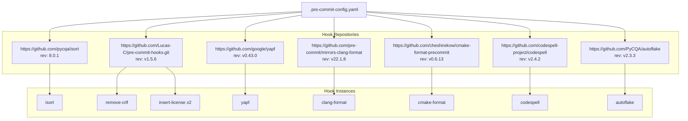
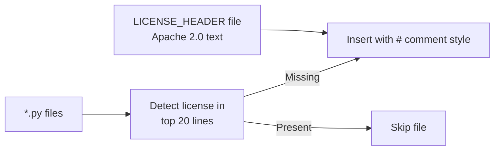
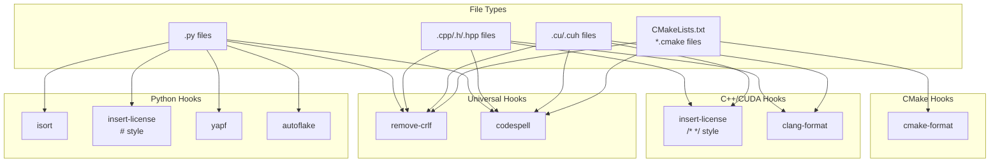

<!-- source: DeepWiki mcp.deepwiki.com · repo NVIDIA/TensorRT-Edge-LLM · extra page Pre-commit Hooks · fetched 2026-10-26 -->

# Pre-commit Hooks

<details>
<summary>Relevant source files</summary>

The following files were used as context for generating this wiki page:

- [.clang-format](.clang-format)
- [.pre-commit-config.yaml](.pre-commit-config.yaml)
- [LICENSE_HEADER](LICENSE_HEADER)

</details>


## Purpose and Scope

This document provides comprehensive documentation of the pre-commit hook system used in TensorRT-Edge-LLM to enforce code quality standards before commits reach the repository. Pre-commit hooks automatically format code, verify license headers, check spelling, and remove unused imports across Python, C++, CUDA, and CMake files.

The system is configured via `.pre-commit-config.yaml` and leverages standard tools like `clang-format` for C++ and `yapf` for Python to maintain a consistent style across the codebase.

---

## Pre-commit System Architecture

The pre-commit framework executes a series of automated checks when developers run `git commit`. Each hook operates on specific file types and performs targeted quality checks, failing the commit if issues are detected and automatically fixing many problems.

### Hook Execution Flow

```mermaid
graph LR
    DEV["Developer runs<br/>git commit"]
    PRECOMMIT["pre-commit framework<br/>reads .pre-commit-config.yaml"]
    
    subgraph "Hook Execution Sequence"
        ISORT["isort<br/>Python import sorting"]
        CRLF["remove-crlf<br/>Line ending normalization"]
        LICENSE_PY["insert-license<br/>Python files"]
        LICENSE_CPP["insert-license<br/>C++/CUDA files"]
        YAPF["yapf<br/>Python formatting"]
        CLANG["clang-format<br/>C++/CUDA formatting"]
        CMAKE["cmake-format<br/>CMake formatting"]
        SPELL["codespell<br/>Spell checking"]
        AUTOFLAKE["autoflake<br/>Remove unused imports"]
    end
    
    PASS["Commit succeeds"]
    FAIL["Commit blocked<br/>Fix issues and retry"]
    
    DEV --> PRECOMMIT
    PRECOMMIT --> ISORT
    ISORT --> CRLF
    CRLF --> LICENSE_PY
    LICENSE_PY --> LICENSE_CPP
    LICENSE_CPP --> YAPF
    YAPF --> CLANG
    CLANG --> CMAKE
    CMAKE --> SPELL
    SPELL --> AUTOFLAKE
    
    AUTOFLAKE -->|All pass| PASS
    AUTOFLAKE -->|Any fail| FAIL
```



**Sources**: [.pre-commit-config.yaml:9-72]()

---

## Configuration File Structure

The pre-commit hooks are defined in `.pre-commit-config.yaml` at the repository root. The configuration uses a repository-based architecture where each hook sources from an upstream Git repository at a pinned revision.

### Global Exclusions

The configuration excludes specific directories and files from all hook processing to prevent modification of third-party or generated code:

| Pattern | Description |
|---------|-------------|
| `3rdParty/.*` | Third-party libraries managed externally [.pre-commit-config.yaml:4]() |
| `cpp/common/json/jsmn.h` | External JSON parser header [.pre-commit-config.yaml:5]() |
| `kernelSrcs/.*` | CuTe DSL and generated kernel source files [.pre-commit-config.yaml:6]() |

**Sources**: [.pre-commit-config.yaml:1-7]()

### Hook Repository Structure



**Sources**: [.pre-commit-config.yaml:9-72]()

---

## Hook Descriptions

### isort: Python Import Sorting

The `isort` hook automatically organizes Python import statements according to PEP 8 conventions, grouping standard library, third-party, and local imports.

**Configuration**:
- Repository: `https://github.com/pycqa/isort` [.pre-commit-config.yaml:10]()
- Revision: `8.0.1` [.pre-commit-config.yaml:11]()

**Sources**: [.pre-commit-config.yaml:10-13]()

---

### remove-crlf: Line Ending Normalization

Ensures consistent Unix-style line endings (LF) across the codebase by removing Windows-style carriage returns (CRLF).

**Configuration**:
- Repository: `https://github.com/Lucas-C/pre-commit-hooks.git` [.pre-commit-config.yaml:14]()
- Revision: `v1.5.6` [.pre-commit-config.yaml:15]()

**Sources**: [.pre-commit-config.yaml:14-17]()

---

### insert-license: License Header Enforcement

The `insert-license` hook is configured twice to handle different file types with appropriate comment styles. It reads the license text from `LICENSE_HEADER` and inserts it at the top of source files if not already present.

#### Python License Insertion



**Configuration**:
- File pattern: `\.py$` [.pre-commit-config.yaml:19]()
- Comment style: `#` [.pre-commit-config.yaml:24]()
- License file: `LICENSE_HEADER` [.pre-commit-config.yaml:22]()
- Detection: Top 20 lines [.pre-commit-config.yaml:25]()
- Arguments: `--allow-past-years` [.pre-commit-config.yaml:26]()

**Sources**: [.pre-commit-config.yaml:18-26](), [LICENSE_HEADER:1-14]()

#### C++/CUDA License Insertion

**Configuration**:
- File patterns: `\.(cpp|cu|cuh|h|hpp)$` [.pre-commit-config.yaml:28]()
- Exclusions: [.pre-commit-config.yaml:29-34]()
  - `.*cubin.cpp$` (generated CUDA binary files)
  - `.*_cubin.h` (generated CUDA headers)
  - `3rdParty/.*` (third-party code)
- Comment style: `/*| *| */` (C-style block comments) [.pre-commit-config.yaml:39]()
- License file: `LICENSE_HEADER` [.pre-commit-config.yaml:37]()

**Sources**: [.pre-commit-config.yaml:27-41]()

#### License Header Content

The `LICENSE_HEADER` file contains the SPDX-compliant Apache 2.0 license header:

```text
SPDX-FileCopyrightText: Copyright (c) 2025-2026 NVIDIA CORPORATION & AFFILIATES. All rights reserved.
SPDX-License-Identifier: Apache-2.0
```

**Sources**: [LICENSE_HEADER:1-14]()

---

### yapf: Python Code Formatting

The `yapf` (Yet Another Python Formatter) hook automatically formats Python code to match the project's style guidelines.

**Configuration**:
- Repository: `https://github.com/google/yapf` [.pre-commit-config.yaml:42]()
- Revision: `v0.43.0` [.pre-commit-config.yaml:43]()

**Sources**: [.pre-commit-config.yaml:42-45]()

---

### clang-format: C++/CUDA Formatting

The `clang-format` hook enforces consistent formatting for C++, C, and CUDA source files based on the project's `.clang-format` specification.

**Configuration**:
- Repository: `https://github.com/pre-commit/mirrors-clang-format` [.pre-commit-config.yaml:46]()
- Revision: `v22.1.8` [.pre-commit-config.yaml:47]()
- Target types: `c++`, `c`, `cuda` [.pre-commit-config.yaml:50]()
- Exclusions: `.*cubin.cpp$`, `.*_cubin.h`, `3rdParty/.*` [.pre-commit-config.yaml:51-56]()

#### Formatting Specification (`.clang-format`)
The repository uses a custom configuration that mandates:
- **Column Limit**: 120 characters [.clang-format:48]()
- **Indentation**: 4 spaces, no tabs [.clang-format:67, 101]()
- **Brace Wrapping**: Custom style (Allman-like) where braces follow case labels, classes, namespaces, and functions [.clang-format:25-32]()
- **Pointer Alignment**: Left-aligned (`T* var`) [.clang-format:84]()
- **Qualifier Alignment**: Right-aligned (East-const) [.clang-format:105]()
- **Standard**: C++17 [.clang-format:98]()

**Sources**: [.pre-commit-config.yaml:46-56](), [.clang-format:1-107]()

---

### codespell: Spell Checking

The `codespell` hook detects common spelling mistakes in source code and comments. It uses a custom ignore list for technical terms and domain-specific jargon.

**Configuration**:
- Repository: `https://github.com/codespell-project/codespell` [.pre-commit-config.yaml:61]()
- Revision: `v2.4.2` [.pre-commit-config.yaml:62]()
- Ignored words: `rouge,inout,atleast,strat,nd,subtile,thrid,ans,datas,thw,mot` [.pre-commit-config.yaml:66]()
- Exclusions: `.*\.json$` [.pre-commit-config.yaml:67]()

**Sources**: [.pre-commit-config.yaml:61-67]()

---

### autoflake: Unused Import Removal

The `autoflake` hook automatically removes unused imports and unused variables from Python files.

**Configuration**:
- Repository: `https://github.com/PyCQA/autoflake` [.pre-commit-config.yaml:68]()
- Revision: `v2.3.3` [.pre-commit-config.yaml:69]()
- Arguments: `--remove-all-unused-imports`, `--remove-unused-variables`, `--in-place`, `--recursive` [.pre-commit-config.yaml:72]()

**Sources**: [.pre-commit-config.yaml:68-72]()

---

## File Type to Hook Mapping

The following diagram illustrates how different source file types are routed through the pre-commit pipeline.



**Sources**: [.pre-commit-config.yaml:9-72]()

---

## Installation and Usage

### Installing Pre-commit Hooks

Pre-commit hooks must be installed once in the local repository environment:

```bash
pip install pre-commit
pre-commit install
```

### Manual Execution

Run all hooks on all files without committing:

```bash
pre-commit run --all-files
```

Run a specific hook (e.g., `clang-format`):

```bash
pre-commit run clang-format --all-files
```

### Bypassing Hooks

In rare cases where hook bypass is necessary (not recommended for contributions):

```bash
git commit --no-verify
```

**Sources**: Based on standard pre-commit framework usage patterns and [.pre-commit-config.yaml:1-72]().

---

