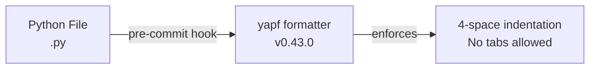
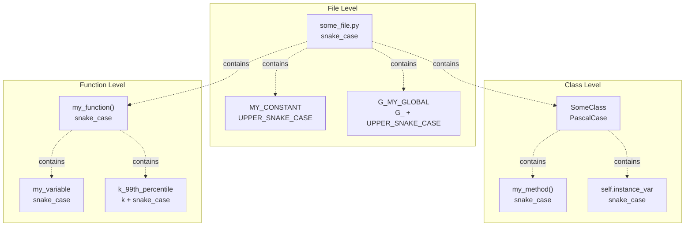
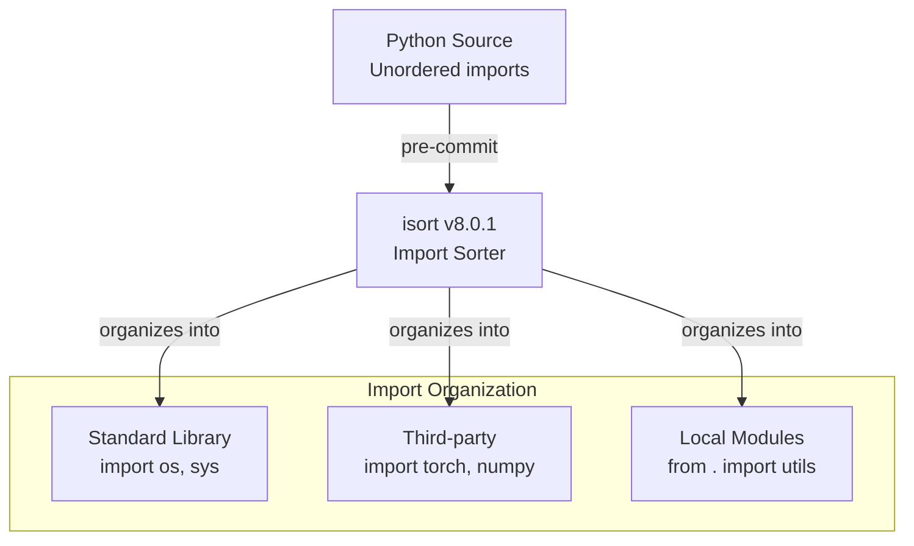
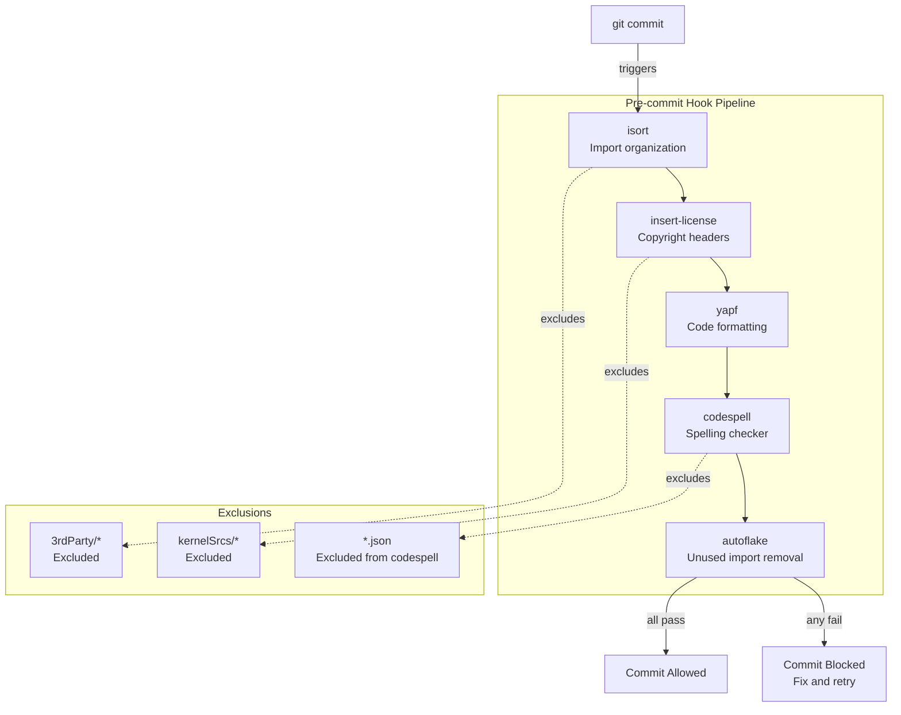

<!-- source: DeepWiki mcp.deepwiki.com · repo NVIDIA/TensorRT-Edge-LLM · extra page Python Style Guide · fetched 2026-10-26 -->

# Python Style Guide

<details>
<summary>Relevant source files</summary>

The following files were used as context for generating this wiki page:

- [.pre-commit-config.yaml](.pre-commit-config.yaml)
- [CODING_GUIDELINES.md](CODING_GUIDELINES.md)

</details>


## Purpose and Scope

This document specifies the Python coding standards for the TensorRT-Edge-LLM project. These guidelines apply to all Python code in the repository, including model export scripts, quantization tools, and utility modules. The standards are enforced through automated pre-commit hooks and manual code review.

For C++ coding standards, see [C++ Style Guide](6.2.1). For information about the overall contribution workflow and quality assurance process, see [Contributing Workflow](6.3) and [Code Quality Tools](6.4).

**Sources**: [CODING_GUIDELINES.md:2-6](), [CODING_GUIDELINES.md:340-482]()

---

## Python Version Requirement

The codebase conforms to **Python 3.8+** standards. All code must be compatible with Python 3.8 and later versions to ensure broad platform support across development and deployment environments.

**Sources**: [CODING_GUIDELINES.md:341-342]()

---

## Formatting Standards

### Indentation

All Python code uses **4 spaces** for indentation. Tabs are strictly prohibited. This is automatically enforced by the `yapf` formatter configured in the pre-commit hooks.

Title: Formatting Enforcement Pipeline


**Diagram 1**: Formatting enforcement pipeline showing how `yapf` ensures consistent indentation.

**Sources**: [CODING_GUIDELINES.md:344-345](), [.pre-commit-config.yaml:42-45]()

### Automated Formatting

The project uses `yapf` (Yet Another Python Formatter) version 0.43.0 for automatic code formatting. This tool is integrated as a pre-commit hook and runs automatically on all `.py` files before commits are finalized.

**Sources**: [.pre-commit-config.yaml:42-45]()

---

## Naming Conventions

The following table summarizes naming conventions for different Python identifiers:

| Identifier Type | Convention | Format | Example |
|----------------|-----------|---------|---------|
| Files | snake_case | Lowercase with underscores | `some_file.py` |
| Classes | PascalCase | Capitalized words, no underscores | `class SomeClass` |
| Functions/Methods | snake_case | Lowercase with underscores | `def my_awesome_function():` |
| Local Variables | snake_case | Lowercase with underscores | `my_variable = ...` |
| Numeric-prefix Variables | k prefix + snake_case | Prefix `k` for number-starting names | `k_99th_percentile = ...` |
| Global Variables | UPPER_SNAKE_CASE with G prefix | All caps with `G_` prefix | `G_MY_GLOBAL = ...` |
| Constants | UPPER_SNAKE_CASE | All caps with underscores | `MY_CONSTANT = ...` |

Title: Python Naming Convention Hierarchy


**Diagram 2**: Naming convention hierarchy showing identifier patterns used throughout Python code in the project.

### Identifier Guidelines

1. **Avoid variable shadowing**: Do not reuse variable names from outer scopes within inner scopes.
2. **Initialize class members**: All externally visible members of a class must be initialized in the `__init__` constructor.

**Sources**: [CODING_GUIDELINES.md:369-393]()

---

## Import Guidelines

### Namespace Preservation

Always maintain the namespace when importing modules. This improves code readability and makes it clear where classes and functions originate.

**Incorrect patterns:**

```python
# Anti-pattern 1: Direct import loses namespace context
from package.subpackage.foo import SomeClass
SomeClass()

# Anti-pattern 2: Over-qualified imports are verbose
import package
package.subpackage.foo.SomeClass()
```

**Correct pattern:**

```python
# Preferred: Import the module, use qualified names
from package.subpackage import foo
foo.SomeClass()
```

This pattern provides the optimal balance between namespace clarity and import brevity.

### Import Organization

The `isort` tool (version 8.0.1) automatically organizes imports according to standard conventions. It is configured as a pre-commit hook and runs on all Python files.

Title: Import Organization Workflow


**Diagram 3**: Import organization workflow showing how `isort` structures import statements.

**Sources**: [CODING_GUIDELINES.md:347-367](), [.pre-commit-config.yaml:10-13]()

---

## Comments and Docstrings

### Docstrings for External Interfaces

For interfaces that may be used outside a file (public APIs, exported functions, public classes), prefer **docstrings** over comments. Use the [Google Python Style Guide](https://google.github.io/styleguide/pyguide.html) format, which is parseable by Sphinx documentation generators.

### Comments for Internal Logic

Reserve comments for:
- Code logic within function bodies
- Internal helper functions local to a file
- Complex algorithm explanations

### Docstring Syntax

**For Classes and Functions:**

```python
class MyClass:
    """
    Description of the class.
    
    Args:
        param1: Description of param1
        param2: Description of param2
        
    Returns:
        Description of return value
    """
```

**For Attributes and Variables (inline documentation):**

```python
class MyClass:
    """
    Description of the class.
    """
    def __init__(self):
        self.x = 5
        """int: Description of 'x'"""

y = 2
"""int: Description of 'y'"""
```

Attribute docstrings are rendered under the class docstring in generated documentation.

**Sources**: [CODING_GUIDELINES.md:395-417]()

---

## Error Handling Best Practices

### Specific Exception Handling

Limit `except` blocks to the smallest, most specific set of exceptions possible. Avoid bare `except:` clauses.

**Incorrect:**

```python
try:
    open(path, "r").read()
except:  # Anti-pattern: catches everything including KeyboardInterrupt
    print("Failed to open file")
```

**Correct:**

```python
try:
    open(path, "r").read()
except FileNotFoundError:
    print("Failed to open file")
```

### Duck-Typing with Try-Except

When using try-except for duck-typing (handling multiple variable types), minimize the `try` block body and use `else` for the main logic.

**Incorrect:**

```python
try:
    f.seek(0)
    f.read()  # If this fails, we can't distinguish type vs. read error
except AttributeError:
    ... # Not a file-like object, do something else
```

**Correct:**

```python
try:
    f.seek  # Check attribute existence only, don't call
except AttributeError:
    ... # Not a file-like object, do something else
else:
    f.seek(0)
    f.read()  # Main logic in else block
```

This pattern minimizes the chance of catching unrelated exceptions within the `try` block.

**Sources**: [CODING_GUIDELINES.md:437-481]()

---

## Code Quality Guidelines

### Avoid Unnecessary Reflection

Functionality should be implemented directly when possible, rather than using reflection or metaprogramming.

**Incorrect:**

```python
def make_complex(*args):
    x, y = args
    return dict(**locals())  # Uses reflection via locals()
```

**Correct:**

```python
def make_complex(x, y):
    return {'x': x, 'y': y}  # Explicit, clear, maintainable
```

**Sources**: [CODING_GUIDELINES.md:419-435]()

---

## Automated Enforcement Tools

The project uses multiple automated tools to enforce Python coding standards. These tools are integrated as pre-commit hooks and run automatically before each commit.

Title: Pre-commit Hook Pipeline


**Diagram 4**: Pre-commit hook execution pipeline for Python files showing the sequence of automated quality checks.

### Tool Configuration Details

| Tool | Version | Purpose | Configuration |
|------|---------|---------|---------------|
| `isort` | 8.0.1 | Organizes import statements | Runs on all `.py` files [.pre-commit-config.yaml:10-13]() |
| `yapf` | v0.43.0 | Formats Python code | Runs on all `.py` files [.pre-commit-config.yaml:42-45]() |
| `autoflake` | v2.3.3 | Removes unused imports and variables | `--remove-all-unused-imports`, `--remove-unused-variables`, `--in-place`, `--recursive` [.pre-commit-config.yaml:68-72]() |
| `codespell` | v2.4.2 | Checks for common typos | Excludes `.json` files, ignores words: `rouge`, `inout`, `atleast`, `strat`, `nd`, `subtile`, `thrid`, `ans`, `datas`, `thw` [.pre-commit-config.yaml:61-67]() |
| `insert-license` | v1.5.6 | Ensures copyright headers | Uses `LICENSE_HEADER` file, `#` comment style for Python [.pre-commit-config.yaml:18-26]() |

### Excluded Files

The following files and directories are excluded from Python pre-commit checks:
- `3rdParty/*` - Third-party libraries maintain their own style [.pre-commit-config.yaml:4]()
- `kernelSrcs/*` - Kernel-specific code with different requirements [.pre-commit-config.yaml:6]()
- `cpp/common/json/jsmn.h` [.pre-commit-config.yaml:5]()
- JSON files (excluded from `codespell` only) [.pre-commit-config.yaml:67]()

**Sources**: [.pre-commit-config.yaml:1-72]()

---

## Copyright Headers

All Python source files must include the NVIDIA copyright header. The `insert-license` pre-commit hook automatically adds or verifies this header.

**Required header format:**

```python
#
# Copyright (c) 2025, NVIDIA CORPORATION. All rights reserved.
#
# Licensed under the Apache License, Version 2.0 (the "License");
# you may not use this file except in compliance with the License.
# You may obtain a copy of the License at
#
#     http://www.apache.org/licenses/LICENSE-2.0
#
# Unless required by applicable law or agreed to in writing, software
# distributed under the License is distributed on an "AS IS" BASIS,
# WITHOUT WARRANTIES OR CONDITIONS OF ANY KIND, either express or implied.
# See the License for the specific language governing permissions and
# limitations under the License.
#
```

The header is automatically inserted by the pre-commit hook if missing and detected within the top 20 lines if present.

**Sources**: [CODING_GUIDELINES.md:483-502](), [.pre-commit-config.yaml:18-26]()

---

## Integration with Development Workflow

These Python style guidelines are enforced at multiple stages:

1. **Local Development**: Pre-commit hooks run automatically on `git commit` [.pre-commit-config.yaml:9-72]()
2. **Pull Request Submission**: CI/CD checks verify compliance.
3. **Code Review**: Reviewers verify adherence to guidelines not caught by automation.

For detailed information on setting up pre-commit hooks, see [Pre-commit Hooks](6.4.1). For the complete contribution workflow, see [Contributing Workflow](6.3).

**Sources**: [CODING_GUIDELINES.md:340-482](), [.pre-commit-config.yaml:1-72]()

---

