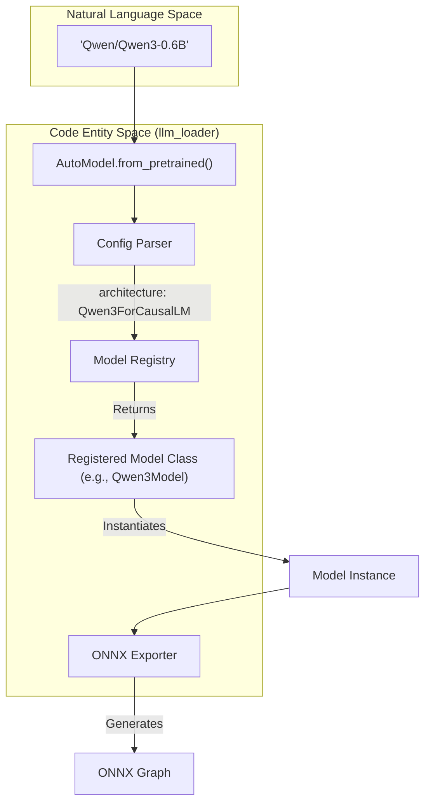
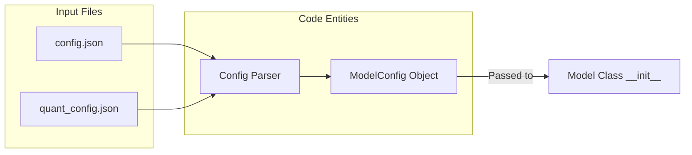
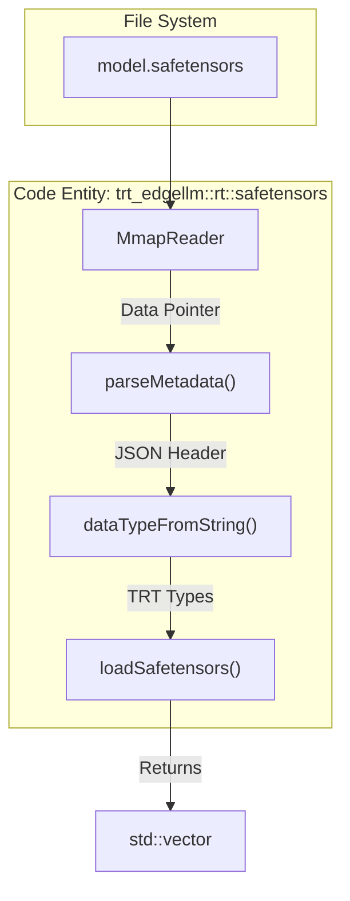

<!-- source: DeepWiki mcp.deepwiki.com · repo NVIDIA/TensorRT-Edge-LLM · extra page AutoModel and Model Registry · fetched 2026-10-26 -->

# AutoModel and Model Registry

Relevant source files

The following files were used as context for generating this wiki page:

- [cpp/common/mmapReader.cpp](cpp/common/mmapReader.cpp)
- [cpp/common/mmapReader.h](cpp/common/mmapReader.h)
- [cpp/common/safetensorsUtils.cpp](cpp/common/safetensorsUtils.cpp)
- [cpp/common/safetensorsUtils.h](cpp/common/safetensorsUtils.h)

The `llm_loader` is an experimental Python-based checkpoint processing and ONNX export frontend designed to simplify the transition from HuggingFace-style model checkpoints to TensorRT-optimized engines. At its core, the `AutoModel` class provides a unified interface for loading various model architectures by dispatching to specific model implementations registered in a central registry.

## AutoModel Dispatch Mechanism

The `AutoModel` class serves as the primary entry point for users to load models without needing to specify the exact architecture class manually. This is achieved through the `from_pretrained` method, which inspects the model's configuration and dispatches the loading process to the appropriate registered model family.

### Data Flow for Model Loading

The following diagram illustrates how `AutoModel.from_pretrained` resolves a model directory into a concrete model instance and eventually exports it to ONNX.

**Model Loading and Export Flow**

Sources: [experimental/llm_loader/README.md:1-20](), [.github/ISSUE_TEMPLATE/2_bug_report_export.md:20-24]()

## Model Registry and `register_model` API

The `llm_loader` maintains a registry that maps HuggingFace `architectures` (defined in `config.json`) to internal implementation classes. Developers can extend support for new model families using the `register_model` decorator.

### Supported Model Families

The registry supports a diverse set of model families across text, vision, and action domains, including recent additions for 0.10.0 like Cosmos3 and DSpark.

| Model Family | Registered Architecture Keys | Primary Use Case |
| :--- | :--- | :--- |
| **Qwen3** | `Qwen3ForCausalLM` | Text Generation, ASR, TTS |
| **Gemma4** | `Gemma4ForCausalLM` | Multimodal (Unified Audio/Vision) |
| **NemotronH** | `NemotronHForCausalLM` | High-performance Chat |
| **InternVL3** | `InternVL3ForCausalLM` | Multimodal Vision-Language |
| **Alpamayo** | `Alpamayo1ActionModel` | Robotics/Trajectory Prediction |
| **Cosmos3** | `Cosmos3EdgeForCausalLM` | Multimodal Reasoning/Policy |
| **DiffusionGemma**| `DiffusionGemmaBackbone` | Non-autoregressive Decoding |
| **DSpark** | `DSparkDraftModel` | Speculative Decoding Drafting |

### Implementation Detail: `register_model`
When a new model class is defined, it is decorated with `@register_model`. This adds the class to a global dictionary where the keys are the architecture strings found in model checkpoints. When `AutoModel.from_pretrained` is called, it reads the `config.json` from the provided path, extracts the `architectures` field, and lookups the corresponding class in this dictionary.

Sources: [experimental/llm_loader/README.md:10-30]()

## Checkpoint Config Parsing

Before a model is instantiated, the `llm_loader` must parse the checkpoint's configuration. This process involves mapping standard HuggingFace parameters to the internal configuration format required for ONNX export and engine building.

### Key Configuration Parameters
The parser handles several critical attributes:
*   **Hidden Size & Intermediate Size:** Defines the transformer layer dimensions.
*   **Number of Heads:** Both for Attention and Key-Value (supporting Multi-Query and Grouped-Query Attention).
*   **Activation Functions:** Maps strings like `silu` or `gelu` to internal operator types.
*   **Quantization Metadata:** If the model was quantized, the config will contain metadata for FP8, NVFP4, or INT4 scales.

**Config Parsing Logic**

Sources: [.github/ISSUE_TEMPLATE/2_bug_report_export.md:22-23](), [experimental/llm_loader/README.md:5-15]()

## Weights and Serialization Utilities

The `llm_loader` and the broader runtime rely on efficient weight loading and serialization. The C++ core provides utilities for memory-mapped file access and `safetensors` format handling.

### Memory-Mapped I/O
The `trt_edgellm::file_io::MmapReader` class provides efficient file reading by mapping contents directly into memory without copying [cpp/common/mmapReader.h:35-36](). It supports `kReadOnly` and `kCopyOnWrite` modes [cpp/common/mmapReader.h:38-44]().

### Safetensors Integration
The runtime includes a robust `safetensors` implementation for serializing and deserializing weights.
*   **Metadata Parsing:** `parseMetadata` extracts the JSON header and tensor offsets from a memory-mapped buffer [cpp/common/safetensorsUtils.h:56-56]().
*   **Type Mapping:** `dataTypeFromString` converts safetensors strings (e.g., "F8_E4M3") to `nvinfer1::DataType` [cpp/common/safetensorsUtils.cpp:80-102]().
*   **Serialization:** `saveSafetensors` handles the creation of the JSON header and the raw data payload [cpp/common/safetensorsUtils.cpp:170-185]().

**Safetensors Loading Logic**

Sources: [cpp/common/mmapReader.h:35-55](), [cpp/common/safetensorsUtils.h:35-69](), [cpp/common/safetensorsUtils.cpp:80-102]()

## Integration with Export Pipeline

The `AutoModel` interface is the foundation for the `tensorrt-edgellm-export-llm` CLI tool. This tool leverages the registered models to perform the following sequence:

1.  **Initialization:** `AutoModel.from_pretrained(model_dir)` loads the weights and configuration.
2.  **Weight Mapping:** The registered model class defines how HuggingFace tensors map to the expected names in the ONNX graph.
3.  **Graph Construction:** The model class builds the computational graph using the SDK's internal graph construction API.
4.  **Serialization:** The resulting graph is exported as an ONNX file, which can then be consumed by the `LLMBuilder` or `VisualBuilder`.

Sources: [.github/ISSUE_TEMPLATE/2_bug_report_export.md:19-24]()

---

