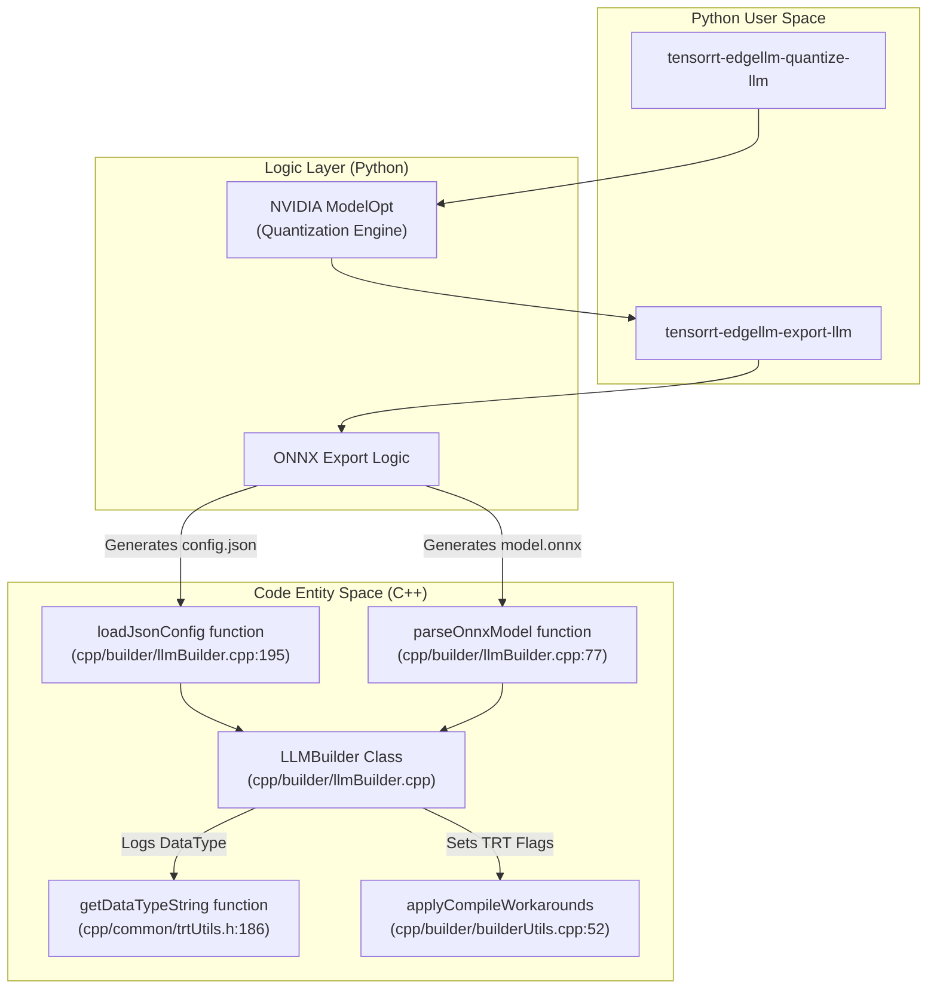
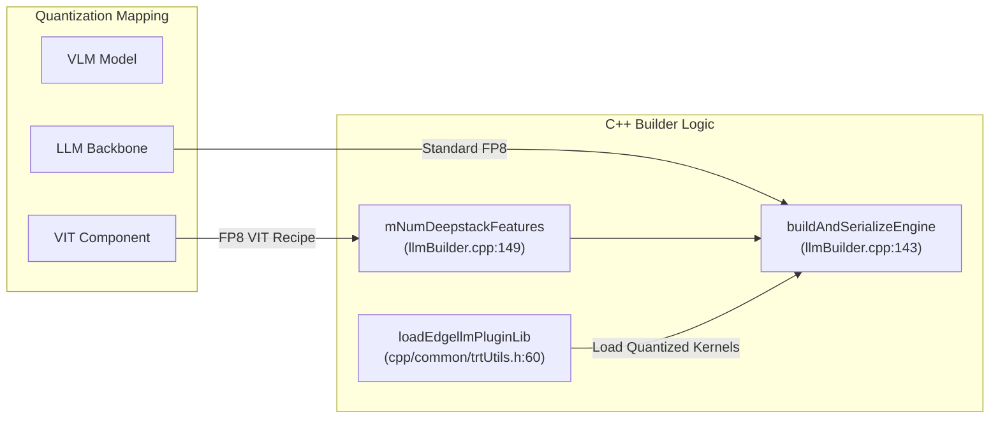

<!-- source: DeepWiki mcp.deepwiki.com · repo NVIDIA/TensorRT-Edge-LLM · extra page Quantization Options · fetched 2026-10-26 -->

# Quantization Options

<details>
<summary>Relevant source files</summary>

The following files were used as context for generating this wiki page:

- [cpp/builder/builderUtils.cpp](cpp/builder/builderUtils.cpp)
- [cpp/builder/builderUtils.h](cpp/builder/builderUtils.h)

</details>


## Purpose and Scope

This page documents the quantization precision types supported by TensorRT-Edge-LLM and their usage in the model deployment workflow. Quantization reduces model weight precision to achieve smaller memory footprints and faster inference on edge devices. This document covers FP16, FP8, NVFP4, and INT4/INT4_GPTQ/INT4_AWQ quantization methods, including new support for **Gemma 4 26B-A4B INT4 AWQ MoE** and **Qwen3-Omni 30B-A3B INT4 AWQ** introduced in version 0.10.0.

The core logic for handling these precisions during the build phase resides in the `LLMBuilder` class, which parses model configurations and sets up the TensorRT network accordingly [cpp/builder/llmBuilder.cpp:37-43](). The runtime utilities also provide helper functions to identify data types during logging and error reporting [cpp/common/trtUtils.h:186-203]().

## Overview

TensorRT-Edge-LLM implements quantization in the Python export pipeline using the `tensorrt-edgellm-quantize-llm` command-line tool [.github/ISSUE_TEMPLATE/2_bug_report_export.md:22-22](). Quantization is applied before ONNX export and engine building. The system supports multiple quantization schemes optimized for different model types (text-only LLMs vs. vision-language models) and hardware capabilities.

The quantization workflow operates as a preprocessing step that transforms full-precision model weights into lower-precision representations. These quantized weights are then embedded in the ONNX graph and subsequently compiled into optimized TensorRT engines by the `LLMBuilder` [cpp/builder/llmBuilder.cpp:133-146]().

**Sources:** [.github/ISSUE_TEMPLATE/2_bug_report_export.md:22-22](), [cpp/builder/llmBuilder.cpp:37-43](), [cpp/builder/llmBuilder.cpp:133-146](), [cpp/common/trtUtils.h:186-203]()

## Quantization Workflow in the Pipeline

### Natural Language to Code Entity Space: Export Pipeline
The following diagram maps the high-level quantization concepts to the specific Python tools and C++ builder classes used in the codebase.


**Sources:** [.github/ISSUE_TEMPLATE/2_bug_report_export.md:22-24](), [cpp/builder/llmBuilder.cpp:77-78](), [cpp/builder/llmBuilder.cpp:194-196](), [cpp/common/trtUtils.h:186-186](), [cpp/builder/builderUtils.cpp:52-52]()

## Supported Precision Types

The following table summarizes the precision types supported by TensorRT-Edge-LLM and how they are identified in the C++ runtime [cpp/common/trtUtils.h:186-206]():

| Precision Type | Bits per Weight | TensorRT DataType | Primary Use Case |
|---|---|---|---|
| **FP16** | 16 bits | `kHALF` | Baseline precision, highest accuracy |
| **BF16** | 16 bits | `kBF16` | High dynamic range, modern architectures |
| **FP8** | 8 bits | `kFP8` (E4M3) | Balanced precision/speed |
| **NVFP4** | 4 bits | `kFP4` | Aggressive compression (Thor/Blackwell) |
| **INT4 / AWQ** | 4 bits (integer) | `kINT4` | Standard integer quantization, optimized for MoE |
| **INT8** | 8 bits (integer) | `kINT8` | Legacy integer quantization |

## FP16 and BF16 (Half Precision)

FP16 serves as the baseline precision for edge deployment. BF16 is also supported for models trained in BFloat16 format. During the engine build process, `LLMBuilder` parses the model configuration to identify architecture parameters like `hidden_size` and `num_attention_heads` to set up the network [cpp/builder/llmBuilder.cpp:204-209]().

### Usage
FP16 quantization is requested via:
```bash
tensorrt-edgellm-quantize-llm --model_dir <model_path> --output_dir <output_path> --quantization fp16
```
**Sources:** [.github/ISSUE_TEMPLATE/2_bug_report_export.md:22-22](), [cpp/builder/llmBuilder.cpp:204-209](), [cpp/common/trtUtils.h:193-195]()

## FP8 (8-bit Floating Point)

FP8 quantization reduces weight precision to 8 bits (typically E4M3 format). The system uses NVIDIA ModelOpt for calibration. The `getDataTypeString` utility maps `nvinfer1::DataType::kFP8` to "FLOAT8_E4M3" [cpp/common/trtUtils.h:195-195]().

### FP8 Vision Transformer (VIT) Recipe
For multimodal models like Qwen3-VL, the `LLMBuilder` detects specialized inputs like `deepstack_embeds` [cpp/builder/llmBuilder.cpp:150-157](). The FP8 recipe for VIT ensures that the vision encoder maintains accuracy when quantized alongside the LLM backbone.


**Sources:** [cpp/builder/llmBuilder.cpp:143-143](), [cpp/builder/llmBuilder.cpp:149-161](), [cpp/common/trtUtils.h:60-61](), [cpp/common/trtUtils.h:195-195]()

## NVFP4 (NVIDIA 4-bit Floating Point)

NVFP4 is a specialized 4-bit floating-point format. The build process for NVFP4 models involves specific environment variables to handle optimization. The `applyCompileWorkarounds` function manages these flags, specifically disabling `match_dual_gemm` and `collective:fp4` for TensorRT 11.x on sm12x (Thor) to ensure stability [cpp/builder/builderUtils.cpp:64-74]().

### Usage
```bash
tensorrt-edgellm-quantize-llm --model_dir <model_path> --output_dir <output_path> --quantization nvfp4
```
**Sources:** [cpp/builder/builderUtils.cpp:63-74](), [cpp/common/trtUtils.h:204-205]()

## INT4, GPTQ, and AWQ

INT4 quantization uses 4-bit integer representation. The `LLMBuilder` handles these by parsing the ONNX model which contains quantized weights and scales [cpp/builder/llmBuilder.cpp:77-78]().

### INT4 AWQ (Activation-aware Weight Quantization)
Starting in version 0.10.0, the runtime supports advanced INT4 AWQ for large-scale Mixture-of-Experts (MoE) and multimodal models:
- **Gemma 4 26B-A4B:** Supports INT4 AWQ MoE architectures.
- **Qwen3-Omni 30B-A3B:** Supports INT4 AWQ for omni-modal inference.

The builder applies specific workarounds for INT4-FP16 kernels using the `__LUNOWUD` environment variable, which is configured in `applyCompileWorkarounds` [cpp/builder/builderUtils.cpp:52-86]().

### INT4_GPTQ
GPTQ models are detected automatically. The `LLMBuilder` loads the model configuration via `loadJsonConfig` [cpp/builder/llmBuilder.cpp:195-196](), which includes the quantization metadata required for TensorRT to select the correct kernels. The runtime identifies INT4 as `kINT4` [cpp/common/trtUtils.h:206-206]().

**Sources:** [cpp/builder/builderUtils.cpp:52-86](), [cpp/builder/llmBuilder.cpp:77-78](), [cpp/common/trtUtils.h:206-206]()

## Component-Specific Quantization Support

### Mixed Precision and Speculative Decoding
The `LLMBuilder` supports building specialized engines for speculative decoding, such as `eagle_draft.engine` or `eagle_base.engine` [cpp/builder/llmBuilder.cpp:123-133](). These engines can utilize different quantization levels to balance the speed of the draft model with the accuracy of the base model.

### Configuration Parsing
The quantization and model parameters are extracted in `LLMBuilder::parseConfig()`:
- **Hidden Size:** `mHiddenSize` [cpp/builder/llmBuilder.cpp:204-204]()
- **KV Heads:** `mNumKVHeads` [cpp/builder/llmBuilder.cpp:208-208]()
- **Rotary Dim:** `mRotaryDim` [cpp/builder/llmBuilder.cpp:220-227]()

**Sources:** [cpp/builder/llmBuilder.cpp:123-133](), [cpp/builder/llmBuilder.cpp:192-235]()

## Precision Selection Guidelines

| Consideration | FP16/BF16 | FP8 | NVFP4 | INT4 (GPTQ/AWQ) |
|---|---|---|---|---|
| **Memory Efficiency** | Baseline | 2x | 4x | 4x |
| **Accuracy** | Highest | High | Moderate | Moderate/High |
| **Hardware** | All GPUs | Thor/Hopper+ | Thor/Blackwell | All GPUs |

### Build Process for Quantized Engines
The `LLMBuilder::build()` function orchestrates the entire process of turning quantized ONNX models into executable engines:
1. **Apply Workarounds:** `applyCompileWorkarounds()` is called to set `__LUNOWUD` flags [cpp/builder/builderUtils.cpp:52-86]().
2. **Load Plugins:** `loadEdgellmPluginLib()` [cpp/builder/llmBuilder.cpp:48-48](). This loads the custom kernels required for quantized inference [cpp/common/trtUtils.h:60-91]().
3. **Parse Config:** `parseConfig()` [cpp/builder/llmBuilder.cpp:51-51]()
4. **Setup Network:** `createBuilderAndNetwork()` [cpp/builder/llmBuilder.cpp:57-57]()
5. **Serialize:** `buildAndSerializeEngine()` [cpp/builder/llmBuilder.cpp:143-143]()

**Sources:** [cpp/builder/builderUtils.cpp:52-86](), [cpp/builder/llmBuilder.cpp:45-189](), [cpp/common/trtUtils.h:60-91]()

---

