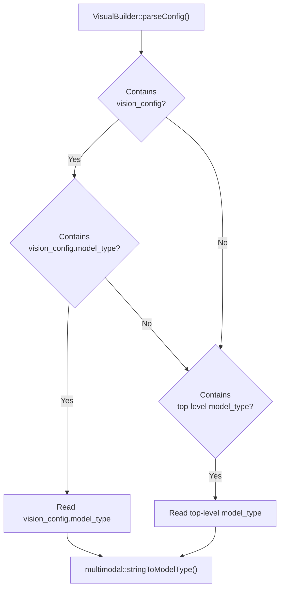
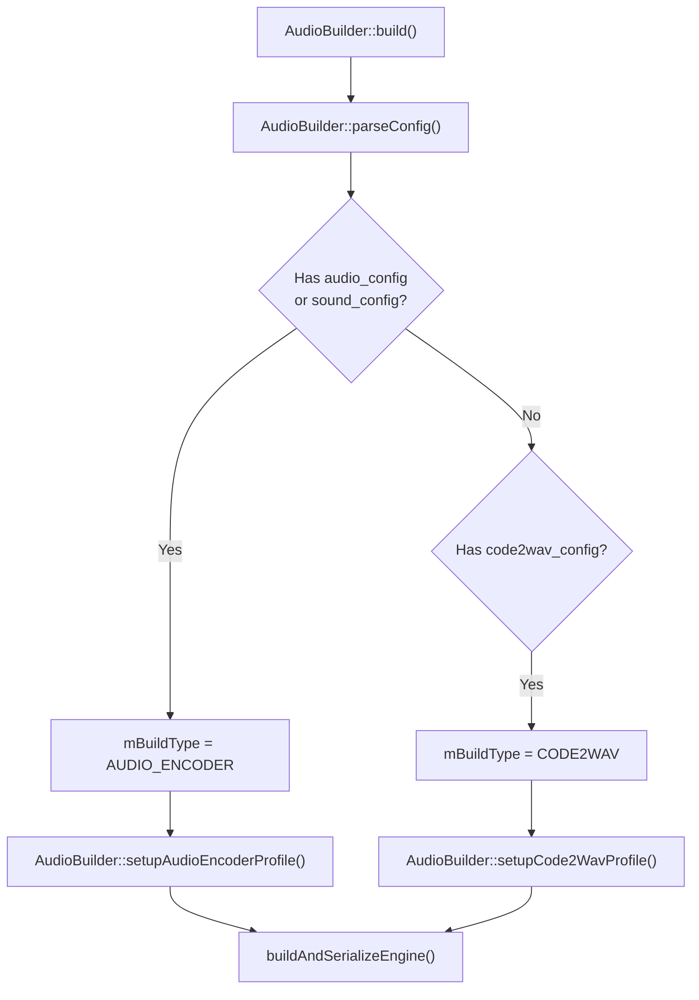
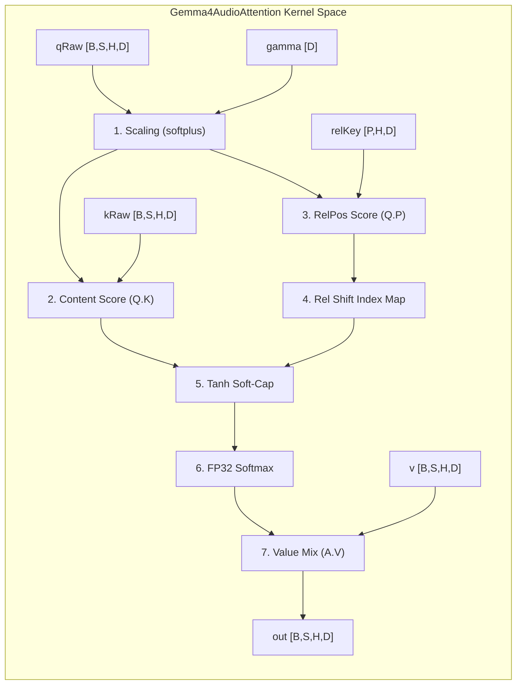
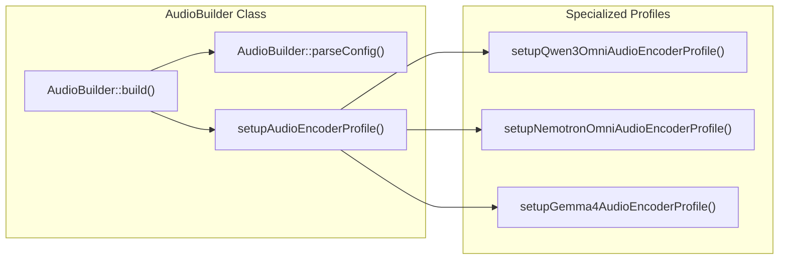

<!-- source: DeepWiki mcp.deepwiki.com · repo NVIDIA/TensorRT-Edge-LLM · extra page Supported Multimodal Models · fetched 2026-10-26 -->

# Supported Multimodal Models

Relevant source files

The following files were used as context for generating this wiki page:

- [cpp/kernels/audioAttentionKernels/README.md](cpp/kernels/audioAttentionKernels/README.md)
- [cpp/kernels/audioAttentionKernels/gemma4AudioAttention.cu](cpp/kernels/audioAttentionKernels/gemma4AudioAttention.cu)
- [cpp/kernels/audioAttentionKernels/gemma4AudioAttention.h](cpp/kernels/audioAttentionKernels/gemma4AudioAttention.h)

## Purpose and Scope

This page documents the multimodal models currently supported by TensorRT-Edge-LLM, including Vision-Language Models (VLMs), Audio-Language Models, and Audio-to-Audio models. These models enable the processing of visual or auditory data in conjunction with text, or direct audio-to-audio translation and synthesis.

The documentation covers architectural details, configuration requirements, and engine building specifics for each supported model family, including Qwen-VL, Qwen2.5-VL, Phi-4-Multimodal, InternVL, Nemotron-Omni, Gemma4 unified multimodal, Cosmos3-Omni, and Qwen3 audio variants.

## Overview

TensorRT-Edge-LLM provides a modular framework for building multimodal engines. The system uses specialized builder classes to handle different modalities:
- `VisualBuilder`: Creates optimized TensorRT engines for vision transformers (ViT) and encoders.
- `AudioBuilder`: Creates optimized engines for audio encoders and speech synthesis (Code2Wav) components.
- `LLMBuilder`: Handles the standard language model component, which fuses modality embeddings with text tokens.

**Sources:** [cpp/builder/audioBuilder.cpp:89-204](), [cpp/builder/audioBuilder.h:80-103]()

## Supported Model Families

The following table summarizes the supported multimodal models and their key characteristics:

| Modality | Model Family | Variants | Input Format | Special Requirements |
| :--- | :--- | :--- | :--- | :--- |
| **Vision** | **Qwen-VL** | Qwen2-VL, Qwen2.5-VL, Qwen3-VL | Dynamic HW patches | 2D RoPE, window attention |
| **Vision** | **InternVL** | InternVL3, InternVL3.5 | Fixed 256-token blocks | Multiples of 256 tokens |
| **Vision** | **Phi-4-MM** | Phi-4-Multimodal | Fixed crop (448×448) | GN projection weights |
| **Vision** | **Nemotron** | Nemotron-Omni | Fixed image size | RADIO encoder |
| **Vision** | **Gemma4** | Gemma4 Unified | Framed-PCM/Images | Unified vision-audio builder |
| **Vision** | **Cosmos3** | Cosmos3-Omni | High-res patches | High-resolution ViT runner |
| **Audio** | **Qwen3-ASR** | Qwen3-Omni-ASR | Mel-spectrogram | Audio encoder engine |
| **Audio** | **Qwen3-TTS** | Qwen3-Omni-Code2Wav | Audio codes | Code2Wav engine |
| **Audio** | **Qwen3-Omni** | Qwen3-Omni | Full duplex audio | Audio encoder + Code2Wav |
| **Audio** | **Gemma4-Audio**| Gemma4 Unified | Framed-PCM | `Gemma4AudioAttentionPlugin` |
| **Audio** | **Nemotron-ASR**| Nemotron-3.5-ASR | Mel-spectrogram | RNN-T transcription runtime |

**Sources:** [cpp/builder/audioBuilder.h:126-131](), [cpp/builder/audioBuilder.cpp:128-147](), [cpp/kernels/audioAttentionKernels/README.md:1-9]()

## Vision-Language Models (VLMs)

### Model Type Detection

The `VisualBuilder` determines the model type from `config.json`. It looks for `vision_config.model_type` or a top-level `model_type` key to dispatch to the correct optimization profile.

## Audio Models

The `AudioBuilder` supports three primary audio tasks: encoding for speech recognition (ASR), synthesis (Code2Wav), and unified multimodal processing for Gemma4.

### Audio Build Types

The builder determines the `AudioBuildType` based on the configuration keys present in the model's `config.json`:
- **AUDIO_ENCODER**: Triggered by `audio_config` or `sound_config`. Used for Qwen3-Omni-ASR and Nemotron-Omni.
- **CODE2WAV**: Triggered by `code2wav_config`. Used for Qwen3-Omni-TTS.

**Sources:** [cpp/builder/audioBuilder.h:66-71](), [cpp/builder/audioBuilder.cpp:128-147]()

### Audio Pipeline Architecture

The diagram below shows how `AudioBuilder` interacts with the configuration to produce specialized engines.

**Sources:** [cpp/builder/audioBuilder.cpp:97-213](), [cpp/builder/audioBuilder.cpp:160-178]()

### Gemma4 Audio Attention

Gemma4 unified models utilize a specialized attention mechanism for audio processing. This is implemented via a fused CUDA kernel `trt_edgellm::kernel::gemma4AudioAttentionForward` that handles scaling, content scoring, relative-position scoring (Transformer-XL style), soft-capping, and masking.

**Key Kernel Operations:**
1. **Scaling**: Per-dim learned query scale (`softplus(gamma)`) and fixed key scale (`ln(1+e) / ln2`). [cpp/kernels/audioAttentionKernels/gemma4AudioAttention.cu:26-28]()
2. **Relative-position score**: `Q.Pᵀ` then Transformer-XL blocked shift (`rel_shift`). [cpp/kernels/audioAttentionKernels/gemma4AudioAttention.cu:33-37]()
3. **Soft-cap**: `S = cap * tanh( (AC + BD) / cap )` with a default cap of 50. [cpp/kernels/audioAttentionKernels/gemma4AudioAttention.cu:39]()
4. **Local-causal Masking**: Enforced within the fused kernel using a 24-slot K/V context gather. [cpp/kernels/audioAttentionKernels/gemma4AudioAttention.cu:41-43]()

The kernel is specialized for the Gemma 4 audio configuration: `chunkSize=12`, `leftHorizon=12`, `contextSize=24`, `relPosLen=13`, and `headDim=128`. It supports **fp16**, **bf16**, and **fp32** data types.

**Sources:** [cpp/kernels/audioAttentionKernels/README.md:5-21](), [cpp/kernels/audioAttentionKernels/gemma4AudioAttention.cu:21-59](), [cpp/kernels/audioAttentionKernels/gemma4AudioAttention.h:36-42]()

### Audio Implementation Detail: Gemma4 Attention Data Flow

**Sources:** [cpp/kernels/audioAttentionKernels/gemma4AudioAttention.cu:21-49](), [cpp/kernels/audioAttentionKernels/gemma4AudioAttention.h:60-71]()

### Configuration Parameters

| Parameter | Component | Purpose |
| :--- | :--- | :--- |
| `min_time_steps` | Audio Encoder | Minimum mel-spectrogram time steps (default: 100) |
| `max_time_steps` | Audio Encoder | Maximum mel-spectrogram time steps (default: 6000) |
| `use_trt_native_audio_attn` | Audio Encoder | Whether to use TRT IAttention instead of custom plugins |
| `min_code_len` | Code2Wav | Minimum audio code sequence length (default: 1) |
| `max_code_len` | Code2Wav | Maximum audio code sequence length (default: 2000) |
| `chunkSize` | Gemma4 Audio | Query block size (default: 12) |
| `leftHorizon` | Gemma4 Audio | Effective left context (default: 12) |

**Sources:** [cpp/builder/audioBuilder.h:42-49](), [cpp/builder/audioBuilder.cpp:33-44](), [cpp/kernels/audioAttentionKernels/gemma4AudioAttention.h:38-41]()

## Audio Engine Building Flow

The `AudioBuilder::build()` method orchestrates the creation of the audio engine, including specialized profile setup for different architectures like Nemotron-Omni (Parakeet) and Qwen3-Omni.

**Sources:** [cpp/builder/audioBuilder.cpp:139-158](), [cpp/builder/audioBuilder.h:142-157]()

## Multimodal Input Binding Names

Consistent naming is used across the C++ core and builders to identify multimodal tensors:

| Name | Code Entity |
| :--- | :--- |
| `audio_input` | `binding_names::kAudioInput` |
| `audio_embeds` | `binding_names::kAudioEmbeds` |
| `code_input` | `binding_names::kCodeInput` |
| `mel_bins` | `binding_names::kMelBins` |
| `input_features` | `binding_names::kInputFeatures` |

**Sources:** [cpp/builder/audioBuilder.cpp:20](), [cpp/builder/audioBuilder.h:37]()

---

