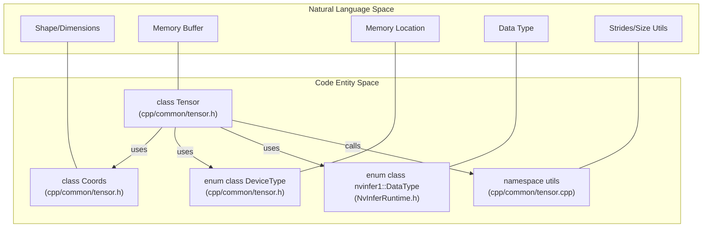
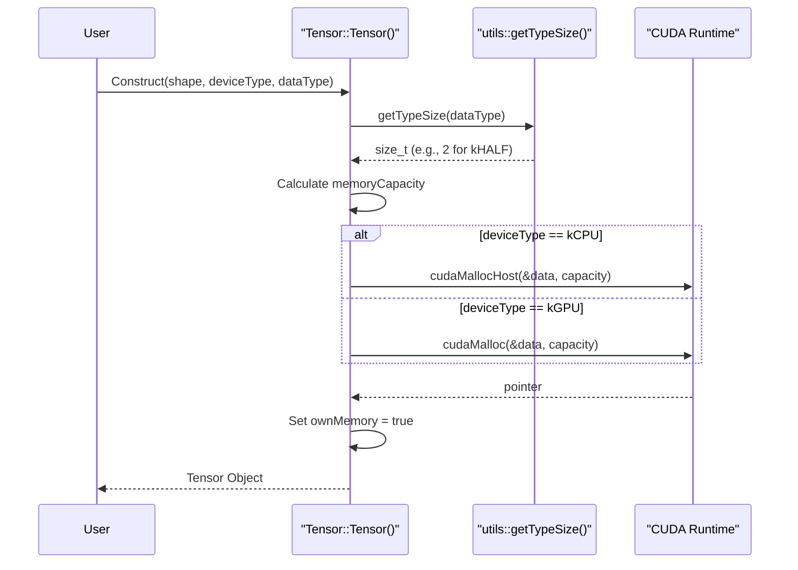

<!-- source: DeepWiki mcp.deepwiki.com · repo NVIDIA/TensorRT-Edge-LLM · extra page Tensor Memory Management · fetched 2026-10-26 -->

# Tensor Memory Management

Relevant source files

The following files were used as context for generating this wiki page:

- [cpp/common/cudaMacros.h](cpp/common/cudaMacros.h)
- [cpp/common/cudaUtils.h](cpp/common/cudaUtils.h)
- [cpp/common/tensor.cpp](cpp/common/tensor.cpp)
- [cpp/common/tensor.h](cpp/common/tensor.h)
- [cpp/common/tensorUtils.cpp](cpp/common/tensorUtils.cpp)

## Purpose and Scope

This document provides a deep dive into the `Tensor` class and the consumer-producer design pattern used for memory management in the `trt_edgellm` runtime. The `Tensor` class is the core abstraction that manages all runtime memory for inference operations, serving as the foundation for both vanilla and speculative decoding strategies.

The implementation is located in the `trt_edgellm::rt` namespace and provides a unified interface for CUDA device memory and pinned host memory allocations.

**Sources:** [cpp/common/tensor.h:35-39](), [cpp/common/tensor.cpp:27-30]()

---

## Overview

The `Tensor` class is a lightweight wrapper around memory buffers. It manages the lifecycle of memory and tracks metadata such as shape, data type, and device location. It is designed to bridge the gap between high-level runtime logic and low-level TensorRT engine execution.

### Natural Language to Code Entity Mapping

The following diagram maps conceptual memory management terms to their specific C++ class and function implementations in the codebase.

**Diagram: System Concepts to Code Entities**

**Sources:** [cpp/common/tensor.h:41-45](), [cpp/common/tensor.h:85-86](), [cpp/common/tensor.h:221-222](), [cpp/common/tensor.cpp:32-33]()

---

## The Coords Class

The `Coords` class manages multi-dimensional shapes for tensors, supporting up to `kMAX_DIMS` (8) dimensions.

### Implementation Details
- **Storage**: Uses a fixed-size `std::array<int64_t, kMAX_DIMS>` to avoid heap allocations during shape manipulation [cpp/common/tensor.h:213-214]().
- **TRT Integration**: Provides `getTRTDims()` to convert internal shapes to `nvinfer1::Dims` required by the TensorRT API [cpp/common/tensor.cpp:117-126]().
- **Volume Calculation**: The `volume()` method calculates the total number of elements by multiplying all dimensions [cpp/common/tensor.cpp:103-115]().
- **Iterators**: Supports construction from iterator ranges or initializer lists for flexible shape definitions [cpp/common/tensor.h:138-152]().

**Sources:** [cpp/common/tensor.h:48-48](), [cpp/common/tensor.h:85-215](), [cpp/common/tensor.cpp:89-142]()

---

## The Tensor Class

The `Tensor` class implements a robust memory management policy. It can either **own** memory (allocating via `cudaMalloc` or `cudaMallocHost`) or **wrap** existing memory (acting as a non-owning view).

### Core Implementation
| Feature | Implementation Detail |
| :--- | :--- |
| **Ownership** | Controlled by `ownMemory` boolean. If true, `releaseResource()` calls `cudaFree` or `cudaFreeHost` [cpp/common/tensor.cpp:278-294](). |
| **Move Semantics** | Supports move construction and assignment to transfer ownership efficiently without copying data [cpp/common/tensor.cpp:218-267](). |
| **Reshaping** | `reshape()` allows changing dimensions without reallocating if the new volume fits within `memoryCapacity` [cpp/common/tensor.cpp:313-324](). |
| **Data Access** | `data<T>()` provides type-safe access to the underlying pointer with debug-time checks [cpp/common/tensor.h:351-361](). |
| **Sub-byte Types** | Currently, sub-byte types like `kINT4` or `kFP4` are explicitly prohibited during construction [cpp/common/tensor.cpp:147-154](). |

### Memory Allocation Flow
The following diagram illustrates how a `Tensor` is initialized and how memory is allocated based on the `DeviceType`.

**Diagram: Tensor Allocation Flow**

**Sources:** [cpp/common/tensor.cpp:144-175](), [cpp/common/tensor.cpp:35-72]()

---

## Consumer-Producer Design Pattern

The runtime utilizes a consumer-producer pattern to manage data flow between the engine execution (producer) and the sampling/post-processing logic (consumer).

### Pattern Roles
1. **Producer (Engine Runner)**: 
   - Pre-allocates `Tensor` objects for engine outputs.
   - Binds `tensor.data` pointers to TensorRT execution context.
   - Triggers `enqueueV3` to populate buffers.
2. **Consumer (Sampler/Decoder)**:
   - Receives `Tensor` objects from the runner.
   - Uses `tensor.toHost()` if results are needed on CPU for sampling [cpp/common/tensor.cpp:381]().
   - Accesses elements using `tensor.at<T>(coords)` [cpp/common/tensor.h:363-380]().

### Data Transfer Operations
The `Tensor` class provides built-in utilities for moving data between producers and consumers across different memory spaces:

- **`toHost()`**: Synchronously copies data from GPU to a CPU-allocated `Tensor` [cpp/common/tensor.cpp:381]().
- **`toDevice()`**: Synchronously copies data from CPU to a GPU-allocated `Tensor` [cpp/common/tensor.cpp:381]().
- **`copyFrom()`**: General-purpose copy between any two tensors, handling `cudaMemcpyDeviceToHost`, `DeviceToDevice`, etc., based on their `mDeviceType` [cpp/common/tensor.cpp:349-381]().

**Sources:** [cpp/common/tensor.cpp:349-381](), [cpp/common/tensor.h:320-336]()

---

## CUDA Hardware and Feature Detection

The runtime includes utilities to query hardware capabilities and manage scoped device changes, which are critical for correct tensor allocation on multi-GPU systems or specific architectures.

### Scoped Device Management
The `CudaDeviceGuard` class ensures that scoped initialization runs on a target device without leaking thread-local device changes back to the caller [cpp/common/cudaUtils.h:163-195]().

### Feature Detection
The codebase centralizes CUDA-version-based feature detection to avoid scattered preprocessor checks. This affects which data types the `Tensor` class and associated kernels can support.

| Feature Macro | Condition | Supported Data Types |
| :--- | :--- | :--- |
| `SUPPORTS_FP8` | CUDA >= 11.8 | `__nv_fp8_e4m3` [cpp/common/cudaMacros.h:52-57]() |
| `SUPPORTS_FP4` | CUDA >= 12.8 | `cuda_fp4.h` types [cpp/common/cudaMacros.h:65-70]() |

**Sources:** [cpp/common/cudaUtils.h:55-93](), [cpp/common/cudaMacros.h:26-70]()

---

## Formatting and Debugging Utilities

To facilitate debugging, the codebase includes a `tensorUtils.cpp` file that implements sophisticated string formatting for tensors, mimicking PyTorch-style printing.

### Implementation of `toString()`
- **Recursive Building**: `buildStringRecursive` traverses the `Coords` to format multi-dimensional arrays [cpp/common/tensorUtils.cpp:124-126]().
- **Edge Item Logic**: For large tensors, it only prints the "head" and "tail" of the data, using `SCALAR_PRINT_THRESHOLD` (32) for the last dimension and `VECTOR_PRINT_THRESHOLD` (5) for higher dimensions to keep logs readable [cpp/common/tensorUtils.cpp:132-135]().
- **Type Handling**: `formatElement<T>` handles conversion of `half`, `__nv_bfloat16`, and `__nv_fp8_e4m3` to strings for logging, upcasting to `float` for precision control [cpp/common/tensorUtils.cpp:57-110]().

**Sources:** [cpp/common/tensorUtils.cpp:57-110](), [cpp/common/tensorUtils.cpp:124-209](), [cpp/common/tensor.cpp:381]()

---

