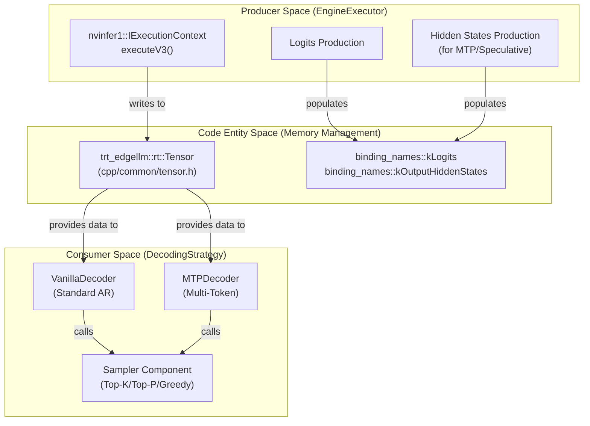
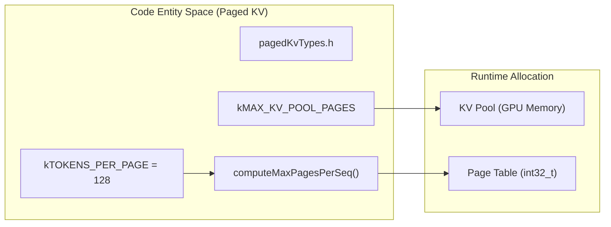
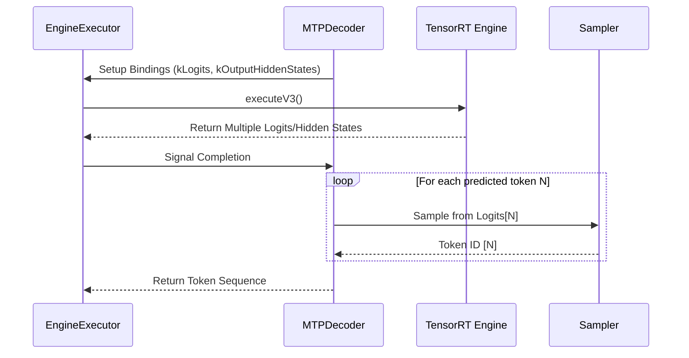

<!-- source: DeepWiki mcp.deepwiki.com · repo NVIDIA/TensorRT-Edge-LLM · extra page Vanilla and MTP Decoding · fetched 2026-10-26 -->

# Vanilla and MTP Decoding

Relevant source files

The following files were used as context for generating this wiki page:

- [cpp/common/pagedKvTypes.h](cpp/common/pagedKvTypes.h)
- [cpp/common/ropeUtils.h](cpp/common/ropeUtils.h)

## Overview

This section documents the two primary autoregressive decoding strategies implemented in the TensorRT-Edge-LLM runtime: **Vanilla Decoding** and **Multi-Token Prediction (MTP) Decoding**. Both strategies utilize a pluggable `DecodingStrategy` interface and follow a strict consumer-producer design pattern centered around the `Tensor` class for memory management.

Vanilla decoding represents the baseline sequential generation, while MTP decoding enables the model to predict multiple future tokens in a single forward pass, significantly increasing throughput for supported architectures like Qwen3 and Gemma4.

**Sources:** [cpp/common/tensor.h:217-221](), [cpp/common/bindingNames.h:73-80]()

---

## Consumer-Producer Design Pattern

Both decoding strategies rely on a unified architectural pattern where memory ownership and data flow are decoupled. The `trt_edgellm::rt::Tensor` class serves as the shared medium between the inference engine (producer) and the sampling logic (consumer).

The `Tensor` class manages memory across `DeviceType::kCPU` and `DeviceType::kGPU` [cpp/common/tensor.h:41-45](). It enforces explicit ownership transfer by disabling copy constructors [cpp/common/tensor.h:228-230](), ensuring that buffers like `kLogits` [cpp/common/bindingNames.h:73]() and `kOutputHiddenStates` [cpp/common/bindingNames.h:80]() are safely accessed by the decoders.

**Sources:** [cpp/common/tensor.h:41-45](), [cpp/common/tensor.h:217-233](), [cpp/common/bindingNames.h:73-80]()

---

## Paged KV-Cache Management

A critical component shared by both decoding strategies is the Paged KV-Cache system. Instead of contiguous memory allocation, the KV cache is divided into pages of fixed size, defined by `kTOKENS_PER_PAGE` (128 tokens) [cpp/common/pagedKvTypes.h:27]().

### KV Pool Configuration
The runtime calculates the required pool size based on the maximum batch size and capacity. The minimum active pages are computed as `maxBatchSize * ceil(maxKVCacheCapacity / kTOKENS_PER_PAGE)` [cpp/common/pagedKvTypes.h:56-61]().

The page table uses `kUNUSED_PAGE_ENTRY` (-1) to denote unallocated slots [cpp/common/pagedKvTypes.h:30](). This paged architecture allows for efficient `ContextCacheManager` reuse across multi-turn requests.

**Sources:** [cpp/common/pagedKvTypes.h:27-61]()

---

## Vanilla Decoding

Vanilla decoding is the standard sequential generation strategy. It generates exactly one token per iteration.

### Generation Process
1.  **Prefill Phase**: The engine processes the entire input prompt. It populates the KV cache for all context tokens and produces the first set of logits.
2.  **Decode Phase**: The engine takes the last generated token ID, updates the KV cache, and produces logits for the next token.

### Data Flow for Vanilla
For vanilla decoding, the primary interaction is with the `kLogits` binding. The shape is typically `[batch_size, vocab_size]` for the decode phase [cpp/common/bindingNames.h:71-73]().

**Sources:** [cpp/common/bindingNames.h:69-73](), [cpp/common/trtUtils.h:88-91]()

---

## Multi-Token Prediction (MTP) Decoding

MTP decoding is an advanced strategy where the model is trained with additional "MTP heads" that predict $N$ future tokens simultaneously. This is distinct from speculative decoding as it typically uses a single model with multiple output heads rather than a separate draft model.

### MTP Architecture in Code
MTP relies on specific bindings to handle multiple sets of logits or hidden states. The `MTPDecoder` coordinates the extraction of these multiple tokens.

### Key Bindings for MTP
-   **`kLogits`**: In MTP, this may contain multiple rows per batch item, representing predictions for $t+1, t+2, \dots, t+N$ [cpp/common/bindingNames.h:73]().
-   **`kOutputHiddenStates`**: Used if the MTP strategy requires intermediate representations to refine subsequent token predictions [cpp/common/bindingNames.h:80]().
-   **`kLastTokenIds`**: Used to specify which positions in the sequence should produce output logits [cpp/common/bindingNames.h:66]().

**Sources:** [cpp/common/bindingNames.h:62-80](), [cpp/common/trtUtils.h:99-103]()

---

## RoPE and Rotary Dimension Handling

Both decoders interact with Rotary Positional Embeddings (RoPE). The `getRotaryDim` utility determines the width of the `rope_rotary_cos_sin` cache [cpp/common/ropeUtils.h:27-33]().

### RoPE Variants
The system supports several RoPE configurations via `rope_scaling` JSON objects [cpp/common/ropeUtils.h:52-54]():
- **Standard/Partial RoPE**: Controlled by `partial_rotary_factor` [cpp/common/ropeUtils.h:61-62]().
- **Proportional RoPE**: A variant where the full head dimension is used (`rotaryDim == headDim`) and identity values are materialized for inactive slots [cpp/common/ropeUtils.h:56-59]().

**Sources:** [cpp/common/ropeUtils.h:27-63]()

---

## Performance Optimizations

### CUDA Graph Integration
Both Vanilla and MTP decoders support CUDA Graph capturing via `captureTRTCudaGraph()` [cpp/common/trtUtils.h:90-91](). This is particularly effective for the **Decode Phase** where the execution pattern (grid dimensions, kernel sequences) is identical for every single-token step, allowing the runtime to bypass CPU-side kernel launch overhead.

### Precision Support
The decoders are agnostic to the underlying precision, provided the `Tensor` descriptors match the engine's requirements. The system supports:
-   **FP8 KV Cache**: Reducing memory footprint for long-context generation.
-   **NVFP4/INT4 Quantization**: Supported through custom plugins like `loadEdgellmPluginLib` [cpp/common/trtUtils.h:56-70]().

**Sources:** [cpp/common/trtUtils.h:56-91](), [cpp/common/tensor.h:68-80]()

---

