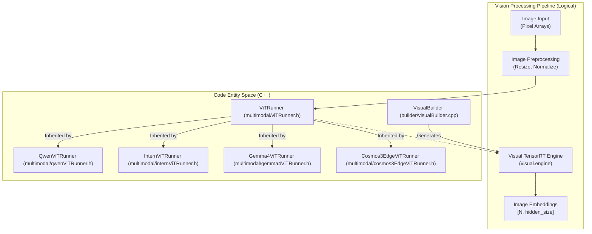
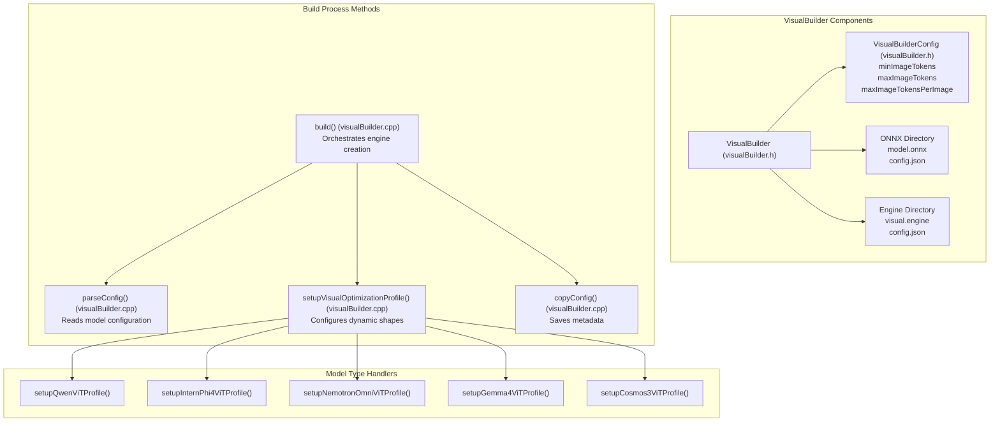
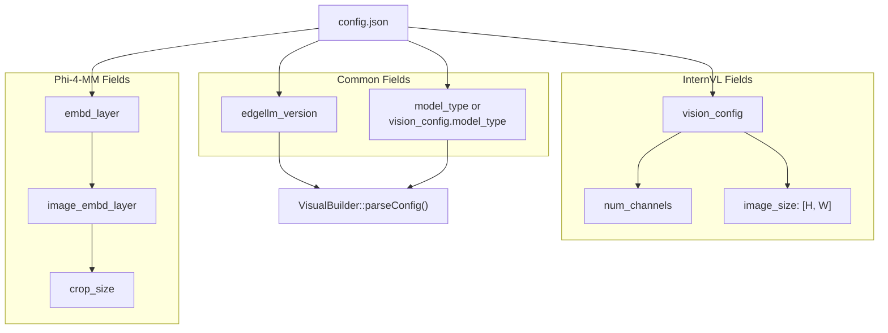

<!-- source: DeepWiki mcp.deepwiki.com · repo NVIDIA/TensorRT-Edge-LLM · extra page Vision Transformer Integration · fetched 2026-10-26 -->

# Vision Transformer Integration

Relevant source files

The following files were used as context for generating this wiki page:

- [cpp/kernels/audioAttentionKernels/gemma4AudioAttention.cu](cpp/kernels/audioAttentionKernels/gemma4AudioAttention.cu)
- [cpp/kernels/contextAttentionKernels/attentionScaleUtils.h](cpp/kernels/contextAttentionKernels/attentionScaleUtils.h)

## Purpose and Scope

This page documents the Vision Transformer (ViT) integration system in TensorRT-Edge-LLM, which enables Vision-Language Model (VLM) support. The ViT component processes image inputs and generates embeddings that are subsequently fused with text embeddings in the LLM backbone. This page covers the `VisualBuilder` class, optimization profile configurations for different ViT architectures (including Qwen, InternVL, Phi-4-MM, Nemotron-Omni, Gemma4, and Cosmos3), and specialized vision kernels.

For information about multimodal model support and embedding fusion strategies, see [Multimodal Support](7.2). For details on the LLM backbone integration, see [Supported Multimodal Models](7.2.1).

## Overview

Vision Transformer integration follows a two-stage deployment model: first, the ViT component is built into a separate TensorRT engine using `VisualBuilder`, then at inference time, the vision engine processes images to produce embeddings that are fed into the LLM engine. This separation allows independent optimization of vision and language components.

**Vision-to-Code Pipeline Mapping**
The following diagram bridges high-level vision processing concepts to the specific C++ classes and files responsible for them.

**Sources:** [cpp/builder/visualBuilder.cpp:41-131]()

## VisualBuilder Class

The `VisualBuilder` class is responsible for constructing TensorRT engines for Vision Transformer components. It parallels the `LLMBuilder` class but specializes in vision model requirements.

### Class Structure

The `VisualBuilder` class (defined in [cpp/builder/visualBuilder.h:93-167]()) uses `VisualBuilderConfig` to manage constraints like token counts and profiling verbosity.

**Sources:** [cpp/builder/visualBuilder.h:38-167](), [cpp/builder/visualBuilder.cpp:41-131]()

### Key Properties

The `VisualBuilder` class maintains model-specific properties parsed from `config.json` during the `parseConfig()` call [cpp/builder/visualBuilder.cpp:133-215]():

| Property | Type | Description | Relevant Models |
|----------|------|-------------|-----------------|
| `mModelType` | `multimodal::ModelType` | Identifies ViT architecture | All VLMs |
| `mNumChannels` | `int64_t` | Image channel count (typically 3) | InternVL, Phi-4-MM, Nemotron-Omni |
| `mImageSizeH` | `int64_t` | Image height in pixels | InternVL, Phi-4-MM, Nemotron-Omni |
| `mImageSizeW` | `int64_t` | Image width in pixels | InternVL, Phi-4-MM, Nemotron-Omni |

**Sources:** [cpp/builder/visualBuilder.h:161-166](), [cpp/builder/visualBuilder.cpp:164-212]()

## Supported Vision Transformer Architectures

The system supports distinct ViT architecture families, each with different input requirements and optimization profiles.

### Qwen-VL Family

Qwen-VL models (Qwen2-VL, Qwen2.5-VL) use a dynamic spatial resolution approach. The number of visual tokens varies based on image resolution.

**Key characteristics:**
- Input shape: `[HW, inputDim]` where `HW` represents the flattened spatial dimensions.
- Requires rotary position embeddings: `rotary_pos_emb`.
- Uses complex attention masks and windowing information for Qwen2.5-VL.

**Sources:** [cpp/builder/visualBuilder.h:140-140](), [cpp/builder/visualBuilder.cpp:254-325]()

### InternVL and Phi-4-MM Family

InternVL and Phi-4-MM use a block-based approach where images are processed in tiles.

**Key characteristics:**
- Input shape: `[numBlocks, numChannels, imageHeight, imageWidth]`.
- InternVL: Reads dimensions from `vision_config.num_channels` and `vision_config.image_size` [cpp/builder/visualBuilder.cpp:166-170]().
- Phi-4-MM: Uses 3 channels with configurable crop size (default 448×448) [cpp/builder/visualBuilder.cpp:172-189]().
- **Phi-4-MM Specific**: Requires copying `phi4mm_gn_proj.safetensors` (Grid Newline projection weights) to the engine directory [cpp/builder/visualBuilder.cpp:101-115]().

**Sources:** [cpp/builder/visualBuilder.cpp:166-189](), [cpp/builder/visualBuilder.cpp:101-115]()

### Nemotron-Omni (RADIO)

Nemotron-Omni utilizes the RADIO vision encoder which supports dynamic tile batching.

**Key characteristics:**
- Input shape: `[numTiles, 3, imageSize, imageSize]`.
- Configuration requires `force_image_size` in the `config.json` [cpp/builder/visualBuilder.cpp:194-207]().

**Sources:** [cpp/builder/visualBuilder.cpp:191-207](), [cpp/builder/visualBuilder.cpp:358-385]()

### Gemma4 Unified Vision

Gemma4 utilizes a unified multimodal architecture where vision tokens are managed within a fixed budget.

**Key characteristics:**
- Fixed per-image soft-token budget recorded in `builder_config` [cpp/builder/visualBuilder.cpp:214-220]().
- Supports multiple images per profile by scaling the total request budget [cpp/builder/visualBuilder.cpp:220-225]().

**Sources:** [cpp/builder/visualBuilder.cpp:209-245]()

### Cosmos3 Edge Vision

Cosmos3-Edge models utilize a specialized vision encoder for multimodal reasoning.

**Key characteristics:**
- Configuration involves `cosmos3_edge_vision_config` or `vision_config` [cpp/builder/visualBuilder.cpp:208-212]().
- Optimization profile manages dynamic token counts via `setupCosmos3ViTProfile` [cpp/builder/visualBuilder.cpp:388-410]().

**Sources:** [cpp/builder/visualBuilder.cpp:208-212](), [cpp/builder/visualBuilder.cpp:388-410]()

## Optimization Profile Configuration

The `VisualBuilder` sets up optimization profiles to accommodate variable numbers of image tokens or tiles.

### Profile Logic for Different Families

| Model Family | Primary Dynamic Dimension | Profile Method |
|--------------|---------------------------|----------------|
| Qwen ViT | `HW` (flattened tokens) | `setupQwenViTProfile` |
| InternVL / Phi-4-MM | `num_blocks` | `setupInternPhi4ViTProfile` |
| Nemotron-Omni | `num_tiles` | `setupNemotronOmniViTProfile` |
| Gemma4 | `num_images` / `num_tokens` | `setupGemma4ViTProfile` |
| Cosmos3 | `num_tokens` | `setupCosmos3ViTProfile` |

For InternVL/Phi-4-MM, the number of blocks is derived by dividing total tokens by 256:
- `minBlocks = minImageTokens / 256` [cpp/builder/visualBuilder.cpp:337]()
- `maxBlocks = maxImageTokens / 256` [cpp/builder/visualBuilder.cpp:339]()

**Sources:** [cpp/builder/visualBuilder.cpp:217-252](), [cpp/builder/visualBuilder.cpp:327-356]()

## Model Configuration Parsing

The `parseConfig()` method extracts vision-specific parameters from `config.json`. It looks for `model_type` in two locations:
1. `vision_config.model_type` [cpp/builder/visualBuilder.cpp:147-150]()
2. Top-level `model_type` [cpp/builder/visualBuilder.cpp:151-154]()

**Sources:** [cpp/builder/visualBuilder.cpp:133-215]()

## Specialized Vision Kernels

The runtime includes specialized CUDA kernels to optimize multimodal attention mechanisms, such as the Gemma 4 audio-encoder attention (which shares architectural patterns with the vision encoder).

### Gemma 4 Audio Attention Kernel
The `fusedChunkKernel` in [cpp/kernels/audioAttentionKernels/gemma4AudioAttention.cu:139-170]() implements a fully fused attention body including:
1. **Scaling**: Learned query scale + fixed key scale [cpp/kernels/audioAttentionKernels/gemma4AudioAttention.cu:26-29]().
2. **Content Score**: GEMM-based $Q \cdot K^T$ [cpp/kernels/audioAttentionKernels/gemma4AudioAttention.cu:30-32]().
3. **Relative-position Score**: Transformer-XL blocked shift [cpp/kernels/audioAttentionKernels/gemma4AudioAttention.cu:33-37]().
4. **Soft-cap**: $tanh$ based logit capping [cpp/kernels/audioAttentionKernels/gemma4AudioAttention.cu:39-40]().

**Sources:** [cpp/kernels/audioAttentionKernels/gemma4AudioAttention.cu:19-59](), [cpp/kernels/audioAttentionKernels/gemma4AudioAttention.cu:139-170]()

## FP8 Quantization for Vision Transformers

FP8 quantization is supported for Vision Transformers to reduce memory footprint and improve throughput. This is typically enabled by the quantization tool during the export pipeline.

In the C++ builder, if `profilingDetailed` is enabled in `VisualBuilderConfig`, the builder sets the profiling verbosity to `kDETAILED` [cpp/builder/visualBuilder.cpp:77-81](), which helps in analyzing the performance of quantized layers.

**Sources:** [cpp/builder/visualBuilder.h:43-43](), [cpp/builder/visualBuilder.cpp:77-81]()

## Build Process Flow

The `VisualBuilder::build()` method ( [cpp/builder/visualBuilder.cpp:41-131]() ) orchestrates the complete engine building process:

1. **Load Plugins**: Calls `loadEdgellmPluginLib()` to ensure custom vision layers are available [cpp/builder/visualBuilder.cpp:44]().
2. **Parse Config**: Reads `config.json` to determine `mModelType` and dimensions [cpp/builder/visualBuilder.cpp:47]().
3. **Initialize Network**: Creates the TensorRT builder and network definition [cpp/builder/visualBuilder.cpp:53]().
4. **Parse ONNX**: Uses `parseOnnxModel()` to load the model into the network [cpp/builder/visualBuilder.cpp:61]().
5. **Setup Profiles**: Configures dynamic shapes via `setupVisualOptimizationProfile()` [cpp/builder/visualBuilder.cpp:84]().
6. **Handle Model Specifics**: For Phi-4-MM, copies the GN projection weights [cpp/builder/visualBuilder.cpp:101-115]().
7. **Serialize Engine**: Builds and saves `visual.engine` [cpp/builder/visualBuilder.cpp:118-122]().
8. **Finalize**: Copies the configuration to the engine directory [cpp/builder/visualBuilder.cpp:125]().

**Sources:** [cpp/builder/visualBuilder.cpp:41-131]()

## Configuration Files

After engine building, the `VisualBuilder` copies configuration metadata to the engine directory using `copyConfig()` [cpp/builder/visualBuilder.cpp:425-460]().

### config.json Structure

The saved `config.json` includes the original model configuration and the `builder_config` section containing:
- `min_image_tokens`
- `max_image_tokens`
- `max_image_tokens_per_image`

### preprocessor_config.json

The builder also attempts to copy `preprocessor_config.json` from the source ONNX directory if it exists [cpp/builder/visualBuilder.cpp:451-455](). This file contains critical image normalization and resizing parameters used by the runtime processing pipeline.

**Sources:** [cpp/builder/visualBuilder.cpp:425-460](), [cpp/builder/visualBuilder.h:45-54]()

---

