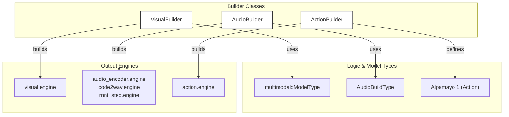
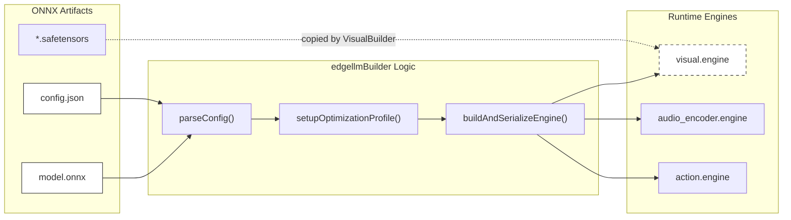

<!-- source: DeepWiki mcp.deepwiki.com · repo NVIDIA/TensorRT-Edge-LLM · extra page Visual, Audio, and Action Engine Builders · fetched 2026-10-26 -->

# Visual, Audio, and Action Engine Builders

Relevant source files

The following files were used as context for generating this wiki page:

- [cpp/builder/actionBuilder.cpp](cpp/builder/actionBuilder.cpp)
- [cpp/builder/actionBuilder.h](cpp/builder/actionBuilder.h)
- [cpp/builder/audioBuilder.cpp](cpp/builder/audioBuilder.cpp)
- [cpp/builder/audioBuilder.h](cpp/builder/audioBuilder.h)
- [cpp/builder/visualBuilder.cpp](cpp/builder/visualBuilder.cpp)
- [cpp/builder/visualBuilder.h](cpp/builder/visualBuilder.h)

## Purpose and Scope

The **Visual, Audio, and Action Engine Builders** are a suite of specialized builder classes in the `edgellmBuilder` library responsible for converting ONNX models of non-text modalities into optimized TensorRT engines. This includes **VisualBuilder** for vision encoders (Vision Transformers), **AudioBuilder** for audio encoders, speech synthesis (Code2Wav), and ASR decoders, and **ActionBuilder** for robotics trajectory models. These builders handle modality-specific optimization profiles, dynamic shape ranges, and specialized weight management (e.g., Grid Newline projections). Starting in version 0.9.x, these builders support unified multimodal models like **Gemma 4** which feature encoder-free framed-PCM audio and position-aware visual pooling. Version 0.10.0 adds support for **Nemotron-3.5-ASR** RNN-T step engines.

**Sources:** [cpp/builder/visualBuilder.cpp:44-148](), [cpp/builder/audioBuilder.cpp:97-227](), [cpp/builder/actionBuilder.cpp:40-102]()

---

## Architectural Overview

The builders follow a consistent factory-like pattern: they parse a `config.json`, determine the specific model architecture (e.g., Qwen-VL vs InternVL), set up TensorRT optimization profiles for dynamic inputs, and serialize the resulting engine.

### Builder Entity Mapping

The following diagram bridges the logical model types to the specific C++ builder entities and their primary output artifacts.

**Sources:** [cpp/builder/visualBuilder.h:103-143](), [cpp/builder/audioBuilder.h:81-104](), [cpp/builder/actionBuilder.h:87-107]()

---

## VisualBuilder

The `VisualBuilder` constructs engines for Vision Transformers (ViT) used in Vision-Language Models (VLMs). It supports dynamic image resolutions by configuring spatial dimensions based on "image tokens".

### Supported Visual Models
| Model Type | Enum | Strategy |
| :--- | :--- | :--- |
| **Qwen2/2.5/3-VL** | `QWEN2_VL`, etc. | Dynamic HW patches with spatial merging [cpp/builder/visualBuilder.cpp:244-272]() |
| **InternVL / Phi-4MM** | `INTERNVL`, `PHI4MM` | Fixed-size block batching (256 tokens/block) [cpp/builder/visualBuilder.cpp:274-278]() |
| **Nemotron-Omni** | `NEMOTRON_OMNI_VISION_ENCODER` | RADIO vision encoder with dynamic tile batching [cpp/builder/visualBuilder.cpp:211-227]() |
| **Gemma4 Unified** | `GEMMA4_UNIFIED_VISION` | Ragged patch, position-id, and position-aware pooling [cpp/builder/visualBuilder.cpp:229-242]() |
| **Cosmos3 Edge** | `COSMOS3_EDGE_VISION_ENCODER` | Specialized ViT for Cosmos3 reasoning models [cpp/builder/visualBuilder.cpp:237-242]() |

### Build Flow & Optimization
The `VisualBuilder::build()` method [cpp/builder/visualBuilder.cpp:44-148]() orchestrates:
1. **Config Parsing**: Detects `model_type` from `vision_config` or top-level JSON [cpp/builder/visualBuilder.cpp:150-179]().
2. **Profile Setup**: 
    - **Qwen**: Sets up `visual_input`, `rotary_pos_emb`, and `attention_mask`. Qwen2.5/3 include window attention masks and fast position embeddings [cpp/builder/visualBuilder.cpp:300-382]().
    - **Gemma4**: Configures ragged patches and `pos_ids` for position-aware pooling [cpp/builder/visualBuilder.cpp:424-468]().
    - **InternVL/Phi-4MM**: Validates that `min/maxImageTokens` are multiples of 256 [cpp/builder/visualBuilder.cpp:387-395]().
3. **Weight Management**: For **Phi-4MM** and **Nemotron-Omni**, it copies required weight files (e.g., `phi4mm_gn_proj.safetensors`, `nemotron_omni_embedder.safetensors`) to the engine directory [cpp/builder/visualBuilder.cpp:114-133]().

**Sources:** [cpp/builder/visualBuilder.cpp:44-148](), [cpp/builder/visualBuilder.h:39-98]()

---

## AudioBuilder

The `AudioBuilder` handles three distinct audio-related tasks: encoding raw audio features, synthesizing speech from codes (Code2Wav), and RNN-T decoding for ASR.

### Audio Build Types
The builder auto-detects the task based on the presence of specific config keys in `config.json` [cpp/builder/audioBuilder.cpp:254-276]().

| Task | Build Type | Output Engine |
| :--- | :--- | :--- |
| **Audio Encoding** | `AUDIO_ENCODER` | `audio_encoder.engine` |
| **Speech Synthesis** | `CODE2WAV` | `code2wav.engine` |
| **RNN-T ASR Step** | `RNNT_DECODER` | `rnnt_step.engine` |

### Optimization Profiles
- **Audio Encoder**: Configures dynamic time steps. For **Gemma4 Unified**, it supports encoder-free framed-PCM inputs [cpp/builder/audioBuilder.cpp:307-327](), [cpp/builder/audioBuilder.cpp:427-451]().
- **Code2Wav**: Configures dynamic code lengths for the generator, used in Qwen3-Omni [cpp/builder/audioBuilder.cpp:333-351]().
- **RNN-T Decoder**: Uses fully static I/O for single decode steps, requiring no optimization profile [cpp/builder/audioBuilder.cpp:180-186]().

**Sources:** [cpp/builder/audioBuilder.cpp:128-153](), [cpp/builder/audioBuilder.h:39-72]()

---

## ActionBuilder

The `ActionBuilder` is designed for robotics and trajectory models, specifically supporting the **Alpamayo 1** architecture. These models utilize diffusion-based trajectory generation.

### Key Configuration Parameters
The builder extracts specific architecture parameters from `config.json` [cpp/builder/actionBuilder.cpp:104-146]():
- `num_hidden_layers`: Number of transformer layers.
- `num_key_value_heads`: Head count for KV cache.
- `n_diffusion_tokens`: Number of waypoints in the trajectory (e.g., 64).

### Optimization Profile Setup
`ActionBuilder::setupActionOptimizationProfile` [cpp/builder/actionBuilder.cpp:148-208]() configures:
- **Noise Trajectory**: `[batch, num_diffusion_tokens, 2]` for 2D waypoint coordinates.
- **KV Cache**: Dynamic batching for `k_cache` and `v_cache` across all layers. It infers `maxKVCacheCapacity` directly from the ONNX input dimensions [cpp/builder/actionBuilder.cpp:175-189]().

**Sources:** [cpp/builder/actionBuilder.cpp:32-102](), [cpp/builder/actionBuilder.h:37-82]()

---

## Engine Building Data Flow

The following diagram illustrates the data flow from the Python-exported ONNX artifacts through the C++ Builder classes into the final TensorRT engines.

**Sources:** [cpp/builder/visualBuilder.cpp:44-148](), [cpp/builder/audioBuilder.cpp:97-227](), [cpp/builder/actionBuilder.cpp:40-102]()

---

## Shared Builder Utilities

All modality builders utilize common helper functions defined in `builderUtils.h` and `trtUtils.h`:

- **`loadEdgellmPluginLib()`**: Dynamically loads custom TensorRT plugins (e.g., `AttentionPlugin`, `ViTAttentionPlugin`, `Gemma4AudioAttentionPlugin`) required for inference [cpp/builder/visualBuilder.cpp:47]().
- **`createBuilderAndNetwork()`**: Initializes the `nvinfer1::IBuilder` and `nvinfer1::INetworkDefinition` [cpp/builder/visualBuilder.cpp:65]().
- **`parseOnnxModel()`**: Invokes the NV ONNX parser to populate the network from the `.onnx` file [cpp/builder/visualBuilder.cpp:73]().
- **`buildAndSerializeEngine()`**: Performs the heavy-duty TensorRT compilation and writes the `.engine` file to disk [cpp/builder/visualBuilder.cpp:135]().

**Sources:** [cpp/builder/visualBuilder.cpp:44-83](), [cpp/builder/audioBuilder.cpp:100-123](), [cpp/builder/actionBuilder.cpp:42-62]()

---

