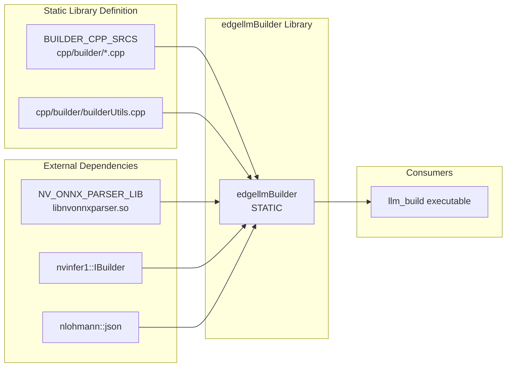
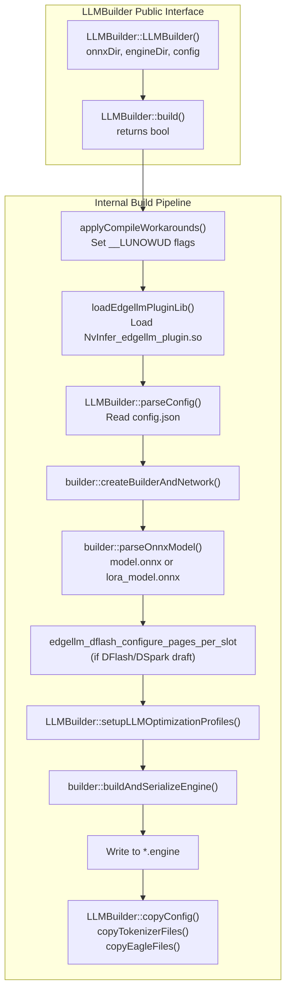
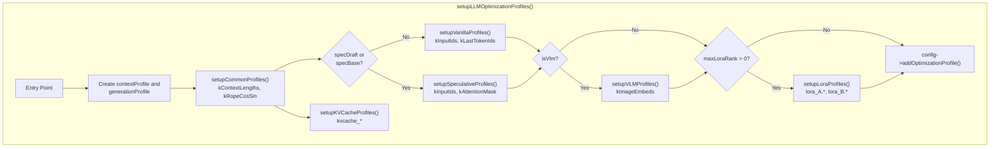

<!-- source: DeepWiki mcp.deepwiki.com · repo NVIDIA/TensorRT-Edge-LLM · extra page edgellmBuilder Library · fetched 2026-10-26 -->

# edgellmBuilder Library

Relevant source files

The following files were used as context for generating this wiki page:

- [cpp/builder/builderUtils.cpp](cpp/builder/builderUtils.cpp)
- [cpp/builder/builderUtils.h](cpp/builder/builderUtils.h)
- [cpp/builder/llmBuilder.cpp](cpp/builder/llmBuilder.cpp)
- [cpp/builder/llmBuilder.h](cpp/builder/llmBuilder.h)

## Purpose and Scope

The `edgellmBuilder` library is responsible for converting ONNX models to optimized TensorRT engines for both text-only LLMs and multimodal models (VLMs, audio, action). This library handles TensorRT engine generation, optimization profile configuration, and packaging of auxiliary files required for runtime inference. It supports advanced decoding features including MTP, EAGLE3, DFlash, and DSpark.

For information about the runtime that loads and executes these engines, see [edgellmCore Library](4.2.1). For the overall engine building workflow from the application perspective, see [Engine Building](3.2).

**Sources:** [cpp/builder/builderUtils.cpp:1-16](), [cpp/builder/llmBuilder.cpp:1-16]()

---

## Library Overview

The `edgellmBuilder` library is a static C++ library that wraps TensorRT's ONNX parser and builder APIs. It provides specialized builder classes:

- **`LLMBuilder`**: Builds TensorRT engines for text-only language models and multimodal models, including support for speculative decoding (EAGLE3, DFlash, DSpark, MTP) and LoRA adapters. Defined in [cpp/builder/llmBuilder.h:113-119]().
- **`VisualBuilder`**: Builds TensorRT engines for vision transformers (InternVL, Phi-4-MM, Qwen-VL). Defined in [cpp/builder/visualBuilder.h]().
- **`AudioBuilder`**: Builds TensorRT engines for audio encoders (Qwen3-ASR, Nemotron-3.5-ASR).
- **`ActionBuilder`**: Builds TensorRT engines for action/trajectory models (Alpamayo 1).

The library utilizes `nvonnxparser` to parse ONNX models and `nvinfer` to generate TensorRT engines.

**Sources:** [cpp/builder/llmBuilder.cpp:37-43](), [cpp/builder/builderUtils.h:97-102](), [cpp/builder/llmBuilder.h:113-119]()

---

## Build System Integration

The following diagram bridges the build-time entities to their C++ code representations.

**Diagram: Build-Time Entity Space Mapping**

The library is compiled from source files in `cpp/builder/` and includes common utilities. It links against TensorRT's ONNX parser library and exposes a clean API for engine building.

**Sources:** [cpp/builder/builderUtils.h:20-27](), [cpp/builder/llmBuilder.cpp:18-25]()

---

## LLMBuilder Class

### Class Structure and Build Flow

The `LLMBuilder::build()` method orchestrates the entire engine building process. Key steps include applying compile workarounds for specific TensorRT versions, loading the custom TensorRT plugin via `loadEdgellmPluginLib()`, parsing the ONNX model, and configuring optimization profiles.

**Diagram: LLMBuilder Execution Flow**

**Sources:** [cpp/builder/llmBuilder.cpp:121-238](), [cpp/builder/builderUtils.cpp:52-86]()

---

### Optimization Profile Setup

The `LLMBuilder` creates two profiles: `contextProfile` and `generationProfile` [cpp/builder/llmBuilder.cpp:416-417](). These define the min/opt/max dimensions for all dynamic input tensors.

**Sources:** [cpp/builder/llmBuilder.cpp:410-454]()

---

### Common Profiles

All models require core optimization profiles handled in `setupCommonProfiles` [cpp/builder/llmBuilder.cpp:456]():

| Input Binding | Context Profile (min, opt, max) | Generation Profile (min, opt, max) | Purpose |
|---------------|----------------------------------|-------------------------------------|---------|
| `kContextLengths` | (1), (maxBS), (maxBS) | (1), (maxBS), (maxBS) | Active tokens per sequence |
| `kRopeCosSin` | (1, maxKVCap, rotDim) to (maxBS, maxKVCap, rotDim) | Same as context | Rotary embeddings |
| `kKVCacheStartIndex` | (0) to (maxBS) | (1) to (maxBS) | KV cache write offset |
| `kvcache_*` | (maxBS, 2, heads, 0, hDim) to (maxBS, 2, heads, poolPages, hDim) | Same as context | Paged KV cache pool |

**Sources:** [cpp/builder/llmBuilder.cpp:456-488](), [cpp/builder/llmBuilder.cpp:710-730]()

---

### Speculative Decoding Profiles

For speculative models (EAGLE3, DFlash, DSpark, MTP), `setupSpeculativeProfiles` [cpp/builder/llmBuilder.cpp:511]() manages tree-based input shapes:

- **`kInputIds`**: Context [1, 1] to [maxBS, maxInputLen]; Generation [1, 1] to [maxBS, maxTreeSize] [cpp/builder/llmBuilder.cpp:517-535]().
- **`kAttentionMask`**: Specifically for tree attention, shapes up to [maxBS, 1, maxTreeSize, maxTreeSize] [cpp/builder/llmBuilder.cpp:537-550]().
- **`kDraftModelHiddenStates`**: Used by draft models to receive base model state [cpp/builder/llmBuilder.cpp:552-564]().

**Sources:** [cpp/builder/llmBuilder.cpp:511-574]()

---

## Utility Functions in builderUtils

### Compile Workarounds

`applyCompileWorkarounds` [cpp/builder/builderUtils.cpp:52-86]() applies environment variable flags (`__LUNOWUD`) to bypass known TensorRT compiler issues, such as dual-GEMM fusion miscompilations on Blackwell (sm12x) or specific MLIR autotuning threads.

**Sources:** [cpp/builder/builderUtils.cpp:52-86]()

### Profile Management

- `setOptimizationProfile`: Sets `kMIN`, `kOPT`, and `kMAX` dimensions for a named input [cpp/builder/builderUtils.cpp:141-152]().
- `checkOptimizationProfileDims`: Validates that `min <= opt <= max` [cpp/builder/builderUtils.cpp:112-131]().

**Sources:** [cpp/builder/builderUtils.cpp:112-152]()

### Engine Building

`buildAndSerializeEngine` [cpp/builder/builderUtils.cpp:258-294]() triggers the TensorRT build process, monitors memory if supported (TRT >= 10.6), and serializes the resulting `ICudaEngine` to disk.

**Sources:** [cpp/builder/builderUtils.cpp:258-294]()

---

## Configuration Management

After building the engine, `LLMBuilder` serializes a combined configuration file containing both the original model metadata and the builder-specific parameters (e.g., `max_batch_size`, `max_kv_pool_pages`).

| Method | Files Copied | Conditions |
|--------|-------------|------------|
| `copyConfig()` | `config.json` | Always (includes `builder_config`) [cpp/builder/llmBuilder.cpp:732]() |
| `copyTokenizerFiles()` | `tokenizer.json`, `tokenizer_config.json` | Skipped for `specDraft` [cpp/builder/llmBuilder.cpp:771]() |
| `copyEagleFiles()` | `d2t.safetensors` | Only for `eagle3` draft [cpp/builder/llmBuilder.cpp:802]() |
| `copyVocabMappingFiles()` | `vocab_map.safetensors` | If `reduced_vocab_size` is active [cpp/builder/llmBuilder.cpp:816]() |

**Sources:** [cpp/builder/llmBuilder.cpp:732-841](), [cpp/builder/llmBuilder.h:83-103]()

---

## Error Handling

The library uses a combination of boolean return values and `ELLM_CHECK` macros for validation:

| Component | Validation | Action |
|-----------|------------|--------|
| `LLMBuilderConfig` | `resolvedKVPoolPages()` [cpp/builder/llmBuilder.h:59-79]() | Throws `std::runtime_error` on invalid sizes |
| ONNX Parser | `parseOnnxModel()` [cpp/builder/builderUtils.cpp:226-256]() | Logs parser errors and returns `nullptr` |
| Builder | `createBuilderAndNetwork()` [cpp/builder/builderUtils.cpp:189-209]() | Logs failure and returns `{nullptr, nullptr}` |

**Sources:** [cpp/builder/llmBuilder.h:59-79](), [cpp/builder/builderUtils.cpp:189-256]()

---

