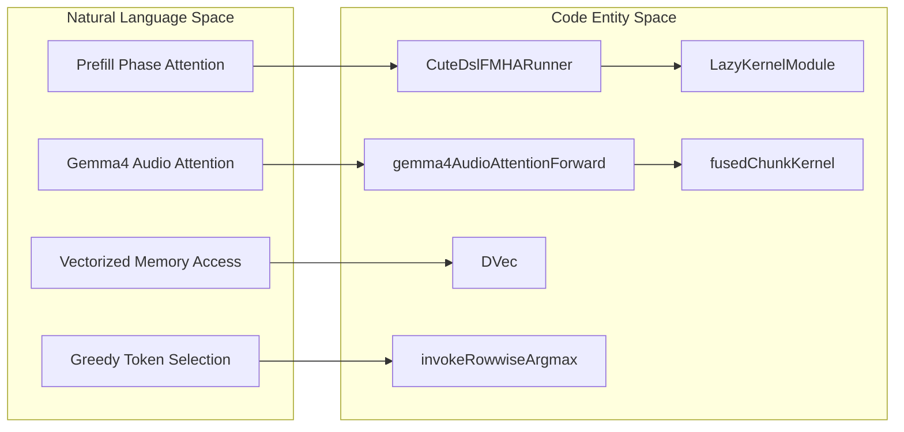
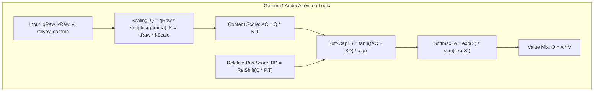

<!-- source: DeepWiki mcp.deepwiki.com · repo NVIDIA/TensorRT-Edge-LLM · extra page edgellmKernels Library · fetched 2026-10-26 -->

# edgellmKernels Library

Relevant source files

The following files were used as context for generating this wiki page:

- [cpp/kernels/audioAttentionKernels/gemma4AudioAttention.cu](cpp/kernels/audioAttentionKernels/gemma4AudioAttention.cu)
- [cpp/kernels/audioAttentionKernels/gemma4AudioAttention.h](cpp/kernels/audioAttentionKernels/gemma4AudioAttention.h)
- [cpp/kernels/common/argmaxKernel.cu](cpp/kernels/common/argmaxKernel.cu)
- [cpp/kernels/common/argmaxKernel.h](cpp/kernels/common/argmaxKernel.h)
- [cpp/kernels/common/vectorizedTypes.cuh](cpp/kernels/common/vectorizedTypes.cuh)
- [cpp/kernels/contextAttentionKernels/attentionScaleUtils.h](cpp/kernels/contextAttentionKernels/attentionScaleUtils.h)
- [cpp/kernels/contextAttentionKernels/cuteDslFMHARunner.cpp](cpp/kernels/contextAttentionKernels/cuteDslFMHARunner.cpp)
- [cpp/kernels/contextAttentionKernels/cuteDslFMHARunner.h](cpp/kernels/contextAttentionKernels/cuteDslFMHARunner.h)
- [cpp/kernels/contextAttentionKernels/cuteDslFMHAV2Runner.cpp](cpp/kernels/contextAttentionKernels/cuteDslFMHAV2Runner.cpp)
- [cpp/kernels/contextAttentionKernels/cuteDslFMHAV2Runner.h](cpp/kernels/contextAttentionKernels/cuteDslFMHAV2Runner.h)

## Purpose and Scope

The `edgellmKernels` library is a foundational static library that provides CUDA kernel implementations and common utilities shared across the TensorRT-Edge-LLM codebase. This library serves as a low-level compute layer, containing optimized CUDA kernels for attention mechanisms (FMHA, XQA, and the specialized Gemma4 Audio Attention), Mixture of Experts (MoE), Mamba architectures, and memory management utilities.

Starting in version 0.10.0, the library heavily utilizes the **CuTe DSL** (Domain Specific Language) for generating high-performance kernels for Blackwell (SM100/101/110) and Hopper architectures, replacing legacy cubin-based implementations for FMHA-v2 [cpp/kernels/contextAttentionKernels/cuteDslFMHAV2Runner.h:58-59]().

## Library Architecture

### Data Vectorization and Memory Access

A core utility within the library is the `DVec` template, which provides efficient vectorized memory load/store operations for CUDA kernels. This abstraction is specialized for various data types to ensure optimal memory coalescing and bandwidth utilization on edge platforms.

| Specialization | Vector Size | Hardware Instruction / Type | Primary Use Case |
| :--- | :--- | :--- | :--- |
| `DVec<float>` | 8 | 2x `float4` (32 bytes) | Cos/Sin cache loading [cpp/kernels/common/vectorizedTypes.cuh:71-74]() |
| `DVec<half>` | 8 | `uint4` (16 bytes) | Half-precision KV cache access [cpp/kernels/common/vectorizedTypes.cuh:118-121]() |
| `DVec<__nv_bfloat16>` | 8 | `uint4` (16 bytes) | BF16 memory access [cpp/kernels/common/vectorizedTypes.cuh:162-165]() |
| `DVec<uint8_t>` | 16 | `uint4` (16 bytes) | Byte-granularity copies / FP8 KV [cpp/kernels/common/vectorizedTypes.cuh:202-205]() |

**Sources**: [cpp/kernels/common/vectorizedTypes.cuh:39-218]()

### Component Interaction and Dispatch

The library provides high-level "Runner" classes that encapsulate the complexity of CUDA kernel configuration, resource management, and dispatch.

#### Natural Language to Code Entity Space: Attention Dispatch

**Sources**: [cpp/kernels/contextAttentionKernels/cuteDslFMHARunner.h:51-52](), [cpp/kernels/audioAttentionKernels/gemma4AudioAttention.h:69-71](), [cpp/kernels/common/vectorizedTypes.cuh:40-41](), [cpp/kernels/common/argmaxKernel.h:47-48]()

## CuTe DSL FMHA Runners

The library provides unified runners for CuTe DSL compiled FMHA kernels, specialized for different hardware generations and attention variants.

### CuteDslFMHARunner (Blackwell SM100+)
This runner targets NVIDIA Blackwell architectures. It supports two primary modes:
1.  **LLM Mode**: Batched Q + combined/paged KV cache with causal masking and optional sliding window [cpp/kernels/contextAttentionKernels/cuteDslFMHARunner.h:43-44]().
2.  **ViT Mode**: Packed variable-length separate Q/K/V with bidirectional attention [cpp/kernels/contextAttentionKernels/cuteDslFMHARunner.h:46-47]().

It includes specialized support for **FP8 input** with FP16 output, as well as **skip-softmax (BLASST)** variants which approximate the attention calculation by skipping negligible KV tiles [cpp/kernels/contextAttentionKernels/cuteDslFMHARunner.h:94-98]().

### CuteDslFMHAV2Runner (SM80 to SM121)
The `CuteDslFMHAV2Runner` provides a broader compatibility range, covering Ampere through Blackwell. It implements several mask contracts:
*   `kCAUSAL` and `kSLIDING_CAUSAL` for standard LLM prefill [cpp/kernels/contextAttentionKernels/cuteDslFMHAV2Runner.h:47-48]().
*   `kPADDING` for dense non-causal attention [cpp/kernels/contextAttentionKernels/cuteDslFMHAV2Runner.h:49]().
*   `kVISION_BLOCK` for Gemma4 vision-block attention, supporting same-image-block logic [cpp/kernels/contextAttentionKernels/cuteDslFMHAV2Runner.h:50](), [cpp/kernels/contextAttentionKernels/cuteDslFMHAV2Runner.h:109-112]().

#### Implementation Detail: Lazy Module Loading
Both runners utilize `LazyKernelModule` to manage AOT-compiled kernel variants. Kernels are only loaded into the CUDA context when `preflightLlm()` or `preflightPaged()` is called, ensuring minimal memory footprint for unused variants [cpp/kernels/contextAttentionKernels/cuteDslFMHARunner.cpp:44-48](), [cpp/kernels/contextAttentionKernels/cuteDslFMHAV2Runner.cpp:80-84]().

**Sources**: [cpp/kernels/contextAttentionKernels/cuteDslFMHARunner.h:39-140](), [cpp/kernels/contextAttentionKernels/cuteDslFMHAV2Runner.h:44-116](), [cpp/kernels/contextAttentionKernels/cuteDslFMHARunner.cpp:57-98]()

## Gemma4 Audio Attention

The library includes a highly specialized fused kernel for the Gemma 4 audio-encoder tower. This kernel handles chunked local attention with query-dependent relative-position scores.

### Kernel Features
- **Fused Operations**: Fuses Q/K scaling, content scores, relative-position scores (with Transformer-XL style shift), tanh soft-cap, masking, softmax, and value mixing into a single kernel [cpp/kernels/audioAttentionKernels/gemma4AudioAttention.cu:19-58]().
- **Shared Memory Staging**: Uses shared memory to stage scaled Q, K, V, and P (relative key) tensors. It utilizes a padded row stride (`LDS = D + 2`) to avoid bank conflicts [cpp/kernels/audioAttentionKernels/gemma4AudioAttention.cu:143-162]().
- **Specialized Configuration**: Optimized for Gemma 4 audio defaults: `chunkSize=12`, `leftHorizon=12`, `contextSize=24`, and `headDim=128` [cpp/kernels/audioAttentionKernels/gemma4AudioAttention.h:36-42]().

### Data Flow: Gemma4 Audio Fused Kernel

**Sources**: [cpp/kernels/audioAttentionKernels/gemma4AudioAttention.cu:19-58](), [cpp/kernels/audioAttentionKernels/gemma4AudioAttention.h:36-71]()

## Common Utility Kernels

### Argmax Kernel
The library provides a bit-stable row-wise `argmax` implementation (`invokeRowwiseArgmax`).
*   **Tie-breaking**: Resolves ties to the **lowest** column index to match PyTorch greedy reference behavior [cpp/kernels/common/argmaxKernel.h:31-33]().
*   **Precision**: Performs comparisons in `float` even for `half` inputs to ensure stability across different launch shapes [cpp/kernels/common/argmaxKernel.h:35-37]().
*   **Implementation**: Uses one block per row with intra-warp shuffle and shared-memory reduction [cpp/kernels/common/argmaxKernel.cu:64-98]().

### Attention Scaling
The library includes utilities to validate and resolve the `QK^T` multiplier (`attentionScale`). If no scale is provided, it defaults to `1.0 / sqrt(headSize)` [cpp/kernels/contextAttentionKernels/attentionScaleUtils.h:37-47]().

**Sources**: [cpp/kernels/common/argmaxKernel.h:28-48](), [cpp/kernels/common/argmaxKernel.cu:46-98](), [cpp/kernels/contextAttentionKernels/attentionScaleUtils.h:29-47]()

## Kernel Categories

### Attention Kernels
- **FMHA (Flash Multi-Head Attention)**: Memory-efficient attention for context phase, now primarily driven by CuTe DSL runners [cpp/kernels/contextAttentionKernels/cuteDslFMHARunner.h:51-52]().
- **XQA (eXtended Query Attention)**: Optimized for generation phase (decoding).
- **Gemma4 Audio Attention**: Specialized chunked attention for audio encoders [cpp/kernels/audioAttentionKernels/gemma4AudioAttention.h:44-58]().
- **DFlash Kernels**: Support for the DFlash target KV cache update and speculative decoding.

### Specialized Architecture Kernels
- **MoE (Mixture of Experts)**: Kernels for gated activation and expert routing.
- **Mamba/SSD**: Support for State Space Models (SSM) and Selective State Space models.
- **Gated Delta Net (GDN)**: Specialized kernels for linear attention variants.

### Sampling Kernels
- Implements `Top-K`, `Top-P`, and `Temperature` scaling for token selection during the generation phase.

## Build and Integration

### Precision Support
The library supports multiple precision types, including `half`, `__nv_bfloat16`, and `float`. For critical operations like the Gemma4 audio attention, internal accumulation (scores and softmax) is performed in `fp32` to maintain accuracy [cpp/kernels/audioAttentionKernels/gemma4AudioAttention.h:54-56]().

### Runtime Integration
The `edgellmCore` library links `edgellmKernels` to provide the computational backbone for its high-level components. For instance, the `Decoder` coordinates the dispatch of FMHA/XQA runners, and the `Sampler` invokes sampling kernels or the `argmax` kernel for final token selection.

**Sources**: [cpp/kernels/audioAttentionKernels/gemma4AudioAttention.h:52-58](), [cpp/kernels/contextAttentionKernels/cuteDslFMHARunner.h:51-52](), [cpp/kernels/common/argmaxKernel.h:47-48]()

---

