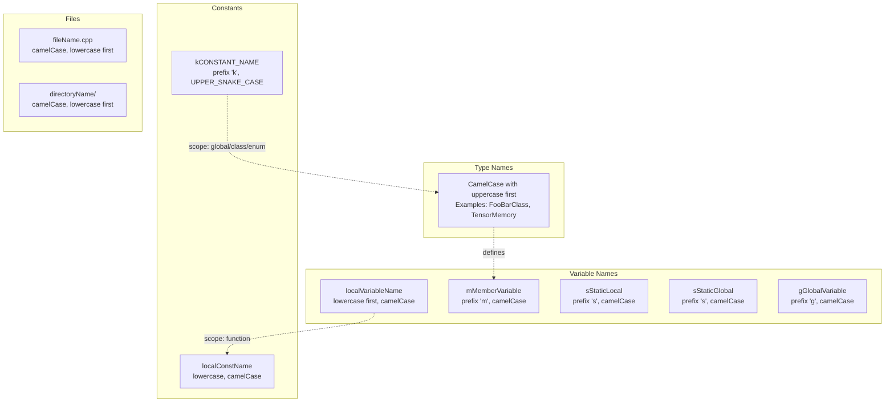
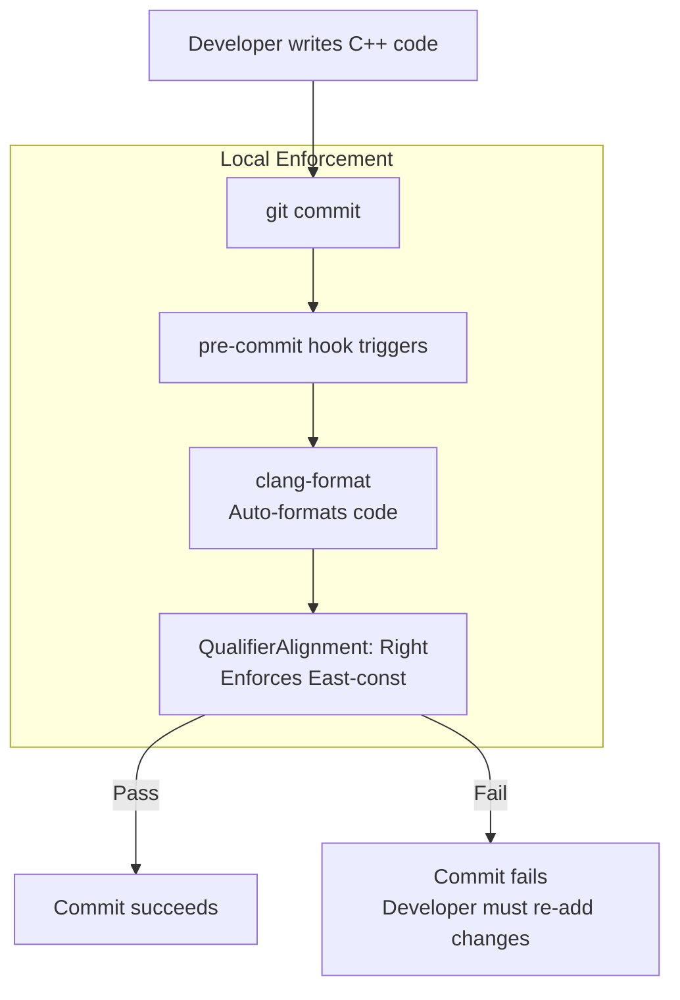

<!-- source: DeepWiki mcp.deepwiki.com · repo NVIDIA/TensorRT-Edge-LLM · extra page C++ Style Guide · fetched 2026-10-26 -->

# C++ Style Guide

<details>
<summary>Relevant source files</summary>

The following files were used as context for generating this wiki page:

- [.clang-format](.clang-format)
- [CODING_GUIDELINES.md](CODING_GUIDELINES.md)

</details>


## Purpose and Scope

This document specifies the C++ coding standards for the TensorRT-Edge-LLM project. These guidelines ensure consistency across the codebase, improve code readability, and reduce common programming errors. The style is primarily based on the [Google C++ Style Guide](https://google.github.io/styleguide/cppguide.html) with project-specific customizations.

For Python coding standards, see [Python Style Guide](#6.2.2). For the automated enforcement of these rules, see [Pre-commit Hooks](#6.4.1).

**Sources**: [CODING_GUIDELINES.md:1-6]()

---

## Formatting Configuration

All C++ code in this project is automatically formatted using `clang-format`. The configuration enforces consistent spacing, indentation, and brace placement across the codebase.

### Clang-Format Rules Overview

The following diagram maps the key formatting rules defined in `.clang-format` to their effect on code structure:

Title: Clang-Format Configuration Logic

```mermaid
graph TD
    subgraph "Indentation Rules"
        IND["IndentWidth: 4<br/>UseTab: Never"]
        ACCESS["AccessModifierOffset: -4"]
        CONT["ContinuationIndentWidth: 4"]
    end
    
    subgraph "Line Length & Breaking"
        COLUMN["ColumnLimit: 120"]
        BREAK_BIN["BreakBeforeBinaryOperators: All"]
        BREAK_TERN["BreakBeforeTernaryOperators: true"]
        MULTILINE["AlwaysBreakBeforeMultilineStrings: true"]
    end
    
    subgraph "Brace Style"
        ALLMAN["BreakBeforeBraces: Custom<br/>Allman-based Style"]
        BRACE_WRAP["BraceWrapping:<br/>AfterCaseLabel: true<br/>AfterClass: true<br/>AfterFunction: true<br/>AfterNamespace: true<br/>AfterControlStatement: Always<br/>BeforeCatch/Else: true"]
    end
    
    subgraph "Alignment & Spacing"
        ALIGN_COMMENT["AlignTrailingComments: true"]
        NO_ALIGN_OP["AlignOperands: false"]
        PTR_ALIGN["PointerAlignment: Left"]
    end
    
    subgraph "C++17 Standards"
        STANDARD["Standard: c++17"]
        CONST["QualifierAlignment: Right<br/>East-const enforcement"]
    end
    
    IND --> CODE_STRUCT["Code Structure"]
    ACCESS --> CODE_STRUCT
    COLUMN --> CODE_STRUCT
    ALLMAN --> CODE_STRUCT
    BRACE_WRAP --> CODE_STRUCT
    PTR_ALIGN --> CODE_STRUCT
    CONST --> CODE_STRUCT
    
    CODE_STRUCT --> FORMATTED["Formatted C++ Files<br/>.cpp/.h/.cu"]
```


**Key Rules**:

| Rule Category | Setting | Description | File:Line |
|--------------|---------|-------------|-----------|
| **Indentation** | 4 spaces, no tabs | [.clang-format:67-101]() |
| **Column Limit** | 120 characters | [.clang-format:48-48]() |
| **Brace Style** | Custom Allman | [.clang-format:25-44]() |
| **Pointer Alignment** | Left (`int* ptr`) | [.clang-format:84-84]() |
| **Const Qualification** | East-const (right) | [.clang-format:105-105]() |
| **C++ Standard** | C++17 | [.clang-format:98-98]() |

### Allman Brace Style

The project uses a customized Allman indentation style where opening braces are placed on their own line for classes, functions, and control statements. This is controlled by the `BreakBeforeBraces: Custom` and `BraceWrapping` parameters in the configuration. [ .clang-format:25-44]()

```cpp
// Correct
void function()
{
    if (condition)
    {
        statement();
    }
    else
    {
        otherStatement();
    }
}

// Incorrect - inline braces
void function() {
    if (condition) {
        statement();
    }
}
```

**Sources**: [.clang-format:1-107](), [CODING_GUIDELINES.md:36-40]()

---

## Naming Conventions

The project employs a comprehensive naming scheme that uses prefixes and casing to communicate variable scope and mutability.

### Naming Convention Taxonomy

Title: Naming Convention to Code Entity Mapping


### Naming Rules by Category

| Category | Format | Prefix | Example | Citation |
|----------|--------|--------|---------|----------|
| **Types** (classes, structs, enums) | CamelCase | None | `FooBarClass` | [CODING_GUIDELINES.md:48-49]() |
| **Local variables** | camelCase | None | `localFooBar` | [CODING_GUIDELINES.md:51-52]() |
| **Member variables** | camelCase | `m` | `mNbFooValues` | [CODING_GUIDELINES.md:63-65]() |
| **Global non-static** | camelCase | `g` | `gDontUseGlobalFoos` | [CODING_GUIDELINES.md:54-55]() |
| **Global static/anonymous namespace** | camelCase | `s` | `sMutableStaticGlobal` | [CODING_GUIDELINES.md:57-58]() |
| **Local static** | camelCase | `s` | `sFlag` | [CODING_GUIDELINES.md:60-61]() |
| **Magic number constants** | UPPER_SNAKE_CASE | `k` | `kDIGIT_NUM` | [CODING_GUIDELINES.md:68-71]() |
| **Non-magic constants** (function-scope) | camelCase | None | `pass` | [CODING_GUIDELINES.md:72-75]() |
| **Macros** | UPPER_SNAKE_CASE | None | `FOO_VERSION` | [CODING_GUIDELINES.md:77-79]() |
| **Files and directories** | camelCase | None | `thisIsAFilename.cpp` | [CODING_GUIDELINES.md:44-46]() |

### Special Cases

**Abbreviations**: Hungarian notation is generally discouraged, with the exception of 'apps hungarian' prefixes like `nb` to indicate count (e.g., `mNbLayers`). [CODING_GUIDELINES.md:81-82]()

**Constructor parameter conflicts**: If a constructor's parameter name `foo` conflicts with a public member name `foo`, add a trailing underscore to the parameter:
```cpp
Foo(int foo_) : foo(foo_) {}  // foo_ parameter, foo member
```
[CODING_GUIDELINES.md:83-83]()

**Literal suffixes**: Use uppercase for literal suffixes:
```cpp
uint64_t value = 1234L;  // Correct
uint64_t value = 1234l;  // Incorrect
```
[CODING_GUIDELINES.md:84-84]()

**Sources**: [CODING_GUIDELINES.md:43-84]()

---

## Code Organization

### Namespaces

Closing braces of namespaces must have a comment identifying the namespace being closed:

```cpp
namespace foo
{
    // ... implementation ...
} // namespace foo
```

**Sources**: [CODING_GUIDELINES.md:10-17]()

### Constants

Prefer `const` or `constexpr` variables over `#define` macros. Constants make debugging easier since they are visible to the compiler. [CODING_GUIDELINES.md:19-22]()

All literals except `0` (used for signness/existence/emptiness checks), `nullptr`, `true`, and `false` should only be used for variable initialization. Direct usage of magic numbers in logic is discouraged:

```cpp
// Incorrect
if (nbInputs == 2U) { /* ... */ }

// Correct
constexpr size_t kNbInputsWBias = 2U;
if (nbInputs == kNbInputsWBias) { /* ... */ }
```

**Sources**: [CODING_GUIDELINES.md:24-34]()

### Brace Notation

The statement forming the body of `switch`, `while`, `do..while`, or `for` must be a compound statement (brace-delimited), even for single statements. [CODING_GUIDELINES.md:36-40]()

Empty loop bodies must have their semicolon on a new line:
```cpp
while (condition())
;  // Semicolon on new line
```

**Sources**: [CODING_GUIDELINES.md:36-40]()

---

## Memory Management and Pointers

### Smart Pointers

Use smart pointers for heap-allocated objects. Use `unique_ptr` for single resource ownership and `shared_ptr` for shared resource ownership. `weak_ptr` should only be used in exceptional cases. [CODING_GUIDELINES.md:102-105]()

**Priority**: `unique_ptr` > `shared_ptr` > `weak_ptr`

Do not use smart pointers that have been deprecated in C++11 (e.g., `auto_ptr`).

**Sources**: [CODING_GUIDELINES.md:102-105]()

### Casting

Use the least forceful cast necessary:

| Scenario | Correct Cast | Avoid |
|----------|-------------|-------|
| Pointer to `void*` | Implicit | Any explicit cast |
| `void*` to `T*` | `static_cast` | `reinterpret_cast` |
| Removing `const` | `const_cast` | C-style cast |
| Type punning | `reinterpret_cast` | C-style cast |

**Never**:
- Use C-style casts (except void casts).
- Use functional notation casts (other than explicit constructor calls).
- Use `dynamic_cast`.

**Sources**: [CODING_GUIDELINES.md:167-174]()

---

## Comments and Documentation

### C++ Style Comments

Use C++ style (`//`) comments exclusively. C-style comments (`/* */`) are only allowed for special inline parameter documentation to clarify calls where parameters are not obvious from inspection. [CODING_GUIDELINES.md:108-114]()

```cpp
// This is a single-line comment

doSomeOperation(/* checkForErrors = */ false);
```

### Doxygen Documentation

Follow Doxygen rules for documenting new class interfaces and function prototypes. Use `//!` for single-line comments and `//!<` for documenting class members. [CODING_GUIDELINES.md:115-127]()

**Example**:
```cpp
//! This is a Doxygen comment for a class
class Foo
{
    int x; //!< This is a Doxygen comment for members
};
```

**Sources**: [CODING_GUIDELINES.md:115-127]()

### Disabling Code

Use `#if` / `#endif` with mnemonic conditions to disable code. Do NOT use comments to hide code. Avoid "dead code" (e.g., `if (false)` blocks). [CODING_GUIDELINES.md:129-161]()

**Sources**: [CODING_GUIDELINES.md:129-161]()

---

## Exceptions

**Exceptions must not be thrown across library boundaries.** [CODING_GUIDELINES.md:163-164]()

This is a critical requirement for maintaining binary compatibility and stable runtime behavior when the SDK is linked against different applications or when multiple shared libraries (`edgellmCore`, `edgellmBuilder`) interact.

**Sources**: [CODING_GUIDELINES.md:163-164]()

---

## Enforcement Pipeline

The C++ style guide is automatically enforced through a multi-stage pipeline using `clang-format` and pre-commit hooks.

Title: Automated Style Enforcement Pipeline


### Formatting Tools

The project utilizes `LLVM clang-format` for automated formatting. A maximum of 120 characters per line is enforced. [CODING_GUIDELINES.md:92-94]()

Exceptions to formatting rules can be specified using:
```cpp
// clang-format off
...
// clang-format on
```
[CODING_GUIDELINES.md:95-100]()

**Sources**: [.clang-format:1-107](), [CODING_GUIDELINES.md:87-100]()

---

