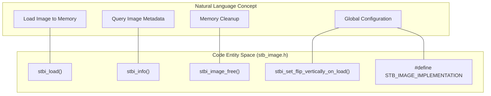
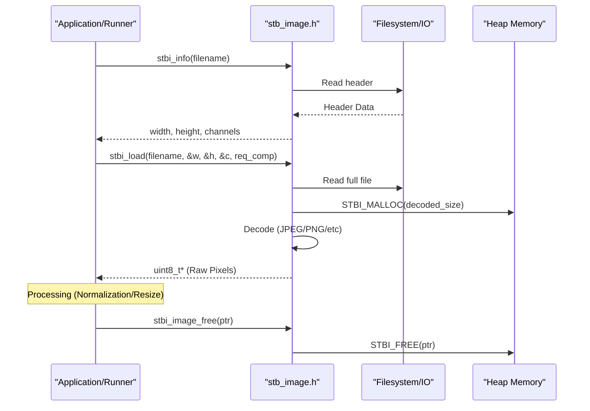

<!-- source: DeepWiki mcp.deepwiki.com · repo NVIDIA/TensorRT-Edge-LLM · extra page stb_image Library · fetched 2026-10-26 -->

# stb_image Library

<details>
<summary>Relevant source files</summary>

The following files were used as context for generating this wiki page:

- [3rdParty/stb/stb_image.h](3rdParty/stb/stb_image.h)

</details>


## Purpose and Scope

This document provides reference documentation for the `stb_image` library, a third-party single-header image loading library integrated into TensorRT-Edge-LLM for multimodal processing. This page covers the library's role in loading image inputs for Vision-Language Models (VLMs), supported image formats, and technical implementation details within the `stb_image.h` header.

The library is primarily used to decode compressed image files (JPEG, PNG, etc.) into raw pixel buffers that can be subsequently processed by Vision Transformers (ViT) within the multimodal inference pipeline, such as those used in InternVL, Qwen-VL, and Phi-4-Multimodal.

Sources: [3rdParty/stb/stb_image.h:1-61](), [3rdParty/stb/stb_image.h:101-118]()

---

## Technical Overview

`stb_image` is a public domain, single-header C library (`stb_image.h`) that provides image loading functionality without external dependencies. In the TensorRT-Edge-LLM codebase, it is treated as a core dependency for all vision-related tasks, providing a lightweight alternative to larger libraries like OpenCV.

**Key Implementation Features:**
- **Single-header implementation**: The implementation is guarded by the `STB_IMAGE_IMPLEMENTATION` macro, which must be defined in exactly one C or C++ file [3rdParty/stb/stb_image.h:23-32]().
- **SIMD Acceleration**: Includes SIMD optimizations for x86/x64 (SSE2) and ARM (NEON), which is critical for performance on NVIDIA Jetson (Orin/Thor) and DRIVE platforms [3rdParty/stb/stb_image.h:59-59]().
- **Memory Management**: Allows overriding default allocation with `STBI_MALLOC`, `STBI_REALLOC`, and `STBI_FREE` to integrate with custom allocators if needed [3rdParty/stb/stb_image.h:35-35]().
- **Thread Safety**: Provides thread-local storage for failure reasons and configuration flags like vertical flipping, ensuring safety during concurrent inference requests [3rdParty/stb/stb_image.h:76-76]().

### Code Entity Mapping: Natural Language to Code Space

The following diagram maps high-level image loading concepts to the specific functions and macros defined in `stb_image.h`.



**Diagram: Mapping System Concepts to stb_image Code Entities**

Sources: [3rdParty/stb/stb_image.h:23-35](), [3rdParty/stb/stb_image.h:76-76](), [3rdParty/stb/stb_image.h:101-108]()

---

## Supported Image Formats

The library supports a wide array of formats relevant to VLM training and inference datasets. As of version 2.30, it continues to provide robust decoding for common formats.

| Format | Support Level | Technical Details |
| :--- | :--- | :--- |
| **JPEG** | Baseline & Progressive | 12 bpc/arithmetic not supported [3rdParty/stb/stb_image.h:42-42]() |
| **PNG** | 1/2/4/8/16-bit | Supports various bits-per-channel [3rdParty/stb/stb_image.h:43-43]() |
| **TGA** | Various | 16-bit TGA supported [3rdParty/stb/stb_image.h:94-94]() |
| **BMP** | Non-1bpp, Non-RLE | Standard bitmap support; 1-bit supported [3rdParty/stb/stb_image.h:46-46](), [3rdParty/stb/stb_image.h:83-83]() |
| **PSD** | Composited only | No extra channels, 8/16 bit [3rdParty/stb/stb_image.h:47-47]() |
| **GIF** | Static/Animated | Reports as 4-channel [3rdParty/stb/stb_image.h:49-49]() |
| **HDR** | Radiance rgbE | High Dynamic Range support [3rdParty/stb/stb_image.h:50-50]() |
| **PNM** | PPM and PGM | Binary format only; 16-bit support [3rdParty/stb/stb_image.h:52-52](), [3rdParty/stb/stb_image.h:73-73]() |

Sources: [3rdParty/stb/stb_image.h:38-53](), [3rdParty/stb/stb_image.h:70-95]()

---

## Data Flow and Integration

In the TensorRT-Edge-LLM pipeline, `stb_image` acts as the bridge between the filesystem and the `edgellmCore` tensor structures.

### Image Loading Flow



**Diagram: Image Loading Sequence and Memory Interaction**

### Key Functions and Parameters

- **`stbi_load`**: The primary entry point. It takes a filename and returns a pointer to the pixel data. The `desired_channels` (or `req_comp`) parameter allows the caller to force the output to a specific number of channels (e.g., forcing RGBA by passing 4) [3rdParty/stb/stb_image.h:40-49]().
- **`stbi_info`**: Used to pre-calculate buffer sizes or validate inputs before committing to a full decode by reading only the image header [3rdParty/stb/stb_image.h:73-73]().
- **`stbi_load_16` / `stbi_loadf`**: Variants for 16-bit integer or 32-bit float (HDR) data. As of v2.16, all functions have 16-bit variants to support high-precision vision tasks [3rdParty/stb/stb_image.h:84-84]().

Sources: [3rdParty/stb/stb_image.h:20-61](), [3rdParty/stb/stb_image.h:101-118]()

---

## Build and Configuration

To use `stb_image` in the project, the implementation must be instantiated in exactly one source file within the build system.

### Implementation Setup
In the chosen C++ file within the multimodal processing component:
```cpp
#define STB_IMAGE_IMPLEMENTATION
#include "stb_image.h"
```
[3rdParty/stb/stb_image.h:23-32]()

### SIMD and Optimization
The library automatically detects support for:
- **SSE2**: Enabled for x64 non-GCC compilers by default [3rdParty/stb/stb_image.h:89-89]().
- **NEON**: Supported for ARM-based edge devices like NVIDIA Orin/Thor, providing significant speedups for mobile/embedded inference [3rdParty/stb/stb_image.h:59-59]().
- General optimizations for performance were added in version 2.29 [3rdParty/stb/stb_image.h:71-71]().

### Error Handling
If a load fails, the functions return `NULL`. The specific reason for failure can be retrieved via `stbi_failure_reason()`. This is thread-safe as of version 2.24, allowing for robust error logging in multi-threaded server environments [3rdParty/stb/stb_image.h:76-76]().

Sources: [3rdParty/stb/stb_image.h:23-36](), [3rdParty/stb/stb_image.h:70-95]()

---

